# Plan and execute switching for planned work

`edu-ops-control-room-switching` · electric power distribution · distribution operations (system control) · part of `electric-distribution-utility`

Before a crew works on de-energized lines or station equipment, the control room must isolate it with a written switching order and hand the crew a work protection permit. A crew supervisor applies for protection, a switching planner writes the step-by-step order from the network model, a second operator checks it, and on the day a system operator directs field staff by radio through each step before issuing the permit and later restoring the system. Work is slow because orders wait in queues for writing, checking and weekly approval, and because a crew pulled to trouble or bad weather postpones the booked day. Errors are rare but serious: a missed back-feed or wrong device can injure a worker or drop customers.

| | |
|---|---|
| Unit of work | one switching order |
| Starts when | A crew supervisor applies for work protection for a job on the crew schedule. |
| Done when | The work is done under permit, the system is restored to normal, and the closed order and permit forms are filed; or the work is cancelled. |
| Organisation | A municipally owned Ontario distributor with about 350,000 customers, 91 substations and a 24-hour control room that controls all switching on its system. (571 employees, 2019-2022) |
| Volume | 350 cases a month (range 250 to 450) |

## Where it sits

- Starts with **crew_schedule** from ops-work-scheduling (100% of cases)
- Relies on **asset_register** from ae-records-gis (a standing input; it does not start a case)
- Sends **work_protection** to ops-overhead-construction (outcome: any)
- Sends **work_protection** to ops-underground-construction (outcome: any)
- Sends **work_protection** to ops-station-maintenance (outcome: any)
- Sends **work_protection** to ops-pole-replacement (outcome: any)
- Sends **work_protection** to ops-customer-isolations (outcome: any)
- Sends **switching_order** to ops-planned-outage-notice (outcome: any)

## Flow

```mermaid
flowchart TD
    s01["s01 Submit application for work protection<br/>Overhead lines supervisor"]
    s02{{"s02 Log request and check lead time<br/>Switching and outage planner"}}
    s03["s03 Study network and load transfer<br/>Switching and outage planner"]
    s04["s04 Write switching order<br/>Switching and outage planner"]
    s05{{"s05 Independently check switching order<br/>Distribution system operator  control room"}}
    s06{{"s06 Approve the week's switching plan<br/>Control room shift supervisor"}}
    s07["s07 Send outage details for customer notice<br/>Switching and outage planner"]
    s08{{"s08 Review order at start of work day<br/>Distribution system operator  control room"}}
    s09["s09 Crew confirms readiness and holds job briefing<br/>Power line technician  journeyperson"]
    s10["s10 Drive to the switching points<br/>Power line technician  journeyperson"]
    s11{{"s11 Direct switching step by step<br/>Distribution system operator  control room"}}
    s12["s12 Stop and revise the sequence<br/>Control room shift supervisor"]
    s13["s13 Operate devices and hang tags<br/>Power line technician  journeyperson"]
    s14["s14 Operate station equipment and hang tags<br/>Station electrician  power system electrician"]
    s15{{"s15 Test for potential and apply grounds<br/>Power line technician  journeyperson"}}
    s16["s16 Issue work protection permit<br/>Distribution system operator  control room"]
    s17["s17 Remove grounds and surrender permit<br/>Power line technician  journeyperson"]
    s18["s18 Direct restoration switching<br/>Distribution system operator  control room"]
    s19["s19 Close devices and remove tags<br/>Power line technician  journeyperson"]
    s20{{"s20 Confirm customers are back on<br/>Distribution system operator  control room"}}
    s21["s21 Close order and update network model<br/>Distribution system operator  control room"]
    s22["s22 Review completed orders and file records<br/>Switching and outage planner"]
    s01 --> s02
    s02 -->|"88%"| s03
    s02 -->|"12%"| s01
    s03 --> s04
    s04 --> s05
    s05 -->|"90%"| s06
    s05 -->|"10%"| s04
    s06 -->|"40%"| s07
    s06 -->|"60%"| s08
    s07 --> s08
    s08 -->|"88%"| s09
    s08 -->|"8%"| s06
    s08 -->|"4%"| end0
    s09 --> s10
    s10 --> s11
    s11 -->|"75%"| s13
    s11 -->|"20%"| s14
    s11 -->|"5%"| s12
    s12 --> s11
    s13 --> s15
    s14 --> s15
    s15 -->|"99%"| s16
    s15 -->|"1%"| s11
    s16 --> s17
    s17 --> s18
    s18 --> s19
    s19 --> s20
    s20 -->|"97%"| s21
    s20 -->|"3%"| s19
    s21 --> s22
    s22 --> end1
    end0(["cancelled"])
    end1(["completed"])
```

## Roles

| Role | Department | Layer | FTE on this process | Loaded cost per hour | Evidence |
|---|---|---|---:|---:|---|
| Overhead lines supervisor | Overhead Lines | supervisor | 0.6 | 80 CAD | C |
| Switching and outage planner | System Control Centre | senior specialist | 2.4 | 70 CAD | C |
| Distribution system operator (control room) | System Control Centre | individual contributor | 4.5 | 72 CAD | C |
| Control room shift supervisor | System Control Centre | supervisor | 0.4 | 85 CAD | C |
| Power line technician (journeyperson) | Overhead Lines | individual contributor | 15 | 65 CAD | C |
| Station electrician (power system electrician) | Stations and Protection and Control | individual contributor | 0.6 | 67 CAD | C |

## Steps

Hands-on time and the wait before each step show the most common value. Evidence tier A is a sourced number, B a sourced description, C the author's estimate.

| Step | Who | Kind | Hands-on | Wait before | Control | Evidence |
|---|---|---|---:|---:|---|---|
| **s01 Submit application for work protection.** The crew supervisor fills in the utility's application for work protection for a job on the coming schedule: location, equipment to be isolated, the crew's person in charge, date, start and end times, and whether customers can lose power. A sketch or design print is attached and the form is emailed or entered in the mobile workforce tool. | Overhead lines supervisor | drafting | 25 min | 1.0 d |  | B [guelph-hv] |
| **s02 Log request and check lead time.** The switching planner registers the application in the outage management system's planned-work list, checks that it arrived with enough lead time for customer notice, and looks for other orders booked on the same feeder or station that day. Incomplete or late applications go back to the supervisor. | Switching and outage planner | intake | 10 min | 12.0 h |  | C |
| **s03 Study network and load transfer.** The planner opens the network model in the GIS and OMS and recent feeder loading in SCADA to find the isolation points, decide whether load can be moved to a neighbouring feeder without overloading it, and identify any customers who will lose supply. Abnormal states left by earlier work are checked against the field. | Switching and outage planner | analysis | 25 min | 1.0 d |  | C |
| **s04 Write switching order.** The planner writes the switching order step by step: each switch or elbow to open, where to apply work permit tags and grounds, the permit to issue, and the reverse restoration steps. Repeat jobs start from a stored order; new ones are written from the single-line diagram. | Switching and outage planner | drafting | 30 min | 0 min |  | B [guelph-hv] |
| **s05 Independently check switching order.** A second qualified operator, often on a quieter night shift, traces every step of the order against the GIS map and single-line diagram, confirms that all sources into the work zone are opened and grounded, and initials the order. Errors send it back to the planner. | Distribution system operator (control room) | review | 15 min | 1.0 d | Check and recheck of switching orders by a second senior operator before use (controlling-authority practice under the Utility Work Protection Code) | B [guelph-hv] |
| **s06 Approve the week's switching plan.** The control room shift supervisor reviews all switching orders booked for the coming days in one sitting, looking for conflicts on the same feeders, load limits on hot days, and staffing on each shift. Orders that clash are moved and the planner is told. | Control room shift supervisor | approval | 6 min | 2.0 d | Control centre approval of planned switching before the work day | C |
| **s07 Send outage details for customer notice.** For orders that interrupt customers, the planner sends the affected customer list from the OMS, the date, time and expected length to the planned outage notice process so that customers get a call, email or text in advance. The order date is then fixed. | Switching and outage planner | communication | 12 min | 4.0 h |  | B [ho-planned] |
| **s08 Review order at start of work day.** On the booked day the system operator reads the order again, checks SCADA and the OMS for anything that has changed since it was written (a feeder on abnormal, a storm, high load) and confirms by radio that the crew is on site. Work is postponed when the system, weather or crew is not ready. | Distribution system operator (control room) | review | 12 min | 2.0 d |  | C |
| **s09 Crew confirms readiness and holds job briefing.** The line crew arrives at the site, holds its tailboard briefing on the hazards and the switching plan, and calls the control room to confirm it is ready, giving the name of the person in charge who will hold the permit. | Power line technician (journeyperson) | communication | 10 min | 30 min | Pre-job tailboard briefing (Electrical Utility Safety Rules) | C |
| **s10 Drive to the switching points.** Two line technicians drive the truck from the work site to each switch, elbow or recloser named in the order, which can be several kilometres apart on rural feeders. | Power line technician (journeyperson) | travel | 25 min | 0 min |  | C |
| **s11 Direct switching step by step.** The system operator reads each step to the field staff by radio, the field person repeats it back, operates the device and reports the time, and the operator updates the OMS and SCADA model and ticks the step off. Steps that do not match the field stop the sequence. | Distribution system operator (control room) | coordination | 35 min | 0 min | Utility Work Protection Code (IHSA) permit and tag system used by Ontario distributors with the Electrical Utility Safety Rules | B [guelph-hv] |
| **s12 Stop and revise the sequence.** When a device is not where the map shows it, is already open or will not operate, the shift supervisor stops the sequence, works out a safe alternative with the operator and approves the revised steps, which are recorded on the order before switching resumes. | Control room shift supervisor | judgment | 25 min | 10 min | Changes to a switching order need control-centre approval before execution | C |
| **s13 Operate devices and hang tags.** The line technicians open the switches or pull the elbows named in each step, check the open point visually, hang work permit tags on every isolating device and report each step back to the operator. | Power line technician (journeyperson) | physical | 35 min | 0 min | Utility Work Protection Code (IHSA) permit and tag system used by Ontario distributors with the Electrical Utility Safety Rules | B [guelph-hv] |
| **s14 Operate station equipment and hang tags.** A station electrician opens and racks out the breakers and switches in the substation named in the order, applies work permit tags and locks, and reports each step to the operator by radio or phone. | Station electrician (power system electrician) | physical | 40 min | 30 min | Utility Work Protection Code (IHSA) permit and tag system used by Ontario distributors with the Electrical Utility Safety Rules | B [guelph-hv] |
| **s15 Test for potential and apply grounds.** At the work location the crew tests the isolated conductors for voltage and applies protective grounds on both sides of the work zone. The Work Permit protects only the isolation; testing and grounding remain the crew's responsibility. | Power line technician (journeyperson) | physical | 20 min | 10 min | Test for absence of voltage and ground before work (Electrical Utility Safety Rules) | B [guelph-hv] |
| **s16 Issue work protection permit.** The operator issues the Work Permit by radio to the named person in charge, who writes it down, repeats it back and signs the permit form; the operator records the permit number, holder and time in the OMS and log. Only then may the crew start work. | Distribution system operator (control room) | approval | 10 min | 5 min | Utility Work Protection Code (IHSA) permit and tag system used by Ontario distributors with the Electrical Utility Safety Rules | B [guelph-hv], [ihsa-uwpc] |
| **s17 Remove grounds and surrender permit.** When the planned work is finished the person in charge checks that all workers are clear, the crew removes its grounds, and the holder calls the control room to surrender the permit, which the operator records. | Power line technician (journeyperson) | physical | 20 min | 5.0 h | Utility Work Protection Code (IHSA) permit and tag system used by Ontario distributors with the Electrical Utility Safety Rules | B [guelph-hv] |
| **s18 Direct restoration switching.** The operator cancels the permit and reads the restoration steps in reverse order, removing tags and closing devices, updating the OMS and SCADA model as each step is reported. | Distribution system operator (control room) | coordination | 25 min | 5 min | Utility Work Protection Code (IHSA) permit and tag system used by Ontario distributors with the Electrical Utility Safety Rules | B [guelph-hv] |
| **s19 Close devices and remove tags.** The field staff remove the work permit tags and close the devices in the order read by the operator, driving between points as needed, and confirm each step by radio. | Power line technician (journeyperson) | physical | 30 min | 0 min |  | B [guelph-hv] |
| **s20 Confirm customers are back on.** The operator checks SCADA feeder readings and the OMS for customers still shown off, and checks for calls, before closing the planned outage event. A missed device sends the field staff back. | Distribution system operator (control room) | validation | 8 min | 10 min |  | C |
| **s21 Close order and update network model.** The operator enters the actual switching times on the order, sets device states back to normal in the OMS, notes any abnormal state left for the GIS team, and files the order. | Distribution system operator (control room) | data entry | 12 min | 1.0 h |  | C |
| **s22 Review completed orders and file records.** Once a week the switching planner checks the completed orders and permit forms for missing signatures, times and tags returned, corrects the network model, and files the forms where they are kept for at least two years. | Switching and outage planner | review | 6 min | 3.0 d | Utility Work Protection Code rule 1.101: keep work protection forms and tags at least two years | B [ihsa-eusr] |

## Exceptions

| Exception | Share of cases | What happens |
|---|---:|---|
| Order returned at checking | 10% | The second operator finds a wrong device or missed back-feed and returns the order to the planner. |
| Postponed on the day | 8% | Weather, a crew pulled to trouble or an abnormal system state postpones the work; the order goes back into the weekly plan and customers may need a second notice. |
| Field does not match the order | 5% | A device is missing, already open or will not operate; the shift supervisor approves a revised sequence. |
| Station switching | 20% | Isolation is at a substation, so a station electrician on call operates breakers instead of the line crew. |

## Benchmarks

| Metric | Value | Unit | Population | Evidence |
|---|---|---|---|---|
| cycle_time_days | p50 13, p90 24 | calendar days from application for protection to filed order | Planned switching orders at a mid-size Ontario distributor, 2019-2022 | C |
| work_protection_record_retention | 2 | years | Ontario utilities using the Utility Work Protection Code | B [ihsa-eusr] |

## Pain points

- Orders wait for writing, independent checking and the weekly approval, so short-notice jobs cannot be isolated and crews are given other work. (steps s02, s05, s06; C)
- Postponements on the day (weather, trouble calls, abnormal system) waste the crew's set-up and may mean a second customer notice. (steps s08; C)
- The GIS model does not always match the field, which forces revisions during switching and is a safety risk. (steps s12, s21; C)

## Assumptions

- Loaded costs are taken from the organisation file (wage times 1.40 for benefits, pension, payroll taxes and overhead).
- Field switching is done by two line technicians from the crew that will do the work, using its bucket truck; on underground jobs a cable crew does the same steps at similar times.
- The time between permit issue and surrender is the planned work itself (another process); it is entered as the wait before the surrender step and is the main reason consoles and trucks are held for hours.
- Station switching is done by an on-call station electrician; about one order in five.
- lines-supervisor is not listed among this process's roles in the organisation file, but crew supervisors are the usual applicants for work protection; underground-supervisor and stations-supervisor apply in the same way for their jobs.
- Three switching planners cannot write 350 orders a month alone at more than an hour each; the night-shift system operators write and check simpler repeat orders, so their share of drafting is counted in the system operator FTE.
- Queue waits before the work day are modelled as adding to elapsed time; in practice the work date is booked when the application is made, so these waits are partly absorbed by the booking lead time. The day-of review wait is the remaining time to the booked date. The simulated median (about 15 days) is two days above the 13-day estimate for this reason, and the simulated p90 (about 20 days) is below the estimate because the model does not hold orders booked many weeks ahead for large capital jobs.

## Sources

- [guelph-hv] [5.1.5 High Voltage Electrical Systems (Physical Resources safety procedures)](https://www.pr.uoguelph.ca/node/210) (University of Guelph, 2026). Undated page; year is the access year. An Application for Work Protection goes to the controlling authority (the local hydro utility) ahead of the required date; the utility operator prepares the switching and a second senior operator checks and initials it; the operator switches as written on the Order to Operate, applies work permit tags at every isolating point and issues a Work Permit guaranteeing protection to a competent person; the person in charge on site verifies de-energization, applies grounds and locks out; the holder briefs workers before surrendering the permit.
- [ihsa-uwpc] [Important concepts for UWPC (IHSA Health and Safety Magazine, volume 23 issue 2)](https://www.ihsa.ca/IHSA-Health-Safety-Magazine/IHSAV232/Keys-to-the-Utility-Work-Protection-Code.aspx) (Infrastructure Health and Safety Association, 2026). Undated magazine page; year is the access year. The Utility Work Protection Code works with the Electrical Utility Safety Rules and uses a system of permits and tags to show when lines are isolated and safe to work on; people who issue permits or do the work must be trained and certified in the Code.
- [ihsa-eusr] [Electrical utility safety updates (IHSA Health and Safety Magazine, volume 24 issue 1)](https://www.ihsa.ca/IHSA-Health-Safety-Magazine/IHSAV241/EUSR.aspx) (Infrastructure Health and Safety Association, 2026). Undated magazine page (it says an updated UWPC will be released in 2024); year is the access year. Prepared work protection forms and tags must be kept for at least two years (UWPC rule 1.101); UWPC recertification every 27 months or earlier.
- [ho-planned] [Planned power outages](https://hydroottawa.com/en/community/planned-outages) (Hydro Ottawa, 2026). Customers affected by a planned outage receive advance notice by phone, email or text according to their MyAccount preferences, giving date, time and expected length; planned outages are for maintenance, upgrades and crew safety and are kept as short as possible.

Written by claude-opus on 2026-11-24.
