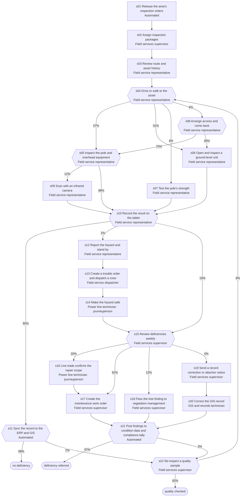

# Inspect overhead and underground plant

`edu-ops-distribution-inspection` · electric power distribution · distribution operations · part of `electric-distribution-utility`

Inspectors work through the utility's poles, pad-mounted transformers, switchgear and vaults on a fixed multi-year cycle, looking for rot, leaning poles, broken hardware, oil leaks, damaged or open enclosures and hot connections, and a share of poles get a strength test each year. Each asset gets a record on a tablet with photos and a priority; urgent hazards go straight to the control room for a line crew, and other deficiencies are reviewed weekly by the field services supervisor and turned into maintenance work orders, tree trimming requests or record corrections. The work is high volume and repetitive, so the slow parts are getting to every asset in the cycle (back-lot poles, locked yards, snow) and the weekly batch review of findings, and the common errors are wrong asset numbers and inconsistent priorities.

| | |
|---|---|
| Unit of work | one asset inspected (a pole with its overhead equipment, or one ground-level unit such as a pad-mounted transformer, switchgear or vault) |
| Starts when | The asset's area comes due in the multi-year inspection plan and its inspection work order is released. |
| Done when | The inspection record is in the ERP and GIS, and any deficiency has been made safe or passed on as a maintenance work order, a trimming request or a record correction. |
| Organisation | A city-owned Ontario electricity distributor with about 350,000 customers, 49,000 poles and about 39,000 to 47,000 distribution transformers over 1,116 km2. (571 employees, 2019-2022) |
| Volume | 2,500 cases a month (range 1,900 to 3,100) |

## Where it sits

- Starts with **capital_plan** from ae-capital-plan (100% of cases)
- Relies on **asset_register** from ae-records-gis (a standing input; it does not start a case)
- Sends **maintenance_work_order** to ops-work-scheduling (outcome: deficiency referred)
- Sends **inspection_findings** to ae-asset-condition-assessment (outcome: any)
- Sends **esa_report** to corp-public-safety-compliance (outcome: any)
- Sends **inspection_findings** to ops-vegetation-management (outcome: deficiency referred)
- Sends **inspection_findings** to ae-records-gis (outcome: deficiency referred)
- Sends **attachment_transfer_notice** to telecom-attacher (outcome: deficiency referred)

## Flow

## Roles

| Role | Department | Layer | FTE on this process | Loaded cost per hour | Evidence |
|---|---|---|---:|---:|---|
| Field service representative | Field Services | individual contributor | 5.2 | 50 CAD | C |
| Field services supervisor | Field Services | supervisor | 0.9 | 72 CAD | C |
| Power line technician (journeyperson) | Overhead Lines | individual contributor | 0.8 | 65 CAD | C |
| Field service dispatcher | Work Planning and Dispatch | individual contributor | 0.05 | 50 CAD | C |
| GIS and records technician | Standards and Records | individual contributor | 0.1 | 50 CAD | C |

## Steps

Hands-on time and the wait before each step show the most common value. Evidence tier A is a sourced number, B a sourced description, C the author's estimate.

| Step | Who | Kind | Hands-on | Wait before | Control | Evidence |
|---|---|---|---:|---:|---|---|
| **s01 Release the area's inspection orders.** At the start of the year the ERP generates inspection work orders for every asset in the areas due under the multi-year plan, and they are released to the field services backlog area by area through the year. | Automated | system auto | 0 min | 0 min |  | B [ho_grid2024] |
| **s02 Assign inspection packages.** The field services supervisor groups orders into packages of a few hundred assets by area and type, assigns them to inspectors with a due date and pushes them to the tablets; the minutes shown are one asset's share of that work. | Field services supervisor | coordination | 0.3 min | 2.0 d |  | C |
| **s03 Review route and asset history.** The inspector opens the package map on the tablet, checks the previous inspection result and open deficiencies for each asset and plans a driving route for the day. | Field service representative | lookup | 0.5 min | 5.0 d |  | C |
| **s04 Drive or walk to the asset.** The inspector drives along the line or between subdivision pad-mounts, parks and walks to the asset, including back-lot poles reached through yards. | Field service representative | travel | 2.5 min | 0 min |  | C |
| **s05 Inspect the pole and overhead equipment.** The inspector checks the pole for lean, rot, woodpecker and vehicle damage, then looks up at crossarms, insulators, transformer, arresters, guys and anchors, conductors and clearances, and tree contact, using binoculars. | Field service representative | physical | 3 min | 0 min |  | B [ho_grids2024], [ho_grid2024] |
| **s06 Open and inspect a ground-level unit.** The inspector checks that the pad-mounted transformer, switchgear or vault is locked and intact, opens it where the procedure allows, looks for oil leaks, corrosion, damaged elbows and animal entry, checks the pad and clearances around doors, and relocks it. | Field service representative | physical | 10 min | 0 min | Approach distances and procedure for opening energized pad-mounted equipment (IHSA Electrical Utility Safety Rules) | B [ho_grids2024] |
| **s07 Test the pole's strength.** The inspector sounds the pole with a hammer, bores or uses a resistance drill at ground line, measures circumference and remaining shell, and records whether the pole passes, needs reinforcement or must be replaced. | Field service representative | physical | 25 min | 0 min |  | B [ho_grids2024], [ho_grid2024] |
| **s08 Arrange access and come back.** When a back-lot pole or a unit in a fenced yard cannot be reached, the inspector leaves a card or phones the owner, and returns on an agreed day or when the obstacle is gone. | Field service representative | communication | 5 min | 7.0 d |  | C |
| **s09 Scan with an infrared camera.** On infrared routes the inspector scans connectors, transformer bushings, cutouts and switches with a thermal camera while the line is loaded and records any connection hotter than its neighbours. | Field service representative | physical | 4 min | 0 min |  | C |
| **s10 Record the result on the tablet.** The inspector confirms the asset number against the tag, ticks the checklist, attaches photos, and for each deficiency picks a code and a priority (urgent, within 30 days, within a year, monitor). | Field service representative | data entry | 1.5 min | 0 min | Inspection records kept under the Distribution System Code inspection requirements and Ontario Regulation 22/04 | C |
| **s11 Sync the record to the ERP and GIS.** When the tablet next connects, the mobile workforce application posts the inspection result to the ERP work order and the GIS asset, and the order closes automatically if there is no deficiency. | Automated | system auto | 0 min | 1.0 h |  | C |
| **s12 Report the hazard and stand by.** For a broken pole, a low or damaged conductor, an open or damaged pad-mount, or a tree on a line, the inspector phones the dispatcher with the location and asset number and stays to keep the public away until a crew arrives. | Field service representative | communication | 20 min | 0 min | Public safety hazards guarded until made safe (utility public safety policy under Ontario Regulation 22/04) | C |
| **s13 Create a trouble order and dispatch a crew.** The dispatcher enters the hazard as a trouble order in the outage management system, chooses the nearest available crew or trouble truck and phones them the details. | Field service dispatcher | coordination | 5 min | 5 min |  | C |
| **s14 Make the hazard safe.** A two-person line crew drives to the site, secures or temporarily supports the pole, closes or replaces the enclosure lock, or cuts the line clear, and passes permanent repair back as a work order. | Power line technician (journeyperson) | physical | 1.0 h | 2.0 h | Pre-job hazard assessment and approach distances (IHSA Electrical Utility Safety Rules) | C |
| **s15 Review deficiencies weekly.** Each week the field services supervisor exports the new deficiencies, looks at photos, corrects codes and priorities, removes duplicates of open work orders, and decides where each one goes. | Field services supervisor | review | 3 min | 3.0 d | Supervisor review of inspection priorities (maintenance policy) | C |
| **s16 Line trade confirms the repair scope.** A journeyperson line trade reviews the photos, and visits the site when photos are not enough, to say what repair, materials and equipment are needed and whether an outage is required. | Power line technician (journeyperson) | judgment | 20 min | 3.0 d |  | C |
| **s17 Create the maintenance work order.** The supervisor creates a corrective maintenance work order in the ERP with the asset, priority, description and photos and sends it to work planning for scheduling. | Field services supervisor | data entry | 6 min | 0 min |  | C |
| **s18 Pass the tree finding to vegetation management.** For tree contact or vegetation encroachment, the supervisor emails the finding with the span, photos and priority to the vegetation coordinator for an urgent or cycle trim. | Field services supervisor | communication | 4 min | 0 min |  | C |
| **s19 Send a record correction or attacher notice.** When the asset in the field does not match the GIS (wrong size, wrong location, missing unit), the supervisor sends a correction request to the records group; for sagging or non-standard telecom attachments, a notice goes to the attacher. | Field services supervisor | communication | 10 min | 0 min |  | C |
| **s20 Correct the GIS record.** A GIS technician checks the as-built drawings, updates the asset's attributes or location in the GIS and closes the correction request. | GIS and records technician | data entry | 20 min | 5.0 d |  | C |
| **s21 Post findings to condition data and compliance tally.** The ERP links the deficiency to the asset and the asset condition data, and the inspection counts roll into the cycle compliance tally used for the annual regulatory audit and the asset condition assessment. | Automated | system auto | 0 min | 0 min |  | B [esa_util] |
| **s22 Re-inspect a quality sample.** The supervisor re-inspects a small random sample of completed assets in the field and compares the result with the inspector's record; disagreements are discussed with the inspector and the asset is re-inspected. | Field services supervisor | review | 15 min | 5.0 d | Annual audit of distributor compliance under Ontario Regulation 22/04 section 13 | B [esa_util] |

## Exceptions

| Exception | Share of cases | What happens |
|---|---:|---|
| Urgent hazard | 1% | A broken pole, low wire, open pad-mount or tree on a line is guarded and made safe the same day before the permanent repair is planned. |
| No access | 4% | Back-lot poles and fenced units need the owner's cooperation, which adds days to weeks. |
| Record mismatch | 1% | The asset in the field does not match the GIS and the record is corrected. |

## Benchmarks

| Metric | Value | Unit | Population | Evidence |
|---|---|---|---|---|
| pole_test_interval_years | 10 | years | Hydro Ottawa, 49,000 poles | A [ho_grids2024] |
| equipment_inspection_cycle_years | 3 | years | Hydro Ottawa transformers, switches and breakers | A [ho_grid2024] |
| cycle_time_days | p50 14, p90 35 | calendar days from release of the asset's package to record closed or deficiency referred | Author's estimate | C |

## Pain points

- Deficiencies wait for a weekly batch review and are re-typed as ERP work orders, so a 30-day priority can lose a week before planning sees it. (steps s15, s17; C)
- Back-lot poles and fenced or snow-covered units are hard to reach, which delays completing each year's share of the cycle. (steps s04, s07, s08; C)
- Different inspectors rate the same defect differently, so supervisors re-code priorities and re-inspect samples. (steps s10, s15, s22; C)

## Assumptions

- One case is one asset: a pole with its overhead equipment, or one ground-level unit. Pole-mounted transformers are inspected with their pole.
- The 2024 Hydro Ottawa sources (three-year equipment cycle, 10-year pole tests, about 38,946 transformers inspected) are assumed to describe practice in 2019-2022. The OEB Distribution System Code Appendix C table could not be read and is not cited.
- Inspections are done by field service representatives, as the organisation file implies. At about 2,500 assets a month they need about 5 to 5.5 FTE, more than half of the eight-person group; many Ontario distributors use dedicated inspectors or contractors for this work.
- Infrared scanning of overhead lines is shown on about 12% of pole visits; satellite and remote sensing came after the reference period and are not modelled.
- The weather wait on pole testing (s07) has a mode of zero and a long tail for assets that fall due in deep winter.
- Urgent hazards are shown as made safe by a two-person line crew with a bucket truck; permanent repairs are separate work orders in other processes.

## Sources

- [ho_grid2024] [An in-depth look at Hydro Ottawa's grid maintenance](https://hydroottawa.com/en/blog/depth-look-hydro-ottawas-grid-maintenance) (Hydro Ottawa, 2024). Routine inspections of transformers, switches and breakers follow a three-year cycle across the service territory; a critical pole program tests thousands of poles a year; maintenance holes are graded A to E; work often needs the area de-energized, which may need a planned outage; vegetation management units are on two- or three-year cycles; satellite imaging twice a year (introduced after the reference period).
- [ho_grids2024] [With great grids comes great reliability](https://hydroottawa.com/en/blog/great-grids-comes-great-reliability) (Hydro Ottawa, 2024). All 49,000 poles are inspected at 10-year intervals; 38,946 transformers are regularly inspected; crews trim more than 60,000 trees in a typical year; customers get 24 to 72 hours notice of planned outages, with letters for outages over six hours.
- [esa_util] [Utilities: Electrical Distribution Safety regulation and technical guidelines](https://esasafe.com/utilities/) (Electrical Safety Authority, 2025). Ontario Regulation 22/04 section 13 requires an annual audit of distributor compliance with sections 4 to 8 and section 14 an annual declaration of compliance; distributors must notify ESA of a serious electrical incident within 48 hours; construction must be inspected and certified safe before use.

Written by claude-opus on 2026-11-24.
