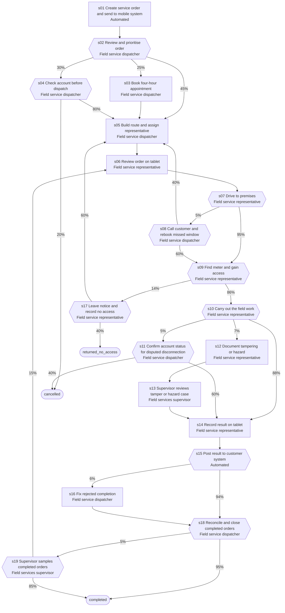

# Carry out field service orders

`edu-ops-field-service-orders` · electric power distribution · distribution operations (field services) · part of `electric-distribution-utility`

Field service representatives visit customer premises to disconnect and reconnect service for non-payment and moves where the meter cannot be switched remotely, investigate high bills and voltage complaints, check suspected tampering and do service checks. A dispatcher triages orders from the customer system, checks disconnection orders against the account and OEB rules, books four-hour appointments where the customer must be present and builds daily routes. Work is slowed by travel across a large territory, no-access visits and last-minute payments that cancel disconnections; reconnections and appointments have regulatory time standards.

| | |
|---|---|
| Unit of work | one field service order |
| Starts when | Collections, move-in and move-out, billing, metering or the contact centre creates a field service order in the CIS. |
| Done when | The field work is done and the result is posted to the customer account, or the order is cancelled or returned after failed access. |
| Organisation | A municipally owned Ontario distributor with about 350,000 customers and a small field services group working from the customer system and a mobile workforce tool. (571 employees, 2019-2022) |
| Volume | 1,300 cases a month (range 900 to 1,800) |

## Where it sits

- Starts with **disconnect_order** from cs-collections (35% of cases)
- Starts with **disconnect_order** from cs-move-in-move-out (20% of cases)
- Starts with **customer_inquiry** from cs-contact-centre (20% of cases)
- Starts with **read_exception** from cs-meter-data-management (15% of cases)
- Starts with **meter_order** from cs-billing-exceptions (10% of cases)
- Sends **field_result** to cs-collections (outcome: completed)
- Sends **field_result** to cs-billing-exceptions (outcome: completed)
- Sends **field_result** to cs-meter-data-management (outcome: completed)
- Sends **field_result** to cs-collections (outcome: returned_no_access)
- Sends **time_record** to fin-payroll (outcome: any)

## Flow

## Roles

| Role | Department | Layer | FTE on this process | Loaded cost per hour | Evidence |
|---|---|---|---:|---:|---|
| Field service representative | Field Services | individual contributor | 8 | 50 CAD | C |
| Field service dispatcher | Work Planning and Dispatch | individual contributor | 2 | 50 CAD | C |
| Field services supervisor | Field Services | supervisor | 0.4 | 72 CAD | C |

## Steps

Hands-on time and the wait before each step show the most common value. Evidence tier A is a sourced number, B a sourced description, C the author's estimate.

| Step | Who | Kind | Hands-on | Wait before | Control | Evidence |
|---|---|---|---:|---:|---|---|
| **s01 Create service order and send to mobile system.** An order raised in the customer information system by collections, move-in and move-out, billing or the contact centre is passed by the interface to the mobile workforce system with the account, meter number, order type and due date. | Automated | system auto | 0 min | 30 min |  | C |
| **s02 Review and prioritise order.** The field service dispatcher opens new orders, checks the type, due date and any safety or access notes on the premise, and sorts them: reconnections due within two business days first, appointments next, then disconnections and investigations. | Field service dispatcher | intake | 3 min | 4.0 h |  | B [oeb-rules] |
| **s03 Book four-hour appointment.** For orders where the customer must be present (meter access inside, high-bill investigation, reconnection that needs entry), the dispatcher calls the customer and books a four-hour window, recording it in the mobile system so the route respects it. | Field service dispatcher | communication | 6 min | 2.0 h |  | C |
| **s04 Check account before dispatch.** For disconnection orders the dispatcher checks the account in the CIS the evening before or morning of the visit: whether the customer has paid, made an arrears agreement, or has a social agency assessment or medical certificate pending, and whether the winter ban applies. Orders no longer valid are cancelled. | Field service dispatcher | lookup | 2 min | 12.0 h | OEB Distribution System Code disconnection rules (notice periods, winter ban, agency and medical holds) | B [oeb-rules] |
| **s05 Build route and assign representative.** The dispatcher groups the day's orders by area in the mobile workforce system, fits appointment windows, balances work across the field service representatives on shift and pushes each route to the reps' tablets. | Field service dispatcher | coordination | 3 min | 12.0 h |  | C |
| **s06 Review order on tablet.** At the start of the day or between jobs the representative reads the order on the tablet: meter location, prior visits, access codes, dog or hazard warnings and what result is needed. | Field service representative | review | 2 min | 8.0 h |  | C |
| **s07 Drive to premises.** The representative drives the light vehicle to the premises, often across suburban and rural parts of a 1,116 km2 service area between urban jobs. | Field service representative | travel | 20 min | 0 min |  | C |
| **s08 Call customer and rebook missed window.** When a representative will miss a four-hour window, the dispatcher calls the customer to warn them and either confirms a later arrival or rebooks the appointment, which counts against the appointments-met measure. | Field service dispatcher | communication | 5 min | 15 min |  | C |
| **s09 Find meter and gain access.** The representative locates the meter, knocks or meets the customer for appointments, and deals with locked gates, dogs, blocked meter rooms or no one home. | Field service representative | physical | 5 min | 0 min |  | C |
| **s10 Carry out the field work.** Depending on the order the representative removes the meter or fits a disconnect collar, reinstalls the meter to reconnect, reads and inspects the meter and seals, measures voltage at the meter base, or checks for diversion or damage. Photos are taken of the meter and reading. | Field service representative | physical | 12 min | 0 min | Utility safe work practice for meter removal and meter-base work: arc-rated PPE and inspection of the meter base before pulling or setting a meter | C |
| **s11 Confirm account status for disputed disconnection.** When a customer at the door says they have paid, the representative calls the dispatcher, who checks the CIS for a payment or agreement posted that day; the disconnection goes ahead or is cancelled. | Field service dispatcher | communication | 5 min | 5 min |  | B [oeb-rules] |
| **s12 Document tampering or hazard.** The representative photographs broken seals, jumpers or a damaged meter base, records the condition and makes the site safe or calls for a trouble crew if there is an immediate hazard. | Field service representative | drafting | 20 min | 0 min |  | C |
| **s13 Supervisor reviews tamper or hazard case.** The field services supervisor reviews the report and photos, decides whether to refer the account for back-billing or to the police, arranges any meter change, and records the outcome before the order is completed. | Field services supervisor | judgment | 20 min | 1.0 d |  | C |
| **s14 Record result on tablet.** The representative enters the completion code, reading, seal numbers and notes on the tablet, attaches photos, and records time and mileage for the visit. | Field service representative | data entry | 4 min | 0 min |  | C |
| **s15 Post result to customer system.** The mobile system sends the completion back to the CIS, which updates the meter status, posts the reading and triggers billing, collections or move-in and move-out follow-up. | Automated | system auto | 0 min | 30 min |  | C |
| **s16 Fix rejected completion.** The dispatcher reads the interface error (meter number mismatch, reading out of range, order already closed), corrects the completion in the CIS by hand or asks the representative for the missing detail. | Field service dispatcher | data entry | 8 min | 12.0 h |  | C |
| **s17 Leave notice and record no access.** The representative leaves a door card asking the customer to call, photographs the obstacle and records a no-access completion. The order is re-routed for another attempt or returned to the originating group after repeated failures. | Field service representative | drafting | 4 min | 0 min |  | C |
| **s18 Reconcile and close completed orders.** Each afternoon the dispatcher compares routed orders with completions, chases representatives for missing results, checks reconnections and appointments against their standards, and closes the orders. | Field service dispatcher | validation | 2 min | 4.0 h | OEB service quality reporting: appointments met and reconnections within the required time | C |
| **s19 Supervisor samples completed orders.** Each week the supervisor reviews a sample of about one completion in twenty, checking readings and photos for wrong readings, missing seals and orders closed without the work being done, and sends errors back for a revisit. | Field services supervisor | review | 5 min | 2.0 d | Supervisor quality sampling of field completions | C |

## Exceptions

| Exception | Share of cases | What happens |
|---|---:|---|
| Disconnection cancelled before the visit | 6% | The customer pays, makes an arrears agreement or an agency hold is placed before the visit. |
| No access | 14% | Locked gate, dog, blocked meter room or no one home for an appointment; a door card is left and the order re-routed or returned. |
| Tampering or hazard found | 6% | Broken seals, jumpers or a damaged meter base; the supervisor decides on back-billing, police referral or a meter change. |
| Missed appointment window | 5% | The representative runs late and the dispatcher warns or rebooks the customer. |

## Benchmarks

| Metric | Value | Unit | Population | Evidence |
|---|---|---|---|---|
| cycle_time_days | p50 2, p90 6 | calendar days from order creation to result posted | Field service orders at a mid-size Ontario distributor, 2019-2022 | C |
| reconnection_time_limit | 2 | business days after payment or arrears agreement | Ontario electricity distributors | B [oeb-rules] |
| disconnection_notice_period | 14 | days' notice before disconnection for non-payment (60 with medical documentation) | Ontario electricity distributors | B [oeb-rules] |

## Pain points

- Many disconnection visits are wasted because the customer pays on the day or at the door. (steps s04, s11; B [oeb-rules])
- No-access visits need repeat trips across a large territory. (steps s09, s17; C)
- Completions rejected by the CIS interface are fixed by hand. (steps s16; C)

## Assumptions

- Loaded costs are taken from the organisation file (wage times 1.40 for benefits, pension, payroll taxes and overhead).
- Most residential meters of the period needed a visit to disconnect or reconnect; where remote switching was available those orders do not reach this process.
- Disconnection orders are worked within the 14-day window after the notice period; the account check and route waits represent that spread.
- Order mix: about 35% collections disconnections and reconnections, 20% move orders, 20% customer inquiries (high bill, voltage), 15% read exceptions, 10% billing meter orders.
- Staffing gap: the simulated hands-on time implies about 13 FTE in total against 9.4 stated; the representatives' share (about 10 FTE) exceeds the eight in the organisation file. Representative minutes per visit were kept because travel in a 1,116 km2 territory is hard to reduce; the order volume (an organisation file estimate) may be high.
- The four-hour appointment window and the 90% appointments-met standard are taken from the organisation file; the Distribution System Code page could not be opened in this session.

## Sources

- [oeb-rules] [Rules for electricity utilities](https://www.oeb.ca/consumer-information-and-protection/oebs-consumer-protection-role/rules-electricity-utilities) (Ontario Energy Board, 2026). Overdue notice at least 7 days before a disconnection notice; at least 14 days' notice (60 with a doctor's letter); disconnection any time in the following 14 days; a last contact attempt at least 48 hours before; staff available to take payment; winter ban for residential non-payment disconnection from November 15 to April 30 with reconnection by December 1; reconnection generally within 2 business days of payment or an arrears agreement; up to 21 days' delay while an agency checks low-income assistance eligibility.
- [oeb-ban-2022] [End of Disconnection Ban (news release, April 18, 2022)](https://www.oeb.ca/newsroom/2022/end-disconnection-ban) (Ontario Energy Board, 2022). The winter disconnection ban runs November 15 to April 30 and was coming to an end in 2022; distributors must follow a step-by-step notice process before disconnecting for non-payment.

Written by claude-opus on 2026-11-24.
