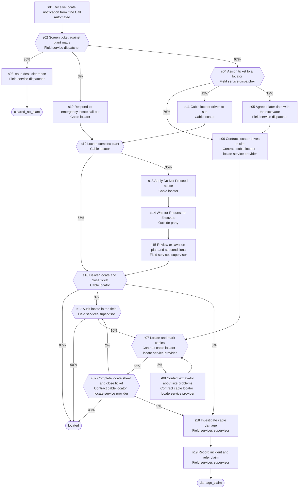

# Locate underground plant for excavators

`edu-ops-locates` · electric power distribution · distribution operations (field services) · part of `electric-distribution-utility`

Anyone who digs in Ontario must request a locate through Ontario One Call, which sends the request to every utility with plant nearby. The utility screens each ticket against its maps, clears those with no cables in the dig area, and has a locator mark the rest with paint and flags within five business days, using contract locators for routine tickets and its own cable locators for high-voltage and complex plant. Spring and summer volumes exceed capacity, so tickets queue and late locates hold up excavators and the utility's own crews. Mismarked or missed cables lead to strikes, outages and safety incidents.

| | |
|---|---|
| Unit of work | one locate request |
| Starts when | Ontario One Call transmits a locate request for a dig area that touches the utility's registered area. |
| Done when | The excavator has a clearance or a marked locate with a locate sheet; or a damage that followed a locate has been investigated and referred. |
| Organisation | A municipally owned Ontario distributor with about 350,000 customers and 3,167 km of underground circuit, whose locates are mostly delivered by a contract locate provider. (571 employees, 2019-2022) |
| Volume | 7,500 cases a month (range 4,500 to 12,000) |

## Where it sits

- Starts with **locate_request** from ontario-one-call (97% of cases)
- Starts with **locate_request** from ops-work-scheduling (3% of cases)
- Sends **locate_result** to excavator (outcome: located)
- Sends **locate_result** to excavator (outcome: cleared_no_plant)
- Sends **locate_result** to ops-overhead-construction (outcome: located)
- Sends **locate_result** to ops-underground-construction (outcome: located)
- Sends **locate_result** to ops-pole-replacement (outcome: located)
- Sends **locate_result** to ops-cable-fault-repair (outcome: located)
- Sends **legal_claim** to corp-legal-claims (outcome: damage_claim)
- Sends **safety_incident** to corp-health-safety (outcome: damage_claim)

## Flow

## Roles

| Role | Department | Layer | FTE on this process | Loaded cost per hour | Evidence |
|---|---|---|---:|---:|---|
| Field service dispatcher | Work Planning and Dispatch | individual contributor | 3.5 | 50 CAD | C |
| Contract cable locator (locate service provider) | Locate service provider (contracted) | individual contributor | 38 | 50 CAD | C |
| Cable locator | Field Services | individual contributor | 9 | 45 CAD | C |
| Field services supervisor | Field Services | supervisor | 1.2 | 72 CAD | C |

## Steps

Hands-on time and the wait before each step show the most common value. Evidence tier A is a sourced number, B a sourced description, C the author's estimate.

| Step | Who | Kind | Hands-on | Wait before | Control | Evidence |
|---|---|---|---:|---:|---|---|
| **s01 Receive locate notification from One Call.** Ontario One Call transmits each locate request whose dig area touches the utility's registered area to the utility's locate management system, with the excavator, address, dig area description, type of work and requested start date. | Automated | system auto | 0 min | 0 min |  | B [ho-locates] |
| **s02 Screen ticket against plant maps.** A dispatcher opens the ticket map and the GIS underground layer side by side and decides whether the dig area is clear of the utility's cables, needs a field locate, or is an emergency. Large or vague dig areas are flagged for a call to the excavator. | Field service dispatcher | lookup | 2 min | 2.0 h | Ontario Underground Infrastructure Notification System Act, 2012: members must respond to every locate request within the set time | C |
| **s03 Issue desk clearance.** For tickets with no utility plant in the dig area the dispatcher sends the excavator a clearance notice by email or fax from the locate system and closes the ticket as cleared in the One Call portal. | Field service dispatcher | communication | 2 min | 30 min |  | B [ho-locates] |
| **s04 Assign ticket to a locator.** The dispatcher bundles tickets by area and due date and assigns routine ones to the contract locate provider and complex ones (high-voltage duct banks, downtown network, large projects) to the utility's own cable locators. Tickets that cannot be done by the due date are flagged. | Field service dispatcher | coordination | 1 min | 4.0 h |  | C |
| **s05 Agree a later date with the excavator.** When the locate cannot be done by the due date the dispatcher calls the excavator to agree a new date or a partial locate for the first phase of work, and records the agreement on the ticket to avoid a late-locate complaint. | Field service dispatcher | communication | 6 min | 1.0 h |  | B [renew-locates] |
| **s06 Contract locator drives to site.** When the ticket reaches the top of the contractor's route, a contract locator drives to the dig site, usually doing several tickets in one neighbourhood in a day. | Contract cable locator (locate service provider) | travel | 18 min | 3.0 d |  | C |
| **s07 Locate and mark cables.** The locator connects a transmitter to the cable or uses induction, traces the cable with a receiver across the dig area, compares the signal with the utility's map, and marks the route with red paint and flags. Unclear dig areas or blocked access stop the locate. | Contract cable locator (locate service provider) | physical | 25 min | 0 min | Locate marking practice under CSA Z247 damage prevention guidance and the utility's locate standard (paint and flags within the locate tolerance zone) | B [ho-locates] |
| **s08 Contact excavator about site problems.** The locator calls the excavator about a missing white-lined area, a locked yard or a dig area too large to locate in one visit, and arranges to come back once the site is accessible. | Contract cable locator (locate service provider) | communication | 8 min | 1.0 d |  | C |
| **s09 Complete locate sheet and close ticket.** The locator fills in the locate sheet with a sketch, measurements from fixed features and validity period, leaves it at the site or emails it to the excavator, and closes the ticket as located in the locate system. | Contract cable locator (locate service provider) | drafting | 7 min | 0 min |  | B [ho-locates] |
| **s10 Respond to emergency locate call-out.** For an emergency request (a water main break, gas leak or the utility's own cable fault) the on-call cable locator is called out and drives straight to the site, ahead of the routine queue. | Cable locator | travel | 25 min | 1.0 h |  | C |
| **s11 Cable locator drives to site.** A utility cable locator picks up complex tickets on the daily route (high-voltage feeders, duct banks, the downtown network, large construction projects) and drives to the site. | Cable locator | travel | 20 min | 2.0 d |  | C |
| **s12 Locate complex plant.** The cable locator traces feeders and duct banks with transmitter and receiver, checks vault and manhole positions against the GIS and as-built drawings, and marks the routes; for crowded or high-voltage areas they mark the area where excavation needs extra care. | Cable locator | physical | 40 min | 0 min | Locate marking practice under CSA Z247 damage prevention guidance and the utility's locate standard (paint and flags within the locate tolerance zone) | B [ho-locates] |
| **s13 Apply Do Not Proceed notice.** Where high-voltage cables are close to the planned dig, the locator leaves a Do Not Proceed sticker or notice telling the excavator not to dig until the utility has reviewed a Request to Excavate. | Cable locator | drafting | 8 min | 0 min | Utility Do Not Proceed procedure for excavation near high-voltage cables | B [ho-locates] |
| **s14 Wait for Request to Excavate.** The excavator fills in the utility's Request to Excavate form with contact details, locate ticket number, exact address and a description of the planned excavation and sends it in. | Outside party | external wait | 0 min | 1.0 d |  | B [ho-locates] |
| **s15 Review excavation plan and set conditions.** The field services supervisor reviews the form against the cable records, decides whether a utility standby, hand digging, hydrovac or a cable outage is needed, and calls the excavator with the conditions. | Field services supervisor | judgment | 20 min | 1.0 d | Utility review of excavation near high-voltage cables before digging proceeds | B [ho-locates] |
| **s16 Deliver locate and close ticket.** The cable locator or supervisor completes the locate sheet with sketch and conditions, gives it to the excavator and closes the ticket in the locate system. | Cable locator | drafting | 8 min | 30 min |  | B [ho-locates] |
| **s17 Audit locate in the field.** The field services supervisor visits a sample of completed locates, mostly from the contractor, and checks the marks against a fresh trace and the locate sheet for accuracy and completeness. Errors are sent back for a re-mark and recorded against the contractor. | Field services supervisor | review | 25 min | 1.0 d | Utility audit of contract locate quality | C |
| **s18 Investigate cable damage.** When an excavator strikes a cable, after the trouble crew has made it safe, the supervisor visits the site, compares the marks and locate sheet with where the cable was hit, interviews the excavator and the locator and takes photos to decide whether the locate or the digging was at fault. | Field services supervisor | analysis | 2.0 h | 7.0 d |  | C |
| **s19 Record incident and refer claim.** The supervisor files the incident in the safety system and sends the investigation to legal and claims, who bill the excavator for repairs or handle a claim against the locate contractor. | Field services supervisor | drafting | 1.0 h | 1.0 d |  | C |

## Exceptions

| Exception | Share of cases | What happens |
|---|---:|---|
| Cannot meet the due date | 8% | The contractor queue is too long and the dispatcher agrees a later date with the excavator. |
| Site not ready | 5% | No white-lining, locked yard or dig area too large; the locator returns later. |
| Do Not Proceed near high-voltage cable | 3% | The excavator must send a Request to Excavate and wait for the utility's conditions. |
| Emergency locate | 3% | An on-call cable locator is called out ahead of the queue. |
| Cable strike after locate | 0% | A cable is struck during excavation; the supervisor investigates whether the locate or the digging was at fault and refers the claim. |

## Benchmarks

| Metric | Value | Unit | Population | Evidence |
|---|---|---|---|---|
| cycle_time_days | p50 5, p90 14 | calendar days from notification to clearance or delivered locate | Locate requests at a mid-size Ontario distributor, 2019-2022 | C |
| share_of_locates_late_ontario | 0.85 | share of requests later than five business days (upper figure quoted) | Ontario locate requests before the 2022 reforms | B [renew-locates] |
| share_of_tickets_over_15_days_ontario | 0.49 | share of tickets taking longer than 15 days | Ontario One Call data reported in 2022 | B [renew-locates] |

## Pain points

- Spring and summer volumes exceed locator capacity, so tickets queue past the five-business-day deadline and excavators and the utility's own crews wait. (steps s06, s05; B [renew-locates])
- Map errors and poor signals lead to mismarks found only by audit or by a cable strike. (steps s07, s17, s18; C)
- Excavation near high-voltage cables waits for a Request to Excavate and a supervisor review. (steps s13, s14, s15; B [ho-locates])

## Assumptions

- Loaded costs for utility staff are taken from the organisation file (wage times 1.40 for benefits, pension, payroll taxes and overhead); the contract locator cost is the author's estimate of contractor billing per hour.
- Most field locates are done by a contract locate provider. The organisation file describes in-house locators with contractor overflow, but ten in-house locators cannot mark about 5,000 field tickets a month at over an hour each (about 38 FTE of contract locators is implied); a search excerpt of a later Hydro Ottawa rate filing (not opened) said locates were done by external vendors.
- The wait before the contract locator's visit stands for the contractor's queue; it is the main source of elapsed time and is longer in the spring and summer peak than the annual triangle shows.
- Damage investigations start days to weeks after the locate, when the excavation happens; those cases have long cycle times but are rare.
- The five-business-day deadline is taken from Hydro Ottawa's contractor page; the statute page returned an access error.

## Sources

- [ho-locates] [Locates - safe digging (information for contractors)](https://hydroottawa.com/en/contractors/locates-safe-digging) (Hydro Ottawa, 2026). Locate requests go through Ontario One Call at least five business days before digging (ten for multi-address requests); colour-coded ground markings; stay 1.5 m from marked cables and hand dig or hydrovac near them; request a re-locate when marks are unclear or expire; near high-voltage cables Hydro Ottawa places a 'Do Not Proceed' sticker or notice, the excavator completes a Request to Excavate form, and Hydro Ottawa replies within 48 business hours.
- [renew-locates] [Industry group praises crucial reforms to Ontario's utility locates system](https://www.renewcanada.net/5000090925-2/) (ReNew Canada, 2022). Locates are legally due within five business days but 'as high as 85 per cent' of requests are late; Ontario One Call data showed 49 per cent of tickets took longer than 15 days; idle time costs about $1,000 an hour in sewer and watermain work; Bill 93 reforms (shared locates, 60-day minimum validity, dedicated locators).

Written by claude-opus on 2026-11-24.
