# Run storm and major event response

`edu-ops-major-event-response` · electric utilities: power distribution · distribution operations · part of `electric-distribution-utility`

When a storm, a lightning burst or the loss of a transmission supply knocks out power to many customers at once, the utility shifts from routine outage handling to a major event response. In most events the control room calls out the on-call roster and restores 90% of customers within hours; in a few it activates incident command, sends out damage assessors, brings in contractors and other utilities' crews and runs restoration in 12- to 16-hour periods for days. Afterwards the event is confirmed as a Major Event Day and reported to the OEB. It is hard because warnings are unreliable, damage is unknown for hours, and crews, material and public communications all have to scale at once.

| | |
|---|---|
| Unit of work | one major event |
| Starts when | A forecast severe storm, a sudden flood of SCADA alarms and outage calls, or a transmission supply loss that takes out many customers at once. |
| Done when | Customers are restored and the system is back to normal, outside crews are released, and the major event report is filed with the OEB and published. |
| Organisation | A city-owned Ontario electricity distributor with about 350,000 customers, a 24-hour system control centre, overhead and underground line crews and single-person trouble trucks, using SCADA, an outage management system, smart meters and mobile workforce tablets. (571 employees, 2019-2022) |
| Volume | 0.19 cases a month (range 0.1 to 0.35) |

## Where it sits

- Starts with **outage_event** from ops-system-monitoring (90% of cases)
- Starts with **outage_report** from hydro-one (10% of cases)
- Sends **major_event_declaration** to ops-outage-restoration (outcome: any)
- Sends **major_event_declaration** to corp-outage-communications (outcome: any)
- Sends **major_event_declaration** to fin-inventory-stores (outcome: any)
- Sends **interruption_data** to ae-reliability-analysis (outcome: report_filed)
- Sends **rrr_filing** to oeb (outcome: report_filed)
- Sends **mutual_aid_request** to mutual-aid-utility (outcome: any)
- Sends **mutual_aid_request** to contractor (outcome: any)

## Flow

```mermaid
flowchart TD
    s01{{"s01 Watch forecasts and supply alerts<br/>Distribution system operator  control room"}}
    s02["s02 Decide on pre-event standby<br/>Control room shift supervisor"]
    s03["s03 Arrange standby crews<br/>Overhead lines supervisor"]
    s04["s04 Outages flood the control room<br/>Automated"]
    s05{{"s05 Triage alarms and outages<br/>Distribution system operator  control room"}}
    s06["s06 Coordinate supply restoration with Hydro One<br/>Distribution system operator  control room"]
    s07["s07 Call out the on-call roster<br/>Control room shift supervisor"]
    s08{{"s08 Decide whether to activate incident command<br/>Manager, system control centre"}}
    s09["s09 Open the incident command centre<br/>Director, distribution operations"]
    s10["s10 Organise damage assessment<br/>Field services supervisor"]
    s11["s11 Patrol and record the damage<br/>Field service representative"]
    s12["s12 Set restoration priorities<br/>Manager, system control centre"]
    s13{{"s13 Decide on outside help<br/>Director, distribution operations"}}
    s14["s14 Request contractors and mutual aid<br/>Director, distribution operations"]
    s15["s15 Outside crews travel in<br/>Outside party"]
    s16["s16 Orient outside crews on safety rules<br/>Health and safety / environment advisor"]
    s17["s17 Stage material and supplies<br/>Stores attendant"]
    s18["s18 Publish restoration updates<br/>Communications advisor"]
    s19["s19 Run restoration from the control room<br/>Control room shift supervisor"]
    s20["s20 Direct one operational period<br/>Overhead lines supervisor"]
    s21{{"s21 Review progress and plan the next period<br/>Manager, system control centre"}}
    s22["s22 Return the system to normal<br/>Distribution system operator  control room"]
    s23{{"s23 Stand down and release crews<br/>Director, distribution operations"}}
    s24["s24 Hold the lessons-learned debrief<br/>Director, distribution operations"]
    s25["s25 Confirm the Major Event Day<br/>Regulatory analyst"]
    s26["s26 Draft the major event report<br/>Regulatory analyst"]
    s27{{"s27 Review the report<br/>Manager, system control centre"}}
    s28["s28 Approve the filing<br/>Vice-President  operations, engineering, customer service, finance, corporate services"]
    s29["s29 File with the OEB and publish<br/>Regulatory analyst"]
    s01 -->|"35%"| s02
    s01 -->|"65%"| s04
    s02 --> s03
    s03 --> s04
    s04 --> s05
    s05 -->|"55%"| s06
    s05 -->|"45%"| s07
    s06 --> s07
    s07 --> s08
    s08 -->|"33%"| s09
    s08 -->|"67%"| s19
    s09 --> s10
    s10 --> s11
    s11 --> s12
    s12 --> s13
    s13 -->|"35%"| s14
    s13 -->|"65%"| s17
    s14 --> s15
    s15 --> s16
    s16 --> s17
    s17 --> s18
    s18 --> s20
    s19 --> s22
    s20 --> s21
    s21 -->|"50%"| s20
    s21 -->|"50%"| s22
    s22 --> s23
    s23 -->|"40%"| s24
    s23 -->|"60%"| s25
    s24 --> s25
    s25 --> s26
    s26 --> s27
    s27 -->|"85%"| s28
    s27 -->|"15%"| s26
    s28 --> s29
    s29 --> end0
    end0(["report_filed"])
```

## Roles

| Role | Department | Layer | FTE on this process | Loaded cost per hour | Evidence |
|---|---|---|---:|---:|---|
| Distribution system operator (control room) | System Control Centre | individual contributor | 0.02 | 72 CAD | B [oakville-cro] |
| Control room shift supervisor | System Control Centre | supervisor | 0.03 | 85 CAD | C |
| Overhead lines supervisor | Overhead Lines | supervisor | 0.03 | 80 CAD | C |
| Manager, system control centre | System Control Centre | manager | 0.03 | 105 CAD | C |
| Director, distribution operations | Distribution Operations | director | 0.03 | 120 CAD | C |
| Field services supervisor | Field Services | supervisor | 0.01 | 72 CAD | C |
| Field service representative | Field Services | individual contributor | 0.03 | 50 CAD | C |
| Health and safety / environment advisor | Health, Safety and Environment | individual contributor | 0.01 | 65 CAD | C |
| Stores attendant | Supply Chain and Stores | individual contributor | 0.02 | 45 CAD | C |
| Communications advisor | Communications and Public Affairs | individual contributor | 0.02 | 60 CAD | C |
| Regulatory analyst | Regulatory Affairs | senior specialist | 0.02 | 66 CAD | B [me-index] |
| Vice-President (operations, engineering, customer service, finance, corporate services) | Office of the President and CEO | executive | 0.002 | 160 CAD | C |

## Steps

Hands-on time and the wait before each step show the most common value. Evidence tier A is a sourced number, B a sourced description, C the author's estimate.

| Step | Who | Kind | Hands-on | Wait before | Control | Evidence |
|---|---|---|---:|---:|---|---|
| **s01 Watch forecasts and supply alerts.** The system operator watches Environment Canada watches and warnings, the weather service feed and Hydro One notices of planned or forced supply outages, and tells the shift supervisor when severe wind, ice, lightning or a supply problem is expected. | Distribution system operator (control room) | lookup | 10 min | 0 min |  | B [me-2019-07], [me-2020-10], [me-2022-12], [me-2022-05], [me-2020-03], [me-2022-06] |
| **s02 Decide on pre-event standby.** The control room shift supervisor, with the on-call manager, decides how many line, cable and control staff to hold past the end of the day or bring in early, and whether contractors should be warned. | Control room shift supervisor | judgment | 20 min | 30 min |  | B [ho-blog-2020], [me-2019-07], [me-2022-12] |
| **s03 Arrange standby crews.** The lines supervisor phones crews to stay past shift or report early, moves trucks and material to the service centres closest to the expected damage and confirms the numbers to the control room. | Overhead lines supervisor | coordination | 45 min | 0 min |  | B [ho-blog-2020] |
| **s04 Outages flood the control room.** SCADA breaker lockouts and station alarms arrive together while the outage management system groups thousands of calls and smart meter last-gasp messages into predicted outages on the control room screens. | Automated | system auto | 0 min | 0 min |  | B [me-2022-05], [me-2019-04] |
| **s05 Triage alarms and outages.** Operators on every console sort SCADA lockouts, station and supply alarms and predicted outages, restore what remote switching can, flag wires down for the trouble trucks and estimate how many customers are out and where. | Distribution system operator (control room) | analysis | 1.0 h | 0 min | Utility Work Protection Code and Electrical Utility Safety Rules (IHSA), required for work on or near distribution lines under the Occupational Health and Safety Act | B [me-2022-06], [me-2022-12], [me-2019-07], [me-2020-10], [me-2019-04] |
| **s06 Coordinate supply restoration with Hydro One.** An operator works with the transmitter's grid control centre on the tripped supply circuit or station, agrees the order of restoring feeders, and transfers load to other stations where capacity allows. | Distribution system operator (control room) | communication | 30 min | 10 min |  | B [oakville-cro], [me-2022-06], [me-2019-04] |
| **s07 Call out the on-call roster.** The shift supervisor calls out the full on-call roster of line, cable and station trades, trouble responders, supervisors and the on-call manager, and logs who is coming and when. | Control room shift supervisor | coordination | 40 min | 0 min |  | B [me-2019-11], [me-2019-04], [me-2022-06], [me-2020-03] |
| **s08 Decide whether to activate incident command.** The on-call control manager reviews customers out, the number of outages and the damage reports, and decides whether the control room can run the restoration with on-call crews or the Electrical Emergency Response Plan and an incident command centre must be activated. | Manager, system control centre | judgment | 30 min | 30 min |  | B [me-2019-07], [me-2022-12], [me-2022-05], [me-2019-04] |
| **s09 Open the incident command centre.** Operations directors and managers take incident command roles (commander, operations, planning, logistics, communications liaison), set up the command room with OMS screens and phone bridges, and set the first operational period and briefing times. | Director, distribution operations | coordination | 1.0 h | 30 min |  | B [me-2019-07], [ho-blog-2022] |
| **s10 Organise damage assessment.** The field services supervisor splits the territory into patrol zones from the OMS and GIS, pairs field service representatives and locators into assessment teams, and issues them maps and a damage recording template on their tablets. | Field services supervisor | coordination | 1.0 h | 15 min |  | C |
| **s11 Patrol and record the damage.** Assessment teams drive their zones, record broken poles, downed conductors, failed transformers and trees on lines with photos and pole numbers, stand by dangerous wires until a trouble truck arrives, and send results to planning. | Field service representative | physical | 4.0 h | 30 min |  | B [after-storm], [me-2022-05] |
| **s12 Set restoration priorities.** The control manager ranks the work: public safety hazards first, then hospitals, water and other critical services, then feeders and taps with the most customers, and finally single services, and turns the damage list into crew work packages. | Manager, system control centre | judgment | 1.0 h | 30 min |  | B [ho-blog-2022] |
| **s13 Decide on outside help.** The incident commander compares the work packages with the crews available and decides whether to bring in standing-agreement line, forestry and civil contractors and to request mutual assistance crews from other utilities. | Director, distribution operations | judgment | 30 min | 30 min |  | B [me-2022-05], [me-2019-07], [me-2019-11] |
| **s14 Request contractors and mutual aid.** The incident commander calls standing-agreement contractors and sends mutual assistance requests through the Electricity Canada and provincial distributors' association channels, stating crew types, equipment, lodging and the expected duration. | Director, distribution operations | communication | 2.0 h | 0 min |  | B [me-2022-05], [me-2019-11] |
| **s15 Outside crews travel in.** Mutual aid and contractor crews mobilise their trucks and travel to the utility's service centres, which can take most of a day for crews from other cities. | Outside party | external wait | 0 min | 12.0 h |  | C |
| **s16 Orient outside crews on safety rules.** Safety advisors brief arriving crews on the host utility's work protection procedures, the control room as controlling authority, radio protocols, local hazards and reporting, and pair each crew with a local guide. | Health and safety / environment advisor | communication | 2.0 h | 1.0 h | Occupational Health and Safety Act host-employer duties and the Utility Work Protection Code: outside crews work under the host utility's controlling authority | B [ihsa-uwpc] |
| **s17 Stage material and supplies.** Stores attendants open the warehouse and pole yard around the clock, stage poles, transformers, cross-arms and conductor by service centre, issue material to crews against the event work order and track stock for reorders. | Stores attendant | physical | 6.0 h | 1.0 h |  | B [me-2022-05], [me-2020-03] |
| **s18 Publish restoration updates.** Communications advisors post outage counts, restoration progress and safety messages on social media, the website and to media and councillors, and decide whether restoration estimates can be shown as times or must be given in days. | Communications advisor | communication | 5.0 h | 15 min |  | B [me-2022-05], [me-2022-06], [me-2022-12] |
| **s19 Run restoration from the control room.** Without incident command, the shift supervisor and operators dispatch on-call crews and trouble trucks to the predicted outages in priority order, switch customers back as repairs finish, and update estimates until 90% of customers are back. | Control room shift supervisor | coordination | 5.0 h | 0 min |  | B [me-2019-11], [me-2021-06], [me-2022-06], [me-2020-10], [me-2019-04] |
| **s20 Direct one operational period.** Supervisors brief crews at the start of a 12- to 16-hour operational period, hand out work packages, track completions on the OMS and call in reassignments as damage turns out larger or smaller than assessed. | Overhead lines supervisor | coordination | 10.0 h | 0 min |  | B [me-2022-05], [ho-600] |
| **s21 Review progress and plan the next period.** At the end of each period the incident command team reviews customers still out, crew hours and rest needs, material and safety incidents, resets priorities and estimates, and decides whether another period is needed. | Manager, system control centre | review | 1.0 h | 0 min |  | C |
| **s22 Return the system to normal.** Operators work through the temporary switching left by the event, close open points, return feeders to normal configuration, clear tags and make sure temporary repairs are logged for permanent work. | Distribution system operator (control room) | coordination | 3.0 h | 4.0 h | Utility Work Protection Code and Electrical Utility Safety Rules (IHSA), required for work on or near distribution lines under the Occupational Health and Safety Act | C |
| **s23 Stand down and release crews.** The incident commander or on-call manager releases outside crews, sends staff home under rest rules, closes the command centre and asks each group for its notes, hours and costs. | Director, distribution operations | coordination | 1.0 h | 1.0 h |  | C |
| **s24 Hold the lessons-learned debrief.** Operations, control, safety, stores and communications leads review what worked and what failed, from assessment speed to outage map accuracy, and assign improvement actions. | Director, distribution operations | review | 2.0 h | 5.0 d |  | B [me-2022-05], [after-storm], [me-2020-03] |
| **s25 Confirm the Major Event Day.** Once outage records are closed, the regulatory analyst computes the day's system average interruption duration and compares it with the IEEE 1366 threshold built from five years of daily values, and separates loss-of-supply interruptions. | Regulatory analyst | analysis | 1.0 h | 3.0 d | OEB reliability reporting using IEEE Standard 1366 major event days | A [me-2019-11], [me-2019-07], [me-2020-10], [me-2022-05] |
| **s26 Draft the major event report.** The analyst gathers cause, timeline, customers and hours interrupted, staff and contractors used, mutual aid, communications and lessons from operations and communications, and fills in the OEB major event report template. | Regulatory analyst | drafting | 8.0 h | 18.0 d |  | B [me-index], [me-2022-12] |
| **s27 Review the report.** The control centre manager checks the timeline, restoration times and staffing statements against the OMS and the control log and returns corrections. | Manager, system control centre | review | 1.0 h | 3.0 d |  | C |
| **s28 Approve the filing.** The vice-president of operations reads the reviewed report, checks the statements on preparedness and communications and approves it for filing. | Vice-President (operations, engineering, customer service, finance, corporate services) | approval | 30 min | 2.0 d | Executive sign-off of regulatory filings | C |
| **s29 File with the OEB and publish.** The analyst files the major event report with the OEB through its reporting portal and posts the same report on the utility's major events web page. | Regulatory analyst | communication | 45 min | 1.0 d | OEB Reporting and Record-keeping Requirements: major event report, normally within 60 days | B [me-index] |

## Exceptions

| Exception | Share of cases | What happens |
|---|---:|---|
| Derecho-scale event with mutual aid | 11% | Damage across the whole territory (May 2022: 1,000 outages, 180,946 customers, about 450 workers, four utilities) needs mutual aid, outside-crew orientation and many operational periods; the outage map was withdrawn and estimates given in days. |
| Transmission supply loss | 55% | A Hydro One circuit or station trip takes out whole stations; restoration depends on the transmitter and load transfers rather than crews. |
| Report sent back for corrections | 15% | The manager finds inconsistent customer counts or times and the analyst redrafts. |

## Benchmarks

| Metric | Value | Unit | Population | Evidence |
|---|---|---|---|---|
| hours_to_restore_90_percent | Oct 2020 6.8, Jun 2021 8.6, Jun 2022 2.7, Dec 2022 12.5, Nov 2019 6, May 2022 170 | hours from event start to 90% of interrupted customers restored | Hydro Ottawa major events 2019-2022 where stated | A [me-2020-10], [me-2021-06], [me-2022-06], [me-2022-12], [me-2019-11], [me-2022-05] |
| cycle_time_days | p50 45, p90 58 | calendar days from event start to the OEB major event report being filed | Major events at an Ontario distributor | B [me-index] |

## Pain points

- Forecasts understate severity, so standby decisions are often too small or too late. (steps s01, s02; B [me-2022-05], [me-2019-11], [me-2021-06])
- Damage is unknown for hours, so restoration estimates cannot be given and the outage map stops being useful. (steps s11, s18; B [me-2022-05], [after-storm])
- Outside crews arrive a day later and need safety orientation and local guides before they are productive. (steps s15, s16; C)
- Writing the regulatory report weeks later relies on reconstructing times and counts from logs, and published reports contain inconsistent figures. (steps s26, s27; B [me-2022-12])

## Assumptions

- A case is one IEEE 1366 Major Event Day reported to the OEB. Nine occurred in 2019-2022, so the volume is 0.19 a month, almost twice the organisation file's mode of 0.1.
- Restoration labour (crews repairing poles, transformers and wires) is in edu-ops-outage-restoration through its storm surge; this workflow holds only the command, call-out, assessment, logistics, communications and reporting work, plus a line crew and bucket truck occupancy figure on the operational-period step to show the fleet tied up.
- Only three of nine events activated incident command and only one (the May 2022 derecho) used mutual aid, so most simulated cases follow the control-room path. Five of nine were loss-of-supply events from Hydro One rather than storms on the distribution system.
- The cycle time runs to the OEB filing, so it is dominated by report drafting and sign-off waits; restoration itself takes hours in most events and about seven days in the derecho.
- Simulated time from the first warning to the start of clean-up is a median of about 14 hours (p90 about 75), including pre-event standby time; the six event reports that state it give 2.7 to 12.5 hours to restore 90% of customers in ordinary major events and about 170 hours in the derecho.
- The trigger share from Hydro One (10%) covers planned or forced supply outages that become major events without a storm, as in October 2020.
- FTEs are small because events are rare (about 2.3 a year); during an event most of the operations division works on it. Emergency plan upkeep and the annual drills mentioned in the event reports are not counted here.
- Loaded costs come from the organisation file (wage x 1.40). Hydro Ottawa's After the Storm report PDF could not be retrieved, so figures from it are taken only from its news release.

## Sources

- [me-index] [Major events (list of Hydro Ottawa major event reports)](https://hydroottawa.com/en/about-us/regulatory-affairs/major-events) (Hydro Ottawa, 2026). Major events listed by date: three in 2019 (April 15, July 5, November 1), two in 2020 (March 7, October 18), one in 2021 (June 14), three in 2022 (May 21, June 18, December 23); after a major event the utility files a report with the OEB normally within 60 days of occurrence.
- [me-2019-04] [Hydro Ottawa Limited Major Event: April 15, 2019](https://www.hydroottawa.com/en/about-us/regulatory-affairs/major-events/April-15-2019) (Hydro Ottawa, 2019). Lightning, flooding and a transformer-station loss of supply; 44,511 customers (13%); station outage restored in 2 h 41 min; no Emergency Response Organization activation; 84.2% of callers used the IVR and 15.8% reached an agent; daily SAIDI 6.14 against 5.3.
- [me-2019-07] [Hydro Ottawa Limited Major Event: July 5, 2019](https://www.hydroottawa.com/en/about-us/regulatory-affairs/major-events/July-5-2019) (Hydro Ottawa, 2019). Lightning and loss of supply at four stations; 70,069 customers (21%); longest outage 6 h 35 min; on-call staff, four extra PLTs and control room staff held past end of day; standing service agreements with forestry, civil and lines contractors (not used); Electrical Emergency Response Plan activated with an Incident Command Centre staffed 7:30 pm to 2:00 am; daily SAIDI 12.11 against 5.3.
- [me-2019-11] [Hydro Ottawa Limited Major Event: November 1, 2019](https://www.hydroottawa.com/en/about-us/regulatory-affairs/major-events/November-1-2019) (Hydro Ottawa, 2019). Wind storm tree contacts; 14,228 customers (4%); wind damage from 9 am with 90% restored by 3 pm; 100% of on-call staff used and one outside contractor; member of the Hydro One Mutual Assistance Agreement and the North Atlantic Mutual Aid Group; daily SAIDI 5.97 against a threshold of 5.3 based on five years of daily SAIDI.
- [me-2020-03] [Hydro Ottawa Limited Major Event: March 7, 2020](https://www.hydroottawa.com/en/about-us/regulatory-affairs/major-events/March-7-2020) (Hydro Ottawa, 2020). Pothead failure and station fire at a municipal station; 11,686 customers (3%); 26 hours to restore all customers of the station; no warning; full on-shift and on-call roster; shortage of CO2 extinguishers covered from another station.
- [me-2020-10] [Hydro Ottawa Limited Major Event: October 18, 2020](https://www.hydroottawa.com/en/about-us/regulatory-affairs/major-events/October-18-2020) (Hydro Ottawa, 2020). Planned Hydro One loss of supply to three stations plus a defective-equipment outage; 9,186 customers; 90% restored in 6.8 h; customers notified four days before; dedicated switching crew; weekly preparation meeting for on-call managers; daily SAIDI 12.1 against a threshold of 5.14.
- [me-2021-06] [Hydro Ottawa Limited Major Event: June 14, 2021](https://www.hydroottawa.com/en/about-us/regulatory-affairs/major-events/June-14-2021) (Hydro Ottawa, 2021). Lightning; 17,441 customers (5%); 90% restored by 1:04 am the next day (about 8.5 h); storms forecast; full on-shift staffing and on-call roster; no mutual aid; ETRs through the OMS, outage line and email alerts from one minute after the start.
- [me-2022-05] [Hydro Ottawa Limited Major Event: May 21, 2022](https://hydroottawa.com/en/about-us/regulatory-affairs/major-events/may-21-2022) (Hydro Ottawa, 2022). Derecho began 3:36 pm May 21, 2022; 90% of interrupted customers restored by 6:00 pm May 28; 180,946 customers interrupted on the day plus 11,528 on later days (54% of customers); about 450 workers including four high-voltage lines contractors, four neighbouring utilities, three forestry, three civil and one communications contractor; mutual assistance through Electricity Canada and EDA channels; no equipment or material shortages; outage map withdrawn and relaunched May 30 with restoration estimates in days; daily SAIDI 2,308.27 against an IEEE 1366 threshold of 5.05; only a Severe Thunderstorm Watch at 2:12 pm before outages began; company-wide debrief under way.
- [me-2022-06] [Hydro Ottawa Limited Major Event: June 18, 2022](https://www.hydroottawa.com/en/about-us/regulatory-affairs/major-events/June-18-2022) (Hydro Ottawa, 2022). Cable fault on a Hydro One 115 kV supply; 27,405 customers (8%); 90% restored in 2 h 40 min; no warning; full on-shift complement and on-call roster; no mutual aid; first tweet 26 minutes and OMS ETRs 34 minutes after the start.
- [me-2022-12] [Hydro Ottawa Limited Major Event: December 23, 2022](https://www.hydroottawa.com/en/about-us/regulatory-affairs/major-events/December-23-2022) (Hydro Ottawa, 2023). Winter storm with a Hydro One supply circuit trip and loss of supply to four stations; 67,710 customers interrupted (19%); 90% restored in 12 h 30 min; weather statement, watch and warning issued days ahead; on-call staff reported at 18:00 the evening before and all line and underground staff at 06:00; Incident Command Centre activated; no mutual aid; ETRs on outage map, outage line and email alerts.
- [ho-blog-2020] [How Hydro Ottawa powers through summer storm season](https://hydroottawa.com/en/blog/how-hydro-ottawa-powers-through-summer-storm-season) (Hydro Ottawa, 2020). Additional staff put on standby and resources relocated when severe weather is forecast; outages reported through the 24/7 outage line, app and MyAccount; outage map updated every 15 minutes; restoration estimates posted when available.
- [ho-blog-2022] [How utilities prepare for emergencies](https://hydroottawa.com/en/blog/how-utilities-prepare-emergencies) (Hydro Ottawa, 2022). Emergency Response Plan with year-round simulations; priorities set by health and safety risk, essential services such as hospitals and schools, then densely populated areas; system operators in the control centre on duty 24/7; field operators handle emergency response, outage restoration and single-customer calls; on-call staff, contractors and arborists after hours; automated field devices restore some customers automatically.
- [oakville-cro] [Control Room Operator (job posting, closed February 13, 2022)](https://mearie.talentnest.com/en/posting/82564) (Oakville Hydro, via The MEARIE Group careers site, 2022). Ontario distribution control room duties: operate SCADA/ADMS and automated field devices, prepare and direct scheduled and emergency switching and load transfers, deliver Utility Work Protection Code processes, liaise with Hydro One and the IESO on outages and restoration, daily KPI reporting and post-event analysis; MEARIE operator training.
- [after-storm] [Hydro Ottawa releases its After the Storm report](https://newswire.ca/news-releases/hydro-ottawa-releases-its-after-the-storm-report-815321222.html) (Hydro Ottawa (via Cision Newswire), 2022). May 2022 derecho: winds up to 190 km/h; damage across the entire service territory; 1,000 individual outages against 200 after the 2018 tornadoes; more than 1,500 known or reported tree contacts; 180,000 customers out at the peak; estimated cost $23.8M.
- [ho-600] [600 skilled field workers dispersed across city to restore remaining 29,000 customers - 3:00 PM update](https://hydroottawa.com/en/news-releases/600-skilled-field-workers-dispersed-across-city-restore-remaining-29000-customers-300) (Hydro Ottawa, 2022). About 600 employees and crews working around the clock; 151,000 restored six days after the storm; switching largely done remotely by the System Office; homes with damaged electrical equipment need repairs before reconnection; stay 10 metres from downed lines and call the outage line.
- [ihsa-uwpc] [Keys to the Utility Work Protection Code (IHSA Health and Safety Magazine)](https://www.ihsa.ca/IHSA-Health-Safety-Magazine/IHSAV232/Keys-to-the-Utility-Work-Protection-Code.aspx) (Infrastructure Health and Safety Association, None). The Electrical Utility Safety Rules govern how workers act near hazards and the Utility Work Protection Code uses permits and tags to show when lines are isolated and safe to work on; permit issuers and workers need training and certification. Publication year not stated on the page.

Written by claude-opus on 2026-11-24.
