# Restore unplanned outages

`edu-ops-outage-restoration` · electric utilities: power distribution · distribution operations · part of `electric-distribution-utility`

When an outage needs more than a single trouble responder, the control room isolates the damaged section and switches healthy sections onto neighbouring feeders, then a line or cable crew repairs the broken pole, transformer or conductor under work protection. The operator keeps the outage record and the estimated restoration time current, and the event is closed with a cause code that feeds reliability reporting. Elapsed time is driven by crew call-out after hours, waits for tree crews, locates and traffic control, pole replacements, and the strict sequence of isolation, testing and grounding before anyone touches the line.

| | |
|---|---|
| Unit of work | one outage event needing a crew |
| Starts when | A feeder lockout seen in SCADA, or a trouble responder's request for a crew, opens an outage event that one person cannot fix. |
| Done when | All customers are restored, the outage event is closed with a cause code and the work order is reviewed, or the event is handed to cable fault location and repair. |
| Organisation | A city-owned Ontario electricity distributor with about 350,000 customers, a 24-hour system control centre, overhead and underground line crews and single-person trouble trucks, using SCADA, an outage management system, smart meters and mobile workforce tablets. (571 employees, 2019-2022) |
| Volume | 100 cases a month (range 60 to 160) |

## Where it sits

- Starts with **restoration_work_order** from ops-trouble-response (55% of cases)
- Starts with **outage_event** from ops-system-monitoring (40% of cases)
- Starts with **major_event_declaration** from ops-major-event-response (5% of cases)
- Relies on **material_issue** from fin-inventory-stores (a standing input; it does not start a case)
- Relies on **fleet_availability** from corp-fleet-maintenance (a standing input; it does not start a case)
- Sends **outage_event** to corp-outage-communications (outcome: any)
- Sends **outage_event** to ops-system-monitoring (outcome: restored)
- Sends **interruption_data** to ae-reliability-analysis (outcome: restored)
- Sends **as_built** to ae-records-gis (outcome: restored)
- Sends **time_record** to fin-payroll (outcome: restored)
- Sends **restoration_work_order** to ops-cable-fault-repair (outcome: handed_to_cable_fault_repair)
- Sends **legal_claim** to corp-legal-claims (outcome: restored_with_damage_claim)
- Sends **spill_report** to corp-environment (outcome: restored_with_spill_report)

## Flow

```mermaid
flowchart TD
    s01["s01 Log the outage event<br/>Automated"]
    s02["s02 Analyse the outage<br/>Distribution system operator  control room"]
    s03["s03 Isolate and transfer load remotely<br/>Distribution system operator  control room"]
    s04["s04 Set the estimated restoration time<br/>Distribution system operator  control room"]
    s05{{"s05 Call the on-call supervisor<br/>Distribution system operator  control room"}}
    s06{{"s06 Assign or call out a line crew<br/>Overhead lines supervisor"}}
    s07{{"s07 Issue emergency material<br/>Stores attendant"}}
    s08["s08 Patrol the line to find the fault<br/>Trouble response power line technician"]
    s09["s09 Switch manually in the field<br/>Trouble response power line technician"]
    s10["s10 Travel to the site<br/>Power line technician  journeyperson"]
    s11{{"s11 Hold the tailboard and plan the job<br/>Power line technician  journeyperson"}}
    s12["s12 Contractor cuts trees clear<br/>Outside party"]
    s13["s13 Wait for locates and traffic control<br/>Outside party"]
    s14["s14 Issue work protection<br/>Distribution system operator  control room"]
    s15["s15 Test and ground the work area<br/>Power line technician  journeyperson"]
    s16["s16 Repair the damage<br/>Power line technician  journeyperson"]
    s17{{"s17 Support the crew on the ground<br/>Apprentice power line technician"}}
    s18["s18 Replace the broken pole<br/>Power line technician  journeyperson"]
    s19["s19 Remove grounds and surrender protection<br/>Power line technician  journeyperson"]
    s20{{"s20 Assess the underground fault<br/>Underground and cable supervisor"}}
    s21["s21 Cable crew replaces the failed equipment<br/>Cable splicer / underground power line technician"]
    s22["s22 Re-energize and restore normal switching<br/>Distribution system operator  control room"]
    s23["s23 Confirm restoration and fix stragglers<br/>Power line technician  journeyperson"]
    s24["s24 Close the outage event<br/>Distribution system operator  control room"]
    s25{{"s25 Review the work order next business day<br/>Overhead lines supervisor"}}
    s26["s26 Prepare the damage recovery package<br/>Overhead lines supervisor"]
    s27["s27 Report the oil spill<br/>Health and safety / environment advisor"]
    s01 --> s02
    s02 --> s03
    s03 --> s04
    s04 --> s05
    s05 -->|"72%"| s06
    s05 -->|"28%"| s20
    s06 -->|"30%"| s07
    s06 -->|"35%"| s08
    s06 -->|"35%"| s10
    s07 -->|"50%"| s08
    s07 -->|"50%"| s10
    s08 --> s09
    s09 --> s10
    s10 --> s11
    s11 -->|"20%"| s12
    s11 -->|"12%"| s13
    s11 -->|"68%"| s14
    s12 --> s14
    s13 --> s14
    s14 --> s15
    s15 --> s16
    s16 --> s17
    s17 -->|"20%"| s18
    s17 -->|"80%"| s19
    s18 --> s19
    s19 --> s22
    s20 -->|"45%"| end0
    s20 -->|"55%"| s21
    s21 --> s22
    s22 --> s23
    s23 --> s24
    s24 --> s25
    s25 -->|"86%"| end1
    s25 -->|"9%"| s26
    s25 -->|"5%"| s27
    s26 --> end2
    s27 --> end3
    end0(["handed_to_cable_fault_repair"])
    end1(["restored"])
    end2(["restored_with_damage_claim"])
    end3(["restored_with_spill_report"])
```

## Roles

| Role | Department | Layer | FTE on this process | Loaded cost per hour | Evidence |
|---|---|---|---:|---:|---|
| Distribution system operator (control room) | System Control Centre | individual contributor | 1 | 72 CAD | B [oakville-cro] |
| Trouble response power line technician | Overhead Lines | individual contributor | 0.8 | 70 CAD | B [ho-plt] |
| Overhead lines supervisor | Overhead Lines | supervisor | 0.5 | 80 CAD | C |
| Power line technician (journeyperson) | Overhead Lines | individual contributor | 7 | 65 CAD | B [ho-plt] |
| Apprentice power line technician | Overhead Lines | individual contributor | 1.6 | 46 CAD | B [ho-plt] |
| Stores attendant | Supply Chain and Stores | individual contributor | 0.1 | 45 CAD | C |
| Underground and cable supervisor | Underground and Cable | supervisor | 0.15 | 80 CAD | C |
| Cable splicer / underground power line technician | Underground and Cable | individual contributor | 1.8 | 66 CAD | C |
| Health and safety / environment advisor | Health, Safety and Environment | individual contributor | 0.02 | 65 CAD | C |

## Steps

Hands-on time and the wait before each step show the most common value. Evidence tier A is a sourced number, B a sourced description, C the author's estimate.

| Step | Who | Kind | Hands-on | Wait before | Control | Evidence |
|---|---|---|---:|---:|---|---|
| **s01 Log the outage event.** A feeder breaker lockout alarm arrives through SCADA, or a trouble responder's crew request becomes an emergency work order; the outage management system opens one outage event with the predicted device, the customers affected and the start time. | Automated | system auto | 0 min | 0 min |  | B [scorecard-2021] |
| **s02 Analyse the outage.** The system operator reads the fault indicators and relay targets in SCADA, the call pattern in the OMS and the responder's report, and works out which section of the feeder is faulted and which healthy sections can be picked up from neighbouring feeders. | Distribution system operator (control room) | analysis | 10 min | 2 min |  | B [oakville-cro] |
| **s03 Isolate and transfer load remotely.** The operator opens and closes SCADA-controlled switches and breakers to isolate the faulted section and pick up the healthy sections from adjacent feeders, checking feeder loading before each transfer and logging each operation. | Distribution system operator (control room) | coordination | 15 min | 0 min | Utility Work Protection Code and Electrical Utility Safety Rules (IHSA), required for work on or near distribution lines under the Occupational Health and Safety Act | B [ho-600], [ho-blog-2022] |
| **s04 Set the estimated restoration time.** The operator enters the cause, the damage and an estimated restoration time in the OMS, which pushes it to the outage map, the outage line and email alerts for the customers still out. | Distribution system operator (control room) | data entry | 4 min | 0 min |  | B [me-2021-06], [me-2022-06], [ho-blog-2020] |
| **s05 Call the on-call supervisor.** The operator phones the overhead or underground supervisor (the on-call supervisor after hours) with the location, damage, customers out and access conditions, and sends the work order to the crew's tablet. | Distribution system operator (control room) | communication | 5 min | 0 min |  | C |
| **s06 Assign or call out a line crew.** The lines supervisor pulls a day crew from planned work or, after hours, calls out the on-call crew by phone, confirms who is fit to work under hours-of-work limits and tells the operator when the crew expects to arrive. | Overhead lines supervisor | coordination | 10 min | 15 min |  | C |
| **s07 Issue emergency material.** The stores attendant, called in after hours if needed, picks the pole, transformer, cross-arms or conductor from the yard, loads it on the crew's trailer or truck and books the issue against the emergency work order. | Stores attendant | physical | 30 min | 15 min |  | C |
| **s08 Patrol the line to find the fault.** A trouble responder drives the isolated section, looks for broken insulators, burnt conductors, fallen limbs or failed equipment, and reports the location and damage to the operator. | Trouble response power line technician | travel | 30 min | 5 min |  | C |
| **s09 Switch manually in the field.** On the operator's instructions the responder opens manual load-break switches or cut-outs on either side of the damage and closes others to pick up more customers, reporting each operation back by radio. | Trouble response power line technician | physical | 20 min | 0 min | Utility Work Protection Code and Electrical Utility Safety Rules (IHSA), required for work on or near distribution lines under the Occupational Health and Safety Act | B [ho-plt] |
| **s10 Travel to the site.** The crew drives the bucket truck and, if a pole is involved, the digger derrick from the service centre to the site, reading the work order and the responder's photographs on the way. | Power line technician (journeyperson) | travel | 25 min | 0 min |  | C |
| **s11 Hold the tailboard and plan the job.** The crew leader walks the site, identifies energized equipment, traffic and tree hazards, decides the work method and the isolation needed, and the crew signs the tailboard form before starting. | Power line technician (journeyperson) | judgment | 10 min | 0 min | Electrical Utility Safety Rules: job planning, hazard assessment and pre-job tailboard before work near energized equipment | B [ihsa-uwpc] |
| **s12 Contractor cuts trees clear.** The on-call line clearance contractor sends a tree crew that cuts and removes fallen trees and limbs from the conductors and the work area once the line is isolated or covered. | Outside party | external wait | 45 min | 1.0 h |  | B [ho-blog-2022], [me-2019-07] |
| **s13 Wait for locates and traffic control.** Before digging a new pole hole or working in a busy road, the crew waits for an emergency locate of buried plant through Ontario One Call members and for police or a traffic control contractor to close lanes. | Outside party | external wait | 30 min | 1.0 h |  | C |
| **s14 Issue work protection.** The operator writes or retrieves the switching order, has the isolating devices opened and tagged, confirms the isolation points against the operating diagram, and issues work protection to the crew leader, recording the permit in the log. | Distribution system operator (control room) | coordination | 10 min | 5 min | Utility Work Protection Code and Electrical Utility Safety Rules (IHSA), required for work on or near distribution lines under the Occupational Health and Safety Act | B [oakville-cro], [ihsa-uwpc] |
| **s15 Test and ground the work area.** Two line trades test the isolated conductors for voltage with a tester, apply temporary grounds on both sides of the work area and confirm to the crew leader that the work area is protected. | Power line technician (journeyperson) | physical | 15 min | 0 min | Utility Work Protection Code and Electrical Utility Safety Rules (IHSA), required for work on or near distribution lines under the Occupational Health and Safety Act | B [ihsa-uwpc] |
| **s16 Repair the damage.** The crew replaces the failed transformer, splices or re-strings the broken conductor, replaces cross-arms, insulators or cut-outs, and re-makes connections from the bucket. | Power line technician (journeyperson) | physical | 1.2 h | 0 min |  | B [ho-plt] |
| **s17 Support the crew on the ground.** The apprentice sets up traffic cones and signs, rigs and sends up material on the hand line, runs the truck controls and cleans up the old equipment while the journeypersons work aloft. | Apprentice power line technician | physical | 1.2 h | 0 min |  | B [ho-plt] |
| **s18 Replace the broken pole.** With the digger derrick the crew augers a new hole, sets and backfills a new pole, transfers the cross-arms, transformer and conductors from the broken pole, and cuts down the old one. | Power line technician (journeyperson) | physical | 4.0 h | 0 min |  | B [after-storm], [me-2022-05] |
| **s19 Remove grounds and surrender protection.** The crew removes the temporary grounds, checks everyone is clear, and the crew leader surrenders the work protection to the operator by radio, who records it before any switching back. | Power line technician (journeyperson) | physical | 15 min | 0 min | Utility Work Protection Code and Electrical Utility Safety Rules (IHSA), required for work on or near distribution lines under the Occupational Health and Safety Act | B [ihsa-uwpc] |
| **s20 Assess the underground fault.** The underground supervisor reviews the fault location, cable age and whether the failure is a padmount transformer, elbow or termination that a cable crew can replace, or a buried cable fault that needs fault locating and excavation. | Underground and cable supervisor | judgment | 20 min | 20 min |  | C |
| **s21 Cable crew replaces the failed equipment.** The cable crew drives to the site, takes work protection from the operator, tests and grounds, then replaces the padmount transformer, elbows or terminations, removes grounds and surrenders protection. | Cable splicer / underground power line technician | physical | 3.0 h | 30 min | Utility Work Protection Code and Electrical Utility Safety Rules (IHSA), required for work on or near distribution lines under the Occupational Health and Safety Act | C |
| **s22 Re-energize and restore normal switching.** The operator closes the isolating devices, picks up the remaining customers, returns the transferred sections to their normal feeders when loading allows, and checks SCADA and meter last-gasp and power-up messages for customers still out. | Distribution system operator (control room) | coordination | 10 min | 5 min | Utility Work Protection Code and Electrical Utility Safety Rules (IHSA), required for work on or near distribution lines under the Occupational Health and Safety Act | B [oakville-cro], [ho-600] |
| **s23 Confirm restoration and fix stragglers.** The crew checks that every transformer on the section is energized, reconnects services that dropped with the line and reports nested outages (single customers still out) to the operator before leaving. | Power line technician (journeyperson) | validation | 20 min | 0 min |  | C |
| **s24 Close the outage event.** The operator records restoration times by step, customers affected at each step and the cause code, so the event produces correct interruption data for reliability reporting. | Distribution system operator (control room) | data entry | 6 min | 1.0 h |  | B [scorecard-2021] |
| **s25 Review the work order next business day.** The supervisor reviews the completed emergency work order, crew hours and overtime, materials used and any follow-up such as a temporary repair to make permanent, sends as-built changes to records and flags damage by a third party or a spill. | Overhead lines supervisor | review | 20 min | 10.0 h |  | C |
| **s26 Prepare the damage recovery package.** For third-party damage the supervisor collects the police report number, photographs, the crew's time and material costs and sends a package to legal and claims to recover the cost from the driver's insurer. | Overhead lines supervisor | drafting | 1.0 h | 1.0 d |  | C |
| **s27 Report the oil spill.** The health and safety and environment advisor records the spill, reports it to the provincial Spills Action Centre when required, and arranges clean-up and disposal of contaminated soil. | Health and safety / environment advisor | communication | 1.0 h | 2.0 h | Ontario Environmental Protection Act, Part X spill reporting | C |

## Exceptions

| Exception | Share of cases | What happens |
|---|---:|---|
| Broken pole | 14% | A pole broken by a vehicle, wind or a falling tree adds several hours with a digger derrick and often a locate and traffic control first. |
| Tree on the line | 14% | A contractor tree crew must cut the tree off the conductors before the line crew can isolate and repair. |
| Buried cable fault | 13% | Underground faults that need fault locating and excavation leave this workflow for the cable fault repair process after the operator has restored what switching can. |
| Third-party damage | 7% | A vehicle into a pole or a contractor dig-in leads to a damage recovery claim. |

## Benchmarks

| Metric | Value | Unit | Population | Evidence |
|---|---|---|---|---|
| average_interruption_duration_hours | 1.34 | hours per customer interrupted (SAIDI 0.83 / SAIFI 0.62), 2021, excluding loss of supply and major events | Hydro Ottawa Limited customers | A [scorecard-2021] |
| cycle_time_days | p50 1.2, p90 3.0 | calendar days from outage event to work order reviewed | Crew-level unplanned outages at a large Ontario distributor, ordinary weather | C |

## Pain points

- After hours the crew has to be called out and assembled, which adds about an hour before travel even starts. (steps s06; C)
- Restoration estimates are set before anyone has seen the damage and are often missed, which drives repeat customer calls. (steps s04; B [me-2022-05])
- Crews stand idle waiting for tree crews, locates or traffic control while customers stay out. (steps s12, s13; C)
- Step restoration times and customer counts are entered by hand after the event and drive reliability statistics. (steps s24; C)

## Assumptions

- Volumes are crew-level events in ordinary weather; storm events arrive through the surge and the major event workflow.
- Crews are three journeypersons plus an apprentice on overhead work, recorded as people on the journeyperson step and a concurrent apprentice step; cable crews are three splicers.
- System operator minutes on these events are counted here (about 1 FTE); continuous desk monitoring is in edu-ops-system-monitoring.
- Underground equipment failures are reviewed by the underground supervisor in the same way as the overhead review step, which is recorded against the lines supervisor for simplicity.
- Buried cable faults leave this workflow after assessment; their locating, excavation and splicing are documented in ops-cable-fault-repair.
- The simulated median (about 1.5 days) is mostly the wait for the supervisor's next-business-day review; the last customer on a crew-level event is restored in a simulated median of about 7 hours (p90 about 11), consistent with crew repairs taking far longer than the 1.15-1.34 hour average interruption per customer, which includes customers restored by switching within minutes.
- Loaded costs come from the organisation file (wage x 1.40). The share of events by branch is the author's estimate; no published breakdown was found.

## Sources

- [scorecard-2021] [Scorecard - Hydro Ottawa Limited (2017-2021) and 2021 Scorecard MD&A](https://www.oeb.ca/documents/scorecard/2021/Scorecard%20-%20Hydro%20Ottawa%20Limited.pdf) (Ontario Energy Board, 2022). Average hours of interruption per customer 0.83 in 2020 and 2021; average interruptions per customer 0.72 in 2020 and 0.62 in 2021 (both excluding loss of supply and major events); one major event in 2021; top outage causes loss of supply, defective equipment and foreign interference; emergency (unplanned) capital $8.57M against a $6.73M budget in 2021.
- [oakville-cro] [Control Room Operator (job posting, closed February 13, 2022)](https://mearie.talentnest.com/en/posting/82564) (Oakville Hydro, via The MEARIE Group careers site, 2022). Ontario distribution control room duties: operate SCADA/ADMS and automated field devices, prepare and direct scheduled and emergency switching and load transfers, deliver Utility Work Protection Code processes, liaise with Hydro One and the IESO on outages and restoration, daily KPI reporting and post-event analysis; MEARIE operator training.
- [ho-600] [600 skilled field workers dispersed across city to restore remaining 29,000 customers - 3:00 PM update](https://hydroottawa.com/en/news-releases/600-skilled-field-workers-dispersed-across-city-restore-remaining-29000-customers-300) (Hydro Ottawa, 2022). About 600 employees and crews working around the clock; 151,000 restored six days after the storm; switching largely done remotely by the System Office; homes with damaged electrical equipment need repairs before reconnection; stay 10 metres from downed lines and call the outage line.
- [ho-blog-2022] [How utilities prepare for emergencies](https://hydroottawa.com/en/blog/how-utilities-prepare-emergencies) (Hydro Ottawa, 2022). Emergency Response Plan with year-round simulations; priorities set by health and safety risk, essential services such as hospitals and schools, then densely populated areas; system operators in the control centre on duty 24/7; field operators handle emergency response, outage restoration and single-customer calls; on-call staff, contractors and arborists after hours; automated field devices restore some customers automatically.
- [ho-plt] [Powerline Technician / Hydro Ottawa (job posting, closed February 24, 2025)](https://mearie.talentnest.com/posting/196792) (Hydro Ottawa, via The MEARIE Group careers site, 2025). PLTs respond to electrical emergencies, outages and reliability problems, diagnose and repair or replace equipment, assist first responders, do switching and live-line work, and provide 24/7 on-call duty on a yearly schedule; IBEW Local 636 collective agreement.
- [me-2021-06] [Hydro Ottawa Limited Major Event: June 14, 2021](https://www.hydroottawa.com/en/about-us/regulatory-affairs/major-events/June-14-2021) (Hydro Ottawa, 2021). Lightning; 17,441 customers (5%); 90% restored by 1:04 am the next day (about 8.5 h); storms forecast; full on-shift staffing and on-call roster; no mutual aid; ETRs through the OMS, outage line and email alerts from one minute after the start.
- [me-2022-06] [Hydro Ottawa Limited Major Event: June 18, 2022](https://www.hydroottawa.com/en/about-us/regulatory-affairs/major-events/June-18-2022) (Hydro Ottawa, 2022). Cable fault on a Hydro One 115 kV supply; 27,405 customers (8%); 90% restored in 2 h 40 min; no warning; full on-shift complement and on-call roster; no mutual aid; first tweet 26 minutes and OMS ETRs 34 minutes after the start.
- [ho-blog-2020] [How Hydro Ottawa powers through summer storm season](https://hydroottawa.com/en/blog/how-hydro-ottawa-powers-through-summer-storm-season) (Hydro Ottawa, 2020). Additional staff put on standby and resources relocated when severe weather is forecast; outages reported through the 24/7 outage line, app and MyAccount; outage map updated every 15 minutes; restoration estimates posted when available.
- [ihsa-uwpc] [Keys to the Utility Work Protection Code (IHSA Health and Safety Magazine)](https://www.ihsa.ca/IHSA-Health-Safety-Magazine/IHSAV232/Keys-to-the-Utility-Work-Protection-Code.aspx) (Infrastructure Health and Safety Association, None). The Electrical Utility Safety Rules govern how workers act near hazards and the Utility Work Protection Code uses permits and tags to show when lines are isolated and safe to work on; permit issuers and workers need training and certification. Publication year not stated on the page.
- [me-2019-07] [Hydro Ottawa Limited Major Event: July 5, 2019](https://www.hydroottawa.com/en/about-us/regulatory-affairs/major-events/July-5-2019) (Hydro Ottawa, 2019). Lightning and loss of supply at four stations; 70,069 customers (21%); longest outage 6 h 35 min; on-call staff, four extra PLTs and control room staff held past end of day; standing service agreements with forestry, civil and lines contractors (not used); Electrical Emergency Response Plan activated with an Incident Command Centre staffed 7:30 pm to 2:00 am; daily SAIDI 12.11 against 5.3.
- [after-storm] [Hydro Ottawa releases its After the Storm report](https://newswire.ca/news-releases/hydro-ottawa-releases-its-after-the-storm-report-815321222.html) (Hydro Ottawa (via Cision Newswire), 2022). May 2022 derecho: winds up to 190 km/h; damage across the entire service territory; 1,000 individual outages against 200 after the 2018 tornadoes; more than 1,500 known or reported tree contacts; 180,000 customers out at the peak; estimated cost $23.8M.
- [me-2022-05] [Hydro Ottawa Limited Major Event: May 21, 2022](https://hydroottawa.com/en/about-us/regulatory-affairs/major-events/may-21-2022) (Hydro Ottawa, 2022). Derecho began 3:36 pm May 21, 2022; 90% of interrupted customers restored by 6:00 pm May 28; 180,946 customers interrupted on the day plus 11,528 on later days (54% of customers); about 450 workers including four high-voltage lines contractors, four neighbouring utilities, three forestry, three civil and one communications contractor; mutual assistance through Electricity Canada and EDA channels; no equipment or material shortages; outage map withdrawn and relaunched May 30 with restoration estimates in days; daily SAIDI 2,308.27 against an IEEE 1366 threshold of 5.05; only a Severe Thunderstorm Watch at 2:12 pm before outages began; company-wide debrief under way.
- [me-index] [Major events (list of Hydro Ottawa major event reports)](https://hydroottawa.com/en/about-us/regulatory-affairs/major-events) (Hydro Ottawa, 2026). Major events listed by date: three in 2019 (April 15, July 5, November 1), two in 2020 (March 7, October 18), one in 2021 (June 14), three in 2022 (May 21, June 18, December 23); after a major event the utility files a report with the OEB normally within 60 days of occurrence.

Written by claude-opus on 2026-11-24.
