# Build overhead capital work (line crews)

`edu-ops-overhead-construction` · electricity distribution · distribution operations · part of `electric-distribution-utility`

Line crews build the overhead part of the capital program: new pole lines for growth, rebuilds of aging rear-lot and rural lines, and transformer and switch replacements. Once a job is scheduled, the supervisor checks the site, a planner gets buried plant located and switching booked, stores stage the material, and a crew of three journeyperson line technicians and an apprentice builds it with a bucket truck and digger derrick under a work protection permit. The crew lead then hands back redlined drawings and hours for sign-off and the as-built goes to the capital project manager. Most of the elapsed time is waiting: for locates, switching orders, road permits, crew slots and weather, and for back-office sign-off after the work is done.

| | |
|---|---|
| Unit of work | one overhead construction work order |
| Starts when | Work scheduling releases the work order to an overhead crew with a planned week (crew schedule). |
| Done when | The plant is built and energized, crew time is approved and the as-built package has reached the capital project manager; or the job is deferred at the site check. |
| Organisation | A municipally owned Ontario electricity distributor with about 346,000 customers, 2,746 km of overhead line and 20 in-house line crews. (571 employees, 2019-2022) |
| Volume | 90 cases a month (range 60 to 130) |

## Where it sits

- Starts with **crew_schedule** from ops-work-scheduling (100% of cases)
- Relies on **work_protection** from ops-control-room-switching (a standing input; it does not start a case)
- Relies on **material_issue** from fin-inventory-stores (a standing input; it does not start a case)
- Relies on **locate_result** from ops-locates (a standing input; it does not start a case)
- Relies on **fleet_availability** from corp-fleet-maintenance (a standing input; it does not start a case)
- Relies on **design_package** from ae-distribution-design (a standing input; it does not start a case)
- Sends **as_built** to ae-capital-project-delivery (outcome: completed)
- Sends **time_record** to fin-payroll (outcome: any)
- Sends **safety_incident** to corp-health-safety (outcome: completed)
- Sends **vehicle_defect** to corp-fleet-maintenance (outcome: completed)
- Sends **locate_request** to ontario-one-call (outcome: any)
- Sends **capital_work_order** to ae-capital-project-delivery (outcome: deferred)

## Flow

```mermaid
flowchart TD
    s01["s01 Review the released job package<br/>Overhead lines supervisor"]
    s02{{"s02 Walk the site with the crew lead<br/>Overhead lines supervisor"}}
    s03["s03 Revise the design for a field conflict<br/>Distribution design technologist"]
    s04["s04 Submit locate requests<br/>Work planner and scheduler"]
    s05["s05 Wait for underground owners to mark the site<br/>Outside party"]
    s06{{"s06 Pick and stage materials<br/>Stores attendant"}}
    s07["s07 Chase backordered material<br/>Work planner and scheduler"]
    s08["s08 Request switching and work protection<br/>Work planner and scheduler"]
    s09{{"s09 Write the switching order<br/>Switching and outage planner"}}
    s10["s10 Wait for the road occupancy permit<br/>Outside party"]
    s11{{"s11 Hold for the booked crew day<br/>Overhead lines supervisor"}}
    s12["s12 Reschedule a postponed job<br/>Work planner and scheduler"]
    s13["s13 Drive the crew and trucks to site<br/>Power line technician  journeyperson"]
    s14{{"s14 Hold the tailboard and set up the work zone<br/>Power line technician  journeyperson"}}
    s15["s15 Take work protection from the control room<br/>Distribution system operator  control room"]
    s16["s16 Build the overhead plant<br/>Power line technician  journeyperson"]
    s17{{"s17 Work as groundman and assist the build<br/>Apprentice power line technician"}}
    s18{{"s18 Inspect the completed work<br/>Construction inspector"}}
    s19["s19 Correct deficiencies<br/>Power line technician  journeyperson"]
    s20["s20 Release protection and energize<br/>Distribution system operator  control room"]
    s21["s21 Clean up and return to the yard<br/>Power line technician  journeyperson"]
    s22["s22 Complete the work order and redlines<br/>Power line technician  journeyperson"]
    s23{{"s23 Review and sign off the job<br/>Overhead lines supervisor"}}
    s24["s24 Close the field work order and send the as-built<br/>Work planner and scheduler"]
    s01 --> s02
    s02 -->|"82%"| s04
    s02 -->|"15%"| s03
    s02 -->|"3%"| end0
    s03 --> s04
    s04 --> s05
    s05 --> s06
    s06 -->|"88%"| s08
    s06 -->|"12%"| s07
    s07 --> s06
    s08 --> s09
    s09 -->|"65%"| s11
    s09 -->|"35%"| s10
    s10 --> s11
    s11 -->|"88%"| s13
    s11 -->|"12%"| s12
    s12 --> s11
    s13 --> s14
    s14 -->|"65%"| s15
    s14 -->|"35%"| s16
    s15 --> s16
    s16 --> s17
    s17 -->|"35%"| s18
    s17 -->|"65%"| s20
    s18 -->|"90%"| s20
    s18 -->|"10%"| s19
    s19 --> s20
    s20 --> s21
    s21 --> s22
    s22 --> s23
    s23 -->|"90%"| s24
    s23 -->|"10%"| s22
    s24 --> end1
    end0(["deferred"])
    end1(["completed"])
```

## Roles

| Role | Department | Layer | FTE on this process | Loaded cost per hour | Evidence |
|---|---|---|---:|---:|---|
| Overhead lines supervisor | Overhead Lines | supervisor | 3 | 80 CAD | C |
| Power line technician (journeyperson) | Overhead Lines | individual contributor | 33 | 65 CAD | B [jobbank_72203] |
| Apprentice power line technician | Overhead Lines | individual contributor | 11 | 46 CAD | C |
| Work planner and scheduler | Work Planning and Dispatch | individual contributor | 2 | 55 CAD | C |
| Distribution design technologist | Distribution Design and Customer Connections | individual contributor | 0.5 | 57 CAD | C |
| Stores attendant | Supply Chain and Stores | individual contributor | 0.8 | 45 CAD | C |
| Switching and outage planner | System Control Centre | senior specialist | 0.6 | 70 CAD | C |
| Distribution system operator (control room) | System Control Centre | individual contributor | 0.5 | 72 CAD | C |
| Construction inspector | Capital Project Delivery | individual contributor | 0.4 | 56 CAD | C |

## Steps

Hands-on time and the wait before each step show the most common value. Evidence tier A is a sourced number, B a sourced description, C the author's estimate.

| Step | Who | Kind | Hands-on | Wait before | Control | Evidence |
|---|---|---|---:|---:|---|---|
| **s01 Review the released job package.** The overhead lines supervisor opens the scheduled work order in the ERP and mobile workforce tool, reads the design package (drawings, bill of materials, construction standards) and the crew schedule, and assigns a crew lead. They note anything that looks hard to build, such as rear-lot access or heavy framing. | Overhead lines supervisor | intake | 30 min | 2.0 d |  | C |
| **s02 Walk the site with the crew lead.** The supervisor and crew lead drive to the site, walk the pole line with the drawings, and check truck access, trees, clearances to buildings, existing attachments and soil. They mark changes to pole positions or framing and decide whether the design can be built as drawn. | Overhead lines supervisor | validation | 2.0 h | 2.0 d |  | C |
| **s03 Revise the design for a field conflict.** A design technologist opens the drawing in the engineering repository, moves a pole, changes framing or adds an anchor to suit the site, updates the material list in the ERP and reissues the approved drawing to the supervisor. | Distribution design technologist | drafting | 3.0 h | 3.0 d | Ontario Regulation 22/04 ss. 6-7: plans and standard design drawings used in construction must be approved | B [esa_guidelines] |
| **s04 Submit locate requests.** The work planner enters each dig location (new pole holes, anchors) on the Ontario One Call portal with the planned dig date and the work order number, and files the ticket numbers on the job. | Work planner and scheduler | data entry | 20 min | 12.0 h | Ontario Underground Infrastructure Notification System Act, 2012 and Occupational Health and Safety Act: locate all buried plant before excavating | B [ho_locates] |
| **s05 Wait for underground owners to mark the site.** The utility's own locators and the gas, telecom, water and municipal owners each mark their buried plant at the site. Owners have five business days to respond to a single-address request; stragglers and re-locates stretch the wait. | Outside party | external wait | 0 min | 5.0 d |  | B [ho_locates] |
| **s06 Pick and stage materials.** A stores attendant prints the material list from the ERP, picks poles from the pole yard and crossarms, insulators, conductor, transformers and hardware from the warehouse, issues them to the work order and stages them on a pole trailer or pallet for the crew. | Stores attendant | physical | 1.5 h | 1.0 d |  | C |
| **s07 Chase backordered material.** The work planner works with the buyer to find a substitute approved item or a delivery date for missing items such as transformers, switches or specific pole classes, and moves the job if the material will not arrive in time. | Work planner and scheduler | coordination | 45 min | 10.0 d |  | C |
| **s08 Request switching and work protection.** The work planner sends the control room a switching request with the isolation points, date, crew and protection holder, and asks for planned outage notices when customers will lose power. | Work planner and scheduler | coordination | 30 min | 1.0 d |  | C |
| **s09 Write the switching order.** A switching and outage planner checks the feeder in the GIS, outage management system and SCADA, writes the step-by-step switching order and grounding points, books the outage window and triggers the customer notices. | Switching and outage planner | drafting | 1.0 h | 3.0 d | Utility Work Protection Code (IHSA): work protection permit and tags issued by the control room before work on isolated plant | B [ihsa_uwpc] |
| **s10 Wait for the road occupancy permit.** The City reviews the road occupancy application and traffic control plan for work in the travelled road and issues the permit for set dates. Arterial roads and summer construction season take longer. | Outside party | external wait | 0 min | 7.0 d | Municipal road activity by-law: permit to occupy the road allowance | C |
| **s11 Hold for the booked crew day.** The job waits for its slot in the crew schedule. The day before, the supervisor confirms the crew, bucket truck and digger derrick, the switching order, the materials and the weather forecast. | Overhead lines supervisor | coordination | 20 min | 2.0 d |  | C |
| **s12 Reschedule a postponed job.** The work planner rebooks the crew day, moves the switching order and outage notices with the control room, and tells affected customers of the new date. | Work planner and scheduler | coordination | 40 min | 2.0 d |  | C |
| **s13 Drive the crew and trucks to site.** The crew loads the staged material and drives the bucket truck, digger derrick and pole trailer from the operations centre to the site. | Power line technician (journeyperson) | travel | 35 min | 30 min |  | C |
| **s14 Hold the tailboard and set up the work zone.** The crew lead runs the pre-job briefing and job hazard assessment on the form, sets up traffic control signs and cones, and places the trucks. The crew checks limits of approach and the equipment they will use. | Power line technician (journeyperson) | physical | 40 min | 0 min | Electrical Utility Safety Rules (IHSA) and Ontario Regulation 213/91: pre-job hazard assessment and traffic protection | B [ihsa_uwpc] |
| **s15 Take work protection from the control room.** The system operator directs the switching; the crew operates field switches and reports each step. The operator issues the work protection permit to the crew's protection holder, who places tags, tests the line dead and applies grounds. | Distribution system operator (control room) | coordination | 40 min | 20 min | Utility Work Protection Code (IHSA): work protection permit and tags issued by the control room before work on isolated plant | B [ihsa_uwpc] |
| **s16 Build the overhead plant.** Three journeyperson line technicians frame and set poles with the digger derrick, install anchors and guys, string and sag conductor from the bucket truck, and hang transformers, switches and arresters to the construction standards. Jobs run from part of a day to several crew days. | Power line technician (journeyperson) | physical | 8.0 h | 0 min |  | B [entergy_poles] |
| **s17 Work as groundman and assist the build.** The apprentice works on the ground alongside the journeypersons: rigging material, feeding conductor, digging and tamping, running the derrick controls under supervision and keeping the work zone clear. | Apprentice power line technician | physical | 8.0 h | 0 min |  | C |
| **s18 Inspect the completed work.** A construction inspector checks the work against the construction standards and drawings: clearances, sag, grounding, guying and equipment ratings. They record deficiencies on the inspection form for the crew. | Construction inspector | review | 1.0 h | 4.0 h | Ontario Regulation 22/04 s. 8: construction inspected and certified safe before it is put into use | B [esa_guidelines] |
| **s19 Correct deficiencies.** Two line technicians go back up in the bucket to retension a guy, add a ground or reframe a crossarm as the inspection noted, and tell the inspector it is done. | Power line technician (journeyperson) | physical | 1.5 h | 1.0 h |  | C |
| **s20 Release protection and energize.** The crew removes grounds and tags and the protection holder surrenders the permit. The system operator switches the new or rebuilt section into service and confirms customers are back on. | Distribution system operator (control room) | coordination | 30 min | 10 min | Utility Work Protection Code (IHSA): work protection permit and tags issued by the control room before work on isolated plant | B [ihsa_uwpc] |
| **s21 Clean up and return to the yard.** The crew loads old poles, wire and scrap, tidies the site, drives back, returns unused material to stores against the work order and reports any truck defects. | Power line technician (journeyperson) | travel | 1.2 h | 0 min |  | C |
| **s22 Complete the work order and redlines.** The crew lead marks the as-built changes on the drawing, records material used, enters crew hours by work order in the time entry system and completes the job in the mobile tool. | Power line technician (journeyperson) | data entry | 40 min | 12.0 h |  | C |
| **s23 Review and sign off the job.** The supervisor reviews the crew's hours, the redlines and the hazard assessment, approves the timesheets and signs the job complete. Incomplete redlines or wrong charges go back to the crew lead. | Overhead lines supervisor | approval | 30 min | 2.0 d | Collective agreement and payroll policy: supervisor approval of crew time | C |
| **s24 Close the field work order and send the as-built.** The work planner sets the field work order to complete in the ERP, scans the redlined drawings into the document repository and sends the as-built package to the capital project manager for records and capitalisation. | Work planner and scheduler | data entry | 25 min | 2.0 d |  | C |

## Exceptions

| Exception | Share of cases | What happens |
|---|---:|---|
| Design conflict found at the site check | 15% | The pole position, framing or access does not work as drawn and the design technologist reissues the drawing before locates are requested. |
| Backordered material | 12% | A transformer, switch or pole class is not in stock; the planner chases a date or substitute and the job slips. |
| Road occupancy permit | 35% | Work in the travelled road waits for the City's permit and traffic plan approval. |
| Weather or crew postponement | 12% | Wind, lightning, ice, a truck breakdown or emergency work cancels the crew day and the switching and notices are rebooked. |
| Inspection deficiency | 4% | The inspector finds a defect and two technicians go back to fix it before energizing. |

## Benchmarks

| Metric | Value | Unit | Population | Evidence |
|---|---|---|---|---|
| cycle_time_days | p50 30, p90 60 | calendar days from job release to the crew to as-built handed to the project manager | Ontario municipal distributor in-house overhead capital jobs, 2019-2022 | C |
| crew_size | 4 | people per overhead crew | Distribution line crews | B [entergy_poles] |
| overhead_assets_past_expected_life | 0.25 | share of distribution assets | Hydro Ottawa distribution assets (about 165,000) | A [ho_aging] |

## Pain points

- Preparation waits (locates, switching order, road permit) add two to three weeks before a crew can start, and a missed locate or permit pushes the crew slot. (steps s04, s05, s09, s10; B [ho_locates])
- Crews are shared with trouble, storm and service work, so weather or an emergency cancels booked days and all the switching and notices must be rebooked. (steps s11, s12; C)
- Paper or tablet redlines and hours reach the planner days after the work, and incomplete redlines bounce between supervisor and crew lead, delaying as-builts and GIS updates. (steps s22, s23, s24; C)
- Material shortages, worst for transformers in 2021-2022, stall staged jobs. (steps s06, s07; C)

## Assumptions

- The process starts when work scheduling releases the job to a crew and ends when the as-built reaches the capital project manager; design, scheduling, locating, switching and GIS posting are separate processes whose hand-offs appear here as steps.
- Crew work is recorded as elapsed crew time with people = 3 journeypersons plus a concurrent apprentice step; on travel, tailboard and clean-up steps the apprentice is folded into the three journeypersons, which slightly overstates journeyperson cost and understates apprentice hours.
- A multi-day job is one build step whose touch time is the sum of crew working hours; nights between crew days are not added, so simulated elapsed time for multi-day jobs is a little short.
- Loaded costs come from the organisation file (wage x 1.40).
- About 65% of jobs need isolation and a work protection permit; the rest are new, not yet energized lines or live-line work under a reclose hold-off.
- The simulated median (about 36 days) sits slightly above the 30-day benchmark estimate because preparation waits are added in sequence; in practice a planner sometimes requests locates and switching in parallel, which shortens the elapsed time by a few days.
- Wait times describe 2019-2022 practice, including pandemic-era supply delays for transformers in 2021-2022.

## Sources

- [ho_locates] [Contractors: locates and safe digging](https://hydroottawa.com/en/contractors/locates-safe-digging) (Hydro Ottawa, 2025). Locate requests at least five business days before digging (ten for multi-address requests), legally required; hand digging or hydrovac near cables; stay 1.5 m from marked cables; re-locate when marks expire. Current page; the five-business-day rule applied in 2019-2022.
- [esa_guidelines] [Regulation Technical Guidelines (Ontario Regulation 22/04)](https://esasafe.com/utilities/) (Electrical Safety Authority (Ontario), n.d.). Ontario Regulation 22/04: all equipment and plans or standard design drawings must be approved (ss. 6-7); all construction inspected and certified safe before use (s. 8); annual audit of compliance; serious electrical incidents reported to ESA within 48 hours.
- [ihsa_uwpc] [Keys to the Utility Work Protection Code](https://www.ihsa.ca/IHSA-Health-Safety-Magazine/IHSAV232/Keys-to-the-Utility-Work-Protection-Code.aspx) (Infrastructure Health and Safety Association (IHSA) Health and Safety Magazine, vol. 23 issue 2, n.d.). The Electrical Utility Safety Rules govern worker conduct near hazards; the Utility Work Protection Code uses permits and tags to show when lines are safe to work on; issuers and workers must be trained and certified.
- [entergy_poles] [No two poles are the same](https://www.entergy.com/stormcenter/poles) (Entergy, n.d.). Roadside residential pole replacement 2 to 3 hours, rear-lot or alley 4 to 6 hours, with a line crew of four or five and a bucket truck with auger; steps: clear equipment, remove old pole, dig hole avoiding underground lines, set new pole, reconnect.
- [jobbank_72203] [Wages: Lineworker - Electrical Power Systems in Ontario (NOC 72203)](https://www.jobbank.gc.ca/marketreport/wages-occupation/27095/ON) (Government of Canada, Job Bank, 2025). Ontario hourly wage low 29.70, median 49.48, high 62.90; Ottawa region 32.93, 50.63, 63.29 (2024-2025 reference period).
- [ho_aging] [Investing in our future: aging infrastructure (2026-2030 investment plan)](https://hydroottawa.com/en/about-us/regulatory-affairs/2026-2030-investment-plan/aging-infrastructure) (Hydro Ottawa, 2025). About 25% of roughly 165,000 distribution assets have reached end of expected service life; another 15% will within ten years.

Written by claude-opus on 2026-11-24.
