# Replace poles (planned pole replacement)

`edu-ops-pole-replacement` · electricity distribution · distribution operations · part of `electric-distribution-utility`

Wood poles that fail inspection or strength testing are replaced in a planned program of about 325 to 350 poles a year. After a site check and locates, a crew of three line technicians and an apprentice sets the new pole beside the old one, moves the wires and equipment across under a work protection permit or reclose hold-off, and pulls the old pole if nothing else is on it. On most urban poles telecom and cable companies still have lines on the old pole, so the crew leaves a topped stub and the joint-use technologist sends transfer notices. The crew work takes hours, but the case stays open for months while attachers move their cables and a crew returns to pull the stub.

| | |
|---|---|
| Unit of work | one pole replaced |
| Starts when | Work scheduling releases a pole replacement work order, raised from a condemned pole in inspection or testing, to an overhead crew. |
| Done when | The new pole is in service, the old pole or stub has been removed, crew time is approved and the pole record has gone to records; or the pole is found not to need replacing. |
| Organisation | A municipally owned Ontario electricity distributor with about 346,000 customers, about 49,000 poles and 20 in-house line crews. (571 employees, 2019-2022) |
| Volume | 28 cases a month (range 20 to 40) |

## Where it sits

- Starts with **crew_schedule** from ops-work-scheduling (100% of cases)
- Relies on **asset_condition** from ae-asset-condition-assessment (a standing input; it does not start a case)
- Relies on **work_protection** from ops-control-room-switching (a standing input; it does not start a case)
- Relies on **material_issue** from fin-inventory-stores (a standing input; it does not start a case)
- Relies on **locate_result** from ops-locates (a standing input; it does not start a case)
- Sends **attachment_transfer_notice** to telecom-attacher (outcome: replaced)
- Sends **as_built** to ae-capital-project-delivery (outcome: replaced)
- Sends **time_record** to fin-payroll (outcome: any)
- Sends **locate_request** to ontario-one-call (outcome: any)
- Sends **inspection_findings** to ae-asset-condition-assessment (outcome: not_replaced)

## Flow

```mermaid
flowchart TD
    s01["s01 Review the pole replacement order<br/>Overhead lines supervisor"]
    s02{{"s02 Check the pole site<br/>Overhead lines supervisor"}}
    s03["s03 Arrange access with property owners<br/>Work planner and scheduler"]
    s04["s04 Submit a locate request<br/>Work planner and scheduler"]
    s05["s05 Wait for underground owners to mark the site<br/>Outside party"]
    s06["s06 Stage the pole and hardware<br/>Stores attendant"]
    s07["s07 Request switching or a hold-off<br/>Work planner and scheduler"]
    s08["s08 Write the switching order or hold-off plan<br/>Switching and outage planner"]
    s09{{"s09 Hold for the booked crew day<br/>Overhead lines supervisor"}}
    s10["s10 Reschedule the pole<br/>Work planner and scheduler"]
    s11["s11 Drive the crew, pole and trucks to site<br/>Power line technician  journeyperson"]
    s12["s12 Hold the tailboard and set up<br/>Power line technician  journeyperson"]
    s13["s13 Take work protection or hold-off from the control room<br/>Distribution system operator  control room"]
    s14["s14 Dig the hole and set the new pole<br/>Power line technician  journeyperson"]
    s15["s15 Assist as groundman<br/>Apprentice power line technician"]
    s16["s16 Transfer conductors and equipment<br/>Power line technician  journeyperson"]
    s17{{"s17 Release protection or hold-off<br/>Distribution system operator  control room"}}
    s18["s18 Pull the old pole<br/>Power line technician  journeyperson"]
    s19["s19 Top the old pole and leave the stub<br/>Power line technician  journeyperson"]
    s20["s20 Send transfer notices to the attachers<br/>Distribution design technologist"]
    s21{{"s21 Wait for attachers to move their cables<br/>Outside party"}}
    s22["s22 Chase overdue transfers<br/>Distribution design technologist"]
    s23["s23 Return and remove the stub pole<br/>Power line technician  journeyperson"]
    s24["s24 Clean up and request site restoration<br/>Power line technician  journeyperson"]
    s25["s25 Complete the work order and redlines<br/>Power line technician  journeyperson"]
    s26{{"s26 Review and sign off the job<br/>Overhead lines supervisor"}}
    s27["s27 Close the work order and send the as-built<br/>Work planner and scheduler"]
    s01 --> s02
    s02 -->|"72%"| s04
    s02 -->|"25%"| s03
    s02 -->|"3%"| end0
    s03 --> s04
    s04 --> s05
    s05 --> s06
    s06 --> s07
    s07 --> s08
    s08 --> s09
    s09 -->|"88%"| s11
    s09 -->|"12%"| s10
    s10 --> s09
    s11 --> s12
    s12 --> s13
    s13 --> s14
    s14 --> s15
    s15 --> s16
    s16 --> s17
    s17 -->|"35%"| s18
    s17 -->|"65%"| s19
    s18 --> s24
    s19 --> s20
    s20 --> s21
    s21 -->|"75%"| s23
    s21 -->|"25%"| s22
    s22 --> s23
    s23 --> s24
    s24 --> s25
    s25 --> s26
    s26 -->|"92%"| s27
    s26 -->|"8%"| s25
    s27 --> end1
    end0(["not_replaced"])
    end1(["replaced"])
```

## Roles

| Role | Department | Layer | FTE on this process | Loaded cost per hour | Evidence |
|---|---|---|---:|---:|---|
| Overhead lines supervisor | Overhead Lines | supervisor | 0.6 | 80 CAD | C |
| Power line technician (journeyperson) | Overhead Lines | individual contributor | 4.8 | 65 CAD | B [jobbank_72203] |
| Apprentice power line technician | Overhead Lines | individual contributor | 0.9 | 46 CAD | C |
| Work planner and scheduler | Work Planning and Dispatch | individual contributor | 0.5 | 55 CAD | C |
| Distribution design technologist | Distribution Design and Customer Connections | individual contributor | 0.3 | 57 CAD | C |
| Switching and outage planner | System Control Centre | senior specialist | 0.2 | 70 CAD | C |
| Distribution system operator (control room) | System Control Centre | individual contributor | 0.2 | 72 CAD | C |
| Stores attendant | Supply Chain and Stores | individual contributor | 0.2 | 45 CAD | C |

## Steps

Hands-on time and the wait before each step show the most common value. Evidence tier A is a sourced number, B a sourced description, C the author's estimate.

| Step | Who | Kind | Hands-on | Wait before | Control | Evidence |
|---|---|---|---:|---:|---|---|
| **s01 Review the pole replacement order.** The overhead lines supervisor opens the pole replacement work order in the ERP and mobile tool, reads the inspection or pole test result that condemned the pole, the pole number, height and class and the attached equipment, and assigns it to a crew lead. | Overhead lines supervisor | intake | 20 min | 2.0 d |  | B [ho_maint] |
| **s02 Check the pole site.** The supervisor drives to the pole, confirms its condition and number, checks whether a digger derrick can reach it or it sits in a rear lot, notes telecom and other attachments, transformers and services, and picks the spot for the new hole beside the old pole. | Overhead lines supervisor | validation | 1.0 h | 2.0 d |  | B [entergy_poles] |
| **s03 Arrange access with property owners.** The work planner sends letters or door hangers to the owners of the yards the crew must enter, asks them to unlock gates, keep pets in and clear items, and arranges any fence removal or hedge trimming before the crew day. | Work planner and scheduler | communication | 40 min | 3.0 d |  | B [mb_pole] |
| **s04 Submit a locate request.** The work planner enters the new hole location and any anchor on the Ontario One Call portal with the planned dig date and files the ticket number on the job. | Work planner and scheduler | data entry | 15 min | 12.0 h | Ontario Underground Infrastructure Notification System Act, 2012 and Occupational Health and Safety Act: locate all buried plant before excavating | B [ho_locates] |
| **s05 Wait for underground owners to mark the site.** The utility's own locators and the gas, telecom and municipal owners mark their buried plant around the pole within five business days, or clear the request. | Outside party | external wait | 0 min | 5.0 d |  | B [ho_locates] |
| **s06 Stage the pole and hardware.** A stores attendant issues the pole of the right height and class from the pole yard, with crossarms, insulators, guys and connectors, against the work order, and loads the pole trailer for the crew. | Stores attendant | physical | 1.0 h | 1.0 d |  | C |
| **s07 Request switching or a hold-off.** The work planner sends the control room the job date, crew and protection holder, asking either for isolation and a planned outage (heavy framing, transformers) or for a reclose hold-off so the crew can work the lines live with rubber gloves and cover-up. | Work planner and scheduler | coordination | 25 min | 1.0 d |  | C |
| **s08 Write the switching order or hold-off plan.** A switching and outage planner checks the feeder in the GIS and outage system, writes the switching steps or the hold-off on the upstream recloser, books any outage and triggers customer notices. | Switching and outage planner | drafting | 40 min | 2.0 d | Utility Work Protection Code (IHSA): work protection permit or reclose hold-off issued by the control room before work on or near energized lines | B [ihsa_uwpc] |
| **s09 Hold for the booked crew day.** The pole waits for a slot in the crew schedule, often grouped with other poles on the same street. The day before, the supervisor confirms crew, digger derrick, bucket truck, pole and weather. | Overhead lines supervisor | coordination | 15 min | 3.0 d |  | C |
| **s10 Reschedule the pole.** The work planner rebooks the crew day, moves the switching order and outage notice, and re-sends access notices for rear-lot poles. | Work planner and scheduler | coordination | 30 min | 2.0 d |  | C |
| **s11 Drive the crew, pole and trucks to site.** The crew tows the pole trailer behind the digger derrick and drives the bucket truck from the operations centre to the pole. | Power line technician (journeyperson) | travel | 35 min | 30 min |  | C |
| **s12 Hold the tailboard and set up.** The crew lead runs the pre-job briefing and hazard assessment, sets traffic control or ground mats in a yard, places the trucks, and covers up energized conductors near the work. | Power line technician (journeyperson) | physical | 35 min | 0 min | Electrical Utility Safety Rules (IHSA) and Ontario Regulation 213/91: pre-job hazard assessment, limits of approach, traffic protection | B [ihsa_uwpc], [mb_pole] |
| **s13 Take work protection or hold-off from the control room.** The system operator either directs switching and issues a work protection permit, after which the crew tests and grounds the line, or places a reclose hold-off for live-line work and confirms it to the crew lead. | Distribution system operator (control room) | coordination | 25 min | 15 min | Utility Work Protection Code (IHSA): work protection permit or reclose hold-off issued by the control room before work on or near energized lines | B [ihsa_uwpc] |
| **s14 Dig the hole and set the new pole.** The crew augers the new hole beside the old pole with the digger derrick, about ten percent of the pole length plus two feet deep, lifts and plumbs the new pole, backfills and tamps it. Rear-lot poles are dug and raised with smaller equipment and by hand. | Power line technician (journeyperson) | physical | 1.5 h | 0 min |  | B [ho_maint], [entergy_poles] |
| **s15 Assist as groundman.** The apprentice works on the ground alongside the journeypersons: rigging the pole, guiding the butt into the hole, tamping backfill, and sending up hardware and tools. | Apprentice power line technician | physical | 1.5 h | 0 min |  | C |
| **s16 Transfer conductors and equipment.** From the bucket, the journeypersons frame the new pole, move the primary and secondary conductors, transformer, cut-outs, services and street light, and transfer grounds and guys. Customers fed from the pole see a brief outage while their wires move. | Power line technician (journeyperson) | physical | 1.5 h | 0 min |  | B [mb_pole], [entergy_poles] |
| **s17 Release protection or hold-off.** The crew removes grounds and cover-up and surrenders the permit or hold-off; the system operator restores the normal configuration and confirms customers are back on. | Distribution system operator (control room) | coordination | 10 min | 10 min | Utility Work Protection Code (IHSA): work protection permit or reclose hold-off issued by the control room before work on or near energized lines | B [ihsa_uwpc] |
| **s18 Pull the old pole.** With nothing left on it, the crew cuts any remaining hardware, pulls the old pole with the digger derrick, fills the old hole and loads the pole for disposal. | Power line technician (journeyperson) | physical | 1.0 h | 0 min |  | C |
| **s19 Top the old pole and leave the stub.** The crew cuts the old pole off above the highest telecom attachment, caps it and tags it, leaving a stub pole carrying the telecom and cable TV lines until the owners move them to the new pole. | Power line technician (journeyperson) | physical | 40 min | 0 min |  | B [mb_pole] |
| **s20 Send transfer notices to the attachers.** The joint-use design technologist emails each telecom and cable company on the stub pole a transfer notice with the pole number, location and date the new pole was set, and logs the open transfer in the joint-use spreadsheet. | Distribution design technologist | communication | 20 min | 3.0 d |  | C |
| **s21 Wait for attachers to move their cables.** Each telecom and cable company schedules its own crew to move its lines to the new pole. Several companies may be on one pole, each working on its own timetable, so the stub can stand for months. | Outside party | external wait | 0 min | 30.0 d |  | C |
| **s22 Chase overdue transfers.** The joint-use technologist checks the open transfer list, emails or calls the attacher's coordinator with the overdue pole list and escalates long-standing stubs, then waits for the attacher's crew. | Distribution design technologist | coordination | 20 min | 21.0 d |  | C |
| **s23 Return and remove the stub pole.** Once the transfer is confirmed, a two-person crew is scheduled as fill-in work, drives out, pulls the stub with the digger derrick, fills the hole and hauls the stub away. | Power line technician (journeyperson) | physical | 2.5 h | 14.0 d |  | C |
| **s24 Clean up and request site restoration.** The crew rakes out spoil, tops up the hole with fill, removes mats and debris, puts back any fence section and logs lawn or asphalt restoration for the contractor. | Power line technician (journeyperson) | physical | 40 min | 0 min |  | C |
| **s25 Complete the work order and redlines.** The crew lead records the new pole's height, class, treatment and year, the removed pole, hours by work order and material used in the mobile tool and on the drawing. | Power line technician (journeyperson) | data entry | 20 min | 12.0 h |  | C |
| **s26 Review and sign off the job.** The supervisor reviews the hours, the pole record and the hazard assessment, approves the timesheets and signs the job complete, or sends it back for missing data. | Overhead lines supervisor | approval | 15 min | 2.0 d | Collective agreement and payroll policy: supervisor approval of crew time | C |
| **s27 Close the work order and send the as-built.** The work planner sets the work order to complete in the ERP and sends the pole record and redline to the project manager and records for the GIS and fixed asset update. | Work planner and scheduler | data entry | 15 min | 2.0 d |  | C |

## Exceptions

| Exception | Share of cases | What happens |
|---|---:|---|
| Rear-lot pole | 25% | The pole sits in a back yard; owners are notified, gates and fences arranged, and the crew works with smaller equipment and by hand. |
| Stub pole left for attachers | 65% | Telecom or cable lines remain on the old pole; the crew tops it, notices go out and a crew returns months later to pull the stub. |
| Overdue attacher transfer | 16% | An attacher has not moved its lines and the joint-use technologist chases and escalates. |
| Weather or crew postponement | 12% | Weather, frozen ground or emergency work cancels the crew day. |

## Benchmarks

| Metric | Value | Unit | Population | Evidence |
|---|---|---|---|---|
| cycle_time_days | p50 90, p90 220 | calendar days from release to the crew until the old pole is gone and the job is closed | Ontario municipal distributor planned pole replacements, 2019-2022 | C |
| crew_time_per_pole_hours | low 2, high 6 | hours on site for the pole change | Residential distribution poles, roadside (2-3 h) and rear-lot (4-6 h) | B [entergy_poles] |
| poles_replaced_per_year | low 325, high 350 | poles per year through planned work | Hydro Ottawa, normal year | A [ho_storm2022] |

## Pain points

- Stub poles stand for months while each telecom and cable company moves its lines on its own schedule, and the utility must chase transfers and send a second crew. (steps s19, s20, s21, s22, s23; B [mb_pole])
- Rear-lot poles need owner access, hand digging and longer crew time. (steps s03, s14; B [entergy_poles], [mb_pole])
- Open transfers are tracked in a spreadsheet, so stubs are forgotten when a notice is not logged. (steps s20, s22; C)

## Assumptions

- One case is one pole, open until the old pole or stub is removed; in practice the replacement work order is often closed when the new pole is in service and stub removal is tracked as a separate order, which would shorten the measured cycle to about five weeks.
- About 65% of poles carry telecom or cable attachments that must be moved by their owners.
- Every pole job takes either a work protection permit or a reclose hold-off from the control room.
- Crew work is recorded as elapsed crew time with people = 3 journeypersons plus a concurrent apprentice step during pole setting.
- Loaded costs come from the organisation file (wage x 1.40).
- The simulated median (about 95 to 100 days) is slightly above the 90-day benchmark estimate; both rest on the attacher-transfer wait, which has no published figure for this distributor and dominates the cycle.
- Storm-broken poles are outside this workflow; the surge covers planned follow-up work only.

## Sources

- [ho_maint] [An in-depth look at Hydro Ottawa's grid maintenance](https://hydroottawa.com/en/blog/depth-look-hydro-ottawas-grid-maintenance) (Hydro Ottawa, 2024). Critical pole program tests thousands of poles a year; replacements are driven by testing or by emergencies such as vehicle collisions; cable replacements are prioritised from fault histories, cable tests and estimated life; new cable goes in 4-inch PVC or HDPE conduit.
- [ho_locates] [Contractors: locates and safe digging](https://hydroottawa.com/en/contractors/locates-safe-digging) (Hydro Ottawa, 2025). Locate requests at least five business days before digging (ten for multi-address requests), legally required; hand digging or hydrovac near cables; stay 1.5 m from marked cables; re-locate when marks expire. Current page; the five-business-day rule applied in 2019-2022.
- [ho_storm2022] [Hydro Ottawa restores power to 94 per cent of customers - 2:00 PM update](https://hydroottawa.com/en/news-releases/hydro-ottawa-restores-power-94-cent-customers-200-pm-update) (Hydro Ottawa, 2022). About 400 poles to repair or replace after the May 2022 storm, against 325 to 350 poles replaced through planned work in a normal year; nearly a year's construction done in nine days.
- [entergy_poles] [No two poles are the same](https://www.entergy.com/stormcenter/poles) (Entergy, n.d.). Roadside residential pole replacement 2 to 3 hours, rear-lot or alley 4 to 6 hours, with a line crew of four or five and a bucket truck with auger; steps: clear equipment, remove old pole, dig hole avoiding underground lines, set new pole, reconnect.
- [mb_pole] [What to expect with pole replacement](https://www.hydro.mb.ca/support/help/0044-what-to-expect-with-pole-replacement/) (Manitoba Hydro, n.d.). Customers notified ahead of time, and again before crews enter backyards; gates, pets and fencing; ground mats; brief outage while wires move to the new pole; removal of the old pole may be delayed by ground conditions or telecommunication wires.
- [ihsa_uwpc] [Keys to the Utility Work Protection Code](https://www.ihsa.ca/IHSA-Health-Safety-Magazine/IHSAV232/Keys-to-the-Utility-Work-Protection-Code.aspx) (Infrastructure Health and Safety Association (IHSA) Health and Safety Magazine, vol. 23 issue 2, n.d.). The Electrical Utility Safety Rules govern worker conduct near hazards; the Utility Work Protection Code uses permits and tags to show when lines are safe to work on; issuers and workers must be trained and certified.
- [jobbank_72203] [Wages: Lineworker - Electrical Power Systems in Ontario (NOC 72203)](https://www.jobbank.gc.ca/marketreport/wages-occupation/27095/ON) (Government of Canada, Job Bank, 2025). Ontario hourly wage low 29.70, median 49.48, high 62.90; Ottawa region 32.93, 50.63, 63.29 (2024-2025 reference period).

Written by claude-opus on 2026-11-24.
