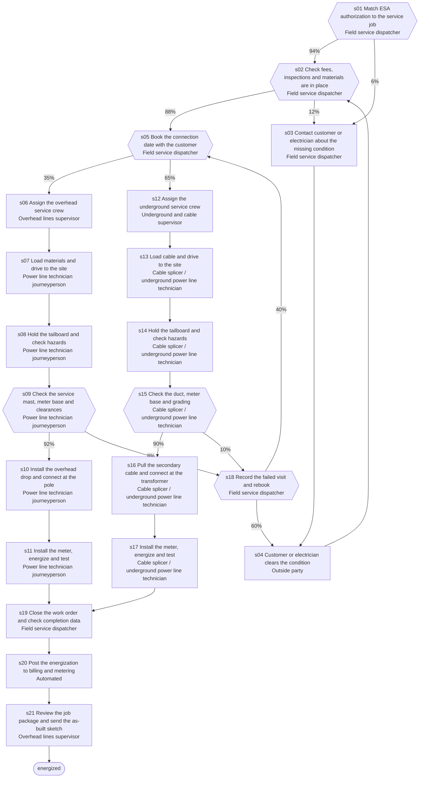

# Connect and energize new services

`edu-ops-service-connection-work` · electricity distribution · distribution operations · part of `electric-distribution-utility`

This process connects a new or upgraded low-voltage service to the grid once the customer has paid, the electrician's wiring has passed the Electrical Safety Authority (ESA) inspection and the utility has received the ESA connection authorization. A field dispatcher matches the authorization to the job and books a date, a supervisor assigns a two-person overhead or underground crew, the crew checks the meter base, installs the drop or pulls the cable, sets the meter and energizes, and the completion flows to billing, metering and the GIS. The Distribution System Code requires the connection within five business days of all conditions being met; delays come from authorizations that do not match the job, unpaid fees, unfinished customer work found on site and crews pulled away to trouble and storm work.

| | |
|---|---|
| Unit of work | one service connection |
| Starts when | The ESA connection authorization for a paid service request arrives, or a job already on the crew schedule reaches the front of the queue. |
| Done when | The service is energized with a meter installed, the work order is closed, the energization has reached billing and metering, and the as-built sketch has been sent to GIS records. |
| Organisation | A municipally owned Ontario distributor serving about 350,000 customers with its own unionized line and cable crews, a mobile workforce system on crew tablets and an ERP for work orders. (571 employees, 2019-2022) |
| Volume | 420 cases a month (range 330 to 560) |

## Where it sits

- Starts with **esa_authorization** from esa (55% of cases)
- Starts with **crew_schedule** from ops-work-scheduling (45% of cases)
- Relies on **capital_work_order** from ae-service-layouts (a standing input; it does not start a case)
- Relies on **standards** from ae-standards-maintenance (a standing input; it does not start a case)
- Sends **meter_order** to cs-meter-exchange (outcome: energized)
- Sends **energization_notice** to cs-move-in-move-out (outcome: energized)
- Sends **as_built** to ae-records-gis (outcome: energized)
- Sends **time_record** to fin-payroll (outcome: any)

## Flow

## Roles

| Role | Department | Layer | FTE on this process | Loaded cost per hour | Evidence |
|---|---|---|---:|---:|---|
| Field service dispatcher | Work Planning and Dispatch | individual contributor | 3.3 | 50 CAD | C |
| Overhead lines supervisor | Overhead Lines | supervisor | 0.8 | 80 CAD | C |
| Power line technician (journeyperson) | Overhead Lines | individual contributor | 6.2 | 65 CAD | C |
| Apprentice power line technician | Overhead Lines | individual contributor | 2.7 | 46 CAD | C |
| Underground and cable supervisor | Underground and Cable | supervisor | 0.3 | 80 CAD | C |
| Cable splicer / underground power line technician | Underground and Cable | individual contributor | 11.2 | 66 CAD | C |
| Apprentice cable splicer | Underground and Cable | individual contributor | 4.8 | 46 CAD | C |

## Steps

Hands-on time and the wait before each step show the most common value. Evidence tier A is a sourced number, B a sourced description, C the author's estimate.

| Step | Who | Kind | Hands-on | Wait before | Control | Evidence |
|---|---|---|---:|---:|---|---|
| **s01 Match ESA authorization to the service job.** The field service dispatcher opens the ESA connection authorization that arrived by email or through the ESA notification feed, finds the service work order in the mobile workforce system by civic address, and compares the address, voltage and ampacity on the authorization with the customer layout. A mismatch means the electrician must have ESA reissue the authorization before the crew can energize. | Field service dispatcher | validation | 6 min | 4.0 h | Ontario Regulation 22/04 and Conditions of Service s.2.1.5: ESA Connection Authorization required before energizing a new or upgraded service | B [hol-cos-v8], [esa-service-inspection] |
| **s02 Check fees, inspections and materials are in place.** The dispatcher looks up the job in the ERP and customer system to confirm the layout fees are paid, both trench inspections passed for an underground service, any transformer or secondary work has been completed and a meter is available. All of these are service conditions; the five-business-day clock starts only when they are met. | Field service dispatcher | lookup | 8 min | 30 min |  | B [oeb-scorecard-2021], [hol-service-requests] |
| **s03 Contact customer or electrician about the missing condition.** The dispatcher phones or emails the customer or the electrical contractor to explain what is missing: a corrected ESA authorization, an unpaid fee, an unbooked trench inspection or an incomplete meter base. The call and its outcome are noted on the work order. | Field service dispatcher | communication | 15 min | 1.0 h |  | C |
| **s04 Customer or electrician clears the condition.** The customer pays the fee, the electrician fixes the meter base or has ESA reissue the authorization, or the contractor books and passes the trench inspection. The job then returns to the dispatcher's ready queue. | Outside party | external wait | 0 min | 3.0 d |  | C |
| **s05 Book the connection date with the customer.** The dispatcher offers a date within five business days and, when the customer must be present, a four-hour window, then adds the job to the service crew day sheet in the mobile workforce system. Subdivision lots on the same street are grouped so one crew can connect several services in a day. | Field service dispatcher | coordination | 10 min | 4.0 h | Distribution System Code s.7.2 (connect within five business days, 90% of the time) and s.7.3-7.4 (four-hour appointment window) | B [oeb-scorecard-2021], [oeb-dsc] |
| **s06 Assign the overhead service crew.** The overhead lines supervisor reviews the next day's service jobs with the day sheet, checks the layout sketch for anything that needs a bigger crew, a pole or an outage, and assigns the job to a two-person service crew and bucket truck. Trouble calls and storm work pull crews off service work, so jobs wait for a free crew. | Overhead lines supervisor | coordination | 5 min | 2.0 d |  | B [oeb-scorecard-2021] |
| **s07 Load materials and drive to the site.** The crew picks up the service wire, connectors and a meter from the yard or truck stock and drives the bucket truck to the address. Ottawa's territory is 1,116 square kilometres, so rural jobs add travel. | Power line technician (journeyperson) | travel | 35 min | 1.0 h |  | C |
| **s08 Hold the tailboard and check hazards.** Before starting, the crew leader runs a tailboard: the job, the energized parts, the approach limits, traffic, trees and the customer's mast, and signs the job hazard form on the tablet. | Power line technician (journeyperson) | review | 10 min | 0 min | Occupational Health and Safety Act (Ontario) and the utility safety rule book: pre-job tailboard and hazard assessment | C |
| **s09 Check the service mast, meter base and clearances.** The journeyperson compares the mast height, attachment point, meter base and clearances with the layout and the utility's metering specification. A missing ESA tag, a mast that is too short or a meter base in the wrong place stops the job. | Power line technician (journeyperson) | validation | 10 min | 0 min | Conditions of Service s.3.1.3.6: service entry components inspected and approved by the utility before energizing | B [hol-cos-v8] |
| **s10 Install the overhead drop and connect at the pole.** The crew strings the triplex service wire from the pole or secondary bus to the customer's attachment, sags it, and makes the connections at the pole live with rubber gloves from the bucket. Spans over 30 m or a missing clearance pole make the job longer. | Power line technician (journeyperson) | physical | 1.2 h | 0 min |  | B [hol-cos-v8] |
| **s11 Install the meter, energize and test.** The crew installs the smart meter in the socket, checks voltage on both legs and the neutral, confirms the meter lights up, and records the meter number, reading, materials and time on the tablet with photographs. | Power line technician (journeyperson) | physical | 25 min | 0 min |  | C |
| **s12 Assign the underground service crew.** The underground and cable supervisor reviews the booked underground services, checks the transformer or pedestal number on the layout, and assigns the job to a two-person cable crew and splicing truck. Cable fault repairs and subdivision energizations compete for the same crews. | Underground and cable supervisor | coordination | 5 min | 2.0 d |  | B [oeb-scorecard-2021] |
| **s13 Load cable and drive to the site.** The cable crew loads secondary cable, connectors and a meter onto the splicing truck and drives to the address, often a new subdivision on the edge of the city. | Cable splicer / underground power line technician | travel | 35 min | 1.0 h |  | C |
| **s14 Hold the tailboard and check hazards.** The crew leader runs a tailboard covering the energized transformer or pedestal, excavation edges, traffic and public around the site, and signs the job hazard form on the tablet. | Cable splicer / underground power line technician | review | 10 min | 0 min | Occupational Health and Safety Act (Ontario) and the utility safety rule book: pre-job tailboard and hazard assessment | C |
| **s15 Check the duct, meter base and grading.** The splicer checks that the customer's duct reaches the meter base with a pull rope in it, the meter base is at the location on the layout, the transformer or pedestal is accessible and the lot has been graded so the duct is at the right depth. | Cable splicer / underground power line technician | validation | 10 min | 0 min | Conditions of Service s.3.1.3.6: service entry components inspected and approved by the utility before energizing | B [hol-trench], [hol-cos-v8] |
| **s16 Pull the secondary cable and connect at the transformer.** The crew pulls secondary cable through the customer's duct with the rope, cuts and trains it, and terminates it in the pad-mounted transformer or secondary pedestal, working to live-work rules or with the transformer isolated. Blocked or crushed ducts are the usual reason the pull takes longer. | Cable splicer / underground power line technician | physical | 1.2 h | 0 min |  | B [hol-cos-v8] |
| **s17 Install the meter, energize and test.** The crew installs the smart meter, checks voltage and polarity, confirms the meter displays, and records the meter number, reading, transformer number, materials and time on the tablet with photographs. | Cable splicer / underground power line technician | physical | 25 min | 0 min |  | C |
| **s18 Record the failed visit and rebook.** The crew calls the dispatcher, who records the reason on the work order, phones the customer or electrician and sends the deficiency notice, and applies the site-not-ready charge where the layout says so. Access problems are rebooked at once; deficiencies wait for the customer. | Field service dispatcher | communication | 15 min | 30 min |  | B [hol-service-requests] |
| **s19 Close the work order and check completion data.** The dispatcher reviews the crew's completion entry, checks the meter number against the meter issued and the materials and hours charged, completes the work order in the ERP and flags missing photographs or readings back to the crew. | Field service dispatcher | data entry | 8 min | 8.0 h |  | C |
| **s20 Post the energization to billing and metering.** The nightly interface between the mobile workforce system, the ERP and the customer system sets the service point active, sends the energization notice that starts the account set-up and creates the meter order that registers the meter with the AMI head-end and the provincial meter data repository. | Automated | system auto | 0 min | 6.0 h |  | C |
| **s21 Review the job package and send the as-built sketch.** The supervisor who assigned the crew reviews the completed package once a week or so, checks the red-lined service sketch (connection point, transformer number, cable length) and the timesheet, signs it and sends it to GIS records for posting. | Overhead lines supervisor | review | 6 min | 2.0 d |  | C |

## Exceptions

| Exception | Share of cases | What happens |
|---|---:|---|
| ESA authorization does not match the job | 6% | Address, voltage or ampacity on the authorization differs from the layout; the electrician has ESA reissue it before the crew is booked. |
| Condition outstanding when the authorization arrives | 11% | Fees unpaid, a trench inspection not passed or transformer work not finished; the job waits for the customer or an upstream crew. |
| Site not ready when the crew arrives | 9% | Blocked duct, wrong meter base location, short mast or no access; the crew leaves and the job is rebooked, often with a site-not-ready charge. |
| Crews diverted to storm restoration | 3% | During a declared major event all crews go to restoration and booked connections move to the days after; customers are called and rebooked. |

## Benchmarks

| Metric | Value | Unit | Population | Evidence |
|---|---|---|---|---|
| connections_within_five_business_days | 1.0 | share of connections, 2021 | Hydro Ottawa low-voltage residential and small business connections (5,024 in 2021) | A [oeb-scorecard-2021] |
| appointments_met_on_time | 0.9886 | share of appointments, 2021 | Hydro Ottawa appointments for service upgrades, meter checks and service layouts (9,001 in 2021) | A [oeb-scorecard-2021] |
| cycle_time_days | p50 7, p90 16 | calendar days from ESA authorization received to as-built sent to records | Modelled utility, 2019-2022 | C [oeb-scorecard-2021] |

## Pain points

- ESA authorizations that do not match the layout address or ampacity, and unpaid fees, hold jobs after the customer believes they are ready. (steps s01, s02, s03; C)
- Crew visits wasted on sites that are not ready: blocked ducts, wrong meter base locations, locked gates. (steps s09, s15, s18; B [hol-service-requests])
- Trouble calls and storms pull service crews away, so jobs wait for a free crew within the five-day window. (steps s06, s12; A [oeb-scorecard-2021])
- Completion data is re-checked by the dispatcher and the supervisor, and as-built sketches reach GIS a week or more after energization. (steps s19, s21; C)

## Assumptions

- The case starts when the ESA connection authorization arrives for a job whose layout has been issued; the work before that (layout, payment, trench inspections) is in ae-service-layouts. About 55% of cases are started by the authorization and 45% by a job already scheduled whose authorization arrived earlier; every case needs both.
- Two-person crews do service connections (a journeyperson and an apprentice or two journeypersons); the organisation file's line-crew and cable-crew resources are three-to-four-person construction crews, so the steps use the bucket truck and cable truck as the limiting resources instead.
- Self-contained residential meters are installed by the connecting crew; the meter order to metering registers the meter in the AMI head-end and the provincial repository and covers larger transformer-rated services.
- Underground services are assigned by the underground and cable supervisor, a role the organisation file's process map does not list for this process.
- Loaded costs are the organisation file's rates (wage x 1.40). Staffing FTEs add 25% to hands-on time for set-up, failed trips and calls that do not reach a step.
- The simulated cycle time runs to the as-built hand-off, so it is longer than the time to energize that the DSC measures; the energize portion is about 3 to 5 days in the simulation.
- The Distribution System Code cited is the August 2026 revision; sections 7.2 to 7.4 on new service connections and appointments are quoted for 2021 in the OEB scorecard, so the rules applied in the reference period.

## Sources

- [esa-service-inspection] [What is a service connection inspection?](https://esasafe.com/notifications-and-inspections/what-is-a-service-connection-inspection/) (Electrical Safety Authority, 2026). Service inspection after customer-owned service equipment is installed and before it is covered; ESA then authorizes the utility to energize; authorization valid up to six months; each project needs a service layout from the utility.
- [hol-cos-v8] [Hydro Ottawa Conditions of Service, ECS0012 Rev. 8 (proposed, effective December 2021)](https://hydroottawa.com/sites/default/files/2021-09/HOL-COS-V8-EN-PROPOSED-SEPT-2021.pdf) (Hydro Ottawa Limited, 2021). s.2.1: design and material prepayments, deposits before field work; s.2.1.3: offer to connect contents, economic evaluation, expansion deposit (letter of credit, cash, surety), alternative bid with qualified contractors and 2-year warranty; s.2.1.5: ESA Connection Authorization Certificate required before energizing and must match address, voltage and ampacity; duct banks inspected before concrete and before backfill with a mandrel test, pads and vaults inspected before equipment; s.2.1.7: Installation and Service Agreement for developers; s.3.1.2: subdivision site information (plan, grading, phasing, load summary); s.3.1.3: utility designates supply point and meter base location, installs up to 30 m of service conductor, inspects service entry to the meter base; s.3.4: DER Form B, CIA fee, Installation and Service Agreement with Connection Cost Agreement, Hydro One consulted on the customer's behalf; Appendix G: quotes expire after 90 days, one free customer layout per property per year, two-person line crew isolations.
- [hol-dsp-2026] [Distribution System Plan Overview, 2026-2030 Custom IR (EB-2024-0115), Exhibit 2-5-1](https://static.hydroottawa.com/documents/corporate/regulatory-affairs/2025/Distribution%20System%20Plan%20Overview.pdf) (Hydro Ottawa Limited, 2025). Residential customer connection volumes averaged 6,067 a year in 2021-2023 against a budgeted 3,190; 2021-2025 System Access spending of $293M including $157M customer connections, $89M system expansion and $1M generation connections, with $158M of capital contributions; customer connections cover subdivisions, commercial developments and infill.
- [hol-service-requests] [Electrical service requests](https://hydroottawa.com/en/residential/services/electrical-service-requests) (Hydro Ottawa Limited, 2026). Submit the service request form three to four weeks before the project; Hydro Ottawa calls within 10 business days; customer layout by email with initial site review and service loading assessment; customer pays the layout fees and then calls the Service Desk to schedule; extra charges if the site is not ready when the crew arrives; some projects take longer when equipment must be ordered.
- [hol-trench] [Contractors - Underground service trenches](https://hydroottawa.com/accounts-services/accounts/contractors-developers/underground-service-trench) (Hydro Ottawa Limited, 2026). Sequence for an underground service: customer layout, locate, trench, duct and rope, meter base, first inspection booked through the Service Desk, backfill with sand, second inspection, final backfill, ESA connection permit, then call the Service Desk to schedule the connection.
- [oeb-dsc] [Distribution System Code (last revised August 1, 2026)](https://www.oeb.ca/sites/default/files/Distribution_System_Code.pdf) (Ontario Energy Board, 2026). s.6.1.1: respond to a written connection request within 15 calendar days and make an offer to connect within 60 calendar days; s.3.2 and Appendix B: economic evaluation, capital contribution, expansion deposit, alternative bid and final economic evaluation after energization; s.6.2.6: micro-embedded offer within 15, 30 or 60 days and at least 30 days to accept; s.6.2.7: connect a micro-embedded generator within 5 business days of ESA authorization, agreement and payment (90% of the time); s.6.2.9.1: preliminary consultation response within 15 days; s.6.2.12 and 6.2.13: CIA within 60, 75, 90 or 105 days; s.6.2.14A: file with the transmitter within 15 days; s.6.2.16: detailed cost estimate and offer to connect within 90 days of payment.
- [oeb-scorecard-2021] [Scorecard - Hydro Ottawa Limited (2017-2021) and 2021 Scorecard Management Discussion and Analysis](https://www.oeb.ca/documents/scorecard/2021/Scorecard%20-%20Hydro%20Ottawa%20Limited.pdf) (Ontario Energy Board, 2022). 5,024 new residential and small business services connected in 2021, 100% within five business days of conditions being met or as scheduled with the customer (DSC s.7.2, 90% minimum); 9,001 appointments for service upgrades, meter checks and service layouts in 2021 (98.86% on time, four-hour window under DSC s.7.4); missed appointments mainly caused by emergencies and weather; 6 CIAs totalling 11,635.8 kW in 2021 all on time, timelines 60 to 90 days, all CIA work done internally; 52 micro-embedded generators (10 kW or less) connected in 2021, 100% within five business days.

Written by claude-opus on 2026-11-24.
