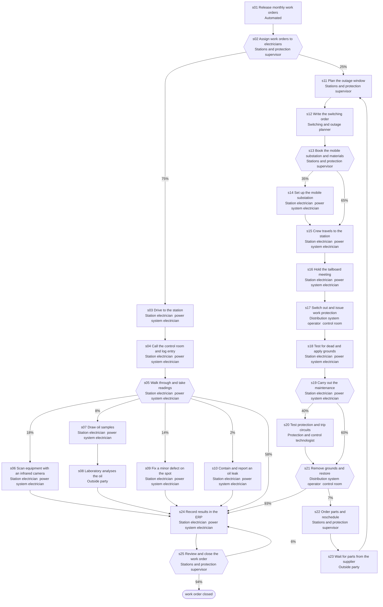

# Inspect and maintain substations

`edu-ops-station-maintenance` · electric power distribution · distribution operations · part of `electric-distribution-utility`

Station electricians visit each of the utility's 91 municipal substations once a month to read gauges, look over transformers, breakers, batteries and the building, and fix small problems on the spot, and they carry out heavier time-based and condition-based maintenance that needs equipment switched out of service. Outage work involves the stations supervisor, a switching planner and a control room operator who issues work protection, and often a mobile substation to keep customers supplied. Routine visits are quick but compete with trouble calls and construction for the same small crew; outage work is slow because it has to be booked around summer and winter peaks, the two mobile substations and parts that can take months to arrive.

| | |
|---|---|
| Unit of work | one station maintenance work order |
| Starts when | A monthly inspection or a time- or condition-based maintenance work order falls due in the ERP and is released on the stations crew schedule. |
| Done when | The work is done, readings and test results are recorded in the ERP, the stations supervisor closes the work order and any findings go to asset management. |
| Organisation | A city-owned Ontario electricity distributor with about 350,000 customers, 91 substations and a 33-person stations and protection department working days with on-call cover. (571 employees, 2019-2022) |
| Volume | 120 cases a month (range 95 to 160) |

## Where it sits

- Starts with **crew_schedule** from ops-work-scheduling (100% of cases)
- Relies on **work_protection** from ops-control-room-switching (a standing input; it does not start a case)
- Relies on **asset_condition** from ae-asset-condition-assessment (a standing input; it does not start a case)
- Relies on **material_issue** from fin-inventory-stores (a standing input; it does not start a case)
- Sends **inspection_findings** to ae-asset-condition-assessment (outcome: any)
- Sends **maintenance_work_order** to ops-protection-testing (outcome: work order closed)
- Sends **spill_report** to corp-environment (outcome: any)
- Sends **time_record** to fin-payroll (outcome: any)
- Sends **purchase_requisition** to fin-procurement (outcome: any)

## Flow

## Roles

| Role | Department | Layer | FTE on this process | Loaded cost per hour | Evidence |
|---|---|---|---:|---:|---|
| Station electrician (power system electrician) | Stations and Protection and Control | individual contributor | 9.5 | 67 CAD | C |
| Stations and protection supervisor | Stations and Protection and Control | supervisor | 1 | 82 CAD | C |
| Protection and control technologist | Stations and Protection and Control | senior specialist | 0.4 | 65 CAD | C |
| Switching and outage planner | System Control Centre | senior specialist | 0.4 | 70 CAD | C |
| Distribution system operator (control room) | System Control Centre | individual contributor | 0.3 | 72 CAD | C |

## Steps

Hands-on time and the wait before each step show the most common value. Evidence tier A is a sourced number, B a sourced description, C the author's estimate.

| Step | Who | Kind | Hands-on | Wait before | Control | Evidence |
|---|---|---|---:|---:|---|---|
| **s01 Release monthly work orders.** The ERP preventive maintenance plan generates the month's station inspection work orders and any time-based maintenance orders that fall due, and places them in the stations backlog with the station, equipment and task list attached. | Automated | system auto | 0 min | 0 min |  | C |
| **s02 Assign work orders to electricians.** The stations supervisor reviews the backlog in the ERP against the crew calendar, vacation and trouble work, sorts routine inspections into geographic routes and flags orders that need an outage, a mobile substation or a protection technologist. | Stations and protection supervisor | coordination | 4 min | 1.0 d |  | C |
| **s03 Drive to the station.** The electrician collects the inspection sheet, station keys, gas detector and test kit, then drives a light truck to the station; a route usually takes in three or four stations in a day across urban and rural parts of the territory. | Station electrician (power system electrician) | travel | 30 min | 5.0 d |  | C |
| **s04 Call the control room and log entry.** Before opening the station the electrician phones the control room operator, gives name, station and purpose, confirms no switching is planned there, and signs the station log book; the call is repeated on leaving. | Station electrician (power system electrician) | communication | 5 min | 0 min | Station entry procedure in the utility's work protection code and IHSA Electrical Utility Safety Rules | C |
| **s05 Walk through and take readings.** The electrician walks the yard and switchgear room, records transformer winding and oil temperatures, oil levels, gas relay and pressure relief indications, tap changer and breaker operation counters, battery voltage and charger state, and checks fences, heaters, lighting, signage and for oil leaks or animal entry. | Station electrician (power system electrician) | physical | 1.0 h | 0 min |  | B [ho_stations2021], [doble2021] |
| **s06 Scan equipment with an infrared camera.** On the quarterly or annual scan visit the electrician photographs bushings, connections, cable terminations and breaker cubicles with a thermal camera under load and notes any spot that is hotter than similar parts nearby. | Station electrician (power system electrician) | physical | 40 min | 0 min |  | C |
| **s07 Draw oil samples.** For transformers due for oil testing the electrician draws oil from the sampling valve into syringes and bottles, labels them with the transformer serial number, and ships them to the testing laboratory. | Station electrician (power system electrician) | physical | 30 min | 0 min |  | B [doble2021] |
| **s08 Laboratory analyses the oil.** An outside laboratory runs dissolved gas analysis and oil quality tests (moisture, acidity, dielectric strength) and emails a report that flags gas levels or trends against the IEEE limits. | Outside party | external wait | 0 min | 7.0 d |  | B [doble2021] |
| **s09 Fix a minor defect on the spot.** The electrician replaces failed lamps, heaters or filters, tops up battery electrolyte, clears debris or nests, or repairs a fence or lock using van stock, without taking any equipment out of service. | Station electrician (power system electrician) | physical | 40 min | 0 min |  | C |
| **s10 Contain and report an oil leak.** If a transformer or breaker is leaking oil the electrician lays absorbent pads and booms, checks whether oil has left the containment, and calls the control room and the health, safety and environment advisor, who decides whether the spill must be reported to the province. | Station electrician (power system electrician) | physical | 1.0 h | 0 min | Ontario Environmental Protection Act spill reporting (Spills Action Centre) | C |
| **s11 Plan the outage window.** The stations supervisor checks the station's load history in SCADA, the season and other planned work on the same feeders, picks a window when the load can be carried by adjacent stations or a mobile substation, and requests the outage and switching from the control centre. | Stations and protection supervisor | coordination | 2.0 h | 7.0 d |  | B [ho_grid2024] |
| **s12 Write the switching order.** The switching planner writes the step-by-step switching order to isolate the transformer or breaker, transfer load to other feeders or the mobile, and place grounds, then has it checked by a second operator. | Switching and outage planner | drafting | 1.5 h | 3.0 d | Written and independently checked switching orders under the utility's work protection code | C |
| **s13 Book the mobile substation and materials.** The supervisor confirms that parts and consumables are in stores, books one of the two mobile substations if customers cannot be carried by adjacent feeders, and confirms the crew and date with the control room. | Stations and protection supervisor | coordination | 45 min | 5.0 d |  | C |
| **s14 Set up the mobile substation.** A crew tows the mobile substation to the station, levels and grounds it, connects primary and secondary cables, and tests it before the switching; it stays connected until the station equipment is back in service. | Station electrician (power system electrician) | physical | 6.0 h | 1.0 d | Pre-energization tests and grounding of mobile equipment under the work protection code | C |
| **s15 Crew travels to the station.** The three-person crew loads tools, test sets and materials and drives to the station for the start of the outage window, usually early morning. | Station electrician (power system electrician) | travel | 35 min | 12.0 h |  | C |
| **s16 Hold the tailboard meeting.** The crew leader walks the crew through the job plan, isolation points, hazards, approach distances and emergency plan, and everyone signs the tailboard form. | Station electrician (power system electrician) | communication | 20 min | 0 min | Pre-job hazard assessment and tailboard (Occupational Health and Safety Act duties; IHSA Electrical Utility Safety Rules) | C |
| **s17 Switch out and issue work protection.** The control room operator carries out the switching remotely through SCADA and with the crew at the station, confirms the equipment is isolated, and issues a work protection permit to the crew leader. | Distribution system operator (control room) | coordination | 40 min | 30 min | Work protection issued only by the control room under the utility's work protection code | C |
| **s18 Test for dead and apply grounds.** The crew tests each isolated conductor with a voltage detector, applies protective grounds and locks and tags the isolation points listed on the permit. | Station electrician (power system electrician) | physical | 30 min | 0 min | Test before touch, grounding and lockout under IHSA Electrical Utility Safety Rules | C |
| **s19 Carry out the maintenance.** The crew performs the planned work: breaker timing and contact resistance tests and mechanism service, transformer power factor and turns ratio tests, tap changer inspection, battery impedance and discharge tests, switchgear cleaning and torque checks, and repairs found along the way. | Station electrician (power system electrician) | physical | 6.0 h | 0 min |  | B [doble2021] |
| **s20 Test protection and trip circuits.** The protection and control technologist injects test currents into the relays, checks trip and close circuits to the maintained breaker, and confirms settings match the protection database before the equipment goes back in service. | Protection and control technologist | validation | 2.0 h | 0 min | Return-to-service testing of protection after maintenance (utility protection standard) | B [doble2021] |
| **s21 Remove grounds and restore.** The crew removes grounds and locks and surrenders the permit; the operator cancels the work protection, switches the equipment back in and the mobile substation is disconnected if one was used. | Distribution system operator (control room) | coordination | 30 min | 30 min | Permit surrender before re-energizing under the work protection code | C |
| **s22 Order parts and reschedule.** When the crew finds a failed bushing, tap changer part or breaker mechanism component that is not stocked, the supervisor raises a purchase requisition and puts the work order back on the outage plan. | Stations and protection supervisor | data entry | 1.0 h | 1.0 d |  | C |
| **s23 Wait for parts from the supplier.** The supplier quotes and delivers the part; station equipment parts are often made to order, so lead times run from weeks to several months. | Outside party | external wait | 0 min | 21.0 d |  | C |
| **s24 Record results in the ERP.** The electrician types the readings, test results, defects found, materials used and hours into the ERP work order and timesheet, attaches the scanned sheet or test files, and raises a corrective work order for anything left open. | Station electrician (power system electrician) | data entry | 20 min | 1.0 d |  | C |
| **s25 Review and close the work order.** The stations supervisor reads the completed order, compares readings with the previous visit, sends abnormal results to the asset management engineer and closes the order or returns it for missing information. | Stations and protection supervisor | review | 10 min | 3.0 d | Supervisor review of completed maintenance records (asset management records policy) | C |

## Exceptions

| Exception | Share of cases | What happens |
|---|---:|---|
| Parts not in stock | 2% | About 7% of outage jobs find a defect that needs a made-to-order part; the equipment is restored and the outage is replanned after the part arrives. |
| Oil spill | 2% | A leaking transformer or breaker is contained and reported to the environment team and possibly the province. |
| Record returned | 6% | The supervisor sends the work order back because readings or test files are missing. |

## Benchmarks

| Metric | Value | Unit | Population | Evidence |
|---|---|---|---|---|
| substations | 92 | stations | Hydro Ottawa, 2021 | A [ho_stations2021] |
| cycle_time_days | p50 14, p90 40 | calendar days from work order release to close | Author's estimate for a mix of about 75% monthly inspections and 25% outage maintenance | C |

## Pain points

- Outage maintenance has to fit between summer and winter peaks and around two mobile substations, so jobs slip from season to season and the backlog grows on stations that are already past their expected life. (steps s11, s13, s14; C)
- Readings are written on paper or tablets and re-keyed into the ERP, so trends are hard to see and records come back for missing data. (steps s05, s24, s25; C)
- Made-to-order station parts have long lead times, forcing a second outage. (steps s22, s23; C)

## Assumptions

- Monthly visits to every station and the quarterly or annual infrared and oil-sampling intervals are the organisation file's and the author's estimates; no opened source states the utility's station inspection interval. The 2024 Hydro Ottawa source gives a three-year cycle for routine inspection of transformers, switches and breakers across the territory, which may refer to distribution plant rather than stations.
- The process map lists the trigger as the crew schedule from work scheduling; in practice the stations department plans its own preventive work in the ERP and the schedule only releases it.
- Switching planners and control room operators take part in every outage job but are not in the process map's role list; they are included here at small FTE.
- Outage work is shown with a three-person crew (people = 3); protection retesting runs alongside the end of the maintenance (concurrent_with).
- The mobile substation is held for two to seven days per job that uses one; with about 10 such jobs a month and two units this keeps them busy for much of the spring and fall seasons.
- Corrective work raised from findings (hot spots, DGA alerts) is a new work order and a new case, not a loop inside this one.

## Sources

- [ho_stations2021] [The not-so-secret life of power stations](https://hydroottawa.com/en/blog/not-so-secret-life-power-stations) (Hydro Ottawa, 2021). 92 substations across the city in 2021; distribution substations step voltage down to under 10,000 volts; station transformers weigh up to 70,000 pounds and need a crane; stations use switchgear, fuses and breakers to isolate circuits.
- [doble2021] [An Overview of Substation Maintenance: Its Evolution and Key Testing Practices (E. Khan)](https://www.doble.com/an-overview-of-substation-maintenance-its-evolution-and-key-testing-practices/) (Doble Engineering Company, 2021). Substation maintenance combines time-based, condition-based and performance-based strategies; transformer diagnostics include dissolved gas analysis, oil quality, power factor, winding resistance and turns ratio; breaker diagnostics include timing and motion and contact resistance; battery tests include impedance, voltage, specific gravity and discharge; relays are tested at commissioning and periodically.
- [ho_grid2024] [An in-depth look at Hydro Ottawa's grid maintenance](https://hydroottawa.com/en/blog/depth-look-hydro-ottawas-grid-maintenance) (Hydro Ottawa, 2024). Routine inspections of transformers, switches and breakers follow a three-year cycle across the service territory; a critical pole program tests thousands of poles a year; maintenance holes are graded A to E; work often needs the area de-energized, which may need a planned outage; vegetation management units are on two- or three-year cycles; satellite imaging twice a year (introduced after the reference period).

Written by claude-opus on 2026-11-24.
