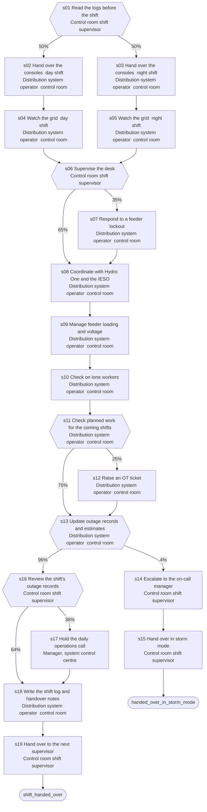

# Monitor and operate the distribution grid

`edu-ops-system-monitoring` · electric utilities: power distribution · distribution operations: system control · part of `electric-distribution-utility`

The system control centre watches and operates the distribution grid around the clock in two 12-hour shifts. Operators watch SCADA alarms, feeder loading and the outage management system, respond to feeder lockouts by switching remotely, coordinate with the transmitter Hydro One, keep outage records and estimates current, and hand over open work protection and abnormal devices at every shift change. The job is hard because the same desk must handle quiet nights and storms with hundreds of events, errors in permits or switching can injure crews, and outage records written in a hurry drive the utility's reliability statistics.

| | |
|---|---|
| Unit of work | one control room shift |
| Starts when | The start of a 12-hour control room shift at 07:00 or 19:00. |
| Done when | The shift's alarms, outages and permits are handled or handed over, the operating log and outage records are complete, and the incoming supervisor has signed the shift change. |
| Organisation | A city-owned Ontario electricity distributor with about 350,000 customers, a 24-hour system control centre, overhead and underground line crews and single-person trouble trucks, using SCADA, an outage management system, smart meters and mobile workforce tablets. (571 employees, 2019-2022) |
| Volume | 61 cases a month (range 60 to 62) |

## Where it sits

- Starts with **outage_report** from cs-contact-centre (60% of cases)
- Starts with **outage_report** from emergency-services (5% of cases)
- Starts with **outage_report** from hydro-one (5% of cases)
- Starts with **outage_event** from ops-trouble-response (20% of cases)
- Starts with **outage_event** from ops-outage-restoration (10% of cases)
- Relies on **asset_register** from ae-records-gis (a standing input; it does not start a case)
- Sends **trouble_order** to ops-trouble-response (outcome: any)
- Sends **outage_event** to ops-outage-restoration (outcome: any)
- Sends **outage_event** to ops-major-event-response (outcome: handed_over_in_storm_mode)
- Sends **outage_event** to corp-outage-communications (outcome: any)
- Sends **interruption_data** to ae-reliability-analysis (outcome: shift_handed_over)
- Sends **ot_ticket** to corp-ot-systems (outcome: any)

## Flow

## Roles

| Role | Department | Layer | FTE on this process | Loaded cost per hour | Evidence |
|---|---|---|---:|---:|---|
| Distribution system operator (control room) | System Control Centre | individual contributor | 11 | 72 CAD | B [oakville-cro], [ho-blog-2022] |
| Control room shift supervisor | System Control Centre | supervisor | 4 | 85 CAD | C |
| Manager, system control centre | System Control Centre | manager | 0.15 | 105 CAD | C |

## Steps

Hands-on time and the wait before each step show the most common value. Evidence tier A is a sourced number, B a sourced description, C the author's estimate.

| Step | Who | Kind | Hands-on | Wait before | Control | Evidence |
|---|---|---|---:|---:|---|---|
| **s01 Read the logs before the shift.** The incoming shift supervisor reads the operating log, the list of open work protection permits, abnormal switching states, outages in progress, planned work for the shift and the weather outlook before taking the desk. | Control room shift supervisor | lookup | 20 min | 0 min |  | B [oakville-cro] |
| **s02 Hand over the consoles (day shift).** Each incoming operator sits with the outgoing operator at the console and goes through open permits, devices left in abnormal positions, events in progress and crews in the field, then signs on in the log. | Distribution system operator (control room) | communication | 20 min | 0 min |  | C |
| **s03 Hand over the consoles (night shift).** The smaller night crew takes over the consoles in the same way, paying particular attention to permits that will stay open overnight and to on-call crews already called out. | Distribution system operator (control room) | communication | 20 min | 0 min |  | C |
| **s04 Watch the grid (day shift).** Operators watch SCADA alarms, breaker status, feeder loading and voltage, and the OMS queue of predicted outages through the shift, acknowledge and classify alarms, and answer radio calls from crews; individual trouble orders and switching jobs are counted in their own workflows. | Distribution system operator (control room) | analysis | 10.8 h | 0 min |  | B [ho-blog-2022], [oakville-cro] |
| **s05 Watch the grid (night shift).** Night operators watch the same alarms and OMS queue with one console less, cover trouble dispatch and on-call crew call-outs themselves, and run end-of-day checks such as clearing nuisance alarms. | Distribution system operator (control room) | analysis | 10.8 h | 0 min |  | C |
| **s06 Supervise the desk.** The shift supervisor balances events between consoles, approves switching orders and permits, tracks crews' hours of work and call-outs, and keeps the on-call manager informed of anything unusual. | Control room shift supervisor | coordination | 11.0 h | 0 min | Utility Work Protection Code and Electrical Utility Safety Rules (IHSA), required for work on or near distribution lines under the Occupational Health and Safety Act | B [oakville-cro] |
| **s07 Respond to a feeder lockout.** When a feeder breaker trips and locks out, an operator reads relay targets and fault indicators, opens the sectionalizing switches it can reach remotely, re-closes to pick up the healthy part of the feeder and opens an outage event for a crew. | Distribution system operator (control room) | analysis | 30 min | 0 min | Utility Work Protection Code and Electrical Utility Safety Rules (IHSA), required for work on or near distribution lines under the Occupational Health and Safety Act | B [ho-600], [ho-blog-2022] |
| **s08 Coordinate with Hydro One and the IESO.** An operator calls or takes calls from the transmitter's grid control centre about station breaker operations, supply circuit outages and voltage, and from the IESO about outage requests or system conditions, and logs what was agreed. | Distribution system operator (control room) | communication | 10 min | 0 min |  | B [oakville-cro] |
| **s09 Manage feeder loading and voltage.** On hot or very cold days an operator watches feeders and station transformers approaching their limits, transfers load between feeders and asks Hydro One to adjust station voltage when customers report low voltage. | Distribution system operator (control room) | analysis | 5 min | 0 min |  | C |
| **s10 Check on lone workers.** An operator tracks single-person trouble responders and other lone workers in the field, calls any who miss a scheduled check-in or stay silent past the expected job time, and starts the emergency procedure if they cannot be reached. | Distribution system operator (control room) | communication | 20 min | 0 min | Occupational Health and Safety Act general duty and the utility's working-alone procedure for single-person trouble trucks | C |
| **s11 Check planned work for the coming shifts.** The operator reads the switching orders and work protection requests prepared by the switching planners for the next shifts, checks them against the current abnormal state of the grid and flags any order that no longer fits. | Distribution system operator (control room) | review | 30 min | 0 min |  | B [oakville-cro] |
| **s12 Raise an OT ticket.** When a remote terminal unit stops reporting, a telemetry point freezes, a radio link drops or the OMS slows, the operator logs a ticket for the on-call OT specialist, marks the affected devices as suspect and arranges field checks if needed. | Distribution system operator (control room) | communication | 10 min | 0 min |  | C |
| **s13 Update outage records and estimates.** Through the shift operators correct predicted outages, merge duplicate events, update restoration estimates shown on the outage map and complete restoration times and cause codes for events closed in the field. | Distribution system operator (control room) | data entry | 1.0 h | 0 min |  | B [ho-blog-2020], [scorecard-2021] |
| **s14 Escalate to the on-call manager.** When alarms and outages build faster than the desk can handle, the supervisor calls the on-call control manager, opens the storm desk console, extends operators past the end of shift and asks for trouble trucks and crews to be held. | Control room shift supervisor | judgment | 30 min | 0 min |  | B [me-2019-07], [me-2022-12] |
| **s15 Hand over in storm mode.** The shift ends with extended or overlapping operators, the storm desk open and the event handed to the major event process; the supervisor briefs the incoming supervisor and the on-call manager together. | Control room shift supervisor | communication | 30 min | 0 min |  | C |
| **s16 Review the shift's outage records.** Before the end of the shift the supervisor checks that every outage event closed during the shift has times, customer counts and a cause code, and that open permits and abnormal devices are listed for handover. | Control room shift supervisor | review | 30 min | 0 min |  | C |
| **s17 Hold the daily operations call.** On weekday mornings the control centre manager reviews the previous 24 hours with the shift supervisor and line and underground supervisors: major outages, near misses, outstanding repairs and the day's planned outages. | Manager, system control centre | review | 30 min | 0 min |  | B [oakville-cro] |
| **s18 Write the shift log and handover notes.** Each operator completes the log entries for the shift, lists open permits, abnormal devices, crews still working and events in progress, and saves the handover notes for the incoming operator. | Distribution system operator (control room) | drafting | 20 min | 0 min |  | C |
| **s19 Hand over to the next supervisor.** The supervisor briefs the incoming supervisor on the shift's events, open permits, crews in the field and anything escalated, and both sign the log at the change of shift. | Control room shift supervisor | communication | 15 min | 0 min |  | C |

## Exceptions

| Exception | Share of cases | What happens |
|---|---:|---|
| Storm escalation | 4% | Alarms and outages build beyond the desk; the supervisor calls the on-call manager, opens the storm desk and hands over in storm mode to the major event process. |
| Feeder lockout | 35% | A feeder breaker locks out and an operator isolates and restores what remote switching can before a crew is sent. |
| Telemetry or system failure | 25% | A remote terminal unit, radio link or OMS fault leaves devices unmonitored until OT fixes it. |

## Benchmarks

| Metric | Value | Unit | Population | Evidence |
|---|---|---|---|---|
| cycle_time_days | p50 0.5, p90 0.53 | calendar days per shift including handover | Distribution control rooms on 12-hour shifts | C |
| average_interruption_duration_hours | 1.34 | hours per customer interrupted, 2021, excluding loss of supply and major events | Hydro Ottawa Limited customers | A [scorecard-2021] |

## Pain points

- Night shifts run the same desk with one console fewer, so a storm at night overloads the operators before help arrives. (steps s05, s14; C)
- Open permits and abnormal devices must be carried across every shift change by hand; a missed item is a crew safety risk. (steps s02, s03, s18; B [ihsa-uwpc], [oakville-cro])
- Outage records are corrected by hand during busy shifts, and errors flow into reliability statistics. (steps s13, s16; C)
- Failed telemetry leaves operators blind to devices until OT specialists or field staff check them. (steps s12; C)

## Assumptions

- A case is one 12-hour shift (61 a month). Day shifts have four operators and nights three; the organisation file does not state the split.
- Desk time is counted here as continuous monitoring. Minutes on individual trouble orders (about 2 FTE), crew outages (about 1 FTE), planned switching and work protection (about 4.5 FTE in ops-control-room-switching) and other workflows (about 2 FTE) are counted there, so this file states 11 FTE to keep the organisation total near its 20 operators. The simulated hands-on time here is seat presence, during which that other work is also done, which is why it implies more FTE than stated.
- Steps during the shift run alongside the monitoring step (concurrent_with), so the simulated cycle time stays close to 12 hours.
- The organisation file's surge multiplier for this process (3 to 12) describes events, not shifts; for a shift-based unit the surge adds extended and overlapping shifts, not more shifts.
- Four shift supervisors are not enough to staff one 24/7 seat without overtime (about 4.9 needed at 1,800 worked hours a year).
- Hands-on time times volume implies about 26 FTE at the validator's 130 productive hours a month, against 15 stated: a control room seat is occupied for whole shifts, and shift workers spend about 140-150 hours a month on the desk, and part of the seat time is counted in other workflows (see above).
- Loaded costs come from the organisation file (wage x 1.40).

## Sources

- [oakville-cro] [Control Room Operator (job posting, closed February 13, 2022)](https://mearie.talentnest.com/en/posting/82564) (Oakville Hydro, via The MEARIE Group careers site, 2022). Ontario distribution control room duties: operate SCADA/ADMS and automated field devices, prepare and direct scheduled and emergency switching and load transfers, deliver Utility Work Protection Code processes, liaise with Hydro One and the IESO on outages and restoration, daily KPI reporting and post-event analysis; MEARIE operator training.
- [ho-blog-2022] [How utilities prepare for emergencies](https://hydroottawa.com/en/blog/how-utilities-prepare-emergencies) (Hydro Ottawa, 2022). Emergency Response Plan with year-round simulations; priorities set by health and safety risk, essential services such as hospitals and schools, then densely populated areas; system operators in the control centre on duty 24/7; field operators handle emergency response, outage restoration and single-customer calls; on-call staff, contractors and arborists after hours; automated field devices restore some customers automatically.
- [ho-600] [600 skilled field workers dispersed across city to restore remaining 29,000 customers - 3:00 PM update](https://hydroottawa.com/en/news-releases/600-skilled-field-workers-dispersed-across-city-restore-remaining-29000-customers-300) (Hydro Ottawa, 2022). About 600 employees and crews working around the clock; 151,000 restored six days after the storm; switching largely done remotely by the System Office; homes with damaged electrical equipment need repairs before reconnection; stay 10 metres from downed lines and call the outage line.
- [ho-blog-2020] [How Hydro Ottawa powers through summer storm season](https://hydroottawa.com/en/blog/how-hydro-ottawa-powers-through-summer-storm-season) (Hydro Ottawa, 2020). Additional staff put on standby and resources relocated when severe weather is forecast; outages reported through the 24/7 outage line, app and MyAccount; outage map updated every 15 minutes; restoration estimates posted when available.
- [scorecard-2021] [Scorecard - Hydro Ottawa Limited (2017-2021) and 2021 Scorecard MD&A](https://www.oeb.ca/documents/scorecard/2021/Scorecard%20-%20Hydro%20Ottawa%20Limited.pdf) (Ontario Energy Board, 2022). Average hours of interruption per customer 0.83 in 2020 and 2021; average interruptions per customer 0.72 in 2020 and 0.62 in 2021 (both excluding loss of supply and major events); one major event in 2021; top outage causes loss of supply, defective equipment and foreign interference; emergency (unplanned) capital $8.57M against a $6.73M budget in 2021.
- [me-2019-07] [Hydro Ottawa Limited Major Event: July 5, 2019](https://www.hydroottawa.com/en/about-us/regulatory-affairs/major-events/July-5-2019) (Hydro Ottawa, 2019). Lightning and loss of supply at four stations; 70,069 customers (21%); longest outage 6 h 35 min; on-call staff, four extra PLTs and control room staff held past end of day; standing service agreements with forestry, civil and lines contractors (not used); Electrical Emergency Response Plan activated with an Incident Command Centre staffed 7:30 pm to 2:00 am; daily SAIDI 12.11 against 5.3.
- [me-2022-12] [Hydro Ottawa Limited Major Event: December 23, 2022](https://www.hydroottawa.com/en/about-us/regulatory-affairs/major-events/December-23-2022) (Hydro Ottawa, 2023). Winter storm with a Hydro One supply circuit trip and loss of supply to four stations; 67,710 customers interrupted (19%); 90% restored in 12 h 30 min; weather statement, watch and warning issued days ahead; on-call staff reported at 18:00 the evening before and all line and underground staff at 06:00; Incident Command Centre activated; no mutual aid; ETRs on outage map, outage line and email alerts.
- [me-index] [Major events (list of Hydro Ottawa major event reports)](https://hydroottawa.com/en/about-us/regulatory-affairs/major-events) (Hydro Ottawa, 2026). Major events listed by date: three in 2019 (April 15, July 5, November 1), two in 2020 (March 7, October 18), one in 2021 (June 14), three in 2022 (May 21, June 18, December 23); after a major event the utility files a report with the OEB normally within 60 days of occurrence.
- [ihsa-uwpc] [Keys to the Utility Work Protection Code (IHSA Health and Safety Magazine)](https://www.ihsa.ca/IHSA-Health-Safety-Magazine/IHSAV232/Keys-to-the-Utility-Work-Protection-Code.aspx) (Infrastructure Health and Safety Association, None). The Electrical Utility Safety Rules govern how workers act near hazards and the Utility Work Protection Code uses permits and tags to show when lines are isolated and safe to work on; permit issuers and workers need training and certification. Publication year not stated on the page.

Written by claude-opus on 2026-11-24.
