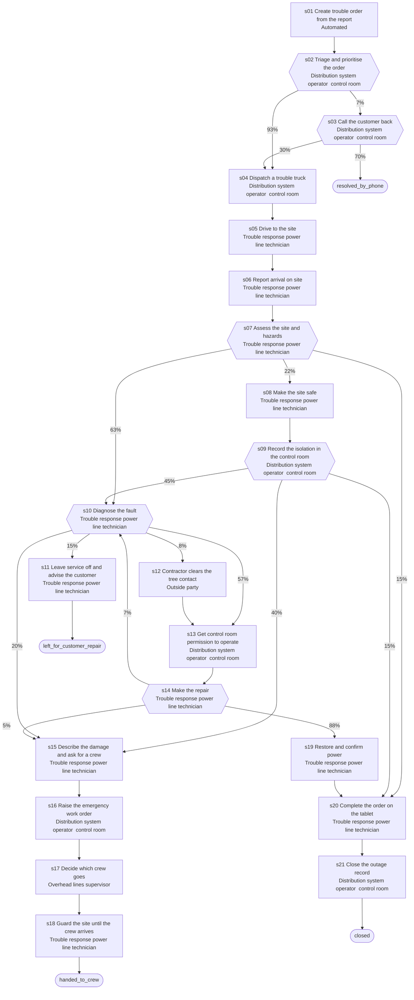

# Respond to trouble calls and hazards

`edu-ops-trouble-response` · electric utilities: power distribution · distribution operations · part of `electric-distribution-utility`

When a customer reports no power, a wire down or a tree on a line, the control room sends a single-person trouble truck. The trouble responder makes the site safe, fixes what one person can (a blown transformer fuse, a loose service connection) and calls for a line crew when a pole, transformer or primary conductor is damaged. The work is slow when both shift trucks are already busy, at night and in storms, when sites are hard to reach, and when a fix needs control room permission or a tree contractor first. The Distribution System Code requires a qualified person on site within 60 minutes in urban areas and 120 in rural areas for emergency calls.

| | |
|---|---|
| Unit of work | one trouble order |
| Starts when | The control room's outage management system creates a trouble order from a customer call, web report, police or fire call, or a smart meter alarm. |
| Done when | Power is restored and the order and outage record are closed, the site is made safe and handed to a line crew, or the customer is told the fault is on their side. |
| Organisation | A city-owned Ontario electricity distributor with about 350,000 customers, a 24-hour system control centre, overhead and underground line crews and single-person trouble trucks, using SCADA, an outage management system, smart meters and mobile workforce tablets. (571 employees, 2019-2022) |
| Volume | 900 cases a month (range 600 to 1,300) |

## Where it sits

- Starts with **trouble_order** from ops-system-monitoring (100% of cases)
- Sends **restoration_work_order** to ops-outage-restoration (outcome: handed_to_crew)
- Sends **outage_event** to ops-system-monitoring (outcome: closed)
- Sends **interruption_data** to ae-reliability-analysis (outcome: closed)
- Sends **customer_outage_notice** to residential-customer (outcome: left_for_customer_repair)

## Flow

## Roles

| Role | Department | Layer | FTE on this process | Loaded cost per hour | Evidence |
|---|---|---|---:|---:|---|
| Trouble response power line technician | Overhead Lines | individual contributor | 10.5 | 70 CAD | B [ho-plt] |
| Distribution system operator (control room) | System Control Centre | individual contributor | 2 | 72 CAD | B [oakville-cro] |
| Overhead lines supervisor | Overhead Lines | supervisor | 0.2 | 80 CAD | C |

## Steps

Hands-on time and the wait before each step show the most common value. Evidence tier A is a sourced number, B a sourced description, C the author's estimate.

| Step | Who | Kind | Hands-on | Wait before | Control | Evidence |
|---|---|---|---:|---:|---|---|
| **s01 Create trouble order from the report.** The outage management system receives a no-power, wire-down or hazard report from the IVR, a contact centre agent, the web outage form or police and fire, places the caller on the network model, groups it with other calls into a predicted device and creates a trouble order on the control room queue. | Automated | system auto | 0 min | 0 min |  | B [ho-blog-2020] |
| **s02 Triage and prioritise the order.** The system operator opens the order, reads the caller's remarks, checks whether police or fire are on site or a wire is down, looks at SCADA for a feeder lockout and pings the smart meter to confirm loss of power, then sets the priority: public safety first, then outages by customers affected. | Distribution system operator (control room) | judgment | 4 min | 5 min |  | B [oakville-cro], [dsc] |
| **s03 Call the customer back.** Where the meter shows power at the service, the operator or an agent calls the customer, asks them to check their main breaker and fuses and whether neighbours have power, and advises them to call a licensed electrician if the problem is inside the house. | Distribution system operator (control room) | communication | 5 min | 10 min |  | C |
| **s04 Dispatch a trouble truck.** The operator picks the nearest free trouble responder from the mobile workforce map, sends the order to the truck tablet and confirms by radio; when both shift trucks are busy the order waits for the first truck to clear or the on-call PLT is called in. | Distribution system operator (control room) | coordination | 3 min | 8 min |  | B [ho-blog-2022] |
| **s05 Drive to the site.** The trouble responder acknowledges the order on the tablet, reads the caller remarks and the predicted device, and drives the single-person bucket truck to the address or the pole number given. | Trouble response power line technician | travel | 20 min | 0 min |  | C |
| **s06 Report arrival on site.** On arrival the responder sets the order to on-site on the tablet and tells the control room by radio; this arrival time is the response time the utility reports against the Distribution System Code emergency standard. | Trouble response power line technician | communication | 2 min | 0 min | OEB Distribution System Code section 7.9: emergency response within 60 minutes urban and 120 minutes rural, 80% of the time | A [dsc] |
| **s07 Assess the site and hazards.** The responder walks the site, looks for wires down, broken poles, burning equipment or trees on lines, sets the minimum approach distance, decides whether to work alone or call help, and records the hazard assessment on the tablet before touching anything. | Trouble response power line technician | judgment | 10 min | 0 min | Electrical Utility Safety Rules: job planning, hazard assessment and pre-job tailboard before work near energized equipment | B [ho-plt], [ihsa-uwpc] |
| **s08 Make the site safe.** The responder keeps the public and fire crews back at least 10 metres, opens the upstream cut-out or switch to isolate a downed conductor where it can be done safely, and stands guard until the line is dead or the hazard is removed. | Trouble response power line technician | physical | 30 min | 0 min | Utility Work Protection Code and Electrical Utility Safety Rules (IHSA), required for work on or near distribution lines under the Occupational Health and Safety Act | B [ho-600], [dsc] |
| **s09 Record the isolation in the control room.** While the responder works, the operator records the opened device and the de-energized section in the OMS and on the operating diagram, so customers affected and later switching are correct and no one re-energizes the section. | Distribution system operator (control room) | coordination | 6 min | 0 min | Utility Work Protection Code and Electrical Utility Safety Rules (IHSA), required for work on or near distribution lines under the Occupational Health and Safety Act | B [oakville-cro] |
| **s10 Diagnose the fault.** The responder tests voltage at the meter base and the transformer secondary, checks the transformer fuse and the service drop and patrols the tap line, then decides whether the fault is on the customer's side, a simple repair, a tree contact or work for a crew. | Trouble response power line technician | analysis | 15 min | 0 min |  | B [ho-plt] |
| **s11 Leave service off and advise the customer.** Where the customer's mast, meter base or panel is damaged, the responder disconnects or leaves the service off, tags it, explains that a licensed electrician must repair it and that the Electrical Safety Authority must authorise reconnection, and closes the order with that status. | Trouble response power line technician | communication | 20 min | 0 min | Ontario Electrical Safety Code (O. Reg. 164/99): ESA connection authorization before a damaged customer service is re-energized | B [ho-600] |
| **s12 Contractor clears the tree contact.** When a tree or large limb lies on the secondary or service, the operator calls the on-call line clearance contractor, whose arborists cut and remove the wood once the responder confirms the line is dead or covered. | Outside party | external wait | 1.0 h | 3.0 h |  | B [ho-blog-2022] |
| **s13 Get control room permission to operate.** Before opening or closing a cut-out, replacing a fuse or reconnecting a drop, the responder radios the operator with the device number; the operator checks the operating diagram, any work protection on the section and the load, and authorises the operation. | Distribution system operator (control room) | coordination | 4 min | 5 min | Utility Work Protection Code and Electrical Utility Safety Rules (IHSA), required for work on or near distribution lines under the Occupational Health and Safety Act | B [oakville-cro], [ihsa-uwpc] |
| **s14 Make the repair.** The responder replaces the transformer fuse from the bucket with a hot stick, tightens or replaces the service connectors, or re-terminates a damaged drop, wearing rubber gloves and following the approach distances for the voltage. | Trouble response power line technician | physical | 30 min | 0 min | Utility Work Protection Code and Electrical Utility Safety Rules (IHSA), required for work on or near distribution lines under the Occupational Health and Safety Act | B [ho-plt] |
| **s15 Describe the damage and ask for a crew.** The responder radios the operator with what is broken (pole, transformer, primary conductor), the material and equipment needed, road and tree conditions and whether customers can be picked up by switching, and photographs the damage on the tablet. | Trouble response power line technician | communication | 10 min | 0 min |  | C |
| **s16 Raise the emergency work order.** The operator turns the trouble order into an emergency restoration work order in the OMS and the work management system, attaches the responder's notes and photographs, and updates the estimated restoration time shown on the outage map. | Distribution system operator (control room) | data entry | 6 min | 0 min |  | C |
| **s17 Decide which crew goes.** The lines supervisor, or the on-call supervisor after hours, decides whether a day crew can be pulled from planned work or an on-call crew must be called out, and confirms the crew and expected arrival to the operator. | Overhead lines supervisor | judgment | 10 min | 10 min |  | C |
| **s18 Guard the site until the crew arrives.** The responder stays with downed or damaged equipment, keeps the public away and briefs the crew leader on arrival, then is released to the next order. | Trouble response power line technician | physical | 45 min | 0 min |  | C |
| **s19 Restore and confirm power.** The responder closes the cut-out or reconnects the service, measures voltage at the transformer and meter base and checks that the smart meter reports power and the customer's lights are on. | Trouble response power line technician | validation | 6 min | 0 min |  | C |
| **s20 Complete the order on the tablet.** The responder enters the cause code, the device operated, materials used and times on the mobile tablet, which updates the OMS record and the work order for costing. | Trouble response power line technician | data entry | 8 min | 0 min |  | C |
| **s21 Close the outage record.** The operator checks the restoration time, customers affected and cause code against SCADA and meter data, corrects obvious errors and closes the outage record that feeds reliability reporting. | Distribution system operator (control room) | validation | 4 min | 10 min |  | B [scorecard-2021] |

## Exceptions

| Exception | Share of cases | What happens |
|---|---:|---|
| Repeat fuse operation | 3% | The replaced transformer fuse blows again, so the responder re-diagnoses and often finds an internal transformer fault that needs a crew. |
| Tree contact needs a contractor | 6% | A limb on the secondary or service has to be removed by the line clearance contractor before the responder can reconnect. |
| Customer-side damage | 8% | A torn-off mast or damaged meter base means the service stays off until the customer's electrician repairs it and ESA authorises reconnection. |

## Benchmarks

| Metric | Value | Unit | Population | Evidence |
|---|---|---|---|---|
| emergency_response_standard | urban_minutes 60, rural_minutes 120, share_of_calls 0.8 | minutes from emergency call to qualified person on site | Ontario licensed electricity distributors | A [dsc] |
| cycle_time_days | p50 0.11, p90 0.3 | calendar days from trouble order to order closed or handed to a crew | Trouble orders at a large Ontario distributor, ordinary weather | C |

## Pain points

- Two trucks per shift means a third call waits for the first truck to clear, so no-power calls queue behind hazards at night and in storms. (steps s04; C)
- A responder guarding a downed wire is unavailable for other calls until a crew arrives. (steps s08, s18; C)
- Every operation needs radio permission from a busy control room, which adds minutes to each repair. (steps s13; B [oakville-cro], [ihsa-uwpc])
- Cause codes entered in the field are often 'unknown' or wrong and must be corrected before reliability reporting. (steps s20, s21; C)

## Assumptions

- The process starts when the OMS creates a trouble order; the customer call itself belongs to the contact centre and the IVR.
- Only the system operator's minutes on individual orders are counted here (about 2 FTE); the rest of the 24/7 desk is in edu-ops-system-monitoring so that FTEs are not counted twice.
- Response time to arrival (DSC 7.9) applies to emergency calls; ordinary no-power calls can wait longer behind hazards, which the dispatch wait range reflects.
- Trouble PLT FTE (10.5) reflects shift presence: two responders on every shift around the clock. Hands-on time times volume implies fewer hours, because responders also wait between calls and do small patrols and switching for other processes.
- Loaded costs come from the organisation file (wage x 1.40).
- The simulated median of about 4 hours is longer than the 2.6-hour benchmark estimate because it includes the wait for a free truck and the delay before the operator closes the outage record; time to restore the customer is closer to the benchmark.
- About 1.6 hours of trouble PLT time per order at 900 orders a month uses nearly all the hours of two trucks per shift (about 1,460 truck-hours a month). In practice day line crews and field service staff absorb some orders; if they do not, the organisation file volume of 900 a month is on the high side for two trucks.
- Shares of hazards, simple repairs, crew requests and customer-side faults are the author's estimates; no published breakdown was found.

## Sources

- [dsc] [Distribution System Code (last revised March 27, 2024)](https://www.oeb.ca/sites/default/files/Distribution-System-Code_March_20240327.pdf) (Ontario Energy Board, 2024). Section 7.9: emergency calls must be responded to within 60 minutes in urban areas and 120 minutes in rural areas, at least 80% of the time on a yearly basis; arrival of a qualified service person on site is a response. Section 4.5.3: during an emergency a distributor may interrupt supply to effect repairs. The 7.9 standard predates the reference period (the same 60/120-minute rule appears in the code's earlier versions).
- [ho-blog-2020] [How Hydro Ottawa powers through summer storm season](https://hydroottawa.com/en/blog/how-hydro-ottawa-powers-through-summer-storm-season) (Hydro Ottawa, 2020). Additional staff put on standby and resources relocated when severe weather is forecast; outages reported through the 24/7 outage line, app and MyAccount; outage map updated every 15 minutes; restoration estimates posted when available.
- [ho-blog-2022] [How utilities prepare for emergencies](https://hydroottawa.com/en/blog/how-utilities-prepare-emergencies) (Hydro Ottawa, 2022). Emergency Response Plan with year-round simulations; priorities set by health and safety risk, essential services such as hospitals and schools, then densely populated areas; system operators in the control centre on duty 24/7; field operators handle emergency response, outage restoration and single-customer calls; on-call staff, contractors and arborists after hours; automated field devices restore some customers automatically.
- [oakville-cro] [Control Room Operator (job posting, closed February 13, 2022)](https://mearie.talentnest.com/en/posting/82564) (Oakville Hydro, via The MEARIE Group careers site, 2022). Ontario distribution control room duties: operate SCADA/ADMS and automated field devices, prepare and direct scheduled and emergency switching and load transfers, deliver Utility Work Protection Code processes, liaise with Hydro One and the IESO on outages and restoration, daily KPI reporting and post-event analysis; MEARIE operator training.
- [ho-plt] [Powerline Technician / Hydro Ottawa (job posting, closed February 24, 2025)](https://mearie.talentnest.com/posting/196792) (Hydro Ottawa, via The MEARIE Group careers site, 2025). PLTs respond to electrical emergencies, outages and reliability problems, diagnose and repair or replace equipment, assist first responders, do switching and live-line work, and provide 24/7 on-call duty on a yearly schedule; IBEW Local 636 collective agreement.
- [ihsa-uwpc] [Keys to the Utility Work Protection Code (IHSA Health and Safety Magazine)](https://www.ihsa.ca/IHSA-Health-Safety-Magazine/IHSAV232/Keys-to-the-Utility-Work-Protection-Code.aspx) (Infrastructure Health and Safety Association, None). The Electrical Utility Safety Rules govern how workers act near hazards and the Utility Work Protection Code uses permits and tags to show when lines are isolated and safe to work on; permit issuers and workers need training and certification. Publication year not stated on the page.
- [ho-600] [600 skilled field workers dispersed across city to restore remaining 29,000 customers - 3:00 PM update](https://hydroottawa.com/en/news-releases/600-skilled-field-workers-dispersed-across-city-restore-remaining-29000-customers-300) (Hydro Ottawa, 2022). About 600 employees and crews working around the clock; 151,000 restored six days after the storm; switching largely done remotely by the System Office; homes with damaged electrical equipment need repairs before reconnection; stay 10 metres from downed lines and call the outage line.
- [scorecard-2021] [Scorecard - Hydro Ottawa Limited (2017-2021) and 2021 Scorecard MD&A](https://www.oeb.ca/documents/scorecard/2021/Scorecard%20-%20Hydro%20Ottawa%20Limited.pdf) (Ontario Energy Board, 2022). Average hours of interruption per customer 0.83 in 2020 and 2021; average interruptions per customer 0.72 in 2020 and 0.62 in 2021 (both excluding loss of supply and major events); one major event in 2021; top outage causes loss of supply, defective equipment and foreign interference; emergency (unplanned) capital $8.57M against a $6.73M budget in 2021.
- [me-index] [Major events (list of Hydro Ottawa major event reports)](https://hydroottawa.com/en/about-us/regulatory-affairs/major-events) (Hydro Ottawa, 2026). Major events listed by date: three in 2019 (April 15, July 5, November 1), two in 2020 (March 7, October 18), one in 2021 (June 14), three in 2022 (May 21, June 18, December 23); after a major event the utility files a report with the OEB normally within 60 days of occurrence.
- [after-storm] [Hydro Ottawa releases its After the Storm report](https://newswire.ca/news-releases/hydro-ottawa-releases-its-after-the-storm-report-815321222.html) (Hydro Ottawa (via Cision Newswire), 2022). May 2022 derecho: winds up to 190 km/h; damage across the entire service territory; 1,000 individual outages against 200 after the 2018 tornadoes; more than 1,500 known or reported tree contacts; 180,000 customers out at the peak; estimated cost $23.8M.
- [me-2022-05] [Hydro Ottawa Limited Major Event: May 21, 2022](https://hydroottawa.com/en/about-us/regulatory-affairs/major-events/may-21-2022) (Hydro Ottawa, 2022). Derecho began 3:36 pm May 21, 2022; 90% of interrupted customers restored by 6:00 pm May 28; 180,946 customers interrupted on the day plus 11,528 on later days (54% of customers); about 450 workers including four high-voltage lines contractors, four neighbouring utilities, three forestry, three civil and one communications contractor; mutual assistance through Electricity Canada and EDA channels; no equipment or material shortages; outage map withdrawn and relaunched May 30 with restoration estimates in days; daily SAIDI 2,308.27 against an IEEE 1366 threshold of 5.05; only a Severe Thunderstorm Watch at 2:12 pm before outages began; company-wide debrief under way.

Written by claude-opus on 2026-11-24.
