# Build and renew underground plant (cable crews)

`edu-ops-underground-construction` · electricity distribution · distribution operations · part of `electric-distribution-utility`

Cable crews install and replace underground primary cable, padmount transformers and switchgear, splice and terminate cable after civil contractors have built the ducts and vaults, and energize new subdivisions. An inspector first confirms the civil work is ready, a planner gets the dig points located and an outage booked, and stores stage reels and equipment. A crew of two or three splicers and an apprentice pulls cable, sets equipment, splices, tests and energizes under a work protection permit, then hands back redlines and hours. Jobs stall when contractors are late, when transformers and switchgear are on backorder, and on the multi-address locate and outage notice lead times.

| | |
|---|---|
| Unit of work | one underground work order |
| Starts when | Work scheduling releases the work order to a cable crew with a planned week (crew schedule). |
| Done when | Cable and equipment are installed, tested and energized, crew time is approved and the as-built has reached the capital project manager; or the job is deferred. |
| Organisation | A municipally owned Ontario electricity distributor with about 346,000 customers, 3,167 km of underground line and 14 in-house cable crews. (571 employees, 2019-2022) |
| Volume | 45 cases a month (range 30 to 70) |

## Where it sits

- Starts with **crew_schedule** from ops-work-scheduling (100% of cases)
- Relies on **work_protection** from ops-control-room-switching (a standing input; it does not start a case)
- Relies on **material_issue** from fin-inventory-stores (a standing input; it does not start a case)
- Relies on **locate_result** from ops-locates (a standing input; it does not start a case)
- Relies on **design_package** from ae-distribution-design (a standing input; it does not start a case)
- Relies on **inspection_findings** from ae-construction-inspection (a standing input; it does not start a case)
- Sends **as_built** to ae-capital-project-delivery (outcome: completed)
- Sends **time_record** to fin-payroll (outcome: any)
- Sends **locate_request** to ontario-one-call (outcome: any)
- Sends **spill_report** to corp-environment (outcome: completed)
- Sends **capital_work_order** to ae-capital-project-delivery (outcome: deferred)

## Flow

```mermaid
flowchart TD
    s01["s01 Review the released job package<br/>Underground and cable supervisor"]
    s02{{"s02 Confirm the civil work is ready<br/>Construction inspector"}}
    s03["s03 Wait for the civil contractor to finish<br/>Outside party"]
    s04["s04 Submit locate requests<br/>Work planner and scheduler"]
    s05["s05 Wait for underground owners to mark the site<br/>Outside party"]
    s06{{"s06 Stage cable reels and equipment<br/>Stores attendant"}}
    s07["s07 Chase long-lead equipment<br/>Work planner and scheduler"]
    s08["s08 Request switching and a planned outage<br/>Work planner and scheduler"]
    s09["s09 Write the switching order and book the outage<br/>Switching and outage planner"]
    s10{{"s10 Hold for the booked crew day and outage window<br/>Underground and cable supervisor"}}
    s11["s11 Reschedule the job<br/>Work planner and scheduler"]
    s12["s12 Drive the crew and cable truck to site<br/>Cable splicer / underground power line technician"]
    s13{{"s13 Hold the tailboard and set up the site<br/>Cable splicer / underground power line technician"}}
    s14["s14 Pull new cable into the ducts<br/>Cable splicer / underground power line technician"]
    s15{{"s15 Take work protection from the control room<br/>Distribution system operator  control room"}}
    s16["s16 Set or replace padmount equipment<br/>Cable splicer / underground power line technician"]
    s17["s17 Splice and terminate the cable<br/>Cable splicer / underground power line technician"]
    s18["s18 Prepare cable and assist the splicers<br/>Apprentice cable splicer"]
    s19{{"s19 Test the new cable before energizing<br/>Cable splicer / underground power line technician"}}
    s20["s20 Inspect the installation<br/>Construction inspector"]
    s21["s21 Energize and release protection<br/>Distribution system operator  control room"]
    s22["s22 Clean up and return equipment<br/>Cable splicer / underground power line technician"]
    s23["s23 Complete the work order and redlines<br/>Cable splicer / underground power line technician"]
    s24{{"s24 Review and sign off the job<br/>Underground and cable supervisor"}}
    s25["s25 Close the field work order and send the as-built<br/>Work planner and scheduler"]
    s01 --> s02
    s02 -->|"72%"| s04
    s02 -->|"25%"| s03
    s02 -->|"3%"| end0
    s03 --> s02
    s04 --> s05
    s05 --> s06
    s06 -->|"85%"| s08
    s06 -->|"15%"| s07
    s07 --> s06
    s08 --> s09
    s09 --> s10
    s10 -->|"90%"| s12
    s10 -->|"10%"| s11
    s11 --> s10
    s12 --> s13
    s13 -->|"70%"| s14
    s13 -->|"30%"| s15
    s14 --> s15
    s15 -->|"50%"| s16
    s15 -->|"50%"| s17
    s16 --> s17
    s17 --> s18
    s18 --> s19
    s19 -->|"50%"| s20
    s19 -->|"45%"| s21
    s19 -->|"5%"| s17
    s20 --> s21
    s21 --> s22
    s22 --> s23
    s23 --> s24
    s24 -->|"90%"| s25
    s24 -->|"10%"| s23
    s25 --> end1
    end0(["deferred"])
    end1(["completed"])
```

## Roles

| Role | Department | Layer | FTE on this process | Loaded cost per hour | Evidence |
|---|---|---|---:|---:|---|
| Underground and cable supervisor | Underground and Cable | supervisor | 1.5 | 80 CAD | C |
| Cable splicer / underground power line technician | Underground and Cable | individual contributor | 14 | 66 CAD | B [jobbank_72203] |
| Apprentice cable splicer | Underground and Cable | individual contributor | 4 | 46 CAD | C |
| Work planner and scheduler | Work Planning and Dispatch | individual contributor | 1.2 | 55 CAD | C |
| Construction inspector | Capital Project Delivery | individual contributor | 0.6 | 56 CAD | C |
| Stores attendant | Supply Chain and Stores | individual contributor | 0.5 | 45 CAD | C |
| Switching and outage planner | System Control Centre | senior specialist | 0.4 | 70 CAD | C |
| Distribution system operator (control room) | System Control Centre | individual contributor | 0.4 | 72 CAD | C |

## Steps

Hands-on time and the wait before each step show the most common value. Evidence tier A is a sourced number, B a sourced description, C the author's estimate.

| Step | Who | Kind | Hands-on | Wait before | Control | Evidence |
|---|---|---|---:|---:|---|---|
| **s01 Review the released job package.** The underground supervisor opens the scheduled work order in the ERP and mobile workforce tool, reads the design package (cable routes, duct and vault drawings, splice and termination details, transformer and switchgear specifications) and assigns a crew lead. | Underground and cable supervisor | intake | 40 min | 2.0 d |  | C |
| **s02 Confirm the civil work is ready.** A construction inspector visits the site to confirm the civil contractor has finished: ducts installed and proven with a mandrel, vaults, transformer pads and switchgear bases set at grade, pull strings in place. They record what is missing on the inspection form. | Construction inspector | validation | 2.0 h | 3.0 d |  | B [ho_fortune] |
| **s03 Wait for the civil contractor to finish.** The civil contractor completes or repairs the ducts, vaults and pads, often working around other subdivision trades or winter conditions, and notifies the project manager when the site is ready again. | Outside party | external wait | 0 min | 14.0 d |  | C |
| **s04 Submit locate requests.** The work planner enters the excavation points (splice pits, transformer pads, riser poles, road crossings) on the Ontario One Call portal with the planned dig date and files the ticket numbers on the job. | Work planner and scheduler | data entry | 20 min | 12.0 h | Ontario Underground Infrastructure Notification System Act, 2012 and Occupational Health and Safety Act: locate all buried plant before excavating | B [ho_locates] |
| **s05 Wait for underground owners to mark the site.** The utility's own locators and the gas, telecom, water and municipal owners mark their buried plant at each dig point. Owners have five business days for a single address and ten for a multi-address request, which most cable jobs are. | Outside party | external wait | 0 min | 7.0 d |  | B [ho_locates] |
| **s06 Stage cable reels and equipment.** A stores attendant issues cable reels, splice and termination kits, elbows, padmount transformers or switchgear against the work order in the ERP and arranges delivery of reels and transformers to site or to the cable truck. | Stores attendant | physical | 1.5 h | 1.0 d |  | C |
| **s07 Chase long-lead equipment.** The work planner works with the buyer on delivery dates for padmount transformers, switchgear or a specific cable, checks whether an approved substitute is in another job's stock, and moves the job if needed. | Work planner and scheduler | coordination | 45 min | 14.0 d |  | C |
| **s08 Request switching and a planned outage.** The work planner sends the control room a switching request for the tie-in or equipment change, with isolation points, date and protection holder, and asks for planned outage notices for the customers on the affected loop or radial. | Work planner and scheduler | coordination | 30 min | 1.0 d |  | C |
| **s09 Write the switching order and book the outage.** A switching and outage planner checks the underground loop in the GIS and outage management system, writes the switching order and grounding points, books the outage window so customers get advance notice, and triggers the notices. | Switching and outage planner | drafting | 1.0 h | 3.0 d | Utility Work Protection Code (IHSA): work protection permit and tags issued by the control room before work on isolated plant | B [ihsa_uwpc] |
| **s10 Hold for the booked crew day and outage window.** The job waits for the crew slot and the date given to customers in the outage notice. The day before, the supervisor confirms the crew, cable truck, reels, switching order and contractor support. | Underground and cable supervisor | coordination | 20 min | 4.0 d |  | C |
| **s11 Reschedule the job.** The work planner rebooks the crew day with the supervisor, moves the switching order and outage with the control room, and has new notices sent. | Work planner and scheduler | coordination | 40 min | 3.0 d |  | C |
| **s12 Drive the crew and cable truck to site.** The cable crew loads splice kits and elbows and drives the splicing truck, reel trailer and generator from the operations centre to the site, often across the city. | Cable splicer / underground power line technician | travel | 35 min | 30 min |  | C |
| **s13 Hold the tailboard and set up the site.** The crew lead runs the pre-job briefing and hazard assessment, fences open vaults and excavations, sets up traffic control and checks the gas detector and vault ventilation before anyone enters a vault. | Cable splicer / underground power line technician | physical | 40 min | 0 min | Electrical Utility Safety Rules (IHSA) and Ontario Regulation 213/91: hazard assessment, confined space entry and traffic protection | B [ihsa_uwpc] |
| **s14 Pull new cable into the ducts.** The crew sets up the reel trailer and winch, attaches the pulling eye to the pull string, lubricates and pulls the cable through the ducts between vaults or pads while watching tension, and leaves enough tail for splicing. | Cable splicer / underground power line technician | physical | 4.0 h | 0 min |  | B [ho_fortune], [ho_maint] |
| **s15 Take work protection from the control room.** The system operator directs the switching on the loop; the crew opens elbows or switchgear and reports each step. The operator issues the work protection permit, and the protection holder tests the cable dead and applies grounds at both ends. | Distribution system operator (control room) | coordination | 40 min | 20 min | Utility Work Protection Code (IHSA): work protection permit and tags issued by the control room before work on isolated plant | B [ihsa_uwpc] |
| **s16 Set or replace padmount equipment.** The crew disconnects the old padmount transformer or switchgear, lifts it out with the boom truck, sets the new unit on the pad, and checks rating, phasing and grounding against the drawing. | Cable splicer / underground power line technician | physical | 4.0 h | 0 min |  | B [ho_fortune] |
| **s17 Splice and terminate the cable.** Two cable splicers prepare cable ends, install splices and load-break elbows at transformers and switchgear, and make terminations at riser poles, following the splice kit instructions and company standards. A 28 kV splice takes a few hours of careful work. | Cable splicer / underground power line technician | physical | 6.0 h | 0 min |  | C |
| **s18 Prepare cable and assist the splicers.** The apprentice cleans and trains cable ends, passes tools and kit parts, runs the generator and keeps the vault ventilated and the work zone clear while the splicers work. | Apprentice cable splicer | physical | 6.0 h | 0 min |  | C |
| **s19 Test the new cable before energizing.** The crew runs an insulation or very low frequency withstand test on the new section, checks phasing, records results on the test sheet and fixes any failure before handing back. | Cable splicer / underground power line technician | validation | 1.0 h | 0 min | Company construction standard: test new primary cable before energizing | C |
| **s20 Inspect the installation.** A construction inspector checks the installation against the drawings and standards: cable identification, splice locations, grounding, clearances at pads, labels and test records, and records any deficiency. | Construction inspector | review | 1.0 h | 2.0 h | Ontario Regulation 22/04 s. 8: construction inspected and certified safe before it is put into use | B [esa_guidelines] |
| **s21 Energize and release protection.** The crew removes grounds and tags and surrenders the permit. The system operator switches the section into service, restores the normal open point and confirms customers are back on. | Distribution system operator (control room) | coordination | 30 min | 10 min | Utility Work Protection Code (IHSA): work protection permit and tags issued by the control room before work on isolated plant | B [ihsa_uwpc] |
| **s22 Clean up and return equipment.** The crew closes vaults, returns empty reels and removed transformers to the yard (old units go for PCB testing and disposal), credits unused material and reports truck defects. | Cable splicer / underground power line technician | travel | 1.2 h | 0 min |  | C |
| **s23 Complete the work order and redlines.** The crew lead records splice locations, cable lengths and equipment serial numbers on the drawing, enters crew hours by work order and completes the job in the mobile tool. | Cable splicer / underground power line technician | data entry | 40 min | 12.0 h |  | C |
| **s24 Review and sign off the job.** The underground supervisor reviews hours, redlines and test records, approves the timesheets and signs the job complete, or returns it to the crew lead for missing information. | Underground and cable supervisor | approval | 30 min | 2.0 d | Collective agreement and payroll policy: supervisor approval of crew time | C |
| **s25 Close the field work order and send the as-built.** The work planner sets the field work order to complete in the ERP, scans redlines and test records into the document repository and sends the as-built package to the capital project manager. | Work planner and scheduler | data entry | 25 min | 2.0 d |  | C |

## Exceptions

| Exception | Share of cases | What happens |
|---|---:|---|
| Civil work not ready | 25% | Ducts, vaults or pads are unfinished or deficient; the job waits for the contractor and the inspector rechecks. |
| Long-lead equipment on backorder | 15% | A padmount transformer, switchgear or cable is not in stock; the job slips until delivery. |
| Outage moved | 10% | A customer asks to move the outage, the crew is pulled to a cable fault, or frost stops excavation; switching and notices are rebooked. |
| Failed cable test | 5% | The new section fails its test and a splice or termination is redone before energizing. |

## Benchmarks

| Metric | Value | Unit | Population | Evidence |
|---|---|---|---|---|
| cycle_time_days | p50 40, p90 80 | calendar days from job release to the crew to as-built handed to the project manager | Ontario municipal distributor in-house underground jobs, 2019-2022 | C |
| underground_cable_length | 5000 | km of underground cable | Hydro Ottawa, about 2016 | A [tdw2016] |

## Pain points

- Crews arrive to find ducts or pads unfinished or blocked; civil readiness depends on contractors outside the crew's control. (steps s02, s03, s14; B [ho_fortune])
- Multi-address locates take up to ten business days and outages need advance customer notice, so preparation takes weeks for a one or two day crew job. (steps s04, s05, s09, s10; B [ho_locates])
- Padmount transformer and switchgear lead times stretched in 2021-2022, stalling staged jobs. (steps s06, s07; C)
- Splice locations and serial numbers are captured on paper or tablet redlines and often come back incomplete, delaying records. (steps s23, s24; C)

## Assumptions

- The process starts when work scheduling releases the job to a cable crew and ends when the as-built reaches the capital project manager; civil construction, design, switching and GIS posting are other processes.
- Crew work is recorded as elapsed crew time with people = 3 (or 2 splicers plus a concurrent apprentice step for splicing).
- About 70% of jobs include a cable pull and about half set or replace padmount equipment; every job ties into the energized system under a work protection permit.
- Loaded costs come from the organisation file (wage x 1.40).
- The digger derrick stands in for the boom truck used to lift padmount transformers.

## Sources

- [ho_fortune] [Fortune Cable Renewal](https://hydroottawa.com/en/community/major-projects/fortune-cable-renewal) (Hydro Ottawa, 2025). Cable renewal done by Hydro Ottawa crews and contractors: buried ducts and concrete-encased road crossings, cable and transformer replacement (46 and 30 transformers in two phases), multi-phase over two years, temporary backfill then reinstatement when weather allows.
- [ho_maint] [An in-depth look at Hydro Ottawa's grid maintenance](https://hydroottawa.com/en/blog/depth-look-hydro-ottawas-grid-maintenance) (Hydro Ottawa, 2024). Critical pole program tests thousands of poles a year; replacements are driven by testing or by emergencies such as vehicle collisions; cable replacements are prioritised from fault histories, cable tests and estimated life; new cable goes in 4-inch PVC or HDPE conduit.
- [ho_locates] [Contractors: locates and safe digging](https://hydroottawa.com/en/contractors/locates-safe-digging) (Hydro Ottawa, 2025). Locate requests at least five business days before digging (ten for multi-address requests), legally required; hand digging or hydrovac near cables; stay 1.5 m from marked cables; re-locate when marks expire. Current page; the five-business-day rule applied in 2019-2022.
- [esa_guidelines] [Regulation Technical Guidelines (Ontario Regulation 22/04)](https://esasafe.com/utilities/) (Electrical Safety Authority (Ontario), n.d.). Ontario Regulation 22/04: all equipment and plans or standard design drawings must be approved (ss. 6-7); all construction inspected and certified safe before use (s. 8); annual audit of compliance; serious electrical incidents reported to ESA within 48 hours.
- [ihsa_uwpc] [Keys to the Utility Work Protection Code](https://www.ihsa.ca/IHSA-Health-Safety-Magazine/IHSAV232/Keys-to-the-Utility-Work-Protection-Code.aspx) (Infrastructure Health and Safety Association (IHSA) Health and Safety Magazine, vol. 23 issue 2, n.d.). The Electrical Utility Safety Rules govern worker conduct near hazards; the Utility Work Protection Code uses permits and tags to show when lines are safe to work on; issuers and workers must be trained and certified.
- [jobbank_72203] [Wages: Lineworker - Electrical Power Systems in Ontario (NOC 72203)](https://www.jobbank.gc.ca/marketreport/wages-occupation/27095/ON) (Government of Canada, Job Bank, 2025). Ontario hourly wage low 29.70, median 49.48, high 62.90; Ottawa region 32.93, 50.63, 63.29 (2024-2025 reference period).
- [tdw2016] [Utility Proactively Tests Underground Cable (Alana Jones and Bill Bennett)](https://www.tdworld.com/electric-utility-operations/article/20966290/utility-proactively-tests-underground-cable) (T&D World, 2016). Hydro Ottawa has nearly 5,000 km of underground cable, more than 90% XLPE, much installed from the mid-1970s to 1990 and at or past its 30-year expected life; replacing on faults is a lagging approach; injection versus replacement depends on splice count and feasibility.

Written by claude-opus on 2026-11-24.
