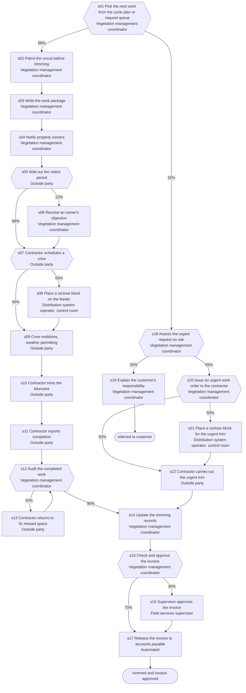

# Manage tree trimming near lines

`edu-ops-vegetation-management` · electric power distribution · distribution operations · part of `electric-distribution-utility`

Trees growing into overhead lines cause outages and fires, so the utility pays tree contractors to trim around its lines on a fixed cycle, every two years on urban circuits and every three on rural ones, and to deal with urgent trees reported by inspectors and customers between cycles. A small team of vegetation coordinators patrols each circuit before trimming, writes the work package, notifies property owners and settles objections, then audits the contractor's work and checks the invoice before it is paid; control room operators block reclosing on feeders where crews work close to the line. Work is slowed by notice periods, owner objections, contractor crew availability and weather, and audits on a small sample let missed spans through until the next outage.

| | |
|---|---|
| Unit of work | one circuit-kilometre trimmed on cycle, or one urgent tree request between cycles |
| Starts when | A circuit section comes due in the two- or three-year trimming cycle, or an inspector or customer reports a tree close to or touching a primary line. |
| Done when | The trees are trimmed to clearance and recorded, the contractor's invoice is approved for payment, or the customer is told that the tree or service wire is theirs to manage. |
| Organisation | A city-owned Ontario electricity distributor with about 350,000 customers and about 2,750 km of overhead line over a mixed urban, suburban and rural territory. (571 employees, 2019-2022) |
| Volume | 125 cases a month (range 80 to 180) |

## Where it sits

- Starts with **capital_plan** from ae-capital-plan (68% of cases)
- Starts with **inspection_findings** from ops-distribution-inspection (20% of cases)
- Starts with **customer_inquiry** from cs-contact-centre (12% of cases)
- Relies on **asset_register** from ae-records-gis (a standing input; it does not start a case)
- Relies on **purchase_order** from fin-procurement (a standing input; it does not start a case)
- Sends **vegetation_work_order** to contractor (outcome: any)
- Sends **supplier_invoice** to fin-accounts-payable (outcome: trimmed and invoice approved)
- Sends **inspection_findings** to ae-asset-condition-assessment (outcome: trimmed and invoice approved)

## Flow

## Roles

| Role | Department | Layer | FTE on this process | Loaded cost per hour | Evidence |
|---|---|---|---:|---:|---|
| Vegetation management coordinator | Field Services | senior specialist | 3 | 56 CAD | C |
| Field services supervisor | Field Services | supervisor | 0.1 | 72 CAD | C |
| Distribution system operator (control room) | System Control Centre | individual contributor | 0.05 | 72 CAD | C |

## Steps

Hands-on time and the wait before each step show the most common value. Evidence tier A is a sourced number, B a sourced description, C the author's estimate.

| Step | Who | Kind | Hands-on | Wait before | Control | Evidence |
|---|---|---|---:|---:|---|---|
| **s01 Pick the next work from the cycle plan or request queue.** The coordinator reviews the cycle plan spreadsheet for circuits coming due and the queue of tree findings from inspectors and customer service requests, and decides whether each item is cycle work or needs an urgent visit. | Vegetation management coordinator | judgment | 5 min | 0 min |  | B [tdw2026], [ho_veg] |
| **s02 Patrol the circuit before trimming.** The coordinator drives and walks the circuit section with GIS maps, marks spans that need trimming or removals, notes hazard trees, access problems, gardens and properties that need personal contact, and estimates crew time. | Vegetation management coordinator | physical | 1.0 h | 7.0 d |  | B [tdw2026] |
| **s03 Write the work package.** The coordinator turns the patrol notes into a work package for the contractor: span list, clearances by voltage, removals, spans needing a reclose block or outage, access notes and an estimate, and issues it as a release under the trimming contract. | Vegetation management coordinator | drafting | 30 min | 2.0 d |  | B [ho_veg], [ho_grid2024] |
| **s04 Notify property owners.** The coordinator or a contractor's notifier leaves door hangers or letters at every affected property giving the dates and work, and phones or visits owners where a tree is to be removed or heavily cut. | Vegetation management coordinator | communication | 20 min | 1.0 d | Property owner notification before planned trimming (utility vegetation management policy) | B [hydroone_veg] |
| **s05 Wait out the notice period.** Owners have about one to two weeks to call with questions or objections before the crew arrives; most do not respond. | Outside party | external wait | 0 min | 7.0 d |  | C |
| **s06 Resolve an owner's objection.** The coordinator calls or meets the owner, explains the clearance needed and the outage risk, agrees on a pruning approach or a removal with replacement planting where policy allows, and records any span deferred or escalated. | Vegetation management coordinator | judgment | 1.0 h | 3.0 d |  | B [hydroone_veg] |
| **s07 Contractor schedules a crew.** The contractor's general foreman fits the package into the crew schedule, which competes with storm work, other utilities' work and its own staffing. | Outside party | external wait | 0 min | 7.0 d |  | C |
| **s08 Place a reclose block on the feeder.** When a crew will work within the limits of approach, its foreman calls the control room and the operator disables automatic reclosing on the feeder in SCADA, logs the hold-off, and removes it when the crew reports clear. | Distribution system operator (control room) | coordination | 10 min | 15 min | Reclose blocking for work near energized lines under the utility's work protection code and IHSA Electrical Utility Safety Rules | C |
| **s09 Crew mobilizes, weather permitting.** The crew moves its bucket truck and chipper to the circuit; high wind, lightning, ice and extreme heat stop aerial tree work, so starts slip day by day. | Outside party | external wait | 0 min | 0 min |  | C |
| **s10 Contractor trims the kilometre.** A three-person utility arborist crew with a bucket truck and chipper prunes the marked trees to clearance, removes hazard trees, chips small branches and leaves cut wood in place where agreed; an urban kilometre with about 55 to 60 trees takes one to three crew days. | Outside party | external wait | 0 min | 1.0 d | Limits of approach for tree work near energized conductors (Ontario Regulation 213/91, Construction Projects) | B [ho_grids2024], [hydroone_veg] |
| **s11 Contractor reports completion.** The contractor sends the completed span list, timesheets and equipment hours for the package by email, usually with the weekly or monthly billing. | Outside party | external wait | 0 min | 3.0 d |  | C |
| **s12 Audit the completed work.** The coordinator drives a sample of the circuit, checks clearances and clean-up against the package, and lists spans that were missed or left short of clearance. | Vegetation management coordinator | validation | 45 min | 5.0 d | Verification of contractor work before payment (utility contract management policy) | B [tdw2026] |
| **s13 Contractor returns to fix missed spans.** The contractor sends a crew back at its own cost to finish the spans listed in the audit, then emails the coordinator that they are done. | Outside party | external wait | 0 min | 5.0 d |  | C |
| **s14 Update the trimming records.** The coordinator records the trim date, spans done, removals and deferred spans for the circuit in the GIS layer and the cycle spreadsheet so the next cycle and urgent calls can be checked against it. | Vegetation management coordinator | data entry | 15 min | 1.0 d |  | C |
| **s15 Check and approve the invoice.** The coordinator matches the contractor's invoice lines to timesheets, equipment hours, unit counts and the purchase order release, queries differences with the contractor and approves it in the ERP up to their limit. | Vegetation management coordinator | validation | 20 min | 7.0 d | Receipt and approval of contractor work by the work owner before accounts payable pays (delegated authority policy) | C |
| **s16 Supervisor approves the invoice.** The field services supervisor reviews the coordinator's reconciliation of timesheets and units for larger invoices and approves them in the ERP or sends questions back. | Field services supervisor | approval | 10 min | 2.0 d | Delegated spending authority | C |
| **s17 Release the invoice to accounts payable.** The ERP moves the approved invoice into the next payment run and charges the cost to the vegetation management budget. | Automated | system auto | 0 min | 1.0 d |  | C |
| **s18 Assess the urgent request on site.** The coordinator looks up the location in the GIS, checks the last trim date, and visits the site to see whether a tree is touching or close to a primary line, is a dead or leaning hazard tree, or only affects the customer's own service wire. | Vegetation management coordinator | physical | 50 min | 2.0 d |  | B [ho_veg] |
| **s19 Explain the customer's responsibility.** The coordinator calls or emails the customer to explain that the tree or service wire is theirs to manage, and how to book a temporary disconnect so their own arborist can work safely. | Vegetation management coordinator | communication | 15 min | 1.0 d |  | B [ho_veg] |
| **s20 Issue an urgent work order to the contractor.** The coordinator phones the contractor's on-call foreman and emails a short work order with the location, photos and the work needed, flagged for completion within days. | Vegetation management coordinator | communication | 20 min | 1.0 h |  | C |
| **s21 Place a reclose block for the urgent trim.** The control room operator disables reclosing on the feeder while the crew works close to the line and restores it when the crew reports clear. | Distribution system operator (control room) | coordination | 10 min | 15 min | Reclose blocking for work near energized lines under the utility's work protection code | C |
| **s22 Contractor carries out the urgent trim.** A contractor crew trims or removes the tree within days, or the same day if it is touching the line, and reports completion with photos. | Outside party | external wait | 0 min | 2.0 d | Limits of approach for tree work near energized conductors (Ontario Regulation 213/91, Construction Projects) | C |

## Exceptions

| Exception | Share of cases | What happens |
|---|---:|---|
| Owner objection | 8% | An owner objects to pruning or removal; the coordinator negotiates and some spans are deferred to the next cycle. |
| Missed spans | 7% | The audit finds spans skipped or short of clearance and the contractor returns. |
| Customer's own tree | 11% | The urgent request concerns a service wire or private tree, which is the customer's responsibility. |

## Benchmarks

| Metric | Value | Unit | Population | Evidence |
|---|---|---|---|---|
| trim_cycle_years | urban 2, rural 3 | years between cycle trims | Hydro Ottawa before the 2022 pilot | A [tdw2026] |
| trees_trimmed_per_year | 60000 | trees | Hydro Ottawa, typical year | A [ho_grids2024], [ho_veg] |
| cycle_time_days | p50 45, p90 75 | calendar days from picking the work to invoice approved (cycle work) or reply or invoice (urgent requests) | Author's estimate | C |

## Pain points

- Planning rests on subjective ground patrols and fixed cycles, so effort goes to circuits on the calendar rather than the spans most likely to cause outages. (steps s01, s02; A [tdw2026])
- Audits check only a sample of the work, so missed spans show up later as tree outages. (steps s12; B [tdw2026])
- Notice periods, owner objections and contractor crew availability stretch each package over weeks. (steps s05, s06, s07, s09; C)
- Invoices are matched by hand against timesheets and unit counts in spreadsheets. (steps s15; C)

## Assumptions

- A case is either one circuit-kilometre of cycle trimming (about 68% of cases) or one urgent tree request between cycles (about 32%), so volume is higher than the organisation file's km-only figure.
- Coordinator hands-on time implies about 3.5 FTE against three people in the organisation file; the gap is left as found rather than hidden by shortening steps.
- Contractor crew time (about one to three three-person crew days per urban km) sits in the wait times of external steps, because those crews are not the organisation's staff; the staffing check therefore covers only coordinators, the supervisor and control room operators.
- The cycle plan is treated as a trigger from the capital plan; the process map lists only inspection findings and customer inquiries as triggers.
- Patrol-based planning, fixed cycles and sample audits describe 2019-2022; satellite and AI-based planning began as a pilot in 2022 and is not modelled.
- Reclose blocks are placed for about half of the work; the share is an estimate.
- Storm clean-up of trees during a major event is run by the storm response process; the surge here is the extra urgent and follow-up trimming in the weeks after.

## Sources

- [tdw2026] [The Trees Are Winning: Hydro Ottawa Is Using Remote Sensing to Fight Back (A. Kemp)](https://www.tdworld.com/vegetation-management/article/55373019/the-trees-are-winning-hydro-ottawa-is-using-remote-sensing-to-fight-back) (T&D World, 2026). Before the 2022 pilot Hydro Ottawa trimmed on fixed cycles under OEB direction, rural circuits every three years and urban circuits every two; planning relied on ground patrols and outage history; contractor work was verified with small field samples; the May 2022 derecho put more than 180,000 customers out and compressed about four years of emergency repairs into 14 days.
- [ho_grids2024] [With great grids comes great reliability](https://hydroottawa.com/en/blog/great-grids-comes-great-reliability) (Hydro Ottawa, 2024). All 49,000 poles are inspected at 10-year intervals; 38,946 transformers are regularly inspected; crews trim more than 60,000 trees in a typical year; customers get 24 to 72 hours notice of planned outages, with letters for outages over six hours.
- [ho_veg] [Vegetation management](https://hydroottawa.com/en/community/vegetation-management) (Hydro Ottawa, 2025). Program trims more than 60,000 trees a year; standard is at least 3 metres (10 feet) of clearance around primary lines; customers are responsible for vegetation around their service wires; safety issues and forestry requests come in by phone or a non-electrical service request; forestry inspectors monitor vegetation near lines.
- [ho_grid2024] [An in-depth look at Hydro Ottawa's grid maintenance](https://hydroottawa.com/en/blog/depth-look-hydro-ottawas-grid-maintenance) (Hydro Ottawa, 2024). Routine inspections of transformers, switches and breakers follow a three-year cycle across the service territory; a critical pole program tests thousands of poles a year; maintenance holes are graded A to E; work often needs the area de-energized, which may need a planned outage; vegetation management units are on two- or three-year cycles; satellite imaging twice a year (introduced after the reference period).
- [hydroone_veg] [Vegetation management practices](https://www.hydroone.com/about/corporate-information/vegetation-management/practices) (Hydro One, 2025). A neighbouring Ontario distributor notifies owners in person, by phone, text or letter for planned tree removal, works with owners who object, leaves body wood cut to length in manicured areas and removes small branches, and uses herbicides only with landowner consent.

Written by claude-opus on 2026-11-24.
