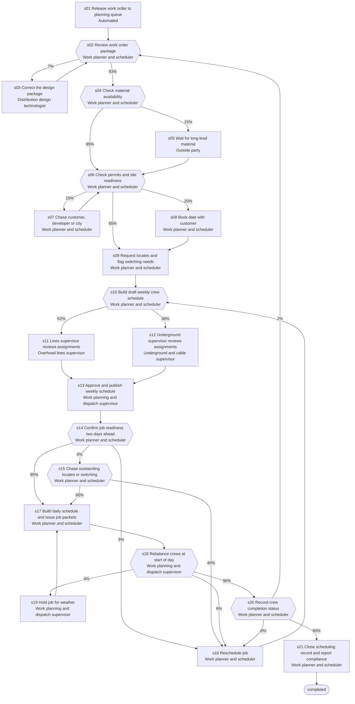

# Plan and schedule field work

`edu-ops-work-scheduling` · electric power distribution · distribution operations (work planning and dispatch) · part of `electric-distribution-utility`

Work planners turn released capital, maintenance and customer work orders into weekly and daily crew schedules for line, cable and station crews. For each order they check that the design is complete, material is in stock, permits and the customer's site are ready, locates are requested and switching is booked, then fit it into crew capacity and confirm readiness just before the work. The process is slow because orders wait for material, customers and crew capacity, and unstable because trouble calls, storms, absences and weather pull crews away. Jobs that are not ready when the crew arrives waste crew time and send the order back into planning.

| | |
|---|---|
| Unit of work | one work order scheduled |
| Starts when | A capital, maintenance, service or connection work order is released for scheduling in the ERP. |
| Done when | The order has been worked by a crew, recorded complete and closed for scheduling. |
| Organisation | A municipally owned Ontario distributor with about 350,000 customers and roughly 60 line, cable and station crews planned by a central work planning group. (571 employees, 2019-2022) |
| Volume | 2,000 cases a month (range 1,500 to 2,600) |

## Where it sits

- Starts with **capital_work_order** from ae-capital-project-delivery (25% of cases)
- Starts with **capital_work_order** from ae-service-layouts (25% of cases)
- Starts with **maintenance_work_order** from ops-distribution-inspection (30% of cases)
- Starts with **maintenance_work_order** from ae-joint-use (15% of cases)
- Starts with **capital_work_order** from ae-der-connection (5% of cases)
- Relies on **material_issue** from fin-inventory-stores (a standing input; it does not start a case)
- Relies on **qualified_worker** from corp-training-qualification (a standing input; it does not start a case)
- Sends **crew_schedule** to ops-overhead-construction (outcome: any)
- Sends **crew_schedule** to ops-underground-construction (outcome: any)
- Sends **crew_schedule** to ops-service-connection-work (outcome: any)
- Sends **crew_schedule** to ops-pole-replacement (outcome: any)
- Sends **crew_schedule** to ops-station-maintenance (outcome: any)
- Sends **crew_schedule** to ops-control-room-switching (outcome: any)
- Sends **crew_schedule** to fin-inventory-stores (outcome: any)
- Sends **locate_request** to ops-locates (outcome: any)

## Flow

## Roles

| Role | Department | Layer | FTE on this process | Loaded cost per hour | Evidence |
|---|---|---|---:|---:|---|
| Work planner and scheduler | Work Planning and Dispatch | individual contributor | 11.5 | 55 CAD | C |
| Work planning and dispatch supervisor | Work Planning and Dispatch | supervisor | 1 | 72 CAD | C |
| Overhead lines supervisor | Overhead Lines | supervisor | 0.5 | 80 CAD | C |
| Underground and cable supervisor | Underground and Cable | supervisor | 0.3 | 80 CAD | C |
| Distribution design technologist | Distribution Design and Customer Connections | individual contributor | 1 | 57 CAD | C |

## Steps

Hands-on time and the wait before each step show the most common value. Evidence tier A is a sourced number, B a sourced description, C the author's estimate.

| Step | Who | Kind | Hands-on | Wait before | Control | Evidence |
|---|---|---|---:|---:|---|---|
| **s01 Release work order to planning queue.** When design, approvals and funding are complete the originating group sets the work order to released in the ERP, which places it in the planners' queue with its estimate, crew type, required date and linked design package. | Automated | system auto | 0 min | 0 min |  | C |
| **s02 Review work order package.** A work planner opens the released order, the design drawings in the document store and the material list, checks that scope, crew type, estimated hours and required date make sense, and assigns a priority. Orders with missing drawings or unclear scope go back to design. | Work planner and scheduler | review | 5 min | 1.0 d |  | C |
| **s03 Correct the design package.** A design technologist reopens the job, adds the missing drawing, corrects the material list or clarifies the scope with the planner, and re-releases the order. | Distribution design technologist | drafting | 45 min | 3.0 d |  | C |
| **s04 Check material availability.** The planner checks the order's material reservation in the ERP against stock on hand, sees whether poles, transformers, switchgear or cable are in the warehouse, and asks stores or a buyer to expedite anything short. | Work planner and scheduler | lookup | 4 min | 1.0 h |  | C |
| **s05 Wait for long-lead material.** The job is held until the supplier delivers the missing transformer, switchgear, cable or poles to the warehouse; the planner sees the receipt in the ERP. | Outside party | external wait | 0 min | 21.0 d |  | C |
| **s06 Check permits and site readiness.** The planner checks that the municipal consent or road occupancy permit is in hand, that the customer or developer has finished civil work and has electrical inspection where needed, and that easements and access are settled. | Work planner and scheduler | lookup | 3 min | 1.0 h |  | C |
| **s07 Chase customer, developer or city.** The planner calls or emails the developer, customer's electrician or the city to find out when the site, inspection or permit will be ready, notes the expected date and parks the order until then. | Work planner and scheduler | communication | 12 min | 5.0 d |  | C |
| **s08 Book date with customer.** For service and connection jobs the planner calls the customer or contractor to agree a date when the site will be accessible and anyone needed will be present, and records the commitment on the order. | Work planner and scheduler | communication | 8 min | 4.0 h |  | C |
| **s09 Request locates and flag switching needs.** For jobs that dig, the planner submits a locate request through the One Call portal with the dig area and start date; for jobs on energized plant, the planner flags the need for work protection so the crew supervisor applies for a switching order. | Work planner and scheduler | data entry | 5 min | 1.0 h | Ontario Underground Infrastructure Notification System Act, 2012: request locates before excavating | B [ho-locates] |
| **s10 Build draft weekly crew schedule.** Each week the planner fits ready orders into the next week's crew calendar in the scheduling spreadsheet or ERP scheduling board, balancing crew hours, due dates, customer commitments and the order of jobs on the same feeder. Orders that do not fit wait for a later week. | Work planner and scheduler | analysis | 3 min | 3.0 d |  | B [bain-field] |
| **s11 Lines supervisor reviews assignments.** At the weekly planning meeting the overhead lines supervisor checks which crew gets each overhead job, matches skills and equipment to the work, and moves jobs that need a larger crew or a digger derrick. | Overhead lines supervisor | review | 3 min | 1.0 d |  | C |
| **s12 Underground supervisor reviews assignments.** At the same meeting the underground supervisor checks the cable crew assignments, confirms civil contractor dates for duct and vault work and adjusts the order of splices. | Underground and cable supervisor | review | 3 min | 1.0 d |  | C |
| **s13 Approve and publish weekly schedule.** The work planning and dispatch supervisor resolves conflicts between groups, approves the week's schedule and publishes it to crews, stores (for material picking) and the control room (for switching). | Work planning and dispatch supervisor | approval | 2 min | 1.0 h | Supervisor approval of the weekly crew schedule | C |
| **s14 Confirm job readiness two days ahead.** Two working days before the job the planner checks that locates are complete in the One Call portal, the switching order is approved, material is staged, the permit is valid and the customer is still ready. Jobs that are not ready are rescheduled before the crew is sent. | Work planner and scheduler | validation | 3 min | 2.0 d |  | C |
| **s15 Chase outstanding locates or switching.** The planner calls the locate dispatcher or contractor and the switching planner to find out whether the outstanding locate or switching order will be done in time, and asks for priority if the crew date is fixed. | Work planner and scheduler | communication | 10 min | 1.0 d |  | B [renew-locates] |
| **s16 Reschedule job.** The planner removes the job from the crew's week, records the reason (locate, material, customer, weather, crew pulled to trouble), fills the slot with another ready job if one exists, and puts the order back into the weekly planning pool. | Work planner and scheduler | coordination | 8 min | 1.0 h |  | B [bain-field] |
| **s17 Build daily schedule and issue job packets.** The day before, the planner turns the week's plan into each crew's day in the mobile workforce system, attaches drawings, locate numbers, switching order number and customer notes, and prints packets for crews that still use paper. | Work planner and scheduler | drafting | 2 min | 1.0 d |  | C |
| **s18 Rebalance crews at start of day.** At the start of the shift the dispatch supervisor adjusts the day for absences, crews held over on trouble or storm work, and broken-down trucks, moving or dropping jobs. Forecast high wind, lightning or freezing rain puts overhead jobs on hold. | Work planning and dispatch supervisor | judgment | 2 min | 0 min |  | C |
| **s19 Hold job for weather.** The supervisor keeps the job on the crew's list but holds it until the weather clears, assigning the crew yard or underground work in the meantime, and releases it again when conditions allow. | Work planning and dispatch supervisor | judgment | 3 min | 1.0 d |  | C |
| **s20 Record crew completion status.** After the crew works the job the planner reads the completion status in the mobile workforce system (complete, partly complete, not done and why), updates hours in the ERP and puts unfinished work back into planning. | Work planner and scheduler | data entry | 2 min | 1.0 d |  | B [bain-case] |
| **s21 Close scheduling record and report compliance.** Weekly, the planner confirms completed orders are closed for scheduling, and the team reports schedule compliance (jobs done as planned against jobs scheduled) and reasons for misses to operations management. | Work planner and scheduler | data entry | 2 min | 2.0 d |  | C |

## Exceptions

| Exception | Share of cases | What happens |
|---|---:|---|
| Long-lead material | 15% | A transformer, switchgear or cable is not in stock and the job waits weeks for delivery. |
| Customer or permit not ready | 15% | The developer's civil work, electrical inspection or the city permit is not in place; the planner chases and parks the order. |
| Not ready two days out | 11% | Locates, switching or material are missing at the readiness check and the job is rescheduled to a later week. |
| Crew pulled on the day | 6% | Trouble, storm work or absences take the crew and the job is bumped. |
| Found not ready on site | 8% | The crew arrives and cannot finish because of site, material or scope problems; the remaining work goes back into planning. |

## Benchmarks

| Metric | Value | Unit | Population | Evidence |
|---|---|---|---|---|
| cycle_time_days | p50 21, p90 60 | calendar days from release to completed | Released distribution work orders at a mid-size Ontario distributor, 2019-2022 | C |
| crew_wrench_time_share | 0.4 | share of crew time on hands-on work | One large US utility before a productivity programme | B [bain-case] |

## Pain points

- Jobs found not ready at the two-day check, on the morning of the job or on arrival send orders back to weekly planning and leave crews idle or on filler work. (steps s14, s18, s20, s16; B [bain-field], [bain-case])
- Locate and switching readiness are tracked in separate systems (One Call portal, OMS) and checked by hand. (steps s14, s15; C)
- Long-lead material and customer site delays hold capital orders for weeks. (steps s05, s07; C)

## Assumptions

- Loaded costs are taken from the organisation file (wage times 1.40 for benefits, pension, payroll taxes and overhead).
- The weekly planning meeting is shown as one review step per order for the relevant supervisor; minutes are the supervisor's share of the meeting for that order.
- The wait before the weekly schedule step stands for backlog waiting for crew capacity; it is the largest single source of elapsed time.
- Crew work itself is outside this process (it belongs to construction and maintenance processes); its duration is entered as the wait before completion status is recorded.
- design-technologist is not listed among this process's roles in the organisation file; it is included because returned packages are corrected by design.
- Rescheduled orders loop back to weekly planning; about one order in four is rescheduled at least once, which matches the instability the organisation file describes.

## Sources

- [ho-locates] [Locates - safe digging (information for contractors)](https://hydroottawa.com/en/contractors/locates-safe-digging) (Hydro Ottawa, 2026). Locate requests go through Ontario One Call at least five business days before digging (ten for multi-address requests); colour-coded ground markings; stay 1.5 m from marked cables and hand dig or hydrovac near them; request a re-locate when marks are unclear or expire; near high-voltage cables Hydro Ottawa places a 'Do Not Proceed' sticker or notice, the excavator completes a Request to Excavate form, and Hydro Ottawa replies within 48 business hours.
- [renew-locates] [Industry group praises crucial reforms to Ontario's utility locates system](https://www.renewcanada.net/5000090925-2/) (ReNew Canada, 2022). Locates are legally due within five business days but 'as high as 85 per cent' of requests are late; Ontario One Call data showed 49 per cent of tickets took longer than 15 days; idle time costs about $1,000 an hour in sewer and watermain work; Bill 93 reforms (shared locates, 60-day minimum validity, dedicated locators).
- [bain-field] [Field service: Reenergizing a hidden asset](https://www.bain.com/fr-ca/insights/field-service-reenergizing-a-hidden-asset/) (Bain & Company, 2011). At one US utility less than 50 percent of field time was spent on actual maintenance or construction work; one utility scheduled so loosely that crews were idle 50 to 60 percent of the time while another scheduled so tightly it missed customer and compliance dates; recommends tracking the share of jobs cancelled and schedule stability.
- [bain-case] [Boosting a utility's workforce productivity (case study)](https://www.bain.com/es/client-results/boosting-utilitys-workforce-productivity/) (Bain & Company, 2026). Undated case study (the programme began in 2010); year is the access year. Field diagnostic at a large US utility found crew wrench time of about 40 percent; poor planning caused idle time and schedule gaps; productivity rose by 25 percent or more in the first year after the change.

Written by claude-opus on 2026-11-24.
