# Account for leases and expected credit losses (equipment finance company)

`efc-account-for-leases-and-credit-losses` · equipment leasing and finance · accounting · part of `equipment-finance-co`

Each month the lessor must show its leases at the right value: finance leases as receivables earning income at a constant rate, operating leases as depreciating assets, residual values that still hold, and an allowance for the credit losses it expects. Lease accountants check the classification of new contracts, review finance income, modifications and residual values, while portfolio risk analysts run the IFRS 9 expected credit loss model on month-end data with forward-looking scenarios; the accounting manager and controller review the results, a quarterly committee approves scenarios and adjustments, and the entries go to the month-end close. The work is slow and error-prone because the model and most reviews live in spreadsheets fed from the data warehouse, classification and residual judgements need experience, and 2020 payment deferrals and swings in the economic outlook made the allowance hard to estimate.

| | |
|---|---|
| Unit of work | one monthly lease accounting cycle |
| Starts when | The month-end cut-off in the lease system, with the month's booked contracts, the monthly risk report and the latest residual schedule available. |
| Done when | Classification, income, modification and residual entries and the expected credit loss allowance are approved, posted and reconciled to the ledger and handed to the month-end close, with quarter-end disclosure schedules when due. |
| Organisation | A privately owned Canadian equipment lessor with 55,000 active contracts and $1.5 billion of net investment reporting under IFRS, with audited statements relied on by its bank syndicate and conduits. (340 employees, 2019-2022) |
| Volume | 1 cases a month (range 1 to 1) |

## Where it sits

- Starts with **booked_contract** from book-contracts (50% of cases)
- Starts with **risk_report** from monitor-portfolio-risk (35% of cases)
- Starts with **residual_schedule** from value-equipment-and-set-residuals (15% of cases)
- Sends **journal_entries** to close-the-month (outcome: any)

## Flow

```mermaid
flowchart TD
    s01["s01 Lease system runs the month-end batch<br/>Automated"]
    s02["s02 Extract the month's new bookings and classification report<br/>Lease accountant"]
    s03{{"s03 Review the classification of flagged contracts<br/>Lease accountant"}}
    s04["s04 Correct lease type codes and prepare the reclassification<br/>Lease accountant"]
    s05["s05 Reconcile new bookings and initial direct costs<br/>Lease accountant"]
    s06{{"s06 Review finance income and amortisation for anomalies<br/>Lease accountant"}}
    s07["s07 Investigate and correct income anomalies<br/>Lease accountant"]
    s08["s08 Account for modifications, deferrals and terminations<br/>Lease accountant"]
    s09{{"s09 Review residual values against the residual schedule<br/>Lease accountant"}}
    s10["s10 Asset manager confirms revised residual estimates<br/>Asset manager, valuation and residuals"]
    s11["s11 Calculate and record the residual impairment<br/>Lease accountant"]
    s12["s12 Extract the month-end credit loss data<br/>Portfolio risk analyst"]
    s13{{"s13 Assign stages and run the expected credit loss model<br/>Portfolio risk analyst"}}
    s14["s14 Update forward-looking scenarios and weights<br/>Portfolio risk analyst"]
    s15["s15 Analyse the allowance movement and draft commentary<br/>Portfolio risk analyst"]
    s16["s16 Assess large credit-impaired accounts individually<br/>Portfolio risk analyst"]
    s17{{"s17 Accounting manager reviews the lease accounting and allowance package<br/>Accounting manager"}}
    s18{{"s18 Controller approves the allowance and management adjustments<br/>Controller"}}
    s19{{"s19 Quarterly credit loss committee approves scenarios and adjustments<br/>Chief financial officer"}}
    s20["s20 Prepare and post the lease accounting and allowance entries<br/>Lease accountant"]
    s21{{"s21 Accounting manager approves the journal in the ledger<br/>Accounting manager"}}
    s22{{"s22 Reconcile lease and allowance balances to the ledger<br/>Lease accountant"}}
    s23["s23 Prepare quarter-end lease and credit risk schedules<br/>Lease accountant"]
    s01 --> s02
    s02 --> s03
    s03 -->|"85%"| s05
    s03 -->|"15%"| s04
    s04 --> s05
    s05 --> s06
    s06 -->|"80%"| s08
    s06 -->|"20%"| s07
    s07 --> s08
    s08 --> s09
    s09 -->|"60%"| s12
    s09 -->|"40%"| s10
    s10 --> s11
    s11 --> s12
    s12 --> s13
    s13 -->|"35%"| s14
    s13 -->|"65%"| s15
    s14 --> s15
    s15 --> s16
    s16 --> s17
    s17 -->|"80%"| s18
    s17 -->|"10%"| s13
    s17 -->|"10%"| s15
    s18 -->|"62%"| s20
    s18 -->|"33%"| s19
    s18 -->|"5%"| s17
    s19 -->|"92%"| s20
    s19 -->|"8%"| s14
    s20 --> s21
    s21 -->|"95%"| s22
    s21 -->|"5%"| s20
    s22 -->|"67%"| end0
    s22 -->|"33%"| s23
    s23 --> end1
    end0(["posted_monthly"])
    end1(["posted_with_quarter_schedules"])
```

## Roles

| Role | Department | Layer | FTE on this process | Loaded cost per hour | Evidence |
|---|---|---|---:|---:|---|
| Lease accountant | Financial and lease accounting | individual contributor | 0.8 | 50 CAD | B [src_jb_11100] |
| Portfolio risk analyst | Risk and portfolio management | individual contributor | 0.4 | 53 CAD | C |
| Accounting manager | Financial and lease accounting | manager | 0.06 | 72 CAD | C |
| Controller | Financial and lease accounting | director | 0.03 | 98 CAD | C |
| Asset manager, valuation and residuals | Asset management and remarketing | senior specialist | 0.03 | 56 CAD | C |
| Chief financial officer | Finance | executive | 0.01 | 175 CAD | C |

## Steps

Hands-on time and the wait before each step show the most common value. Evidence tier A is a sourced number, B a sourced description, C the author's estimate.

| Step | Who | Kind | Hands-on | Wait before | Control | Evidence |
|---|---|---|---:|---:|---|---|
| **s01 Lease system runs the month-end batch.** After the month-end cut-off the lease system closes the period overnight: it accrues finance income on every finance lease and loan, depreciates operating lease assets, amortises initial direct costs, ages receivables and loads a month-end contract snapshot to the data warehouse. | Automated | system auto | 0 min | 8.0 h |  | B [src_aasb16], [src_bdo_ifrs16] |
| **s02 Extract the month's new bookings and classification report.** A lease accountant runs the report of contracts booked in the month (about 1,400) with lease type code, term, equipment type, purchase option, residual, implicit rate and cost, and filters the ones the classification rules flag: fair market value or large fixed residuals, terms short against the equipment's life, mid-ticket deals and new product codes. | Lease accountant | lookup | 1.5 h | 4.0 h |  | C |
| **s03 Review the classification of flagged contracts.** For each flagged contract the accountant opens the schedule in the imaging system, checks the purchase option, term against economic life, residual and present value of payments against the equipment cost, and decides whether the lease transfers substantially all the risks and rewards; they record the conclusion in the review workbook. | Lease accountant | judgment | 7.0 h | 1.0 h | IFRS 16 paragraphs 61 to 66: lease classification at inception by transfer of risks and rewards | B [src_aasb16], [src_bdo_ifrs16] |
| **s04 Correct lease type codes and prepare the reclassification.** The accountant sends the booking team the contracts whose accounting class is wrong, with the correct code, and drafts the journal that moves them between net investment in finance leases and operating lease assets, including the depreciation or income already recorded. | Lease accountant | data entry | 1.0 h | 12.0 h |  | B [src_aasb16] |
| **s05 Reconcile new bookings and initial direct costs.** The accountant ties the net investment added in the month to the vendor payments and broker commissions funded and to the booking journal from the lease system, and checks that broker fees and other initial direct costs are deferred on the right contracts. | Lease accountant | validation | 2.5 h | 2.0 h |  | B [src_bdo_ifrs16] |
| **s06 Review finance income and amortisation for anomalies.** The accountant compares the month's finance income yield by product and channel with prior months and with the booked rates, and lists contracts with zero, negative or very high yields, usually from a wrong rate, a missed payment change or a modification booked incorrectly. | Lease accountant | analysis | 2.5 h | 1.0 h |  | B [src_aasb16] |
| **s07 Investigate and correct income anomalies.** For each anomaly the accountant reads the contract and its transaction history, works out the correct income, and either asks operations to fix the schedule or prepares a correcting entry for the difference. | Lease accountant | analysis | 1.5 h | 2.0 h |  | C |
| **s08 Account for modifications, deferrals and terminations.** The accountant works the month's report of restructures, payment deferrals, assumptions, early buyouts and casualty terminations, checks that each was remeasured correctly in the lease system, records any modification loss on finance leases and treats changed operating leases as new leases. | Lease accountant | analysis | 8.0 h | 1.0 h | IFRS 16 paragraph 66 and IFRS 9: modified leases reassessed and remeasured | B [src_aasb16], [src_bdo_covid] |
| **s09 Review residual values against the residual schedule.** The accountant compares the unguaranteed residuals booked on fair market value and fixed-option contracts with the latest residual schedule from asset management and recent remarketing results, by equipment type and maturity year, and lists types where the expected residual has fallen. | Lease accountant | analysis | 4.0 h | 2.0 h | IFRS 16 paragraph 77: lessor shall review regularly estimated unguaranteed residual values | A [src_aasb16] |
| **s10 Asset manager confirms revised residual estimates.** An asset manager reviews the flagged equipment types against auction results, dealer listings and recent off-lease sales and confirms or adjusts the expected residuals, with a short note of the evidence. | Asset manager, valuation and residuals | review | 1.0 h | 1.0 d |  | C |
| **s11 Calculate and record the residual impairment.** The accountant revises the income allocation for the affected finance leases and calculates the immediate charge for amounts already accrued, and for operating lease assets adjusts depreciation or tests for impairment, preparing the journal and support. | Lease accountant | analysis | 1.5 h | 1.0 h |  | A [src_aasb16] |
| **s12 Extract the month-end credit loss data.** A portfolio risk analyst extracts contract-level balances, days past due, risk grade or score band, deferral and restructure flags, watch list, insolvency status and equipment type from the data warehouse and the monthly risk report, and ties the total exposure to the lease subledger. | Portfolio risk analyst | lookup | 3.0 h | 1.0 h |  | B [src_cwb_p78], [src_bcbs_d350] |
| **s13 Assign stages and run the expected credit loss model.** The analyst assigns each contract a stage (stage 2 for a significant increase in credit risk, such as 30 days past due, a deferral or watch list; stage 3 for 90 days past due, default or insolvency) and runs the spreadsheet model that applies default probabilities by score band or risk rating, loss given default by equipment type and the exposure at default. | Portfolio risk analyst | analysis | 5.0 h | 30 min | IFRS 9 section 5.5: impairment measured as expected credit losses, lifetime for credit-impaired and significantly deteriorated exposures | B [src_cwb_p78], [src_gaapdyn_leasecl], [src_ifrs9_page] |
| **s14 Update forward-looking scenarios and weights.** The analyst updates the base, upside and downside economic scenarios from the large Canadian banks' published forecasts (unemployment, GDP, business insolvencies, used equipment prices), sets the scenario weights, recalculates the adjustments to default probabilities and documents the rationale for any judgement not captured by the model. | Portfolio risk analyst | judgment | 8.0 h | 2.0 h |  | B [src_cwb_p78], [src_cwb_p35], [src_bdo_covid] |
| **s15 Analyse the allowance movement and draft commentary.** The analyst builds the allowance roll-forward (opening balance, new bookings, stage transfers, write-offs, recoveries, remeasurement and scenario changes), compares coverage by stage with last month and with net charge-offs, and writes the commentary for accounting. | Portfolio risk analyst | analysis | 4.0 h | 1.0 h |  | B [src_cwb_p87] |
| **s16 Assess large credit-impaired accounts individually.** For mid-ticket accounts in default, repossession or insolvency the analyst asks late-stage collections and recoveries for the expected recovery (equipment value after costs, guarantor prospects, trustee estimates) and replaces the modelled amount with an individual allowance where it differs. | Portfolio risk analyst | judgment | 5.0 h | 6.0 h |  | C |
| **s17 Accounting manager reviews the lease accounting and allowance package.** The accounting manager checks the classification conclusions, modification and residual entries, ties the credit loss data to the subledger, reviews the model run, stage movements and commentary, and sends points back to the analyst or accountant. | Accounting manager | review | 2.5 h | 12.0 h | Internal control over the allowance and lease accounting tested by the external auditor: independent review of a key estimate | C |
| **s18 Controller approves the allowance and management adjustments.** The controller reviews the allowance level against charge-off experience, delinquency and coverage by stage, challenges any management adjustment and the residual and modification charges, and approves the figures for posting. | Controller | approval | 1.0 h | 12.0 h | Allowance for credit losses approved by the controller as a key accounting estimate relied on by auditors and lenders | C |
| **s19 Quarterly credit loss committee approves scenarios and adjustments.** At quarter end the chief financial officer chairs a meeting with the controller, the chief credit officer and the director of risk and portfolio management that reviews the scenarios, weights, management adjustments and coverage, and approves the allowance for the quarterly statements and lender reporting. | Chief financial officer | approval | 1.0 h | 1.0 d | Credit loss allowance governance: quarterly senior management approval of scenarios and adjustments | B [src_bcbs_d350], [src_cwb_p35] |
| **s20 Prepare and post the lease accounting and allowance entries.** The lease accountant prepares the journal for the change in the allowance by stage, individual allowances, residual impairment, modification losses and reclassifications, attaches the support and uploads it to the ledger. | Lease accountant | data entry | 1.5 h | 2.0 h |  | C |
| **s21 Accounting manager approves the journal in the ledger.** The accounting manager checks the journal against the approved figures and support and approves it in the ledger; the preparer cannot approve their own entry. | Accounting manager | approval | 20 min | 4.0 h | Manual journal entries approved by someone other than the preparer (company journal entry policy) | C |
| **s22 Reconcile lease and allowance balances to the ledger.** The accountant ties the net investment, operating lease assets, residuals and the allowance by stage in the ledger to the subledger and the approved roll-forward, files the package for the close and the auditors and notes open items for next month. | Lease accountant | validation | 3.0 h | 2.0 h |  | C |
| **s23 Prepare quarter-end lease and credit risk schedules.** At quarter end the accountant prepares the schedules lenders, the board and the auditors need: the five-year maturity analysis of lease payments receivable, finance income and selling profit, operating lease income, the allowance by stage and the credit quality tables. | Lease accountant | drafting | 8.0 h | 4.0 h | IFRS 16 paragraphs 89 to 97 and IFRS 7 credit risk disclosures | A [src_aasb16] |

## Exceptions

| Exception | Share of cases | What happens |
|---|---:|---|
| Wrong lease classification code | 15% | Review finds contracts booked with the wrong accounting class, usually fair market value leases set up as finance leases; booking corrects the code and accounting posts a reclassification. |
| Income anomalies | 20% | Contracts with zero, negative or very high yields from rate or modification errors are investigated and corrected. |
| Residual values fall | 40% | Used equipment values for some types fall below booked residuals; the asset manager confirms revised estimates and accounting records the charge. |
| Scenario update | 35% | At quarter end, or when the outlook changes as in March 2020, the analyst updates the scenarios, weights and any management adjustment. |
| Package returned on review | 20% | The accounting manager finds a data or model problem or weak commentary and sends the package back for a rerun. |
| Quarter-end committee and schedules | 33% | At quarter end the credit loss committee approves the allowance and accounting prepares the lease and credit risk disclosure schedules. |

## Benchmarks

| Metric | Value | Unit | Population | Evidence |
|---|---|---|---|---|
| cycle_time_days | p50 8, p90 12 | calendar days from month-end cut-off to approved lease and allowance entries posted | Author estimate for a private Canadian lessor whose close takes about 11 calendar days | C [src_apqc_close] |
| monthly_close_calendar_days | top_quartile 4.8, median 6.4, bottom_quartile 10 | calendar days | 2,300 organisations in APQC's general accounting benchmark | A [src_apqc_close] |
| net_losses_share_of_receivables | 0.0048 | share of average receivables, 2020 | US equipment finance companies (ELFA survey) | A [src_elfa_sefa2021] |
| provision_for_credit_losses_swing | 2020 25.7, 2021 0.2 | CAD millions | Chesswood Group, $1.7 billion of equipment and vehicle finance receivables | A [src_chesswood_2021] |
| stage_2_share_of_performing_loans | 2020 0.34, 2021 0.09 | share | Canadian Western Bank, including its equipment financing book | A [src_cwb_p35] |

## Pain points

- The expected credit loss model is a spreadsheet fed by data warehouse extracts, so each month's run depends on manual data preparation and one or two people who understand it; review often sends it back for a rerun. (steps s12, s13, s17; C)
- 2020 payment deferrals and the changing economic outlook forced repeated scenario updates and management adjustments that models could not capture, and the allowance swung sharply between 2020 and 2021. (steps s08, s14, s19; A [src_chesswood_2021], [src_cwb_p35], [src_bdo_covid])
- Classification and residual reviews need judgement about purchase options, economic lives and used equipment values, and errors in booking codes surface only at month end. (steps s03, s04, s09, s10; B [src_bdo_ifrs16], [src_aasb16])
- Modifications from restructures, deferrals and early buyouts are booked by operations and must be rechecked by accounting, because a wrong remeasurement changes income and the allowance. (steps s08, s06, s07; C)

## Assumptions

- One case is one monthly cycle from the month-end cut-off. Lease accountants and portfolio analysts work in parallel; the simulator adds all hands-on time in sequence, which roughly offsets the fact that about 70 hands-on hours spread over several people's working days; the simulated median of about 9 days sits close to the 8-day estimate.
- Lessor accounting is IFRS 16, which carried over IAS 17's lessor model; IFRS 16 text is cited from the Australian standard AASB 16, which reproduces it word for word.
- The lessor is assumed to apply the IFRS 9 general three-stage approach to lease and loan receivables, as lenders commonly do; the simplified lifetime approach is an allowed policy choice for lease receivables and would remove stage tracking.
- Stage rules (30 days past due, deferrals and watch list for stage 2; 90 days past due, default or insolvency for stage 3) and the use of the large banks' published forecasts follow common Canadian lender practice; this lessor's model is not public.
- Portfolio risk analysts own the credit loss data and model because the process map lists them and they produce the monthly risk report; the asset manager (residuals) and chief financial officer (quarterly committee) take part although the process map does not list them.
- About 1,400 new bookings a month are classified by a lease type code at booking; only about 100 to 150 flagged contracts are reviewed in detail. Modification volumes are much higher in 2020, which sets the high end of step s08.
- Securitised contracts stay on the balance sheet (organisation file assumption), so they remain in the net investment and the allowance.
- Staffing: modelled hands-on time is about 70 hours a month, about 0.6 FTE at 130 hours; stated FTE (about 1.3) also covers booking support, audit requests, ad hoc analysis and month-end questions that are not modelled as steps.
- Loaded costs are the organisation file's (2019-2022 wage times 1.35).

## Sources

- [src_aasb16] [AASB 16 Leases: lessor requirements (paragraphs 61 to 97), identical in wording to IFRS 16](https://standards.aasb.gov.au/node/46) (Australian Accounting Standards Board, 2019). A lease is a finance lease if it transfers substantially all the risks and rewards of ownership (para 62), with indicators in para 63; classification is made at inception and reassessed only on a modification (para 66); finance income at a constant periodic rate on the net investment (para 75); a lessor shall review regularly estimated unguaranteed residual values and recognise any reduction immediately, and applies IFRS 9 derecognition and impairment to the net investment (para 77); operating lease income and depreciation (paras 81 to 84); disclosures including a five-year maturity analysis (para 94).
- [src_bdo_ifrs16] [IFRS 16 (accounting news, October 2018)](https://www.bdo.com.au/en-au/content/accounting-news/accounting-news-october-2018/ifrs-16) (BDO Australia, 2018). Lessor accounting under IFRS 16 is largely unchanged from IAS 17; classification requires considerable professional judgement; a finance lease is a receivable at the net investment with finance income at a constant periodic rate; IFRS 9 impairment applies to finance lease receivables; changes in residual estimates do not change the classification.
- [src_ifrs9_page] [IFRS 9 Financial Instruments](https://www.ifrs.org/issued-standards/list-of-standards/ifrs-9-financial-instruments/) (IFRS Foundation, 2014). IFRS 9 is effective for annual periods beginning on or after 1 January 2018; the expected credit loss impairment requirements were added in July 2014.
- [src_gaapdyn_leasecl] [Accounting for impairment of lease receivables under IFRS 9](https://www.gaapdynamics.com/?p=21142) (GAAP Dynamics, 2021). For lease receivables an entity chooses, as an accounting policy, either the general three-bucket approach or the simplified approach that always measures lifetime expected credit losses without tracking changes in credit risk, and must apply the choice consistently.
- [src_cwb_p78] [CWB Financial Group Annual Report 2021, significant accounting policies: impairment](https://publications.cwb.com/view/902877744/78) (Canadian Western Bank, 2021). Expected credit losses in three stages based on the change in credit risk since initial recognition, measured with probability of default, loss given default and exposure at default; the base case forecast is updated quarterly with a range of other scenarios and multiple probability-weighted outcomes; assessing significant increases in credit risk requires significant judgment.
- [src_cwb_p35] [CWB Financial Group Annual Report 2021, MD&A: provision and allowance for credit losses](https://publications.cwb.com/view/902877744/35) (Canadian Western Bank, 2021). The macroeconomic forecast is based on an average of the large Canadian banks' forecasts; modelled expected credit losses are supplemented with expert credit judgments, including the effect of government stimulus that cannot be modelled from history; stage 2 loans fell to 9% of performing loans from 34% a year earlier; the performing allowance fell 18% in 2021.
- [src_cwb_p87] [CWB Financial Group Annual Report 2021, note on allowance for credit losses by stage](https://publications.cwb.com/view/902877744/87) (Canadian Western Bank, 2021). The allowance reconciliation by stage shows transfers, write-offs, recoveries and remeasurement that reflects changes in forward-looking macroeconomic forecasts and qualitative adjustments.
- [src_bdo_covid] [Coronavirus impacts on the accounting for financial instruments](https://www.bdo.com.au/en-au/accounting-news/accounting-news-april-2020/coronavirus-impacts-on-the-accounting-for-financial-instruments) (BDO Australia, 2020). COVID-19 may cause a significant increase in credit risk, but deferrals alone should not be assumed to do so across the board; a delay in payment creates a credit loss even when full repayment is expected; expected credit losses are probability-weighted and prior models cannot simply be rolled forward, so entities rework models or apply latest macroeconomic data as an overlay.
- [src_bcbs_d350] [Guidance on credit risk and accounting for expected credit losses](https://www.bis.org/bcbs/publ/d350.htm) (Basel Committee on Banking Supervision, 2015). Supervisory expectations for expected credit loss accounting: risk management should be involved in assessing and measuring allowances; credit loss recognition was too little, too late before the crisis.
- [src_chesswood_2021] [Chesswood announces fiscal year 2021 results](https://www.newswire.ca/news-releases/chesswood-announces-fiscal-year-2021-results-834803822.html) (Chesswood Group Limited (Cision Newswire), 2022). A North American equipment and vehicle finance group with $1.7 billion of gross finance receivables recognised a $0.2 million provision for credit losses in 2021, $25.5 million less than 2020, mainly from provision releases; net charge-offs were $2.0 million in 2021 against $31.4 million in 2020.
- [src_apqc_close] [Metric of the month: cycle time for monthly close](https://www.cfo.com/news/metric-of-the-month-cycle-time-for-monthly-close/659297/) (CFO.com (APQC data), 2018). APQC benchmark of 2,300 organisations: monthly close from trial balance to consolidated statements takes 4.8 calendar days or less for the top quarter, 6.4 days at the median and 10 or more for the bottom quarter.
- [src_elfa_sefa2021] [New data reveals market insights (2021 Survey of Equipment Finance Activity)](https://www.elfaonline.org/communications/july-august-sept/new-data-reveals-market-insights) (Equipment Leasing and Finance Association, 2021). US equipment finance in 2020: receivables over 30 days past due rose 30 basis points to 2.3%; net full-year losses rose to 0.48% of average receivables.
- [src_jb_11100] [Wages for financial auditors and accountants (NOC 11100)](https://www.jobbank.gc.ca/wagereport/occupation/116) (Job Bank, Government of Canada, 2024). Ontario hourly wages for accountants: low $24.73, median $40.87, high $72.12 (reference period 2023-2024).

Written by claude-opus on 2026-11-17.
