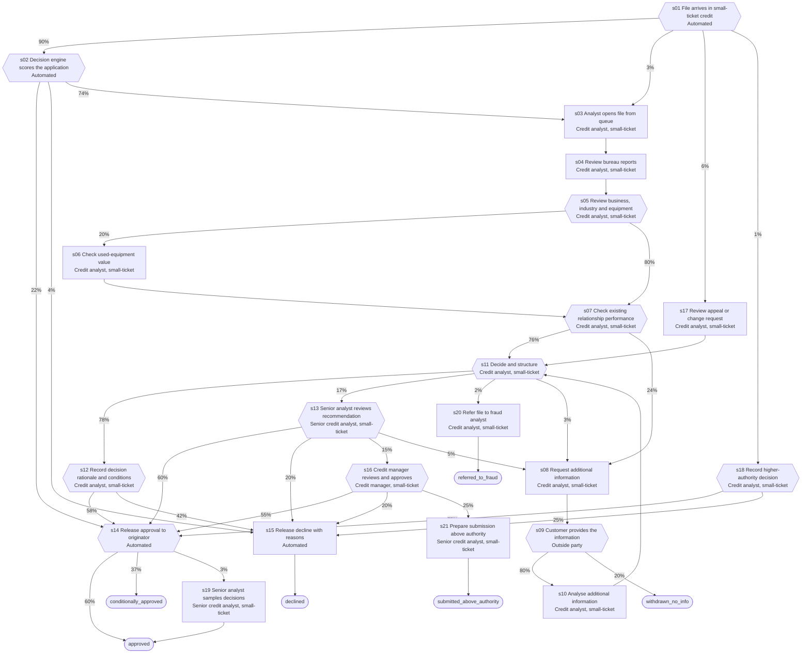

# Adjudicate small-ticket credit applications

`efc-adjudicate-small-ticket-credit` · equipment leasing and finance · credit (small-ticket adjudication) · part of `equipment-finance-co`

Applications up to $250,000 are scored by a rule-based decision engine, which approves or declines about a quarter of them automatically and refers the rest to a team of 16 credit analysts. An analyst reads the bureau reports, weighs the business, industry and equipment, checks any existing relationship and either decides within delegated authority, asks the originator for bank statements or financial statements, or passes the recommendation to a senior analyst or the credit manager. Decisions go back to the vendor desk, broker desk or account executive, and appeals come back for another look. Speed matters because dealers and brokers send the same deal to competing lessors, and most delay comes from queues at busy times and waiting for customers' documents.

| | |
|---|---|
| Unit of work | one small-ticket application |
| Starts when | A set-up application, a fraud-cleared file, an appeal or a decision returned from higher authority enters the small-ticket queue. |
| Done when | A credit decision (approval, conditional approval or decline) is released to the originating desk, or the file is withdrawn, referred to fraud review or submitted above authority. |
| Organisation | A mid-size privately owned Canadian independent equipment lessor deciding about 3,000 small-ticket applications a month with 16 analysts, 3 senior analysts and a manager. (340 employees, 2019-2022) |
| Volume | 3,000 cases a month (range 2,500 to 3,600) |

## Where it sits

- Starts with **credit_application** from intake-credit-applications (90% of cases)
- Starts with **fraud_clearance** from verify-identity-and-fraud (3% of cases)
- Starts with **credit_appeal** from communicate-credit-decisions (6% of cases)
- Starts with **credit_decision** from approve-credit-above-authority (1% of cases)
- Relies on **credit_policy** from maintain-credit-policy-and-scorecards (a standing input; it does not start a case)
- Relies on **system_release** from manage-system-changes (a standing input; it does not start a case)
- Sends **credit_decision** to communicate-credit-decisions (outcome: approved)
- Sends **credit_decision** to communicate-credit-decisions (outcome: conditionally_approved)
- Sends **credit_decision** to communicate-credit-decisions (outcome: declined)
- Sends **credit_decision** to communicate-credit-decisions (outcome: withdrawn_no_info)
- Sends **fraud_alert** to verify-identity-and-fraud (outcome: referred_to_fraud)
- Sends **credit_submission** to approve-credit-above-authority (outcome: submitted_above_authority)

## Flow

## Roles

| Role | Department | Layer | FTE on this process | Loaded cost per hour | Evidence |
|---|---|---|---:|---:|---|
| Credit analyst, small-ticket | Small-ticket credit | individual contributor | 13 | 39 CAD | B [src_bennington_analyst], [src_jb_credit_admin] |
| Senior credit analyst, small-ticket | Small-ticket credit | senior specialist | 1.6 | 48 CAD | C [src_jb_credit_admin] |
| Credit manager, small-ticket | Small-ticket credit | manager | 0.3 | 75 CAD | C |

## Steps

Hands-on time and the wait before each step show the most common value. Evidence tier A is a sourced number, B a sourced description, C the author's estimate.

| Step | Who | Kind | Hands-on | Wait before | Control | Evidence |
|---|---|---|---:|---:|---|---|
| **s01 File arrives in small-ticket credit.** A file reaches small-ticket credit from intake as a newly set-up application, from the fraud analyst as a cleared file, from the sales desks as an appeal or change request, or back from the director or chief credit officer with a decision on a file sent above authority. | Automated | intake | 0 min | 0 min |  | C |
| **s02 Decision engine scores the application.** The rule-based decision engine combines the commercial and personal bureau scores with application data such as time in business, industry, equipment type and amount, applies policy knock-out rules and the auto-approval matrix, and either approves small clean deals, declines on a hard rule or refers the file to an analyst. | Automated | system auto | 0 min | 1 min | Credit policy scorecard cut-offs and auto-approval matrix approved by the chief credit and risk officer | B [src_marlin_10k2019], [src_marlin_10k2014], [src_timepayment_2022], [src_oracle_lease_uw] |
| **s03 Analyst opens file from queue.** A credit analyst takes the next file from the small-ticket queue, with vendor deals flagged as priority, reads the coordinator's set-up summary and the engine's score and reason codes, and checks the requested amount, term and structure. | Credit analyst, small-ticket | intake | 2 min | 1.5 h |  | C |
| **s04 Review bureau reports.** The analyst reads the commercial reports for payment index, delinquency and failure scores, trade lines, collections and legal items and the PayNet lease history, then each guarantor's personal report for score, utilisation, recent inquiries, collections and bankruptcies. | Credit analyst, small-ticket | analysis | 7 min | 0 min |  | B [src_eqx_bcr_guide], [src_marlin_10k2019] |
| **s05 Review business, industry and equipment.** The analyst weighs time in business, industry risk, how essential the equipment is to the business, its resale market and the dealer's track record, and compares the amount with what a business of this size can carry. Used, specialised or private-sale equipment gets a value check. | Credit analyst, small-ticket | analysis | 5 min | 0 min |  | B [src_bennington_analyst], [src_dlc_easylease] |
| **s06 Check used-equipment value.** The analyst looks up recent auction results, dealer listings or a value guide for the make, model, year and hours, compares them with the invoice price to spot inflated invoices and decides how much can be advanced against the asset. | Credit analyst, small-ticket | lookup | 8 min | 0 min |  | C |
| **s07 Check existing relationship performance.** For returning customers and guarantors the analyst opens the lease management system to review how past and current contracts have paid, any returned debits, deferrals or collection notes, and the total exposure after this deal. | Credit analyst, small-ticket | lookup | 2 min | 0 min |  | B [src_marlin_10k2019] |
| **s08 Request additional information.** The analyst posts a request in the portal and emails the originating desk for what is needed to decide: typically three months of business bank statements, financial statements for larger deals, an explanation of a derogatory item, proof of a down payment or a second guarantor. | Credit analyst, small-ticket | communication | 4 min | 0 min |  | B [src_marlin_10k2019], [src_dlc_easylease] |
| **s09 Customer provides the information.** The vendor desk, broker or account executive asks the customer for the documents, and the customer downloads statements from online banking or asks the accountant for financial statements. Some customers do not reply or buy elsewhere. | Outside party | external wait | 0 min | 1.0 d |  | C |
| **s10 Analyse additional information.** The analyst reads the bank statements for average balances, regular deposits, returned items and other lenders' payments, or the financial statements for revenue, profit and debt, and records the figures that support the decision. | Credit analyst, small-ticket | analysis | 15 min | 1.0 h |  | B [src_marlin_10k2019] |
| **s11 Decide and structure.** The analyst decides to approve as requested, approve with conditions such as a larger down payment, a security deposit, an extra guarantor or a shorter term, or decline, re-scoring the file when the structure changes. Recommendations above the analyst's authority go to a senior analyst. | Credit analyst, small-ticket | judgment | 6 min | 0 min | Delegated credit authority: individual analyst approval limits by amount and risk grade set in credit policy | B [src_occ_lpm], [src_bennington_analyst], [src_oracle_lease_uw] |
| **s12 Record decision rationale and conditions.** The analyst enters the decision, risk grade, conditions and reason codes in the portal and writes a short rationale, logging any policy exception so it can be tracked in portfolio reporting. | Credit analyst, small-ticket | drafting | 4 min | 0 min | Credit policy documentation standard and aggregate exception tracking | B [src_occ_lpm] |
| **s13 Senior analyst reviews recommendation.** A senior analyst reads the analyst's recommendation and the file, questions the structure or conditions, and approves or declines within senior authority, sends the file back for more information, or passes it to the credit manager. | Senior credit analyst, small-ticket | approval | 12 min | 2.0 h | Delegated credit authority: second signature above the analyst limit | B [src_occ_lpm] |
| **s14 Release approval to originator.** The portal posts the approval with its conditions, expiry date and approved structure to the originating desk's view and sends the standard approval notice, which starts the sales desk's conversation with the dealer, broker or customer. | Automated | system auto | 0 min | 0 min |  | B [src_oracle_lease_uw], [src_marlin_10k2019] |
| **s15 Release decline with reasons.** The portal posts the decline with its reason codes to the originating desk, which tells the dealer, broker or customer and may come back with new information as an appeal. | Automated | system auto | 0 min | 0 min |  | B [src_oracle_lease_uw] |
| **s16 Credit manager reviews and approves.** The small-ticket credit manager reviews files above senior authority, larger exposures or policy exceptions, often after a conversation with the senior analyst, and approves, declines or prepares to send the file above authority to the director or chief credit officer. | Credit manager, small-ticket | approval | 15 min | 4.0 h | Delegated credit authority: manager approval limit and policy exception approval | B [src_occ_lpm] |
| **s17 Review appeal or change request.** The analyst who made the decision reads the appeal or change request, such as a larger down payment, a co-signer, a different structure or an explanation of a bureau item, pulls any new report needed and sends the file back to decision. | Credit analyst, small-ticket | judgment | 15 min | 6.0 h |  | B [src_bennington_analyst] |
| **s18 Record higher-authority decision.** When the director or chief credit officer returns a decision on a file sent above authority, the analyst enters the decision and any added conditions in the portal so it can be released to the originator. | Credit analyst, small-ticket | data entry | 4 min | 1.0 h |  | C |
| **s19 Senior analyst samples decisions.** A senior analyst re-reviews a small sample of auto-approvals and analyst approvals each week against policy, checks that exceptions were logged and reports findings to the credit manager for coaching or rule changes. | Senior credit analyst, small-ticket | review | 12 min | 0 min | Credit quality assurance: post-decision sample review of auto-decisions and analyst approvals | B [src_occ_lpm] |
| **s20 Refer file to fraud analyst.** When the analyst sees signs of fraud, such as an inflated invoice, a dealer that cannot be verified or documents that look altered, the analyst puts the file on hold and refers it to the fraud analyst with notes. | Credit analyst, small-ticket | communication | 5 min | 0 min |  | C |
| **s21 Prepare submission above authority.** A senior analyst writes a short credit submission with the deal, exposure, bureau and cash flow summary, the policy exceptions and the recommended structure, and sends it to the director of credit or the chief credit and risk officer for a decision. | Senior credit analyst, small-ticket | drafting | 40 min | 2.0 h |  | B [src_occ_lpm] |

## Exceptions

| Exception | Share of cases | What happens |
|---|---:|---|
| Additional information requested | 18% | The analyst needs bank statements, financial statements, an explanation or a second guarantor; the file waits for the customer and about one in five is never completed. |
| Escalated above analyst authority | 13% | Larger amounts, weaker grades or policy exceptions need a senior analyst's second signature, and some go on to the credit manager. |
| Submitted above small-ticket authority | 0% | Files beyond the manager's limit or with major exceptions are written up for the director or chief credit officer and come back later as returned decisions. |
| Appeal or change request | 6% | The dealer or broker comes back with a larger down payment, a co-signer or an explanation and the analyst decides again. |
| Used or specialised equipment | 13% | The analyst checks auction results and listings to confirm the invoice price and sets an advance limit. |
| Fraud concern found during review | 2% | The analyst finds an inflated invoice, an unverifiable dealer or altered documents and refers the file to the fraud analyst. |

## Benchmarks

| Metric | Value | Unit | Population | Evidence |
|---|---|---|---|---|
| cycle_time_days | p50 0.17, p90 3.0 | calendar days from entering small-ticket credit to decision released | Small-ticket credit at Canadian independent lessors, 2019-2022 | B [src_marlin_10k2019], [src_leaseservices], [src_dlc_easylease], [src_crest_instant] |
| auto_decision_rate | 2014 0.41, 2019 0.55 | share of new applications decided by scorecard | A US small-ticket lessor working through dealers, average deal $14,000 to $16,000 | A [src_marlin_10k2019], [src_marlin_10k2014] |
| automated_approval_limit | before 15000, after 25000 | USD per deal | A US small-ticket lessor, November 2022 | A [src_timepayment_2022] |
| approval_ratio | 0.766 | share of decided applications approved | 25 large US equipment finance companies, August 2019 | A [src_elfa_mlfi_aug2019] |
| applications_per_analyst_per_day | low 9, mode 11, high 14 | decided applications including auto-decisions | This organisation | C |

## Pain points

- Files queue for hours at busy times and overnight while dealers and brokers shop the same deal to competing lessors, so a slower answer loses business even when the credit is good. (steps s03; B [src_marlin_10k2019], [src_leaseservices])
- Requests for bank statements or financial statements stall about a fifth of referred files for days, and many customers never send them. (steps s08, s09, s10; C)
- Escalations wait for senior analysts and the manager, who also carry their own files. (steps s13, s16; C)
- The auto-approval matrix covers only small clean deals, so most files still need an analyst to read reports the engine has already scored. (steps s02, s04; B [src_timepayment_2022], [src_marlin_10k2019])

## Assumptions

- About 26% of new applications are decided by the engine (22% approved, 4% declined). This is well below Marlin's 55% because the average small-ticket deal here is about $36,000 and the range runs to $250,000.
- Approval shares are set so that roughly 66% of decided applications are approved, matching the organisation file; about a third of approvals carry conditions or a counter-offer.
- Delegated authority is laddered: analysts decide within their limit, senior analysts give a second signature above it, the manager approves larger exposures and exceptions, and files beyond the manager go to the approve-credit-above-authority process. The exact dollar limits are not modelled.
- Cases that start from the approve-credit-above-authority process are decisions coming back; recording and releasing them is part of this process.
- Triggers from credit policy and system releases change rules and cut-offs; they do not start cases, so their share is 0.
- Staffing: about 13 of 16 analysts, 1.6 of 3 senior analysts and 0.3 of the manager's time are on this process.
- Loaded costs are the organisation file's (2019-2022 wage times 1.35).

## Sources

- [src_marlin_10k2019] [Marlin Business Services Corp. Form 10-K for fiscal year 2019](https://www.sec.gov/Archives/edgar/data/1260968/000119312520072460/d875863d10k.htm) (US Securities and Exchange Commission (EDGAR), 2020). About 55% of new applications were auto-decisioned with proprietary scorecards in 2019; within two hours of receipt the analyst is usually ready to decide deals under $50,000; when information is insufficient the analyst requests more; transactions over $150,000 get more scrutiny, which may include financial statements; approvals are typically valid for up to 90 days; average transaction about $16,000.
- [src_marlin_10k2014] [Marlin Business Services Corp. Form 10-K for fiscal year 2014](https://www.sec.gov/Archives/edgar/data/0001260968/000119312515081042/d878047d10k.htm) (US Securities and Exchange Commission (EDGAR), 2015). 17 credit analysts averaging about 12 years of experience; scorecards used on about 41% of credit decisions on new applications in 2014; decisions generally within two hours; transactions over $100,000 receive more scrutiny; about 914,000 applications processed and 383,000 leases originated since 1997.
- [src_timepayment_2022] [TimePayment raises its automated approval limit to $25K](https://www.equipmentfa.com/news/35372/timepayment-raises-its-automated-approval-limit-to-25k) (Equipment Finance Advisor, 2022). A US small-ticket lessor raised its limit for automated approvals of qualified lessees from $15,000 to $25,000 in November 2022, letting dealers go straight to documents.
- [src_bennington_analyst] [Credit Analyst, Bennington Financial (job posting)](https://builtintoronto.com/job/credit-analyst/8635629) (Built In Toronto, 2026). A Canadian equipment lessor's credit analyst adjudicates deals of $50,000 to $100,000, recommends acceptance, pricing and structure, creates custom structured approvals within defined guidelines and works with broker partners on each approval until the deal closes.
- [src_occ_lpm] [Comptroller's Handbook: Loan Portfolio Management (April 1998, updated June 2017)](https://occ.gov/publications-and-resources/publications/comptrollers-handbook/files/lending-loan-portfolio-risk-management/pub-ch-loan-portfolio-mgmt-previous.pdf) (Office of the Comptroller of the Currency, 2017). A loan policy should name who may approve credit and set specific approval limits commensurate with the officer's experience and the type, amount and risk of credit; laddered or joint authorities and committees are used for larger amounts; policy and underwriting exceptions should be tracked in aggregate.
- [src_elfa_mlfi_aug2019] [ELFA Monthly Leasing and Finance Index, August 2019](https://www.equipmentfa.com/Images/IndustryData/19-10-10-10-21-49-2019-09-26-august-2019-mlfi-press-release.pdf) (Equipment Leasing and Finance Association, 2019). Credit approvals totaled 76.6% of decisions submitted in August 2019 at 25 large US equipment finance companies; receivables over 30 days 2.0%.
- [src_oracle_lease_uw] [Oracle Financial Services Lending and Leasing: Lease Origination User Guide, Underwriting](https://docs.oracle.com/cd/E82458_01/html/Lease_Origination_User_Guide/Underwriting.htm) (Oracle, 2017). After the bureau pull the system assigns a custom credit score and sends the application to auto-approve, auto-reject or the underwriting queue; decisions are approved, conditioned, rejected or withdrawn; changed data requires a re-score.
- [src_dlc_easylease] [EasyLease: equipment and vendor leasing](https://dominionlending.ca/easylease) (Dominion Lending Centres, 2024). Canadian leasing applications have a quick turnaround of 24 to 48 hours; businesses under two years old are limited to $70,000 and need a personal guarantee and net worth statement; from $80,000 two years of financial statements are required.
- [src_leaseservices] [Applying for financing (help centre)](https://help.leaseservices.com/help-center/category/applying-for-financing) (Lease Services, 2024). Approval typically notified to the dealer after 2 to 4 business hours.
- [src_crest_instant] [Offer equipment financing to your customers](https://www.crestcapital.com/offer-equipment-financing-to-your-customers) (Crest Capital, 2025). One application covers $10,000 to $500,000; no financial statements or tax returns up to $250,000; same-day decisions.
- [src_eqx_bcr_guide] [Equifax Business Credit Report user guide](https://assets.equifax.com/assets/canada/english/business_credit_report_user_guide.pdf) (Equifax Canada, 2017). Payment Index 0 to 99 (closer to zero means creditors paid within terms), Commercial Delinquency Score 101 to 662 and Business Failure Risk Score 1001 to 1722, with trade, collection, legal and inquiry detail.
- [src_jb_credit_admin] [Wages: Finance and credit administrator in Ontario (NOC 11109)](https://www.jobbank.gc.ca/marketreport/wages-occupation/186/ON) (Job Bank, Government of Canada, 2025). Ontario hourly wages low $23.00, median $36.92, high $66.46 (2023-2024).

Written by claude-opus on 2026-11-17.
