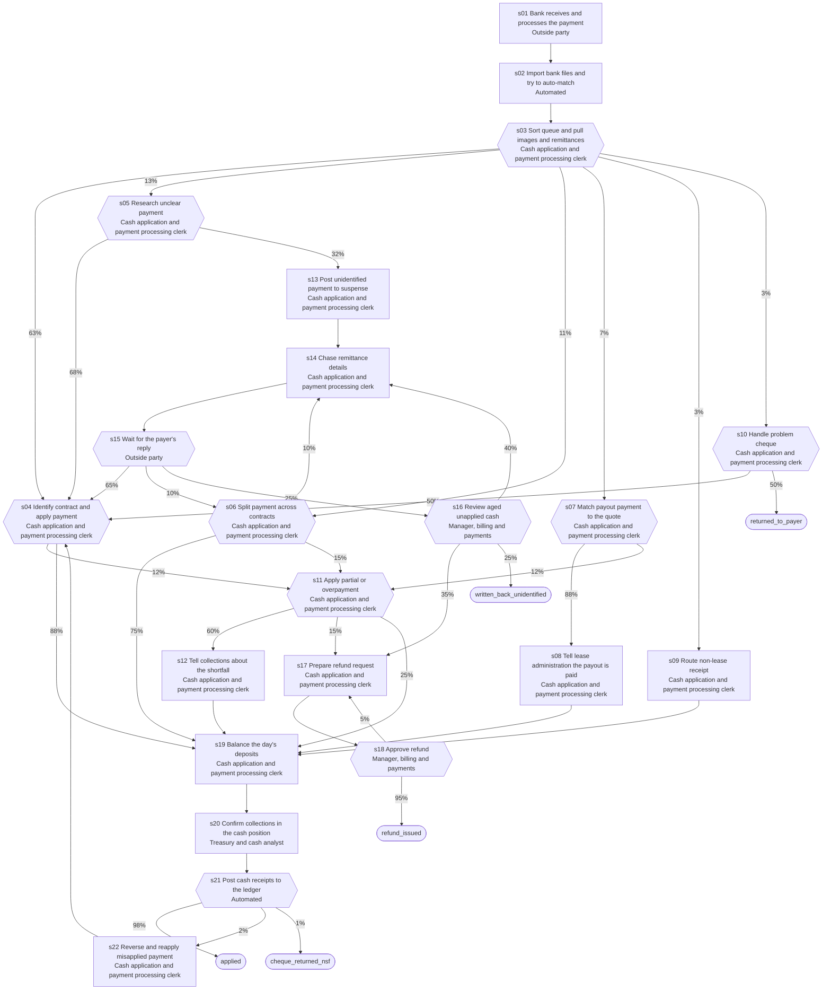

# Apply customer payments (equipment finance company)

`efc-apply-customer-payments` · equipment leasing and finance · operations (billing and payments) · part of `equipment-finance-co`

Most lease payments arrive by pre-authorised debit and post themselves; this workflow covers the roughly 9,000 items a month that do not. Cash application clerks work lockbox cheques, EFT and bill payments with missing or wrong contract numbers, wires, payments that cover several contracts, payout payments and short or over payments, then balance each day's deposits so treasury, funders and the ledger get correct collections. It is slow and error-prone because Canadian EFT carries little remittance data, small business customers send details by e-mail or not at all, and a payment on the wrong contract shows up only when a customer is chased for money already paid.

| | |
|---|---|
| Unit of work | one payment item needing manual application |
| Starts when | A payment arrives at the bank (lockbox cheque, EFT, wire or online bill payment) and does not post automatically. |
| Done when | The payment is applied to the right contract or contracts, or refunded, returned or transferred out of suspense, the day's deposits balance and the receipts are posted to the ledger. |
| Organisation | A privately owned Canadian independent lessor with about 55,000 active contracts, a bank wholesale lockbox, a bank cash management portal and a lease management system with rule-based auto-matching. (340 employees, 2019-2022) |
| Volume | 9,000 cases a month (range 7,500 to 11,000) |

## Where it sits

- Starts with **payment_settlement** from clearing_bank (55% of cases)
- Starts with **customer_payment** from customer (40% of cases)
- Starts with **open_receivables** from bill-customers (5% of cases)
- Sends **journal_entries** to close-the-month (outcome: any)
- Sends **delinquent_account** to collect-early-stage (outcome: applied)
- Sends **collections_data** to report-to-securitisation-funders (outcome: any)
- Sends **collections_data** to manage-daily-cash (outcome: any)
- Sends **collections_data** to maintain-data-and-reporting (outcome: any)
- Sends **payment_return** to process-returned-payments (outcome: cheque_returned_nsf)

## Flow

## Roles

| Role | Department | Layer | FTE on this process | Loaded cost per hour | Evidence |
|---|---|---|---:|---:|---|
| Cash application and payment processing clerk | Billing and payment processing | individual contributor | 5.5 | 30 CAD | B [src_jb_14200] |
| Manager, billing and payments | Billing and payment processing | manager | 0.15 | 70 CAD | C |
| Treasury and cash analyst | Treasury and securitisation | individual contributor | 0.1 | 48 CAD | C |

## Steps

Hands-on time and the wait before each step show the most common value. Evidence tier A is a sourced number, B a sourced description, C the author's estimate.

| Step | Who | Kind | Hands-on | Wait before | Control | Evidence |
|---|---|---|---:|---:|---|---|
| **s01 Bank receives and processes the payment.** The clearing bank's courier empties the lockbox, the processing centre opens the envelopes, images cheques and stubs and deposits the funds; EFT credits, wires and online bill payments arrive with whatever reference the payer typed. The day's lockbox data, images, EFT and bill payment remittance files are ready the next morning. | Outside party | external wait | 0 min | 16.0 h |  | B [src_nbc_lockbox], [src_pc_trends2020] |
| **s02 Import bank files and try to auto-match.** Early in the morning the lease system imports the settlement, lockbox and remittance files. Items whose reference matches a contract number and whose amount equals the open receivable post automatically and leave this workflow; the rest drop into the manual cash application queue with their images. | Automated | system auto | 0 min | 30 min |  | B [src_nacha_cashapp], [src_pc_iso_case] |
| **s03 Sort queue and pull images and remittances.** A clerk downloads the lockbox images from the bank portal, opens the remittance mailbox where customers, dealers and brokers e-mail payment details, and sorts the queue by type: single identifiable payments, unclear references, multi-contract payments, payouts, non-lease receipts and problem cheques. | Cash application and payment processing clerk | intake | 0.3 min | 2.0 h |  | B [src_nbc_lockbox] |
| **s04 Identify contract and apply payment.** The clerk searches the lease system by contract number, customer name or amount, compares the payment with the open receivables on that customer's contracts and applies it with the date the bank received it, so the customer is not charged late interest for the lessor's processing time. | Cash application and payment processing clerk | data entry | 1.2 min | 20 min |  | B [src_rbc_creditors] |
| **s05 Research unclear payment.** For an EFT or bill payment with a missing or wrong reference, the clerk searches by payer name, amount and date, checks the bank detail for the payer's account name, looks in the remittance mailbox and collection notes for a promise to pay, and asks collections or customer service if a customer said they had paid. | Cash application and payment processing clerk | lookup | 5 min | 1.0 h |  | B [src_pc_iso_case] |
| **s06 Split payment across contracts.** For a cheque or EFT that pays several contracts, the clerk opens the customer's remittance advice (e-mail, spreadsheet or stub), allocates the amount to each contract and checks that the parts add up; without an advice the clerk allocates by the customer's open invoices only where they add up exactly. | Cash application and payment processing clerk | data entry | 3.5 min | 30 min |  | B [src_nacha_cashapp] |
| **s07 Match payout payment to the quote.** The clerk finds the payout quote issued by lease administration, checks the amount, taxes and expiry date against the payment and applies it to the payout receivable. | Cash application and payment processing clerk | validation | 4 min | 30 min |  | C |
| **s08 Tell lease administration the payout is paid.** The clerk e-mails or tasks lease administration that the payout funds are applied so they can terminate billing, stop the debit, request title transfer and tell treasury if the contract sits in a securitised pool. | Cash application and payment processing clerk | communication | 1.5 min | 15 min |  | C |
| **s09 Route non-lease receipt.** For insurance claim cheques, dealer refunds, protection program refunds and other receipts that do not pay a lease invoice, the clerk posts the money to a clearing account and sends the image to the owning team (lease administration for casualty proceeds, accounting for supplier refunds). | Cash application and payment processing clerk | coordination | 3 min | 30 min |  | C |
| **s10 Handle problem cheque.** For cheques the bank holds in exception or will not process (postdated beyond the window, stale-dated, unsigned, wrong payee, or marked 'paid in full' on a partial amount), the clerk decides with the manager's guidance whether to accept, hold or return the cheque, and writes to the customer when it goes back. | Cash application and payment processing clerk | judgment | 6 min | 1.0 h | Cash handling policy for restrictive endorsements and stale or postdated cheques; the bank requires a decision on exception items before 2 pm for same-day processing | A [src_nbc_lockbox] |
| **s11 Apply partial or overpayment.** The clerk applies a short payment in the order the contract and the system hierarchy set (taxes, rent, then late charges and fees, oldest first), or decides what to do with an overpayment: leave it as a credit on the next invoice when the customer asked, or start a refund. | Cash application and payment processing clerk | judgment | 2.5 min | 15 min | Lease agreement terms and servicing policy on the order in which partial payments are applied | B [src_leasepak_hier] |
| **s12 Tell collections about the shortfall.** The clerk adds a note to the account and flags the remaining past-due amount so it appears in the early-stage collections queue, with the payer's explanation if the remittance gave one. | Cash application and payment processing clerk | communication | 1 min | 10 min |  | C |
| **s13 Post unidentified payment to suspense.** The clerk posts the payment to the unapplied cash suspense account with the payer name, amount, date and bank reference, and adds it to the unapplied cash log with the research done so far. | Cash application and payment processing clerk | data entry | 1.5 min | 10 min | Internal control over financial reporting: unapplied cash held in a suspense account that is reconciled and aged | C |
| **s14 Chase remittance details.** The clerk e-mails or calls the payer, or the dealer or broker who arranged the lease, asking which contract or contracts the payment was for, and diarises a follow-up. | Cash application and payment processing clerk | communication | 5 min | 4.0 h |  | C |
| **s15 Wait for the payer's reply.** The payer, dealer or broker replies with the contract numbers or a remittance advice, often after a reminder; some never reply. | Outside party | external wait | 0 min | 3.0 d |  | C |
| **s16 Review aged unapplied cash.** Each week the manager of billing and payments reviews the aged unapplied cash log, decides which items to chase again, which to refund to the payer traced through the bank, and which old unidentified items to transfer out of suspense under policy. | Manager, billing and payments | review | 3 min | 3.5 d | Internal control over financial reporting: management review of aged suspense balances | C |
| **s17 Prepare refund request.** The clerk prepares a refund request with the payment proof, the customer's instruction or the bank trace, and the account statement showing the credit, and sends it for approval before accounts payable issues the cheque or EFT. | Cash application and payment processing clerk | drafting | 12 min | 2.0 h |  | C |
| **s18 Approve refund.** The manager of billing and payments checks the credit, the payee and the support and approves the refund for payment by accounts payable, or sends it back. | Manager, billing and payments | approval | 3 min | 8.0 h | Internal control over financial reporting: the clerk who applies cash cannot approve or release refunds | C |
| **s19 Balance the day's deposits.** At the end of the day a clerk checks that payments applied plus items in suspense equal each deposit on the bank statement, by lockbox batch, EFT file and wire, and clears differences before the day is closed. The time shown is one item's share of this daily task. | Cash application and payment processing clerk | validation | 0.2 min | 4.0 h | Internal control over financial reporting: daily reconciliation of cash receipts applied to bank deposits | C |
| **s20 Confirm collections in the cash position.** The treasury analyst takes the balanced daily cash report into the cash position, checks collections on contracts sold to each conduit and flags amounts to be remitted. The time shown is one item's share of the daily task. | Treasury and cash analyst | review | 0.05 min | 30 min | Securitisation servicing agreements: collections on sold contracts tracked by pool and passed to the conduit | C |
| **s21 Post cash receipts to the ledger.** Overnight the lease system posts the day's cash receipts and suspense movements to the general ledger and loads collections by contract and pool into the data warehouse for treasury, funders and reporting. | Automated | system auto | 0 min | 10.0 h |  | C |
| **s22 Reverse and reapply misapplied payment.** When a customer, collector or the month-end review finds a payment on the wrong contract, the clerk reverses it, checks whether late charges or a debit retry were triggered by the error, waives them and reapplies the payment correctly. | Cash application and payment processing clerk | data entry | 10 min | 5.0 d |  | C |

## Exceptions

| Exception | Share of cases | What happens |
|---|---:|---|
| Unidentified payment | 5% | No contract can be found; the payment sits in suspense while the clerk chases the payer, dealer or broker, and the manager reviews it weekly until it is applied, refunded or transferred out. |
| Short payment | 10% | The payment is less than the amount due; it is applied in hierarchy order and the shortfall goes to collections. |
| Overpayment refunded | 3% | An overpayment or duplicate payment is refunded through accounts payable after manager approval. |
| Payout payment differs from quote | 1% | The payout amount is short or the quote has expired; lease administration requotes or the shortfall is collected. |
| Problem cheque | 3% | Postdated, stale-dated, unsigned or 'paid in full' cheques need a decision before the bank's deadline and half go back to the payer. |
| Misapplied payment | 2% | A payment applied to the wrong contract is found days or weeks later, usually when the customer is chased, and is reversed and reapplied with any late charges waived. |

## Benchmarks

| Metric | Value | Unit | Population | Evidence |
|---|---|---|---|---|
| cycle_time_days | p50 1.5, p90 3.5 | calendar days from receipt at the bank to applied and posted | Manually applied payments at a mid-size lessor (derived) | C [src_nbc_lockbox], [src_billtrust_ar] |
| auto_cash_hit_rate | high_performers 80% and above, low_performers 0% to 20% | share of payments applied automatically | Companies in the Nacha and Credit Research Foundation cash application survey (US, 2021) | A [src_nacha_cashapp] |
| days_to_cash_application_target | 1 | days | Vendor-recommended executive metric | B [src_billtrust_ar] |
| corporate_cheque_volume_change_2019 | -0.15 | share change from 2018 | Canada, all corporate cheques | A [src_pc_trends2020] |
| sme_share_using_cheques_2019 | 0.45 | share of SMEs | Canadian small and medium enterprises (RFi Group survey cited by Payments Canada) | A [src_pc_trends2020] |
| manual_items_per_clerk_day | 86 | items | This organisation | C |

## Pain points

- EFT and bill payments arrive with little or wrong reference data, so clerks search by name and amount and chase payers by e-mail. (steps s05, s14, s15; B [src_pc_iso_case], [src_nacha_cashapp])
- Payments applied to the wrong contract are found only when a collector calls a customer who has paid, which creates complaints and late charge reversals. (steps s04, s06, s22; C)
- Unapplied cash ages in a spreadsheet log reviewed weekly; old items need manager decisions and refunds through another department. (steps s13, s16, s17, s18; C)
- Payout payments must be matched to quotes and handed to lease administration quickly, or billing and debits continue after payout. (steps s07, s08; C)

## Assumptions

- Only items that fail auto-matching are cases; the roughly 47,000 debits a month that post automatically are outside this workflow.
- Mix of manual items (63% single identifiable payments, 13% unclear references, 11% multi-contract, 7% payouts, 3% non-lease receipts, 3% problem cheques) is an author estimate.
- The organisation file's 9,000 items a month and seven clerks, who also handle returned payments, imply about 4 to 5 minutes per item. The touch times here give a little under 6 minutes on average, so the implied staffing is somewhat above the 5.75 FTE stated; the gap is in line with backlogs and overtime at month start, or with a manual volume in the organisation file that is on the high side.
- Daily batch tasks (deposit balancing, treasury review) are shown as one item's share of the daily effort so that staffing adds up.
- Refunds are paid by accounts payable, outside this workflow. Old unidentified items are transferred out of suspense under the lessor's policy; provincial unclaimed property rules were not researched.
- Collections on securitised contracts are assumed to be tracked by pool daily and settled with conduits under the servicing agreements; the exact remittance timing was not sourced.
- No problem was found in the organisation file for this process, apart from the volume note above.

## Sources

- [src_nbc_lockbox] [Wholesale lockbox: specifications user guide](https://nbc.ca/content/dam/bnc/outils-apps/entreprises/guides/wholesale-lockbox-specifications-user-guide.pdf) (National Bank of Canada, 2019). Courier empties the lockbox every business day; cheque, stub and correspondence images online; exceptions (multiple payments that do not balance, no stub or reference, 'paid in full', postdated outside the period) need a decision before 2 pm; stale-dated and unsigned cheques not processed; funds credited the day items are processed.
- [src_pc_trends2020] [Canadian Payment Methods and Trends 2020](https://payments.ca/sites/default/files/2022-08/PaymentsCanada_2020CanadianPaymentsMethodsAndTrendsReport_En.pdf) (Payments Canada, 2020). 2019 data: corporate cheque use fell 15% from 2018; 45% of SMEs and 43% of mid-market companies use cheques and paper; cheques 16% of SME spend; EFT holds most business payment value; 23% of consumer bills paid by PAD.
- [src_pc_iso_case] [Specialty retailer prepares for benefits of richer payments data (ISO 20022 case study)](https://payments.ca/sites/default/files/2022-08/PaymentsCanada_2019SpecialtyRetailerISO20022CaseStudy_En.pdf) (Payments Canada, 2019). AFT batch payments use Standard 005, which offers limited room for remittance data; remittance advice typically sent by e-mail or portal; incoming batch payments matched manually to invoices.
- [src_nacha_cashapp] [Goofus and Gallant: cash application](https://www.nacha.org/news/goofus-and-gallant-cash-application) (Nacha, 2021). Nacha and Credit Research Foundation survey: high performers apply 80% or more of payments automatically, low performers 0% to 20%; high performers get remittance feeds from banks, low performers by e-mail and mail.
- [src_leasepak_hier] [Payment hierarchy (U0212)](https://docsuite.netsoltech.com/v76a/docsuite/refguide/u/u02/u0212/payment_hierarchy.php) (NETSOL Technologies (LeasePak documentation), n.d.). Partial payments are applied by priority and payment order across receivable types (rent, interest, sales tax, late charges, fees); items with order 0 paid in invoice order.
- [src_rbc_creditors] [Best practices document for creditors (bill payment)](https://www.rbcroyalbank.com/business/customer-service/_assets-custom/pdf/RBC-Best-Practices-Document-for-Billers.pdf) (RBC Royal Bank, n.d.). Creditors may value-date bill payments to the day paid or to the day they reconcile remittance details, which can be days later and cause late fees; disclosure encouraged.
- [src_billtrust_ar] [Accounts receivable performance metrics](https://www.billtrust.com/?p=14505) (Billtrust, n.d.). Days to cash application target of 1 day; match rate target 85% to 95% or more.
- [src_jb_14200] [Wages for accounting and related clerks (NOC 14200)](https://www.jobbank.gc.ca/wagereport/occupation/27033) (Job Bank, Government of Canada, 2025). Hourly wages 2023-2024: Ontario low $18.12, median $25.00, high $37.00; Toronto region median $25.64.

Written by claude-opus on 2026-11-17.
