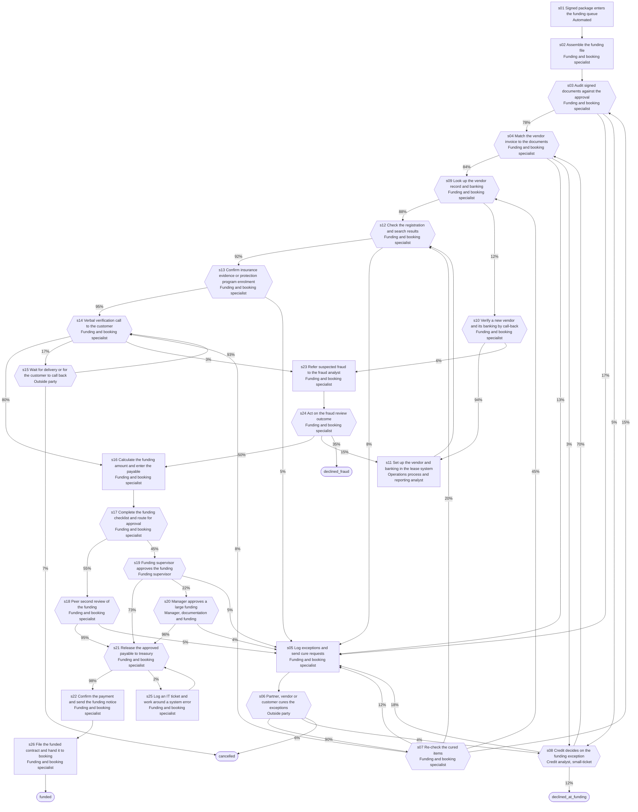

# Audit signed packages and fund vendors

`efc-audit-and-fund-contracts` · equipment leasing and finance · operations (funding) · part of `equipment-finance-co`

Before the company pays a dealer for leased equipment, a funding specialist audits the signed package against the credit approval: signatures and guarantees, the vendor invoice and serial numbers, the security registration, insurance and a verification call confirming the customer received and accepted the equipment. Exceptions go back to dealers, brokers or credit; new vendors are verified by call-back and set up by someone who does not fund deals; a second person approves every payable and treasury releases the payment. Missing or wrong documents, undelivered equipment and unreachable customers cause most of the delay.

| | |
|---|---|
| Unit of work | one contract funding |
| Starts when | A complete signed document package is placed in the funding queue; the vendor invoice, registration confirmation and insurance status arrive separately and often later. |
| Done when | The vendor payment has been released by treasury, the partner notified and the funded file handed to booking, or the deal is cancelled or declined at funding. |
| Organisation | A privately owned Canadian independent equipment lessor with 340 staff funding about 1,400 small- and mid-ticket contracts a month through dealers, brokers and direct sales. (340 employees, 2019-2022) |
| Volume | 1,400 cases a month (range 1,150 to 1,650) |

## Where it sits

- Starts with **signed_documents** from customer (80% of cases)
- Starts with **vendor_invoice** from equipment_vendor (11% of cases)
- Starts with **registration_confirmation** from search-and-register-security (4% of cases)
- Starts with **insurance_confirmation** from track-equipment-insurance (3% of cases)
- Starts with **fraud_clearance** from verify-identity-and-fraud (2% of cases)
- Sends **funding_approval** to manage-daily-cash (outcome: funded)
- Sends **funded_contract_file** to book-contracts (outcome: funded)
- Sends **fraud_alert** to verify-identity-and-fraud (outcome: any)
- Sends **it_ticket** to resolve-it-service-requests (outcome: any)

## Flow

## Roles

| Role | Department | Layer | FTE on this process | Loaded cost per hour | Evidence |
|---|---|---|---:|---:|---|
| Funding and booking specialist | Funding and booking team | individual contributor | 8 | 34 CAD | B [src_jobbank_14201], [src_eq_credit_coord] |
| Funding supervisor | Funding and booking team | supervisor | 0.5 | 49 CAD | C |
| Manager, documentation and funding | Documentation and funding | manager | 0.1 | 74 CAD | C |
| Credit analyst, small-ticket | Small-ticket credit | individual contributor | 0.3 | 39 CAD | C |
| Operations process and reporting analyst | Operations | individual contributor | 0.15 | 46 CAD | C |

## Steps

Hands-on time and the wait before each step show the most common value. Evidence tier A is a sourced number, B a sourced description, C the author's estimate.

| Step | Who | Kind | Hands-on | Wait before | Control | Evidence |
|---|---|---|---:|---:|---|---|
| **s01 Signed package enters the funding queue.** When the documentation team files a complete signed package, the origination portal moves the deal to the funding work queue, ordered by the date the documents arrived and flagged if the dealer asked for same-day funding. | Automated | system auto | 0 min | 0 min |  | C |
| **s02 Assemble the funding file.** A funding and booking specialist opens the file and gathers everything needed for the audit on two screens: the approval and its conditions from the portal, the signed documents and vendor invoice from imaging, the registration verification from the registration clerks and the insurance status from the insurance tracker. Missing items are noted before the audit starts. | Funding and booking specialist | lookup | 2 min | 4.0 h |  | B [src_eq_credit_coord], [src_leaseservices_verif] |
| **s03 Audit signed documents against the approval.** The specialist checks each document against the approval: the agreement and schedule are signed by an authorised officer, every guarantor signed, initials and dates are present, amounts, payment, term and serial numbers agree across documents, the delivery and acceptance certificate is signed and the pre-authorised debit form has banking details. Defects go on an exception list. | Funding and booking specialist | validation | 5 min | 0 min | Credit policy and funder eligibility criteria: no funding until signed documents match the approval and every condition is met | B [src_elfa_acceptance], [src_pawnee_docusign], [src_eq_credit_coord] |
| **s04 Match the vendor invoice to the documents.** The specialist compares the vendor invoice with the documents and approval: it is made out to the company, the equipment description and serial numbers match the schedule, the price and taxes agree with the financed amount, any trade-in or down payment is shown and soft costs are within policy. A higher price or different unit is an exception. | Funding and booking specialist | validation | 3 min | 0 min | Funding policy: pay only against an invoice to the company that matches the financed equipment and amount | B [src_elfa_fraud_study], [src_mortgagecentre] |
| **s05 Log exceptions and send cure requests.** The specialist records each exception in the portal and emails the dealer, broker or account executive a stipulation list: missing signatures or pages, corrected invoice, insurance certificate, or a registration amendment or prior-lender waiver. Registration corrections go to the registration clerks. | Funding and booking specialist | communication | 3 min | 15 min |  | C |
| **s06 Partner, vendor or customer cures the exceptions.** The dealer, broker or customer sends the missing pages, a corrected invoice or the certificate, often after the customer re-signs through e-signature or the vendor reissues the invoice. Some deals are cancelled at this point because the customer changed its mind or the equipment fell through. | Outside party | external wait | 0 min | 1.0 d |  | B [src_pawnee_docusign] |
| **s07 Re-check the cured items.** When cures arrive, the specialist checks only the items on the exception list: the re-signed page, the corrected invoice, the certificate or the amended registration. A fully re-signed package gets a complete re-audit; otherwise the file resumes where it stopped. | Funding and booking specialist | validation | 3 min | 3.0 h |  | C |
| **s08 Credit decides on the funding exception.** A small-ticket credit analyst reviews the exception, such as a guarantor who will not sign, an approval older than its validity period needing a refreshed bureau, or a higher price, and waives it, adds a condition or declines the deal at funding. Decisions are recorded in the portal under the analyst's delegated authority. | Credit analyst, small-ticket | approval | 10 min | 4.0 h | Delegated credit authority: only credit may waive or change approval conditions | C |
| **s09 Look up the vendor record and banking.** The specialist checks that the vendor on the invoice is an approved vendor in the lease system with verified banking details on file. Dealers in a vendor program are already set up; one-off vendors on broker and direct deals, and any vendor that sent new banking instructions, need verification. | Funding and booking specialist | lookup | 1 min | 0 min |  | B [src_eq_credit_coord] |
| **s10 Verify a new vendor and its banking by call-back.** The specialist confirms the vendor exists from the corporate registry and its website, calls it on a number found independently (not the one on the invoice or email) to confirm the invoice and banking details, and obtains a bank letter or void cheque. Mismatches or pressure to pay quickly are treated as fraud flags. | Funding and booking specialist | validation | 20 min | 8.0 h | Payment fraud controls: independent call-back verification of new vendors and banking changes | B [src_elfa_fraud_webinar], [src_afp_2021] |
| **s11 Set up the vendor and banking in the lease system.** An operations analyst who does not fund deals enters the verified vendor and its banking details in the lease system's vendor master and attaches the bank letter, so the payable can be created. | Operations process and reporting analyst | data entry | 10 min | 6.0 h | Internal control over payments: whoever maintains vendor master data does not approve or release payments | B [src_sikich_sod] |
| **s12 Check the registration and search results.** The specialist opens the registration verification statement and compares debtor names, serial numbers and collateral description with the documents, checks it was filed in the right province within the purchase-money window or, in Quebec, that the lease was published, and reviews the search for earlier registrations that need a waiver or discharge. | Funding and booking specialist | validation | 2 min | 30 min | Provincial PPSA (lease over one year; unperfected interest ineffective against a trustee; purchase-money priority if perfected within 15 days) and Civil Code of Quebec art. 1852 publication | B [src_bc_ppsa], [src_elfa_quebec_pub] |
| **s13 Confirm insurance evidence or protection program enrolment.** The specialist checks in the insurance tracker that a certificate naming the company as loss payee is on file or that the customer will be enrolled in the protection program. Trucks and mid-ticket equipment need the certificate before funding. | Funding and booking specialist | lookup | 1 min | 0 min | Lease terms and funding policy: equipment insured with the company as loss payee, or protection program enrolment | C |
| **s14 Verbal verification call to the customer.** The specialist calls the customer on the number in the credit file, confirms they are speaking to the signer, and asks whether the equipment was delivered, is working and is accepted, and confirms the vendor, payment amount and term. Notes go in the portal. A vendor on the line, a different equipment location or pressure to rush are fraud flags. | Funding and booking specialist | communication | 5 min | 3.0 h | Funding policy: lessee acceptance confirmed by signed certificate and verbal verification before funding | B [src_elfa_acceptance], [src_leaseservices_verif], [src_elfa_fraud_webinar] |
| **s15 Wait for delivery or for the customer to call back.** The file waits until the equipment is delivered and installed or the customer returns the call. Specialists retry from a daily follow-up list; equipment delivered from the manufacturer or needing installation can take a week or more. | Outside party | external wait | 0 min | 2.0 d |  | B [src_mortgagecentre] |
| **s16 Calculate the funding amount and enter the payable.** The specialist works out the amount to pay: equipment cost plus tax, less any down payment or first and last payments the vendor collected, less holdbacks, and splits it when there are several vendors. They enter the vendor payable and any broker commission in the lease system. | Funding and booking specialist | data entry | 4 min | 0 min |  | B [src_mortgagecentre] |
| **s17 Complete the funding checklist and route for approval.** The specialist ticks the funding checklist in the portal (documents, invoice, registration, insurance, verification, payable) and routes the file for a second signature: a peer funder for small files, the funding supervisor for larger files, exceptions and new vendors. | Funding and booking specialist | validation | 1.5 min | 0 min |  | B [src_leaseservices_verif] |
| **s18 Peer second review of the funding.** Another funding specialist reviews the checklist, the payable amount against the invoice and documents and the verification notes, and approves the payable in the lease system or returns it. | Funding and booking specialist | review | 3 min | 1.0 h | Internal control over payments: a payable is approved by someone other than the person who prepared it | B [src_sikich_sod] |
| **s19 Funding supervisor approves the funding.** The funding supervisor reviews larger files, waived exceptions and new-vendor files, checks the payable and the verification, and approves in the lease system. Fundings above $250,000 are passed to the manager. | Funding supervisor | approval | 5 min | 3.0 h | Payment approval limits: supervisor approval above the peer-approval threshold | C |
| **s20 Manager approves a large funding.** The manager of documentation and funding reviews mid-ticket fundings above $250,000, checks that credit conditions and any third-party payments are in order, and approves. | Manager, documentation and funding | approval | 10 min | 4.0 h | Payment approval limits: manager approval for large fundings | C |
| **s21 Release the approved payable to treasury.** The specialist sets the contract to funded pending payment, which places the approved vendor payable and broker commission in the treasury payment queue for the next EFT file; treasury releases payments from the bank portal, so funding staff never release cash. | Funding and booking specialist | data entry | 1 min | 0 min | Internal control over payments: payment release by treasury, separate from funding approval | B [src_sikich_sod] |
| **s22 Confirm the payment and send the funding notice.** After treasury's daily EFT run, the specialist checks the payment report, then emails the dealer or broker a funding notice with the amount and remittance details so they can release the equipment or close the sale. | Funding and booking specialist | communication | 1 min | 20.0 h |  | B [src_newcap_toronto], [src_mortgagecentre] |
| **s23 Refer suspected fraud to the fraud analyst.** The specialist puts the file on hold and writes a referral to the fraud and verification analyst describing the flags, such as banking that does not match the vendor, a customer who did not know about the lease, or equipment at another address. | Funding and booking specialist | communication | 15 min | 15 min |  | B [src_elfa_fraud_study], [src_elfa_fraud_webinar] |
| **s24 Act on the fraud review outcome.** When the fraud analyst clears or declines the file, the specialist either resumes funding, with vendor set-up if the flag was on the vendor, or closes the deal as declined and tells the partner it will not fund. | Funding and booking specialist | judgment | 5 min | 2.0 d |  | C |
| **s25 Log an IT ticket and work around a system error.** When the lease system rejects the payable or the contract status will not change, the specialist logs an IT ticket with screenshots and, once IT fixes the data or configuration, re-releases the payable. | Funding and booking specialist | communication | 10 min | 8.0 h |  | C |
| **s26 File the funded contract and hand it to booking.** The specialist indexes the final funded file in imaging, sends paper originals to the vault and moves the contract to the booking queue with the payment reference. | Funding and booking specialist | data entry | 1 min | 0 min |  | C |

## Exceptions

| Exception | Share of cases | What happens |
|---|---:|---|
| Deficient signed documents | 17% | Missing signatures, guarantor pages or initials, or amounts that differ between documents; sent back to the partner and re-audited. |
| Invoice problems | 13% | Invoice missing, not made out to the company, wrong serial numbers or a higher price; the vendor reissues it. |
| Credit exception at funding | 8% | Condition not met, approval expired or price above tolerance; credit waives, re-conditions or declines. |
| New vendor or changed banking | 12% | One-off vendors and banking changes are verified by independent call-back and set up by the operations analyst. |
| Equipment not delivered or customer unreachable | 17% | The verification call cannot confirm acceptance; the file waits for delivery or a callback. |
| Suspected fraud | 3% | Banking, identity or equipment flags send the file to the fraud analyst; about a third are declined. |
| Registration error or prior lien | 7% | Debtor name or serial number errors need an amendment, or an earlier registration needs a waiver or discharge. |
| Prefunding or progress payment | 2% | Custom or manufactured equipment needs a deposit to the vendor before delivery; funded on an interim agreement with manager approval and later re-audited at acceptance. Not modelled as separate steps. |

## Benchmarks

| Metric | Value | Unit | Population | Evidence |
|---|---|---|---|---|
| cycle_time_days | p50 3, p90 12 | calendar days from signed package in the funding queue to vendor payment released or file closed, all outcomes | Canadian small- and mid-ticket equipment lessor, 2019-2022 (composite estimate) | B [src_newcap_toronto], [src_mortgagecentre], [src_pawnee_docusign] |
| business_email_compromise_targeting | 0.76 | share of organisations targeted in 2020 | AFP 2021 Payments Fraud and Control Survey respondents (US treasury and finance professionals) | A [src_afp_2021] |
| first_pass_exception_rate | 0.22 | share of funding files with at least one document exception at first audit | Small-ticket independent lessor (author estimate) | C |

## Pain points

- About one in five signed packages fails the first audit for missing signatures, pages or mismatched amounts, and each cure takes a day or more with the partner. (steps s03, s05, s06; B [src_pawnee_docusign])
- Verification calls often fail because the customer is busy or the equipment is not yet delivered, so files wait days after documents are signed. (steps s14, s15; B [src_elfa_acceptance], [src_mortgagecentre])
- Vendor invoices arrive late or wrong (not made out to the company, missing serial numbers), and invoice fraud and banking-change scams require slow manual call-backs. (steps s04, s10; B [src_elfa_fraud_study], [src_afp_2021])
- Payments wait for treasury's once-a-day EFT run, so a file approved after the cut-off is paid the next business day. (steps s22; C)
- Month-end peaks fill the funding queue as partners push volume, lengthening queue waits and approval waits. (steps s02, s19; C)

## Assumptions

- The case starts when the signed package reaches the funding queue. Triggered_by shares give the input whose arrival usually starts or restarts the audit: signed documents in most cases, the vendor invoice or registration confirmation when they arrive last, and a fraud clearance for files re-entering after review.
- Lessors were not FINTRAC reporting entities in 2019-2022 (organisation file assumption), so verification and fraud checks rest on company policy, funder eligibility and fraud risk, not on anti-money-laundering law.
- Every payable needs a second person: a peer funder for small files, the funding supervisor for larger files and exceptions and the manager above $250,000; treasury releases the EFT. Thresholds are author estimates.
- About 92% of files entering the funding queue are paid; about 8% are cancelled before funding (mostly undelivered equipment or customers changing their minds), declined at funding by credit or declined for fraud. Cases per month keep the process map figure of 1,400 although slightly more files enter than fund.
- External steps have zero touch time; customer, vendor and partner time is in wait_before_min.
- Funding specialists split their time with booking (book-contracts), so fte_on_process is about 8 of 11, with 3 on booking. Hands-on time implies about 8.6 FTE here and about 4.5 FTE in booking, roughly 13 FTE against 11 people before any registration support, so the organisation file appears to understate the funding team by one or two people (or the team relies on overtime at month end).
- Loaded costs are the organisation file's (2019-2022 wage times 1.35).

## Sources

- [src_elfa_acceptance] [Equipment acceptance is important](https://www.elfaonline.org/communications/january-february-2020/equipment-acceptance-is-important) (Equipment Leasing and Finance Association (Equipment Leasing Today), 2020). Lessors generally do not fund until the signed delivery and acceptance certificate is received; where the lessee has not signed a follow-up certificate after delivery, a prudent lessor requests one or makes a telephone verification call; deemed acceptance and pre-authorised funding before acceptance carry more risk.
- [src_leaseservices_verif] [Your first 30 days (customer help centre)](https://help.leaseservices.com/help-center/category/your-first-30-days) (Lease Services, undated). A verification call is when a member of the lessor's documentation team calls an approved applicant to confirm they applied for the financing and received the equipment; a cover letter serves as the checklist of documents needed to release funds; customers then receive a welcome letter.
- [src_elfa_fraud_webinar] [5 takeaways from ELFA webinar on fraud detection, mitigation and prevention](https://www.elfaonline.org/newsroom/2023/03/29/5-takeaways-from-elfa-webinar-on-fraud-7ca7475d) (Equipment Leasing and Finance Association, 2023). Lenders should call vendors directly to verify they are legitimate and consider a physical inspection for pricier equipment to verify it exists; email, address, device and IP checks of the originating party.
- [src_elfa_fraud_study] [New Foundation study examines the prevention, detection and impact of fraud on the equipment finance industry](https://www.elfaonline.org/newsroom/2024/01/29/new-foundation-study-examines-the-57ed4e5d) (Equipment Leasing and Finance Association, 2024). Fraud types in equipment finance include identity theft, use of legitimate credentials by criminals, first-party fraud by owners, impersonation and fraudulent invoice creation; incidents of some types rose 10% or more over two years; preventive checks are more effective than investigation; many firms do not track fraud losses.
- [src_eq_credit_coord] [Credit Coordinator, Bennington Financial Corp (job posting)](https://jobs.lever.co/eqbank/c1b4e9a7-8406-44f8-b482-eaf231c17a11) (EQ Bank / EQB Inc. on Lever, 2025). A Canadian equipment lessor prepares preliminary credit packages for the funding review, collecting the documents needed to finalise the credit audit at funding, and processes vendor approvals by researching and validating information.
- [src_bc_ppsa] [Personal Property Security Act [RSBC 1996] chapter 359](https://www.bclaws.gov.bc.ca/civix/document/id/complete/statreg/96359_01) (Government of British Columbia (BC Laws), 2024). Section 3: the Act applies to a lease for a term of more than one year; section 20: an unperfected security interest is not effective against a trustee in bankruptcy; section 34: a purchase-money security interest has priority if perfected within 15 days after the debtor obtains possession.
- [src_elfa_quebec_pub] [State law compendium: Quebec, publication](https://www.elfaonline.org/advocacy/state-issues/state-law-compendium/quebec-canada/publication) (Equipment Leasing and Finance Association, 2024). Civil Code of Quebec article 1852: rights under a lease of more than one year of a road vehicle or of movable property needed to operate an enterprise must be published to be set up against third persons; late publication is effective only from its date.
- [src_afp_2021] [AFP survey: payments fraud increase attributed to coronavirus pandemic (2021 Payments Fraud and Control Survey)](https://www.financialprofessionals.org/training-resources/resources/articles/Details/afp-survey-payments-fraud-increase-attributed-to-coronavirus-pandemic) (Association for Financial Professionals, 2021). 74% of organisations were targeted by payment scams in 2020; 76% were targeted by business email compromise; 62% of those with attempted or actual fraud said it came from business email compromise.
- [src_sikich_sod] [Why segregation of duties is a key internal control and how to implement it](https://www.sikich.com/insight/why-segregation-of-duties-is-a-key-internal-control-and-how-to-implement-it/) (Sikich, 2026). Segregation of duties splits originating, authorising, recording and reconciling a transaction; maintaining vendor master data and releasing payments is a conflict; dual authorisation of payments above thresholds in the payables system and bank portal.
- [src_newcap_toronto] [Toronto equipment financing](https://newcapleasing.com/toronto-equipment-financing/) (NewCap Leasing, undated). Once approved and documents are signed, funding and equipment release typically happen within 48 hours for standard leases.
- [src_mortgagecentre] [What we lease (vendor leasing process)](https://mortgagecentre.com/what-we-lease) (Mortgage Centre Canada, undated). Canadian vendor leasing sequence: signed agreements returned, release or purchase order to the vendor, delivery, customer receives and accepts the equipment, then the vendor is paid the equipment cost plus tax usually within 2 to 5 days.
- [src_pawnee_docusign] [Pawnee Leasing Corporation achieves 50% faster access to capital with DocuSign eSignature (case study)](https://www.casestudies.com/company/docusign/case-study/pawnee-leasing-customers-access-capital-50-faster-with-docusign-esignature) (DocuSign via casestudies.com, undated). Broker-submitted agreements often arrived with missing signatures or wrong amounts, causing repeated back-and-forth and funding delays that stretched from days into weeks.
- [src_jobbank_14201] [Wages: Financial clerk, financial sector in Ontario (NOC 14201)](https://www.jobbank.gc.ca/marketreport/wages-occupation/1674/ON) (Job Bank, Government of Canada, 2025). Ontario hourly wages low $18.00, median $25.48, high $35.90 (2023-2024).

Written by claude-opus on 2026-11-17.
