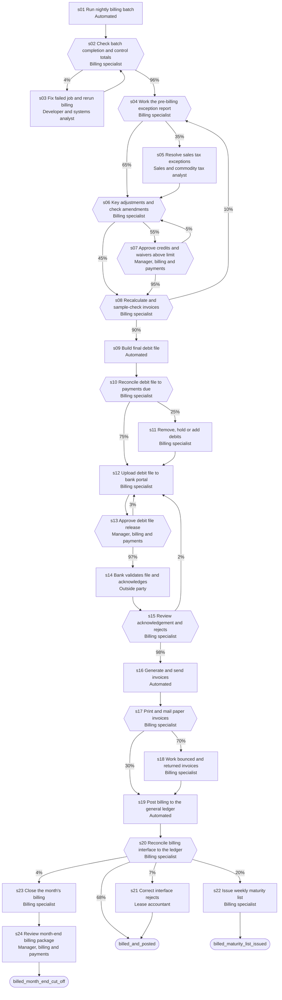

# Run daily billing and debit files (equipment finance company)

`efc-bill-customers` · equipment leasing and finance · operations (billing and payments) · part of `equipment-finance-co`

Every business day the lease system bills the contracts coming due: invoices about two weeks before the payment date, with GST/HST, QST or PST for the province where the equipment sits, and a pre-authorised debit file for payments due in two business days. A team of billing specialists works the exceptions the batch throws up, keys adjustments and amendments sent by customer service, insurance tracking and lease administration, releases the debit file to the bank under dual approval and reconciles the billing posted to the ledger. The work is slow and error-prone because much of it is re-keying requests from e-mail, because booking errors in tax codes and dates surface only at billing, and because the debit file has to beat the bank's deadline with every cancellation and insolvency hold removed.

| | |
|---|---|
| Unit of work | one daily billing run with its exceptions |
| Starts when | The end-of-day cut-off for contract changes on a business day starts the nightly billing batch. |
| Done when | Invoices are sent, the debit file is accepted by the clearing bank, billing is posted to and reconciled with the general ledger, and any weekly or month-end billing outputs are delivered. |
| Organisation | A privately owned Canadian independent lessor with about 55,000 active small- and mid-ticket contracts serviced on one lease management system, a mid-market ERP ledger and a bank cash management portal. (340 employees, 2019-2022) |
| Volume | 22 cases a month (range 21 to 23) |

## Where it sits

- Starts with **booked_contract** from book-contracts (30% of cases)
- Starts with **billing_adjustment** from handle-service-requests (12% of cases)
- Starts with **billing_adjustment** from process-returned-payments (10% of cases)
- Starts with **insurance_charge** from track-equipment-insurance (8% of cases)
- Starts with **contract_amendment** from quote-and-process-buyouts (12% of cases)
- Starts with **contract_amendment** from manage-end-of-term (14% of cases)
- Starts with **contract_amendment** from restructure-and-defer-payments (5% of cases)
- Starts with **contract_amendment** from process-lease-assumptions (1% of cases)
- Starts with **contract_amendment** from settle-casualty-losses (1% of cases)
- Starts with **billing_adjustment** from recover-off-lease-equipment (2% of cases)
- Starts with **billing_adjustment** from handle-property-tax-assessments (1% of cases)
- Starts with **system_release** from manage-system-changes (4% of cases)
- Sends **invoice_statement** to customer (outcome: any)
- Sends **pad_file** to clearing_bank (outcome: any)
- Sends **journal_entries** to close-the-month (outcome: any)
- Sends **sales_tax_data** to file-sales-taxes (outcome: any)
- Sends **maturity_list** to manage-end-of-term (outcome: billed_maturity_list_issued)
- Sends **open_receivables** to apply-customer-payments (outcome: any)

## Flow

## Roles

| Role | Department | Layer | FTE on this process | Loaded cost per hour | Evidence |
|---|---|---|---:|---:|---|
| Billing specialist | Billing and payment processing | individual contributor | 3.2 | 32 CAD | B [src_jb_14200] |
| Manager, billing and payments | Billing and payment processing | manager | 0.2 | 70 CAD | C |
| Sales and commodity tax analyst | Tax | individual contributor | 0.1 | 48 CAD | C |
| Developer and systems analyst | Applications and development | individual contributor | 0.02 | 62 CAD | C |
| Lease accountant | Financial and lease accounting | individual contributor | 0.02 | 50 CAD | C |

## Steps

Hands-on time and the wait before each step show the most common value. Evidence tier A is a sourced number, B a sourced description, C the author's estimate.

| Step | Who | Kind | Hands-on | Wait before | Control | Evidence |
|---|---|---|---:|---:|---|---|
| **s01 Run nightly billing batch.** After the end-of-day cut-off for contract changes, the lease system runs the billing job stream: a pre-billing edit report, selection of contracts whose next payment falls within the invoice lead days (about 14 days), calculation of GST/HST, QST or PST by the province where the equipment is located, fees, insurance protection charges and late charges, and creation of debit items for payments due in two business days. | Automated | system auto | 0 min | 3.0 h |  | B [src_oracle_olfm], [src_nbc_payments] |
| **s02 Check batch completion and control totals.** First thing in the morning a billing specialist opens the job log and the billing register summary, confirms every job ended normally and compares the count and dollar total of contracts billed with the scheduled payments due and with the prior week's run for the same due day. A failed job or a total that is off by more than the tolerance stops the run. | Billing specialist | validation | 25 min | 10.0 h | Internal control over financial reporting: completeness and accuracy of billing (batch control totals), tested by the external auditor and expected by securitisation servicing agreements | C |
| **s03 Fix failed job and rerun billing.** The billing specialist logs an IT ticket and a developer reads the job log, fixes the cause (a locked record, a bad rate table, a failed tax table load after a release) and reruns the failed part of the billing job stream in the morning window. | Developer and systems analyst | analysis | 1.0 h | 1.5 h |  | C |
| **s04 Work the pre-billing exception report.** Specialists split the exception report and work each flagged contract: missing or invalid tax jurisdiction, invalid bank account or bill-to address, payment amount different from the schedule, first invoices of new bookings with interim rent to prorate, and contracts on hold for insolvency or deferral. For each they open the contract in the lease system and the signed documents in imaging, correct the data or put billing on hold for the day. | Billing specialist | analysis | 3.7 h | 15 min |  | B [src_oracle_olfm], [src_nbc_payments] |
| **s05 Resolve sales tax exceptions.** The sales and commodity tax analyst receives the contracts with tax questions by email, confirms the province where the equipment is ordinarily located and whether PST, QST or HST applies, checks exemption documents on file (First Nations, farmers, production machinery, federal government) and tells billing which tax code to set. Contracts not settled today are held and billed in a later run. | Sales and commodity tax analyst | judgment | 45 min | 1.5 h | Excise Tax Act s.136.1 and Schedule IX (each lease interval is a separate supply taxed where the property is ordinarily located); BC Provincial Sales Tax Act (PST on each lease payment, exemptions need documentation); Quebec QST Act | A [src_cra_333], [src_bc_pst315] |
| **s06 Key adjustments and check amendments.** Specialists work the billing work queue and shared mailbox: credit and rebill requests from customer service, returned payment fees, protection program charges from insurance tracking, property tax rebills, and amendments set up by lease administration (payout terminations, month-to-month renewals, restructures, assumptions, casualty terminations). For each they check the support, key or verify the change in the lease system and note the reason code. | Billing specialist | data entry | 4.5 h | 30 min |  | C |
| **s07 Approve credits and waivers above limit.** The manager of billing and payments opens the pending adjustment queue, reads the reason and support for each credit, small balance write-off or fee waiver above the specialist's limit and approves it or sends it back with a question. | Manager, billing and payments | approval | 20 min | 1.5 h | Delegation of authority policy and internal control over financial reporting: the person who keys a credit cannot approve it above the specialist limit | C |
| **s08 Recalculate and sample-check invoices.** A specialist reruns billing on demand for the corrected contracts, then checks a sample of about 20 to 30 invoices against the contract schedule: every first invoice of a new booking, amended contracts and contracts with a tax change. The check covers payment amount, tax rate by province, fees and the due date. | Billing specialist | review | 1.2 h | 20 min | Billing quality policy: second-person check of first invoices and amended contracts | C |
| **s09 Build final debit file.** The lease system regenerates the pre-authorised debit file in the CPA Standard 005 format for payments due in two business days, leaving out contracts with a hold code (cancelled authorisation, insolvency stay, deferral, payout pending). | Automated | system auto | 0 min | 10 min |  | B [src_c1_aft] |
| **s10 Reconcile debit file to payments due.** A specialist compares the debit file's record count and total with the payments due by debit in the billing register and works the hold list: written cancellation instructions received since yesterday, new bankruptcies and proposals, deferral agreements and accounts that collections asked to take off debit after repeated returns. | Billing specialist | validation | 45 min | 20 min | Payments Canada Rule H1 s.30 (stop debits in the next cycle after a cancellation, within 30 days) and s.24 (business payors can claim reimbursement for 10 business days); internal control over financial reporting | A [src_h1], [src_pc_pad_guide] |
| **s11 Remove, hold or add debits.** The specialist removes debits for cancelled authorisations and customers under a stay of proceedings, holds deferred contracts, adds one-time debits that customers authorised to collections or customer service, and regenerates the file. | Billing specialist | data entry | 30 min | 10 min |  | C |
| **s12 Upload debit file to bank portal.** The specialist uploads the file to the bank's cash management portal, reads the validation summary (records, total, settlement date) and checks it against the reconciliation sheet before submitting it for approval. | Billing specialist | data entry | 10 min | 20 min |  | B [src_c1_aft] |
| **s13 Approve debit file release.** The manager of billing and payments, or the treasury analyst as back-up, opens the pending file in the bank portal, compares the count and total with the reconciliation sheet and approves it before the bank's afternoon deadline, or rejects it. | Manager, billing and payments | approval | 10 min | 1.0 h | Bank portal dual authorisation and treasury policy: the user who uploads a payment file cannot release it | B [src_c1_aft] |
| **s14 Bank validates file and acknowledges.** The clearing bank validates the file format and limits, sends an acknowledgement report and later a report of rejected items (invalid institution, transit or account numbers). Items are exchanged for settlement on the due date. | Outside party | external wait | 0 min | 1.0 h |  | B [src_c1_aft] |
| **s15 Review acknowledgement and rejects.** A specialist checks that the acknowledged total matches the file, flags rejected items so customer service can get corrected banking details or switch the customer to invoice, and resubmits if the whole file was refused. | Billing specialist | review | 15 min | 30 min |  | C |
| **s16 Generate and send invoices.** The lease system produces the invoice documents for the run: e-mailed PDF invoices for customers with an invoice e-mail on file and a print file for paper invoices. Invoices go mainly to customers who pay by cheque or EFT and to debit customers whose amount changed, where the invoice also serves as notice of the new amount. | Automated | system auto | 0 min | 5 min | Payments Canada Rule H1 s.17: notice of a changed or variable debit amount at least 10 calendar days before the debit, unless reduced or waived in the debit agreement under s.19 | A [src_h1], [src_nbc_payments] |
| **s17 Print and mail paper invoices.** A specialist prints the paper invoices, runs them through the folder-inserter with return envelopes, checks the count against the print file and takes the trays to the mailroom for the afternoon postal pickup. | Billing specialist | physical | 40 min | 10 min |  | C |
| **s18 Work bounced and returned invoices.** A specialist works the e-mail bounce folder and the returned mail tray, looks up other contacts in the lease system, resends the invoice and asks customer service to confirm a new address with the customer. | Billing specialist | lookup | 25 min | 5 min |  | C |
| **s19 Post billing to the general ledger.** Overnight the lease system builds the billing journal (receivables, reduction of net investment in finance leases, operating lease income, fees, GST/HST, QST and PST payable by province) and the interface loads it into the general ledger. The billing register by province is saved for the sales tax returns. | Automated | system auto | 0 min | 8.0 h |  | B [src_bdo_ifrs16], [src_oracle_olfm] |
| **s20 Reconcile billing interface to the ledger.** Next morning a specialist compares the billing register totals with the journal batch posted in the general ledger by account and by province, and checks the interface error log for rejected lines. | Billing specialist | validation | 25 min | 7.0 h | Internal control over financial reporting: daily subledger-to-ledger reconciliation of billing, relied on in the month-end close and by the external auditor | C |
| **s21 Correct interface rejects.** The specialist identifies the rejected lines, usually a new product or tax code without a ledger mapping, and asks a lease accountant to post a correcting entry and fix the mapping so the next interface runs clean. | Lease accountant | analysis | 40 min | 4.0 h |  | C |
| **s22 Issue weekly maturity list.** On the first run of the week the lease system lists contracts reaching the end of term in the next 90 days; a specialist checks the list against last week's and sends it to lease administration for end-of-term notices. | Billing specialist | communication | 20 min | 30 min |  | C |
| **s23 Close the month's billing.** On the last run of the month a specialist prints the month's billing register, ties billed amounts by product and province to the ledger, lists contracts held from billing and interim rent not yet billed for accounting's accruals, and sends the tax register by province to the tax team. | Billing specialist | analysis | 4.0 h | 1.0 h | Internal control over financial reporting: month-end cut-off and subledger reconciliation for the close | C |
| **s24 Review month-end billing package.** The manager of billing and payments reviews the month-end package, asks about large held items and signs the reconciliation before it goes to accounting and tax. | Manager, billing and payments | review | 30 min | 4.0 h | Internal control over financial reporting: management review of the billing reconciliation | C |

## Exceptions

| Exception | Share of cases | What happens |
|---|---:|---|
| Failed billing job | 4% | A job in the nightly stream fails or totals are out of tolerance; IT fixes and reruns it before the morning work can start, which squeezes the time left before the bank's deadline. |
| Sales tax question | 35% | Contracts with an unclear province, a move between provinces or an exemption claim go to the tax analyst; unresolved ones are held and billed in a later run. |
| Errors found in the invoice sample | 10% | The sample check finds wrong prorations, tax codes or fees, and specialists go back through the exception list. |
| Debit holds and removals | 25% | Cancellations, insolvency stays, deferrals and one-time debits force changes to the debit file before release. |
| Debit file rejected | 5% | The approver or the bank rejects the file (mismatch, wrong date, format error) and it is corrected and uploaded again, sometimes after the recommended deadline. |
| Ledger interface rejects | 7% | Lines with an unmapped product or tax code are rejected by the ledger interface and need a correcting entry. |
| Month-end billing close | 4% | The last run of the month adds the billing register reconciliation, accrual list and tax register. |

## Benchmarks

| Metric | Value | Unit | Population | Evidence |
|---|---|---|---|---|
| cycle_time_days | p50 1.7, p90 3.7 | calendar days from the end-of-day cut-off to the billing reconciled in the ledger | Daily lease billing runs at a mid-size lessor (derived) | C [src_c1_aft] |
| invoice_lead_time_days | 14 | calendar days before the payment due date | National Bank equipment finance customers | A [src_nbc_payments] |
| pad_prenotification_days | 10 | calendar days before a changed or variable debit | All Canadian pre-authorised debits unless waived | A [src_h1] |
| business_pad_claim_window | 10 | business days after the debit | Business PADs in Canada | A [src_h1], [src_pc_pad_guide] |
| aft_file_delivery_deadline | recommended 2, latest 1 | business days before the due date | Originators using Central 1 PaymentStream AFT (2019) | A [src_c1_aft] |
| contracts_billed_per_run | 2500 | contracts | This organisation | C |

## Pain points

- Adjustments and amendments arrive by e-mail and work queue from five or more teams and are re-keyed into the lease system, so keying errors and missed payout terminations cause rebills and customer calls. (steps s06, s07; C)
- Tax code and date errors made at booking surface only when the contract is billed and need the tax analyst, who sits in another department. (steps s04, s05; C)
- The debit file must beat the bank's deadline, so a failed batch or a late approver leaves little time to remove cancelled and stayed debits, and a missed cancellation can lead to a reimbursement claim. (steps s03, s10, s11, s13; B [src_c1_aft], [src_h1])
- Paper invoices and returned mail still take daily manual handling for customers not on debit. (steps s17, s18; C)

## Assumptions

- One case is one daily run. Hands-on minutes are the combined time of several specialists, so the simulator, which adds touch time in sequence, overstates elapsed time: its median of about 2.8 days against the 1.7-day benchmark is explained mostly by about 16 hours of team touch time that in practice is spread across four to six people working side by side on day 1.
- Invoices for due dates about 14 days out and debits for due dates two business days out come from the same nightly batch and are treated as one run.
- About 85% of contracts pay by pre-authorised debit (organisation file assumption); invoices go mainly to the other 15% and to debit customers whose amount changes. Most of the lessor's debit agreements are assumed to include a Rule H1 pre-notification waiver, so the invoice notice matters mainly where no waiver was signed.
- The manager of billing approves debit files; the treasury analyst is the back-up approver. Bank cut-off is taken as the Central 1 recommended deadline; the lessor's own bank may differ.
- Volumes of adjustments and amendments per run are derived from the organisation file's process volumes, not observed.
- No problem was found in the organisation file for this process. Its triggered_by list mixes daily inputs of very different size; trigger shares here weight them by their estimated share of the run's exception work.

## Sources

- [src_h1] [Rule H1 Pre-Authorized Debits (PADs)](https://www.payments.ca/sites/default/files/h1eng.pdf) (Payments Canada (Canadian Payments Association), 2026). s.16 confirmation 10 calendar days before the first debit; s.17 pre-notification of changed or variable amounts at least 10 calendar days before; s.19 waiver must be displayed prominently; s.21 audit trail kept 12 months after the last debit; s.24 business PAD claims up to 10 business days; s.30 cancel in the next cycle and stop within 30 days. Current version opened; these sections date from the 2008 review and applied in 2019-2022.
- [src_pc_pad_guide] [Pre-authorized debit (business guide)](https://www.payments.ca/resources/payment-guides/business-guides/pre-authorized-debit) (Payments Canada, n.d.). Payor's PAD agreement contents, 10-day notice for variable amounts, 10-day business claim window versus 90 days personal, one re-presentment within 30 days after a bounced debit, records kept one year after the last debit.
- [src_c1_aft] [PaymentStream AFT Guide for File Upload](https://www.prospera.ca/assets/pdf/PaymentStream_AFT_Guide_File_Upload.pdf) (Central 1 Credit Union (hosted by Prospera Credit Union), 2019). AFT files recommended by 5 pm ET two business days before the due date, optional by 7 pm ET one business day before; uploaded files can require approval by a second user; acknowledgement and consolidated returns and rejects reports.
- [src_cra_333] [GST/HST Memorandum 3-3-3, Place of supply in a province: tangible personal property](https://www.canada.ca/en/revenue-agency/services/forms-publications/publications/3-3-3/place-supply-province-tangible-personal-property.html) (Canada Revenue Agency, 2026). Each lease interval is a separate supply (s.136.1); for leases over three months the supply is made where the property is ordinarily located at the time of the supply; the province and rate change if the equipment moves.
- [src_bc_pst315] [Bulletin PST 315, Rentals and leases of goods](https://www2.gov.bc.ca/assets/gov/taxes/sales-taxes/publications/pst-315-rentals-leases-goods.pdf) (British Columbia Ministry of Finance, 2025). Lessors charge PST on lease payments at the time they are paid or payable; exemptions for First Nations, production machinery, farmers and the federal government; some exemptions need documentation from the lessee.
- [src_nbc_payments] [Equipment financing: lease payments and invoices](https://www.nbc.ca/en/business/help-centre/manage-business/financing/equipment-financing-payments-invoices.html) (National Bank of Canada, n.d.). Payment by cheque or pre-authorised debit, debit may be a condition of approval; invoices issued about two weeks before each payment; $5 invoice fee avoidable with debit; PST and GST/HST on payments, exempt customers send documentation; past-due interest 2% a month; prorated billing when equipment arrives before the lease start.
- [src_oracle_olfm] [Oracle Lease and Finance Management User Guide, Release 12.1: Billing](https://docs.oracle.com/cd/E18727_01/doc.121/e13583/T289627T522221.htm) (Oracle, n.d.). Contracts selected by stream type, due date and print lead days; pre-billing report for bank account, bill-to and GL code errors; process billable streams, transfer to receivables, print consolidated invoices; late charge and late interest programs.
- [src_jb_14200] [Wages for accounting and related clerks (NOC 14200)](https://www.jobbank.gc.ca/wagereport/occupation/27033) (Job Bank, Government of Canada, 2025). Hourly wages 2023-2024: Ontario low $18.12, median $25.00, high $37.00; Toronto region median $25.64.
- [src_bdo_ifrs16] [IFRS 16 (accounting news, October 2018)](https://www.bdo.com.au/en-au/content/accounting-news/accounting-news-october-2018/ifrs-16) (BDO Australia, 2018). IFRS 16 keeps IAS 17 lessor accounting: finance leases carried as a net investment receivable with finance income at a constant periodic rate; operating lease income straight-line; IFRS 9 impairment applies to lease receivables.

Written by claude-opus on 2026-11-17.
