# Book contracts and set up billing

`efc-book-contracts` · equipment leasing and finance · operations (funding and booking) · part of `equipment-finance-co`

After a vendor is paid, a funding and booking specialist sets the contract up in the lease management system so it can be billed, accounted for, insured, reported and later sold to a securitisation conduit. The specialist completes customer and asset records, the payment schedule, sales tax codes, the accounting classification, pre-authorised debit details, insurance, registration and commission data, runs the system's booking validation and sends a welcome package. A billing specialist checks a sample before the first invoice; wrong tax codes, dates or bank details found later cause rebills and returned debits.

| | |
|---|---|
| Unit of work | one booked contract |
| Starts when | A funded contract file with its payment reference is handed to the booking queue. |
| Done when | The contract is active in the lease system with schedule, tax, accounting, billing, insurance and commission data, the welcome package is sent and any sample-check corrections are made. |
| Organisation | A privately owned Canadian independent equipment lessor with 340 staff funding about 1,400 small- and mid-ticket contracts a month through dealers, brokers and direct sales. (340 employees, 2019-2022) |
| Volume | 1,400 cases a month (range 1,150 to 1,650) |

## Where it sits

- Starts with **funded_contract_file** from audit-and-fund-contracts (100% of cases)
- Sends **booked_contract** to bill-customers (outcome: booked)
- Sends **booked_contract** to track-equipment-insurance (outcome: booked)
- Sends **booked_contract** to sell-securitisation-pools (outcome: booked)
- Sends **booked_contract** to calculate-sales-commissions (outcome: booked)
- Sends **booked_contract** to account-for-leases-and-credit-losses (outcome: booked)
- Sends **booked_contract** to maintain-data-and-reporting (outcome: booked)
- Sends **asset_additions** to prepare-income-tax-and-cca (outcome: booked)
- Sends **journal_entries** to close-the-month (outcome: booked)
- Sends **welcome_package** to customer (outcome: booked)

## Flow

```mermaid
flowchart TD
    s01["s01 Funded file enters the booking queue<br/>Automated"]
    s02["s02 Open the funded file and pull the booking data<br/>Funding and booking specialist"]
    s03["s03 Find or create the customer and guarantor records<br/>Funding and booking specialist"]
    s04["s04 Enter the asset records<br/>Funding and booking specialist"]
    s05["s05 Set up contract terms and the payment schedule<br/>Funding and booking specialist"]
    s06{{"s06 Assign the tax jurisdiction and tax codes<br/>Funding and booking specialist"}}
    s07["s07 Request a missing tax-exemption certificate<br/>Funding and booking specialist"]
    s08["s08 Set the accounting classification and funding source<br/>Funding and booking specialist"]
    s09{{"s09 Set up billing and the pre-authorised debit<br/>Funding and booking specialist"}}
    s10["s10 Ask the customer for missing banking details<br/>Funding and booking specialist"]
    s11{{"s11 Customer sends banking details<br/>Outside party"}}
    s12{{"s12 Record insurance, registration and commission details<br/>Funding and booking specialist"}}
    s13{{"s13 Supervisor checks a non-standard payment structure<br/>Funding supervisor"}}
    s14{{"s14 Run booking validation and activate the contract<br/>Funding and booking specialist"}}
    s15["s15 Post booking entries and send nightly interfaces<br/>Automated"]
    s16{{"s16 Send the welcome package<br/>Funding and booking specialist"}}
    s17{{"s17 Billing specialist checks a sample of new bookings<br/>Billing specialist"}}
    s18{{"s18 Correct the booking<br/>Funding and booking specialist"}}
    s19["s19 Issue a billing adjustment for the first invoice<br/>Billing specialist"]
    s01 --> s02
    s02 --> s03
    s03 --> s04
    s04 --> s05
    s05 --> s06
    s06 -->|"95%"| s08
    s06 -->|"5%"| s07
    s07 --> s08
    s08 --> s09
    s09 -->|"96%"| s12
    s09 -->|"4%"| s10
    s10 --> s11
    s11 -->|"80%"| s09
    s11 -->|"20%"| s12
    s12 -->|"12%"| s13
    s12 -->|"88%"| s14
    s13 -->|"90%"| s14
    s13 -->|"10%"| s05
    s14 -->|"93%"| s15
    s14 -->|"7%"| s05
    s15 --> s16
    s16 -->|"25%"| s17
    s16 -->|"75%"| end0
    s17 -->|"88%"| end0
    s17 -->|"12%"| s18
    s18 -->|"80%"| end0
    s18 -->|"20%"| s19
    s19 --> end0
    end0(["booked"])
```

## Roles

| Role | Department | Layer | FTE on this process | Loaded cost per hour | Evidence |
|---|---|---|---:|---:|---|
| Funding and booking specialist | Funding and booking team | individual contributor | 3 | 34 CAD | B [src_jobbank_14201], [src_netsol_booklease] |
| Funding supervisor | Funding and booking team | supervisor | 0.2 | 49 CAD | C |
| Billing specialist | Billing and payment processing | individual contributor | 0.5 | 32 CAD | B [src_jobbank_14200] |

## Steps

Hands-on time and the wait before each step show the most common value. Evidence tier A is a sourced number, B a sourced description, C the author's estimate.

| Step | Who | Kind | Hands-on | Wait before | Control | Evidence |
|---|---|---|---:|---:|---|---|
| **s01 Funded file enters the booking queue.** When the funding specialist hands over a funded file, the origination portal moves it to the booking queue with the payment reference, and the lease system shows the deal as funded but not booked. | Automated | system auto | 0 min | 0 min |  | C |
| **s02 Open the funded file and pull the booking data.** A funding and booking specialist opens the funded file in imaging and the application in the portal, and pulls up the signed schedule, invoice, payable, registration verification and insurance status needed to set the contract up. | Funding and booking specialist | lookup | 1 min | 6.0 h |  | C |
| **s03 Find or create the customer and guarantor records.** The specialist searches the lease system for the customer so that repeat customers keep one record and master lease, then reviews or completes the customer data passed from the portal: legal name, billing and equipment addresses, contacts, tax status and linked guarantors. | Funding and booking specialist | data entry | 1.5 min | 0 min |  | B [src_netsol_booklease] |
| **s04 Enter the asset records.** For each equipment line the specialist enters or confirms make, model, serial number, cost, new or used, asset category and equipment location. The category drives the capital cost allowance class and the exempt or non-exempt flag for the specified leasing property rules; the location drives sales tax. | Funding and booking specialist | data entry | 2 min | 0 min |  | B [src_netsol_booklease], [src_cra_cca], [src_legal500_eqfin] |
| **s05 Set up contract terms and the payment schedule.** The specialist enters lease date, commencement date, term, payment amount and frequency, advance payments, interim rent, residual or purchase option and fees, and checks that the system's sum of payments and yield agree with the signed schedule and approval. | Funding and booking specialist | data entry | 2 min | 0 min |  | B [src_netsol_booklease], [src_nbc_invoices] |
| **s06 Assign the tax jurisdiction and tax codes.** The specialist sets the sales tax codes from the equipment's ordinary location: GST or HST, plus QST in Quebec or PST in British Columbia, Saskatchewan or Manitoba, and applies any exemption only when an exemption certificate is on file. | Funding and booking specialist | judgment | 1.5 min | 0 min | Excise Tax Act Schedule IX (each lease interval taxed where the property is ordinarily located) and provincial sales tax acts (for example BC PST Act s.169 registration and collection by lessors) | B [src_cra_333], [src_bc_pst_pt8], [src_nbc_invoices] |
| **s07 Request a missing tax-exemption certificate.** The specialist books the contract as taxable and emails the customer or partner asking for the exemption certificate or number; if it arrives, billing adjusts the tax from that date. | Funding and booking specialist | communication | 3 min | 0 min |  | C |
| **s08 Set the accounting classification and funding source.** The specialist sets the lease type code that drives the accounting: finance lease for most $10 and low fair-market-value buyouts, operating lease where the residual is significant, and loan or conditional sale for financing agreements. They also set the initial funding source (bank warehouse line) and flags used later for securitisation eligibility. | Funding and booking specialist | judgment | 1 min | 0 min | IFRS 16 lessor classification at inception and IFRS 9 for loans, required for the audited financial statements lenders and conduits rely on | B [src_bdo_ifrs16], [src_netsol_booklease] |
| **s09 Set up billing and the pre-authorised debit.** The specialist enters the bank transit, institution and account numbers from the debit form or void cheque, the billing cycle and due date, invoice delivery by email or mail and the interim rent amount, so the first invoice and debit can run. | Funding and booking specialist | data entry | 1.5 min | 0 min | Payments Canada Rule H1: debits only under a signed PAD agreement, with the amounts and dates notified as the agreement requires | B [src_payments_pad], [src_nbc_invoices] |
| **s10 Ask the customer for missing banking details.** The specialist emails or calls the customer for a void cheque or bank letter and sets the contract to invoice billing until it arrives. | Funding and booking specialist | communication | 4 min | 0 min |  | C |
| **s11 Customer sends banking details.** The customer returns a void cheque or bank letter by email, often after a reminder; some never do and stay on invoice billing. | Outside party | external wait | 0 min | 2.0 d |  | C |
| **s12 Record insurance, registration and commission details.** The specialist sets the insurance requirement and protection program flag, records the registration numbers and expiry so they can be discharged or renewed later, and enters the dealer reserve, broker fee and salesperson so commissions and initial direct costs are captured. | Funding and booking specialist | data entry | 2 min | 0 min |  | B [src_netsol_booklease] |
| **s13 Supervisor checks a non-standard payment structure.** The funding supervisor reviews contracts with skip, step-up or seasonal payments, or with unusual fees, comparing the booked schedule and yield with the approval and pricing before activation. | Funding supervisor | approval | 5 min | 4.0 h | Operations procedures: second review of non-standard payment structures before activation | C |
| **s14 Run booking validation and activate the contract.** The specialist runs the lease system's booking validation, which checks that payments sum to the schedule, assets are in inventory, fees do not exceed cost and tax codes are valid, fixes any rejection and activates the contract. The system creates the schedule and maturity date and prints the booking audit report. | Funding and booking specialist | validation | 1 min | 0 min |  | B [src_netsol_booklease] |
| **s15 Post booking entries and send nightly interfaces.** Overnight the lease system posts the booking journal entries (net investment, unearned income, initial direct costs, payables) to the general ledger and loads the new contract to the data warehouse, from which treasury, accounting, tax and sales operations draw their reports. | Automated | system auto | 0 min | 4.0 h |  | B [src_netsol_booklease], [src_oracle_okl_billing] |
| **s16 Send the welcome package.** The lease system generates a welcome letter with the payment schedule, debit dates, contract number, insurance requirement and customer service contacts; the specialist checks it and emails it, or it is mailed when there is no email address. | Funding and booking specialist | communication | 1 min | 0 min |  | B [src_leaseservices_welcome] |
| **s17 Billing specialist checks a sample of new bookings.** A billing specialist takes the day's sample of newly booked contracts, all mid-ticket contracts and any flagged by the pre-billing report, and compares tax codes, dates, payment, billing address and banking with the signed documents before the first invoice runs. | Billing specialist | review | 5 min | 2.0 d | Billing quality control: independent post-booking sample review before the first invoice | B [src_oracle_okl_billing] |
| **s18 Correct the booking.** The specialist amends the tax code, dates, address or banking, or reverses and rebooks the contract when the schedule was wrong, and re-sends the welcome letter if the schedule changed. | Funding and booking specialist | data entry | 15 min | 8.0 h |  | B [src_oracle_okl_billing] |
| **s19 Issue a billing adjustment for the first invoice.** When the first invoice or debit already went out with the wrong amount, tax or date, the billing specialist issues a credit and rebill and, if needed, refunds or re-presents the debit and tells the customer. | Billing specialist | data entry | 10 min | 1.0 d |  | C |

## Exceptions

| Exception | Share of cases | What happens |
|---|---:|---|
| Missing tax-exemption certificate | 5% | Booked taxable while the certificate is requested; billing adjusts later if it arrives. |
| Missing banking details | 4% | The debit form has no usable account; the customer is asked for a void cheque and stays on invoice billing until it arrives. |
| Non-standard payment structure | 12% | Skip, step-up or seasonal schedules get a supervisor check before activation. |
| Booking validation rejection | 7% | Payments do not sum, asset status or fees fail validation; the specialist fixes and re-runs. |
| Error found in the sample check | 3% | Wrong tax code, date, address or bank details are corrected; a fifth already reached the first invoice and need a credit and rebill. |
| Error found after the first invoice outside the sample | 3% | Unsampled booking errors (wrong location, tax code or bank account) surface as customer calls, returned debits or tax reviews and are corrected in billing, customer service or returned-payment processes. Not modelled as steps here. |

## Benchmarks

| Metric | Value | Unit | Population | Evidence |
|---|---|---|---|---|
| cycle_time_days | p50 1.5, p90 6 | calendar days from funded file in the booking queue to contract active and welcome package sent, including sample-check corrections | Canadian small- and mid-ticket equipment lessor, 2019-2022 (author estimate) | C |
| invoice_lead_time_days | 14 | days before the due date that invoices are sent | One Canadian bank-owned equipment lessor | A [src_nbc_invoices] |
| max_assets_per_lease | 200 | assets per lease in one lease system | NetSol LeasePak | A [src_netsol_booklease] |

## Pain points

- Data already keyed in the portal and documents is re-checked and partly re-keyed into the lease system, and every keying step can carry an error into billing. (steps s03, s04, s05, s09; B [src_netsol_booklease])
- Sales tax depends on where equipment is ordinarily located, and equipment location is often recorded as the customer's head office, so tax codes are wrong for mobile or multi-site equipment. (steps s04, s06; B [src_cra_333])
- Only about a quarter of bookings are checked before the first invoice, so many errors surface as rebills, returned debits and customer calls. (steps s17, s18, s19; C)
- Bookings pile up at month end because funding peaks then, and unbooked contracts miss the monthly pool cut and the close. (steps s02; C)

## Assumptions

- Funding and booking specialists (11 in the organisation file) split their time: about 8 FTE on funding audits and 3 FTE on booking. Hands-on time in this file implies about 4.5 FTE for booking and the funding file about 8.6 FTE, so across both processes the team needs roughly 13 FTE against 11 people, before any registration support. Either the organisation file understates the funding team by one or two people or the team relies on overtime at month end.
- The origination portal interface pre-fills customer and deal data in the lease system; without it booking would take longer.
- About 25% of bookings are sample-checked by a billing specialist (including all mid-ticket contracts); errors outside the sample surface after the first invoice in other processes and are listed as an exception, not modelled as steps.
- Most small-ticket leases with $10 or nominal buyouts are finance leases under IFRS 16; operating classification is limited to leases with significant fair-market-value residuals. The classification is set through a lease type code at booking and reviewed monthly by lease accounting.
- The welcome letter is generated by the lease system and checked by the specialist; journal entries post overnight.
- Loaded costs are the organisation file's (2019-2022 wage times 1.35).

## Sources

- [src_netsol_booklease] [LeasePak reference guide: New Lease update (U0101), Book Lease](https://docsuite.netsoltech.com/v77a/docsuite/refguide/updates/u0101_booklease/u0101_booklease.htm) (NetSol Technologies, undated). Booking a lease in a widely used lease management system, from a new entry or an existing application: lessee, assets already in inventory (up to 200 per lease), term, billing cycle, accrual method, payment schedule that must equal calculated payments, lease, commencement and disbursement dates, lease type and form codes; validations (operating leases need operating accounting method, fees cannot exceed cost, sum of payments check); on booking the system creates the payment schedule and maturity, calculates yields, posts general ledger entries for initial direct costs, fees and dealer reserve, records broker fees payable and prints booking audit reports including a new lease invoice status report.
- [src_oracle_okl_billing] [Oracle Lease and Finance Management user's guide: Billing](https://docs.oracle.com/cd/E26401_01/doc.122/e48775/T289627T522221.htm) (Oracle, undated). Contracts must be booked with terms, billing information and payment schedules before billing; a pre-billing report flags errors or missing billing information such as disabled bank accounts, incorrect bill-to sites and invalid GL code combinations; billing programs call the accounting engine to create entries.
- [src_bdo_ifrs16] [IFRS 16 (accounting news, October 2018)](https://www.bdo.com.au/en-au/content/accounting-news/accounting-news-october-2018/ifrs-16) (BDO Australia, 2018). Lessors classify each lease as finance or operating at inception, reassessed only on modification, by substance (transfer of ownership, bargain purchase option, major part of economic life, present value substantially all of fair value); finance leases are carried as a net investment including initial direct costs with finance income at a constant rate; IFRS 9 impairment applies to the lease receivable.
- [src_cra_cca] [Classes of depreciable property](https://www.canada.ca/en/revenue-agency/services/tax/businesses/topics/sole-proprietorships-partnerships/report-business-income-expenses/claiming-capital-cost-allowance/classes-depreciable-property.html) (Canada Revenue Agency, 2025). CCA classes and rates: class 8 at 20%, class 10 at 30%, class 16 at 40% for freight trucks over 11,788 kg, class 43 at 30%, class 50 at 55%, class 53 at 50%.
- [src_legal500_eqfin] [Asset/equipment finance and leasing (Canada)](https://www.legal500.com/intelligence/canada/finance-and-banking/asset-equipment-finance-and-leasing) (Legal 500, undated). Specified leasing property rules split the market into small-ticket leasing of exempt assets, for which a lessor gets full CCA, and non-exempt assets with capped CCA; GST generally applies to lease payments; lease securitisations in Canada are more complicated than loan securitisations.
- [src_cra_333] [GST/HST Memorandum 3-3-3, Place of supply in a province: tangible personal property](https://www.canada.ca/en/revenue-agency/services/forms-publications/publications/3-3-3/place-supply-province-tangible-personal-property.html) (Canada Revenue Agency, 2026). Each lease interval is a separate supply; for leases of more than three months the supply is made in the province where the property is ordinarily located (for specified motor vehicles, where it must be registered), so the rate can change during a lease.
- [src_bc_pst_pt8] [PST Tax Interpretation Manual, Part 8: registration and collection](https://www2.gov.bc.ca/gov/content/taxes/tim/pst/parts/pt-8) (Government of British Columbia, undated). A lessor that enters leases in British Columbia, leases goods located there or delivers them to a lessee there must be registered and must levy, collect and remit PST; amounts collected are held in trust.
- [src_nbc_invoices] [Equipment financing: lease payments and invoices](https://www.nbc.ca/en/business/help-centre/manage-business/financing/equipment-financing-payments-invoices.html) (National Bank of Canada, undated). A Canadian equipment lessor bills a prorated charge for days of possession before the lease starts, may take a last payment on deposit, encourages pre-authorised debit, charges PST and GST or HST on lease payments and adjusts for tax-exempt customers who send documentation; invoices go out about two weeks before due dates.
- [src_leaseservices_welcome] [Your first 30 days (customer help centre)](https://help.leaseservices.com/help-center/category/your-first-30-days) (Lease Services, undated). After funding the customer receives one of several welcome letters depending on the agreement, usually by email or else by mail to the accounts receivable address; questions about fees on the first invoice are common.
- [src_payments_pad] [Pre-authorized debit (business guide)](https://www.payments.ca/resources/payment-guides/business-guides/pre-authorized-debit) (Payments Canada, 2024). Rule H1: PAD agreements need the mandatory Appendix II elements; for variable amounts at least 10 days' notice of the amount unless waived; changes are kept with the original agreement.
- [src_jobbank_14201] [Wages: Financial clerk, financial sector in Ontario (NOC 14201)](https://www.jobbank.gc.ca/marketreport/wages-occupation/1674/ON) (Job Bank, Government of Canada, 2025). Ontario hourly wages low $18.00, median $25.48, high $35.90 (2023-2024).
- [src_jobbank_14200] [Wages for accounting and related clerks (NOC 14200)](https://www.jobbank.gc.ca/wagereport/occupation/27033) (Job Bank, Government of Canada, 2025). Ontario hourly wages low $18.12, median $25.00, high $37.00; Toronto region median $25.64 (2023-2024).

Written by claude-opus on 2026-11-17.
