# Close the books each month (equipment finance company)

`efc-close-the-month` · equipment leasing and finance · finance (accounting) · part of `equipment-finance-co`

Each month the accounting team closes the books of a lessor with about 55,000 contracts and $1.5 billion of leases and loans funded through conduits and a bank line. Lease accountants and ledger clerks reconcile the lease subledger, bank accounts, securitisation debt and other balances to the ledger, post accruals and the loss allowance, and the reporting analyst drafts statements that the controller and the chief financial officer review before they go to planning, treasury and the lenders. The close takes about eight business days because most reconciliations are in spreadsheets, differences between the lease system and the ledger have to be traced contract by contract, and figures from treasury, funders and the credit loss calculation arrive part-way through.

| | |
|---|---|
| Unit of work | one monthly close |
| Starts when | The last business day of the month and the cut-off of postings in the lease system and the ledger. |
| Done when | Reconciliations are signed off, the period is locked and approved financial statements (with quarter-end schedules at quarter end) are delivered to planning, treasury, tax and the auditors. |
| Organisation | A privately owned Canadian independent lessor reporting under IFRS, with a lease management system feeding a mid-market ERP ledger, spreadsheet reconciliations and monthly lender and conduit reporting. (340 employees, 2019-2022) |
| Volume | 1 cases a month (range 1 to 1) |

## Where it sits

- Starts with **journal_entries** from book-contracts (12% of cases)
- Starts with **journal_entries** from bill-customers (15% of cases)
- Starts with **journal_entries** from apply-customer-payments (15% of cases)
- Starts with **journal_entries** from quote-and-process-buyouts (6% of cases)
- Starts with **journal_entries** from settle-casualty-losses (1% of cases)
- Starts with **journal_entries** from manage-end-of-term (4% of cases)
- Starts with **journal_entries** from remarket-equipment (2% of cases)
- Starts with **journal_entries** from recover-deficiencies-and-write-off (3% of cases)
- Starts with **journal_entries** from sell-securitisation-pools (8% of cases)
- Starts with **journal_entries** from manage-daily-cash (8% of cases)
- Starts with **journal_entries** from account-for-leases-and-credit-losses (12% of cases)
- Starts with **journal_entries** from pay-operating-suppliers (6% of cases)
- Starts with **journal_entries** from file-sales-taxes (2% of cases)
- Starts with **journal_entries** from prepare-income-tax-and-cca (1% of cases)
- Starts with **journal_entries** from handle-property-tax-assessments (1% of cases)
- Starts with **journal_entries** from run-payroll-and-benefits (4% of cases)
- Sends **financial_statements** to report-credit-facility-covenants (outcome: any)
- Sends **financial_statements** to produce-management-reporting (outcome: any)
- Sends **financial_statements** to complete-annual-audit (outcome: quarter_statements_issued)
- Sends **financial_statements** to prepare-income-tax-and-cca (outcome: quarter_statements_issued)
- Sends **financial_statements** to budget-and-forecast (outcome: quarter_statements_issued)

## Flow

```mermaid
flowchart TD
    s01["s01 Confirm cut-offs and the close calendar<br/>Accounting manager"]
    s02["s02 Run the lease system month-end batch<br/>Automated"]
    s03["s03 Close payables and list accruals<br/>Accounts payable and ledger clerk"]
    s04{{"s04 Reconcile the lease subledger to the ledger<br/>Lease accountant"}}
    s05["s05 Research and correct differences<br/>Lease accountant"]
    s06["s06 Reconcile bank accounts<br/>Accounts payable and ledger clerk"]
    s07["s07 Reconcile other balance sheet accounts<br/>Accounts payable and ledger clerk"]
    s08{{"s08 Reconcile securitisation and bank debt<br/>Lease accountant"}}
    s09["s09 Resolve funding differences with treasury<br/>Securitisation and funding analyst"]
    s10["s10 Tie in loss allowance and lease accounting entries<br/>Lease accountant"]
    s11["s11 Prepare accruals and other journal entries<br/>Lease accountant"]
    s12["s12 Approve manual journal entries<br/>Accounting manager"]
    s13{{"s13 Review and sign off reconciliations<br/>Accounting manager"}}
    s14["s14 Run the trial balance and consolidate<br/>Financial reporting analyst"]
    s15{{"s15 Analyse variances<br/>Financial reporting analyst"}}
    s16["s16 Draft the financial statements<br/>Financial reporting analyst"]
    s17{{"s17 Controller reviews the draft<br/>Controller"}}
    s18{{"s18 Post late adjustments and redraft<br/>Lease accountant"}}
    s19{{"s19 CFO approves release<br/>Chief financial officer"}}
    s20["s20 Lock the period and complete the checklist<br/>Accounting manager"]
    s21{{"s21 Distribute the statements<br/>Financial reporting analyst"}}
    s22["s22 Prepare the quarter-end package<br/>Accounting manager"]
    s23["s23 Post a correcting entry from variance analysis<br/>Lease accountant"]
    s24["s24 Approve the correcting entry<br/>Accounting manager"]
    s25["s25 Rework a returned reconciliation<br/>Lease accountant"]
    s26["s26 Re-review the reconciliation<br/>Accounting manager"]
    s01 --> s02
    s02 --> s03
    s03 --> s04
    s04 -->|"35%"| s05
    s04 -->|"65%"| s06
    s05 --> s06
    s06 --> s07
    s07 --> s08
    s08 -->|"80%"| s10
    s08 -->|"20%"| s09
    s09 --> s10
    s10 --> s11
    s11 --> s12
    s12 --> s13
    s13 -->|"85%"| s14
    s13 -->|"15%"| s25
    s14 --> s15
    s15 -->|"80%"| s16
    s15 -->|"20%"| s23
    s16 --> s17
    s17 -->|"75%"| s19
    s17 -->|"25%"| s18
    s18 -->|"50%"| s17
    s18 -->|"50%"| s19
    s19 -->|"92%"| s20
    s19 -->|"8%"| s18
    s20 --> s21
    s21 -->|"67%"| end0
    s21 -->|"33%"| s22
    s22 --> end1
    s23 --> s24
    s24 --> s16
    s25 --> s26
    s26 --> s14
    end0(["statements_issued"])
    end1(["quarter_statements_issued"])
```

## Roles

| Role | Department | Layer | FTE on this process | Loaded cost per hour | Evidence |
|---|---|---|---:|---:|---|
| Lease accountant | Financial and lease accounting | individual contributor | 1.2 | 50 CAD | B [src_jb_11100] |
| Accounts payable and ledger clerk | Financial and lease accounting | individual contributor | 0.6 | 30 CAD | B [src_jb_14200] |
| Accounting manager | Financial and lease accounting | manager | 0.45 | 72 CAD | C |
| Financial reporting analyst | Financial and lease accounting | individual contributor | 0.6 | 52 CAD | C |
| Controller | Financial and lease accounting | director | 0.15 | 98 CAD | C |
| Chief financial officer | Finance | executive | 0.03 | 175 CAD | C |
| Securitisation and funding analyst | Treasury and securitisation | individual contributor | 0.02 | 56 CAD | C |

## Steps

Hands-on time and the wait before each step show the most common value. Evidence tier A is a sourced number, B a sourced description, C the author's estimate.

| Step | Who | Kind | Hands-on | Wait before | Control | Evidence |
|---|---|---|---:|---:|---|---|
| **s01 Confirm cut-offs and the close calendar.** On the last business day the accounting manager re-sends the close calendar and checklist, confirms with operations, treasury, tax and HR that bookings, payouts, write-offs, fundings and payroll for the month are in, and reminds teams of the cut-off times for the lease system and the ledger. | Accounting manager | coordination | 1.0 h | 0 min |  | B [src_cfo_apqc_close] |
| **s02 Run the lease system month-end batch.** Overnight the lease system closes the period: it recognises finance income on each finance lease, depreciates operating lease assets, amortises initial direct costs, ages receivables and builds the month-end subledger reports and the ledger interface. | Automated | system auto | 0 min | 10.0 h |  | B [src_bdo_ifrs16] |
| **s03 Close payables and list accruals.** Accounts payable and ledger clerks post supplier invoices received up to the cut-off, list services received but not invoiced (legal, bailiff, transport, software) from purchase orders and e-mails to department heads, and reconcile the payables subledger to the ledger. | Accounts payable and ledger clerk | data entry | 12.0 h | 4.0 h | Internal control over financial reporting expected by the external auditor and relied on in lender and conduit reporting: expense cut-off | C |
| **s04 Reconcile the lease subledger to the ledger.** Lease accountants tie the month-end subledger reports to the ledger control accounts: net investment in finance leases, unearned income, residuals, operating lease assets and depreciation, receivables by aging bucket, unapplied cash and security deposits. They list every difference with its cause. | Lease accountant | validation | 1.2 d | 30 min | Internal control over financial reporting expected by the external auditor and relied on in lender and conduit reporting: monthly subledger-to-ledger reconciliation | B [src_cornell_recon] |
| **s05 Research and correct differences.** The lease accountant traces each difference to contracts and postings (a contract booked with the wrong accounting class, an interface line rejected, a payout not terminated, a write-off posted only in the ledger), asks operations to fix the lease system and drafts the correcting entry, then re-checks the reconciliation. | Lease accountant | analysis | 8.0 h | 4.0 h |  | C |
| **s06 Reconcile bank accounts.** The ledger clerks reconcile each bank account (operating, lockbox, debit collection, payroll and the securitisation collection and reserve accounts) to the ledger, list outstanding items and clear stale ones. | Accounts payable and ledger clerk | validation | 1.2 d | 30 min | Internal control over financial reporting expected by the external auditor and relied on in lender and conduit reporting: monthly bank reconciliation | A [src_apqc_bankrec] |
| **s07 Reconcile other balance sheet accounts.** The clerks reconcile prepaid expenses, deposits, fixed assets of the company's own premises and equipment, clearing and suspense accounts, payroll liabilities and sundry receivables, attaching support and listing items to clear. | Accounts payable and ledger clerk | validation | 18.0 h | 1.0 h | Internal control over financial reporting expected by the external auditor and relied on in lender and conduit reporting: balance sheet account reconciliations | B [src_cornell_recon] |
| **s08 Reconcile securitisation and bank debt.** A lease accountant ties the securitisation liability for each conduit and the credit facility balance to funder and bank statements and treasury's records, accrues interest and amortises financing fees by the effective interest method, and checks the cash reserve accounts. | Lease accountant | validation | 15.0 h | 1.0 h | Internal control over financial reporting expected by the external auditor and relied on in lender and conduit reporting: reconciliation of securitisation and bank debt to third-party statements | C |
| **s09 Resolve funding differences with treasury.** The securitisation and funding analyst works out differences between the ledger and the conduit or bank figures (pool cut timing, collections remitted, fees) and agrees the correcting entry with the lease accountant. | Securitisation and funding analyst | analysis | 3.0 h | 8.0 h |  | C |
| **s10 Tie in loss allowance and lease accounting entries.** The lease accountant checks that the IFRS 9 expected credit loss allowance and the month's lease accounting entries from the lease and credit loss accounting process are posted, that the allowance roll-forward ties to write-offs and recoveries, and that the charge is reasonable against delinquency. | Lease accountant | review | 4.0 h | 2.0 h |  | B [src_bdo_ifrs16] |
| **s11 Prepare accruals and other journal entries.** Lease accountants prepare the month's manual entries with support: payables accruals from the clerks' list, payroll, bonus and commission accruals, deferred broker fees, professional fees, prepaid amortisation, and the sales tax payable true-up agreed with the tax team. | Lease accountant | drafting | 15.0 h | 2.0 h |  | C |
| **s12 Approve manual journal entries.** The accounting manager reviews each manual entry above the threshold against its support and approves it in the ledger, or sends it back to the preparer, who fixes it the same day; the preparer cannot approve their own entry. | Accounting manager | approval | 4.5 h | 5.0 h | Internal control over financial reporting expected by the external auditor and relied on in lender and conduit reporting: manual journal entries approved by someone other than the preparer | B [src_cornell_recon] |
| **s13 Review and sign off reconciliations.** The accounting managers review the subledger, bank, debt and balance sheet reconciliations, question aged reconciling items and unexplained differences, and sign each one off or return it. | Accounting manager | review | 12.0 h | 8.0 h | Internal control over financial reporting expected by the external auditor and relied on in lender and conduit reporting: independent review and sign-off of reconciliations | B [src_cornell_recon] |
| **s14 Run the trial balance and consolidate.** The financial reporting analyst runs the preliminary trial balance, combines the operating company with the securitisation and warehouse entities it consolidates, and eliminates balances between them. | Financial reporting analyst | data entry | 4.0 h | 2.0 h |  | A [src_cfo_apqc_close] |
| **s15 Analyse variances.** The analyst compares each balance and income line with last month and budget, asks accountants, treasury and operations to explain movements above the threshold (bookings, delinquency, funding costs) and writes the commentary. | Financial reporting analyst | analysis | 12.0 h | 2.0 h |  | B [src_cfo_apqc_close] |
| **s16 Draft the financial statements.** The analyst updates the statement templates (balance sheet, income statement, cash flow, allowance roll-forward, funding and portfolio notes) and the lender key-figures schedule from the consolidated trial balance. | Financial reporting analyst | drafting | 12.0 h | 1.0 h |  | C |
| **s17 Controller reviews the draft.** The controller reads the draft statements and commentary, challenges the allowance, residual and accrual judgements, checks the close checklist is complete and either accepts the draft or lists adjustments. | Controller | review | 5.0 h | 8.0 h | Internal control over financial reporting expected by the external auditor and relied on in lender and conduit reporting: management review of the financial statements | C |
| **s18 Post late adjustments and redraft.** A lease accountant posts the adjustments from the review, the analyst reruns the trial balance and updates the statements and commentary. | Lease accountant | data entry | 4.0 h | 2.0 h |  | C |
| **s19 CFO approves release.** The chief financial officer reviews the statements, the main variances and covenant-sensitive figures and approves release to the chief executive, treasury for lender reporting and planning for the management report, or asks for changes. | Chief financial officer | approval | 2.0 h | 18.0 h | Credit facility reporting covenants (monthly statements certified by a responsible officer within about 20 to 30 days) and the company's delegation of authority | B [src_lawinsider_monthly] |
| **s20 Lock the period and complete the checklist.** The accounting manager closes the period in the ledger and the lease system so nothing more posts, checks that every checklist task and reconciliation is signed off and filed for the auditors, and notes late items for next month. | Accounting manager | validation | 2.0 h | 2.0 h | Internal control over financial reporting expected by the external auditor and relied on in lender and conduit reporting: period lock and evidence of completed close tasks | C |
| **s21 Distribute the statements.** The financial reporting analyst sends the approved statements to planning for the management report, to treasury for the borrowing base and covenant calculations and to tax, and files them for the auditors. | Financial reporting analyst | communication | 1.0 h | 30 min |  | C |
| **s22 Prepare the quarter-end package.** At quarter end the accounting manager adds the schedules the lenders, the board and the auditors need: covenant inputs, detailed notes, the quarterly review of lower-risk reconciliations and the auditors' interim requests. | Accounting manager | drafting | 16.0 h | 8.0 h |  | C |
| **s23 Post a correcting entry from variance analysis.** When a movement turns out to be a missing, duplicated or misposted entry, a lease accountant drafts the correcting entry with support and updates the affected reconciliation. | Lease accountant | drafting | 2.0 h | 2.0 h |  | C |
| **s24 Approve the correcting entry.** The accounting manager checks the correcting entry and its support and approves it in the ledger so the analyst can rerun the trial balance and continue drafting. | Accounting manager | approval | 20 min | 2.0 h | Internal control over financial reporting expected by the external auditor and relied on in lender and conduit reporting: manual journal entries approved by someone other than the preparer | C |
| **s25 Rework a returned reconciliation.** The preparer clears the reviewer's points on a returned reconciliation: documents or writes off aged reconciling items, explains or corrects differences and updates the support. | Lease accountant | analysis | 3.0 h | 4.0 h |  | C |
| **s26 Re-review the reconciliation.** The accounting manager checks that each review point on the returned reconciliation is cleared and the support is complete, and signs the reconciliation off. | Accounting manager | review | 30 min | 4.0 h | Internal control over financial reporting expected by the external auditor and relied on in lender and conduit reporting: independent review and sign-off of reconciliations | C |

## Exceptions

| Exception | Share of cases | What happens |
|---|---:|---|
| Subledger differences | 35% | The lease subledger does not agree with the ledger; accountants trace contracts and postings, operations fixes the lease system and the reconciliation is redone. |
| Funding differences | 20% | Securitisation or bank balances differ from funder or bank statements and treasury resolves the difference. |
| Reconciliation returned by the reviewer | 15% | The manager returns a reconciliation with aged or unexplained items. |
| Error found in variance analysis | 20% | A movement cannot be explained and turns out to be a missing or duplicated entry. |
| Review adjustments | 30% | The controller or the CFO asks for adjustments and the statements are redrafted. |
| Quarter end | 33% | Lender, board and auditor schedules are added after the statements are approved. |

## Benchmarks

| Metric | Value | Unit | Population | Evidence |
|---|---|---|---|---|
| cycle_time_days | p50 11, p90 15 | calendar days from the last day of the month to approved statements | Monthly close at a mid-size independent lessor (derived) | C [src_cfo_apqc_close], [src_ventana2019] |
| monthly_close_calendar_days_apqc | top_quartile 4.8, median 6.4, bottom_quartile 10 | calendar days | About 2,300 organisations in APQC's general accounting survey (2018) | A [src_cfo_apqc_close] |
| share_closing_within_six_business_days | 0.61 | share of companies | Ventana Research Office of Finance benchmark, 2019 | A [src_ventana2019] |
| bank_reconciliation_hours_per_account | top 2.6, median 4, bottom 5 | hours per bank account | APQC benchmarking (2026 article) | A [src_apqc_bankrec] |
| lender_monthly_reporting_deadline | low 20, high 30 | calendar days after month end | Sample credit agreement clauses | B [src_lawinsider_monthly] |

## Pain points

- Differences between the lease system and the ledger are traced contract by contract in spreadsheets, and often start with booking or interface errors made earlier in the month. (steps s04, s05; B [src_cfo_apqc_close])
- Funder and bank statements, treasury schedules and the credit loss allowance arrive on business days 2 to 4, so the debt reconciliations and the allowance tie-in wait on other teams. (steps s08, s09, s10; C)
- Manual journal entries and reconciliations queue for the two accounting managers, who also review lease accounting. (steps s12, s13; C)
- Late adjustments from the controller and CFO reviews force redrafts close to the lender deadline. (steps s17, s18, s19; B [src_lawinsider_monthly])

## Assumptions

- One case is one monthly close. Hands-on minutes are team hours (about 190 to 220 hours a month in total); the simulator adds them in sequence, so its median of about 14.5 days runs above the 11-day benchmark even though reconciliations, accruals and debt work run side by side; waits that overlap with other people's work (funder statements, the allowance) are shown as short.
- Stated FTE (about 3 in total) is higher than the FTE implied by the modelled steps because close coordination, meetings, audit queries and small reconciliations are not modelled as steps.
- The IFRS 9 allowance and lease accounting entries are produced by the separate account-for-leases-and-credit-losses process and only tied in here; sales tax returns are prepared by file-sales-taxes and only the payable true-up is booked here.
- Securitised contracts stay on the balance sheet with a securitisation liability, as the organisation file assumes; the entities consolidated are assumed to be a warehouse trust and pool entities.
- The lessor is private, so no statutory ICFR certification applies; controls are those the external auditor tests and lenders and conduits rely on. Lender reporting deadlines are taken from sample clauses, not the lessor's own agreements.
- Organisation file note: the close-the-month process lists no link to report-to-securitisation-funders, although conduit reporting in practice uses closed balances; this workflow does not add that link.

## Sources

- [src_cfo_apqc_close] [Metric of the month: cycle time for monthly close](https://www.cfo.com/news/metric-of-the-month-cycle-time-for-monthly-close/659297/) (CFO.com (APQC), 2018). APQC general accounting survey of 2,300 organisations: top quartile closes in 4.8 calendar days or less, median 6.4, bottom quartile 10 or more, measured from running the trial balance to consolidated statements; most barriers come down to data quality; do reconciliations and entries before month end where possible.
- [src_ventana2019] [Finally, a faster close](https://research.isg-one.com/analyst-perspectives/finally-a-faster-close) (Ventana Research (ISG), 2019). 2019 Office of Finance benchmark: 61% of participants close monthly within six business days (53% in 2015); 88% of companies with substantial automation do; 69% of those automating reconciliations versus 53% that do not.
- [src_apqc_bankrec] [What bank reconciliation cycle time really tells you: metric of the month](https://finance.yahoo.com/economy/policy/articles/bank-reconciliation-cycle-time-really-080053798.html) (Yahoo Finance (APQC), 2026). APQC data: top performers reconcile a single bank account in about 2.6 hours, the median in four hours, bottom performers five hours or more.
- [src_cornell_recon] [Transaction cycle narrative: account reconciliations and monitoring](https://finance.cornell.edu/sites/default/files/account-reconciliation-narrative.pdf) (Cornell University, Division of Financial Services, 2024). Subsidiary systems reconciled to the ledger monthly from two independent sources; asset and liability accounts reconciled monthly or by risk; key control is a second reviewer's approval; key risk is late reconciliations.
- [src_lawinsider_monthly] [Monthly financial statements; compliance certificates (sample clauses)](https://www.lawinsider.com/clause/monthly-financial-statements-compliance-certificates) (Law Insider, n.d.). Sample credit agreement clauses requiring monthly financial statements and compliance certificates 20 to 30 days after month end, certified by a responsible officer.
- [src_bdo_ifrs16] [IFRS 16 (accounting news, October 2018)](https://www.bdo.com.au/en-au/content/accounting-news/accounting-news-october-2018/ifrs-16) (BDO Australia, 2018). Lessor accounting unchanged from IAS 17: finance lease net investment with finance income at a constant periodic rate; operating lease income straight-line; IFRS 9 impairment applies to lease receivables.
- [src_jb_11100] [Wages for financial auditors and accountants (NOC 11100)](https://www.jobbank.gc.ca/wagereport/occupation/116) (Job Bank, Government of Canada, 2025). Hourly wages 2023-2024: Ontario low $24.73, median $40.87, high $72.12; Toronto region median $41.34.
- [src_jb_14200] [Wages for accounting and related clerks (NOC 14200)](https://www.jobbank.gc.ca/wagereport/occupation/27033) (Job Bank, Government of Canada, 2025). Hourly wages 2023-2024: Ontario low $18.12, median $25.00, high $37.00.

Written by claude-opus on 2026-11-17.
