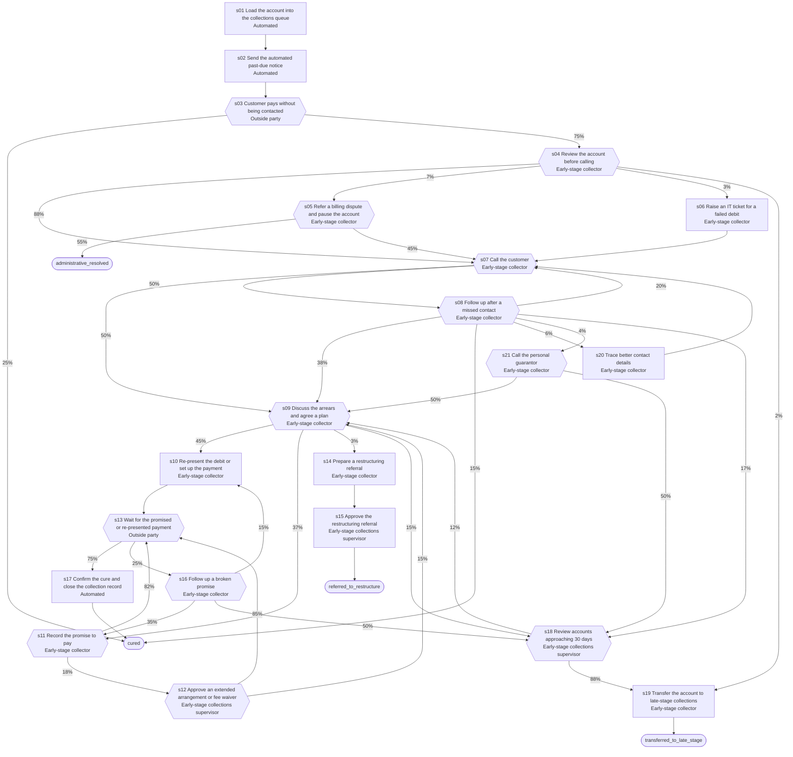

# Collect early-stage delinquencies

`efc-collect-early-stage` · equipment leasing and finance · collections · part of `equipment-finance-co`

When a customer's monthly lease payment is returned by the bank or not received, the account enters early-stage collections. An automated notice goes out, many customers pay on their own, and an early-stage collector works the rest: reviews the account, calls and emails until reaching the business, re-presents the returned debit or takes a promise to pay, sends hardship cases to restructuring and passes accounts still unpaid near 30 days to late-stage collectors. Elapsed time is set by call attempts that go unanswered and by waiting for promised payments; most accounts cure within two weeks while about a quarter roll past 30 days.

| | |
|---|---|
| Unit of work | one newly delinquent account |
| Starts when | A pre-authorised debit is returned or an invoice passes its due date unpaid, and the account is placed in the early-stage collections queue. |
| Done when | The account is current again, the arrears are cleared by a billing correction, the customer is referred to restructuring, or the account is transferred to late-stage collections after 30 days. |
| Organisation | A mid-size Canadian independent equipment lessor with about 55,000 active contracts, 85% paid by pre-authorised debit, and an early-stage team of 16 collectors and 2 supervisors using a queue manager and dialer. (340 employees, 2019-2022) |
| Volume | 2,700 cases a month (range 2,200 to 3,800) |

## Where it sits

- Starts with **delinquent_account** from process-returned-payments (75% of cases)
- Starts with **delinquent_account** from apply-customer-payments (25% of cases)
- Sends **collection_notice** to customer (outcome: any)
- Sends **portfolio_data** to monitor-portfolio-risk (outcome: any)
- Sends **restructure_request** to restructure-and-defer-payments (outcome: referred_to_restructure)
- Sends **delinquent_account** to collect-late-stage (outcome: transferred_to_late_stage)
- Sends **it_ticket** to resolve-it-service-requests (outcome: any)

## Flow

## Roles

| Role | Department | Layer | FTE on this process | Loaded cost per hour | Evidence |
|---|---|---|---:|---:|---|
| Early-stage collector | Early-stage collections | individual contributor | 9.5 | 30 CAD | B [jb_collector], [nbc_coll_agent] |
| Early-stage collections supervisor | Early-stage collections | supervisor | 0.4 | 47 CAD | C |

## Steps

Hands-on time and the wait before each step show the most common value. Evidence tier A is a sourced number, B a sourced description, C the author's estimate.

| Step | Who | Kind | Hands-on | Wait before | Control | Evidence |
|---|---|---|---:|---:|---|---|
| **s01 Load the account into the collections queue.** The nightly feed from the lease system moves each account with a returned debit or an unpaid invoice past its due date into the collections queue manager, with days past due, amount, number of earlier returns, risk score and contract count, and sorts it into a queue by segment and priority. | Automated | system auto | 0 min | 12.0 h |  | B [servsol_early], [charter_424b] |
| **s02 Send the automated past-due notice.** The collections system emails, and for customers without email mails, a past-due notice with the amount owing, the returned payment fee where one applies and how to pay, a few days after the missed payment. | Automated | system auto | 0 min | 1.0 d |  | B [leaseservices_faq] |
| **s03 Customer pays without being contacted.** Many missed payments are administrative: the customer moved funds a day late, changed banks or simply forgot. The customer sends an EFT, calls customer service to pay or waits for the next debit, and the account cures before a collector reaches it. | Outside party | external wait | 0 min | 3.0 d |  | C |
| **s04 Review the account before calling.** An early-stage collector opens the account in the collections system and the lease system to read the payment history, earlier promises and returns, contact notes, other contracts, guarantors and any open service ticket such as a billing dispute, and decides how to approach the call. | Early-stage collector | lookup | 3 min | 4.0 h |  | B [nbc_coll_agent], [monitor_service_coll], [bia_s69] |
| **s05 Refer a billing dispute and pause the account.** When the arrears come from a wrong invoice, a disputed insurance charge or an unprocessed banking change, the collector logs the issue for customer service or billing, puts a hold on collection activity and tells the customer when to expect the correction. | Early-stage collector | coordination | 10 min | 1.0 h |  | B [monitor_service_coll] |
| **s06 Raise an IT ticket for a failed debit.** If the debit failed because of a lease system or debit file error, for example new banking details not loaded, the collector logs an IT ticket with examples, asks billing to send a manual debit and notes the account. | Early-stage collector | communication | 10 min | 30 min |  | C |
| **s07 Call the customer.** The collector dials the business contact from the queue, or the dialer connects the call, and either reaches the owner or bookkeeper or leaves a voicemail and sends a short email asking for a call back. Every attempt is noted. | Early-stage collector | communication | 6 min | 4.0 h |  | B [charter_424b], [leaseservices_faq], [cancap_coll] |
| **s08 Follow up after a missed contact.** A day or two later the collector tries again by phone at a different time, sends a second email or text and, for larger balances, checks the account to see if a payment arrived, then decides whether to keep trying, trace a better number or contact the guarantor. | Early-stage collector | communication | 4 min | 2.0 d |  | B [charter_424b], [monitor_service_coll] |
| **s09 Discuss the arrears and agree a plan.** On the call the collector confirms the amount, asks why the payment failed and whether it will recur, and asks for payment now. Depending on the answer the collector re-presents the debit, takes a promise for a specific amount and date, refers a customer in real difficulty to restructuring, or escalates a customer who refuses or says the business is closing. | Early-stage collector | judgment | 12 min | 0 min |  | B [monitor_service_coll], [nbc_coll_agent], [cancap_coll] |
| **s10 Re-present the debit or set up the payment.** For a returned debit the collector schedules a single re-presentment of the same amount in the next debit file; fees are billed separately. For a customer paying arrears plus fees by debit, the collector records a one-time debit authorisation, or gives EFT or wire instructions and notes the expected date. | Early-stage collector | data entry | 4 min | 0 min | Payments Canada Rule H1: an NSF debit may be re-presented once, within 30 days, for the same amount; a one-time debit needs the payor's authorisation | A [payments_h1] |
| **s11 Record the promise to pay.** The collector records the promised amount, date and method in the collections system, sets a follow-up for the day after, and emails the customer a confirmation. Promises longer than the collector's limit or with a fee waiver go to the supervisor. | Early-stage collector | data entry | 3 min | 0 min |  | B [nbc_coll_agent], [servsol_early] |
| **s12 Approve an extended arrangement or fee waiver.** The early-stage supervisor reviews arrangements beyond the collector's limit, such as a promise more than two weeks out, split payments or waived late and returned payment fees, against the account's history and approves or asks the collector to renegotiate. | Early-stage collections supervisor | approval | 4 min | 4.0 h | Collections authority limits for payment arrangements and fee waivers | C |
| **s13 Wait for the promised or re-presented payment.** The account waits for the re-presented debit to clear or for the promised payment date; the collections system shows the follow-up when the date arrives. | Outside party | external wait | 0 min | 4.0 d |  | C |
| **s14 Prepare a restructuring referral.** For a customer with a genuine cash-flow problem the collector records the reason, recent revenue, how long the difficulty is expected to last and the deferral or term extension asked for, attaches any statements the customer sends and drafts the restructure request. | Early-stage collector | drafting | 20 min | 4.0 h |  | B [cancap_coll], [elfa_sefa2021] |
| **s15 Approve the restructuring referral.** The supervisor checks that the customer qualifies under the referral criteria (account history, number of earlier deferrals, contract status) and sends the request to lease administration and credit, pausing collection activity while it is decided. | Early-stage collections supervisor | approval | 6 min | 1.0 d | Hardship and restructuring referral criteria in the collections policy | C |
| **s16 Follow up a broken promise.** When the promised payment does not arrive or the re-presented debit is returned again, the collector calls and emails the customer, asks what happened and either takes one more firm promise, takes payment now, or flags the account for transfer. | Early-stage collector | communication | 8 min | 1.0 d |  | B [monitor_service_coll] |
| **s17 Confirm the cure and close the collection record.** When the payment is applied and the account is current, the nightly feed takes it out of the collections queue and closes the promise; any returned payment fee stays on the next invoice. | Automated | system auto | 0 min | 12.0 h |  | C |
| **s18 Review accounts approaching 30 days.** Each week the early-stage supervisor reviews accounts nearing 30 days past due with no payment, broken promises or refusals, and decides which move to late-stage collections and which stay because a payment is days away. | Early-stage collections supervisor | review | 3 min | 5.0 d | Collections policy: accounts over 30 days past due move to late-stage collectors | B [leaseservices_faq], [monitor_service_coll] |
| **s19 Transfer the account to late-stage collections.** The collector writes a hand-off note (contacts reached, promises broken, reasons given, guarantor details, equipment location if known) and the account waits in early stage until it passes 30 days past due, then moves to the late-stage queue. | Early-stage collector | data entry | 5 min | 10.0 d |  | C |
| **s20 Trace better contact details.** When the numbers on file do not work, the collector looks for current contacts in the credit bureau report, the business's website and listings, the original application and the dealer that sold the equipment, and updates the account. | Early-stage collector | lookup | 12 min | 4.0 h |  | C |
| **s21 Call the personal guarantor.** Where the business cannot be reached, the collector calls the owner who personally guaranteed the lease at the number on the guarantee, explains the arrears without disclosing more than the guarantee allows and asks the guarantor to have the business pay. | Early-stage collector | communication | 10 min | 4.0 h | Guarantor contact rules in the collections and privacy policy | C |

## Exceptions

| Exception | Share of cases | What happens |
|---|---:|---|
| Billing dispute or administrative error | 5% | The arrears come from a wrong invoice, disputed charge or unloaded banking change; collection is paused and billing corrects the account. |
| System error behind the failed debit | 2% | An IT ticket is raised and a manual debit requested. |
| Insolvency filing or fraud flag | 2% | The account moves straight to late stage; a notice of intention or bankruptcy stays collection action under the Bankruptcy and Insolvency Act. |
| Unreachable customer | 6% | Contact numbers fail; the collector traces new details or calls the guarantor. |
| Broken promise | 13% | The promised or re-presented payment fails and the collector renegotiates or escalates. |
| Hardship referral | 2% | A customer in real difficulty is referred to restructuring after supervisor approval. |

## Benchmarks

| Metric | Value | Unit | Population | Evidence |
|---|---|---|---|---|
| cycle_time_days | p50 11, p90 32 | calendar days from entering the queue to cure, referral or transfer | Newly delinquent accounts at a Canadian small and mid-ticket equipment lessor, 2019-2022 | B [leaseservices_faq], [charter_424b] |
| receivables_over_30_days | 0.02 | share of receivables | ELFA MLFI-25, 25 US equipment finance companies, July 2019 | A [elfa_mlfi_jul2019] |
| receivables_over_30_days_2020 | 0.023 | share of receivables | ELFA SEFA, 104 US equipment finance companies, 2020 | A [elfa_sefa2021] |
| covid_deferrals_approved_2020 | 0.074 | share of portfolio | ELFA SEFA, 104 US equipment finance companies, 2020 | A [elfa_sefa2021] |
| share_rolling_past_30_days | 0.24 | share of newly delinquent accounts | This organisation | C |
| nsf_representment_limit | times 1, within_days 30 | re-presentments of an NSF debit | Canadian pre-authorised debits | A [payments_h1] |

## Pain points

- Half of call attempts reach no one, so collectors spend much of the day on voicemails and repeat attempts while accounts age. (steps s07, s08; C)
- Vague promises and repeated extensions let accounts drift toward 30 days before escalation. (steps s11, s13, s16; B [monitor_service_coll])
- Administrative delinquencies (billing errors, unloaded banking changes) take collector time and annoy good customers. (steps s05, s06; B [monitor_service_coll])
- A returned debit can be re-presented only once, so a second failure forces a manual payment chase. (steps s10, s16; A [payments_h1])
- Transfer to late stage waits for a weekly review and day 31 rather than for the evidence that an account will not cure. (steps s18, s19; C)

## Assumptions

- About 75% of entries are returned debits and 25% unpaid invoices for customers who pay by cheque or EFT.
- Branch shares (25% self-cure before contact, 50% right-party contact per attempt, 75% of promises kept) are author estimates set so that about 24% of accounts transfer to late stage, as in the organisation file.
- Consumer debt collection statutes do not govern in-house collection of commercial lease arrears; guarantor contact follows company privacy and collections policy. This is the author's understanding, not a sourced legal opinion.
- Billing disputes end this workflow when the arrears are removed by billing; the organisation file has no link from collections back to billing or customer service, so none is listed.
- The director of collections, listed in the organisation file for this process, sets policy and reviews reports but takes no per-account step here.
- The 16 early-stage collectors in the organisation file are more than the about 9.5 FTE the modelled step times need; the difference is inbound calls, returned-payment contacts, restructure follow-ups and idle dialer time.
- External steps carry no touch time.

## Sources

- [elfa_mlfi_jul2019] [ELFA Monthly Leasing and Finance Index, July 2019 (press release)](https://www.equipmentfa.com/Images/IndustryData/19-09-09-15-10-46-2019-08-23-July-2019-MLFI-Press-Release.pdf) (Equipment Leasing and Finance Association, 2019). 25 US equipment finance companies: receivables over 30 days 2.0% in July 2019 (1.70% in June, 1.90% a year earlier); charge-offs 0.37%.
- [elfa_sefa2021] [New data reveals market insights (2021 Survey of Equipment Finance Activity)](https://www.elfaonline.org/communications/july-august-sept/new-data-reveals-market-insights) (Equipment Leasing and Finance Association, 2021). 104 ELFA members, 2020: receivables over 30 days rose 30 basis points to 2.3%; net losses 0.48% of average receivables; COVID deferrals approved on 7.4% of the portfolio.
- [charter_424b] [Charter Equipment Lease 1998-1 LLC prospectus (Form 424B1)](https://www.sec.gov/Archives/edgar/data/0001070771/000089155499001687/0000891554-99-001687.txt) (US Securities and Exchange Commission (EDGAR), 1999). Collections staff in New York and Toronto: collection activity generally begins by telephone at ten days past due, another call if still delinquent a week later, a written notice at about twenty days, then contractual remedies; weekly payment status report to officers; delinquency table by 31-60, 61-90, 91-120 and 121+ days.
- [leaseservices_faq] [Collections FAQs (Customer Connect help center)](https://help.leaseservices.com/help-center/category/manage-your-account/collections-faqs) (Lease Services, 2024). A lessor's past-due timeline: late fee on day 1, letter and email on days 5 to 7, emails and calls on days 5 to 28, escalated collections from day 31; customers in difficulty are asked to call to work out a solution.
- [payments_h1] [Rule H1: Pre-authorized debits (PADs)](https://www.payments.ca/sites/default/files/h1eng.pdf) (Payments Canada, 2026). An NSF PAD may be re-presented electronically once, within 30 calendar days, for the same amount without interest or NSF charges; a one-time PAD needs a new PAD agreement and sporadic PADs need an authorisation for each debit; disputed business PADs can be reclaimed within 10 business days.
- [bia_s69] [Bankruptcy and Insolvency Act, section 69 (stay of proceedings on a notice of intention)](https://laws-lois.justice.gc.ca/eng/acts/B-3/page-15.html) (Justice Laws Website, Government of Canada, 2024). On filing a notice of intention, no creditor may pursue any remedy or continue any proceeding to recover a claim provable in bankruptcy, with exceptions for secured creditors who took possession or gave a section 244 notice more than ten days earlier.
- [monitor_service_coll] [The gray area between customer service and collections](https://www.monitordaily.com/?p=172848) (Monitor (Monitordaily), 2025). Equipment finance collections practice: collectors should resolve service barriers, then ask for amount, date and method; vague promises and unprompted extensions let accounts age; escalation timing at 15, 30, 60 and 90 days past due should be set by leadership; coaching through call reviews.
- [nbc_coll_agent] [Collections Agent, Equipment Finance (job posting)](https://www.jobillico.com/en/job-offer/national-bank/collections-agent/17554368) (National Bank of Canada via Jobillico, 2025). Equipment finance collections agent in Winnipeg: answers client inquiries, negotiates payment arrangements, resolves disputes, manages collection files and escalates, documents payment agreements per procedures and compliance requirements.
- [cancap_coll] [Equipment Finance Servicing and Collections Specialist (job posting)](https://jobs.accel.com/companies/can-capital-2/jobs/83749658-equipment-finance-servicing-collections-specialist-hybrid-in-st-louis-georgia-or-nj-to-fully-remote) (CAN Capital via Accel jobs board, 2026). Collections across early, mid and late-stage delinquency by phone, email and letter; repayment plans; recommending deferrals, restructures and settlements; repossession and legal referral in recovery.
- [servsol_early] [Early-stage collections](https://servicingsolutions.com/?p=15035) (Servicing Solutions, 2025). Early-stage collections cover accounts 1 to 30 days past due with calls, emails and SMS, risk-tiered treatment, documented promise-to-pay arrangements and recorded calls for quality review.
- [jb_collector] [Wages: Collector in Ontario (NOC 14202)](https://www.jobbank.gc.ca/marketreport/wages-occupation/19300/ON) (Job Bank, Government of Canada, 2024). Ontario hourly wages low $17.95, median $25.38, high $36.69 (2023-2024).

Written by claude-opus on 2026-11-17.
