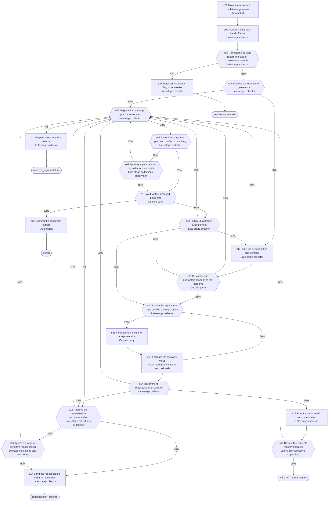

# Collect late-stage delinquencies

`efc-collect-late-stage` · equipment leasing and finance · collections · part of `equipment-finance-co`

Accounts more than 30 days late move from early-stage collectors to a smaller team of senior collectors, who decide whether the customer can be brought current or the equipment must be taken back. The collector reviews every contract and guarantee, checks for insolvency filings, reaches the owner and guarantors, negotiates plans, sends the default notice and demand, and for customers who do not respond confirms the equipment's location, registration and value and recommends repossession or write-off for supervisor or director approval. Most accounts still cure, but each file needs judgement and legal notice periods, unanswered demands and approval queues make it slow.

| | |
|---|---|
| Unit of work | one late-stage account |
| Starts when | An account passes 30 days past due and is transferred from early-stage collections. |
| Done when | The account is current again, referred to restructuring, ordered for repossession, recommended for write-off, or referred to recoveries because of an insolvency filing. |
| Organisation | A mid-size Canadian independent equipment lessor with about 55,000 active contracts and a late-stage team of 9 collectors and a supervisor under a director of collections and recoveries. (340 employees, 2019-2022) |
| Volume | 650 cases a month (range 500 to 1,000) |

## Where it sits

- Starts with **delinquent_account** from collect-early-stage (100% of cases)
- Sends **default_notice** to customer (outcome: any)
- Sends **portfolio_data** to monitor-portfolio-risk (outcome: any)
- Sends **restructure_request** to restructure-and-defer-payments (outcome: referred_to_restructure)
- Sends **repossession_order** to repossess-equipment (outcome: repossession_ordered)
- Sends **write_off_request** to recover-deficiencies-and-write-off (outcome: write_off_recommended)
- Sends **write_off_request** to recover-deficiencies-and-write-off (outcome: insolvency_referred)

## Flow

## Roles

| Role | Department | Layer | FTE on this process | Loaded cost per hour | Evidence |
|---|---|---|---:|---:|---|
| Late-stage collector | Late-stage collections | individual contributor | 8 | 34 CAD | B [jb_collector], [cancap_coll] |
| Late-stage collections supervisor | Late-stage collections | supervisor | 0.3 | 50 CAD | C |
| Director, collections and recoveries | Collections and recoveries | director | 0.05 | 90 CAD | C |
| Asset manager, valuation and residuals | Asset management and remarketing | senior specialist | 0.35 | 56 CAD | C |

## Steps

Hands-on time and the wait before each step show the most common value. Evidence tier A is a sourced number, B a sourced description, C the author's estimate.

| Step | Who | Kind | Hands-on | Wait before | Control | Evidence |
|---|---|---|---:|---:|---|---|
| **s01 Move the account to the late-stage queue.** When an account passes 30 days past due the collections system moves it from the early-stage queue to a late-stage collector, assigned by region and balance, with the early-stage hand-off note attached. | Automated | system auto | 0 min | 12.0 h |  | C |
| **s02 Review the file and hand-off note.** The late-stage collector reads the early-stage notes, every contract and schedule the customer has, the personal guarantees, the equipment list and where it is kept, insurance status and the payment history, and sets a strategy for the account. | Late-stage collector | analysis | 12 min | 1.0 d |  | B [cancap_coll] |
| **s03 Refresh the bureau report and search insolvency records.** The collector pulls a fresh commercial credit report on the business and, where allowed, the guarantors, looking for new defaults, judgments and liens, and searches the federal insolvency records for a bankruptcy, proposal or notice of intention. | Late-stage collector | lookup | 8 min | 0 min |  | B [bia_s69] |
| **s04 Call the owner and the guarantors.** Over several days the collector calls the business owner, then the personal guarantors, emails and leaves messages, aiming to reach someone who can commit to paying and to learn whether the business is still operating and where the equipment is. | Late-stage collector | communication | 12 min | 1.0 d | Guarantor contact rules in the collections and privacy policy | B [cancap_coll], [charter_424b] |
| **s05 Negotiate a catch-up, plan or surrender.** The collector judges the customer's prospects from the conversation and the bureau report and negotiates: full catch-up now, a short payment plan, a referral to restructuring for a viable business with a temporary problem, or a voluntary return of the equipment when the business is winding down. | Late-stage collector | judgment | 15 min | 4.0 h |  | B [cancap_coll], [monitor_service_coll] |
| **s06 Record the payment plan and confirm it in writing.** The collector records the catch-up amount or the plan instalments and dates in the collections system, sets follow-ups, sets up any debits the customer authorises and emails a written confirmation that also restates the default and the lessor's rights. | Late-stage collector | data entry | 8 min | 0 min |  | C |
| **s07 Issue the default notice and demand.** The collector prepares the default notice from the template: the arrears, the default under the lease, a deadline (often ten days) to cure, and that otherwise the lease will be terminated, the full balance accelerated and the equipment must be returned; copies go to each guarantor as a demand under the guarantee. Where the equipment is all or substantially all of an insolvent customer's business property a section 244 notice is added. Letters go by courier or registered mail and email. | Late-stage collector | drafting | 15 min | 5.0 d | Contract default terms, common-law reasonable notice before seizure or acceleration, and BIA s.244 notice ten days before enforcing against all or substantially all of an insolvent business's property | B [legal500_demand], [lawtimes_priest], [lerners_walgre], [bia_s244], [charter_424b] |
| **s08 Customer and guarantors respond to the demand.** The demand period runs. Some customers call to negotiate, some pay the arrears, and many do not respond, often because the business has stopped operating. | Outside party | external wait | 0 min | 10.0 d |  | B [lerners_walgre] |
| **s09 Approve a plan beyond the collector's authority.** The late-stage supervisor reviews plans longer than the collector's limit, settlements below the full arrears and fee waivers against the customer's history and the equipment's value, and approves or asks for a firmer offer. | Late-stage collections supervisor | approval | 6 min | 1.0 d | Collections authority limits for payment plans, settlements and fee waivers | C |
| **s10 Wait for the arranged payments.** The account waits for the catch-up payment or the plan instalments; the collections system shows each due date for follow-up. | Outside party | external wait | 0 min | 10.0 d |  | C |
| **s11 Prepare a restructuring referral.** For a viable business with a temporary problem the collector writes up the cause, recent trading, the deferral or extension requested and the guarantors' position, attaches financial statements and sends the restructure request to lease administration and credit, holding further enforcement while it is decided. | Late-stage collector | drafting | 30 min | 4.0 h |  | B [cancap_coll], [elfa_sefa2021] |
| **s12 Locate the equipment and confirm the registration.** Before recommending repossession the collector confirms where the equipment is (customer site, a job site, a dealer or a repair shop), checks the serial numbers against the contract and searches the personal property registry to confirm the company's registration is in place and correct. | Late-stage collector | lookup | 20 min | 1.0 d | Recovery policy: confirm a valid PPSA or RDPRM registration and the serial numbers before seizure | B [bc_ppsa], [lerners_walgre] |
| **s13 Estimate the recovery value.** An asset manager gives a quick estimate of what the equipment would fetch at auction or through a dealer after seizure, transport, storage and repair costs, from auction results and residual tables, so the collector can compare repossession with settling or writing off. | Asset manager, valuation and residuals | analysis | 20 min | 2.0 d |  | C |
| **s14 Recommend repossession or write-off.** The collector writes a short recommendation memo: balance and arrears, contact history, the customer's prospects, the recovery value against the balance and costs, guarantor strength and any special risks, and recommends repossession, one more settlement attempt, or a write-off and deficiency referral where the equipment is missing or worth little. | Late-stage collector | judgment | 20 min | 1.0 d |  | B [charter_424b], [cancap_coll] |
| **s15 Approve the repossession recommendation.** The late-stage supervisor checks the memo, that the default notice and any section 244 notice went out and their periods have run, that no insolvency stay applies and that the registration is valid, then approves, sends large or sensitive files to the director, or asks for one more settlement attempt. | Late-stage collections supervisor | approval | 10 min | 1.0 d | Delegated authority for repossession, with a check of notice periods and insolvency stays | B [bia_s244], [bia_s69], [lerners_walgre] |
| **s16 Approve a large or sensitive repossession.** The director of collections and recoveries reviews repossessions above the supervisor's limit, of key dealer customers or with public or legal sensitivity, and approves or directs another approach. | Director, collections and recoveries | approval | 10 min | 2.0 d | Delegated authority matrix for repossession by balance | C |
| **s17 Send the repossession order to recoveries.** The collector assembles the repossession package (contract, guarantees, registration verification, default notice and proof of delivery, equipment list with serial numbers, location and contacts, recovery value) and hands it to a recovery officer, who instructs the bailiff. | Late-stage collector | coordination | 15 min | 4.0 h |  | B [lerners_walgre], [lawtimes_priest] |
| **s18 Prepare the write-off recommendation.** Where the equipment is missing, worthless or not worth recovering, the collector prepares the write-off request: balance, collection history, why repossession is not worthwhile, guarantor assets and a proposal to place the deficiency with an agency or lawyer. | Late-stage collector | drafting | 25 min | 1.0 d |  | B [charter_424b] |
| **s19 Review the write-off recommendation.** The late-stage supervisor checks that collection steps were exhausted and the file is complete, then sends the write-off request to recoveries for the director's or chief credit officer's approval, or returns it for more work. | Late-stage collections supervisor | review | 10 min | 2.0 d | Write-off authority policy: recommendation reviewed before approval by the director or chief credit and risk officer | C |
| **s20 Follow up a broken arrangement.** When an instalment is missed the collector calls the customer and guarantors, finds out whether the business can still pay, and either renegotiates once, issues the default notice if it has not gone out, or moves to the repossession assessment. | Late-stage collector | communication | 15 min | 1.0 d |  | B [monitor_service_coll] |
| **s21 Refer an insolvency filing to recoveries.** When the customer has filed a notice of intention, proposal or bankruptcy, the collector stops all collection contact, records the stay, and passes the file to the recovery and insolvency manager to file a claim and decide, with legal, whether the equipment can be recovered. | Late-stage collector | coordination | 20 min | 2.0 h | BIA s.69 and s.69.3 stays of proceedings on a notice of intention, proposal or bankruptcy (CCAA stays where ordered) | A [bia_s69] |
| **s22 Confirm the account is current.** When the arrears are paid the nightly feed takes the account out of the late-stage queue, closes the plan and returns the contract to normal billing and monitoring. | Automated | system auto | 0 min | 12.0 h |  | C |
| **s23 Field agent checks the equipment site.** When the location is unclear the company asks a bailiff or field agent to visit the last known site, confirm the equipment is there and photograph it, for a fixed fee. | Outside party | external wait | 0 min | 5.0 d |  | C |

## Exceptions

| Exception | Share of cases | What happens |
|---|---:|---|
| Insolvency filing found | 4% | A notice of intention, proposal or bankruptcy stays collection; the file goes to recoveries. |
| Voluntary surrender | 3% | A customer winding down agrees to give the equipment back; the repossession is approved without a demand period. |
| Broken payment plan | 12% | An instalment is missed; the collector renegotiates, issues the default notice or assesses repossession. |
| Equipment location unknown | 5% | A field agent visits the last known site before the recovery value is set. |
| Director approval for a large repossession | 3% | Repossessions above the supervisor's limit go to the director. |
| Write-off returned for more work | 0% | The supervisor sends a write-off recommendation back for more collection effort. |

## Benchmarks

| Metric | Value | Unit | Population | Evidence |
|---|---|---|---|---|
| cycle_time_days | p50 25, p90 65 | calendar days from transfer to late stage to cure, referral, repossession order or write-off recommendation | Late-stage accounts at a Canadian small and mid-ticket equipment lessor, 2019-2022 | B [charter_424b], [lerners_walgre], [elfa_sefa2021] |
| delinquency_buckets_june_1999 | 31_60 0.023, 61_90 0.0013, 91_120 0.0001, 121_plus 0.0123 | share of gross receivables | Charter equipment lease portfolio (US and Canada), June 1999 | A [charter_424b] |
| net_losses_2020 | 0.0048 | share of average receivables | ELFA SEFA, 104 US equipment finance companies, 2020 | A [elfa_sefa2021] |
| charge_offs_july_2019 | 0.0037 | share of receivables (annualised) | ELFA MLFI-25, July 2019 | A [elfa_mlfi_jul2019] |
| bia_244_notice_period | 10 | days before enforcement | Canadian secured creditors enforcing against substantially all business property | A [bia_s244] |
| ppsa_disposition_notice | ontario 15, british_columbia 20 | days' notice before disposing of seized collateral | Ontario and BC PPSAs | A [lawtimes_priest], [bc_ppsa] |

## Pain points

- Many customers never answer the calls or the demand, so accounts sit through the demand period before anything else can happen. (steps s04, s07, s08; B [lerners_walgre], [legal500_demand])
- Broken payment plans send accounts round the negotiate-and-wait loop several times before escalation. (steps s05, s10, s20; B [monitor_service_coll])
- The repossession decision needs a location check, a registry search, a value from asset management and one or two approvals, each with its own queue. (steps s12, s13, s15, s16; C)
- Notice errors (wrong amount, missed guarantor, no section 244 notice) can delay or weaken enforcement and expose the lessor to damages. (steps s07, s15; B [lawtimes_priest], [legal500_demand])

## Assumptions

- Branch shares are author estimates set so that about 78% of late-stage accounts cure, about 5% go to restructuring, about 8% to repossession (about 54 a month, inside the organisation file's range of 30 to 75), about 5% to write-off and about 4% to recoveries because of insolvency. Write-off and insolvency referrals (about 62 a month) plus post-sale deficiencies put the deficiency process near the top of its 50 to 110 range.
- Insolvency referrals are sent to recoveries with the write_off_request object because the organisation file has no other link from late-stage collections to recoveries or legal.
- Accounts that partly cure stay with the late-stage collector until current rather than going back to early stage.
- Ontario's 15-day PPSA disposition notice is taken from a news report of a 2021 Court of Appeal case; the Ontario statute site could not be opened.
- Default notice timing within late stage (about 5 days after transfer, up to two weeks) is an author estimate; Charter's 1999 practice was a letter at about twenty days past due.
- Field agent and bailiff fees and asset manager time are outside the collectors' FTE; external steps carry no touch time.
- The legal rules named in controls are the author's reading of the cited statutes and cases, not legal advice.

## Sources

- [charter_424b] [Charter Equipment Lease 1998-1 LLC prospectus (Form 424B1)](https://www.sec.gov/Archives/edgar/data/0001070771/000089155499001687/0000891554-99-001687.txt) (US Securities and Exchange Commission (EDGAR), 1999). Collections staff in New York and Toronto: written notice at about twenty days past due, then remedies including termination, acceleration and repossession; write-off only after reasonable enforcement steps and a finding that the client lacks assets; deficiencies pursued after sale; June 1999 portfolio 2.30% at 31-60 days, 0.13% at 61-90, 0.01% at 91-120 and 1.23% at 121 days or more.
- [elfa_sefa2021] [New data reveals market insights (2021 Survey of Equipment Finance Activity)](https://www.elfaonline.org/communications/july-august-sept/new-data-reveals-market-insights) (Equipment Leasing and Finance Association, 2021). 104 ELFA members, 2020: receivables over 30 days 2.3%; net losses 0.48% of average receivables.
- [elfa_mlfi_jul2019] [ELFA Monthly Leasing and Finance Index, July 2019 (press release)](https://www.equipmentfa.com/Images/IndustryData/19-09-09-15-10-46-2019-08-23-July-2019-MLFI-Press-Release.pdf) (Equipment Leasing and Finance Association, 2019). Receivables over 30 days 2.0% and charge-offs 0.37% in July 2019 for 25 US equipment finance companies.
- [bia_s244] [Bankruptcy and Insolvency Act, section 244 (notice of intention to enforce security)](https://laws-lois.justice.gc.ca/eng/acts/B-3/page-33.html) (Justice Laws Website, Government of Canada, 2024). A secured creditor enforcing against all or substantially all of an insolvent person's business property must send the prescribed notice and may not enforce until ten days after sending it, unless the debtor consents after the notice is sent.
- [bia_s69] [Bankruptcy and Insolvency Act, section 69 (stay of proceedings on a notice of intention)](https://laws-lois.justice.gc.ca/eng/acts/B-3/page-15.html) (Justice Laws Website, Government of Canada, 2024). On a notice of intention no creditor may pursue a remedy or continue proceedings to recover a claim, except secured creditors that took possession or gave a section 244 notice more than ten days earlier.
- [bc_ppsa] [Personal Property Security Act [RSBC 1996] chapter 359](https://www.bclaws.gov.bc.ca/civix/document/id/complete/statreg/96359_01) (Province of British Columbia, 2024). On default the secured party may take possession (s.58); notice at least 20 days before disposing of collateral to the debtor and other interested parties (s.59(6)); redemption at any time before disposal (s.62); debtor liable for any deficiency (s.60(5)).
- [lawtimes_priest] [Secured creditor must give reasonable notice before seizing defaulted assets: Court of Appeal](https://www.lawtimesnews.com/news/general/secured-creditor-must-give-reasonable-notice-before-seizing-defaulted-assets-court-of-appeal/359419) (Law Times, 2021). 1758704 Ontario Inc. v. Priest, 2021 ONCA 588: a secured creditor must give reasonable notice of intent to seize and a chance to cure; the Ontario PPSA's 15-day notice under s.63(4) is referenced; bailiff storage charges of $900 a day.
- [lerners_walgre] [Lessor repossession during a stay: Walgre Transport Inc. (Re)](https://lerners.ca/insights/lessor-repossession-during-a-stay-walgre-transport-inc-(re)) (Lerners LLP, 2026). A Canadian equipment lessor in default sent together a BIA s.244 notice, a demand and termination letter requiring return of the equipment within ten days, and an Ontario PPSA s.63(4) notice of intended disposition; the lessee later filed a notice of intention and the court held the completed enforcement was not stayed.
- [legal500_demand] [Lessons learned, lesson two: serve a demand notice before taking enforcement action](https://www.legal500.com/intelligence/canada/finance-and-banking/lessons-learned-lesson-two-serve-a-demand-notice-before-taking-enforcement-action) (Legal 500 (Canadian law firm article), 2016). A demand or default notice states the amount owed, interest and a deadline and the consequences; there is no statutory form or period, reasonable notice depends on the facts; common law requires reasonable notice before enforcement or acceleration; a section 244 notice may also be needed.
- [cancap_coll] [Equipment Finance Servicing and Collections Specialist (job posting)](https://jobs.accel.com/companies/can-capital-2/jobs/83749658-equipment-finance-servicing-collections-specialist-hybrid-in-st-louis-georgia-or-nj-to-fully-remote) (CAN Capital via Accel jobs board, 2026). Collections across early, mid and late stages; repayment plans; recommending deferrals, restructures and settlements; repossession, legal referral and remarketing in recovery.
- [monitor_service_coll] [The gray area between customer service and collections](https://www.monitordaily.com/?p=172848) (Monitor (Monitordaily), 2025). Delayed escalation leaves accounts deeply delinquent and recovery harder and more expensive; escalation timing at 30, 60 and 90 days past due should be defined by leadership.
- [jb_collector] [Wages: Collector in Ontario (NOC 14202)](https://www.jobbank.gc.ca/marketreport/wages-occupation/19300/ON) (Job Bank, Government of Canada, 2024). Ontario hourly wages low $17.95, median $25.38, high $36.69 (2023-2024).

Written by claude-opus on 2026-11-17.
