# Communicate credit decisions and negotiate conditions

`efc-communicate-credit-decisions` · equipment leasing and finance · sales and origination · part of `equipment-finance-co`

Once credit releases a decision, the sales side has to turn it into a deal or close it. The vendor desk tells dealers, the broker desk tells brokers and account executives tell their own customers what was approved and on what conditions, such as first and last payments, a down payment, a guarantor or a shorter term, or why the deal was declined. They negotiate changes within the approval, send appeals with new information back to credit and pricing requests to the deal desk, and release a document request when the customer accepts. Most elapsed time is spent waiting for dealers, brokers and customers who are also comparing other lenders' offers, and much desk time goes on chasing approvals that never come back.

| | |
|---|---|
| Unit of work | one credit decision |
| Starts when | Credit releases an approval, conditional approval, decline or withdrawal in the origination portal. |
| Done when | A document request is released to documentation, an appeal is sent back to credit, or the decision is closed as declined, withdrawn, lost to another lender or expired. |
| Organisation | A mid-size independent Canadian equipment lessor with vendor, broker and direct channels, an origination portal that posts decisions to dealers and brokers, and sales staff who follow up by phone and email. (340 employees, 2019-2022) |
| Volume | 3,300 cases a month (range 2,700 to 4,000) |

## Where it sits

- Starts with **credit_decision** from adjudicate-small-ticket-credit (88% of cases)
- Starts with **credit_decision** from underwrite-mid-ticket-credit (12% of cases)
- Relies on **pricing_approval** from price-non-standard-deals (a standing input; it does not start a case)
- Sends **decision_notice** to equipment_vendor (outcome: any)
- Sends **decision_notice** to broker (outcome: any)
- Sends **decision_notice** to customer (outcome: any)
- Sends **credit_appeal** to adjudicate-small-ticket-credit (outcome: appealed)
- Sends **credit_appeal** to underwrite-mid-ticket-credit (outcome: appealed)
- Sends **pricing_request** to price-non-standard-deals (outcome: any)
- Sends **document_request** to prepare-lease-documents (outcome: docs_requested)

## Flow

```mermaid
flowchart TD
    s01{{"s01 Post the decision and send the automatic notice<br/>Automated"}}
    s02["s02 Pick up the decision and read the conditions<br/>Vendor desk sales coordinator"]
    s03{{"s03 Tell the dealer the decision and explain the conditions<br/>Vendor desk sales coordinator"}}
    s04{{"s04 Dealer presents the approval to the customer<br/>Outside party"}}
    s05{{"s05 Negotiate changes within the approval<br/>Vendor desk sales coordinator"}}
    s06{{"s06 Account manager reviews a dealer's challenge to a decline<br/>Vendor account manager"}}
    s07["s07 Prepare and submit an appeal to credit<br/>Vendor desk sales coordinator"]
    s08{{"s08 Check the final structure and release the document request<br/>Vendor desk sales coordinator"}}
    s09{{"s09 Follow up the dealer on an open approval<br/>Vendor desk sales coordinator"}}
    s10{{"s10 Dealer reads the approval in the portal and asks for documents<br/>Outside party"}}
    s11{{"s11 Email the decision letter to the broker<br/>Broker desk coordinator"}}
    s12{{"s12 Broker presents the approval and compares other funders' offers<br/>Outside party"}}
    s13{{"s13 Negotiate conditions, pricing or a challenged decline<br/>Broker relationship manager"}}
    s14{{"s14 Present the deal desk's pricing answer to the broker<br/>Broker relationship manager"}}
    s15{{"s15 Chase the broker on an open approval<br/>Broker desk coordinator"}}
    s16["s16 Assemble and submit an appeal package<br/>Broker desk coordinator"]
    s17{{"s17 Check the broker's document request and release it<br/>Broker desk coordinator"}}
    s18["s18 Review the decision and conditions with the underwriter<br/>Account executive, direct sales"]
    s19{{"s19 Present the decision to the customer<br/>Account executive, direct sales"}}
    s20{{"s20 Customer considers the offer<br/>Outside party"}}
    s21{{"s21 Negotiate structure and pricing<br/>Account executive, direct sales"}}
    s22{{"s22 Present the deal desk's repricing<br/>Account executive, direct sales"}}
    s23["s23 Prepare an appeal with new information<br/>Account executive, direct sales"]
    s24{{"s24 Confirm the final structure and submit the document request<br/>Account executive, direct sales"}}
    s01 -->|"38%"| s02
    s01 -->|"16%"| s10
    s01 -->|"32%"| s11
    s01 -->|"14%"| s18
    s02 --> s03
    s03 -->|"52%"| s04
    s03 -->|"35%"| end0
    s03 -->|"6%"| s06
    s03 -->|"7%"| end1
    s04 -->|"78%"| s08
    s04 -->|"12%"| s05
    s04 -->|"5%"| s09
    s04 -->|"5%"| end2
    s05 -->|"50%"| s08
    s05 -->|"32%"| s07
    s05 -->|"18%"| end2
    s06 -->|"55%"| s07
    s06 -->|"45%"| end0
    s07 --> end3
    s08 -->|"94%"| end4
    s08 -->|"6%"| s05
    s09 -->|"45%"| s04
    s09 -->|"55%"| end5
    s10 -->|"88%"| s08
    s10 -->|"9%"| s09
    s10 -->|"3%"| end2
    s11 -->|"68%"| s12
    s11 -->|"22%"| end0
    s11 -->|"5%"| s13
    s11 -->|"5%"| end1
    s12 -->|"72%"| s17
    s12 -->|"13%"| s13
    s12 -->|"7%"| s15
    s12 -->|"8%"| end2
    s13 -->|"30%"| s17
    s13 -->|"30%"| s16
    s13 -->|"12%"| s14
    s13 -->|"10%"| end0
    s13 -->|"18%"| end2
    s14 -->|"85%"| s12
    s14 -->|"15%"| end2
    s15 -->|"40%"| s12
    s15 -->|"60%"| end5
    s16 --> end3
    s17 -->|"94%"| end4
    s17 -->|"6%"| s13
    s18 --> s19
    s19 -->|"72%"| s20
    s19 -->|"16%"| end0
    s19 -->|"7%"| s23
    s19 -->|"5%"| end1
    s20 -->|"72%"| s24
    s20 -->|"20%"| s21
    s20 -->|"8%"| end2
    s21 -->|"40%"| s24
    s21 -->|"30%"| s23
    s21 -->|"15%"| s22
    s21 -->|"15%"| end2
    s22 -->|"85%"| s20
    s22 -->|"15%"| end2
    s23 --> end3
    s24 -->|"95%"| end4
    s24 -->|"5%"| s21
    end0(["declined_closed"])
    end1(["withdrawn_closed"])
    end2(["lost"])
    end3(["appealed"])
    end4(["docs_requested"])
    end5(["expired"])
```

## Roles

| Role | Department | Layer | FTE on this process | Loaded cost per hour | Evidence |
|---|---|---|---:|---:|---|
| Vendor desk sales coordinator | Vendor sales desk | individual contributor | 2.8 | 30 CAD | B [src_greatamerica_process], [src_marlin_10k2019] |
| Vendor account manager | Vendor account management | individual contributor | 0.25 | 64 CAD | C |
| Broker desk coordinator | Broker channel | individual contributor | 1.6 | 30 CAD | B [src_eq_credit_coord] |
| Broker relationship manager | Broker channel | individual contributor | 0.65 | 62 CAD | C |
| Account executive, direct sales | Direct and mid-ticket sales | individual contributor | 3.2 | 72 CAD | B [src_marlin_10k2019] |

## Steps

Hands-on time and the wait before each step show the most common value. Evidence tier A is a sourced number, B a sourced description, C the author's estimate.

| Step | Who | Kind | Hands-on | Wait before | Control | Evidence |
|---|---|---|---:|---:|---|---|
| **s01 Post the decision and send the automatic notice.** When credit releases a decision, the origination portal updates the deal status that the dealer, broker or account executive sees and emails a decision letter: approved amount, term, rate tier, conditions and expiry date, or a decline with a general reason. The deal then sits in the follow-up queue of the desk that owns the channel. | Automated | system auto | 0 min | 0 min |  | B [src_marlin_10k2019], [src_greatamerica_process], [src_oracle_lease_uw] |
| **s02 Pick up the decision and read the conditions.** A vendor desk coordinator takes the next decision from the desk queue, opens it in the origination portal and reads the approved structure, the conditions (for example first and last payments, a down payment, a guarantor or proof of insurance) or the decline reason codes. They compare it with the quote the desk gave the dealer and note anything the dealer will push back on. | Vendor desk sales coordinator | lookup | 2.5 min | 45 min |  | B [src_oracle_lease_uw], [src_bdc_vendor] |
| **s03 Tell the dealer the decision and explain the conditions.** The coordinator phones or emails the dealer's salesperson with the decision. For conditional approvals they explain what the customer must add and how the payment changes; for declines they give the general reason without revealing guarantors' personal credit details and say whether new information could change the answer. The contact is logged against the deal. | Vendor desk sales coordinator | communication | 3 min | 5 min | PIPEDA principle 4.5 (limiting use and disclosure) and the consent clause in the credit application: dealers and brokers receive the decision and conditions, not the guarantors' personal credit details | B [src_greatamerica_process], [src_opc_pipeda_p5] |
| **s04 Dealer presents the approval to the customer.** The dealer's salesperson takes the approval and its conditions to the customer, often while the customer is also weighing a bank loan or another lessor's offer. The customer agrees to the terms, asks for different terms, goes quiet or buys elsewhere. | Outside party | external wait | 0 min | 1.0 d |  | B [src_bpi2017_bolt], [src_bdc_vendor] |
| **s05 Negotiate changes within the approval.** The coordinator works out with the dealer whether the customer's request fits the approval: a different term, first and last payments instead of a down payment, a small change in equipment price or a different end-of-term option. Changes inside the approval's tolerances are agreed on the spot; anything else becomes an appeal to credit. | Vendor desk sales coordinator | judgment | 12 min | 2.0 h | Credit policy and delegated credit authority: sales may change the structure only within the approval's tolerances; any other change goes back to credit | B [src_liberty_guidelines], [src_bdc_vendor] |
| **s06 Account manager reviews a dealer's challenge to a decline.** When a dealer pushes back on a decline, the vendor account manager who owns the relationship looks at the deal, the dealer's volume and the decline reason, and decides whether to back an appeal with new information or to tell the dealer the decision stands. | Vendor account manager | judgment | 20 min | 1.0 d |  | C |
| **s07 Prepare and submit an appeal to credit.** The coordinator collects the new information the dealer offers, such as bank statements, a larger down payment, a co-signer or proof of time in business, writes a short note on what changed and resubmits the deal to credit as an appeal in the origination portal. The case leaves this process and comes back as a new decision. | Vendor desk sales coordinator | drafting | 15 min | 1.0 d | Credit policy on appeals: a decision is reconsidered only with new information, at the original approval level or higher | B [src_oracle_lease_uw], [src_leaseservices_help] |
| **s08 Check the final structure and release the document request.** The coordinator checks the document request, keyed by the dealer in the portal or taken by phone, against the approval: equipment and serial numbers, price, term, payment, signer, guarantors, conditions and the approval's expiry date. They fill gaps, mark the deal ready for documents and the portal sends it to the documentation queue. | Vendor desk sales coordinator | data entry | 5 min | 1.0 h | Credit policy: documents are drawn only against an unexpired approval (90 days) whose final structure matches the approved terms and conditions | B [src_marlin_10k2019], [src_greatamerica_process] |
| **s09 Follow up the dealer on an open approval.** From the desk's open-approvals list, the coordinator phones or emails the dealer about approvals with no response after a few days, asks whether the customer is going ahead and reminds them of the expiry date. Approvals that are clearly lost are closed in the portal. | Vendor desk sales coordinator | communication | 3 min | 2.0 d |  | C [src_marlin_10k2019] |
| **s10 Dealer reads the approval in the portal and asks for documents.** For clean approvals the dealer's salesperson sees the decision in the dealer portal, confirms the deal with the customer and enters the document request with equipment details and signer without calling the desk. | Outside party | external wait | 0 min | 4.0 h |  | B [src_marlin_10k2019], [src_leaseservices_help] |
| **s11 Email the decision letter to the broker.** A broker desk coordinator opens the decision, attaches the decision letter to an email to the broker with the conditions listed plainly, or a decline with its general reason, and logs it. Brokers often have the same deal at other funders, so the coordinator asks whether the broker intends to proceed. | Broker desk coordinator | communication | 5 min | 1.0 h | PIPEDA principle 4.5 (limiting use and disclosure) and the consent clause in the credit application: dealers and brokers receive the decision and conditions, not the guarantors' personal credit details | B [src_eq_credit_coord], [src_opc_pipeda_p5] |
| **s12 Broker presents the approval and compares other funders' offers.** The broker takes the approval to the customer and compares it with offers from other funders it submitted the deal to. The customer accepts, asks the broker to negotiate, stops responding or takes another funder's offer. | Outside party | external wait | 0 min | 1.0 d |  | B [src_bpi2017_bolt] |
| **s13 Negotiate conditions, pricing or a challenged decline.** The broker relationship manager talks to the broker about what the customer wants: a lower rate, fewer conditions, a longer term or a second look at a decline. They agree changes within the approval, prepare a pricing request to the deal desk, or decide an appeal is worth sending with new information. | Broker relationship manager | judgment | 20 min | 8.0 h | Credit policy and delegated credit authority: sales may change the structure only within the approval's tolerances; any other change goes back to credit | C |
| **s14 Present the deal desk's pricing answer to the broker.** After the deal desk prices the request, the relationship manager tells the broker the approved rate and structure or explains why the rate cannot move, and updates the deal in the portal. | Broker relationship manager | communication | 10 min | 1.0 d | Pricing authority matrix: rates below the rate card floor need deal desk and sales operations approval | C |
| **s15 Chase the broker on an open approval.** The broker desk coordinator emails or phones brokers whose approvals have had no answer for a few days, asks whether the deal is proceeding and closes approvals the broker has placed elsewhere. | Broker desk coordinator | communication | 4 min | 2.0 d |  | C [src_marlin_10k2019] |
| **s16 Assemble and submit an appeal package.** The broker desk coordinator collects the new information the broker sends, such as bank statements, interim financial statements, a down payment or an extra guarantor, checks it is complete and resubmits the deal to credit as an appeal with the relationship manager's note. | Broker desk coordinator | drafting | 20 min | 1.0 d | Credit policy on appeals: a decision is reconsidered only with new information, at the original approval level or higher | B [src_liberty_guidelines], [src_oracle_lease_uw] |
| **s17 Check the broker's document request and release it.** When the broker asks for documents, the coordinator checks the request against the approval (equipment, vendor, price, signer, guarantors, conditions and expiry), fills gaps from the broker's email and releases the document request to the documentation queue. | Broker desk coordinator | data entry | 6 min | 1.5 h | Credit policy: documents are drawn only against an unexpired approval (90 days) whose final structure matches the approved terms and conditions | B [src_eq_credit_coord], [src_marlin_10k2019] |
| **s18 Review the decision and conditions with the underwriter.** The account executive reads the decision and, for mid-ticket deals, calls the analyst to understand the conditions, such as covenants, a guarantee, a holdback or a shorter term, and what room there is to adjust them, before going back to the customer. | Account executive, direct sales | lookup | 6 min | 2.0 h |  | B [src_marlin_10k2019] |
| **s19 Present the decision to the customer.** The account executive calls or meets the owner or finance manager, explains the approval, its conditions and the payment, or the decline and what could change it, and sends a written summary. For approvals they ask for the details needed for documents. | Account executive, direct sales | communication | 15 min | 4.0 h | PIPEDA principle 4.5 (limiting use and disclosure) and the consent clause in the credit application: dealers and brokers receive the decision and conditions, not the guarantors' personal credit details | B [src_leaseservices_help] |
| **s20 Customer considers the offer.** The customer reviews the approval with its accountant, compares it with its bank's terms and decides whether to proceed, asks for changes or walks away. | Outside party | external wait | 0 min | 2.0 d |  | B [src_bpi2017_bolt], [src_cfla_cmo2020] |
| **s21 Negotiate structure and pricing.** The account executive negotiates with the customer: seasonal payments, a different residual, fewer conditions or a lower rate. They agree changes within the approval, prepare a pricing request for the deal desk or prepare an appeal to credit. | Account executive, direct sales | judgment | 25 min | 8.0 h | Credit policy and delegated credit authority: sales may change the structure only within the approval's tolerances; any other change goes back to credit | B [src_liberty_guidelines] |
| **s22 Present the deal desk's repricing.** Once the deal desk answers, the account executive takes the approved rate and structure back to the customer and updates the proposal. | Account executive, direct sales | communication | 15 min | 1.0 d | Pricing authority matrix: rates below the rate card floor need deal desk and sales operations approval | C |
| **s23 Prepare an appeal with new information.** The account executive gathers what could change credit's view, such as interim statements, a stronger guarantor, more down payment or added collateral, writes a short case and resubmits the deal to the underwriter as an appeal. | Account executive, direct sales | drafting | 30 min | 1.0 d | Credit policy on appeals: a decision is reconsidered only with new information, at the original approval level or higher | B [src_oracle_lease_uw] |
| **s24 Confirm the final structure and submit the document request.** The account executive confirms the final equipment list, supplier, price, term, payment schedule, signer and guarantors with the customer, checks them against the approval and its expiry and submits the document request in the origination portal. | Account executive, direct sales | data entry | 15 min | 2.0 h | Credit policy: documents are drawn only against an unexpired approval (90 days) whose final structure matches the approved terms and conditions | B [src_marlin_10k2019] |

## Exceptions

| Exception | Share of cases | What happens |
|---|---:|---|
| Dealer challenges a decline through the account manager | 2% | A dealer pushes back on a decline; the vendor account manager decides whether to back an appeal, and the desk resubmits the deal to credit with new information. |
| Approval goes unanswered and expires | 7% | The dealer or broker never comes back, usually because the deal went to another lender; the desk chases once or twice and closes the approval. |
| Rate below the rate card | 2% | A broker or direct customer asks for a lower rate; the request goes to the deal desk and the revised offer goes back to the customer. |
| Final request outside the approval | 3% | The document request has a higher price, different equipment or a different signer than approved, so the desk renegotiates or appeals to credit. |

## Benchmarks

| Metric | Value | Unit | Population | Evidence |
|---|---|---|---|---|
| cycle_time_days | p50 1.0, p90 8.0 | calendar days from decision released to document request, appeal or closure, all outcomes | Author estimate for a Canadian independent lessor, informed by published decision-notice times, approval validity and offer return times | C [src_greatamerica_process], [src_leaseservices_help], [src_bpi2017_bolt], [src_marlin_10k2019] |
| time_to_decision_notice | low 1, high 4 | hours from application to decision notified to the dealer | US small-ticket lessors' published service levels | A [src_greatamerica_process], [src_leaseservices_help] |
| credit_approval_validity | 90 | days | Marlin Business Services, US small-ticket lessor, 2019 | A [src_marlin_10k2019] |
| approval_ratio | 0.757 | share of credit decisions approved | ELFA MLFI-25 respondents, July 2019 | A [src_elfa_mlfi_jul2019] |
| offers_returned_share | 0.542 | share of loan offers returned by the customer | Dutch financial institution's consumer loan offers, BPI Challenge 2017 event log | A [src_bpi2017_bolt] |

## Pain points

- Dealers and brokers shop deals to several lenders, so many approvals are never answered and desk time goes on chasing them. (steps s04, s09, s12, s15; B [src_bpi2017_bolt])
- Conditions are explained by phone and email and then re-keyed into the document request, so misunderstandings surface only when documents are drawn or audited. (steps s03, s08, s11, s17; C)
- Appeals often arrive without the new information credit needs and bounce back, adding days while competitors quote. (steps s07, s16, s23; C)
- Waiting for deal desk pricing while the customer holds another offer loses deals. (steps s14, s22; C)
- Customers judge lessors on turnaround and consistency of credit decisions, so slow or unclear communication of conditions costs business. (steps s02, s03, s19; B [src_cfla_cmo2020])

## Assumptions

- Channel shares follow the organisation file: 54% vendor, 32% broker and 14% direct. About 30% of vendor decisions are clean approvals that dealers act on in the portal without calling the desk.
- Decision mix (about 66% approvals or conditional approvals, 29% declines, 5% withdrawals) is set so that roughly two thirds of decisions are approvals, as in the organisation file. In the simulation about 56% of cases end in a document request (about 1,830 a month, a little below the organisation file's 2,000 document packages), about 6% in an appeal (about 210 a month, close to the 6% and 4% appeal shares the credit workflows use) and about 1% send a pricing request. Dealers and brokers usually ask for documents as soon as a deal is approved, so most losses to competing lenders show up later as unsigned packages in prepare-lease-documents rather than here.
- The case ends when the appeal is submitted; the re-decision comes back from credit as a new case. Pricing approvals from the deal desk return into an open case and do not start one, so their trigger share is 0.
- Decision notices go to the dealer, broker or customer of the deal's channel; the produces list uses outcome 'any' for all three because the channel is not an outcome.
- Non-bank lessors had no adverse action notice rule for commercial credit in Canada in 2019-2022; the control on what may be disclosed rests on PIPEDA and the consent in the credit application.
- Delegated authority tolerances (for example how much the equipment price may rise without re-approval) are not modelled as numbers.
- Staffing: about 2.8 of the 12 vendor desk coordinators (about 3.6 remain after quoting and intake), 1.6 of 4 broker desk coordinators, 0.65 of 7 broker relationship managers, 0.25 of 20 vendor account managers and 3.2 of 14 account executives work on this process. Loaded costs are the organisation file's (2019-2022 wage times 1.35).
- External steps have zero touch time; dealer, broker and customer time is in wait_before_min.

## Sources

- [src_marlin_10k2019] [Marlin Business Services Corp. Form 10-K for fiscal year 2019](https://www.sec.gov/Archives/edgar/data/1260968/000119312520072460/d875863d10k.htm) (Marlin Business Services Corp. via US SEC EDGAR, 2020). Partners get real-time notification of application approvals through a web platform and dealers have an online portal to view status; credit approvals are typically valid for up to 90 days from initial approval, after which a re-approval may be issued; every active relationship has an assigned sales account executive who handles pricing, credit, documentation, training and marketing matters; credit underwriting is managed apart from origination.
- [src_greatamerica_process] [What to expect in the GreatAmerica financing process (blog)](https://www.greatamerica.com/blog/submitting-credit-applications-for-customers-with-greatamerica) (GreatAmerica Financial Services, 2025). Approved applications get an automated approval letter by email; pending decisions mean more information is needed; declines are explained to the provider with as much information as the lessor can give; the approval letter confirms the legal name, desired signer and supporting documents; most decisions are communicated within an hour depending on transaction size; the provider then coordinates documents and signatures.
- [src_leaseservices_help] [Applying for financing (help centre)](https://help.leaseservices.com/help-center/category/applying-for-financing) (LEAF Commercial Capital (leaseservices.com), 2025). The lessor typically notifies the customer or dealer of an approval after 2 to 4 business hours; the analyst approves, declines or pends for more information; once approved a sales representative is notified and contacts the customer, sends documents and lists any additional information needed; approvals above offer amounts may need bank statements or financial information.
- [src_oracle_lease_uw] [Oracle Financial Services Lending and Leasing: Lease Origination User Guide, Underwriting](https://docs.oracle.com/cd/E82458_01/html/Lease_Origination_User_Guide/Underwriting.htm) (Oracle, 2017). Underwriters set an application to approved, conditioned, rejected or withdrawn; stipulations are items that must be addressed before the lease can be funded and can carry adverse action reasons; automatic decisions notify the producer; a decided application is locked and must be put into rehashing (re-decision) to change it, re-scoring when scoring-sensitive data change.
- [src_eq_credit_coord] [Credit Coordinator, Bennington Financial (job posting)](https://jobs.lever.co/eqbank/c1b4e9a7-8406-44f8-b482-eaf231c17a11) (EQ Bank / EQB Inc. on Lever, 2025). A Canadian equipment lessor's coordinator monitors and routes emails and online applications to the internal broker desk, acts as liaison for brokers as primary customers, responds to their inquiries in a timely manner, works with credit and funding to meet broker service levels and creates lease documents at the broker's request after checking the credit approval; salary $42,000 to $46,000.
- [src_liberty_guidelines] [Equipment financing credit guidelines (dealers and vendors)](https://libertycapitalgroup.com/dealers-vendors-financing/credits-and-guidelines) (Liberty Capital Group, 2025). For less-than-perfect credit a lessor expects a down payment or extra collateral; most tiers need a personal guaranty with minimum personal scores; larger deals may need tax returns, interim financials, personal financial statements or a debt schedule; application-only requests are often decided in 24 to 48 hours.
- [src_bdc_vendor] [Pros and cons of vendor financing for equipment purchases](https://www.bdc.ca/en/articles-tools/money-finance/get-financing/pros-cons-vendor-financing-equipment-purchase) (Business Development Bank of Canada, 2024). Vendor financing is arranged at the dealership during the purchase; leasing through a vendor usually requires money at signing such as a first and last monthly payment; the lender still assesses the equipment's value and the buyer's creditworthiness.
- [src_opc_pipeda_p5] [PIPEDA fair information principle 5: limiting use, disclosure, and retention](https://www.priv.gc.ca/en/privacy-topics/privacy-laws-in-canada/the-personal-information-protection-and-electronic-documents-act-pipeda/p_principle/principles/p_use/) (Office of the Privacy Commissioner of Canada, 2024). An organisation may use or disclose personal information only for the identified purposes for which it was collected; new purposes need new consent; staff access should be restricted and monitored.
- [src_bpi2017_bolt] [BPI Challenge 2017: process variability analysis over offers](https://ais.win.tue.nl/bpi/2017/bpi2017_paper_22.pdf) (Eindhoven University of Technology (A. Bolt), BPI Challenge 2017, 2017). Event log of a Dutch financial institution's loan offers: only 54.2% of offers sent are returned by the customer; 40% of all offers are accepted, 11% refused and 49% cancelled; offers sent online only are returned in 3 days on average and offers sent by mail and online in 9 days; cancelled offers have the longest throughput, 23 days on average.
- [src_elfa_mlfi_jul2019] [ELFA Monthly Leasing and Finance Index, July 2019 (press release)](https://www.equipmentfa.com/Images/IndustryData/19-09-09-15-10-46-2019-08-23-July-2019-MLFI-Press-Release.pdf) (Equipment Leasing and Finance Association, 2019). Credit approvals totalled 75.7% of decisions in July 2019 at the reporting equipment finance companies (77.0% in June); receivables over 30 days 2.0%; charge-offs 0.37%.
- [src_cfla_cmo2020] [Asset-based finance in Canada: the 2019-2020 year (Canadian Market Overview)](https://cfla-acfl.ca/files/Industry-Intelligence/CMO-2020.pdf) (Canadian Finance and Leasing Association, 2020). When choosing a leasing company, business customers value funding rates and affordability, the ability to reach someone to solve an issue and customer service, and also turnaround time, information requirements, flexibility and consistency in credit decisions.

Written by claude-opus on 2026-11-17.
