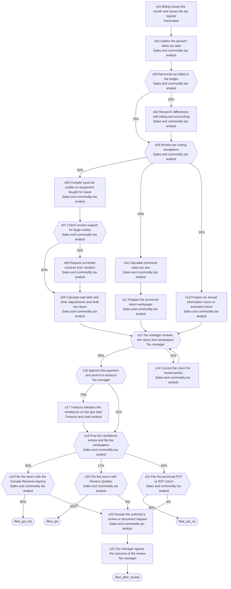

# File sales tax returns (equipment finance company)

`efc-file-sales-taxes` · equipment leasing and finance · tax · part of `equipment-finance-co`

A lessor charges sales tax on every lease payment, buyout and equipment sale, at the rate of the province where the equipment sits, and must report and remit it each month: GST/HST to the Canada Revenue Agency, QST to Revenu Quebec and PST or RST to British Columbia, Saskatchewan and Manitoba. A sales and commodity tax analyst reconciles the billing tax register to the ledger, checks coding exceptions, compiles input tax credits on equipment bought for lease with their invoice support, calculates bad debt and other adjustments, and drafts each return; the tax manager reviews and approves it, treasury remits on the due date and the analyst files online and books the entries. Differences between billing and the ledger, invoices that lack registration numbers, mixed taxable leases and exempt loans, and authority reviews of large credit claims make the work slow.

| | |
|---|---|
| Unit of work | one sales tax return |
| Starts when | A reporting period ends (monthly for GST/HST, QST and the three provincial taxes) and billing issues the month's tax register; annual information returns and amended returns arise once a year or when an error is found. |
| Done when | The return is approved, filed and any tax remitted by the due date, the tax accounts are cleared in the ledger, and any authority review is closed. |
| Organisation | A privately owned Canadian equipment lessor with 55,000 active contracts across all provinces, registered for GST/HST, QST and the B.C., Saskatchewan and Manitoba sales taxes, with a four-person tax team. (340 employees, 2019-2022) |
| Volume | 6 cases a month (range 5 to 7) |

## Where it sits

- Starts with **sales_tax_data** from bill-customers (82% of cases)
- Starts with **sales_tax_data** from quote-and-process-buyouts (7% of cases)
- Starts with **sales_tax_data** from manage-end-of-term (6% of cases)
- Starts with **sales_tax_data** from remarket-equipment (5% of cases)
- Sends **sales_tax_return** to cra (outcome: filed_gst_hst)
- Sends **sales_tax_return** to revenu_quebec (outcome: filed_qst)
- Sends **sales_tax_return** to provincial_tax_authorities (outcome: filed_pst_rst)
- Sends **journal_entries** to close-the-month (outcome: any)

## Flow

## Roles

| Role | Department | Layer | FTE on this process | Loaded cost per hour | Evidence |
|---|---|---|---:|---:|---|
| Sales and commodity tax analyst | Tax | individual contributor | 0.6 | 48 CAD | B [src_jb_11100] |
| Tax manager | Tax | manager | 0.1 | 85 CAD | C |
| Treasury and cash analyst | Treasury and securitisation | individual contributor | 0.005 | 48 CAD | C |

## Steps

Hands-on time and the wait before each step show the most common value. Evidence tier A is a sourced number, B a sourced description, C the author's estimate.

| Step | Who | Kind | Hands-on | Wait before | Control | Evidence |
|---|---|---|---:|---:|---|---|
| **s01 Billing closes the month and issues the tax register.** After the last billing run of the month the lease system produces the month's tax register by province and tax type, and the nightly ledger interface posts tax billed, tax on buyouts, end-of-term purchases and remarketing sales to the tax payable accounts; billing sends the register to tax. | Automated | system auto | 0 min | 2.0 d |  | C |
| **s02 Gather the period's sales tax data.** A sales and commodity tax analyst collects the inputs for the return: the billing tax register for the province or tax, the buyout and end-of-term sale reports from the lease system, remarketing bills of sale with tax, manual invoices, and the ledger balances of the tax payable and receivable accounts. | Sales and commodity tax analyst | lookup | 1.0 h | 8.0 d |  | C |
| **s03 Reconcile tax billed to the ledger.** The analyst ties tax billed and collected per the register and sale reports to the movement in the ledger tax accounts for the province, and lists differences such as credit notes coded to the wrong province, interface rejects and manual journal entries. | Sales and commodity tax analyst | validation | 1.5 h | 1.0 h | Tax account reconciliation supporting the return figures, tested by external auditors and tax auditors | C |
| **s04 Research differences with billing and accounting.** The analyst traces each difference to contracts and postings, asks billing why a credit or rebill carried the wrong tax or province and asks lease accounting to correct mis-posted entries, and agrees whether the fix goes in this return or the next. | Sales and commodity tax analyst | coordination | 1.0 h | 1.0 d |  | C |
| **s05 Review tax coding exceptions.** The analyst checks a sample of the period's contracts with tax changes: equipment moved between provinces, exemption certificates (First Nations, farm or production machinery), buyouts and end-of-term purchases, and casualty settlements, and confirms the tax charged follows the place of supply and exemption rules. | Sales and commodity tax analyst | validation | 1.0 h | 30 min | Excise Tax Act place of supply rules (GST/HST Memorandum 3-3-3) and provincial exemption rules | B [src_cra_333], [src_bc_pst315] |
| **s06 Compile input tax credits on equipment bought for lease.** For a GST/HST or QST return the analyst extracts the vendor invoices funded in the period for leased equipment, with the tax paid by province, from the funding payables in the lease system and ledger, removes equipment financed by loans (which the customer owns) and adds tax on operating expenses. | Sales and commodity tax analyst | analysis | 2.0 h | 1.0 h |  | C |
| **s07 Check invoice support for large credits.** The analyst opens the imaged vendor invoices behind the largest credits and a sample of the rest and checks that each shows the vendor's GST/HST or QST registration number, the company as purchaser, the tax and a description of the equipment, as the credit rules require. | Sales and commodity tax analyst | validation | 1.0 h | 30 min | Input Tax Credit Information (GST/HST) Regulations and GST/HST Memorandum 8.4: documentary requirements for credits | A [src_cra_84] |
| **s08 Request corrected invoices from vendors.** The analyst asks the funding team or the vendor directly for a corrected invoice or the missing registration number, holds the affected credits out of this return and diarises them for a later period within the time limit. | Sales and commodity tax analyst | communication | 30 min | 3.0 d |  | B [src_rc4022], [src_cra_84] |
| **s09 Calculate bad debt and other adjustments and draft the return.** The analyst calculates the tax portion of contracts written off in the period from the write-off report (tax times amount written off divided by total), adds back tax on recoveries, applies the allocation of credits on overhead between taxable leases and exempt loans, and enters the return lines in the workpaper. | Sales and commodity tax analyst | analysis | 1.5 h | 1.0 h | Excise Tax Act bad debt adjustment rules as described in RC4022 | A [src_rc4022] |
| **s10 Calculate provincial sales tax due.** For a PST or RST return the analyst totals tax charged on lease payments, buyouts and asset sales in that province, deducts tax refunded or credited on credit notes, adds tax the company must self-assess on taxable goods it uses, and works out any collection commission. | Sales and commodity tax analyst | analysis | 1.0 h | 1.0 h | B.C. Provincial Sales Tax Act, Saskatchewan Provincial Sales Tax Act and Manitoba Retail Sales Tax Act: collection, refunds and self-assessment | B [src_bc_pst315], [src_bc_pst_pt8], [src_sk_pst], [src_mb_rst] |
| **s11 Prepare the provincial return workpaper.** The analyst fills in the province's return form in the workpaper (taxable sales and leases, tax collected, adjustments, self-assessed tax, commission and net tax) and attaches the reconciliation. | Sales and commodity tax analyst | drafting | 30 min | 30 min |  | B [src_bc_pst_pt8] |
| **s13 Prepare an annual information return or amended return.** The analyst prepares either the annual financial institution GST/HST information return, with income and tax figures by type, or an amended return correcting a prior period error found in a reconciliation, a billing review or an audit, with a schedule of the affected contracts. | Sales and commodity tax analyst | drafting | 4.0 h | 1.0 d |  | B [src_cra_gst111] |
| **s15 Tax manager reviews the return and workpapers.** The tax manager compares the return with the reconciliation and prior months by province, questions large movements in tax collected and credits, checks the support for adjustments and either approves it or returns it with review points. | Tax manager | review | 40 min | 1.0 d | Tax policy: returns reviewed and approved by the tax manager before filing | C |
| **s14 Correct the return for review points.** The analyst clears the manager's points, corrects figures or support in the workpaper and sends the return back for review. | Sales and commodity tax analyst | data entry | 30 min | 4.0 h |  | C |
| **s16 Approve the payment and send it to treasury.** For a return with tax owing the tax manager signs the payment request with the amount, authority account and due date and sends it to treasury; refund returns and information returns skip the payment. | Tax manager | approval | 10 min | 1.0 h | Company signing authority policy: tax payments approved by an authorised signatory | C |
| **s17 Treasury releases the remittance on the due date.** On or just before the due date the treasury and cash analyst includes the remittance in the day's payments through the bank portal to the authority's account, approved in the portal by the treasurer, and confirms it to tax. | Treasury and cash analyst | data entry | 10 min | 9.0 d |  | B [src_rc4022] |
| **s18 Post the remittance entries and file the workpapers.** The analyst records the payment or refund receivable, the commission and adjustments in the ledger, checks that the tax accounts for the period clear to zero, and files the return, reconciliation and support for audit. | Sales and commodity tax analyst | data entry | 30 min | 2.0 h |  | C |
| **s19 File the return with the Canada Revenue Agency.** The analyst keys or uploads the approved figures through the agency's online filing service, submits the return by the due date and saves the confirmation number with the workpapers. | Sales and commodity tax analyst | data entry | 20 min | 1.0 h | Excise Tax Act: monthly return due one month after the period end, filed electronically by large registrants | A [src_rc4022] |
| **s20 File the return with Revenu Quebec.** The analyst enters the approved QST figures in Revenu Quebec's online service, submits the return by the due date and saves the confirmation with the workpapers. | Sales and commodity tax analyst | data entry | 20 min | 1.0 h | Quebec Act respecting the Quebec sales tax: periodic QST returns and remittances | C |
| **s21 File the provincial PST or RST return.** The analyst files the approved return through the province's online tax system (British Columbia, Saskatchewan or Manitoba), confirms the payment reference and saves the confirmation with the workpapers. | Sales and commodity tax analyst | data entry | 15 min | 1.0 h | Provincial sales tax acts: collectors must file returns and remit as prescribed (B.C. Provincial Sales Tax Act s. 186) | B [src_bc_pst_pt8] |
| **s22 Answer the authority's review or document request.** The analyst gathers what the authority asks for (vendor invoices behind credits, lease contracts and exemption certificates, the reconciliation), writes a covering explanation and sends it through the online portal, then waits for the reviewer to accept the return or propose a change. | Sales and commodity tax analyst | communication | 4.0 h | 10.0 d |  | B [src_cra_84], [src_rc4022] |
| **s23 Tax manager agrees the outcome of the review.** The tax manager reviews the authority's conclusion, accepts it or prepares an objection with the analyst, and has any adjustment booked in the ledger. | Tax manager | approval | 45 min | 1.0 d |  | C |

## Exceptions

| Exception | Share of cases | What happens |
|---|---:|---|
| Reconciling differences | 25% | Tax per the billing register does not agree with the ledger, usually credit notes or rebills coded to the wrong province or interface rejects; the analyst works it out with billing and accounting. |
| Credits lacking invoice support | 5% | Vendor invoices behind credits lack the registration number or other required details; the credits are held and claimed later once corrected invoices arrive. |
| Return sent back on review | 15% | The tax manager finds unexplained movements or weak support and returns the draft. |
| Annual or amended return | 16% | The annual financial institution information return, or an amended return for an error found in a reconciliation, billing review or audit. |
| Authority review | 6% | The authority reviews a return, most often a large GST/HST refund or credit claim, and asks for invoices, contracts or the reconciliation before accepting it. |

## Benchmarks

| Metric | Value | Unit | Population | Evidence |
|---|---|---|---|---|
| cycle_time_days | p50 26, p90 32 | calendar days from the end of the reporting period to the return filed and paid (authority reviews excluded from p50) | Monthly sales tax filers; derived from the filing deadline | B [src_rc4022] |
| gst_hst_monthly_filing_threshold | 6000000 | CAD annual taxable supplies | GST/HST registrants | A [src_rc4022] |
| late_filing_penalty | 1% of the amount owing plus 25% of that per full month late, up to 12 months | formula | GST/HST registrants | A [src_rc4022] |
| provincial_sales_tax_rates_on_leases | BC 0.07, SK 0.06, MB 0.07 | share of lease payment | Leases of taxable goods, 2019-2022 | A [src_bc_pst315], [src_sk_pst], [src_mb_rst] |

## Pain points

- Tax per billing and tax per ledger often differ because credits, rebills and manual entries are coded by hand, so each return starts with a reconciliation and a chase of billing and accounting. (steps s03, s04; C)
- Input tax credits on equipment purchases are large and rest on vendor invoices that must carry registration numbers and required details; gaps found late delay credits and invite authority reviews of refund claims. (steps s06, s07, s08, s22; A [src_cra_84])
- Place of supply changes when equipment moves between provinces and exemptions need certificates, so tax codes set at booking drift and errors surface only in sample reviews or audits, sometimes needing amended returns. (steps s05, s13; B [src_cra_333], [src_bc_pst315])
- Five separate returns on different online systems each month, prepared in spreadsheets by two analysts who also handle billing tax questions, leave little slack at month end. (steps s02, s19, s20, s21; C)

## Assumptions

- One case is one return. Five monthly returns (GST/HST, QST, B.C. PST, Saskatchewan PST, Manitoba RST) plus about one annual or amended return a month give the organisation file's six; branch shares at step s05 and the filing steps follow that mix, although the simulator does not carry the return type from one branch to the next.
- The lessor's taxable supplies exceed $6 million, so all returns are monthly; QST and provincial filing periods are assumed to match. Revenu Quebec, Saskatchewan and Manitoba filing rules could not be opened and are tier C.
- The lessor also makes exempt loans (conditional sales and loans), so it is assumed to be a financial institution for GST/HST purposes that files the annual GST111 and allocates credits on overhead between taxable and exempt supplies; the thresholds that decide this were not verified.
- A growing lessor's credits on equipment purchases can exceed tax collected in some months, so about a quarter of returns claim a refund or have no payment; large refund claims attract more reviews.
- Treasury releases the remittance in the daily cash process (manage-daily-cash, step s18); its few minutes are shown here and there.
- Web search stopped working during research for this workflow; sources were fetched from known addresses and several numbers are tier C estimates.
- Staffing: modelled hands-on time is about 8 to 14 hours per return (more for GST/HST, QST and annual returns), about 0.5 FTE for six returns at 130 hours a month; stated FTE (about 0.7) also covers tax coding questions from billing and booking, property tax assessments and audits.
- Cycle time: the simulated median of about 22 days sits below the 26-day estimate mainly because refund and information returns skip the wait for the payment due date; tax-owing returns finish within a few days of the deadline.
- Loaded costs are the organisation file's (2019-2022 wage times 1.35).

## Sources

- [src_rc4022] [RC4022 General information for GST/HST registrants (revision 25)](https://www.canada.ca/en/revenue-agency/services/forms-publications/publications/rc4022/general-information-gst-hst-registrants.html) (Canada Revenue Agency, 2024). Registrants with annual taxable supplies over $6,000,000 are assigned monthly reporting periods; monthly and quarterly filers file and remit no later than one month after the end of the period; bad debt adjustment of A x B / C on a return filed within four years, with recoveries added back; late filing penalty of 1% plus 25% of that per month up to 12 months; up to four years to claim most input tax credits; the $1,500,000 threshold for mandatory electronic filing was removed only for periods from 2024, so larger registrants already filed electronically.
- [src_cra_84] [GST/HST Memorandum 8.4, Documentary requirements for claiming input tax credits](https://www.canada.ca/en/revenue-agency/services/forms-publications/publications/8-4/documentary-requirements-claiming-input-tax-credits.html) (Canada Revenue Agency, 2012). Input tax credits need supporting documents: for $30 to $150 the supplier's GST/HST registration number and tax disclosed, and for $150 or more also the recipient's name, terms of payment and a description of each supply; an invalid registration number can block the credit; records kept six years.
- [src_cra_333] [GST/HST Memorandum 3-3-3, Place of supply in a province: tangible personal property](https://www.canada.ca/en/revenue-agency/services/forms-publications/publications/3-3-3/place-supply-province-tangible-personal-property.html) (Canada Revenue Agency, 2013). Each lease interval is a separate supply; for leases over three months the supply is made in the province of the property's ordinary location agreed by the parties (or registration province for specified motor vehicles), so the HST or GST rate can change during a lease when equipment moves.
- [src_bc_pst315] [Bulletin PST 315, Rentals and leases of goods](https://www2.gov.bc.ca/assets/gov/taxes/sales-taxes/publications/pst-315-rentals-leases-goods.pdf) (British Columbia Ministry of Finance, 2021). Lessors of taxable goods in B.C. must register and charge 7% PST on each lease payment and on an option-to-purchase price even if nominal; lessors are exempt when acquiring goods solely for leasing; PST may be refunded or credited with a refund or credit of the lease price within four years; a registrant self-assesses PST due on its next return. Read from the text copy saved under scratch by earlier work (revision of April 2025; the rules cited were in the September 2021 version it revises).
- [src_bc_pst_pt8] [PST Tax Interpretation Manual, Part 8: registration and collection](https://www2.gov.bc.ca/gov/content/taxes/tim/pst/parts/pt-8) (Government of British Columbia, undated). A lessor that enters into leases in B.C., leases property located in B.C. or delivers property to a lessee in B.C. must be registered (s. 169); collectors must file a tax return (s. 186) and may keep a prescribed allowance (commission) when remitting as required (s. 185).
- [src_sk_pst] [Provincial sales tax](https://www.saskatchewan.ca/business/taxes-licensing-and-reporting/provincial-taxes-policies-and-bulletins/provincial-sales-tax) (Government of Saskatchewan, undated). Saskatchewan PST is a six per cent tax on taxable goods and services used in the province, including rented goods; businesses operating in the province must register for a PST number.
- [src_mb_rst] [Retail sales tax](https://www.gov.mb.ca/finance/taxation/taxes/retail.html) (Manitoba Finance, Taxation Division, undated). Manitoba retail sales tax applies at a general rate of 7% to the retail sale or rental of most goods, calculated before GST.
- [src_cra_gst111] [GST111 Financial Institution GST/HST Annual Information Return](https://www.canada.ca/en/revenue-agency/services/forms-publications/forms/gst111.html) (Canada Revenue Agency, undated). A financial institution that is a GST/HST registrant with total annual income over $2 million must complete the annual information return.
- [src_jb_11100] [Wages for financial auditors and accountants (NOC 11100)](https://www.jobbank.gc.ca/wagereport/occupation/116) (Job Bank, Government of Canada, 2024). Ontario hourly wages for accountants: low $24.73, median $40.87, high $72.12 (reference period 2023-2024).

Written by claude-opus on 2026-11-17.
