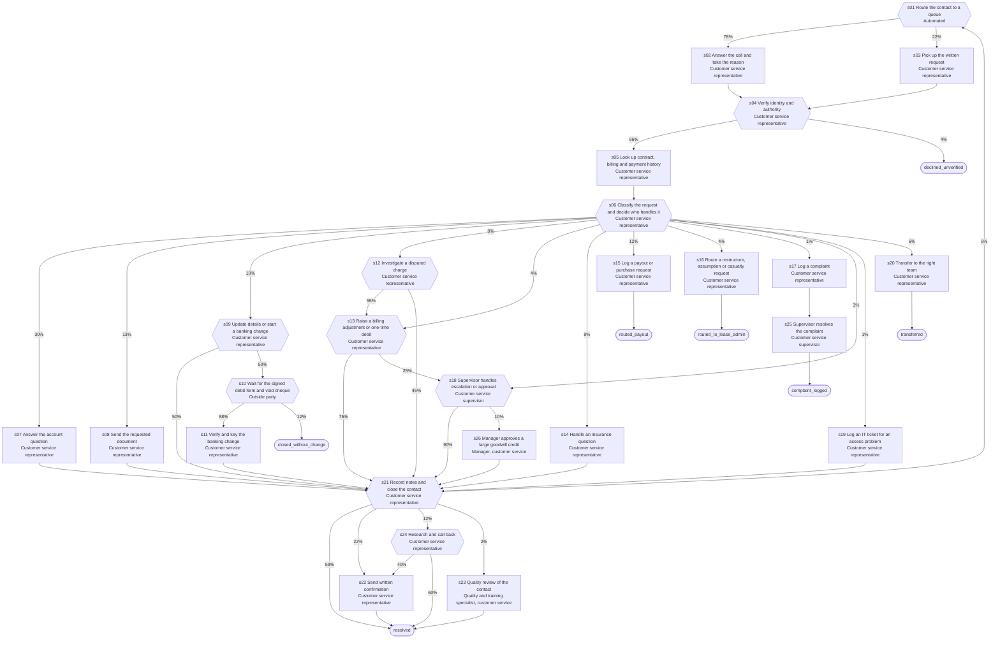

# Handle customer, dealer and broker service requests (equipment finance company)

`efc-handle-service-requests` · equipment leasing and finance · operations (customer service) · part of `equipment-finance-co`

Customer service representatives answer about 11,000 calls and e-mails a month from lessees, dealers and brokers about existing contracts: balances and payment dates, copies of invoices and contracts, address and banking changes, insurance, disputed charges and payout requests. They verify the caller, look up the contract, settle simple requests on the spot and route payouts, restructures, assumptions, casualty losses and complaints to other teams. Work is uneven because calls peak after billing and debit dates, and about three contacts in ten are not resolved first time, often because the answer depends on another team or because a banking change needs signed documents.

| | |
|---|---|
| Unit of work | one service contact |
| Starts when | A customer, dealer or broker calls, e-mails, faxes or sends a portal message about an existing contract. |
| Done when | The request is answered or completed on the contact, confirmed in writing, routed to the team that owns it, or declined because the requester could not be verified. |
| Organisation | A privately owned Canadian independent lessor with about 55,000 active contracts and a 24-person customer service team using contact centre telephony, shared mailboxes, the lease management system and document imaging. (340 employees, 2019-2022) |
| Volume | 11,000 cases a month (range 9,000 to 14,000) |

## Where it sits

- Starts with **service_request** from customer (80% of cases)
- Starts with **service_request** from equipment_vendor (12% of cases)
- Starts with **service_request** from broker (8% of cases)
- Sends **service_response** to customer (outcome: any)
- Sends **payout_request** to quote-and-process-buyouts (outcome: routed_payout)
- Sends **assumption_request** to process-lease-assumptions (outcome: routed_to_lease_admin)
- Sends **restructure_request** to restructure-and-defer-payments (outcome: routed_to_lease_admin)
- Sends **casualty_notice** to settle-casualty-losses (outcome: routed_to_lease_admin)
- Sends **complaint** to handle-complaints-and-compliance-monitoring (outcome: complaint_logged)
- Sends **billing_adjustment** to bill-customers (outcome: resolved)
- Sends **insurance_certificate** to track-equipment-insurance (outcome: resolved)
- Sends **it_ticket** to resolve-it-service-requests (outcome: resolved)

## Flow

## Roles

| Role | Department | Layer | FTE on this process | Loaded cost per hour | Evidence |
|---|---|---|---:|---:|---|
| Customer service representative | Customer service | individual contributor | 14.5 | 27 CAD | B [src_jb_64400] |
| Customer service supervisor | Customer service | supervisor | 1.2 | 45 CAD | C |
| Quality and training specialist, customer service | Customer service | individual contributor | 0.45 | 36 CAD | C |
| Manager, customer service | Customer service | manager | 0.1 | 70 CAD | C |

## Steps

Hands-on time and the wait before each step show the most common value. Evidence tier A is a sourced number, B a sourced description, C the author's estimate.

| Step | Who | Kind | Hands-on | Wait before | Control | Evidence |
|---|---|---|---:|---:|---|---|
| **s01 Route the contact to a queue.** A customer, dealer or broker calls the service line or writes to the shared service mailbox. The phone system plays the menu and routes the call by caller type and topic to the customer service queue; e-mails, faxes and portal messages land in the shared mailbox for the next free representative. | Automated | system auto | 0 min | 0 min |  | B [src_babel2021] |
| **s02 Answer the call and take the reason.** When the call reaches the front of the queue a customer service representative answers, gets the caller's name, company and contract number and the reason for the call. | Customer service representative | intake | 0.5 min | 1 min |  | B [src_babel2021] |
| **s03 Pick up the written request.** A representative assigned to the mailbox opens the next e-mail, fax or portal message, reads the request and any attachment and finds the contract number. | Customer service representative | intake | 1.5 min | 6.0 h |  | C |
| **s04 Verify identity and authority.** The representative finds the contract and checks the requester against it: for a customer, questions such as contract number, business address, signer name and last payment amount; for a dealer or broker, that they are the originating partner and may receive only limited information. Requests from unverified callers are declined until a signer authorises them in writing. | Customer service representative | validation | 0.7 min | 0 min | PIPEDA Schedule 1, Principle 4.7 (safeguards) and 4.3 (consent): authenticate the requester before disclosing or changing account information; the questions used are set by company policy | B [src_opc_safeguards] |
| **s05 Look up contract, billing and payment history.** The representative opens the contract in the lease system (schedule, balance, last payments, returned debits, insurance status, notes from earlier contacts) and the signed documents in imaging. | Customer service representative | lookup | 0.8 min | 0 min |  | C |
| **s06 Classify the request and decide who handles it.** The representative decides whether the request can be settled on the contact or must go to another team, using the service procedures: questions and copies are handled now, payouts, restructures, assumptions, casualty losses and complaints are routed, and credits above the representative's limit need a supervisor. | Customer service representative | judgment | 0.3 min | 0 min |  | B [src_cfla_cmo2020], [src_nbc_payments], [src_nbc_account] |
| **s07 Answer the account question.** The representative explains the balance, the next payment date and amount, why an amount changed (tax, insurance charge, late charge) or where a payment was applied, using the payment history on screen. | Customer service representative | communication | 3 min | 0 min |  | A [src_sqm_fcr2022] |
| **s08 Send the requested document.** The representative finds the invoice, contract, payment schedule, tax letter or paid-in-full letter in the lease system or imaging, checks it goes only to a party on the contract, and e-mails or faxes it. | Customer service representative | communication | 4 min | 0 min |  | C |
| **s09 Update details or start a banking change.** The representative updates an address, phone or invoice e-mail on the call. For a change of bank account the representative explains that a signed debit agreement and a void cheque from the new account are needed and sends the form. | Customer service representative | data entry | 3 min | 0 min |  | B [src_nbc_account], [src_h1] |
| **s10 Wait for the signed debit form and void cheque.** The customer signs the debit agreement and sends it back with a void cheque by e-mail or fax; some never do and stay on their old account or switch to cheque. | Outside party | external wait | 0 min | 2.0 d |  | C |
| **s11 Verify and key the banking change.** A representative compares the account holder name on the void cheque and the signature with the contract, calls the customer back on the number on file to confirm the change, keys the new account in the lease system before the next debit cut-off, and a second representative checks the keying. | Customer service representative | validation | 6 min | 4.0 h | Payments Canada Rule H1 s.15 (each debit supported by a payor's PAD agreement for that account) plus internal payment-fraud policy (call-back to the number on file and second-person check) | A [src_h1], [src_nbc_account] |
| **s12 Investigate a disputed charge.** The representative reviews the invoice and billing history for the disputed late charge, returned payment fee, tax, insurance charge or amount, and either explains it or decides an adjustment is due under the service guidelines. | Customer service representative | analysis | 6 min | 0 min |  | A [src_sqm_fcr2022] |
| **s13 Raise a billing adjustment or one-time debit.** The representative fills in a billing adjustment request in the lease system work queue (credit, fee waiver, rebill, tax exemption with the certificate attached) or records the customer's authorisation for a one-time debit, with the reason code and support. | Customer service representative | data entry | 3 min | 0 min | Delegation of authority (representative credit limit) and Payments Canada Rule H1 s.15(a)(iii): a sporadic or one-time debit needs the payor's authorisation each time | A [src_h1] |
| **s14 Handle an insurance question.** The representative explains the insurance the contract requires or why a protection program charge appeared, takes the customer's certificate of insurance by e-mail and forwards it to insurance tracking. | Customer service representative | communication | 3 min | 0 min |  | C |
| **s15 Log a payout or purchase request.** The representative confirms the contracts, the payout date wanted and the reason (sale of equipment, trade-up through a dealer, purchase option), creates the payout request for lease administration, tells the requester when the quote will arrive and notes the contact. | Customer service representative | data entry | 3 min | 0 min |  | B [src_nbc_end_of_lease] |
| **s16 Route a restructure, assumption or casualty request.** The representative takes the basic facts (reason for a deferral, buyer of the business, date and cause of a loss), sends the application or claim form, and creates a task for lease administration with the notes. | Customer service representative | coordination | 6 min | 0 min |  | B [src_cfla_cmo2020] |
| **s17 Log a complaint.** When the requester expresses dissatisfaction that needs a recorded response, the representative records it in the complaint log with the facts, the outcome wanted and the contract, acknowledges it and passes it to the supervisor. | Customer service representative | drafting | 8 min | 0 min | Complaint handling policy: every complaint recorded and reported to compliance | A [src_sqm_fcr2022] |
| **s18 Supervisor handles escalation or approval.** A customer service supervisor reviews the account and the representative's notes, approves or declines a credit or waiver above the representative's limit, or calls the upset customer back. | Customer service supervisor | approval | 10 min | 2.0 h | Delegation of authority: credits and waivers above the representative's limit approved by a supervisor | C |
| **s19 Log an IT ticket for an access problem.** For a customer who cannot log in to the portal or receive e-invoices, the representative checks the e-mail on file, resets access if the procedure allows, or logs an IT ticket with the details. | Customer service representative | coordination | 3 min | 0 min |  | C |
| **s20 Transfer to the right team.** For a customer in arrears who wants to arrange payment, or a dealer asking about funding or commission, the representative warm-transfers the call to collections, funding or the vendor desk and notes the transfer. | Customer service representative | coordination | 1 min | 1 min |  | C |
| **s21 Record notes and close the contact.** The representative types the contact notes and a disposition code in the lease system, sets a follow-up task where something is outstanding and ends the after-call work. | Customer service representative | data entry | 1.2 min | 0 min |  | A [src_babel2021], [src_sqm_fcr2022] |
| **s22 Send written confirmation.** Right after the contact the representative e-mails a confirmation of the change, the answer or the next steps, using a template from the service library. | Customer service representative | communication | 2 min | 5 min |  | C |
| **s23 Quality review of the contact.** The quality and training specialist listens to the recorded call or reads the e-mail thread, scores it against the scorecard (verification done, accuracy, notes, tone) and gives feedback to the representative. | Quality and training specialist, customer service | review | 15 min | 3.0 d | Customer service quality monitoring program | A [src_cch_poll2013] |
| **s24 Research and call back.** For a request that needs another team's answer (billing, lease administration, funding), the representative sends the question, waits for the reply and calls or e-mails the requester back. | Customer service representative | communication | 5 min | 1.0 d |  | C |
| **s25 Supervisor resolves the complaint.** The supervisor reviews the complaint log entry and the account, calls the customer, agrees a resolution and records the outcome and response date in the log for compliance reporting. | Customer service supervisor | judgment | 30 min | 8.0 h | Complaint handling policy: supervisor response and log entry within the policy deadline | C |
| **s26 Manager approves a large goodwill credit.** The manager of customer service reviews a credit or waiver above the supervisor's limit, checks it against the account history and approves or declines it. | Manager, customer service | approval | 10 min | 8.0 h | Delegation of authority: credits above the supervisor limit approved by the manager | C |

## Exceptions

| Exception | Share of cases | What happens |
|---|---:|---|
| Caller cannot be verified | 4% | The caller cannot answer the verification questions or is not a party to the contract; nothing is disclosed until a signer authorises it in writing. |
| Banking change waiting for documents | 5% | A new bank account needs a signed debit agreement and void cheque, a call-back and a second check before the next debit; some customers never return the form. |
| Credit above the representative's limit | 3% | Disputed charges and waivers above the limit go to a supervisor and occasionally the manager. |
| Complaint | 1% | The complaint is logged, the supervisor calls the customer and the outcome goes to compliance reporting. |
| Not resolved first time | 17% | The answer depends on another team, so the representative calls back later, or the requester contacts the company again. |

## Benchmarks

| Metric | Value | Unit | Population | Evidence |
|---|---|---|---|---|
| cycle_time_days | p50 0.015, p90 2.0 | calendar days from contact to resolution, routing or written confirmation | Inbound service contacts at a mid-size lessor (derived) | C [src_babel2021], [src_sqm_fcr2022] |
| first_call_resolution | all_industries 0.71, billing_calls 0.71, account_maintenance 0.73, complaints 0.47 | share of callers who do not need to contact again (post-call survey) | Over 500 North American call centres benchmarked by SQM Group (2022 report) | A [src_sqm_fcr2022] |
| average_handle_time_seconds | 589 | seconds of talk and wrap-up time | Call centres in SQM Group's FCR benchmark (2022 report) | A [src_sqm_fcr2022] |
| average_speed_to_answer_seconds | 75 | seconds | 214 US contact centres, Q4 2020 (ContactBabel) | A [src_babel2021] |
| wrap_up_share_of_agent_time | 0.094 | share of agent time | 214 US contact centres, Q4 2020 (ContactBabel) | A [src_babel2021] |
| covid_call_volume_2020 | 40% of CFLA respondents had more than 100 COVID-related calls a day | share of respondents | CFLA members, March 2020 survey | A [src_cfla_cmo2020] |

## Pain points

- About three contacts in ten are not resolved first time; many need an answer from billing, lease administration or funding, so customers call again. (steps s21, s24; A [src_sqm_fcr2022])
- Banking changes need a signed form, a void cheque, a call-back and a second check before the debit cut-off; missed cut-offs cause returned debits. (steps s09, s10, s11; B [src_h1], [src_nbc_account])
- Calls peak after billing and debit dates and spiked in 2020 with deferral requests, lengthening queues and abandonment. (steps s02, s03; B [src_cfla_cmo2020], [src_babel2021])
- Verification relies on knowledge questions about the contract, which slows every call and still lets some impostors through. (steps s04; B [src_opc_safeguards])

## Assumptions

- One case is one contact; the request mix (30% account questions, 13% documents, 12% payouts, 10% changes, 8% disputes, 8% insurance and smaller shares of routed work) is an author estimate.
- Hands-on times are set so the average contact takes about 9 minutes of representative time, close to SQM's 589-second handle time; lessor calls are assumed similar to the industry average.
- The benchmark median of about 20 minutes is derived from US and North American contact centre data (12 minutes for a call resolved first time), not measured at a Canadian lessor; the simulated median is sensitive to how many contacts are written rather than phoned, because written requests wait hours in the mailbox.
- The organisation file lists the operations process and reporting analyst for this process; that work (call statistics and staffing reports) is not per contact and is left out of the steps and FTE.
- End-of-term elections are treated as payout or purchase requests to lease administration, because the organisation file has no link from this process to manage-end-of-term; that missing link looks like a gap in the organisation file.
- Collections transfers are warm transfers without a business object, as the organisation file has no link from this process to collect-early-stage.

## Sources

- [src_sqm_fcr2022] [Call center industry 2022 FCR benchmark results (What is a good FCR rate?)](https://www.sqmgroup.com/pdf/WhatIsAGoodFCRRate2022.pdf) (SQM Group, 2022). Average FCR 71% across industries (range 40% to 91%); FCR by call type: general inquiries 74%, account maintenance 73%, billing 71%, complaints 47%; AHT (talk and wrap-up) 589 seconds; financial industries in the moderate band.
- [src_babel2021] [The US Contact Center HR and Operational Benchmarking Report 2021 (summary)](https://www.contactbabel.com/wp-content/uploads/2021/01/US-HROB-2021-Marketing-v3-WEBSITE.pdf) (ContactBabel, 2021). 214 US contact centres interviewed in Q4 2020: mean average speed to answer 75 seconds; mean service call over six minutes; post-call wrap-up 9.4% and talk 58.6% of agent time; call abandonment highest in the finance sector.
- [src_jb_64400] [Wages for financial customer service representatives (NOC 64400)](https://www.jobbank.gc.ca/wagereport/occupation/14140) (Job Bank, Government of Canada, 2025). Hourly wages 2023-2024: Ontario low $17.95, median $22.00, high $30.39; Toronto region median $22.50.
- [src_opc_safeguards] [Interpretation bulletin: safeguards](https://www.priv.gc.ca/en/privacy-topics/privacy-laws-in-canada/the-personal-information-protection-and-electronic-documents-act-pipeda/pipeda-compliance-help/pipeda-interpretation-bulletins/interpretations_08_sg/) (Office of the Privacy Commissioner of Canada, 2015). Principle 4.7 safeguards appropriate to sensitivity; organisations must have safeguards and follow proper client-authentication procedures; cases of impostors passing weak authentication.
- [src_nbc_account] [Equipment financing: updating your account information](https://www.nbc.ca/en/business/help-centre/manage-business/financing/equipment-financing-contact-information-changes.html) (National Bank of Canada, n.d.). Lessees contact customer service by phone or e-mail to change address; banking changes need a void cheque from the new account with the lease numbers, sent by fax or e-mail.
- [src_nbc_payments] [Equipment financing: lease payments and invoices](https://www.nbc.ca/en/business/help-centre/manage-business/financing/equipment-financing-payments-invoices.html) (National Bank of Canada, n.d.). Typical lessee questions: payment methods, invoices issued two weeks before due, invoice fee, taxes on payments, past-due interest, payment dates.
- [src_nbc_end_of_lease] [Equipment financing: end or cancellation of a lease](https://www.nbc.ca/en/business/help-centre/manage-business/financing/equipment-financing-end-lease.html) (National Bank of Canada, n.d.). Leases are non-cancellable; end-of-term options (buy at fair market value or the stated option, renew, return, trade up); letter about 60 days before expiry; customer service arranges returns.
- [src_cfla_cmo2020] [Asset-based finance in Canada: the 2019-2020 year (Canadian Market Overview)](https://cfla-acfl.ca/files/Industry-Intelligence/CMO-2020.pdf) (Canadian Finance and Leasing Association, 2020). March 2020 survey: 40% of respondents had an extreme volume (over 100 a day) of COVID-related calls; deferral requests over half the portfolio for a fifth of respondents; lessees value being able to reach someone to solve an issue and service quality.
- [src_h1] [Rule H1 Pre-Authorized Debits (PADs)](https://www.payments.ca/sites/default/files/h1eng.pdf) (Payments Canada (Canadian Payments Association), 2026). s.15: each debit supported by a payor's PAD agreement; sporadic debits need authorisation each time; one-time debits need a new agreement for later debits. s.30: cancellations honoured in the next cycle.
- [src_cch_poll2013] [Poll: how many calls do you monitor per agent per month?](https://www.callcentrehelper.com/poll-how-many-calls-do-you-monitor-per-agent-per-month-43247.htm) (Call Centre Helper, 2013). 115 respondents: 7% monitor 0-1 calls, 34% 2-4, 26% 5-6, 19% 7-10, 14% 11 or more per agent per month.

Written by claude-opus on 2026-11-17.
