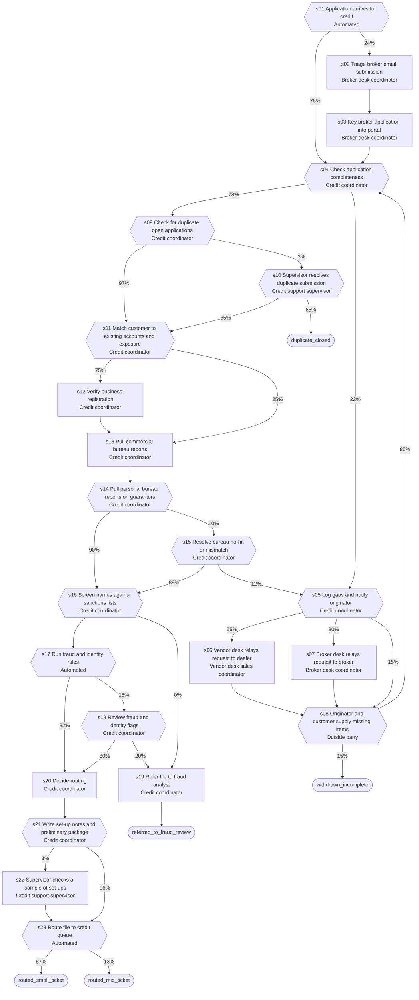

# Receive and set up credit applications

`efc-intake-credit-applications` · equipment leasing and finance · credit (credit support) · part of `equipment-finance-co`

Every credit application, whether keyed by the vendor desk, submitted by a dealer or account executive in the portal or emailed by a broker, is set up by a credit coordinator before an analyst sees it. The coordinator checks it is complete and consented, looks for duplicates and existing exposure, verifies the business in the corporate registry, pulls commercial reports from Equifax and PayNet and personal reports on the guarantors, screens names and clears fraud flags, then routes the file to small-ticket or mid-ticket credit or to fraud review. Missing signatures and statements are the most common delay, and pulling bureau reports through separate portals means typing the same data several times.

| | |
|---|---|
| Unit of work | one credit application |
| Starts when | A credit application is submitted in the origination portal or arrives by email at the broker desk. |
| Done when | The file is set up, bureau reports are attached and it sits in the small-ticket or mid-ticket adjudication queue, or it has been referred to fraud review, closed as a duplicate or withdrawn for missing information. |
| Organisation | A mid-size privately owned Canadian independent equipment lessor with a nine-person credit support team setting up about 3,400 applications a month from vendor, broker and direct channels. (340 employees, 2019-2022) |
| Volume | 3,430 cases a month (range 2,830 to 4,150) |

## Where it sits

- Starts with **credit_application** from quote-point-of-sale-payments (26% of cases)
- Starts with **credit_application** from equipment_vendor (27% of cases)
- Starts with **credit_application** from broker (32% of cases)
- Starts with **credit_application** from originate-direct-deals (14% of cases)
- Starts with **credit_application** from process-lease-assumptions (1% of cases)
- Relies on **credit_bureau_report** from credit_bureau (a standing input; it does not start a case)
- Sends **bureau_inquiry** to credit_bureau (outcome: routed_small_ticket)
- Sends **bureau_inquiry** to credit_bureau (outcome: routed_mid_ticket)
- Sends **bureau_inquiry** to credit_bureau (outcome: referred_to_fraud_review)
- Sends **fraud_alert** to verify-identity-and-fraud (outcome: referred_to_fraud_review)
- Sends **credit_application** to adjudicate-small-ticket-credit (outcome: routed_small_ticket)
- Sends **credit_application** to underwrite-mid-ticket-credit (outcome: routed_mid_ticket)

## Flow

## Roles

| Role | Department | Layer | FTE on this process | Loaded cost per hour | Evidence |
|---|---|---|---:|---:|---|
| Credit coordinator | Credit support | individual contributor | 8.5 | 30 CAD | B [src_eq_credit_coord] |
| Credit support supervisor | Credit support | supervisor | 0.3 | 51 CAD | B [src_eq_credit_coord] |
| Broker desk coordinator | Broker channel | individual contributor | 1.3 | 30 CAD | B [src_eq_credit_coord] |
| Vendor desk sales coordinator | Vendor sales desk | individual contributor | 0.4 | 30 CAD | C |

## Steps

Hands-on time and the wait before each step show the most common value. Evidence tier A is a sourced number, B a sourced description, C the author's estimate.

| Step | Who | Kind | Hands-on | Wait before | Control | Evidence |
|---|---|---|---:|---:|---|---|
| **s01 Application arrives for credit.** A credit application reaches credit support either as a file submitted in the origination portal by the vendor desk, a dealer, an account executive or lease administration, or as an email package from a broker to the broker desk inbox. The portal stamps the time and places portal files in the intake queue. | Automated | intake | 0 min | 0 min |  | B [src_eq_credit_coord], [src_marlin_10k2019] |
| **s02 Triage broker email submission.** A broker desk coordinator opens the next email in the broker desk mailbox, checks in the CRM that the broker is on the approved panel and in good standing, saves the application, owner consent and any financial statements to a new file and replies with an acknowledgement. | Broker desk coordinator | intake | 2 min | 20 min | Broker program agreement: applications accepted only from approved brokers on the panel | B [src_eq_credit_coord] |
| **s03 Key broker application into portal.** The broker desk coordinator re-types the broker's application from the PDF into the portal: legal and operating names, address, business number, years in business, owners and their addresses and dates of birth, equipment, cost, term and structure, and attaches the images so the file joins the intake queue. | Broker desk coordinator | data entry | 8 min | 10 min |  | C |
| **s04 Check application completeness.** A credit coordinator opens the next file in the intake queue and checks that the application is complete and legible: legal name, address, owners, equipment, cost and structure, a signed consent page for each owner, a supplier quote or invoice and, for deals over $250,000, two years of financial statements with interims. | Credit coordinator | validation | 1.5 min | 30 min | Credit policy minimum application requirements by deal size | B [src_eq_credit_coord], [src_crest_over250] |
| **s05 Log gaps and notify originator.** The coordinator lists the missing items in the portal file, puts it on hold and emails or posts a portal message to whoever submitted it: the vendor desk for dealer files, the broker desk for broker files or the account executive for direct deals. | Credit coordinator | communication | 3 min | 0 min |  | C |
| **s06 Vendor desk relays request to dealer.** A vendor desk coordinator picks up the hold notice, phones or emails the dealer with the list of missing items and explains what the customer must sign or provide, then watches for the reply. | Vendor desk sales coordinator | communication | 3 min | 1.0 h |  | C |
| **s07 Broker desk relays request to broker.** A broker desk coordinator emails the broker the list of missing items, often an owner's signature, financial statements or a supplier invoice, and notes the request in the broker's file. | Broker desk coordinator | communication | 3 min | 1.0 h |  | B [src_eq_credit_coord] |
| **s08 Originator and customer supply missing items.** The dealer, broker or account executive goes back to the customer for the missing signature, details or statements and sends them in. Statements and signatures from owners on job sites often take a day or more, and some customers drop the application. | Outside party | external wait | 0 min | 18.0 h |  | C |
| **s09 Check for duplicate open applications.** The coordinator searches the portal for open or recent applications for the same customer, owners or equipment, because brokers and dealers sometimes submit the same deal through more than one channel. | Credit coordinator | lookup | 0.7 min | 0 min | Channel conflict rule in the dealer and broker program agreements: first complete submission keeps the deal | C |
| **s10 Supervisor resolves duplicate submission.** The credit support supervisor compares the files, decides which channel submitted first and whether they are the same deal, informs the originating desks and closes or merges the later file. | Credit support supervisor | judgment | 10 min | 2.0 h |  | C |
| **s11 Match customer to existing accounts and exposure.** The coordinator searches the lease management system by legal name, phone number and each guarantor for existing contracts, adds up current exposure across related companies, notes payment history and any open collection or deferral, and links the application to the customer record. | Credit coordinator | lookup | 1.5 min | 0 min |  | B [src_eq_credit_coord] |
| **s12 Verify business registration.** The coordinator searches the federal or provincial corporate registry for the legal name to confirm the business exists and is active, its incorporation date for time in business and its directors, and compares them with the application. Sole proprietors are checked against business name registrations. | Credit coordinator | lookup | 2 min | 0 min | Credit policy customer identification: confirm the legal existence and status of the applicant; securitisation funders accept only verified legal entities | B [src_eq_credit_coord], [src_cc_fedcorp] |
| **s13 Pull commercial bureau reports.** The coordinator logs in to the Equifax commercial portal and the PayNet portal separately, re-enters the business name, address and phone in each, picks the closest matching entity and saves both reports, noting payment index, delinquency and failure scores, legal items and lease payment history. | Credit coordinator | lookup | 2.5 min | 0 min |  | B [src_eq_credit_coord], [src_eqx_gateway], [src_eqx_bcr_guide], [src_pymnts_paynet] |
| **s14 Pull personal bureau reports on guarantors.** For each owner who will guarantee, the coordinator confirms a signed consent is on file, then requests the Equifax consumer report through the portal's bureau link and attaches it. Most small-ticket files have one or two guarantors. | Credit coordinator | lookup | 2 min | 0 min | PIPEDA Schedule 1 Principle 4.3: personal credit report pulled only with the guarantor's signed consent on file, one consent per hard inquiry | B [src_opc_2015_005], [src_opc_2003_117], [src_eq_credit_coord] |
| **s15 Resolve bureau no-hit or mismatch.** When a bureau returns no file, several possible matches or an address or birth date that does not agree, the coordinator checks the keyed data against the application image, re-runs the search with previous addresses or alternate names and, if needed, asks the originator to confirm details. | Credit coordinator | analysis | 8 min | 20 min |  | C |
| **s16 Screen names against sanctions lists.** The coordinator runs the business, its directors and guarantors through the sanctions screening tool or the consolidated Canadian and US lists and records the result. A possible match is passed to the fraud analyst for review. | Credit coordinator | validation | 0.5 min | 0 min | Special Economic Measures Act and related regulations prohibit dealing with designated persons; screening itself is company policy and a securitisation funder requirement, since non-bank lessors had no AML obligation before April 2025 | B [src_gac_sanctions_faq], [src_goodmans_aml] |
| **s17 Run fraud and identity rules.** The decision engine runs the lessor's fraud rules over the keyed data and bureau results: bureau fraud alerts, residential or mail-drop business addresses, a business registered only weeks ago, phone and address mismatches, owners on several recent applications and dealers not on the approved list. | Automated | system auto | 0 min | 0 min | Fraud prevention policy: automated red-flag rules on every new application | B [src_oracle_lease_uw] |
| **s18 Review fraud and identity flags.** The coordinator looks at each flag against the documents and registry results, for example confirming that a home-based business is plausible for the industry, and either clears the flag with a note or refers the file to the fraud analyst. | Credit coordinator | judgment | 5 min | 10 min | Fraud prevention policy: flags cleared only with a documented reason | B [src_eq_credit_coord] |
| **s19 Refer file to fraud analyst.** The coordinator writes a referral note in the portal listing the flags and what was checked, places a fraud hold so the file cannot be decided, and assigns it to the fraud analyst queue. The credit decision waits for the analyst's clearance. | Credit coordinator | communication | 5 min | 0 min |  | C |
| **s20 Decide routing.** The coordinator decides where the file goes: small-ticket credit when the amount and the customer's total exposure stay at or below $250,000, mid-ticket credit above that, and a senior analyst flag for existing customers with arrears or for restricted equipment. Hot vendor deals are marked for priority. | Credit coordinator | judgment | 0.7 min | 0 min | Credit policy delegated authority by deal size and total exposure | B [src_crest_over250] |
| **s21 Write set-up notes and preliminary package.** The coordinator writes a short set-up summary in the portal: registry result, bureau highlights for the business and each guarantor, existing exposure and payment history, flags cleared and anything unusual, so the analyst can start without re-reading every report. | Credit coordinator | drafting | 2 min | 0 min |  | B [src_eq_credit_coord] |
| **s22 Supervisor checks a sample of set-ups.** The credit support supervisor re-checks a sample of completed set-ups against the bureau reports and registry results for accuracy and consent, records findings for coaching and asks the coordinator to correct any error in the file. | Credit support supervisor | review | 7 min | 0 min | Credit support quality assurance and compliance audit program | B [src_eq_credit_coord] |
| **s23 Route file to credit queue.** The portal moves the file to the small-ticket queue, where the decision engine scores it, or to the mid-ticket underwriting queue, and updates the status the originator sees. | Automated | system auto | 0 min | 0 min |  | B [src_oracle_lease_uw] |

## Exceptions

| Exception | Share of cases | What happens |
|---|---:|---|
| Incomplete application | 22% | A signature, owner detail, supplier invoice or required financial statements are missing; the file goes on hold while the originating desk chases the customer, and about 15% of these are withdrawn. |
| Bureau no-hit or identity mismatch | 10% | A bureau returns no file or a mismatch, often because of a keying error upstream; the coordinator re-searches and sometimes has to ask the originator to confirm details. |
| Fraud flag referred | 4% | Flags that the coordinator cannot clear, and possible sanctions matches, go to the fraud analyst with a hold on the file. |
| Duplicate submission | 3% | The same deal arrives through two channels and the supervisor decides which file survives. |
| Emailed broker application | 24% | Broker packages arrive by email and are re-keyed by the broker desk before set-up. |

## Benchmarks

| Metric | Value | Unit | Population | Evidence |
|---|---|---|---|---|
| cycle_time_days | p50 0.15, p90 2.5 | calendar days from submission to file in an adjudication queue or referred | Credit support at Canadian independent small-ticket lessors, 2019-2022 | C |
| time_from_receipt_to_decision_ready | 2 | hours | US small-ticket lessor, deals under $50,000, 2019 | A [src_marlin_10k2019] |
| bureau_lookup_speed_gain_from_combined_report | 2.0 | times faster | Equifax claim for Canadian asset-based lenders combining Equifax commercial and PayNet data (2024) | A [src_eqx_gateway] |
| applications_per_coordinator_per_day | low 15, mode 18, high 22 | applications | This organisation | C |

## Pain points

- Incomplete applications are the main delay: files sit on hold while the vendor or broker desk chases a signature or statements, and the originator often has to go back to the customer twice. (steps s04, s05, s06, s07, s08; C)
- Commercial reports come from two bureaus with separate log-ins, so the coordinator re-types the business details in each portal and reconciles different entity matches by hand. (steps s13; B [src_eqx_gateway])
- Broker applications arrive as email PDFs and are re-keyed, and keying errors surface later as bureau no-hits that need rework. (steps s02, s03, s15; B [src_eq_credit_coord])
- Files submitted late in the day or overnight wait until the next morning, while dealers expect an answer within hours. (steps s04; B [src_marlin_10k2019])

## Assumptions

- Shares of arriving applications follow the organisation file's channel drivers: about 26% keyed by the vendor desk, 27% submitted by dealers in the portal, 32% from brokers, 14% from direct account executives and about 1% lease assumptions. The credit bureau link (bureau reports coming back) does not start cases, so its share is 0.
- About 24% of applications, mostly from brokers, still arrived by email and were re-keyed by the broker desk.
- Non-bank lessors had no anti-money laundering identification duty before April 1, 2025; registry checks, sanctions screening and fraud rules are company policy driven by credit risk, fraud losses and securitisation funders.
- Corporate registry searches are not a system in the organisation file; a corporate_registry_search system was added here.
- Routing uses total exposure including related companies: about 87% of files go to small-ticket credit, matching the organisation file's assumption.
- The sanctions screening step is modelled for every file; a share of 2019-2022 independents screened only at funding.
- Staffing: about 8.5 of the 9 credit coordinators' time is on intake, slightly below the hands-on time the model implies; the organisation file's nine coordinators look tight for 3,430 applications a month and some set-up is likely absorbed by analysts or overtime.
- Loaded costs are the organisation file's (2019-2022 wage times 1.35).

## Sources

- [src_eq_credit_coord] [Credit Coordinator, Bennington Financial (job posting)](https://jobs.lever.co/eqbank/c1b4e9a7-8406-44f8-b482-eaf231c17a11) (EQ Bank (Lever job board), 2024). A Canadian equipment lessor's credit coordinator monitors and routes emails and online applications to the broker desk, sets up new credit applications, gathers third-party data (land and corporate registries), pulls Equifax and PayNet reports, flags unusual findings for the credit analyst, assembles preliminary credit packages and assists the manager with quality assurance audits; salary $42,000 to $46,000.
- [src_eqx_bcr_guide] [Equifax Business Credit Report user guide](https://assets.equifax.com/assets/canada/english/business_credit_report_user_guide.pdf) (Equifax Canada, 2017). The Canadian commercial report returns the legal entity that most closely matches the inquiry, a Payment Index from 0 to 99 based on the last 90 days, a Commercial Delinquency Score from 101 to 662, a Business Failure Risk Score from 1001 to 1722, trade, collection, legal and inquiry details.
- [src_eqx_gateway] [Business Gateway: an all-in-one credit performance solution for asset-based lenders](https://assets.equifax.com/assets/canada/english/business-gateway-abl-product-sheet-en-aoda.pdf) (Equifax Canada, 2024). Before a combined product, asset-based lenders checked Equifax commercial and PayNet leasing data through multiple log-ins and reports, entered credentials and information several times and reconciled fragmented results manually; the combined report claims at least twice the speed.
- [src_pymnts_paynet] [Equifax acquires PayNet](https://www.pymnts.com/?p=631153) (PYMNTS, 2019). In April 2019 Equifax acquired PayNet, which supplies commercial leasing payment data and credit risk tools to commercial finance and leasing companies in the US and Canada.
- [src_opc_2015_005] [PIPEDA Report of Findings #2015-005: dealer ran credit checks without consent](https://www.priv.gc.ca/en/opc-actions-and-decisions/investigations/investigations-into-businesses/2015/pipeda-2015-005/) (Office of the Privacy Commissioner of Canada, 2015). Under PIPEDA Principle 4.3 an organisation should obtain separate consent for each hard credit inquiry and retain proof of consent.
- [src_opc_2003_117] [PIPEDA case summary 2003-117: bank requires credit check on small business account applicant](https://priv.gc.ca/en/opc-actions-and-decisions/investigations/investigations-into-businesses/2003/pipeda-2003-117) (Office of the Privacy Commissioner of Canada, 2003). A personal credit check on the owner of a small business is a legitimate requirement where credit risk is involved, with consent.
- [src_gac_sanctions_faq] [Canadian sanctions: frequently asked questions](https://www.international.gc.ca/world-monde/international_relations-relations_internationales/sanctions/faq.aspx?lang=eng) (Global Affairs Canada, 2024). Canadian sanctions must be respected by any person in Canada; a dealings ban prohibits persons in Canada from dealing with designated persons; the consolidated list is a screening aid without force of law.
- [src_goodmans_aml] [Anti-money laundering obligations for factors, cheque cashers and financing/leasing entities](https://www.goodmans.ca/insights/article/anti-money-laundering-obligations-for-factors--cheque-cashers--and-financing-leasing-entities--declaration-and-record-keeping-requirements-for-traders) (Goodmans LLP, 2025). Financing and leasing entities became reporting entities under the PCMLTFA only as of April 1, 2025.
- [src_oracle_lease_uw] [Oracle Financial Services Lending and Leasing: Lease Origination User Guide, Underwriting](https://docs.oracle.com/cd/E82458_01/html/Lease_Origination_User_Guide/Underwriting.htm) (Oracle, 2017). Lease origination software runs pre-screen edits when an application is entered, pulls the bureau report, scores the application and routes it to an auto-approve, auto-reject or underwriting queue; stagnant applications are aged into a separate queue.
- [src_marlin_10k2019] [Marlin Business Services Corp. Form 10-K for fiscal year 2019](https://www.sec.gov/Archives/edgar/data/1260968/000119312520072460/d875863d10k.htm) (US Securities and Exchange Commission (EDGAR), 2020). Applications arrive by fax, phone, internet, mail, e-mail and web portal; within two hours of receipt the analyst is usually ready to decide deals under $50,000; when information is insufficient the analyst requests more.
- [src_crest_over250] [Equipment leasing over $250,000](https://www.crestcapital.com/equipment-leasing-over-250) (Crest Capital, 2025). Above $250,000 a lessor asks for two years of financial statements plus interim statements, tax returns and a list of current loans and leases; up to $250,000 is application-only.
- [src_cc_fedcorp] [Search for a federal corporation](https://ised-isde.canada.ca/cc/lgcy/fdrlCrpSrch.html) (Corporations Canada (Innovation, Science and Economic Development Canada), 2025). Federal corporations can be searched by name, corporation number or business number and filtered by status; provincial corporations are searched in the provincial registries.

Written by claude-opus on 2026-11-17.
