# Manage daily cash and release payments (equipment finance company)

`efc-manage-daily-cash` · equipment leasing and finance · treasury · part of `equipment-finance-co`

Every business day the treasury and cash analyst works out how much cash the company has and needs, and pays the dealers and brokers whose deals were funded. The analyst reconciles the bank balances and the previous day's collections, splits collections between the bank warehouse line and the three conduit pools, checks the funding team's approved payables, builds the cash position and prepares any draw, repayment or rollover on the bank line; the treasurer approves the position and releases the payment file in the bank portal. The work is spreadsheet-based and runs against fixed deadlines: bank cut-offs for same-day EFT, notice periods for bank line advances and conduit remittance dates. Questioned payables, late funding approvals, rejected payments and an absent approver push payments to an afternoon run or the next day.

| | |
|---|---|
| Unit of work | one business day |
| Starts when | The bank's prior-day reports become available at the start of a business day, with approved payables waiting in the treasury queue and the previous day's collections balanced by cash application. |
| Done when | The day's vendor payments and broker commissions are released and confirmed, the bank line is drawn, repaid or rolled as needed, conduit remittances due are made, and the day's treasury entries are posted to the ledger. |
| Organisation | A privately owned Canadian equipment lessor with 340 staff, funding about 1,400 contracts a month on a syndicated bank warehouse line and refinancing them through three bank-sponsored ABCP conduits, with a six-person treasury team. (340 employees, 2019-2022) |
| Volume | 22 cases a month (range 21 to 23) |

## Where it sits

- Starts with **funding_approval** from audit-and-fund-contracts (55% of cases)
- Starts with **collections_data** from apply-customer-payments (35% of cases)
- Starts with **funding_proceeds** from sell-securitisation-pools (5% of cases)
- Starts with **funding_proceeds** from bank_syndicate (5% of cases)
- Relies on **borrowing_base_report** from report-credit-facility-covenants (a standing input; it does not start a case)
- Sends **vendor_payment** to equipment_vendor (outcome: any)
- Sends **broker_commission** to broker (outcome: any)
- Sends **cash_forecast** to sell-securitisation-pools (outcome: day_closed_forecast_sent)
- Sends **drawdown_request** to bank_syndicate (outcome: any)
- Sends **journal_entries** to close-the-month (outcome: any)

## Flow

```mermaid
flowchart TD
    s01["s01 Bank prior-day reports load overnight<br/>Automated"]
    s02["s02 Download prior-day balances and activity<br/>Treasury and cash analyst"]
    s03["s03 Check debit settlement and returned items<br/>Treasury and cash analyst"]
    s04{{"s04 Reconcile yesterday's forecast to actual balances<br/>Treasury and cash analyst"}}
    s05["s05 Research an unexplained bank item<br/>Treasury and cash analyst"]
    s06["s06 Pull collections by pool from cash application<br/>Treasury and cash analyst"]
    s07{{"s07 Track conduit collections and remittances due<br/>Treasury and cash analyst"}}
    s26["s26 Confirm conduit settlement figures and plan the paydown<br/>Treasury and cash analyst"]
    s08["s08 Download the vendor and broker payment queue<br/>Treasury and cash analyst"]
    s09{{"s09 Check the queue for approvals, duplicates and banking changes<br/>Treasury and cash analyst"}}
    s10["s10 Hold questioned payables and query the funding team<br/>Treasury and cash analyst"]
    s11["s11 Build the cash position and short-term forecast<br/>Treasury and cash analyst"]
    s12{{"s12 Treasurer reviews the position and decides on the bank line<br/>Treasurer"}}
    s13{{"s13 Check availability under the borrowing base<br/>Treasury and cash analyst"}}
    s14["s14 Prepare the drawdown, repayment or rollover notice<br/>Treasury and cash analyst"]
    s15["s15 Treasurer signs and sends the notice to the agent bank<br/>Treasurer"]
    s16["s16 Agent bank funds or applies the advance<br/>Outside party"]
    s17{{"s17 Build the EFT payment file and any wires<br/>Treasury and cash analyst"}}
    s18["s18 Prepare internal transfers and conduit remittances<br/>Treasury and cash analyst"]
    s19{{"s19 Treasurer approves and releases payments in the bank portal<br/>Treasurer"}}
    s20["s20 Chief financial officer approves a large wire or covers for the treasurer<br/>Chief financial officer"]
    s21["s21 Bank validates the file and sends payments at the exchange<br/>Automated"]
    s22{{"s22 Check the bank acknowledgement and rejects<br/>Treasury and cash analyst"}}
    s24["s24 Correct a rejected payment with the funding team<br/>Treasury and cash analyst"]
    s23{{"s23 Mark payments paid and send the payment report to funding<br/>Treasury and cash analyst"}}
    s25{{"s25 Record the day's treasury entries in the ledger<br/>Treasury and cash analyst"}}
    s27["s27 Update the rolling cash forecast and share it<br/>Treasury and cash analyst"]
    s01 --> s02
    s02 --> s03
    s03 --> s04
    s04 -->|"85%"| s06
    s04 -->|"15%"| s05
    s05 --> s06
    s06 --> s07
    s07 -->|"86%"| s08
    s07 -->|"14%"| s26
    s26 --> s08
    s08 --> s09
    s09 -->|"90%"| s11
    s09 -->|"10%"| s10
    s10 --> s11
    s11 --> s12
    s12 -->|"50%"| s13
    s12 -->|"48%"| s17
    s12 -->|"2%"| s11
    s13 -->|"96%"| s14
    s13 -->|"4%"| s12
    s14 --> s15
    s15 --> s16
    s16 --> s17
    s17 -->|"65%"| s19
    s17 -->|"35%"| s18
    s18 --> s19
    s19 -->|"88%"| s21
    s19 -->|"8%"| s20
    s19 -->|"4%"| s17
    s20 --> s21
    s21 --> s22
    s22 -->|"95%"| s23
    s22 -->|"5%"| s24
    s24 --> s19
    s23 -->|"80%"| s25
    s23 -->|"20%"| s08
    s25 -->|"80%"| end0
    s25 -->|"20%"| s27
    s27 --> end1
    end0(["day_closed"])
    end1(["day_closed_forecast_sent"])
```

## Roles

| Role | Department | Layer | FTE on this process | Loaded cost per hour | Evidence |
|---|---|---|---:|---:|---|
| Treasury and cash analyst | Treasury and securitisation | individual contributor | 1 | 48 CAD | B [src_afp_tasks], [src_jb_11101] |
| Treasurer | Treasury and securitisation | director | 0.15 | 105 CAD | C |
| Chief financial officer | Finance | executive | 0.01 | 175 CAD | C |

## Steps

Hands-on time and the wait before each step show the most common value. Evidence tier A is a sourced number, B a sourced description, C the author's estimate.

| Step | Who | Kind | Hands-on | Wait before | Control | Evidence |
|---|---|---|---:|---:|---|---|
| **s01 Bank prior-day reports load overnight.** Overnight the clearing bank publishes prior-day balance and transaction reports for every account and the settlement and return files for the debits and payments of the previous day, and the lease system finishes its nightly posting of the previous day's cash application. | Automated | system auto | 0 min | 0 min |  | B [src_afp_liquidity] |
| **s02 Download prior-day balances and activity.** When the treasury and cash analyst starts the day, they log in to the bank cash management portal, download the prior-day balance and transaction reports for the operating, lockbox, debit collection, payroll, conduit collection and reserve accounts, and paste them into the daily cash position workbook. | Treasury and cash analyst | data entry | 25 min | 1.0 h |  | B [src_afp_liquidity], [src_kyriba_2018] |
| **s03 Check debit settlement and returned items.** The analyst compares the settlement credit for the pre-authorised debit file due yesterday with the file total that billing released, notes the total of returned debits from the bank's return report, and checks that the lockbox and EFT deposits match what cash application expects. | Treasury and cash analyst | validation | 15 min | 2 min |  | C |
| **s04 Reconcile yesterday's forecast to actual balances.** The analyst compares yesterday's expected closing position with the actual bank balances, line by line: debits settled, vendor payments cleared, bank line advances, conduit proceeds and bank fees, and lists any difference above the tolerance for research. | Treasury and cash analyst | validation | 20 min | 2 min |  | B [src_afp_tasks], [src_afp_13week] |
| **s05 Research an unexplained bank item.** The analyst looks up the item in the bank portal detail, asks cash application whether a large customer payment or payout arrived, asks the securitisation analyst about conduit settlements, or calls the bank's cash management service about an unknown debit, fee or a payment that did not settle. | Treasury and cash analyst | lookup | 25 min | 15 min |  | B [src_afp_tasks] |
| **s06 Pull collections by pool from cash application.** The analyst opens the balanced daily cash report that cash application closes each evening and the data warehouse report of collections by contract and pool, and splits yesterday's collections between contracts on the bank warehouse line, the balance sheet and each of the three conduit pools. | Treasury and cash analyst | lookup | 20 min | 5 min |  | C |
| **s07 Track conduit collections and remittances due.** The analyst adds the day's collections on each conduit pool to the collections tracker, checks the amount held against what each servicing agreement allows the company to keep before the next settlement date, and flags any remittance or reserve top-up that falls due. | Treasury and cash analyst | analysis | 15 min | 2 min | Conduit servicing agreements: collections on sold contracts are held for the conduit and remitted on schedule, with daily monitoring where commingling is allowed (DBRS commingling criteria) | B [src_dbrs_commingling] |
| **s26 Confirm conduit settlement figures and plan the paydown.** On a conduit settlement date the analyst takes the settlement statement from the securitisation analyst, checks the purchase price, fees and reserve deposit against the conduit portal, and plans how much of the proceeds repays the bank warehouse line and how much funds the reserve account. | Treasury and cash analyst | lookup | 20 min | 15 min |  | C |
| **s08 Download the vendor and broker payment queue.** The analyst runs the lease system report of approved vendor payables and broker commissions placed in the treasury payment queue by the funding team since the last run, with counts, totals and same-day requests from dealers, and copies the totals into the cash position. | Treasury and cash analyst | lookup | 15 min | 10 min |  | C |
| **s09 Check the queue for approvals, duplicates and banking changes.** The analyst checks that every payable shows the required second approval in the lease system, sorts by vendor and amount to spot duplicates of earlier payments, looks for vendors whose banking changed in the last few days and checks that large items carry the manager's approval. | Treasury and cash analyst | validation | 25 min | 2 min | Payment release policy: treasury independently checks approvals, duplicates and recent banking changes before releasing funds (fraud prevention for payments) | B [src_afp_tasks], [src_afp_fraud_2021] |
| **s10 Hold questioned payables and query the funding team.** The analyst removes the questioned payables from today's release and emails the funding supervisor with the reason: a missing approval, a possible duplicate or banking that changed after a recent email. Held items return to the queue once funding confirms or corrects them. | Treasury and cash analyst | communication | 12 min | 0 min |  | C |
| **s11 Build the cash position and short-term forecast.** In the workbook the analyst sets the opening available balance, adds expected receipts (today's debit settlement, lockbox and EFT receipts, conduit proceeds) and subtracts today's outflows (vendor payments, broker commissions, interest, payroll or supplier runs, conduit remittances and tax remittances), compares the result with the minimum balance and works out the funding gap or surplus. | Treasury and cash analyst | analysis | 40 min | 5 min |  | B [src_afp_liquidity], [src_afp_tasks], [src_kyriba_2018] |
| **s12 Treasurer reviews the position and decides on the bank line.** The treasurer reviews the position, the payment total and the remaining availability on the bank line, questions unusual items, and decides whether to draw on the line, repay it with surplus or conduit proceeds, roll a maturing bankers' acceptance, or leave it unchanged. | Treasurer | approval | 15 min | 30 min | Treasury policy: daily position and funding decisions approved by the treasurer | B [src_afp_liquidity] |
| **s13 Check availability under the borrowing base.** The analyst compares the outstanding advances plus the proposed draw with the facility limit and the availability in the latest borrowing base certificate, adjusted for contracts sold to conduits since then, so the draw does not exceed eligible receivables. | Treasury and cash analyst | validation | 12 min | 5 min | Credit agreement: advances limited to the lesser of the commitment and the borrowing base | C |
| **s14 Prepare the drawdown, repayment or rollover notice.** The analyst fills in the agent bank's notice template with the amount, date and type of advance (prime rate loan or bankers' acceptance and its term), checks the minimum amounts and the notice deadline, and prepares it for an authorised signatory. | Treasury and cash analyst | drafting | 15 min | 5 min |  | A [src_jacobs_credit] |
| **s15 Treasurer signs and sends the notice to the agent bank.** The treasurer checks the notice against the decision, signs it as an authorised officer and emails or uploads it to the agent bank before the deadline; a late notice moves the advance to the next business day. | Treasurer | approval | 8 min | 20 min | Credit agreement: borrowing notices signed by an authorised officer and delivered by the agent's deadline | A [src_jacobs_credit] |
| **s16 Agent bank funds or applies the advance.** The agent bank confirms the notice, credits a prime rate advance to the operating account or applies a repayment, or schedules a bankers' acceptance issue for its drawdown date. The analyst carries on with the payment file while this happens. | Outside party | external wait | 0 min | 20 min |  | A [src_jacobs_credit] |
| **s17 Build the EFT payment file and any wires.** The analyst releases the cleared payables from the lease system into a payment file in the bank's format, uploads it to the bank portal, keys wires for large mid-ticket fundings or same-day dealer requests, and checks the file count and total against the cleared list before submitting it for approval. | Treasury and cash analyst | data entry | 25 min | 10 min |  | B [src_c1_aft], [src_scotia_cutoffs] |
| **s18 Prepare internal transfers and conduit remittances.** The analyst keys the account transfers the position needs: moving debit and lockbox collections to the operating account, funding the payroll account, remitting collections or a reserve top-up to a conduit's collection account, and paying a sales tax remittance on its due date. | Treasury and cash analyst | data entry | 15 min | 2 min | Conduit servicing agreements: remit collections and reserve amounts when due | B [src_afp_liquidity], [src_dbrs_commingling] |
| **s19 Treasurer approves and releases payments in the bank portal.** The treasurer logs in to the bank portal with a security token, compares the pending file, wires and transfers with the cleared payment list and the cash position, and approves them; the analyst who created them cannot approve them. Wires above the treasurer's limit go to the chief financial officer. | Treasurer | approval | 12 min | 30 min | Bank dual authorization: payments created by one user must be authorised by a different user; company signing authority limits | B [src_td_rights], [src_c1_aft] |
| **s20 Chief financial officer approves a large wire or covers for the treasurer.** The chief financial officer reviews a large wire against its funding approval, or the whole release when the treasurer is away, and approves it in the bank portal with their own token. | Chief financial officer | approval | 8 min | 1.0 h | Company signing authority policy and bank dual authorization | C |
| **s21 Bank validates the file and sends payments at the exchange.** The bank validates the approved file within minutes and returns an acknowledgement, then sends the EFT credits to the clearing exchange at the next cut-off, with funds reaching direct-clearing banks the same evening and some smaller institutions later; wires settle in real time. | Automated | system auto | 0 min | 20 min |  | A [src_scotia_cutoffs] |
| **s22 Check the bank acknowledgement and rejects.** The analyst checks the bank's acknowledgement that the file was accepted with the right count and total and reviews the rejects report for credits refused because of an invalid transit or account number. | Treasury and cash analyst | validation | 8 min | 30 min |  | B [src_c1_aft] |
| **s24 Correct a rejected payment with the funding team.** The analyst tells the funding specialist which vendor payment was rejected and why; funding confirms the correct banking with the vendor by call-back, the vendor master is fixed by someone who does not fund deals, and the analyst re-keys the payment for release. | Treasury and cash analyst | coordination | 20 min | 4.0 h |  | C |
| **s23 Mark payments paid and send the payment report to funding.** The analyst marks the released payables as paid in the lease system with the payment date and file reference and posts the payment report where the funding team picks it up to send funding notices to dealers and brokers. | Treasury and cash analyst | data entry | 12 min | 10 min |  | C |
| **s25 Record the day's treasury entries in the ledger.** Late in the day the analyst prepares the journal for bank line advances and repayments, bankers' acceptance discounts, interest and standby fees, conduit proceeds and reserve deposits, internal transfers and bank fees, attaches the bank confirmations and posts it to the ledger for the accounting team. | Treasury and cash analyst | data entry | 20 min | 45 min |  | C |
| **s27 Update the rolling cash forecast and share it.** Once a week the analyst rolls the 13-week cash forecast forward with actuals, updates expected fundings from the pipeline and conduit sale dates, explains large variances, and sends it to the treasurer, the chief financial officer and the securitisation analysts for pool sizing. | Treasury and cash analyst | analysis | 50 min | 15 min |  | B [src_afp_liquidity], [src_afp_13week] |

## Exceptions

| Exception | Share of cases | What happens |
|---|---:|---|
| Questioned payable held | 10% | Treasury finds a payable without its second approval, a possible duplicate or banking that changed recently and holds it until funding confirms; it usually goes in the afternoon run. |
| Bank line draw, repayment or rollover | 50% | The position shows a gap or a surplus, or a bankers' acceptance matures, so the analyst checks borrowing base availability and the treasurer signs a notice to the agent bank. |
| Availability short under the borrowing base | 2% | The draw needed exceeds availability, so the treasurer defers some payments to the next conduit settlement or asks the lenders for a temporary increase. |
| Conduit settlement day | 14% | A conduit pays for a pool; the analyst checks the settlement statement, repays the bank line and funds the reserve account. |
| Rejected payment | 5% | The bank rejects a credit for an invalid account; funding re-verifies the vendor's banking by call-back and treasury releases the payment again, often the next day. |
| Large wire or treasurer absent | 8% | A wire above the treasurer's limit, or the treasurer's absence, needs the chief financial officer's approval, which can delay the release past the same-day cut-off. |
| Afternoon payment run | 20% | Payables approved after the morning cut-off, including held items cleared by funding, go through the check, position update, approval and release a second time. |

## Benchmarks

| Metric | Value | Unit | Population | Evidence |
|---|---|---|---|---|
| cycle_time_days | p50 0.45, p90 1.0 | calendar days from prior-day bank reports being available to the day's payments released and treasury entries posted | Author estimate for a single-entity Canadian lessor releasing payments through a major bank portal | C [src_scotia_cutoffs], [src_afp_liquidity] |
| spreadsheet_hours_daily_cash_position | 1296 | hours per year per treasury team | More than 100 large US and European companies (Kyriba survey, 2018) | A [src_kyriba_2018] |
| organisations_targeted_by_business_email_compromise | 0.76 | share of organisations, 2020 | AFP Payments Fraud and Control Survey respondents (mainly US) | A [src_afp_fraud_2021] |
| same_day_eft_cutoff | 2:15 p.m. ET | time of day | One major Canadian bank's CAD payables service | A [src_scotia_cutoffs] |

## Pain points

- The cash position is rebuilt each morning by downloading bank reports into spreadsheets and re-keying collections, payables and forecasts, so it takes most of the analyst's morning and depends on one person's workbook. (steps s02, s06, s11; A [src_kyriba_2018])
- Approvals queue behind the treasurer's availability; when the treasurer is in meetings or away, payments miss the same-day cut-off and dealers wait another day for their money. (steps s12, s19, s20; C)
- Payables approved after the morning release need a second run, which repeats the checks and the approval. (steps s08, s09, s17, s19, s23; C)
- Vendor banking changes requested by email are the main fraud exposure; treasury's duplicate and banking checks repeat part of the funding team's controls. (steps s09, s10, s24; A [src_afp_fraud_2021])
- Collections on conduit pools must be tracked daily and remitted on schedule while the company services the contracts, which adds a manual reconciliation between cash application, the data warehouse and each facility's rules. (steps s06, s07, s18; B [src_dbrs_commingling])

## Assumptions

- One case is one business day. Hands-on minutes are one day's work; the analyst's own steps follow each other with little wait, while the treasurer's approvals, the bank acknowledgement and the end-of-day posting carry the waits. The simulator adds every minute in sequence, so its median of about 0.7 days runs above the 0.45-day estimate: in practice the analyst drafts entries, answers funding queries and updates the forecast while waiting for approvals, and the afternoon run overlaps the morning's follow-up.
- About 64 vendor payments and 20 broker commissions a business day follow from the organisation file's 1,400 fundings a month and the 32% broker channel; most go in one EFT file with wires for large or urgent items.
- Treasury releases payments that the funding team has already approved with a second signature (audit-and-fund-contracts workflow); treasury's checks for duplicates and banking changes are a further independent control, not a re-audit.
- Sample notice periods (9:00 a.m. one business day before a prime rate loan, three business days before a bankers' acceptance) come from a published Canadian facility of another borrower; this lessor's facility terms are not public. Most draws are planned a day ahead, so the agent bank step adds little wait to the day.
- About half of business days have a bank line draw, repayment or bankers' acceptance rollover; the line is repaid from the three monthly conduit settlements. These frequencies are author estimates.
- Conduit collections are tracked daily and remitted on each facility's schedule; the remittance itself is a transfer to the conduit's collection account and the monthly servicer report is a separate process (report-to-securitisation-funders). The process map lists no output from this process to the conduits, so none is added.
- The borrowing base certificate from report-credit-facility-covenants is used as a standing input to check availability; the organisation file's process map does not list it, so it appears only under interfaces.inputs.
- Weekly supplier payment runs and bi-weekly payroll funding appear only as forecast outflows and transfers; their approval belongs to pay-operating-suppliers and run-payroll-and-benefits.
- The treasurer is the primary releaser and the chief financial officer the back-up; the chief financial officer is not in the process map's role list for this process but is the usual second signatory in a six-person treasury team.
- Staffing: about 6 to 7 hands-on hours a day, mostly the analyst's, gives about 1.1 FTE at 130 productive hours a month, against 1.16 FTE stated; the organisation file's two treasury analysts leave about 0.8 FTE for covenant and borrowing base reporting and back-up.
- Loaded costs are the organisation file's (2019-2022 wage times 1.35).

## Sources

- [src_afp_liquidity] [Keeping the lights on: the why and how of liquidity management](https://www.financialprofessionals.org/topics/treasury/keeping-the-lights-on-the-why-and-how-of-liquidity-management) (Association for Financial Professionals, 2026). Setting the daily cash position in four steps: gather balances from bank portals and the ERP, forecast near-term inflows and outflows, identify surpluses and shortfalls (a shortfall can be met by drawing on a revolving credit facility), and execute transfers, investments or draws before settlement cut-offs, since late transactions may not settle until the next business day.
- [src_afp_tasks] [Top 5 tasks of a treasury analyst](https://www.financialprofessionals.org/ideas-inspiration/topics/articles/Details/top-5-tasks-of-a-treasury-analyst) (Association for Financial Professionals, undated). Treasury analyst tasks: reconcile bank activity to the ledger and resolve discrepancies with the bank, set the cash position daily and identify where to draw liquidity in a deficit, review bank fees, and use fraud prevention tools such as two-factor authentication on payment systems.
- [src_scotia_cutoffs] [Cut-off times for submitting payments (ScotiaConnect help)](https://www1.scotiaconnect.scotiabank.com/help/en/cut-off-times.html) (Scotiabank, undated). Three daily cut-offs for Canadian dollar payables (5:00 a.m., 2:15 p.m. and 7:00 p.m. ET); a file sent by 2:15 p.m. reaches direct-clearing institutions by 6:30 p.m. the same day, indirect clearers up to two business days later; CAD wires within the Americas are due by 5:00 p.m. ET on the value date.
- [src_td_rights] [What are security rights? (Web Business Banking help)](https://td.com/ca/en/commercial-banking/wbb/help/wbwsecurityright) (TD Bank, undated). Business banking users hold separate rights to authorize EFT and wire payments created or last modified by other users and to authorize their own payments, so a company can require a second person to approve every payment.
- [src_c1_aft] [PaymentStream AFT guide for file upload](https://www.prospera.ca/assets/pdf/PaymentStream_AFT_Guide_File_Upload.pdf) (Central 1 Credit Union, 2019). An uploaded AFT file from a user who requires approval waits as a pending task until another user with approver rights approves or rejects it; files must reach the processor before set delivery deadlines; originators review the daily returns, recalls and rejects report and correct rejected credit transactions. Read from the text copy saved under scratch by earlier work.
- [src_jacobs_credit] [Credit agreement dated as of December 15, 2005 (exhibit 10.12), Canadian dollar revolving and bankers' acceptance facility](https://www.sec.gov/Archives/edgar/data/52988/000119312506248847/dex1012.htm) (Jacobs Engineering Group Inc., filed with the US Securities and Exchange Commission, 2005). Sample Canadian facility terms: a Canadian prime rate loan notice must reach the agent by 9:00 a.m. one business day before the borrowing date, in minimum amounts of Cdn$100,000; a bankers' acceptance drawdown, conversion or rollover notice is due by 9:00 a.m. three business days before, in minimum aggregate amounts of Cdn$1,000,000.
- [src_dbrs_commingling] [DBRS clarifies commingling policy for structured finance transactions with revolving periods](https://dbrs.morningstar.com/research/229385/dbrs-clarifies-commingling-policy-for-structured-finance-transactions-with-revolving-periods) (DBRS, 2009). When a servicer may no longer commingle, collections must reach a trust account at most within three business days of collection; partial commingling is allowed only with a daily asset test, daily monitoring for amortization events and a monthly officer certification.
- [src_kyriba_2018] [Treasury teams wasting almost 5,000 hours per year on spreadsheets](https://www.theglobaltreasurer.com/2018/07/25/treasury-teams-wasting-almost-5000-hours-per-year-on-spreadsheets/) (The Global Treasurer, 2018). Kyriba survey of more than 100 US and European companies: treasury teams spend about 4,812 hours a year on spreadsheet work, the largest share (1,296 hours) on the daily cash position and 960 hours on payment and fund transfers.
- [src_afp_fraud_2021] [AFP survey: payments fraud increase attributed to coronavirus pandemic (2021 Payments Fraud and Control Survey)](https://www.financialprofessionals.org/training-resources/resources/articles/Details/afp-survey-payments-fraud-increase-attributed-to-coronavirus-pandemic) (Association for Financial Professionals, 2021). In 2020, 74% of organisations were targets of payments fraud; 62% of those named business email compromise as the source and 76% were targeted by business email compromise attempts; cheques (66%) and wires (39%) were the payment types most affected.
- [src_afp_13week] [Building the cash muscle: how private equity is elevating the 13-week forecast](https://www.financialprofessionals.org/training-resources/resources/articles/Details/building-the-cash-muscle-how-private-equity-is-elevating-the-13-week-forecast) (Association for Financial Professionals, 2026). Private equity owners expect close cash visibility; in the example cash was reviewed weekly in the first year of ownership, with weekly actuals pulled from bank data and sorted into categories for variance analysis against the forecast.
- [src_jb_11101] [Wages: Financial analyst in Canada (NOC 11101)](https://www.jobbank.gc.ca/marketreport/wages-occupation/12417/ca) (Job Bank, Government of Canada, 2024). Ontario hourly wages for financial analysts: low $28.21, median $43.27, high $72.36 (reference period 2023-2024).

Written by claude-opus on 2026-11-17.
