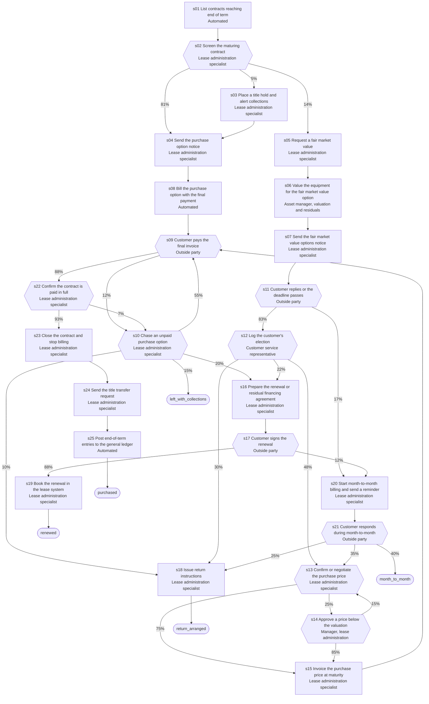

# Manage end of term

`efc-manage-end-of-term` · equipment leasing and finance · lease administration · part of `equipment-finance-co`

When a lease nears its end the customer must buy the equipment, renew the lease or give it back, and the lessor must collect the residual or get the equipment returned in good order. Lease administration screens the monthly maturity list, sends notices, has asset management value fair market value contracts, handles price negotiations, renewals and return instructions, rolls silent customers into month-to-month billing and asks the title team to transfer ownership once the contract is paid in full. Most contracts in a Canadian small-ticket book have a nominal or fixed purchase option and close with little work after a long calendar wait; fair market value contracts, unpaid options and customers who do not reply create most of the effort and delay.

| | |
|---|---|
| Unit of work | one maturing contract |
| Starts when | The contract appears on the lease system's monthly maturity list about 60 to 90 days before its term ends. |
| Done when | The contract is paid in full and title transfer requested, renewed, rolled to month-to-month rent, handed to asset management for return, or left with collections when the option is not paid. |
| Organisation | A mid-size Canadian independent equipment lessor with about 55,000 active small and mid-ticket contracts on a commercial lease management system and a lease administration team of about 11. (340 employees, 2019-2022) |
| Volume | 1,000 cases a month (range 850 to 1,200) |

## Where it sits

- Starts with **maturity_list** from bill-customers (96% of cases)
- Starts with **end_of_term_election** from customer (4% of cases)
- Relies on **asset_valuation** from value-equipment-and-set-residuals (a standing input; it does not start a case)
- Sends **end_of_term_notice** to customer (outcome: any)
- Sends **valuation_request** to value-equipment-and-set-residuals (outcome: any)
- Sends **title_transfer_request** to transfer-title-and-discharge (outcome: purchased)
- Sends **contract_amendment** to bill-customers (outcome: purchased)
- Sends **contract_amendment** to bill-customers (outcome: renewed)
- Sends **contract_amendment** to bill-customers (outcome: month_to_month)
- Sends **return_instruction** to recover-off-lease-equipment (outcome: return_arranged)
- Sends **sales_tax_data** to file-sales-taxes (outcome: purchased)
- Sends **journal_entries** to close-the-month (outcome: purchased)

## Flow

## Roles

| Role | Department | Layer | FTE on this process | Loaded cost per hour | Evidence |
|---|---|---|---:|---:|---|
| Lease administration specialist | Lease administration | individual contributor | 3.5 | 33 CAD | B [jb_clerk], [alta_les] |
| Manager, lease administration | Lease administration | manager | 0.1 | 70 CAD | C |
| Asset manager, valuation and residuals | Asset management and remarketing | senior specialist | 0.5 | 56 CAD | C |
| Customer service representative | Customer service | individual contributor | 0.1 | 27 CAD | C |

## Steps

Hands-on time and the wait before each step show the most common value. Evidence tier A is a sourced number, B a sourced description, C the author's estimate.

| Step | Who | Kind | Hands-on | Wait before | Control | Evidence |
|---|---|---|---:|---:|---|---|
| **s01 List contracts reaching end of term.** The lease system's monthly maturity report lists every contract whose term ends in roughly the next 60 to 90 days, with the purchase option type, residual, balance owing, delinquency status and customer contact, and drops it into the lease administration work list. | Automated | system auto | 0 min | 1.0 d |  | B [leasingnews_exp], [nbc_eol] |
| **s02 Screen the maturing contract.** A lease administration specialist works down the maturity list, opening each contract image where the lease system field is unclear to confirm the purchase option ($1 or $10, a fixed percentage, an obligation to buy at a stated residual, or fair market value), and checks arrears, collections or legal status, co-terminating schedules and the province for sales tax on the option. | Lease administration specialist | validation | 3 min | 3.0 d |  | C |
| **s03 Place a title hold and alert collections.** For a contract in arrears the specialist sets a title hold flag in the lease system so no bill of sale is issued until the account is paid in full, and emails the collector working the account with the maturity date and the purchase option amount. | Lease administration specialist | coordination | 5 min | 1.0 h | Title released only when the contract is paid in full | C |
| **s04 Send the purchase option notice.** The specialist reviews the lease system's mail-merge batch of end-of-term letters for nominal and fixed-option contracts, corrects addresses and amounts that look wrong and releases the letters by mail or email. Each letter states the purchase amount plus taxes, that it will be billed with the final payment, and how to ask about renewal or return where the contract allows it. | Lease administration specialist | communication | 2 min | 2.0 d | End-of-term notice policy and the contract's notice provisions | B [nbc_eol], [leasingnews_exp] |
| **s05 Request a fair market value.** For a fair market value contract the specialist sends a valuation request to asset management with the equipment description, serial numbers, age, original cost, booked residual and any hours, mileage or condition notes from the file. | Lease administration specialist | data entry | 4 min | 4.0 h |  | B [leasepak_quote], [alta_les] |
| **s06 Value the equipment for the fair market value option.** An asset manager prices the equipment from recent auction results, dealer listings and residual tables, adjusts for age and likely condition, and returns a purchase price and a renewal rate to lease administration with a short note on the basis. | Asset manager, valuation and residuals | analysis | 20 min | 3.0 d |  | B [nbc_lease], [alta_les] |
| **s07 Send the fair market value options notice.** The specialist writes an individual letter giving the purchase price at fair market value plus taxes, the renewal payment and term, the return instructions and condition standards, and the date by which the customer must elect, and emails or mails it with an election form. | Lease administration specialist | drafting | 10 min | 1.0 d | End-of-term notice policy and the contract's notice provisions | B [nbc_eol], [lawinsider_eot], [pnc_eol] |
| **s08 Bill the purchase option with the final payment.** When the maturity date arrives the lease system adds the purchase option amount and its sales tax to the final invoice and the pre-authorised debit for the last payment, with no manual work. | Automated | system auto | 0 min | 70.0 d |  | C |
| **s09 Customer pays the final invoice.** Most customers pay the final invoice and purchase option by the usual pre-authorised debit on the due date; others pay by cheque or EFT after it arrives, and some do not pay because they forgot, dispute the amount or want to return or refinance the equipment instead. | Outside party | external wait | 0 min | 2.0 d |  | C |
| **s10 Chase an unpaid purchase option.** The specialist calls or emails the customer about the unpaid option amount, explains the contract terms, and agrees whether the customer will pay, refinance the residual over a short renewal, return the equipment where the contract allows it, or leave the account with collections. | Lease administration specialist | communication | 15 min | 10.0 d |  | C |
| **s11 Customer replies or the deadline passes.** The customer compares the fair market value price with buying elsewhere, renewing or returning, and sends the election form, emails or phones in, often close to the deadline. Some customers do not reply at all and the deadline passes. | Outside party | external wait | 0 min | 30.0 d |  | B [lawinsider_eot], [leasingnews_exp] |
| **s12 Log the customer's election.** A customer service representative takes the customer's call or reads the emailed form, records the election (buy, renew, return or upgrade) and any request such as a lower price in the lease system and routes it to the lease administration queue. | Customer service representative | data entry | 5 min | 30 min |  | C |
| **s13 Confirm or negotiate the purchase price.** The specialist confirms the purchase price with the customer; when the customer pushes back with its own valuation or a competing quote, the specialist checks with the asset manager what lower price is still above expected resale net of return and remarketing costs. | Lease administration specialist | communication | 12 min | 1.0 d |  | B [alta_les] |
| **s14 Approve a price below the valuation.** The lease administration manager reviews the requested discount against the valuation, the cost of collecting and selling the equipment and the customer's history, and approves it or sets a counter-offer. | Manager, lease administration | approval | 8 min | 1.0 d | Delegated authority for residual and purchase price concessions | C |
| **s15 Invoice the purchase price at maturity.** The specialist enters the agreed purchase price as a one-time charge with sales tax for the customer's province, set to bill on or after the maturity date, and sends the customer the invoice with payment instructions. | Lease administration specialist | data entry | 8 min | 14.0 d |  | B [leasepak_quote] |
| **s16 Prepare the renewal or residual financing agreement.** For a renewal the specialist prices a fixed renewal term (often 12 months) or confirms the original rate as the contract allows, or sets up a short schedule to finance an unpaid residual, prepares the extension agreement and sends it for e-signature. | Lease administration specialist | drafting | 20 min | 1.0 d |  | B [alta_les], [nbc_eol] |
| **s17 Customer signs the renewal.** The customer reviews the renewal or extension agreement sent by e-signature and signs it, often after a reminder, or lets it sit unsigned past the maturity date. | Outside party | external wait | 0 min | 5.0 d |  | C |
| **s18 Issue return instructions.** The specialist sends the customer return instructions (return location, de-installation and packing, condition standards, documents to include) and opens a return work item for asset management with the equipment list and site contact, so a carrier can be booked and billing stopped once the equipment arrives. | Lease administration specialist | communication | 20 min | 1.0 d |  | B [nbc_eol], [pnc_eol], [alta_les], [leasepak_term] |
| **s19 Book the renewal in the lease system.** The specialist checks the signed agreement against the terms offered and books the renewal schedule in the lease system (new payment, term, tax, residual), so billing continues on the new terms, and files the signed agreement in the imaging system. | Lease administration specialist | data entry | 15 min | 1.0 d |  | B [leasepak_term] |
| **s20 Start month-to-month billing and send a reminder.** When no election arrives by maturity, the lease system continues billing month to month under the contract's renewal clause; the specialist confirms the contract has rolled, sends a reminder of the options and notes when to follow up. | Lease administration specialist | communication | 6 min | 7.0 d | Contract renewal clause: month-to-month extension at the applicable rent when the lessee neither elects nor returns | B [lawinsider_eot], [leasingnews_exp] |
| **s21 Customer responds during month-to-month.** After a few month-to-month invoices some customers call to buy or return the equipment; others keep paying rent indefinitely because the equipment is still useful. | Outside party | external wait | 0 min | 45.0 d |  | C |
| **s22 Confirm the contract is paid in full.** About ten business days after the final debit, once a disputed business debit can no longer be reclaimed, the specialist checks that all payments, the purchase amount, taxes, late fees and any protection program charges are paid and that no title hold remains. | Lease administration specialist | validation | 3 min | 10.0 d | Title released only after the final payment has cleared (business PAD reimbursement window under Payments Canada Rule H1) | B [payments_h1] |
| **s23 Close the contract and stop billing.** The specialist posts the end-of-term purchase in the lease system, which closes the schedule, stops invoices and debits, records the sale and sales tax and marks the asset sold, and closes the record in the insurance tracking database. | Lease administration specialist | data entry | 5 min | 4.0 h |  | B [leasepak_quote] |
| **s24 Send the title transfer request.** The specialist creates the title transfer request with serial numbers, registration numbers and the buyer's name, so the title team issues the bill of sale and discharges the PPSA or RDPRM registration. | Lease administration specialist | data entry | 2 min | 1.0 h | Provincial PPSA duty to discharge a registration once obligations are performed (for example BC PPSA s.50(4): within 40 days after a written demand) | B [bc_ppsa] |
| **s25 Post end-of-term entries to the general ledger.** The nightly interface posts the end-of-term sale (receivable closed, residual realised, gain or loss, sales tax payable) from the lease system to the general ledger and the sales tax data used for filing. | Automated | system auto | 0 min | 12.0 h |  | C |

## Exceptions

| Exception | Share of cases | What happens |
|---|---:|---|
| Contract in arrears at maturity | 5% | A title hold is set and collections alerted; title waits until the account is paid in full. |
| Unpaid purchase option | 12% | The final invoice with the option is not paid; the specialist chases, refinances, takes the equipment back or leaves the account with collections. |
| Price negotiation on a fair market value purchase | 2% | The customer counters the valuation and the manager approves a lower price or a counter-offer. |
| No reply by maturity | 3% | The contract rolls to month-to-month rent and the specialist sends reminders until the customer buys, returns or keeps renting. |
| Renewal agreement not signed | 0% | The customer agreed to renew but did not sign, so the contract rolls to month-to-month. |
| Balance owing at the paid-in-full check | 6% | Late fees, a returned debit or tax leave a balance and title waits while it is chased. |

## Benchmarks

| Metric | Value | Unit | Population | Evidence |
|---|---|---|---|---|
| cycle_time_days | p50 90, p90 135 | calendar days from the maturity list to title request, renewal, return hand-off or month-to-month | Maturing contracts at a Canadian small and mid-ticket equipment lessor, 2019-2022 | B [nbc_eol], [leasingnews_exp], [payments_h1] |
| notice_lead_time_days | low 60, mode 90, high 180 | days before expiry that lessors send end-of-term notices | US and Canadian lessors | A [nbc_eol], [leasingnews_exp] |
| end_of_term_outcome_mix | purchased 0.84, renewed_or_month_to_month 0.07, returned 0.06, left_with_collections 0.03 | share of maturing contracts | This organisation (modelled) | C |
| business_pad_claim_window | 10 | business days after the debit | Canadian business pre-authorised debits | A [payments_h1] |

## Pain points

- Option types sit in contract images and are not always reliable in the lease system, so every maturing contract is screened by hand. (steps s02; C)
- Fair market value contracts wait days for a valuation and then for the customer, and prices are negotiated case by case. (steps s06, s11, s13, s14; B [alta_les], [nbc_lease])
- Customers who miss the election deadline roll to month-to-month rent, which brings complaints and reminder work, while others keep paying for years. (steps s20, s21; B [leasingnews_exp], [lawinsider_eot])
- Unpaid purchase options turn into collection work after the contract has technically ended. (steps s09, s10; C)
- Title cannot be released until the final debit clears, so customers and their banks wait two weeks or more for a bill of sale. (steps s22, s24; B [payments_h1])

## Assumptions

- Purchase option mix for this small-ticket book: about 60% nominal ($1 or $10), 21% fixed percentage or stated residual, 14% fair market value, plus 5% in arrears at maturity; all author estimates.
- The case clock starts when the contract appears on the maturity list, so most elapsed time is the calendar wait to the maturity date (step s08) and is not a queue.
- Valuations (s06) are done by asset managers and are the same work the organisation file counts in value-equipment-and-set-residuals; a whole-organisation model should count them once.
- The asset_valuation link from the valuation process starts no case, so its share is 0; it arrives at step s06.
- Returns end this workflow when the return instruction reaches asset management; transport, inspection, wear charges and the billing stop belong to recover-off-lease-equipment.
- Upgrades through the dealer are treated as returns (dealer takes the old equipment) or purchases (dealer pays the option); they are not modelled separately.
- Organisation file issue: lease administration has 10 specialists. This workflow needs about 3.5 FTE and payouts about 3.5 FTE, leaving about 3 FTE for 1,250 title transfers a month plus restructures and assumptions, which looks thin.
- External steps carry no touch time; the customer's effort sits inside the waits.

## Sources

- [nbc_eol] [Equipment financing: End or cancellation of a lease](https://www.nbc.ca/en/business/help-centre/manage-business/financing/equipment-financing-end-lease.html) (National Bank of Canada, 2024). A Canadian bank lessor sends a letter about 60 days before the lease expires setting out the options: buy at fair market value or the stated purchase option, keep leasing at the original rate, return the equipment (customer calls to arrange the return) or trade up subject to credit.
- [nbc_lease] [Equipment financing: Lease contract conditions](https://www.nbc.ca/en/business/help-centre/manage-business/financing/equipment-financing-lease.html) (National Bank of Canada, 2024). Fair market value is the price the lessor can sell the equipment for in current market conditions; the lessor owns the equipment until the buyout.
- [leasingnews_exp] [Companies who notify lessee in advance of lease expiration](https://leasingnews.org/Pages/lease_expiration.html) (Leasing News, 2019). Self-reported lessor practices: written notices at 60, 90 or 180 days before expiry, follow-ups at 90, 60 and 30 days; some lessors renew month to month when the lessee neither buys nor returns, one at 50% of the payment; others stop billing at term end; one flags accounts 3 to 6 months ahead.
- [lawinsider_eot] [End of Term Notice sample clauses](https://lawinsider.com/clause/end-of-term-notice) (Law Insider, 2024). Equipment lease clause: the lessee must give at least 90 days' notice of its election to buy, return or extend; without notice or return the schedule extends month to month at the applicable rent; notice is irrevocable.
- [pnc_eol] [Evaluating end-of-lease options](https://www.pnc.com/insights/corporate-institutional/raise-capital/evaluating-end-of-lease-options.html) (PNC Bank, 2024). End-of-lease choices are return (meeting the lessor's return conditions), renew (possibly renegotiating term and payment) or purchase at a set price.
- [alta_les] [Lease End Specialist (job posting)](https://diversityjobs.com/career/13975923/Lease-End-Specialist-Michigan-Livonia) (Alta Equipment Company via DiversityJobs, 2024). Lease-end duties: explain options, review contract terms, quote buyouts and extension payments, prepare extension documents, coordinate returns and inspection reports, work with remarketing on market values.
- [leasepak_quote] [LeasePak reference guide: Payoff Quote [U0213]](https://docsuite.netsoltech.com/v62a/docsuite/refguide/updates/u0213/u0213.htm) (NetSol Technologies, 2020). Residual-based payoffs and termination quotes need a manually entered fair market value; sales tax applies to payoffs, not terminations.
- [leasepak_term] [LeasePak reference guide: Termination [U0103]](https://docsuite.netsoltech.com/v62a/docsuite/refguide/updates/u0103_termination/u0103_termination.htm) (NetSol Technologies, 2020). Termination returns equipment to the lessor: month-to-month leases can be terminated, the asset goes to inventory at the lower of fair market value and net book value, wear and tear and excess use charges are added, and automatic lease extensions must be updated.
- [bc_ppsa] [Personal Property Security Act [RSBC 1996] chapter 359](https://www.bclaws.gov.bc.ca/civix/document/id/complete/statreg/96359_01) (Province of British Columbia, 2024). Section 50(4): a registration must be discharged not later than 40 days after a written demand once obligations are performed; the Act covers leases for a term of more than one year.
- [payments_h1] [Rule H1: Pre-authorized debits (PADs)](https://www.payments.ca/sites/default/files/h1eng.pdf) (Payments Canada, 2026). A payor may claim reimbursement of a disputed business PAD up to 10 business days after the debit (90 calendar days for a personal PAD); an NSF PAD may be re-presented once, within 30 calendar days, for the same amount.
- [jb_clerk] [Wages: Accounting and related clerks (NOC 14200)](https://www.jobbank.gc.ca/wagereport/occupation/27033) (Job Bank, Government of Canada, 2024). Ontario hourly wages low $18.12, median $25.00, high $37.00 (2023-2024).

Written by claude-opus on 2026-11-17.
