# Monitor portfolio credit risk (monthly risk report)

`efc-monitor-portfolio-risk` · equipment leasing and finance · risk management · part of `equipment-finance-co`

Every month the risk and portfolio team turns the month-end data on about 55,000 contracts into a portfolio risk report. Analysts check the data load, reconcile balances to the ledger, collect restructure and recovery lists from operations, calculate delinquency, roll rates and losses, update vintage curves, concentrations, partner performance, the watch list and scorecard monitoring, and draft commentary that the director and the chief credit and risk officer review. The report feeds the loss allowance, lender reporting, planning, partner reviews, credit policy and the board. It is slow because data arrive from several systems and emailed spreadsheets, most analysis is done in spreadsheets that need checking, and reviewers ask for follow-up cuts.

| | |
|---|---|
| Unit of work | one monthly risk report |
| Starts when | Month end: the lease system's month-end batch completes and the snapshot loads into the data warehouse. |
| Done when | The approved report is distributed, extracts are sent to accounting, treasury, planning and the channels, and it has been presented at the credit and risk committee (and condensed for the board at quarter end). |
| Organisation | A mid-size independent Canadian equipment lessor with a seven-person risk and portfolio team, a data warehouse fed nightly from the lease system and spreadsheet-based reporting. (340 employees, 2019-2022) |
| Volume | 1 cases a month (range 1 to 1) |

## Where it sits

- Starts with **portfolio_data** from maintain-data-and-reporting (100% of cases)
- Relies on **portfolio_data** from collect-early-stage (a standing input; it does not start a case)
- Relies on **portfolio_data** from collect-late-stage (a standing input; it does not start a case)
- Relies on **portfolio_data** from restructure-and-defer-payments (a standing input; it does not start a case)
- Relies on **portfolio_data** from recover-deficiencies-and-write-off (a standing input; it does not start a case)
- Relies on **credit_review** from review-large-exposures (a standing input; it does not start a case)
- Sends **risk_report** to report-credit-facility-covenants (outcome: any)
- Sends **risk_report** to account-for-leases-and-credit-losses (outcome: any)
- Sends **risk_report** to budget-and-forecast (outcome: any)
- Sends **risk_report** to produce-management-reporting (outcome: any)
- Sends **risk_report** to review-large-exposures (outcome: any)
- Sends **risk_report** to maintain-credit-policy-and-scorecards (outcome: any)
- Sends **risk_report** to review-vendor-program-performance (outcome: any)
- Sends **risk_report** to manage-broker-panel (outcome: any)
- Sends **risk_report** to manage-enterprise-risk (outcome: any)
- Sends **risk_report** to report-to-board (outcome: board_pack_delivered)

## Flow

```mermaid
flowchart TD
    s01["s01 Load the month-end portfolio snapshot<br/>Automated"]
    s02{{"s02 Check the load and control totals<br/>Data and business intelligence developer"}}
    s03["s03 Re-run failed loads and fix mappings<br/>Data and business intelligence developer"]
    s04["s04 Refresh scheduled risk reports and extracts<br/>Automated"]
    s05{{"s05 Reconcile portfolio balances to the ledger<br/>Portfolio risk analyst"}}
    s06{{"s06 Investigate reconciliation differences<br/>Portfolio risk analyst"}}
    s07["s07 Collect collections, restructure and recovery inputs<br/>Portfolio risk analyst"]
    s08["s08 Calculate delinquency, roll rates and net losses<br/>Portfolio risk analyst"]
    s09["s09 Send the delinquency and loss extract to lease accounting<br/>Portfolio risk analyst"]
    s10["s10 Update vintage and static pool curves<br/>Portfolio risk analyst"]
    s11["s11 Analyse concentrations against policy limits<br/>Portfolio risk analyst"]
    s12["s12 Review dealer and broker performance<br/>Portfolio risk analyst"]
    s13["s13 Update the watch list and large-exposure summary<br/>Portfolio risk analyst"]
    s14["s14 Monitor scorecard and decision engine performance<br/>Portfolio risk analyst"]
    s15["s15 Compare with industry indices and prior periods<br/>Portfolio risk analyst"]
    s16["s16 Draft the report and commentary<br/>Portfolio risk analyst"]
    s17{{"s17 Peer check the figures<br/>Portfolio risk analyst"}}
    s18{{"s18 Director reviews the draft<br/>Director, risk and portfolio management"}}
    s19{{"s19 Run follow-up analysis and revise<br/>Portfolio risk analyst"}}
    s20{{"s20 Chief credit and risk officer signs off<br/>Chief credit and risk officer"}}
    s21["s21 Escalate limit breaches and recommend actions<br/>Director, risk and portfolio management"]
    s22["s22 Distribute the report and extracts<br/>Portfolio risk analyst"]
    s23{{"s23 Present at the monthly credit and risk committee<br/>Director, risk and portfolio management"}}
    s24["s24 Prepare the board risk committee pages<br/>Director, risk and portfolio management"]
    s01 --> s02
    s02 -->|"85%"| s04
    s02 -->|"15%"| s03
    s03 --> s02
    s04 --> s05
    s05 -->|"75%"| s07
    s05 -->|"25%"| s06
    s06 -->|"85%"| s07
    s06 -->|"15%"| s03
    s07 --> s08
    s08 --> s09
    s09 --> s10
    s10 --> s11
    s11 --> s12
    s12 --> s13
    s13 --> s14
    s14 --> s15
    s15 --> s16
    s16 --> s17
    s17 -->|"80%"| s18
    s17 -->|"20%"| s16
    s18 -->|"65%"| s20
    s18 -->|"35%"| s19
    s19 -->|"40%"| s18
    s19 -->|"60%"| s20
    s20 -->|"55%"| s22
    s20 -->|"30%"| s21
    s20 -->|"15%"| s19
    s21 --> s22
    s22 --> s23
    s23 -->|"67%"| end0
    s23 -->|"33%"| s24
    s24 --> end1
    end0(["report_issued"])
    end1(["board_pack_delivered"])
```

## Roles

| Role | Department | Layer | FTE on this process | Loaded cost per hour | Evidence |
|---|---|---|---:|---:|---|
| Portfolio risk analyst | Risk and portfolio management | individual contributor | 0.8 | 53 CAD | B [src_occ_lpm], [src_occ_retail] |
| Director, risk and portfolio management | Risk and portfolio management | director | 0.12 | 100 CAD | C |
| Chief credit and risk officer | Credit and risk | executive | 0.02 | 175 CAD | C |
| Data and business intelligence developer | Data and reporting | individual contributor | 0.05 | 56 CAD | C |

## Steps

Hands-on time and the wait before each step show the most common value. Evidence tier A is a sourced number, B a sourced description, C the author's estimate.

| Step | Who | Kind | Hands-on | Wait before | Control | Evidence |
|---|---|---|---:|---:|---|---|
| **s01 Load the month-end portfolio snapshot.** After the lease system's month-end batch, the nightly warehouse load writes the month-end snapshot: contract balances, days past due, payment deferrals and restructures, charge-offs, recoveries, and the channel, dealer, broker, industry, equipment and province of each contract. | Automated | system auto | 0 min | 12.0 h |  | C |
| **s02 Check the load and control totals.** A data developer compares row counts and total balances in the warehouse snapshot with the lease system's month-end control report, checks that every scheduled job finished and looks for contracts with missing codes such as industry or channel. | Data and business intelligence developer | validation | 2.0 h | 8.0 h | Data management standard: month-end loads are checked against lease system control totals before reports are released | B [src_occ_lpm] |
| **s03 Re-run failed loads and fix mappings.** The data developer re-runs failed jobs, corrects code mappings (for example a new dealer without a channel code or a restructure flag that did not carry over) and reloads the affected tables. | Data and business intelligence developer | data entry | 3.0 h | 8.0 h |  | C |
| **s04 Refresh scheduled risk reports and extracts.** The business intelligence tool refreshes the standard risk reports: delinquency buckets by count and balance, roll rates between buckets, charge-offs and recoveries, and extracts that feed the analysts' spreadsheets. | Automated | system auto | 0 min | 1.0 h |  | B [src_occ_retail] |
| **s05 Reconcile portfolio balances to the ledger.** A portfolio analyst ties the warehouse's net investment, charge-offs and recoveries to the lease subledger and the general ledger figures from accounting, by product and funding pool, and lists differences above the tolerance. | Portfolio risk analyst | validation | 4.0 h | 1.0 d | Reconciliation of portfolio risk data to the ledger, relied on by the external auditor for the loss allowance and by lenders for the borrowing base | C [src_occ_lpm] |
| **s06 Investigate reconciliation differences.** The analyst traces differences contract by contract: timing of late payments, charge-offs booked in the ledger but not yet in the lease system, pools sold mid-month or contracts with wrong product codes, and agrees corrections with accounting or the data team. | Portfolio risk analyst | analysis | 3.0 h | 4.0 h |  | C |
| **s07 Collect collections, restructure and recovery inputs.** The analyst asks the collections supervisors for the watch list and repossession pipeline, lease administration for deferrals and restructures not yet flagged in the system, and recoveries for write-offs, insolvencies and recoveries, which arrive as emailed spreadsheets. | Portfolio risk analyst | lookup | 2.0 h | 1.0 d |  | B [src_elfa_sefa2021], [src_cfla_cmo2020] |
| **s08 Calculate delinquency, roll rates and net losses.** In the report workbook the analyst calculates 31, 61 and 91-plus day delinquency by count and balance, roll rates between buckets, net charge-offs as an annualised share of average receivables, deferral and restructure balances, and splits them by channel, product, province, industry and equipment type against prior months and limits. | Portfolio risk analyst | analysis | 12.0 h | 2.0 h |  | B [src_occ_lpm], [src_occ_retail], [src_elfa_sefa2021] |
| **s09 Send the delinquency and loss extract to lease accounting.** The analyst sends lease accounting the delinquency buckets, roll rates, restructure flags and write-offs it needs for the expected credit loss allowance, with notes on unusual movements. | Portfolio risk analyst | communication | 40 min | 30 min | IFRS 9 impairment applied to lease receivables under IFRS 16: the expected credit loss allowance uses current delinquency, restructure and loss data that the auditor tests | B [src_bdo_ifrs16], [src_ifrs9] |
| **s10 Update vintage and static pool curves.** The analyst adds the month to the cumulative loss and delinquency curves by origination quarter, compares recent vintages with older ones and with pricing and conduit assumptions, and adjusts loss rates for portfolio growth with lagged ratios. | Portfolio risk analyst | analysis | 8.0 h | 1.0 h |  | B [src_occ_retail], [src_boc_abcp] |
| **s11 Analyse concentrations against policy limits.** The analyst measures exposure by industry, equipment type, province, dealer and broker and the twenty largest customer groups, compares each with the credit policy limits and flags breaches and near-breaches. | Portfolio risk analyst | analysis | 6.0 h | 30 min | Board-approved credit policy limits on concentrations by industry, equipment type, region, originator and single obligor | B [src_occ_lpm], [src_occ_retail] |
| **s12 Review dealer and broker performance.** The analyst ranks dealers and brokers by early defaults, first-payment defaults, fraud flags and delinquency on their recent bookings and lists partners above the thresholds for the vendor and broker channel reviews. | Portfolio risk analyst | analysis | 6.0 h | 30 min |  | C [src_occ_retail] |
| **s13 Update the watch list and large-exposure summary.** The analyst adds and removes watch-list accounts using collections notes, restructures and the latest annual reviews of large exposures, records risk rating changes and summarises the largest troubled exposures and the expected loss on each. | Portfolio risk analyst | analysis | 5.0 h | 4.0 h |  | B [src_occ_lpm] |
| **s14 Monitor scorecard and decision engine performance.** The analyst checks approval rates, overrides, the score mix of new applications and early bad rates by score band against the scorecard's expected values and notes drift for the credit policy manager. | Portfolio risk analyst | analysis | 5.0 h | 30 min |  | B [src_occ_lpm] |
| **s15 Compare with industry indices and prior periods.** The analyst compares the company's delinquency and loss rates with the CFLA and PayNet Canadian equipment delinquency indices and the ELFA monthly index, and with the same month last year, to separate market-wide movements from company-specific ones. | Portfolio risk analyst | lookup | 1.0 h | 30 min |  | B [src_cfla_cmo2020], [src_elfa_mlfi_jul2019] |
| **s16 Draft the report and commentary.** The analyst pastes the tables and charts into the report template and writes commentary on trends, drivers, breaches, the outlook and recommended actions, with a one-page summary for leadership. | Portfolio risk analyst | drafting | 12.0 h | 2.0 h |  | B [src_occ_lpm] |
| **s17 Peer check the figures.** A second portfolio analyst ticks the main figures back to the extracts, checks formulas and links in the workbook and reads the commentary against the tables. | Portfolio risk analyst | review | 2.0 h | 8.0 h | Four-eyes check of report figures before management review | C |
| **s18 Director reviews the draft.** The director of risk and portfolio management reads the draft, challenges the explanations for movements, asks for drill-downs on segments that worsened and edits the summary. | Director, risk and portfolio management | review | 3.0 h | 1.0 d | Risk management policy: the director of risk reviews the monthly portfolio report before it goes to the chief credit and risk officer | C [src_occ_lpm], [src_bcbs_credit2000] |
| **s19 Run follow-up analysis and revise.** The analyst runs the requested cuts, for example a vintage split by dealer or the deferral accounts' payment behaviour, updates the tables and commentary and sends the revision back. | Portfolio risk analyst | analysis | 4.0 h | 8.0 h |  | C |
| **s20 Chief credit and risk officer signs off.** The chief credit and risk officer reads the summary and breach list, adds the management view for the committee and approves distribution, or asks for more analysis. | Chief credit and risk officer | approval | 1.5 h | 1.0 d | Board-approved risk appetite statement: the chief credit and risk officer signs off the monthly portfolio report and owns breach escalation | C |
| **s21 Escalate limit breaches and recommend actions.** For concentration breaches, partners above thresholds or worsening vintages, the director writes recommended actions such as tighter cut-offs, a lower limit for an industry or restricting a dealer, and names the owner and date. | Director, risk and portfolio management | judgment | 2.0 h | 4.0 h | Risk appetite statement: limit and trigger breaches go to the credit and risk committee with an action plan | B [src_occ_retail] |
| **s22 Distribute the report and extracts.** The analyst issues the report to leadership and the credit and risk committee and sends extracts to treasury for the borrowing base and covenants, planning, the vendor and broker channel managers, the mid-ticket credit team and the enterprise risk analyst. | Portfolio risk analyst | communication | 1.0 h | 1.0 h |  | C |
| **s23 Present at the monthly credit and risk committee.** At the monthly credit and risk committee the director walks through the summary, breaches and actions; decisions and new requests are minuted and assigned. | Director, risk and portfolio management | communication | 1.5 h | 3.0 d | Credit and risk committee terms of reference: monthly portfolio review | C [src_occ_lpm] |
| **s24 Prepare the board risk committee pages.** At quarter end the director condenses three months of results into the board risk committee pages: risk appetite measures against limits, trends, breaches and actions, in the summary form boards expect. | Director, risk and portfolio management | drafting | 8.0 h | 1.0 d | Board risk committee charter: quarterly portfolio risk report from management | B [src_occ_lpm] |

## Exceptions

| Exception | Share of cases | What happens |
|---|---:|---|
| Failed or partial month-end load | 15% | A warehouse job fails or codes are missing, so the data developer reloads before analysis can start. |
| Balances do not reconcile to the ledger | 25% | Differences with the subledger or ledger have to be traced contract by contract, sometimes needing a data fix. |
| Reviewer asks for follow-up analysis | 40% | The director or the chief credit and risk officer asks for extra cuts before signing off. |
| Limit breach escalated | 30% | A concentration, partner or vintage trigger is breached and the director writes an action plan for the committee. |
| Quarter-end board pages | 33% | At quarter end the director condenses the monthly reports into board risk committee pages. |

## Benchmarks

| Metric | Value | Unit | Population | Evidence |
|---|---|---|---|---|
| cycle_time_days | p50 15, p90 22 | calendar days from month end to report presented at the credit and risk committee | Author estimate for a mid-size non-bank lessor | C [src_boc_abcp] |
| receivables_over_30_days | 2019_july 0.02, 2020 0.023 | share of receivables | US equipment finance companies (ELFA MLFI-25 and SEFA respondents) | A [src_elfa_mlfi_jul2019], [src_elfa_sefa2021] |
| net_losses_share_of_receivables | 2019_july 0.0037, 2020 0.0048 | share of average receivables (annualised) | US equipment finance companies (ELFA) | A [src_elfa_mlfi_jul2019], [src_elfa_sefa2021] |
| covid_deferrals_share_of_portfolio | 0.074 | share of portfolio with approved deferrals, 2020 | 104 US equipment finance companies | A [src_elfa_sefa2021] |
| conduit_monthly_disclosure_deadline | 50 | days after month end | Canadian ABCP conduits under NI 45-106 | A [src_boc_abcp] |
| net_charge_offs_swing | 2020 31.4, 2021 2.0 | CAD million, consolidated net charge-offs | Chesswood Group, Canadian and US equipment finance | A [src_chesswood_fy2021] |

## Pain points

- Restructure, deferral and recovery data arrive as emailed spreadsheets from operations, so the analyst waits and re-keys, and late corrections change figures after accounting has taken its extract. (steps s07, s09; C [src_occ_lpm])
- Most calculations live in large workbooks that need a peer check and break when codes or cohorts change. (steps s08, s10, s16, s17; C)
- Reconciling warehouse balances to the ledger waits for accounting's close figures and differences are traced by hand. (steps s05, s06; C)
- Reviews and follow-up cuts add a week, so the committee sees the month two to three weeks after it ends. (steps s18, s19, s20, s23; C)
- Data quality problems such as missing industry or channel codes and unflagged restructures distort segment analysis. (steps s02, s03; B [src_occ_lpm])

## Assumptions

- One case is one monthly report. Touch minutes are team hours (about 80 to 100 hours a month in total, mostly analysts). Several analyses run side by side (marked concurrent), but the simulator adds them in sequence, so its cycle time is a little longer than the elapsed time a team of four analysts would take.
- All cases start from the month-end data load (maintain-data-and-reporting). Collections, restructure, recovery and large-exposure inputs arrive during the case, so their trigger share is 0.
- The delinquency and loss extract goes to lease accounting before the full report is approved so that the loss allowance can be booked in the close; the produces link to account-for-leases-and-credit-losses therefore uses outcome 'any'.
- The organisation file has no prudential regulator for this lessor, so controls rest on board-approved policy, the external auditor's reliance on the allowance inputs, and lenders' and conduits' reporting needs.
- Staffing: about 0.8 of 4 portfolio analysts (the modelled steps plus ad hoc follow-up questions the report creates), 0.12 of the director, 0.02 of the chief credit and risk officer and 0.05 of a data developer. Loaded costs are the organisation file's (2019-2022 wage times 1.35).
- Quarter-end board pages are modelled as one extra step a third of the time; the board pack itself belongs to report-to-board.

## Sources

- [src_occ_lpm] [Comptroller's Handbook: Loan Portfolio Management (April 1998, updated June 2017)](https://occ.gov/publications-and-resources/publications/comptrollers-handbook/files/lending-loan-portfolio-risk-management/pub-ch-loan-portfolio-mgmt-previous.pdf) (Office of the Comptroller of the Currency, 2017). Reports used to supervise a loan portfolio include risk rating reports, problem loan and watch list reports, delinquency and nonperforming reports, concentration reports, portfolio stratification, stress tests, exception reports and loss allowance analysis; reports to senior management and the board must be analytical, with history and trends, and board reports more summarised; common MIS data integrity problems include wrong industry codes, failure to report delinquency, outdated risk ratings and missing modification history.
- [src_occ_retail] [Comptroller's Handbook: Retail Lending (version 2.0, October 2021)](https://www.occ.gov/publications-and-resources/publications/comptrollers-handbook/files/retail-lending/pub-ch-retail-lending.pdf) (Office of the Comptroller of the Currency, 2021). Early-stage delinquencies are key credit quality signals; management should monitor delinquency and charge-off trends with vintage analysis (grouping loans by origination period) and lagged analysis (adjusting loss rate denominators for growth); concentrations should be identified and managed; reporting should consolidate data by business line, product, industry and region for monthly and quarterly monitoring, with dashboards of key measures against the approved risk appetite.
- [src_elfa_sefa2021] [New data reveals market insights (2021 Survey of Equipment Finance Activity)](https://www.elfaonline.org/communications/july-august-sept/new-data-reveals-market-insights) (Equipment Leasing and Finance Association, 2021). 104 US equipment finance companies, 2020: receivables over 30 days past due rose 30 basis points to 2.3%, held in check by deferrals; net full-year losses 0.48% of average receivables; COVID deferrals approved on 7.4% of the portfolio and accepted on 7%.
- [src_elfa_mlfi_jul2019] [ELFA Monthly Leasing and Finance Index, July 2019 (press release)](https://www.equipmentfa.com/Images/IndustryData/19-09-09-15-10-46-2019-08-23-July-2019-MLFI-Press-Release.pdf) (Equipment Leasing and Finance Association, 2019). Monthly industry index: receivables over 30 days 2.0% in July 2019 (1.70% the month before); charge-offs 0.37%; credit approvals 75.7%.
- [src_cfla_cmo2020] [Asset-based finance in Canada: the 2019-2020 year (Canadian Market Overview)](https://cfla-acfl.ca/files/Industry-Intelligence/CMO-2020.pdf) (Canadian Finance and Leasing Association, 2020). The CFLA/PayNet Canadian equipment delinquency indices track 30-day and 90-day small business delinquency by region and sector; rates rose through 2019 and in the first half of 2020 rose three times as much as in all of 2019, rivalling the 2009-10 recession; CFLA surveyed members on deferral requests in 2020.
- [src_boc_abcp] [A primer on the Canadian asset-backed commercial paper market](https://www.bankofcanada.ca/wp-content/uploads/2024/06/primer-canadian-abcp.pdf) (Bank of Canada, 2024). Conduits must publish monthly information on asset pools and their performance in a Form 45-106F8 monthly disclosure report no later than 50 days after month end; overcollateralisation and excess spread absorb losses on the seller's pools.
- [src_bdo_ifrs16] [IFRS 16 (accounting news, October 2018)](https://www.bdo.com.au/en-au/content/accounting-news/accounting-news-october-2018/ifrs-16) (BDO Australia, 2018). IFRS 16 keeps the IAS 17 lessor model; a finance lessor recognises a receivable for the net investment in the lease; the IFRS 9 impairment requirements must be applied to the lease receivable.
- [src_ifrs9] [IFRS 9 Financial Instruments](https://www.ifrs.org/issued-standards/list-of-standards/ifrs-9-financial-instruments/) (IFRS Foundation, 2018). IFRS 9 includes impairment requirements for an entity's expected credit losses on financial assets and is effective for annual periods beginning on or after 1 January 2018.
- [src_chesswood_fy2021] [Chesswood announces fiscal year 2021 results](https://www.newswire.ca/news-releases/chesswood-announces-fiscal-year-2021-results-834803822.html) (Chesswood Group Limited via Cision Newswire, 2022). A Canadian equipment finance group's net charge-offs were $31.4 million in 2020 and $2.0 million in 2021; the 2021 provision for credit losses fell $25.5 million to $0.2 million on releases from a better performing portfolio; management expected loss metrics to normalise in 2022.
- [src_bcbs_credit2000] [Principles for the Management of Credit Risk](https://www.bis.org/publ/bcbs75.htm) (Basel Committee on Banking Supervision, 2000). A comprehensive credit risk management programme should cover a sound credit-granting process and an appropriate credit administration, measurement and monitoring process, among other areas.

Written by claude-opus on 2026-11-17.
