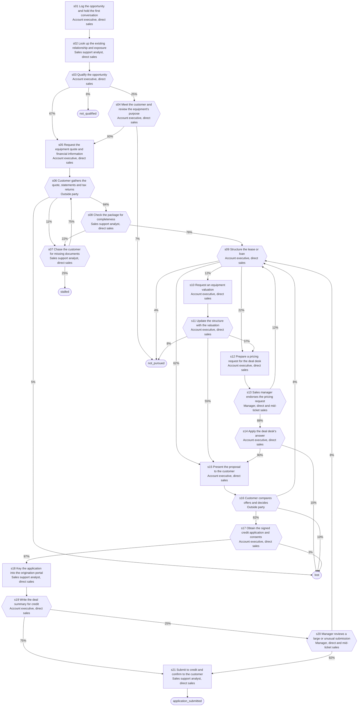

# Originate and structure direct deals

`efc-originate-direct-deals` · equipment leasing and finance · sales and origination · part of `equipment-finance-co`

Account executives sell leases and loans directly to established businesses, mostly larger mid-ticket deals. For each opportunity they learn what the customer wants to buy, check the existing relationship, collect a supplier quote and financial statements, structure the term, residual and payment pattern, get used equipment valued and non-standard rates priced, present a proposal and, if the customer accepts, submit a signed application with a deal summary to credit. Most elapsed time goes on waiting for customers' accountants, valuations and deal desk pricing, and customers compare offers from their banks while they wait; re-keying from the CRM into the origination portal and a thin sales support team add delay and errors.

| | |
|---|---|
| Unit of work | one direct opportunity |
| Starts when | A business customer asks to finance equipment, a supplier or existing customer refers a purchase, or an account executive's prospecting turns up one. |
| Done when | A signed credit application with its package and deal summary is submitted to credit, or the opportunity is closed as not qualified, not pursued, stalled or lost to another lender. |
| Organisation | A mid-size independent Canadian equipment lessor with 14 direct account executives, a small sales support team, a CRM for the pipeline and a separate origination portal for credit submissions. (340 employees, 2019-2022) |
| Volume | 750 cases a month (range 600 to 900) |

## Where it sits

- Starts with **financing_request** from customer (100% of cases)
- Relies on **pricing_approval** from price-non-standard-deals (a standing input; it does not start a case)
- Relies on **asset_valuation** from value-equipment-and-set-residuals (a standing input; it does not start a case)
- Sends **credit_application** to intake-credit-applications (outcome: application_submitted)
- Sends **pricing_request** to price-non-standard-deals (outcome: any)
- Sends **valuation_request** to value-equipment-and-set-residuals (outcome: any)

## Flow

## Roles

| Role | Department | Layer | FTE on this process | Loaded cost per hour | Evidence |
|---|---|---|---:|---:|---|
| Account executive, direct sales | Direct and mid-ticket sales | individual contributor | 10.3 | 72 CAD | B [src_noc_63102], [src_marlin_10k2019] |
| Sales support analyst, direct sales | Direct and mid-ticket sales | individual contributor | 3.5 | 36 CAD | C |
| Manager, direct and mid-ticket sales | Direct and mid-ticket sales | manager | 0.55 | 85 CAD | C |

## Steps

Hands-on time and the wait before each step show the most common value. Evidence tier A is a sourced number, B a sourced description, C the author's estimate.

| Step | Who | Kind | Hands-on | Wait before | Control | Evidence |
|---|---|---|---:|---:|---|---|
| **s01 Log the opportunity and hold the first conversation.** The account executive logs a new opportunity in the CRM, from a customer call, a supplier referral, a repeat customer or their own prospecting, and talks to the owner or finance manager about the equipment, its cost and supplier, timing, the business and its current lenders. | Account executive, direct sales | intake | 15 min | 4.0 h |  | B [src_noc_63102], [src_nbc_equipment] |
| **s02 Look up the existing relationship and exposure.** A sales support analyst searches the lease system and CRM for the customer and related companies: active contracts, payment history, total exposure, recent declines and open applications, and notes the result on the opportunity. | Sales support analyst, direct sales | lookup | 6 min | 4.0 h |  | C |
| **s03 Qualify the opportunity.** The account executive weighs the opportunity against the credit appetite and their pipeline: industry, time in business, equipment type and age, deal size and the existing exposure. They decide to pursue it with a meeting, handle it by phone, or turn it away early. | Account executive, direct sales | judgment | 6 min | 30 min | Credit policy target market: industries, equipment types, minimum time in business and maximum exposure the company finances | B [src_noc_63102], [src_torys_legal500] |
| **s04 Meet the customer and review the equipment's purpose.** For larger or new customers the account executive visits the site or holds a video meeting with the owner, sees the operation and the equipment's purpose, and discusses how the business earns money and how it wants to pay. | Account executive, direct sales | communication | 45 min | 2.0 d |  | B [src_nbc_equipment] |
| **s05 Request the equipment quote and financial information.** The account executive emails the customer a list of what is needed: the supplier's quote with model, year and serial details, the last two year-end financial statements and interims for larger deals, tax returns where statements are not reviewed, and personal net worth statements for guarantors of young businesses. | Account executive, direct sales | communication | 5 min | 30 min |  | A [src_crest_over250], [src_dlc_easylease] |
| **s06 Customer gathers the quote, statements and tax returns.** The customer asks the supplier for a formal quote and its accountant for statements and interims, and sends them by email. Interims and statements for related companies often take the longest. | Outside party | external wait | 0 min | 2.0 d |  | C [src_crest_over250] |
| **s07 Chase the customer for missing documents.** The sales support analyst emails and phones the customer or its accountant for the missing items, keeps the CRM task open and tells the account executive when an opportunity has stalled. | Sales support analyst, direct sales | communication | 5 min | 3.0 d |  | C |
| **s08 Check the package for completeness.** The sales support analyst checks that the quote matches the equipment discussed, that statements cover the right years and are signed or accountant-prepared, that interims are recent, and that guarantor details are there. Gaps go back to the customer. | Sales support analyst, direct sales | validation | 10 min | 8.0 h | Credit policy documentation requirements: two year-ends plus interims above the application-only limit, guarantor net worth statements for young businesses | B [src_crest_over250], [src_liberty_guidelines], [src_leaseservices_help] |
| **s09 Structure the lease or loan.** The account executive chooses lease or loan, term, residual or purchase option, down payment and any seasonal or skip payments that fit the customer's cash cycle and tax position, and runs payment options from the rate card in the pricing spreadsheet. They decide whether the deal needs a valuation or non-standard pricing. | Account executive, direct sales | analysis | 20 min | 8.0 h |  | B [src_crest_over250], [src_dlc_easylease], [src_torys_legal500] |
| **s10 Request an equipment valuation.** The account executive sends asset management a valuation request with the equipment description, year, hours or kilometres, serial numbers, photos and the proposed term and residual. | Account executive, direct sales | data entry | 12 min | 1.0 h | Credit policy: used, specialised or high-value equipment needs an asset management valuation before the residual and advance are set | C |
| **s11 Update the structure with the valuation.** When asset management returns its value, sometimes after a third-party desktop or on-site appraisal, the account executive resets the advance and residual and decides whether the deal still works at standard pricing. | Account executive, direct sales | analysis | 15 min | 3.0 d |  | A [src_amc_appraisals] |
| **s12 Prepare a pricing request for the deal desk.** The account executive writes up the requested rate, structure, competing offer, expected yield and the relationship's value, and attaches the payment model. | Account executive, direct sales | drafting | 15 min | 4.0 h |  | C |
| **s13 Sales manager endorses the pricing request.** The manager of direct sales checks that the concession is needed and worth it for the relationship, then forwards the request to the deal desk or sends it back to be restructured. | Manager, direct and mid-ticket sales | approval | 10 min | 8.0 h | Pricing authority matrix: the sales manager endorses any rate below the rate card floor before the deal desk prices it | C |
| **s14 Apply the deal desk's answer.** When the deal desk replies with an approved rate, fees and structure or a refusal, the account executive updates the payment options and decides whether the deal can still win. | Account executive, direct sales | analysis | 8 min | 1.0 d |  | C |
| **s15 Present the proposal to the customer.** The account executive sends or walks through a proposal letter with payment options, end-of-term choices, fees and conditions, noting that it is subject to credit approval. | Account executive, direct sales | communication | 12 min | 12.0 h |  | B [src_crest_over250] |
| **s16 Customer compares offers and decides.** The customer compares the proposal with its bank's or other lessors' terms, often asking for a sharper rate or a different payment pattern. | Outside party | external wait | 0 min | 2.0 d |  | B [src_cfla_cmo2020] |
| **s17 Obtain the signed credit application and consents.** The account executive sends the credit application by e-mail or e-signature and gets it back signed by the business and each guarantor, with consent to obtain credit reports and share information with credit and funders. | Account executive, direct sales | intake | 6 min | 12.0 h | PIPEDA principle 4.3 (consent): signed consent from the business and each guarantor before credit reports are obtained and information is shared with credit | B [src_opc_pipeda_p3], [src_noc_63102] |
| **s18 Key the application into the origination portal.** The sales support analyst re-keys the customer, owners, guarantors, equipment, supplier and structure from the CRM and spreadsheet into the origination portal and attaches the statements, quote, valuation and any pricing approval. | Sales support analyst, direct sales | data entry | 18 min | 4.0 h |  | B [src_noc_63102] |
| **s19 Write the deal summary for credit.** The account executive writes a cover note for the analyst: the business and its owners, the purpose of the equipment, why this structure, strengths and risks, and the relationship's history and potential. | Account executive, direct sales | drafting | 12 min | 4.0 h |  | B [src_noc_63102] |
| **s20 Manager reviews a large or unusual submission.** The direct sales manager reads the summary and structure for large deals and policy exceptions, asks for changes where the deal will struggle in credit and releases it. | Manager, direct and mid-ticket sales | review | 15 min | 8.0 h | Sales management review of submissions above $500,000 or with policy exceptions | C |
| **s21 Submit to credit and confirm to the customer.** The sales support analyst submits the application to the credit queue in the portal, closes the CRM stage and emails the customer that the application is with credit and when to expect an answer. | Sales support analyst, direct sales | data entry | 3 min | 30 min |  | B [src_marlin_10k2019] |

## Exceptions

| Exception | Share of cases | What happens |
|---|---:|---|
| Customer's statements do not arrive | 12% | The customer or its accountant is slow to send statements or interims; sales support chases and some opportunities stall and close. |
| Used or specialised equipment needs a valuation | 10% | Asset management values the equipment, sometimes through a third-party appraiser, before the residual and advance can be set. |
| Rate below the rate card to beat a bank | 22% | The account executive asks for a sharper rate; the sales manager endorses it and the deal desk prices it before the proposal goes out. |
| Customer asks for a different structure | 6% | After the proposal the customer wants seasonal payments, a different residual or a shorter term, so the deal is restructured. |

## Benchmarks

| Metric | Value | Unit | Population | Evidence |
|---|---|---|---|---|
| cycle_time_days | p50 14, p90 40 | calendar days from first conversation to application submitted or opportunity closed, all outcomes | Author estimate for direct equipment finance sales at a Canadian independent lessor | C [src_amc_appraisals], [src_crest_over250] |
| time_to_credit_answer_with_complete_package | 1 | business days | US lessor, deals over $250,000 | A [src_crest_over250] |
| financial_statement_threshold | 80000 | CAD deal size from which two years of statements plus interims are required | Canadian leasing broker network program | A [src_dlc_easylease] |
| third_party_appraisal_turnaround | desktop 7-15, on_site 15-25 | business days | Equipment appraisals for lenders | A [src_amc_appraisals] |
| opportunity_to_application_rate | 0.64 | share of opportunities submitted to credit | This organisation file (480 direct applications from 750 opportunities a month) | C |

## Pain points

- Waiting for customers' accountants to send year-end statements and interims is the longest delay and many opportunities stall there. (steps s06, s07, s08; B [src_crest_over250], [src_dlc_easylease])
- Valuations and deal desk pricing add days while the customer holds a bank offer. (steps s11, s13, s14, s16; B [src_amc_appraisals])
- The deal lives in the CRM and spreadsheets and is re-keyed into the origination portal, causing errors that credit intake catches. (steps s18; C)
- Account executives split their time between prospecting, structuring, paperwork and post-decision follow-up, so hands-on time per deal is squeezed. (steps s04, s09, s19; C)

## Assumptions

- The case starts at the first serious conversation about a purchase. Prospecting calls, events and supplier visits that do not produce an opportunity are outside this workflow, although they take a real share of account executives' time.
- About 60% of opportunities end in an application in the simulation (about 450 a month), close to the organisation file's 480 direct applications from 750 opportunities.
- About 22% of opportunities send a pricing request to the deal desk (about 165 a month of the deal desk's 350) and about 10% send a valuation request to asset management (about 75 a month of its 280). Pricing approvals and valuations return into open cases, so their trigger share is 0.
- Hands-on times are lean. The organisation file gives 14 account executives about 750 opportunities and 480 applications a month, about 34 applications each, which is high for mid-ticket work. With about 10.3 FTE here and 3.2 FTE in communicate-credit-decisions, account executives are close to fully used; a desk doing mostly mid-ticket deals would usually need more people or fewer, larger deals.
- Sales support analysts (about 3.5 of 4) chase documents and key applications; the manager spends a little over half of the role on endorsements and reviews.
- No anti-money-laundering identification is done here: non-bank lessors were not reporting entities in 2019-2022 (organisation file assumption). Identity and bureau checks happen in credit intake.
- Loaded costs are the organisation file's (2019-2022 wage times 1.35).
- External steps have zero touch time; customer and supplier time is in wait_before_min.

## Sources

- [src_noc_63102] [NOC 2021 profile 63102: Financial sales representatives](https://noc.esdc.gc.ca/Structure/NOCProfile?GocTemplateCulture=en-CA&code=63102&version=2021.0) (Employment and Social Development Canada (National Occupational Classification), 2021). Main duties include interviewing applicants for business loans, researching and evaluating the applicant's financial status, references, credit and ability to repay, submitting credit applications with recommendations, completing credit documentation and proposing solutions for objectives such as business expansion; example titles include credit officer and commercial banking accounts officer.
- [src_crest_over250] [Equipment leasing over $250,000](https://www.crestcapital.com/equipment-leasing-over-250) (Crest Capital, 2025). Above $250,000 a lessor asks for a company overview of up to two pages, a write-up of the equipment's purpose and financial justification, the last two year-end financial statements and current interims, two years of tax returns unless statements are audited or reviewed, statements on principals owning 20% or more and a list of current loans and leases; once the package is in place an answer typically comes within a business day; deferred payments, longer amortisations and seasonal schedules are available.
- [src_dlc_easylease] [EasyLease: equipment and vendor leasing](https://dominionlending.ca/easylease) (Dominion Lending Centres, 2025). Canadian leasing: businesses under two years old are limited to $70,000 and must provide a personal guarantee and personal net worth statement; transactions of $80,000 and up need two years of financial statements plus interims; applications turn around in 24 to 48 hours; customised payment schedules (seasonal leases) are offered.
- [src_amc_appraisals] [Equipment appraisals](https://www.amcbid.com/appraisals) (AMC (amcbid.com), 2025). Lender-specific equipment appraisals take 7 to 15 business days desktop and 15 to 25 business days on site, on fair market value, orderly liquidation value and forced liquidation value premises; rush service is available.
- [src_opc_pipeda_p3] [PIPEDA fair information principle 3: consent](https://www.priv.gc.ca/en/privacy-topics/privacy-laws-in-canada/the-personal-information-protection-and-electronic-documents-act-pipeda/p_principle/principles/p_consent/) (Office of the Privacy Commissioner of Canada, 2024). Meaningful consent is an essential element of PIPEDA; organisations generally need meaningful consent before collecting, using or disclosing personal information, and express consent when the information is sensitive.
- [src_nbc_equipment] [Equipment financing for businesses](https://www.nbc.ca/en/business/financing/equipment-finance.html) (National Bank of Canada, 2025). A Canadian lender's equipment finance process: the client selects the equipment and contacts a financing expert, and the lender structures the lease or loan to the client's needs and coordinates with a dealer to deliver the equipment; lease features include structured payments, purchase options and trade-ups across agriculture, construction, forestry, health care, manufacturing, mining and transportation.
- [src_marlin_10k2019] [Marlin Business Services Corp. Form 10-K for fiscal year 2019](https://www.sec.gov/Archives/edgar/data/1260968/000119312520072460/d875863d10k.htm) (Marlin Business Services Corp. via US SEC EDGAR, 2020). Each relationship has an assigned sales account executive handling pricing, credit, documentation, training and marketing matters; credit underwriting is performed and managed separately from origination.
- [src_cfla_cmo2020] [Asset-based finance in Canada: the 2019-2020 year (Canadian Market Overview)](https://cfla-acfl.ca/files/Industry-Intelligence/CMO-2020.pdf) (Canadian Finance and Leasing Association, 2020). Business customers choosing a leasing company value funding rates and affordability, reaching someone to solve an issue, customer service, turnaround time, information requirements, flexibility and consistency in credit decisions; trucks, trailers and computers are the equipment most likely to be acquired.
- [src_liberty_guidelines] [Equipment financing credit guidelines (dealers and vendors)](https://libertycapitalgroup.com/dealers-vendors-financing/credits-and-guidelines) (Liberty Capital Group, 2025). Larger deals may need tax returns, interim financials, personal financial statements or a debt schedule; weaker credit is offset with a down payment or extra collateral; application-only requests are often decided in 24 to 48 hours.
- [src_torys_legal500] [Asset/equipment finance and leasing (Canada)](https://www.legal500.com/intelligence/canada/finance-and-banking/asset-equipment-finance-and-leasing) (Torys LLP via Legal 500, 2007). About 60% of the Canadian leasing industry's customers are small and medium-sized businesses; the specified leasing property rules split the market into small-ticket leasing of exempt assets with full capital cost allowance for the lessor and other assets where the lessor's tax benefit is limited; lessees of non-exempt assets can elect under section 16.1 to treat rent as principal and interest.
- [src_leaseservices_help] [Applying for financing (help centre)](https://help.leaseservices.com/help-center/category/applying-for-financing) (LEAF Commercial Capital (leaseservices.com), 2025). Approval above pre-approved amounts may require recent bank statements or financial information; the sales representative is the customer's contact through the application.

Written by claude-opus on 2026-11-17.
