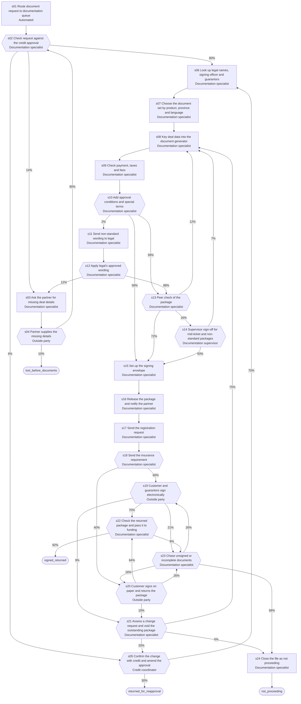

# Prepare lease and loan documents

`efc-prepare-lease-documents` · equipment leasing and finance · operations (documentation) · part of `equipment-finance-co`

After a customer accepts a credit approval, a documentation specialist turns it into a signed lease or loan package: agreement, schedule, guarantees, pre-authorised debit form and delivery and acceptance certificate. The specialist checks the request against the approval, chases dealers and brokers for missing serial numbers and signer details, keys the deal into a document generator, adds approval conditions, sends Quebec customers French or express-wish English documents and releases the package for electronic or paper signature. Most elapsed time is spent waiting for partners and customers; keying errors, changes after documents go out and unsigned packages from shopped deals cause most rework.

| | |
|---|---|
| Unit of work | one document package |
| Starts when | Sales marks an accepted credit approval as ready for documents in the origination portal, creating a document request. |
| Done when | The fully signed package is checked and placed in the funding queue, or the request is closed because the deal was lost, cancelled or sent back for a new credit decision. |
| Organisation | A privately owned Canadian independent equipment lessor with 340 staff funding about 1,400 small- and mid-ticket contracts a month through dealers, brokers and direct sales. (340 employees, 2019-2022) |
| Volume | 2,000 cases a month (range 1,650 to 2,400) |

## Where it sits

- Starts with **document_request** from communicate-credit-decisions (97% of cases)
- Starts with **approved_template** from maintain-contracts-and-legal-review (3% of cases)
- Sends **lease_document_package** to customer (outcome: any)
- Sends **registration_request** to search-and-register-security (outcome: any)
- Sends **legal_review_request** to maintain-contracts-and-legal-review (outcome: any)
- Sends **insurance_requirement** to track-equipment-insurance (outcome: any)

## Flow

## Roles

| Role | Department | Layer | FTE on this process | Loaded cost per hour | Evidence |
|---|---|---|---:|---:|---|
| Documentation specialist | Documentation team | individual contributor | 14 | 33 CAD | B [src_eq_credit_coord], [src_jobbank_14201] |
| Documentation supervisor | Documentation team | supervisor | 0.4 | 49 CAD | C |
| Credit coordinator | Credit support | individual contributor | 0.4 | 30 CAD | B [src_eq_credit_coord] |

## Steps

Hands-on time and the wait before each step show the most common value. Evidence tier A is a sourced number, B a sourced description, C the author's estimate.

| Step | Who | Kind | Hands-on | Wait before | Control | Evidence |
|---|---|---|---:|---:|---|---|
| **s01 Route document request to documentation queue.** When a vendor desk coordinator, broker desk coordinator or account executive marks an accepted approval as ready for documents, the origination portal creates a document request and places it in the documentation work queue by channel and region. No person touches it; the request carries the approval, conditions, equipment and vendor details keyed earlier. | Automated | system auto | 0 min | 0 min |  | C |
| **s02 Check request against the credit approval.** A documentation specialist takes the next request from the queue and opens the credit approval beside it. They compare customer, guarantors, equipment cost, term, payment, structure and end-of-term option with what was approved, check the approval has not expired and list the conditions that must appear in the documents. They decide whether the request is complete, needs details from the partner or differs from the approval. | Documentation specialist | validation | 4 min | 2.5 h | Credit policy: documents must match the approved structure and every approval condition | B [src_eq_credit_coord] |
| **s03 Ask the partner for missing deal details.** The specialist emails or phones the dealer, broker or account executive with a list of what is missing: full equipment description and serial numbers, the vendor quote or invoice, the signing officer's name and title, guarantor home addresses, the delivery address and, for Quebec customers, the language the customer wants. They note the request in the portal and set the file to pending. | Documentation specialist | communication | 5 min | 10 min |  | B [src_eq_credit_coord], [src_pawnee_docusign] |
| **s04 Partner supplies the missing details.** The dealer, broker or account executive collects the details from the customer or the vendor and replies by email or through the portal. Serial numbers often wait until the vendor has the unit in stock. Some deals go quiet because the customer chose another lender. | Outside party | external wait | 0 min | 16.0 h |  | C |
| **s05 Confirm the change with credit and amend the approval.** A credit coordinator compares the changed cost, term or structure with the approval and with the documentation tolerance in the credit policy. Small changes are recorded as an amended approval with the analyst's agreement by email; larger changes or a new guarantor go back to the analyst as a resubmission, which ends this request until a new approval arrives. | Credit coordinator | coordination | 8 min | 3.0 h | Delegated credit authority: changes beyond the documentation tolerance need sign-off by an analyst with authority for the new amount | B [src_eq_credit_coord] |
| **s06 Look up legal names, signing officer and guarantors.** The specialist opens the corporate registry profile and bureau reports in the credit file and copies the customer's exact legal name, jurisdiction and operating names, the officer who will sign and each guarantor's full legal name and address. Exact names matter because the same names go on the registration and a wrong debtor name can make it invalid. | Documentation specialist | lookup | 2 min | 5 min | Provincial PPSA rules on the debtor name in a financing statement (a seriously misleading name error invalidates the registration); the lookup itself is company practice | B [src_cassels_name], [src_eq_credit_coord] |
| **s07 Choose the document set by product, province and language.** The specialist picks the template set: lease or loan, master lease with schedule or single agreement, program forms for the vendor, a guarantee for each guarantor, the pre-authorised debit form and the delivery and acceptance certificate. For a customer in Quebec they use the French version, or the English version with the clause recording the parties' express wish to contract in English. Interim rent or deposit clauses are added when the approval needs them. | Documentation specialist | judgment | 2 min | 0 min | Charter of the French Language, section 55: Quebec contracts of adhesion in French unless the parties expressly wish another language (rule in force 2019-2022) | B [src_gowling_bill96], [src_elfa_acceptance] |
| **s08 Key deal data into the document generator.** The specialist fills the document generator in the origination portal: customer and guarantor details, each equipment line with make, model and serial number from the vendor quote, cost, payment, term, fees, tax status and end-of-term option. Items the portal did not carry from the application, such as serial numbers and guarantor addresses, are typed by hand from the quote and emails. | Documentation specialist | data entry | 8 min | 0 min |  | B [src_pawnee_docusign] |
| **s09 Check payment, taxes and fees.** The specialist checks that the payment produced by the generator equals the approved payment for the cost, term and rate, that the right sales tax applies to the lease payments for the customer's province (GST or HST, plus QST in Quebec or PST in British Columbia, Saskatchewan or Manitoba) and that documentation fees and first and last payments match the program. | Documentation specialist | analysis | 2 min | 0 min | Excise Tax Act (GST/HST) and provincial sales tax acts: tax is charged on each lease payment at the rate for the province where the equipment is located | C |
| **s10 Add approval conditions and special terms.** The specialist adds the clauses and documents that the approval conditions require: a security deposit, additional collateral, a corporate or personal guarantee, a vendor recourse or repurchase agreement, or a waiver drafted from registry search results. When a customer or partner asks for wording outside the templates, the specialist routes it to legal. | Documentation specialist | drafting | 2 min | 0 min |  | B [src_eq_credit_coord] |
| **s11 Send non-standard wording to legal.** The specialist writes a short legal review request with the deal size, the clause the customer or partner wants changed and the template wording, attaches the draft and sends it to legal counsel's queue. | Documentation specialist | communication | 15 min | 30 min |  | C |
| **s12 Apply legal's approved wording.** When legal replies, the specialist inserts the approved clause or the legal-approved template into the package and regenerates the documents. If legal refuses the change, the specialist tells the partner that the standard wording applies. | Documentation specialist | drafting | 10 min | 2.0 d | Contract policy: only legal may approve departures from the approved lease and guarantee templates | C |
| **s13 Peer check of the package.** A second documentation specialist reads the package against the approval: names, addresses, equipment and serial numbers, cost, payment, taxes, term, conditions and signature blocks. They return it with a list of errors or pass it, and send mid-ticket and non-standard packages to the supervisor. | Documentation specialist | review | 5 min | 1.5 h | Documentation procedures: maker-checker review for higher-risk packages | C |
| **s14 Supervisor sign-off for mid-ticket and non-standard packages.** The documentation supervisor reviews mid-ticket packages above $250,000 and any package with legal-approved wording, checks the conditions and the guarantees once more and signs off in the portal before release. | Documentation supervisor | approval | 10 min | 3.0 h | Documentation procedures: supervisor approval of large and non-standard packages | C |
| **s15 Set up the signing envelope.** The specialist decides how the package will be signed. For electronic signature they build an envelope with the signing order (customer officer, then each guarantor), required signature and initial fields and the pre-authorised debit form with its mandatory wording; for wet signature they produce a PDF and cover letter or a courier package. | Documentation specialist | coordination | 3 min | 0 min | Payments Canada Rule H1: the pre-authorised debit agreement must contain the mandatory Appendix II elements and be authorised by the payor | B [src_payments_pad], [src_elfa_esign] |
| **s16 Release the package and notify the partner.** The specialist sends the e-signature envelope or emails the PDF package to the customer, copies the dealer or broker, and sets the portal status to documents out so the partner can see it. | Documentation specialist | communication | 1 min | 0 min |  | B [src_newcap_toronto] |
| **s17 Send the registration request.** The specialist fills the registration request for the funding team's registration clerks: debtor and guarantor names, province, collateral description and serial numbers, and whether a Quebec publication is needed. It is copied from the package, so a keying error in the package is carried into the registration. | Documentation specialist | data entry | 2 min | 0 min |  | C |
| **s18 Send the insurance requirement.** The specialist records the required property coverage, the equipment value and the loss payee wording in the insurance tracker and attaches the insurance request letter the customer passes to their insurance broker. | Documentation specialist | data entry | 2 min | 0 min |  | B [src_pawnee_docusign], [src_elfa_esign] |
| **s19 Customer and guarantors sign electronically.** The customer's signing officer and each guarantor open the e-signature email, review the documents and sign. Many sign the same day; others wait for the equipment, for a partner to explain the terms or for a guarantor who is travelling. Some ask for a change instead of signing. | Outside party | external wait | 0 min | 12.0 h |  | B [src_directcap_eoriginal], [src_elfa_esign] |
| **s20 Customer signs on paper and returns the package.** The customer prints, signs and initials the documents, has guarantors sign, attaches a void cheque for the debit form and returns scans by email, by the dealer or by courier. Pages are often missed or initialled in the wrong place. | Outside party | external wait | 0 min | 2.0 d |  | B [src_corcentric_eoriginal], [src_directcap_eoriginal], [src_pawnee_docusign] |
| **s21 Assess a change request and void the outstanding package.** When the partner or customer asks for a change after documents are out, such as a different unit, a higher price after vendor add-ons, another term or a new signer, the specialist voids the open envelope or marks the paper set void and decides whether the change is within documentation tolerance, needs credit or ends the deal. | Documentation specialist | judgment | 5 min | 30 min |  | C |
| **s22 Check the returned package and pass it to funding.** The specialist opens the completed envelope or the scanned pages and checks that every signature, initial, date and guarantor page is present and that the debit form has banking details. Complete packages are indexed into the imaging system and moved to the funding queue, with paper originals sent to the file room and e-signed originals kept in the e-signature vault; missing pages go back to the customer. | Documentation specialist | validation | 3 min | 2.0 h | Documentation procedures and funder eligibility criteria: a complete, fully signed contract file before funding | B [src_elfa_acceptance], [src_goodmans_ecp], [src_elfa_esign] |
| **s23 Chase unsigned or incomplete documents.** Each morning the specialist works the aging report of packages out for signature. For packages out more than two or three business days, or returned incomplete, they email or call the dealer, broker or customer and resend the envelope or the missing pages. | Documentation specialist | communication | 4 min | 2.0 d |  | C |
| **s24 Close the file as not proceeding.** The specialist voids any open envelope, marks the request lost in the portal with a reason, cancels the registration request and insurance requirement and tells the sales contact. Files are often closed only when the approval expires or the partner confirms the loss. | Documentation specialist | data entry | 3 min | 3.0 d |  | C |

## Exceptions

| Exception | Share of cases | What happens |
|---|---:|---|
| Missing deal details | 14% | Serial numbers, signer details or guarantor addresses are missing, so the specialist asks the partner and waits, often until the vendor has the unit in stock. |
| Structure differs from the approval | 7% | The equipment cost, term or structure in the request or a later change is outside documentation tolerance; a credit coordinator gets it amended or sends it back for a new decision. |
| Non-standard wording | 2% | The customer or partner wants clauses outside the templates; legal reviews them over several days and may refuse. |
| Change after documents are out | 7% | A different unit, price, term or signer after release voids the package and sends it back to keying or credit. |
| Unsigned package from a shopped deal | 17% | The customer does not sign because a dealer or broker placed the deal elsewhere; the specialist chases and finally closes the file. |
| Incomplete paper package | 3% | Paper documents come back with missing initials, guarantee pages or void cheque and are chased. |

## Benchmarks

| Metric | Value | Unit | Population | Evidence |
|---|---|---|---|---|
| cycle_time_days | p50 3, p90 14 | calendar days from document request to signed package in the funding queue or file closure, all outcomes | Canadian small- and mid-ticket equipment lessor, 2019-2022 (composite estimate) | B [src_newcap_toronto], [src_mhc_fullservice], [src_directcap_eoriginal], [src_corcentric_eoriginal], [src_pawnee_docusign] |
| e_signature_share_of_transactions | 0.55 | share of transactions completed electronically | One US small-ticket broker-channel lessor after adopting e-signature (undated case study) | A [src_pawnee_docusign] |
| paper_document_transfer_days | 5 | days to move documents on paper before e-signature | One US small-ticket equipment lender (undated case study) | A [src_directcap_eoriginal] |
| paper_signing_days_large_fleet | low 7, high 10 | days to sign and return a paper package | Large fleet lease transactions with about 30 documents each (undated case study) | A [src_corcentric_eoriginal] |

## Pain points

- Deal details such as serial numbers, signer names and guarantor addresses are missing from many requests, so specialists chase partners and work waits. (steps s02, s03, s04; B [src_pawnee_docusign], [src_eq_credit_coord])
- Serial numbers and guarantor details are re-keyed from quotes and emails into the document generator and again into the registration request, and keying errors surface at the funding audit. (steps s08, s17; C)
- Dealers and brokers shop deals to several lessors, so many packages are drawn, chased and closed without ever being signed. (steps s19, s23, s24; C)
- Paper packages take days to return and often come back with missing initials or pages; e-signature removed much of this delay from 2020. (steps s20, s22; B [src_directcap_eoriginal], [src_corcentric_eoriginal], [src_elfa_esign])
- Changes to equipment or price after documents are out void the package and repeat keying, checks and signing. (steps s21, s08; C)

## Assumptions

- The organisation file's 2,000 document packages a month are read as document requests. In the simulation about 74% end signed and passed to funding (about 1,490, against about 1,400 fundings after funding-audit fallout), about 21% are closed unsigned and about 5% end before documents are drawn or go back to credit; re-issued packages for the same deal are modelled as rework loops, so about 2,200 package versions are generated a month.
- The case ends when the signed package reaches the funding queue. The organisation file models the signed documents as flowing from the customer to audit-and-fund-contracts, so that hand-off is not listed under produces; the delivery and acceptance certificate and verbal verification belong to the funding audit.
- Peer checks cover about 40% of packages (new staff, above $100,000, Quebec and re-issues) and the supervisor signs off mid-ticket and non-standard packages; standard small-ticket packages rely on self-check and the funding audit. This mirrors common small-ticket practice, where the funding audit is the main check.
- E-signature share is set at 60% for the whole 2019-2022 period (lower before 2020, higher after). Quebec packages are about 18% of volume. Both are author estimates.
- External steps have zero touch time so the staffing check counts only company staff; the elapsed time of customers and partners is in wait_before_min.
- Legal review is a separate process; its turnaround appears as the wait before step s12.
- Loaded costs are the organisation file's (2019-2022 wage times 1.35).
- The pre-June 2023 Quebec language rule (express wish clause) is used because the reference period is 2019-2022.

## Sources

- [src_eq_credit_coord] [Credit Coordinator, Bennington Financial Corp (job posting)](https://jobs.lever.co/eqbank/c1b4e9a7-8406-44f8-b482-eaf231c17a11) (EQ Bank / EQB Inc. on Lever, 2025). Canadian equipment lessor credit coordinator creates lease documents on broker request, reviews the credit approval to confirm all needed documents are generated, pulls and analyses searches, creates waivers from search results, communicates with brokers so documents are accurate and timely, and prepares preliminary credit packages for the funding review; salary $42,000 to $46,000.
- [src_elfa_acceptance] [Equipment acceptance is important](https://www.elfaonline.org/communications/january-february-2020/equipment-acceptance-is-important) (Equipment Leasing and Finance Association (Equipment Leasing Today), 2020). Lease forms require the lessee to sign and return a delivery and acceptance certificate after delivery; lessors generally do not fund until the signed certificate is received; a telephone verification call or follow-up signed certificate is prudent; some small-ticket lessors put the acceptance on the face of the lease.
- [src_elfa_esign] [5 takeaways from eSigning and eLeasing: what do you want to know?](https://www.elfaonline.org/newsroom/2021/04/21/5-takeaways-from-esigning-and-eleasing-17f51d5d) (Equipment Leasing and Finance Association, 2021). The pandemic pushed equipment lessors from wet-ink paper documents to e-signatures; e-signing tools will not let signing proceed until required signature and initial fields are complete; signings can finish in minutes instead of hours; savings on overnight delivery offset e-signature costs; e-signed leases are stored in an e-vault as electronic chattel paper.
- [src_pawnee_docusign] [Pawnee Leasing Corporation achieves 50% faster access to capital with DocuSign eSignature (case study)](https://www.casestudies.com/company/docusign/case-study/pawnee-leasing-customers-access-capital-50-faster-with-docusign-esignature) (DocuSign via casestudies.com, undated). A US small-ticket lessor working through brokers: broker-submitted agreements often arrived with missing signatures or wrong amounts, causing back-and-forth and funding delays that stretched from days into weeks; e-signature moved 55% of transactions to electronic completion and cut average time to fund by about 50%.
- [src_directcap_eoriginal] [Direct Capital develops a seamless digital solution with eOriginal (case study)](https://www.casestudies.com/company/eoriginal/case-study/direct-capital-develops-a-seamless-digital-solution-with-eoriginal) (eOriginal via casestudies.com, undated). A small-ticket equipment lender's document transfer time fell from 5 days on paper to 10 minutes after moving to e-signing and e-vaulting.
- [src_corcentric_eoriginal] [Corcentric achieves faster, more cost-effective digital equipment leasing with eOriginal (case study)](https://www.casestudies.com/company/eoriginal/case-study/how-corcentric-delivered-a-streamlined-more-cost-effective-customer-experience-by-digitizing-equipment-leasing) (eOriginal via casestudies.com, undated). Large fleet lease transactions with often 30 documents per deal took a typical 7 to 10 days to sign and return on paper, three days or less after digitisation.
- [src_gowling_bill96] [Bill 96's French First rule takes effect](https://gowlingwlg.com/en-ca/insights-resources/articles/2023/bill-96-s-french-first-rule-takes-effect) (Gowling WLG, 2023). Before 1 June 2023 a Quebec contract of adhesion could be drawn up in a language other than French at the express wish of the parties, and a language selection clause was generally enough; from 1 June 2023 a French version must first be given to the adhering party.
- [src_payments_pad] [Pre-authorized debit (business guide)](https://www.payments.ca/resources/payment-guides/business-guides/pre-authorized-debit) (Payments Canada, 2024). Rule H1: every PAD agreement must contain the mandatory elements in Appendix II (account, PAD category, amount, timing, cancellation, contact details and a recourse statement); it can be completed on paper with the payor's signature or electronically; changes are kept with the original agreement.
- [src_goodmans_ecp] [Ontario PPSA amended to incorporate rules relating to electronic chattel paper](https://www.goodmans.ca/insights/article/Ontario_PPSA_Amended_to_Incorporate_Rules_Relating_to_Electronic_Chattel_Paper) (Goodmans LLP, 2020). Amendments in force 15 May 2020 let secured parties perfect an interest in electronic chattel paper by control; chattel paper is commonly used in vehicle and equipment sales and leases; a purchaser taking possession or control in the ordinary course for new value can have priority.
- [src_cassels_name] [Lessons learned, lesson one supplement: get the name right on the financing statement](https://cassels.com/insights/lessons-learned-lesson-one-supplement-get-the-name-right-on-the-financing-statement/) (Cassels Brock & Blackwell LLP, 2017). A seriously misleading error in the debtor's name makes a PPSA registration invalid in Manitoba and most provinces even when the serial number is right; the lender would have known the correct name from the prescribed documentation.
- [src_jobbank_14201] [Wages: Financial clerk, financial sector in Ontario (NOC 14201)](https://www.jobbank.gc.ca/marketreport/wages-occupation/1674/ON) (Job Bank, Government of Canada, 2025). Ontario hourly wages low $18.00, median $25.48, high $35.90; Toronto region median $25.00 (2023-2024 Labour Force Survey, updated November 2025).
- [src_mhc_fullservice] [Dedication to Canadian companies with full-service financing](https://www.mhccna.com/en-ca/business-insights/articles/dedication-canadian-companies-full-service-financing) (Mitsubishi HC Capital Canada, undated). A Canadian equipment lessor with a dedicated documentation team states it can make same-day credit decisions and fund in as little as 24 to 28 hours.
- [src_newcap_toronto] [Toronto equipment financing](https://newcapleasing.com/toronto-equipment-financing/) (NewCap Leasing, undated). A Canadian lessor says customers sign lease documents electronically once terms are chosen and that funding and equipment release typically happen within 48 hours of signed documents for standard leases.

Written by claude-opus on 2026-11-17.
