# Process returned debits and cheques

`efc-process-returned-payments` · equipment leasing and finance · operations (billing and payment processing) · part of `equipment-finance-co`

About 85% of customers pay their lease by pre-authorised debit, and each month around 1,300 debits and cheques come back unpaid, mostly for insufficient funds and the rest for closed accounts, stopped payments or claims. A cash application clerk downloads the bank's returns report each morning, matches each item to its contract, reverses the payment in the lease system, adds the returned payment fee and places the account in the early collections queue, while a billing specialist checks the few returns that point to a company error. The work is short per item but must be done the same day so collectors can re-present the debit within the 30 days Payments Canada allows, and it goes wrong when returns cannot be matched, debit holds are missed or a customer is chased for a debit the company should not have sent.

| | |
|---|---|
| Unit of work | one returned payment |
| Starts when | The clearing bank reports a pre-authorised debit returned by the customer's bank, or a cheque returned unpaid after apply-customer-payments posted it. |
| Done when | The payment is reversed, the fee is billed and the account sits in the early collections queue with its return reason, or a company debit error is corrected with no fee and no collection action. |
| Organisation | A mid-size Canadian independent equipment lessor with about 55,000 active contracts, a lease management system with daily batch billing and reversal, a bank cash management portal and a separate collections queue. (340 employees, 2019-2022) |
| Volume | 1,300 cases a month (range 900 to 2,400) |

## Where it sits

- Starts with **payment_return** from clearing_bank (93% of cases)
- Starts with **payment_return** from apply-customer-payments (7% of cases)
- Sends **delinquent_account** to collect-early-stage (outcome: placed_in_collections)
- Sends **billing_adjustment** to bill-customers (outcome: placed_in_collections)
- Sends **billing_adjustment** to bill-customers (outcome: corrected_company_error)

## Flow

```mermaid
flowchart TD
    s01["s01 Bank returns the dishonoured payment<br/>Outside party"]
    s02["s02 Download the day's returns from the bank portal<br/>Cash application and payment processing clerk"]
    s03{{"s03 Match the return to its contract and debit<br/>Cash application and payment processing clerk"}}
    s04["s04 Research a return that does not match<br/>Cash application and payment processing clerk"]
    s05["s05 Pull the returned cheque and chargeback advice<br/>Cash application and payment processing clerk"]
    s06["s06 Key the reversal with its return reason<br/>Cash application and payment processing clerk"]
    s07["s07 Run the overnight reversal update<br/>Automated"]
    s08{{"s08 Reconcile the day's returns to the bank and the ledger<br/>Cash application and payment processing clerk"}}
    s09{{"s09 Clear reversal exceptions and differences<br/>Cash application and payment processing clerk"}}
    s10["s10 Sign off the daily returns reconciliation<br/>Manager, billing and payments"]
    s11{{"s11 Classify the return reason and choose the follow-up<br/>Cash application and payment processing clerk"}}
    s12["s12 Hold the debit and ask for new banking details<br/>Cash application and payment processing clerk"]
    s13{{"s13 Look into a stopped payment<br/>Cash application and payment processing clerk"}}
    s14{{"s14 Investigate a claim or a possible debit error<br/>Billing specialist"}}
    s15["s15 Add the returned payment fee<br/>Cash application and payment processing clerk"]
    s16{{"s16 Check the return history for repeat returns<br/>Cash application and payment processing clerk"}}
    s17{{"s17 Decide whether to take a repeat returner off debit<br/>Early-stage collector"}}
    s18["s18 Switch the contract to invoice payment and send the letter<br/>Cash application and payment processing clerk"]
    s19["s19 Place the account in the early collections queue<br/>Cash application and payment processing clerk"]
    s20{{"s20 Approve the fee waiver and billing correction<br/>Manager, billing and payments"}}
    s21["s21 Correct the billing and confirm with the customer<br/>Billing specialist"]
    s01 --> s02
    s02 --> s03
    s03 -->|"88%"| s06
    s03 -->|"5%"| s04
    s03 -->|"7%"| s05
    s04 --> s06
    s05 --> s06
    s06 --> s07
    s07 --> s08
    s08 -->|"95%"| s10
    s08 -->|"5%"| s09
    s09 -->|"90%"| s10
    s09 -->|"10%"| s08
    s10 --> s11
    s11 -->|"66%"| s15
    s11 -->|"14%"| s12
    s11 -->|"12%"| s13
    s11 -->|"8%"| s14
    s12 --> s15
    s13 -->|"85%"| s15
    s13 -->|"15%"| s14
    s14 -->|"45%"| s20
    s14 -->|"55%"| s15
    s15 --> s16
    s16 -->|"12%"| s17
    s16 -->|"88%"| s19
    s17 -->|"50%"| s18
    s17 -->|"50%"| s19
    s18 --> s19
    s19 --> end0
    s20 -->|"95%"| s21
    s20 -->|"5%"| s14
    s21 --> end1
    end0(["placed_in_collections"])
    end1(["corrected_company_error"])
```

## Roles

| Role | Department | Layer | FTE on this process | Loaded cost per hour | Evidence |
|---|---|---|---:|---:|---|
| Cash application and payment processing clerk | Billing and payment processing | individual contributor | 1 | 30 CAD | B [src_jb_14200], [src_psaft] |
| Billing specialist | Billing and payment processing | individual contributor | 0.3 | 32 CAD | C |
| Manager, billing and payments | Billing and payment processing | manager | 0.05 | 70 CAD | C |
| Early-stage collector | Early-stage collections | individual contributor | 0.1 | 30 CAD | C |

## Steps

Hands-on time and the wait before each step show the most common value. Evidence tier A is a sourced number, B a sourced description, C the author's estimate.

| Step | Who | Kind | Hands-on | Wait before | Control | Evidence |
|---|---|---|---:|---:|---|---|
| **s01 Bank returns the dishonoured payment.** The customer's bank refuses the lease debit (insufficient funds, payment stopped, account closed or frozen, or a reimbursement claim) and sends it back through the clearing system to the company's clearing bank, which debits the company's account. A cheque returned unpaid comes back the same way as a chargeback with an image. Under Payments Canada rules the item must be returned by the business day after the payor's bank receives it. | Outside party | external wait | 0 min | 1.0 d |  | A [src_h1], [src_pc_pad_guide], [src_psaft] |
| **s02 Download the day's returns from the bank portal.** Each morning a cash application clerk logs into the bank's cash management portal, downloads the returned items report and return file for the previous day's debits and cheques, prints or saves it to the shared folder, and notes the item count and total so the day's reversals can be balanced later. | Cash application and payment processing clerk | intake | 0.4 min | 2.0 h |  | B [src_psaft] |
| **s03 Match the return to its contract and debit.** For each item the clerk reads the cross-reference number and return code, opens the contract in the lease system and checks that the amount, due date and bank account match a debit in the file billing sent. Items with no usable reference, a consolidated debit covering several contracts or a paper cheque chargeback are set aside for research. | Cash application and payment processing clerk | lookup | 0.8 min | 15 min |  | B [src_psaft], [src_oracle_nsf] |
| **s04 Research a return that does not match.** The clerk looks for the contract behind an unclear return: searches the customer's other contracts, checks whether the contract number changed after a restructure, assumption or rebooking, and splits a consolidated debit across the contracts it paid. When the debit belongs to a contract already paid out, the clerk notes it as a possible debit error for billing to review. | Cash application and payment processing clerk | lookup | 8 min | 30 min |  | C |
| **s05 Pull the returned cheque and chargeback advice.** For a cheque that apply-customer-payments posted and the bank later returned unpaid, the clerk retrieves the cheque image and the bank's chargeback advice, notes the return reason and the payment it reversed, and checks whether the bank will redeposit it or a replacement payment must be requested. | Cash application and payment processing clerk | lookup | 5 min | 30 min |  | C |
| **s06 Key the reversal with its return reason.** The clerk adds the item to the day's payment reversal batch in the lease system with the contract, the original payment reference, the amount and the reason code (non-sufficient funds, stop payment, account closed, claim, other), so the payment comes off the invoice it paid and the invoice shows as unpaid again. | Cash application and payment processing clerk | data entry | 0.8 min | 20 min |  | B [src_leasepak_u0470], [src_oracle_nsf] |
| **s07 Run the overnight reversal update.** After the end-of-day cut-off the lease system processes the reversal batch: it reverses each payment, reapplies any later payments to the oldest open invoice, updates the contract's days past due and the collections data sent to treasury and funders, posts the reversal to the cash and receivable accounts, and prints an exception report and an audit report. | Automated | system auto | 0 min | 8.0 h |  | B [src_leasepak_u0470] |
| **s08 Reconcile the day's returns to the bank and the ledger.** Next morning the clerk compares the count and total of returned items debited to the company's bank account with the reversal audit report and the general ledger cash entry, and works the exception report. Differences (a missed item, a reversal suspense line, a wrong amount) are listed for correction. | Cash application and payment processing clerk | validation | 0.4 min | 1.5 h | Internal control over financial reporting: daily reconciliation of bank activity to the lease sub-ledger and the general ledger; accurate collections data for securitisation servicer reports | B [src_leasepak_u0470], [src_psaft] |
| **s09 Clear reversal exceptions and differences.** The clerk fixes what the overnight run could not do: reverses by hand a payment that was part of a multi-contract batch, clears a reversal suspense item, corrects a wrong amount or reason code, and adds any missed item to tonight's batch. | Cash application and payment processing clerk | data entry | 10 min | 30 min |  | B [src_leasepak_u0470] |
| **s10 Sign off the daily returns reconciliation.** The billing manager reviews the reconciliation sheet, the count and value of returns against recent days and any open differences, initials it, and asks for explanations of large or unusual returns, such as a whole dealer's customers returning on one day. | Manager, billing and payments | review | 0.1 min | 30 min | Internal control over financial reporting: reconciliations reviewed and approved by someone other than the preparer | C |
| **s11 Classify the return reason and choose the follow-up.** The clerk sorts each return by its code and the account notes: insufficient funds or funds not cleared go straight to the fee and collections steps; account closed, invalid account, no debit allowed or frozen need new banking details; payment stopped or customer-initiated returns need a look for a reason; reimbursement claims and returns that suggest the company debited wrongly go to billing. | Cash application and payment processing clerk | judgment | 0.5 min | 10 min |  | B [src_psaft], [src_h1] |
| **s12 Hold the debit and ask for new banking details.** For a closed, invalid or frozen account the clerk sets a debit hold on the contract so tomorrow's billing run does not send another debit that will fail, records the reason, and e-mails or mails the customer a new pre-authorised debit form asking for a void cheque for the new account. New details that arrive later are entered by billing or customer service. | Cash application and payment processing clerk | communication | 3 min | 20 min | Payments Canada Rule H1: debits may be drawn only on the account the payor authorised; a new account needs a new PAD agreement | B [src_h1], [src_psaft] |
| **s13 Look into a stopped payment.** The clerk reads the contract notes and recent contacts to see why the customer stopped the debit: a dispute over the equipment, a recent payout or buyout, a sale of the business, a switch of bank or a sign of closing. A stop placed after a payout or an agreed change is passed to billing as a possible debit error; the rest are flagged as priority for collections. | Cash application and payment processing clerk | analysis | 3 min | 20 min |  | C |
| **s14 Investigate a claim or a possible debit error.** A billing specialist opens the signed PAD agreement in imaging, the billing history and any payout, deferral, restructure or banking change, and checks whether the debit followed the agreement: right amount, right date, pre-notification of a changed amount, and no debit after a payout or an agreed deferral. They decide whether the company debited in error or the customer simply refused a valid debit. | Billing specialist | analysis | 15 min | 8.0 h | Payments Canada Rule H1 sections 23 and 24: reimbursement claims for business PADs within 10 business days of the debit; pre-notification rules for changed amounts | B [src_h1], [src_pc_pad_guide] |
| **s15 Add the returned payment fee.** The clerk keys the returned payment fee set out in the lease (commonly $25 to $50) as a miscellaneous charge on the contract so it bills on the next invoice, as a billing adjustment that billing checks in its daily run. The fee cannot be added to a re-presented debit, which must be for the same amount as the original. | Cash application and payment processing clerk | data entry | 0.4 min | 5 min | Payments Canada Rule H1 s.22(c) and Payee Letter of Undertaking s.20: a re-presented PAD must be for the original amount without NSF charges, so fees are billed separately; fee amount per the lease agreement | B [src_h1], [src_oracle_nsf], [src_nbc_payments] |
| **s16 Check the return history for repeat returns.** The clerk looks at the contract's payment history for earlier returned debits in the last twelve months. A customer with two or more earlier returns is referred to collections to decide whether to keep debiting. | Cash application and payment processing clerk | lookup | 0.4 min | 5 min |  | C |
| **s17 Decide whether to take a repeat returner off debit.** An early-stage collector reviews the account and decides whether to keep the automatic debit, take the customer off debit and ask for payment by EFT or certified cheque until the account is current, or ask for a new debit date that matches the customer's cash flow. | Early-stage collector | judgment | 5 min | 4.0 h | Collections policy on repeated returned debits | C |
| **s18 Switch the contract to invoice payment and send the letter.** The clerk changes the payment method on the contract from debit to invoice, sets the hold so billing's debit file skips it, and sends the customer a letter with the amount due, the returned payment fee and how to pay by EFT, bill payment or certified cheque. | Cash application and payment processing clerk | communication | 5 min | 1.0 h |  | C |
| **s19 Place the account in the early collections queue.** The clerk codes the returned payment in the collections system with the return code, the fee, flags for a stopped payment, a closed account or a repeat return, and a short note, so the account appears in an early-stage collector's queue with the right priority. Customers who have already called to arrange payment are noted so the collector does not chase them twice. | Cash application and payment processing clerk | data entry | 1 min | 10 min |  | B [src_natfunding_posting], [src_leaseservices_faq] |
| **s20 Approve the fee waiver and billing correction.** The billing manager reviews the specialist's finding and approves the correction: no returned payment fee, reversal of any late charge, and a fix to the debit schedule or the payout record; corrections above the specialist's limit and any refund need this approval. | Manager, billing and payments | approval | 5 min | 4.0 h | Delegated authority for fee waivers, credits and refunds | C |
| **s21 Correct the billing and confirm with the customer.** The billing specialist keys the correction in the lease system, sends the billing adjustment for the next invoice, removes any collection flag, fixes the debit schedule or marks the contract closed, and e-mails or calls the customer to confirm what will be debited next and that no fee applies. | Billing specialist | communication | 12 min | 4.0 h |  | C |

## Exceptions

| Exception | Share of cases | What happens |
|---|---:|---|
| Return that cannot be matched | 5% | No usable reference, a consolidated debit for several contracts or a contract renumbered after a restructure; the clerk researches before reversing. |
| Returned cheque | 7% | A cheque posted by cash application is returned unpaid as a chargeback and has to be linked back to the payment it reversed. |
| Reversal exception or reconciliation difference | 5% | The overnight run skips a multi-contract batch or creates a suspense item, or the returns do not balance to the bank. |
| Closed or invalid account | 14% | The debit hold is set and the customer is asked for a new PAD form before the next debit date. |
| Company debit error | 4% | A debit sent after a payout or an agreed deferral, a wrong amount without pre-notification, or a duplicate; no fee and no collection action. |
| Repeat returner | 12% | A collector decides whether to take the customer off debit; half are switched to invoice payment. |

## Benchmarks

| Metric | Value | Unit | Population | Evidence |
|---|---|---|---|---|
| cycle_time_days | p50 2.5, p90 5 | calendar days from the debit due date to the account in the collections queue or the error corrected | Canadian PAD originators; lessor practice of same-day processing of the returns report | B [src_pc_pad_guide], [src_psaft] |
| nsf_representment_limit | times 1, within_days 30 | re-presentments of an NSF or funds-not-cleared debit | All PAD payees in Canada | A [src_h1], [src_pc_pad_guide] |
| business_pad_claim_window | 10 | business days after the debit | Business PADs in Canada | A [src_h1] |
| return_reporting_lag | low 1, high 2 | days after the debit due date | AFT originators using a credit union central's file service | A [src_psaft] |
| late_payment_interest | rate_per_month 0.02, minimum_cad 10 | past due interest charged by one Canadian bank-owned equipment lessor | National Bank equipment financing customers | A [src_nbc_payments] |
| returned_debit_rate | 0.025 | share of monthly debits returned | This organisation in a normal month | C |

## Pain points

- The 30-day window for the single re-presentment starts on the original debit date, so every day a return waits for reversal and queue placement shortens the time collectors have to reach the customer and re-debit. (steps s02, s07, s19; B [src_h1], [src_pc_pad_guide])
- Returns with no usable reference, consolidated debits and renumbered contracts need research, and batch reversal skips multi-contract batches, leaving manual reversals and suspense items. (steps s04, s09; B [src_leasepak_u0470])
- When a debit hold or payment method change is missed, the next billing run sends another debit to a closed account, creating a second return and a second fee the customer disputes. (steps s12, s18; C)
- Debits sent after a payout, an agreed deferral or a changed amount without notice produce claims, fee waivers and complaints, and the account is sometimes chased before billing has found the company's error. (steps s11, s14, s20; B [src_h1])
- Returns peak on the first business days of the month and rose sharply in 2020, while the same clerks also run cash application, so returns compete with unapplied cash for the morning. (steps s02, s03, s06; C)

## Assumptions

- Volume and the 85% debit share come from the organisation file. The split of return reasons (66% insufficient funds or funds not cleared, 14% closed or invalid accounts, 12% stopped or customer-initiated, 8% claims and suspected company errors) is the author's estimate; no Canadian lessor breakdown was found.
- The organisation file says the clerk places the account in collections the same day. In this model reversals post in an overnight batch, so the queue placement usually completes the morning after the return is downloaded; the account is already visible as returned in the lease system on the first day.
- Re-presentment of NSF debits, collection notices and calls belong to collect-early-stage; entering new banking details when they arrive belongs to billing or customer service. Neither is modelled here.
- Returned cheques (about 7% of cases) come from apply-customer-payments, which ends about 1% of its 9,000 items as returned cheques.
- collect-early-stage states that 75% of its 2,700 monthly accounts come from this process (about 2,000), but this process sends only about 1,250 a month at the process map's mode of 1,300 returns. The two figures in the organisation file and the existing workflow do not agree; this file keeps the process map volume.
- Clerk time is about 5 to 6 minutes per return on the common path and 9 to 10 minutes on average once research, exceptions and letters are included, about 1.5 FTE at 1,300 returns a month. Only about 1.0 FTE of cash application clerk time is left unclaimed in the organisation file (7 clerks, 6.0 FTE already claimed), so the role is stated at 1.0 FTE and the organisation file looks about half a clerk short; at the 2020 peak of 2,400 returns the work would need nearly 3 clerks, which the model assumes came from overtime and borrowed billing staff.
- The returned payment fee of $25 to $50 is an estimate of common lease terms; the model does not depend on the amount.
- Loaded hourly costs are the organisation file's (wage times 1.35).

## Sources

- [src_h1] [Rule H1 Pre-Authorized Debits (PADs)](https://www.payments.ca/sites/default/files/h1eng.pdf) (Payments Canada (Canadian Payments Association), 2026). Section 22: a dishonoured PAD (NSF, stop payment, account closed) must be returned no later than the business day after receipt; a dishonoured PAD may be re-presented only for the same amount, without additional charges. Section 24: a business PAD reimbursement claim may be made up to 10 business days after the debit. Appendix (Payee Letter of Undertaking) section 20: after an NSF or funds-not-cleared return the payee may re-present once, within 30 calendar days, with no interest or NSF charges. Read from a text copy saved under scratch/ by earlier work.
- [src_pc_pad_guide] [Pre-authorized debit (business guide)](https://www.payments.ca/resources/payment-guides/business-guides/pre-authorized-debit) (Payments Canada, 2024). If the payor's bank cannot pay, the PAD comes back by the next business day; one re-presentment within 30 days for the exact same amount and without the payee's fees; an NSF payment does not cancel the PAD agreement; business PAD claims within 10 days; the payee's institution notifies it of returned PADs.
- [src_psaft] [PaymentStream AFT Guide for File Upload](https://www.prospera.ca/assets/pdf/PaymentStream_AFT_Guide_File_Upload.pdf) (Central 1 Credit Union (published by Prospera Credit Union), 2019). Returned AFT transactions appear on the consolidated returns, recalls, rejects and error corrections report, usually one or two days after the due date; return codes 901 NSF, 902 account not found, 903 payment stopped, 905 account closed, 907 no debit allowed, 908 funds not cleared, 911 account frozen, 912 invalid account number, 915 to 921 reimbursement claims, 922 customer initiated return; the originator checks the report each business day, investigates the reason, obtains correct account information and arranges payment of the returned item. Read from a text copy saved under scratch/ by earlier work.
- [src_leasepak_u0470] [U0470 Batch Payment Reversal](https://docsuite.netsoltech.com/v76a/docsuite/refguide/u/u04/u0470/index.php) (NetSol Technologies (LeasePak documentation suite), 2023). A lease system's daily end-of-period update reverses payments listed in an input file with a reason code (N non-sufficient funds, S stop payment), reverses and reapplies later payments by due date, skips batches that span several leases, creates reversal suspense items when lines do not match, and prints an exception report and an audit report.
- [src_oracle_nsf] [Reversing payment transaction and assessing NSF fee (Lending and Leasing user guide 15.0)](https://docs.oracle.com/en/industries/financial-services/financial-lending-leasing/15.0.0.0.0/lisug/reversing-payment-transaction-and-assessing-nsf-fee.html) (Oracle, 2023). In a lending and leasing servicing system the user searches posted payments by account, date, amount or reference, selects the payment and clicks NSF; the system reverses the original payment and assesses the NSF fee.
- [src_nbc_payments] [Equipment financing: lease payments and invoices](https://www.nbc.ca/en/business/help-centre/manage-business/financing/equipment-financing-payments-invoices.html) (National Bank of Canada, 2025). A Canadian equipment lessor charges past due interest at 2% a month with a minimum of $10 when a payment is made after its due date, charges $5 to generate an invoice unless the customer pays by pre-authorised debit, and may require pre-authorised debit as a condition of credit approval.
- [src_natfunding_posting] [Equipment Leasing Account Specialist (job posting)](https://www.wayup.com/i-j-Equipment-Leasing-Account-Specialist-FairSquare-924919405561876) (National Funding via WayUp, 2024). An equipment finance company's account specialist manages existing leases in the portfolio for returned payments, contacts customers to resolve missed or delinquent payments and resolves disputes about balances due.
- [src_leaseservices_faq] [Collections FAQs (Customer Connect help center)](https://help.leaseservices.com/help-center/category/manage-your-account/collections-faqs) (Lease Services, 2024). A lease servicer's past-due timeline: a late fee accrues on day 1, a letter and e-mail go out on days 5 to 7, calls and e-mails follow to day 28, and collection efforts escalate on day 31; insufficient funds can send an account to collections before the first bill.
- [src_jb_14200] [Wages for accounting and related clerks (NOC 14200)](https://www.jobbank.gc.ca/wagereport/occupation/27033) (Job Bank, Government of Canada, 2025). Ontario hourly wages low $18.12, median $25.00, high $37.00 (2023-2024).

Written by claude-opus on 2026-11-17.
