# Quote and process early buyouts

`efc-quote-and-process-buyouts` · equipment leasing and finance · lease administration · part of `equipment-finance-co`

A customer or a dealer asks what it would cost to end a lease early, usually to buy the equipment, refinance it or trade it up for new equipment. Customer service gives standard quotes straight from the lease system; non-standard contracts go to a lease administration specialist, sometimes with a valuation from asset management and a manager's approval. About four in ten quotes are paid; then cash application finds the funds, the specialist matches and posts the payoff, refunds any debit taken in the meantime, tells treasury if the contract sat in a securitised pool and asks the title team to discharge the registration. Most elapsed time is the customer deciding, queues between teams and unidentified incoming funds; errors come from expired quotes, debits in flight and missed assets.

| | |
|---|---|
| Unit of work | one payout request |
| Starts when | A customer calls or emails customer service, or a dealer asks its account manager, for an early payout figure on an active contract. |
| Done when | The quote expires unused, or the payout is received, the contract is terminated, refunds are issued, treasury and the title team are notified and the entries are posted. |
| Organisation | A mid-size Canadian independent equipment lessor with about 55,000 active small and mid-ticket contracts, a commercial lease management system, contracts funded partly through bank-sponsored securitisation conduits and a lease administration team of about 11. (340 employees, 2019-2022) |
| Volume | 800 cases a month (range 600 to 1,000) |

## Where it sits

- Starts with **payout_request** from handle-service-requests (68% of cases)
- Starts with **payout_request** from equipment_vendor (32% of cases)
- Sends **payout_quote** to customer (outcome: any)
- Sends **contract_amendment** to bill-customers (outcome: paid_out)
- Sends **title_transfer_request** to transfer-title-and-discharge (outcome: paid_out)
- Sends **pool_change_notice** to report-to-securitisation-funders (outcome: paid_out)
- Sends **journal_entries** to close-the-month (outcome: paid_out)
- Sends **sales_tax_data** to file-sales-taxes (outcome: paid_out)

## Flow

```mermaid
flowchart TD
    s01{{"s01 Take payout request and verify the requester<br/>Customer service representative"}}
    s02{{"s02 Confirm dealer trade-up and customer authorisation<br/>Vendor account manager"}}
    s03["s03 Customer signs authorisation for the dealer<br/>Outside party"]
    s04{{"s04 Check whether the contract qualifies for a standard quote<br/>Customer service representative"}}
    s05["s05 Generate a standard payout quote and send it<br/>Customer service representative"]
    s06["s06 Route the request to the lease administration queue<br/>Customer service representative"]
    s07{{"s07 Review contract terms and account status<br/>Lease administration specialist"}}
    s08["s08 Provide fair market value or residual for the quote<br/>Asset manager, valuation and residuals"]
    s09{{"s09 Calculate the payout in the lease system<br/>Lease administration specialist"}}
    s10{{"s10 Approve a non-standard or high-value quote<br/>Manager, lease administration"}}
    s11["s11 Issue the payout quote letter<br/>Lease administration specialist"]
    s12{{"s12 Customer or dealer decides and arranges funds<br/>Outside party"}}
    s13["s13 Identify and apply payout funds<br/>Cash application and payment processing clerk"]
    s14{{"s14 Match funds to the quote<br/>Lease administration specialist"}}
    s15{{"s15 Resolve a shortfall or overage<br/>Lease administration specialist"}}
    s16["s16 Post the payoff and terminate the contract<br/>Lease administration specialist"]
    s17{{"s17 Check for debits in flight and overpayments<br/>Lease administration specialist"}}
    s18["s18 Prepare a refund request<br/>Lease administration specialist"]
    s19{{"s19 Approve the refund<br/>Manager, lease administration"}}
    s20["s20 Issue the refund in the payment run<br/>Accounts payable and ledger clerk"]
    s21{{"s21 Second check of the payoff posting<br/>Lease administration specialist"}}
    s22["s22 Notify treasury of a securitised payout<br/>Lease administration specialist"]
    s23["s23 Record pool removal and remit the prepayment<br/>Securitisation and funding analyst"]
    s24["s24 Close insurance tracking<br/>Lease administration specialist"]
    s25["s25 Send the title transfer request<br/>Lease administration specialist"]
    s26["s26 Send the paid-in-full confirmation<br/>Lease administration specialist"]
    s27["s27 Post payoff entries to the general ledger<br/>Automated"]
    s01 -->|"68%"| s04
    s01 -->|"32%"| s02
    s02 -->|"78%"| s04
    s02 -->|"22%"| s03
    s03 --> s04
    s04 -->|"55%"| s05
    s04 -->|"45%"| s06
    s05 --> s12
    s06 --> s07
    s07 -->|"75%"| s09
    s07 -->|"25%"| s08
    s08 --> s09
    s09 -->|"72%"| s11
    s09 -->|"28%"| s10
    s10 -->|"90%"| s11
    s10 -->|"10%"| s09
    s11 --> s12
    s12 -->|"38%"| s13
    s12 -->|"10%"| s04
    s12 -->|"52%"| end0
    s13 --> s14
    s14 -->|"84%"| s16
    s14 -->|"16%"| s15
    s15 -->|"60%"| s13
    s15 -->|"40%"| s16
    s16 --> s17
    s17 -->|"86%"| s21
    s17 -->|"14%"| s18
    s18 --> s19
    s19 -->|"95%"| s20
    s19 -->|"5%"| s18
    s20 --> s21
    s21 -->|"58%"| s22
    s21 -->|"38%"| s24
    s21 -->|"4%"| s16
    s22 --> s23
    s23 --> s24
    s24 --> s25
    s25 --> s26
    s26 --> s27
    s27 --> end1
    end0(["quote_not_used"])
    end1(["paid_out"])
```

## Roles

| Role | Department | Layer | FTE on this process | Loaded cost per hour | Evidence |
|---|---|---|---:|---:|---|
| Customer service representative | Customer service | individual contributor | 2 | 27 CAD | B [jb_csr], [nbc_lease] |
| Vendor account manager | Vendor account management | individual contributor | 0.4 | 64 CAD | C |
| Lease administration specialist | Lease administration | individual contributor | 3.5 | 33 CAD | B [jb_clerk], [alta_les] |
| Manager, lease administration | Lease administration | manager | 0.2 | 70 CAD | C |
| Asset manager, valuation and residuals | Asset management and remarketing | senior specialist | 0.35 | 56 CAD | C |
| Cash application and payment processing clerk | Billing and payment processing | individual contributor | 0.5 | 30 CAD | B [jb_clerk] |
| Accounts payable and ledger clerk | Financial and lease accounting | individual contributor | 0.05 | 30 CAD | C |
| Securitisation and funding analyst | Treasury and securitisation | individual contributor | 0.25 | 56 CAD | C |

## Steps

Hands-on time and the wait before each step show the most common value. Evidence tier A is a sourced number, B a sourced description, C the author's estimate.

| Step | Who | Kind | Hands-on | Wait before | Control | Evidence |
|---|---|---|---:|---:|---|---|
| **s01 Take payout request and verify the requester.** A customer service representative answers the call or opens the email or portal message, finds the contract in the lease system and confirms the caller is an authorised signer or guarantor by checking name, address and recent payment details. The representative records what is wanted: full payout, payout of one asset, a trade-up, and the date the customer intends to pay. | Customer service representative | intake | 6 min | 1.0 h | Caller authentication policy protecting owner and guarantor personal information (PIPEDA safeguards principle) | B [nbc_lease], [oracle_payoff] |
| **s02 Confirm dealer trade-up and customer authorisation.** The dealer usually calls its vendor account manager because it needs the payout figure to write a new lease for replacement equipment. The account manager checks the new deal's status in the origination portal, confirms the customer has signed an authorisation letting the dealer receive account information, and emails lease administration asking for a quick quote. | Vendor account manager | coordination | 10 min | 2.0 h | Customer consent before disclosing account information to a third party (PIPEDA consent principle and company privacy policy) | B [nbc_dealers], [nbc_lease], [nbc_eol] |
| **s03 Customer signs authorisation for the dealer.** The dealer or account manager sends the customer a one-page authorisation to release the payout figure and waits for it to come back signed by email or e-signature. Small business owners often take a day or more to return it while they decide on the new equipment. | Outside party | external wait | 0 min | 1.0 d |  | C |
| **s04 Check whether the contract qualifies for a standard quote.** The representative opens the contract summary in the lease system and checks the flags that decide who prepares the quote: one schedule, a fixed purchase option such as $1 or a stated percentage, payments current, no collections or legal status, not a mid-ticket or fair market value contract and not a partial payout. | Customer service representative | lookup | 4 min | 10 min |  | C |
| **s05 Generate a standard payout quote and send it.** For a standard contract the representative runs the payout quote function in the lease system, which adds the remaining payments (discounted where the contract says so), the purchase option, arrears and fees, and sales tax for the province, less any deposit. The representative checks the good-until date falls before the next billing date where possible, emails the quote letter with payment instructions and notes the contract. | Customer service representative | drafting | 8 min | 30 min | Conduit servicing agreements: a full prepayment may be accepted only at not less than the contract's prepayment amount | B [nbc_lease], [leasepak_quote], [charter_424b] |
| **s06 Route the request to the lease administration queue.** For a non-standard contract the representative creates a work item in the lease system service queue and types in the requester, contact details, quote date wanted, trade-up flag and any authorisation, copying details from the call notes or email. | Customer service representative | data entry | 4 min | 10 min |  | C |
| **s07 Review contract terms and account status.** A lease administration specialist opens the signed contract in the imaging system to read the early termination clause, purchase option and discount rate, then checks the lease system for arrears, debits already sent to the bank, late fees, protection program charges, multiple assets and whether the contract sits in a securitised pool. | Lease administration specialist | lookup | 8 min | 1.0 d |  | B [leasepak_quote], [alta_les] |
| **s08 Provide fair market value or residual for the quote.** An asset manager values the equipment for contracts with a fair market value option or a large residual, using recent auction results, listing sites, residual tables and sometimes condition details from the dealer, and records the value and its basis on the work item. | Asset manager, valuation and residuals | analysis | 20 min | 2.0 d |  | B [leasepak_quote], [nbc_lease] |
| **s09 Calculate the payout in the lease system.** The specialist runs the payoff quote function: chooses the method the contract requires (present value of remaining payments at the contract rate, or remaining payments in full), sets the effective date, adds the purchase option or valuation, arrears, fees and sales tax by province, deducts the deposit, and for a one-asset payout splits the schedule. The quote is saved for later payoff processing. | Lease administration specialist | analysis | 12 min | 1.0 h |  | B [leasepak_quote], [oracle_payoff], [charter_424b] |
| **s10 Approve a non-standard or high-value quote.** The lease administration manager reviews quotes that depart from the contract formula: discounts a dealer asked for on a trade-up, waived fees, residual write-downs, amounts above the specialist's limit or a figure below the prepayment amount on a securitised contract. The manager approves, changes or rejects it in the work item. | Manager, lease administration | approval | 8 min | 12.0 h | Delegated authority matrix for payout concessions and fee waivers | C |
| **s11 Issue the payout quote letter.** The specialist generates the quote letter from the lease system template with the good-until date, daily interest after that date, payment instructions and a note that scheduled debits continue until the payout is received, then emails it to the customer and, when authorised, the dealer, and notes the contract. | Lease administration specialist | communication | 5 min | 30 min |  | B [leasepak_quote] |
| **s12 Customer or dealer decides and arranges funds.** The customer compares the payout with keeping the lease, arranges a bank loan or the dealer's new lease, or does nothing. Many quotes are requested for budgeting, refinancing comparisons or trade-ins that do not happen, and simply expire. | Outside party | external wait | 0 min | 5.0 d |  | C |
| **s13 Identify and apply payout funds.** A cash application clerk finds the wire, EFT or cheque in the bank portal or lockbox file, often with no contract number or a dealer's reference, matches it to the contract from the quote list or by calling the payer, posts it to suspense on the contract in the lease system and emails lease administration. | Cash application and payment processing clerk | data entry | 8 min | 1.0 d |  | B [leasepak_payoff] |
| **s14 Match funds to the quote.** The specialist compares the amount and date received with the saved quote, checks the good-until date has not passed, that no new invoice or returned debit has changed the balance and that the difference is within the write-off tolerance. | Lease administration specialist | validation | 5 min | 12.0 h |  | B [leasepak_payoff] |
| **s15 Resolve a shortfall or overage.** The specialist calls or emails the customer or dealer to explain the difference, usually a payment after the good-until date, a debit that came out in the meantime or sales tax left off, and asks for the balance. Small shortfalls are written off within tolerance and overages are set up for refund after posting. | Lease administration specialist | communication | 12 min | 4.0 h |  | C |
| **s16 Post the payoff and terminate the contract.** The specialist recalls the saved quote in the payoff function, applies the funds from suspense, confirms the effective date and reason code (early buyout or trade-up) and posts. The lease system closes the schedule, stops future invoices and debits, reverses unearned income, records fees and sales tax and marks the asset sold; the amendment flows to billing. | Lease administration specialist | data entry | 8 min | 4.0 h |  | B [leasepak_payoff] |
| **s17 Check for debits in flight and overpayments.** The specialist checks whether the next pre-authorised debit was already in the file sent to the bank before the payoff was posted, and whether the customer or dealer paid twice, and sets up a refund if so. | Lease administration specialist | validation | 4 min | 10 min |  | C |
| **s18 Prepare a refund request.** The specialist completes the refund form with the amount, payee, bank details or cheque address, the lease system reference and evidence of the double payment, and sends it to the manager. | Lease administration specialist | drafting | 8 min | 1.0 h |  | C |
| **s19 Approve the refund.** The lease administration manager checks the refund against the suspense balance and the payoff posting and approves it, or sends it back with a question. | Manager, lease administration | approval | 4 min | 1.0 d | Cash disbursement controls: refunds approved by someone other than the preparer | B [leasepak_payoff] |
| **s20 Issue the refund in the payment run.** An accounts payable clerk keys the approved refund into the ledger's payables module and releases it in the next weekly EFT or cheque run through the bank portal. | Accounts payable and ledger clerk | data entry | 6 min | 3.0 d |  | C |
| **s21 Second check of the payoff posting.** A second specialist compares the payoff transaction with the quote, the funds and the contract: all assets closed, billing and debits stopped, sales tax right and reason code correct, and signs the payoff checklist. | Lease administration specialist | review | 4 min | 1.0 d | Maker-checker control over payoff postings tested by the external auditor and by conduit servicer reviews | C |
| **s22 Notify treasury of a securitised payout.** The specialist adds the contract number, payout amount and date to the daily pool change list in the shared spreadsheet and emails treasury, so the prepayment can be passed to the conduit and reported. | Lease administration specialist | communication | 4 min | 1.0 h | Conduit servicing agreement: prepayments deposited for the conduit and reported in the monthly servicer report | B [charter_424b] |
| **s23 Record pool removal and remit the prepayment.** A securitisation analyst updates the pool tracking spreadsheet, moves the payout amount from the operating account to the conduit's collection account through the bank portal and flags the contract for the monthly servicer report. | Securitisation and funding analyst | data entry | 8 min | 1.0 d | Conduit servicing agreement: collections deposited within two business days of receipt | A [charter_424b] |
| **s24 Close insurance tracking.** The specialist marks the contract closed in the insurance tracking database so certificate chasing and any protection program fee stop, and notes that the customer's own insurer can be told once title passes. | Lease administration specialist | data entry | 2 min | 30 min |  | C |
| **s25 Send the title transfer request.** The specialist creates a title transfer request in the lease system queue with the serial numbers, registration numbers and buyer, so the title team issues the bill of sale and discharges the personal property registration. | Lease administration specialist | data entry | 3 min | 1.0 h | Provincial PPSA duty to discharge a registration once obligations are performed (for example BC PPSA s.50(4): within 40 days after a written demand) | B [bc_ppsa] |
| **s26 Send the paid-in-full confirmation.** The specialist emails the customer a paid-in-full letter and, for a trade-up, confirms to the dealer that the old contract is closed so the new lease can fund. | Lease administration specialist | communication | 3 min | 30 min |  | C |
| **s27 Post payoff entries to the general ledger.** The nightly interface from the lease system to the general ledger posts the payoff entries (receivable closed, unearned income reversed, gain or loss and fees, sales tax payable) and passes sales tax amounts to the tax team's data, without a person touching them. | Automated | system auto | 0 min | 12.0 h |  | B [leasepak_payoff] |

## Exceptions

| Exception | Share of cases | What happens |
|---|---:|---|
| Dealer request without customer authorisation | 7% | The dealer cannot be given the payout figure until the customer signs an authorisation. |
| Valuation needed for a fair market value or mid-ticket contract | 11% | Asset management must value the equipment before the quote can be calculated. |
| Concession or high-value quote | 13% | A dealer or customer asks for a discount, or the amount is above the specialist's limit; the manager approves or sends it back. |
| Quote expired and requoted | 10% | The customer pays late or wants a new date, so the quote is redone. |
| Shortfall or overage | 7% | Funds received do not match the quote; the specialist chases the balance or arranges a refund. |
| Debit taken after the payout | 6% | A scheduled debit was already in the bank file; the customer is refunded after approval. |
| Posting error found at second check | 2% | The checker finds a wrong date, tax or open asset and the payoff is reversed and reposted. |

## Benchmarks

| Metric | Value | Unit | Population | Evidence |
|---|---|---|---|---|
| cycle_time_days | p50 13, p90 30 | calendar days from request to quote expiry (unused quotes) or to payoff posted and title request sent | Payout requests at a Canadian small and mid-ticket equipment lessor, 2019-2022 | C |
| quote_conversion_rate | 0.4 | share of payout requests that end in a payout | This organisation | C |
| prepayment_deposit_deadline | 2 | business days from receipt to deposit for the securitisation | Charter Equipment Lease 1998-1 securitisation | A [charter_424b] |
| ppsa_discharge_deadline_bc | 40 | days after a written demand | British Columbia PPSA registrations | A [bc_ppsa] |

## Pain points

- Most quotes are never used, but each one costs a lookup and often a specialist's calculation. (steps s04, s07, s09, s12; C)
- Payout funds arrive without a contract reference and sit in suspense until someone identifies them. (steps s13, s14; B [leasepak_payoff])
- A scheduled debit taken after the quote leads to an overpayment, a refund approval and a weekly payment run, and often a complaint. (steps s17, s18, s19, s20; C)
- Dealers need trade-up figures quickly to close a new deal, but complex quotes wait in the lease administration and valuation queues. (steps s02, s07, s08; B [nbc_lease], [nbc_dealers])
- Securitised payouts are passed to treasury on a spreadsheet list, so omissions surface only at the monthly pool reconciliation. (steps s22, s23; C)

## Assumptions

- Customer service produces about 55% of quotes (standard contracts) directly from the lease system, as NBC describes for its customers; the organisation file's process description gives the calculation to lease administration, which here handles the other 45% and all completed payouts.
- About 38% of quotes are paid at first issue and 10% are requoted, so about 42% of requests end in a payout, close to the organisation file's 40%.
- Unused quotes end when the customer lets the quote lapse; the case's elapsed time for them is the customer's decision time, not the full quote validity period.
- About 60% of payouts are on contracts in conduit pools; the rest are on balance sheet or on the bank line.
- Title transfer and PPSA or RDPRM discharge are a separate process (transfer-title-and-discharge); this workflow ends when the request is sent.
- External steps carry no touch time; the customer's and dealer's effort sits inside the waits.
- Organisation file issue: lease administration has 10 specialists for payouts (about 3 FTE here), end of term, title transfers for about 1,250 cases a month, restructures and assumptions. That looks thin for 55,000 contracts unless customer service carries the standard quotes, as assumed here.
- No Canadian lessor publishes payout cycle times or conversion rates; those figures are author estimates.

## Sources

- [nbc_lease] [Equipment financing: Lease contract conditions](https://www.nbc.ca/en/business/help-centre/manage-business/financing/equipment-financing-lease.html) (National Bank of Canada, 2024). A Canadian bank lessor: buyout quotes are given by the customer service centre; the buyout is based on the number of payments remaining plus the buyout option in the contract; customer service calculates trade-up figures when new equipment is leased.
- [nbc_eol] [Equipment financing: End or cancellation of a lease](https://www.nbc.ca/en/business/help-centre/manage-business/financing/equipment-financing-end-lease.html) (National Bank of Canada, 2024). Leases are non-cancellable but can be replaced or upgraded with a new lease at any time; end-of-term options are purchase at fair market value or stated option, renewal, return or trade-up.
- [nbc_dealers] [Partner with National Bank (equipment finance dealers)](https://www.nbc.ca/en/business/financing/equipment-finance/dealers.html) (National Bank of Canada, 2024). Dealers can request buyout quotes and view financing history through the lessor's dealer portal.
- [leasepak_quote] [LeasePak reference guide: Payoff Quote [U0213]](https://docsuite.netsoltech.com/v62a/docsuite/refguide/updates/u0213/u0213.htm) (NetSol Technologies, 2020). Lease system payoff quote function: payoff methods including net present value of remaining payments and residual, manual fair market value entry for some methods, outstanding payments and assessments, sales tax screen, fees, security deposit, a Good Until date and saving the quote for later payoff processing.
- [leasepak_payoff] [LeasePak reference guide: Payoff [U0103]](https://docsuite.netsoltech.com/v62a/docsuite/refguide/updates/u0103_payoff/u0103_payoff.htm) (NetSol Technologies, 2020). Payoff processing recalls the saved quote, takes the amount received, effective date, sales tax, overage (gain, suspense or refund cheque) and shortage (loss, allowance or invoice) and posts the payoff; payoff reversal needs a reason code; suspense balances raise a warning.
- [oracle_payoff] [Oracle Financial Services Lending and Leasing: Payoff quotes (A.1.8)](https://docs.oracle.com/en/industries/financial-services/financial-lending-leasing/15.0.0.0.0/lecug/payoff-quotes.html) (Oracle, 2021). Payoff quotes may be requested by a customer, dealer or insurance agent, dated for a current or future date, with a valid-up-to date and fields for early termination, disposition and quote fees.
- [charter_424b] [Charter Equipment Lease 1998-1 LLC prospectus (Form 424B1)](https://www.sec.gov/Archives/edgar/data/0001070771/000089155499001687/0000891554-99-001687.txt) (US Securities and Exchange Commission (EDGAR), 1999). Equipment lease securitisation serviced from New York and Toronto: the servicer may accept full prepayment only at not less than the prepayment amount (present value of remaining lease payments as set in the lease); payments on the leases are deposited within two business days of receipt; collection activity begins by telephone at about ten days past due with a letter at about twenty days.
- [bc_ppsa] [Personal Property Security Act [RSBC 1996] chapter 359](https://www.bclaws.gov.bc.ca/civix/document/id/complete/statreg/96359_01) (Province of British Columbia, 2024). The Act covers leases for a term of more than one year; section 50(4) requires a secured party to register a change statement discharging the registration not later than 40 days after a written demand once obligations are performed.
- [alta_les] [Lease End Specialist (job posting)](https://diversityjobs.com/career/13975923/Lease-End-Specialist-Michigan-Livonia) (Alta Equipment Company via DiversityJobs, 2024). A lease-end role quotes buyout amounts and extension payments, administers extensions, terminations and amendments and handles early termination requests.
- [jb_csr] [Wages: Financial customer service representative (NOC 64400)](https://www.jobbank.gc.ca/wagereport/occupation/14140) (Job Bank, Government of Canada, 2024). Ontario hourly wages low $17.95, median $22.00, high $30.39 (2023-2024).
- [jb_clerk] [Wages: Accounting and related clerks (NOC 14200)](https://www.jobbank.gc.ca/wagereport/occupation/27033) (Job Bank, Government of Canada, 2024). Ontario hourly wages low $18.12, median $25.00, high $37.00 (2023-2024).

Written by claude-opus on 2026-11-17.
