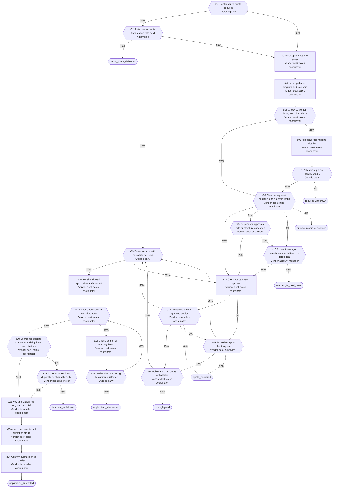

# Provide point-of-sale payment quotes to dealers

`efc-quote-point-of-sale-payments` · equipment leasing and finance · sales and origination (vendor programs) · part of `equipment-finance-co`

Equipment dealers who offer the company's leases at the point of sale ask its vendor desk what a customer's monthly payment would be. About a third price themselves in the dealer portal; the rest phone or email a desk coordinator, who looks up the dealer's program and rate card, works out payments for several terms and end-of-term options and emails a quote. When the customer decides to finance, the coordinator collects the signed application and bureau consent, chases missing items and re-keys the application into the origination portal for credit. Speed matters because the dealer is often with the customer, and most delay comes from incomplete paperwork, exception approvals and the customer's own decision time.

| | |
|---|---|
| Unit of work | one quote request |
| Starts when | A dealer phones, emails or uses the portal quote tool to ask for monthly payment options on equipment a customer wants. |
| Done when | The dealer has a payment quote and either the customer's signed application is submitted to credit, or the quote is delivered and not pursued, declined as outside the program, or referred for non-standard pricing. |
| Organisation | A mid-size privately owned Canadian independent equipment lessor with about 1,500 active dealers, a 13-person vendor desk in the Toronto area, a dealer portal with rate-card quoting and a CRM. (340 employees, 2019-2022) |
| Volume | 3,600 cases a month (range 3,000 to 4,300) |

## Where it sits

- Starts with **vendor_quote_request** from equipment_vendor (100% of cases)
- Relies on **program_terms** from manage-vendor-programs-and-rates (a standing input; it does not start a case)
- Relies on **system_release** from manage-system-changes (a standing input; it does not start a case)
- Sends **payment_quote** to equipment_vendor (outcome: portal_quote_delivered)
- Sends **payment_quote** to equipment_vendor (outcome: quote_delivered)
- Sends **payment_quote** to equipment_vendor (outcome: quote_lapsed)
- Sends **payment_quote** to equipment_vendor (outcome: application_submitted)
- Sends **credit_application** to intake-credit-applications (outcome: application_submitted)
- Sends **pricing_request** to price-non-standard-deals (outcome: referred_to_deal_desk)

## Flow

## Roles

| Role | Department | Layer | FTE on this process | Loaded cost per hour | Evidence |
|---|---|---|---:|---:|---|
| Vendor desk sales coordinator | Vendor sales desk | individual contributor | 8 | 30 CAD | B [src_jb_csr], [src_dlc_easylease] |
| Vendor desk supervisor | Vendor sales desk | supervisor | 0.4 | 51 CAD | C |
| Vendor account manager | Vendor account management | individual contributor | 0.6 | 64 CAD | C |

## Steps

Hands-on time and the wait before each step show the most common value. Evidence tier A is a sourced number, B a sourced description, C the author's estimate.

| Step | Who | Kind | Hands-on | Wait before | Control | Evidence |
|---|---|---|---:|---:|---|---|
| **s01 Dealer sends quote request.** A dealer salesperson who is with a customer asks for monthly payment options on a piece of equipment. The request comes by phone to the vendor desk line, by email to the shared desk mailbox, or through the quote tool in the dealer portal, with the equipment, price and sometimes the customer's name. | Outside party | intake | 0 min | 0 min |  | B [src_marlin_10k2019], [src_nbc_dealers] |
| **s02 Portal prices quote from loaded rate card.** The portal looks up the dealer's program, multiplies the equipment cost by the rate factor for each term and end-of-term option and shows the payments with taxes and fees. Requests outside the loaded card, such as used equipment past the age limit or an amount above the program cap, are pushed to the desk queue instead. | Automated | system auto | 0 min | 0 min |  | B [src_ga_pricing], [src_nbc_dealers] |
| **s03 Pick up and log the request.** A vendor desk coordinator answers the call or takes the next email from the shared mailbox, opens a quote record in the origination portal under the dealer's code and notes the equipment, price, customer and what the dealer asked for. Emails that arrive late in the day wait until the next morning. | Vendor desk sales coordinator | intake | 1.5 min | 3 min |  | C |
| **s04 Look up dealer program and rate card.** The coordinator opens the dealer's account in the CRM and the portal to find which program and rate card apply, any manufacturer promotion or rate buy-down in force, the documentation fee, allowed terms and end-of-term options. Dealers on older programs often have a card that differs from the standard one. | Vendor desk sales coordinator | lookup | 1.5 min | 0 min |  | B [src_ga_pricing], [src_ga_agentdealer] |
| **s05 Check customer history and pick rate tier.** The coordinator searches the lease management system for the customer's existing contracts and payment record and asks the dealer how long the business has operated. From this the coordinator picks the rate tier to quote or marks the quote as subject to credit approval, and notes anything missing to price it. | Vendor desk sales coordinator | lookup | 1.5 min | 0 min |  | B [src_leaseservices], [src_crest_instant] |
| **s06 Ask dealer for missing details.** The coordinator phones or emails the dealer for the facts needed to price the deal, typically the equipment year and hours for used units, the customer's province for sales tax, any trade-in or down payment and whether the customer wants a buyout or fair market value lease. | Vendor desk sales coordinator | communication | 3 min | 0 min |  | C |
| **s07 Dealer supplies missing details.** The dealer salesperson goes back to the customer or to the equipment file and replies with the missing facts. Replies are fast when the customer is still on the lot and can take a day when the salesperson is on the road; some requests are simply dropped. | Outside party | external wait | 0 min | 30 min |  | C |
| **s08 Check equipment eligibility and program limits.** The coordinator compares the request with the program: eligible equipment types, maximum age of used units, the dollar cap for application-only deals, minimum and maximum terms and any restricted industries. Most requests fit; others need a rate or structure exception, a hand-off to the account manager for a large deal, or a polite decline. | Vendor desk sales coordinator | validation | 1 min | 0 min | Vendor program terms: eligible equipment, used-equipment age, application-only dollar limits and term limits set by the director of vendor programs | B [src_dlc_easylease], [src_crest_instant] |
| **s09 Supervisor approves rate or structure exception.** The vendor desk supervisor reviews requests for a rate below the card, a longer term on used equipment, skip or seasonal payments or a deferred first payment. The supervisor approves within the small discretion band the pricing team allows, refuses and quotes standard terms, or passes larger concessions to the dealer's account manager. | Vendor desk supervisor | approval | 5 min | 30 min | Pricing authority matrix: desk supervisor discretion band below the rate card, set by sales operations and pricing | C |
| **s10 Account manager negotiates special terms or large deal.** The dealer's account manager, usually in the field, calls the dealer to understand the competitive situation, decides whether a manufacturer or dealer rate buy-down can close the gap and either confirms special terms for the desk to quote or sends the deal to the pricing desk as a non-standard request. | Vendor account manager | judgment | 25 min | 6.0 h |  | C |
| **s11 Calculate payment options.** The coordinator uses the portal quote screen or the desk spreadsheet calculator to work out payments for two or three terms and for $1 buyout, 10% purchase option and fair market value structures, including the first and last payment in advance, the documentation fee and GST, HST, QST or PST for the customer's province. | Vendor desk sales coordinator | analysis | 3 min | 0 min |  | B [src_ga_pricing], [src_bdc_vendor], [src_nbc_end_of_lease], [src_mhcc_partners] |
| **s12 Prepare and send quote to dealer.** The coordinator generates the quote document from the portal template or an email template, in French for Quebec dealers, states that payments are subject to credit approval and how long the rate holds, emails it to the dealer and records the quote and a follow-up task in the CRM. | Vendor desk sales coordinator | drafting | 2.5 min | 0 min |  | B [src_leaseservices], [src_crest_instant] |
| **s13 Dealer returns with customer decision.** The dealer presents the payment options to the customer, who compares them with cash, a bank loan or another lessor's offer. When the customer chooses to finance, the dealer comes back to the desk with a signed application or asks for a revised quote with a different term, amount or down payment. | Outside party | external wait | 0 min | 1.0 d |  | B [src_dlc_easylease], [src_bdc_vendor] |
| **s14 Follow up open quote with dealer.** When the CRM task comes due a few days later, the coordinator calls or emails the dealer to ask whether the customer has decided, whether a competitor's offer needs matching and whether the quote should be revised. Most quotes followed up are found to be lost or still undecided. | Vendor desk sales coordinator | communication | 4 min | 3.0 d |  | C |
| **s15 Supervisor spot-checks quote.** For a small sample of quotes each week, the vendor desk supervisor re-runs the payment from the rate card and checks the program, promotion, tax and wording. Errors found are corrected and the dealer is sent a revised quote; patterns are raised in coaching. | Vendor desk supervisor | review | 5 min | 0 min | Vendor desk quality assurance: supervisor sample review of quotes | C |
| **s16 Receive signed application and consent.** The dealer emails, faxes or uploads the signed credit application, which carries the business's legal and operating names, address, business number, years in business, the owners' names and home addresses and their signed consent to credit bureau inquiries. The coordinator attaches it to the quote record. | Vendor desk sales coordinator | intake | 2 min | 2.0 h | PIPEDA Schedule 1 Principle 4.3 (knowledge and consent): signed consent from the business and each guarantor before a credit report is pulled, with proof kept on file | B [src_opc_2015_005], [src_opc_2003_117], [src_dlc_easylease], [src_goodmans_aml] |
| **s17 Check application for completeness.** The coordinator checks that every field credit needs is filled and legible, that each owner has signed the consent, that the equipment and price match the quote and that a supplier quote or invoice is attached. About a third of dealer-supplied applications are missing a signature, an owner's address or the legal name. | Vendor desk sales coordinator | validation | 2.5 min | 15 min |  | C |
| **s18 Chase dealer for missing items.** The coordinator emails or calls the dealer listing exactly what is missing, such as an owner's signature on the consent, a home address, the customer's legal name as registered or the supplier invoice, and sets a reminder to check again. | Vendor desk sales coordinator | communication | 4 min | 0 min |  | C |
| **s19 Dealer obtains missing items from customer.** The dealer goes back to the customer for the missing signature or details, which can mean a visit or a courier when the owner is on a job site. The corrected pages come back by email, fax or portal upload, or the customer loses interest and the file is dropped. | Outside party | external wait | 0 min | 12.0 h |  | C |
| **s20 Search for existing customer and duplicate submissions.** Before keying, the coordinator searches the portal and lease system for the customer's legal name and phone number to find existing contracts and any application already submitted in the last few months by another dealer, a broker or a direct account executive. | Vendor desk sales coordinator | lookup | 1.5 min | 0 min | Channel conflict rule in the dealer and broker program agreements: one open application per customer and equipment, first submitter keeps the deal | C |
| **s21 Supervisor resolves duplicate or channel conflict.** The supervisor compares the two submissions, checks which channel submitted first and whether the equipment is the same, and talks to the broker channel or the account executive. The application is merged into the existing file, withdrawn, or allowed to proceed as a separate deal. | Vendor desk supervisor | judgment | 10 min | 2.0 h |  | C |
| **s22 Key application into origination portal.** The coordinator types the application from the PDF or fax image into the portal's application screens: legal and operating names, address, business number, industry, years in business, each owner's name, address and date of birth, the equipment, cost, term, structure and dealer code. | Vendor desk sales coordinator | data entry | 7 min | 10 min |  | B [src_marlin_10k2019], [src_ga_agentdealer] |
| **s23 Attach documents and submit to credit.** The coordinator uploads the signed application and consent, the supplier quote or invoice and the payment quote to the portal file, sets the channel and requested structure, and submits the file to the credit intake queue, which assigns an application number. | Vendor desk sales coordinator | data entry | 1.5 min | 0 min |  | B [src_ga_agentdealer] |
| **s24 Confirm submission to dealer.** The coordinator emails or calls the dealer with the application number and the usual time to a credit answer, and updates the CRM so the account manager can see the dealer's pipeline. | Vendor desk sales coordinator | communication | 1 min | 0 min |  | C |

## Exceptions

| Exception | Share of cases | What happens |
|---|---:|---|
| Rate or structure exception | 7% | The dealer asks for a rate below the card, a longer term on used equipment or seasonal payments; the supervisor decides within a small band and passes bigger concessions to the account manager. |
| Large or strategic deal referred | 3% | Deals above the program cap or in a competitive fight go to the account manager, who either confirms special terms or sends the deal to the pricing desk. |
| Incomplete application | 10% | The signed application lacks an owner's consent signature, a home address or the legal name, and the desk chases the dealer, sometimes more than once. |
| Revised quote | 7% | The customer wants a different term, amount or down payment and the coordinator recalculates and resends the quote. |
| Duplicate submission from another channel | 1% | The same customer and equipment is already in credit from a broker or another dealer and the supervisor resolves who keeps the deal. |

## Benchmarks

| Metric | Value | Unit | Population | Evidence |
|---|---|---|---|---|
| cycle_time_days | p50 0.08, p90 5.0 | calendar days from quote request to the last desk action (quote delivered, or application submitted to credit) | Vendor desks of Canadian independent small-ticket lessors, 2019-2022 | C |
| portal_quote_generation_time | seconds | elapsed time for a dealer to generate a quote in a lender's dealer portal | A Canadian bank's equipment finance dealer portal (current) | B [src_nbc_dealers] |
| time_to_credit_answer_after_submission | low 2, high 4 | business hours | US small-ticket lessor working through dealers | A [src_leaseservices] |
| application_only_limit | under_2_years_in_business 70000, financial_statements_from 80000 | CAD | A Canadian leasing broker network's vendor program | A [src_dlc_easylease] |
| credit_approval_validity | 90 | days | US small-ticket lessor working through dealers, 2019 | A [src_marlin_10k2019] |
| quote_requests_per_vendor_application | 2.0 | ratio | This organisation | C |

## Pain points

- Signed applications from dealers are often missing an owner's consent signature, home address or the legal name, and the desk spends time chasing while the customer cools off. (steps s17, s18, s19; C)
- Applications that arrive as PDFs or faxes are re-typed field by field into the portal, which adds about ten minutes a file and introduces typing errors that surface later as bureau no-hits. (steps s22; B [src_marlin_10k2019])
- Dealers on older programs have their own rate cards and promotions, so coordinators look up the card for every quote and occasionally quote an expired rate. (steps s04, s11, s15; B [src_ga_pricing])
- Rate exceptions wait for the supervisor or a field-based account manager while a competitor may be quoting the same customer. (steps s09, s10; C)
- Emails that arrive in the late afternoon or evening wait until the next morning even though the dealer is with the customer. (steps s03; C)

## Assumptions

- Only quote requests that reach the lessor are counted (3,600 a month). Dealers who price from a printed rate card without contacting the lessor are outside the process.
- About 35% of requests use the portal quote tool and 72% of those end with the printed quote and no desk work. Dealers who then submit the application themselves through the portal go straight to credit intake (the organisation file's equipment_vendor link) and are not counted as an outcome here.
- The triggered_by links from manage-vendor-programs-and-rates (program terms) and manage-system-changes (system releases) are standing inputs that change how quotes are priced; they do not start cases, so their share is 0.
- Organisation file gap: the price-non-standard-deals description says the vendor desk sends deals outside the rate card to the deal desk, but the process map has no link from quote-point-of-sale-payments to price-non-standard-deals. This workflow adds that output (outcome referred_to_deal_desk) and the organisation file was not changed.
- Non-bank lessors were not reporting entities under Canada's anti-money laundering law until April 1, 2025, so the desk does no AML identification; identity checks happen later in credit intake for credit and fraud reasons.
- Bureau consent is collected on the signed application and is treated as a legal requirement under PIPEDA; Quebec dealers also receive French-language quotes and forms.
- Cycle time ends at the last desk action. For quotes that are never pursued that is the moment the quote is sent, so the median is about an hour while cases that go on to an application take days because of the customer's decision time.
- Staffing: 8 of the 12 coordinators' time is on this process; the remaining time goes to communicating credit decisions and status calls in the communicate-credit-decisions process.
- Loaded costs are the organisation file's (2019-2022 wage times 1.35).

## Sources

- [src_marlin_10k2019] [Marlin Business Services Corp. Form 10-K for fiscal year 2019](https://www.sec.gov/Archives/edgar/data/1260968/000119312520072460/d875863d10k.htm) (US Securities and Exchange Commission (EDGAR), 2020). A small-ticket lessor working through equipment dealers lets them submit applications by fax, phone, internet, mail, e-mail or web portal; credit approvals are typically valid for up to 90 days; about 55% of new applications were auto-decisioned in 2019; analysts usually decide within two hours for deals under $50,000.
- [src_dlc_easylease] [EasyLease: equipment and vendor leasing](https://dominionlending.ca/easylease) (Dominion Lending Centres, 2024). Canadian vendor leasing: the vendor offers a monthly lease payment with its equipment quote, then gives the customer a lease application to sign; quick turnaround of 24 to 48 hours; application-only limits of $70,000 under two years in business and financial statements from $80,000.
- [src_ga_pricing] [Technology financing pricing](https://www.greatamerica.com/technology-financing-pricing) (GreatAmerica Financial Services, 2024). Dealers receive a rate schedule by term, lease type and transaction size; payment equals the rate factor times equipment cost; terms of 12 to 60 months; $1 buyout carries higher rates than fair market value; the customer's credit check does not change the rate, only whether the deal is underwritten.
- [src_ga_agentdealer] [Common questions answered on the AgentDealer integration with GreatAmerica](https://www.greatamerica.com/blog/common-questions-answered-on-the-agentdealer-integration-with-greatamerica) (GreatAmerica Financial Services, 2023). Dealer reps build financing quotes from lessor rate data updated daily and submit credit applications that return an application number used for status tracking.
- [src_bdc_vendor] [Pros and cons of vendor financing for equipment purchases](https://www.bdc.ca/en/articles-tools/money-finance/get-financing/pros-cons-vendor-financing-equipment-purchase) (BDC (Business Development Bank of Canada), 2023). Vendor financing is arranged at the point of sale through manufacturer captives or third-party lessors; vendor leases typically ask for a first and last monthly payment at signing; used and specialised equipment carries higher rates.
- [src_nbc_dealers] [Partner with National Bank (equipment finance for dealers)](https://www.nbc.ca/en/business/financing/equipment-finance/dealers.html) (National Bank of Canada, 2025). A Canadian lender's dealer portal lets dealers generate quotes in seconds, view and download quotes and apply for new financing.
- [src_crest_instant] [Offer equipment financing to your customers](https://www.crestcapital.com/offer-equipment-financing-to-your-customers) (Crest Capital, 2025). Point-of-sale payment estimates are subject to credit approval; one application covers $10,000 to $500,000 on 24 to 72 month terms; no financial statements up to $250,000; same-day decisions.
- [src_leaseservices] [Applying for financing (help centre)](https://help.leaseservices.com/help-center/category/applying-for-financing) (Lease Services, 2024). Calculator quotes assume an average credit rating and the final payment can differ after application; applications are completed online or in special cases phoned or faxed; approval typically notified to the dealer after 2 to 4 business hours.
- [src_jb_csr] [Wages for financial customer service representatives (NOC 64400)](https://www.jobbank.gc.ca/wagereport/occupation/14140) (Job Bank, Government of Canada, 2025). Ontario hourly wages low $17.95, median $22.00, high $30.39; Quebec median $24.04 (2023-2024).
- [src_opc_2015_005] [PIPEDA Report of Findings #2015-005: dealer ran credit checks without consent](https://www.priv.gc.ca/en/opc-actions-and-decisions/investigations/investigations-into-businesses/2015/pipeda-2015-005/) (Office of the Privacy Commissioner of Canada, 2015). Under PIPEDA Principle 4.3 an organisation should obtain separate consent for each hard credit inquiry and retain proof of consent for an appropriate period.
- [src_opc_2003_117] [PIPEDA case summary 2003-117: bank requires credit check on small business account applicant](https://priv.gc.ca/en/opc-actions-and-decisions/investigations/investigations-into-businesses/2003/pipeda-2003-117) (Office of the Privacy Commissioner of Canada, 2003). A personal credit check on the individual behind a small business is a legitimate requirement when credit risk is involved, with the individual's consent.
- [src_nbc_end_of_lease] [Equipment financing: end or cancellation of a lease](https://www.nbc.ca/en/business/help-centre/manage-business/financing/equipment-financing-end-lease.html) (National Bank of Canada, 2025). End-of-lease options include buying at fair market value or the stated purchase option, renewing, returning or trading up on approved credit.
- [src_mhcc_partners] [Vendor and broker financing](https://mhccna.com/en-ca/solutions/broker-partners) (Mitsubishi HC Capital Canada, 2025). A Canadian lessor's vendor programs promise quick approvals and payments through simplified applications and offer customers end-of-term options and low down payments.
- [src_goodmans_aml] [Anti-money laundering obligations for factors, cheque cashers and financing/leasing entities](https://www.goodmans.ca/insights/article/anti-money-laundering-obligations-for-factors--cheque-cashers--and-financing-leasing-entities--declaration-and-record-keeping-requirements-for-traders) (Goodmans LLP, 2025). Financing and leasing entities became reporting entities under the PCMLTFA only as of April 1, 2025, so no federal AML identification duty applied to non-bank lessors in 2019-2022.

Written by claude-opus on 2026-11-17.
