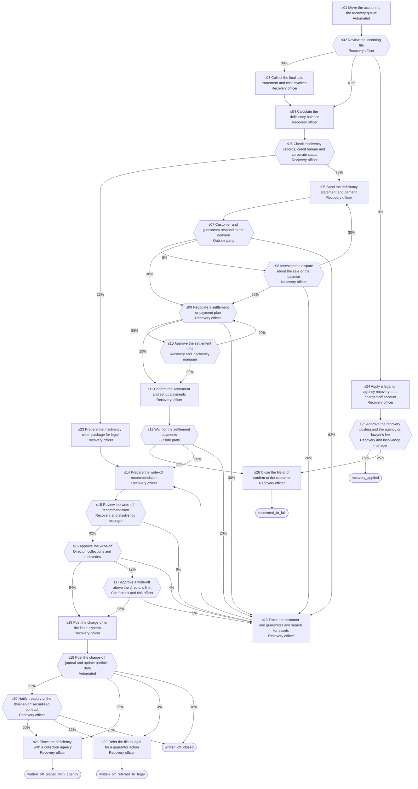

# Recover deficiencies and approve write-offs

`efc-recover-deficiencies-and-write-off` · equipment leasing and finance · collections and recoveries · part of `equipment-finance-co`

When a defaulted lease cannot be cured, or the repossessed equipment sells for less than the balance, a recovery officer turns the remaining amount into a deficiency file. The officer calculates what is still owed, sends a deficiency statement and a demand to the customer and the personal guarantors, negotiates settlements, traces owners and their assets, and recommends a write-off that the recovery manager reviews and the director or the chief credit and risk officer approves. After the charge-off is posted the file goes to a collection agency, to legal for a guarantor lawsuit, or is closed, and charged-off securitised contracts are reported to treasury. Waiting for sale settlements, unanswered demands, skip tracing and monthly approval batches make the process slow, and most files recover little.

| | |
|---|---|
| Unit of work | one deficiency file |
| Starts when | Late-stage collections sends an approved write-off request, the sale proceeds of repossessed equipment are applied leaving a balance, or legal reports a recovery on a charged-off account. |
| Done when | The deficiency is charged off with approval and placed with an agency, referred to legal or closed; or the balance is recovered in full; or a recovery is applied to an account already charged off. |
| Organisation | A privately owned Canadian independent equipment lessor with about 55,000 active small- and mid-ticket contracts and a five-person recoveries and insolvency team. (340 employees, 2019-2022) |
| Volume | 75 cases a month (range 50 to 110) |

## Where it sits

- Starts with **write_off_request** from collect-late-stage (55% of cases)
- Starts with **remarketing_proceeds** from remarket-equipment (36% of cases)
- Starts with **legal_recovery** from manage-legal-actions-and-insolvencies (9% of cases)
- Sends **legal_referral** to manage-legal-actions-and-insolvencies (outcome: written_off_referred_to_legal)
- Sends **collection_placement** to collection_agency_law_firm (outcome: written_off_placed_with_agency)
- Sends **journal_entries** to close-the-month (outcome: any)
- Sends **portfolio_data** to monitor-portfolio-risk (outcome: any)
- Sends **pool_change_notice** to report-to-securitisation-funders (outcome: written_off_placed_with_agency)
- Sends **pool_change_notice** to report-to-securitisation-funders (outcome: written_off_referred_to_legal)
- Sends **pool_change_notice** to report-to-securitisation-funders (outcome: written_off_closed)

## Flow

## Roles

| Role | Department | Layer | FTE on this process | Loaded cost per hour | Evidence |
|---|---|---|---:|---:|---|
| Recovery officer | Recoveries and insolvency | senior specialist | 2.3 | 42 CAD | B [src_jb_collector], [src_monitor_collector] |
| Recovery and insolvency manager | Recoveries and insolvency | manager | 0.25 | 72 CAD | C |
| Director, collections and recoveries | Collections and recoveries | director | 0.04 | 90 CAD | C |
| Chief credit and risk officer | Credit and risk | executive | 0.01 | 175 CAD | C |

## Steps

Hands-on time and the wait before each step show the most common value. Evidence tier A is a sourced number, B a sourced description, C the author's estimate.

| Step | Who | Kind | Hands-on | Wait before | Control | Evidence |
|---|---|---|---:|---:|---|---|
| **s01 Move the account to the recovery queue.** When late-stage collections sends an approved write-off request, when the sale proceeds of repossessed equipment are posted, or when legal reports a recovery, the collections system moves the contract into the recovery queue and assigns it to a recovery officer by region and balance, with earlier notes attached. | Automated | system auto | 0 min | 12.0 h |  | C |
| **s02 Review the incoming file.** The recovery officer reads the late-stage memo or the remarketing settlement note, the contract and schedules, the personal guarantees, the default notice history and any earlier settlement talks, and decides what the file needs: a deficiency calculation, missing sale figures, or just the posting of a recovery from legal or an agency. | Recovery officer | intake | 20 min | 2.0 d |  | B [src_monitor_collector], [src_charter_424b] |
| **s03 Collect the final sale statement and cost invoices.** For equipment that was repossessed and sold, the officer asks remarketing for the auction or buyer settlement statement and asks accounts payable for the bailiff, transport, storage, repair and legal invoices, because the deficiency cannot be stated until every cost is known. Late auction settlements and invoices are chased by email. | Recovery officer | lookup | 20 min | 5.0 d |  | C |
| **s04 Calculate the deficiency balance.** In a spreadsheet the officer works out the balance owed under the default clause: arrears, accelerated future rents discounted at the contract rate, the purchase option or residual, late charges and taxes, plus repossession, storage, repair, selling and legal costs, less net sale proceeds and any security deposit. Figures are re-keyed from the lease system, the settlement statement and invoices. | Recovery officer | analysis | 35 min | 1.0 d |  | B [src_monitor_deficiency], [src_monitor_collector] |
| **s05 Check insolvency records, credit bureau and corporate status.** Before demanding payment the officer searches the federal insolvency records for the business and each guarantor, refreshes the commercial and personal bureau reports and checks whether the corporation is still active. A bankruptcy, proposal or notice of intention stops all collection contact and sends the file down the claim route. | Recovery officer | lookup | 15 min | 1.0 h | Bankruptcy and Insolvency Act s.69 and s.69.3: stay of proceedings once a notice of intention, proposal or bankruptcy is filed | B [src_bia_s69] |
| **s06 Send the deficiency statement and demand.** The officer fills the deficiency letter template with the disposition details (date, method, price), the calculation and the amount due, and a deadline of about 15 days, and sends a demand under each personal guarantee. Letters go by registered mail or courier and email, and proof of delivery is filed because the demand starts the guarantor's obligation and the limitation clock. | Recovery officer | drafting | 25 min | 4.0 h | Provincial PPSA rules on disposition and accounting to the debtor (BC PPSA ss.59-60; a debtor can raise non-compliance as a defence to a deficiency claim, s.69(7)), the guarantee's demand clause and the two-year Ontario Limitations Act period | B [src_bc_ppsa], [src_legal500_guarantee], [src_monitor_deficiency] |
| **s07 Customer and guarantors respond to the demand.** The demand period runs. Some owners call to dispute the sale price or the costs, some offer a settlement or instalments, and most do not reply, often because the business has closed and the owners have few assets left. | Outside party | external wait | 0 min | 15.0 d |  | C |
| **s08 Investigate a dispute about the sale or the balance.** The officer pulls the condition report, the auction results, the notice of intended disposition and its proof of delivery and the cost invoices, asks remarketing whether the sale was in line with the market, corrects any error in the calculation and replies in writing. | Recovery officer | analysis | 1.0 h | 2.0 d |  | B [src_bc_ppsa], [src_monitor_collector] |
| **s09 Negotiate a settlement or payment plan.** The officer talks with the owner or guarantor about a lump-sum settlement at a discount or instalments over several months, checks what they own from bureau data and property searches, and compares the offer with what an agency or a lawsuit would net after fees and costs. | Recovery officer | judgment | 30 min | 1.0 d |  | B [src_monitor_deficiency], [src_monitor_collector] |
| **s10 Approve the settlement offer.** The recovery and insolvency manager reviews the offer against the balance, the guarantor's means, the expected agency or legal recovery and the delegated settlement limits, and approves it, asks for a better offer, or notes that the forgiven amount needs the director when the write-off is approved. | Recovery and insolvency manager | approval | 15 min | 1.0 d | Collections policy: delegated authority to compromise a debt | C |
| **s11 Confirm the settlement and set up payments.** The officer sends a written settlement agreement that keeps the full claim alive if payments stop, records the amounts and dates in the collections system and sets up a pre-authorised debit or asks for a certified cheque or wire for a lump sum. | Recovery officer | data entry | 25 min | 2.0 h |  | B [src_monitor_deficiency] |
| **s12 Wait for the settlement payments.** The file waits for the lump sum or the instalments. Lump sums usually arrive within weeks; instalment plans run for months and the collections system flags any missed payment for follow-up. | Outside party | external wait | 0 min | 30.0 d |  | C |
| **s13 Trace the customer and guarantors and search for assets.** For silent or broken files the officer traces the owners and guarantors through bureau addresses, corporate records and online searches, checks for real property, vehicles and other registrations, and decides the route: an agency placement, a lawsuit on the guarantee where there is equity worth pursuing, or no action where nothing is recoverable. | Recovery officer | analysis | 30 min | 4.0 d |  | B [src_monitor_collector], [src_charter_424b] |
| **s14 Prepare the write-off recommendation.** The officer writes the write-off memo: balance and deficiency calculation, collection and settlement history, asset search results, guarantor position, any insolvency claim, the recommended route and expected recovery, and the tax portion that can be recovered through the GST/HST bad debt deduction. | Recovery officer | drafting | 30 min | 1.0 d |  | B [src_charter_424b], [src_bcra_ifrs9] |
| **s15 Review the write-off recommendation.** The recovery and insolvency manager checks that the collection steps were exhausted, the demand letters and notices are on file, the amount ties to the lease system and the route makes sense, then signs and adds the file to the director's write-off list or sends it back. | Recovery and insolvency manager | review | 15 min | 3.0 d | Credit and collections policy: file completeness review before write-off | C |
| **s16 Approve the write-off.** At the monthly write-off review the director of collections and recoveries goes through the list with the manager and approves write-offs within the director's delegated limit, sends larger ones to the chief credit and risk officer and occasionally asks for another attempt. | Director, collections and recoveries | approval | 10 min | 6.0 d | Board-approved delegated write-off authority; IFRS 9 paragraph 5.4.4 (write off when there is no reasonable expectation of recovery) | B [src_bcra_ifrs9] |
| **s17 Approve a write-off above the director's limit.** The chief credit and risk officer reviews large write-offs, usually mid-ticket contracts or files with guarantor litigation, asks about remaining recovery options and signs the approval or sends the file back. | Chief credit and risk officer | approval | 15 min | 4.0 d | Board-approved delegated write-off authority | C |
| **s18 Post the charge-off in the lease system.** With the signed approval the officer enters the charge-off transaction in the lease system, stops billing and late charges, sets the contract status to charged off and records the tax portion so tax can claim the GST/HST bad debt deduction. The approval memo is attached in imaging for audit. | Recovery officer | data entry | 20 min | 1.0 d | Internal control over financial reporting: charge-offs posted only against a documented approval; Excise Tax Act s.231 requires the debt to be written off in the books before the tax is deducted | B [src_eta_231] |
| **s19 Post the charge-off journal and update portfolio data.** The nightly interface posts the charge-off against the loss allowance in the general ledger and loads the contract's new status, charge-off amount and recovery route into the data warehouse used by risk, treasury and accounting. | Automated | system auto | 0 min | 12.0 h |  | C |
| **s20 Notify treasury of the charged-off securitised contract.** The officer adds the contract to the weekly list of charged-off and recovered securitised contracts sent to the securitisation analyst, with pool code, balance at default, sale proceeds and expected recoveries, so the servicer report shows the default and any repurchase or substitution. | Recovery officer | communication | 10 min | 1.0 d | Conduit servicing agreement: servicer reports defaulted and charged-off receivables and recoveries each period | B [src_charter_424b] |
| **s21 Place the deficiency with a collection agency.** The officer uploads the placement to the panel agency's portal or by secure email: statement of account, contract, guarantees, demand letters, last known contacts and asset search, and records the placement, the contingency fee rate and the review date in the collections system. | Recovery officer | communication | 25 min | 1.0 d |  | B [src_monitor_collector], [src_monitor_deficiency] |
| **s22 Refer the file to legal for a guarantor action.** Where a guarantor owns real property or the balance is large, the officer prepares a legal referral: chronology, contract and guarantee, demand and proof of delivery, deficiency calculation, sale records and asset search, so in-house counsel can sue or instruct outside lawyers before the limitation period runs. | Recovery officer | drafting | 1.0 h | 2.0 d | Ontario Limitations Act, 2002: two-year basic limitation period for the claim against the customer and guarantors | B [src_legal500_guarantee], [src_monitor_deficiency] |
| **s23 Prepare the insolvency claim package for legal.** For a customer or guarantor in bankruptcy or a proposal, the officer prepares the statement of account and supporting documents for the proof of claim (the lessor's or secured creditor's claim, payments in the last three months) and sends it to legal, who files it with the trustee. | Recovery officer | drafting | 45 min | 1.0 d | Bankruptcy and Insolvency Act: Form 31 proof of claim with a statement of account, filed with the trustee to share in any dividend | B [src_osb_form31] |
| **s24 Apply a legal or agency recovery to a charged-off account.** When legal reports a judgment payment or settlement, or an agency remits collections net of its fee, the officer matches the statement to the charged-off contract, posts the recovery in the lease system and records the tax on the recovered amount so it is added back on the next GST/HST return. | Recovery officer | data entry | 25 min | 3.0 d | Excise Tax Act s.231(3): tax on a recovered bad debt is added back to net tax | B [src_eta_231], [src_charter_424b] |
| **s25 Approve the recovery posting and the agency or lawyer's fee.** The recovery and insolvency manager checks the posting against the remittance statement, approves the contingency fee or legal invoice for payment and decides whether the file stays open with the agency or lawyer or can be closed. | Recovery and insolvency manager | approval | 10 min | 2.0 d | Internal control: the person posting a recovery does not approve the related fee payment | C |
| **s26 Close the file and confirm to the customer.** When the balance or an agreed settlement is paid, the officer closes the file in the collections system, ends any agency placement, sends the customer and guarantors a confirmation that the debt is settled and asks lease administration to discharge any remaining registration. | Recovery officer | communication | 15 min | 1.0 d |  | C |

## Exceptions

| Exception | Share of cases | What happens |
|---|---:|---|
| Missing sale statement or cost invoices | 30% | The auction settlement or the bailiff, storage or legal invoices are not in, so the officer chases them before the deficiency can be stated. |
| Insolvency filing | 22% | The customer or a guarantor is in bankruptcy, a proposal or a notice of intention; collection stops and a claim package goes to legal before the write-off. |
| Disputed deficiency | 5% | The customer challenges the sale price or the costs; the officer investigates and may reissue the statement. |
| Broken settlement | 4% | Settlement or plan payments stop and the file returns to tracing and the write-off route. |
| Write-off returned | 10% | The manager, director or chief credit and risk officer sends the file back for more collection or asset search work. |
| Large write-off | 9% | The write-off exceeds the director's limit and needs the chief credit and risk officer. |

## Benchmarks

| Metric | Value | Unit | Population | Evidence |
|---|---|---|---|---|
| cycle_time_days | p50 50, p90 120 | calendar days from the file entering the recovery queue to charge-off and placement, full recovery or recovery posting | Canadian independent equipment lessor, 2019-2022 | C [src_charter_424b], [src_bc_ppsa] |
| net_losses_2020 | 0.0048 | share of average receivables | US equipment finance companies, 104 ELFA respondents | A [src_elfa_sefa2021] |
| defaulted_lease_definition | 120 | days delinquent | Charter Equipment Lease 1998-1 securitisation | A [src_charter_424b] |
| accounting_after_disposition | 30 | days after a written demand | British Columbia PPSA | A [src_bc_ppsa] |
| gst_hst_bad_debt_claim_window | 4 | years after the return period of the write-off | Canada, Excise Tax Act | A [src_eta_231] |

## Pain points

- The deficiency letter waits for the auction settlement and the bailiff, storage and legal invoices, which arrive over several weeks. (steps s03; C)
- Balances are recalculated by hand in spreadsheets from lease system figures, and calculation errors surface only when a customer disputes the amount. (steps s04, s08; B [src_monitor_collector])
- Most demands go unanswered; demand periods and skip tracing add weeks to files that end in write-off anyway. (steps s07, s13; C)
- Write-offs are approved in a monthly batch, so files queue for up to a month before posting. (steps s16, s17; C)
- Agency and legal recoveries arrive as remittance statements that are re-keyed contract by contract. (steps s24, s25; C)

## Assumptions

- Volume mode of 75 sits inside the organisation file's range of 50 to 110; late-stage collections' own estimate of about 58 write-off and insolvency referrals a month plus post-sale deficiencies would put it nearer 90.
- Late-stage collections sends insolvency referrals with the write_off_request object (as its workflow notes); this file treats them as deficiency files that get a claim package for legal before the write-off.
- Insolvency claim packages go to legal at step s23, but the case continues to a write-off; the legal_referral output is tied only to the guarantor-action outcome because the format links outputs to END outcomes.
- Write-off approval is modelled as a monthly review, with the director approving most files and the chief credit and risk officer about one in eight; limits are not published and are author estimates.
- Post-charge-off agency work and lawsuits are outside this case; recoveries come back as new cases through the legal_recovery trigger (step s24).
- Recovery officers' time is shared with repossessions; about 2.3 of 4 officers' time is assigned here.
- Legal rules named in controls are the author's reading of the cited statutes and commentary, not legal advice; BC's PPSA text is used where Ontario's statute site could not be opened.
- External steps have no touch time; customer replies and payments are in wait_before_min.
- Loaded costs are the organisation file's (2019-2022 wage times 1.35).

## Sources

- [src_bc_ppsa] [Personal Property Security Act [RSBC 1996] chapter 359](https://www.bclaws.gov.bc.ca/civix/document/id/complete/statreg/96359_01) (King's Printer, British Columbia, 1996). s.59(6): notice at least 20 days before disposing of seized collateral; s.60(3): written accounting of the disposition within 30 days after a written demand; s.60(5): the debtor is liable to pay any deficiency; s.69(7): non-compliance with ss.59 and 60 can be raised as a defence to a deficiency claim; s.67: seize-or-sue rule applies to consumer goods only.
- [src_eta_231] [Excise Tax Act, section 231 (bad debts)](https://laws-lois.justice.gc.ca/eng/acts/E-15/section-231-20070622.html) (Justice Laws Website, Government of Canada, 2007). A supplier that writes off a bad debt on a taxable supply to an arm's-length recipient may deduct the tax portion from net tax (s.231(1)); tax on a later recovery must be added back (s.231(3)); the deduction must be claimed within four years (s.231(4)).
- [src_bcra_ifrs9] [Removal of irrecoverable receivables from the asset](https://www.bcra.gob.ar/en/removal-of-irrecoverable-receivables-from-the-asset/) (Banco Central de la Republica Argentina, n.d.). Restates IFRS 9 paragraph 5.4.4: a write-off applies when the entity has no reasonable expectation of recovering contractual cash flows, is a derecognition event, and written-off assets still under enforcement are disclosed under IFRS 7 35L.
- [src_charter_424b] [Charter Equipment Lease 1998-1 LLC prospectus (Form 424B1)](https://www.sec.gov/Archives/edgar/data/0001070771/000089155499001687/0000891554-99-001687.txt) (US SEC EDGAR, 1999). A New York and Toronto equipment lessor writes a transaction off only after reasonable steps to enforce its remedies show the client lacks assets, and pursues any deficiency after repossession and sale to the extent practicable; defaulted leases are those more than 120 days delinquent or charged off; servicer reports show recoveries on defaulted leases each period.
- [src_monitor_deficiency] [Preserving and collecting a deficiency balance after repo and sale](https://www.monitordaily.com/?p=149182) (Monitor Daily, n.d.). Post-sale deficiency notice stating the amount and how it was calculated; collection runs from negotiation (lump sum or plan) to litigation to post-judgment remedies; commercially reasonable sale needed to keep the deficiency claim (US UCC context).
- [src_monitor_collector] [The Collector Chronicles: beyond the default, how lenders master repossession and recovery](https://www.monitordaily.com/?p=157653) (Monitor Daily, n.d.). After sale, proceeds are applied and the remaining amount becomes a deficiency handled by repayment plans, placement with agencies or counsel for larger balances, or charge-off when pursuit is not economical; clear documentation of the deficiency calculation prevents disputes.
- [src_legal500_guarantee] [Limitation periods on guarantees (Aird & Berlis LLP)](https://www.legal500.com/intelligence/canada/corporate-commercial-law/limitation-periods-on-guarantees) (Legal 500, 2008). Ontario Limitations Act, 2002: two-year basic limitation period from discovery; in Chorny the period on a guarantee ran from the principal debtor's default, so lenders must act on guarantees within two years unless the documents extend the period.
- [src_osb_form31] [Form 31, Proof of Claim](https://ised-isde.canada.ca/site/office-superintendent-bankruptcy/en/licensed-insolvency-trustees/forms/form-31-proof-claim-br02174) (Office of the Superintendent of Bankruptcy Canada, n.d.). A creditor's proof of claim attaches a statement of account specifying the vouchers or evidence, states whether the claim is unsecured, secured or a lessor's claim, and lists payments received in the three months before the bankruptcy.
- [src_bia_s69] [Bankruptcy and Insolvency Act, section 69 (stay of proceedings on a notice of intention)](https://laws-lois.justice.gc.ca/eng/acts/B-3/page-15.html) (Justice Laws Website, Government of Canada, n.d.). Once a notice of intention is filed no creditor has any remedy against the insolvent person or may commence or continue proceedings to recover a claim provable in bankruptcy.
- [src_elfa_sefa2021] [New data reveals market insights (2021 Survey of Equipment Finance Activity)](https://www.elfaonline.org/communications/july-august-sept/new-data-reveals-market-insights) (Equipment Leasing and Finance Association, 2021). US equipment finance 2020: receivables over 30 days past due 2.3%; net full-year losses 0.48% of average receivables; 104 respondents.
- [src_jb_collector] [Wages: Collector in Ontario (NOC 14202)](https://www.jobbank.gc.ca/marketreport/wages-occupation/19300/ON) (Job Bank, Government of Canada, 2024). Ontario hourly wages for collectors: low $17.95, median $25.38, high $36.69; Toronto median $27.00 (2023-2024).

Written by claude-opus on 2026-11-17.
