# Remarket repossessed and returned equipment

`efc-remarket-equipment` · equipment leasing and finance · asset management and remarketing · part of `equipment-finance-co`

Equipment that customers return at the end of a lease, or that bailiffs seize after a default, sits in storage until the remarketing team sells it. A remarketing specialist reviews the condition report, an asset manager values the equipment, the specialist decides on repairs and picks a channel (an auction, the originating dealer, other dealers or a direct buyer), and the manager approves the plan and the minimum price. After the sale the specialist records the proceeds and costs, asks lease administration for the bill of sale and sends the results to recoveries when a defaulted balance remains. Waiting for inspections, repairs, auction dates and settlements makes the process slow, and storage charges and falling values mean every week of delay costs money.

| | |
|---|---|
| Unit of work | one asset sale |
| Starts when | Seized equipment arrives in storage after a repossession, or returned equipment's condition report is filed at the end of a lease. |
| Done when | The asset is sold and paid for, the proceeds and costs are recorded, the bill of sale is requested and, for seized equipment, the results are with recoveries. |
| Organisation | A privately owned Canadian independent equipment lessor with about 55,000 active contracts and a ten-person asset management and remarketing team. (340 employees, 2019-2022) |
| Volume | 110 cases a month (range 80 to 150) |

## Where it sits

- Starts with **off_lease_asset** from recover-off-lease-equipment (60% of cases)
- Starts with **repossessed_asset** from repossess-equipment (40% of cases)
- Relies on **remarketing_proceeds** from auction_house (a standing input; it does not start a case)
- Sends **consignment** to auction_house (outcome: any)
- Sends **remarketing_proceeds** to recover-deficiencies-and-write-off (outcome: sold_repossessed)
- Sends **title_transfer_request** to transfer-title-and-discharge (outcome: any)
- Sends **journal_entries** to close-the-month (outcome: any)
- Sends **sales_tax_data** to file-sales-taxes (outcome: any)

## Flow

```mermaid
flowchart TD
    s01["s01 Add the asset to the remarketing inventory<br/>Automated"]
    s02{{"s02 Review the asset file<br/>Remarketing specialist"}}
    s03["s03 Order an inspection at the storage yard<br/>Asset logistics coordinator"]
    s04["s04 Yard or inspector reports the condition<br/>Outside party"]
    s05{{"s05 Value the asset and suggest a channel<br/>Asset manager, valuation and residuals"}}
    s06["s06 Third-party appraiser values the asset<br/>Outside party"]
    s07{{"s07 Decide on repairs and get quotes<br/>Remarketing specialist"}}
    s08{{"s08 Approve the repair spend<br/>Manager, asset management and remarketing"}}
    s09["s09 Repair shop reconditions the asset<br/>Outside party"]
    s10["s10 Choose the sales channel and set the reserve<br/>Remarketing specialist"]
    s11{{"s11 Approve the disposition plan and minimum price<br/>Manager, asset management and remarketing"}}
    s12["s12 Consign the asset to an auction<br/>Remarketing specialist"]
    s13["s13 Book transport to the auction yard<br/>Asset logistics coordinator"]
    s14["s14 Asset moves and sells at the next auction<br/>Outside party"]
    s15{{"s15 Auction company settles the proceeds<br/>Outside party"}}
    s16["s16 Market the asset to dealers and buyers<br/>Remarketing specialist"]
    s17{{"s17 Buyers inspect and make offers<br/>Outside party"}}
    s18{{"s18 Negotiate and accept the best offer<br/>Remarketing specialist"}}
    s19["s19 Invoice the buyer with sales tax<br/>Remarketing specialist"]
    s20{{"s20 Buyer pays for the asset<br/>Outside party"}}
    s21["s21 Release the asset to the buyer<br/>Asset logistics coordinator"]
    s22["s22 Record the sale and apply the proceeds<br/>Remarketing specialist"]
    s23{{"s23 Sign off the sale record<br/>Manager, asset management and remarketing"}}
    s24["s24 Post the sale journal and sales tax data<br/>Automated"]
    s25{{"s25 Request the bill of sale and registration discharge<br/>Remarketing specialist"}}
    s26["s26 Send the sale results to recoveries<br/>Remarketing specialist"]
    s01 --> s02
    s02 -->|"20%"| s03
    s02 -->|"80%"| s05
    s03 --> s04
    s04 --> s05
    s05 -->|"12%"| s06
    s05 -->|"88%"| s07
    s06 --> s07
    s07 -->|"25%"| s08
    s07 -->|"75%"| s10
    s08 -->|"85%"| s09
    s08 -->|"15%"| s10
    s09 --> s10
    s10 --> s11
    s11 -->|"57%"| s12
    s11 -->|"38%"| s16
    s11 -->|"5%"| s10
    s12 --> s13
    s13 --> s14
    s14 --> s15
    s15 -->|"94%"| s22
    s15 -->|"6%"| s10
    s16 --> s17
    s17 -->|"85%"| s18
    s17 -->|"15%"| s10
    s18 -->|"86%"| s19
    s18 -->|"14%"| s11
    s19 --> s20
    s20 -->|"96%"| s21
    s20 -->|"4%"| s16
    s21 --> s22
    s22 --> s23
    s23 -->|"95%"| s24
    s23 -->|"5%"| s22
    s24 --> s25
    s25 -->|"40%"| s26
    s25 -->|"60%"| end0
    s26 --> end1
    end0(["sold_off_lease"])
    end1(["sold_repossessed"])
```

## Roles

| Role | Department | Layer | FTE on this process | Loaded cost per hour | Evidence |
|---|---|---|---:|---:|---|
| Remarketing specialist | Asset management and remarketing | individual contributor | 2.6 | 40 CAD | C |
| Asset manager, valuation and residuals | Asset management and remarketing | senior specialist | 0.3 | 56 CAD | C |
| Manager, asset management and remarketing | Asset management and remarketing | manager | 0.2 | 75 CAD | C |
| Asset logistics coordinator | Asset management and remarketing | individual contributor | 0.5 | 32 CAD | C |

## Steps

Hands-on time and the wait before each step show the most common value. Evidence tier A is a sourced number, B a sourced description, C the author's estimate.

| Step | Who | Kind | Hands-on | Wait before | Control | Evidence |
|---|---|---|---:|---:|---|---|
| **s01 Add the asset to the remarketing inventory.** When a bailiff confirms that seized equipment is in storage, or a returned asset's condition report is filed, the lease system changes the asset status to held for sale and puts it in the remarketing queue with the yard location and daily storage rate. | Automated | system auto | 0 min | 12.0 h |  | C |
| **s02 Review the asset file.** The remarketing specialist reads the bailiff report or return condition report, photos, serial numbers, hours or kilometres, the contract status and pool code, and for seized equipment the date the notice of intended disposition went out, and decides whether the condition information is good enough to price the asset. | Remarketing specialist | intake | 15 min | 1.0 d |  | B [src_monitor_collector] |
| **s03 Order an inspection at the storage yard.** The asset logistics coordinator asks the yard or a field inspector for photos, an hour meter reading, a start-up and function check and a list of missing parts, and agrees the fee. | Asset logistics coordinator | coordination | 15 min | 1.0 d |  | C |
| **s04 Yard or inspector reports the condition.** The yard or inspector visits the equipment and sends the condition report and photos, which are filed in imaging and attached to the asset record. | Outside party | external wait | 0 min | 5.0 d |  | C |
| **s05 Value the asset and suggest a channel.** An asset manager checks recent auction results, value guides and dealer listings for the same make, model, year and hours, estimates the auction value and the dealer or retail value net of transport, commission and repairs, and suggests a channel and reserve. High-value or specialised items get a third-party appraisal. | Asset manager, valuation and residuals | analysis | 25 min | 2.0 d |  | B [src_amc_appraisals], [src_rb_10k2020] |
| **s06 Third-party appraiser values the asset.** For high-value or specialised equipment an outside appraiser gives orderly and forced liquidation values and the expected costs of sale, from a desktop review or a site visit. | Outside party | external wait | 0 min | 14.0 d |  | A [src_amc_appraisals] |
| **s07 Decide on repairs and get quotes.** The specialist decides whether repairs would add more value than they cost, for example tires, batteries, a safety certificate for a truck, missing attachments or cleaning, and gets quotes from a dealer or repair shop. | Remarketing specialist | judgment | 20 min | 1.0 d |  | B [src_bc_ppsa] |
| **s08 Approve the repair spend.** The manager of asset management and remarketing checks the quote against the expected price gain and the remaining balance or residual and approves spend above the specialist's limit or tells them to sell as is. | Manager, asset management and remarketing | approval | 10 min | 1.0 d | Asset management delegated spending authority | C |
| **s09 Repair shop reconditions the asset.** A dealer or repair shop does the approved work, which may include a provincial safety inspection for a truck or trailer, and invoices the company; the specialist checks the invoice against the quote. | Outside party | external wait | 0 min | 12.0 d |  | C |
| **s10 Choose the sales channel and set the reserve.** The specialist picks the channel: offer the asset back to the originating dealer or the dealer network, list it for a direct sale online, or consign it to a live or online auction, reserved or unreserved. The disposition plan records the reserve against the net book value or defaulted balance and the expected costs. | Remarketing specialist | judgment | 20 min | 1.0 d |  | B [src_rb_10k2020], [src_monitor_collector] |
| **s11 Approve the disposition plan and minimum price.** The manager reviews the plan, checks that for seized equipment the notice of intended disposition period has run, that the sale method is commercially reasonable for the equipment and that the expected loss is within limits, and approves the channel and minimum price or asks for another plan. | Manager, asset management and remarketing | approval | 10 min | 1.0 d | Provincial PPSA: notice before disposing of seized collateral (Ontario s.63(4), 15 days; BC s.59(6), 20 days) and a commercially reasonable sale (BC s.68(2)); company delegated authority for sale prices below book value | B [src_lawtimes_priest], [src_bc_ppsa] |
| **s12 Consign the asset to an auction.** The specialist signs the auction company's consignment contract on straight commission, chooses unreserved or reserved, sends the asset details, photos and serial numbers, confirms the company can give clear title and books the asset into the next suitable sale. | Remarketing specialist | communication | 25 min | 4.0 h |  | B [src_rb_10k2020] |
| **s13 Book transport to the auction yard.** The coordinator gets carrier quotes, issues the transport order and a release letter to the storage yard, and tracks the move; equipment sold through a weekly online auction can stay in the yard and skip this move. | Asset logistics coordinator | coordination | 20 min | 1.0 d |  | B [src_rb_10k2020] |
| **s14 Asset moves and sells at the next auction.** The carrier moves the equipment, the auction company inspects and lists it, and it sells at the next weekly online auction or the next scheduled site auction. | Outside party | external wait | 0 min | 16.0 d |  | B [src_rb_10k2020] |
| **s15 Auction company settles the proceeds.** After the buyer pays, the auction company sends the settlement statement with the hammer price, commission, fees and any charges, and wires the net proceeds. A reserved lot that does not meet its reserve comes back for a new plan. | Outside party | external wait | 0 min | 10.0 d |  | C [src_rb_10k2020] |
| **s16 Market the asset to dealers and buyers.** The specialist emails the asset to the originating dealer and a list of dealers who buy that equipment type, posts a listing with photos online, answers calls and arranges buyer inspections with the yard. | Remarketing specialist | communication | 30 min | 1.0 d |  | B [src_monitor_collector] |
| **s17 Buyers inspect and make offers.** Dealers and end buyers look at the photos or the equipment and send offers over the following weeks; some assets draw no acceptable offer and go back for a new plan, usually an auction. | Outside party | external wait | 0 min | 15.0 d |  | C |
| **s18 Negotiate and accept the best offer.** The specialist compares the offers with the approved minimum price, negotiates with the best bidders and accepts an offer within the approval, or sends an offer below the minimum back to the manager. | Remarketing specialist | judgment | 30 min | 1.0 d |  | C |
| **s19 Invoice the buyer with sales tax.** The specialist prepares the sale invoice and as-is, where-is terms with GST/HST and any provincial sales tax for the buyer's province, or records the dealer's resale exemption, and asks for a wire or certified funds before release. | Remarketing specialist | drafting | 20 min | 4.0 h | Excise Tax Act s.183(2) (sale of seized property is a commercial activity) and GST/HST and provincial sales tax collection rules | B [src_eta_183] |
| **s20 Buyer pays for the asset.** The buyer wires the price or delivers certified funds; the specialist confirms the funds in the bank report before anything is released. | Outside party | external wait | 0 min | 3.0 d |  | C |
| **s21 Release the asset to the buyer.** Once funds are confirmed the coordinator sends a release letter to the storage yard, agrees the pickup with the buyer's carrier and closes the storage account so daily charges stop. | Asset logistics coordinator | coordination | 15 min | 1.0 d | Company policy: no release of equipment before cleared funds | C |
| **s22 Record the sale and apply the proceeds.** The specialist keys the gross price, commission, repair, transport and storage costs and the tax collected into the lease system from the settlement statement or invoice, closes the asset record, and applies the net proceeds to the defaulted contract or books the gain or loss against the residual on an off-lease asset. | Remarketing specialist | data entry | 20 min | 1.0 d |  | B [src_charter_424b] |
| **s23 Sign off the sale record.** The manager compares the sale price with the valuation and the approved minimum, checks the costs against invoices and the approvals on file, and signs the sale summary before month-end. | Manager, asset management and remarketing | review | 10 min | 2.0 d | Internal control: sales negotiated by one person are reviewed by another before the results are final | C |
| **s24 Post the sale journal and sales tax data.** The nightly interface posts the sale, costs, tax collected and gain or loss to the general ledger and loads the provincial tax amounts for the sales tax returns and the asset status for reporting. | Automated | system auto | 0 min | 12.0 h |  | C |
| **s25 Request the bill of sale and registration discharge.** The specialist sends lease administration the buyer's details, price and serial numbers so it can issue the bill of sale and discharge the company's personal property registration, which the buyer or auction company needs to show clear title. | Remarketing specialist | communication | 10 min | 1.0 d |  | B [src_bc_ppsa] |
| **s26 Send the sale results to recoveries.** For seized equipment the specialist emails the recovery officer the settlement statement, net proceeds and all costs charged, so the deficiency can be calculated and the customer and guarantors told how the sale was done. | Remarketing specialist | communication | 10 min | 4.0 h |  | C |

## Exceptions

| Exception | Share of cases | What happens |
|---|---:|---|
| Missing condition information | 20% | The bailiff or return report lacks photos, hours or a function check, so an inspection is ordered before valuation. |
| Third-party appraisal | 12% | High-value or specialised equipment is appraised by an outside firm before the plan. |
| Repairs before sale | 21% | Repairs or a safety certificate are approved and done before marketing. |
| No sale at the reserve | 9% | A reserved auction lot does not sell or a direct listing draws no acceptable offer, and the asset is replanned, usually to an unreserved auction. |
| Offer below the minimum | 5% | The best direct offer is below the approved minimum and goes back to the manager. |

## Benchmarks

| Metric | Value | Unit | Population | Evidence |
|---|---|---|---|---|
| cycle_time_days | p50 50, p90 100 | calendar days from the asset entering remarketing inventory to sale recorded and results sent | Canadian independent equipment lessor, 2019-2022 | C [src_rb_10k2020], [src_amc_appraisals] |
| auction_commissions_share_of_gtv_2020 | 0.084 | share of gross transaction value | Ritchie Bros., all consignments, 2020 | B [src_rb_10k2020] |
| underwritten_share_of_auction_volume_2020 | 0.2 | share of gross transaction value on guarantee or inventory contracts | Ritchie Bros., 2020 | A [src_rb_10k2020] |
| disposition_notice_ontario | 15 | days before disposing of seized collateral | Ontario PPSA s.63(4) | A [src_lawtimes_priest] |
| disposition_notice_bc | 20 | days before disposing of seized collateral | British Columbia PPSA s.59(6) | A [src_bc_ppsa] |
| appraisal_turnaround | desktop [7, 15], on_site [15, 25] | business days | One US lender appraisal firm | A [src_amc_appraisals] |

## Pain points

- Seized equipment often arrives with a thin bailiff report, so inspections and photos have to be ordered before anyone can price it. (steps s02, s03, s04; C)
- Assets wait in paid storage for auction dates, repairs and settlements; storage charges and depreciation reduce the net recovery. (steps s09, s14, s15; B [src_charter_424b])
- Valuations depend on a few experienced asset managers checking auction results by hand. (steps s05; C)
- Sale results are re-keyed from auction settlement statements and invoices into the lease system and then emailed to recoveries. (steps s22, s26; C)

## Assumptions

- The auction_house trigger (remarketing_proceeds) arrives inside the case at step s15, so it has a share of zero; cases start when an asset enters remarketing inventory.
- About 60% of sales are consigned to auctions and 40% sold to dealers or direct buyers; channel shares, reserves and approval limits are author estimates.
- Consignment is listed with outcome 'any' because the format ties outputs to END outcomes, but only auction cases (about 60%) produce it.
- The share of seized versus returned equipment (40/60) follows the organisation file's volumes for repossessions (about 45 a month) and off-lease returns (about 70 a month).
- Notice of intended disposition is sent in the repossession process; this workflow only checks that the period has run before the sale.
- Auction commission of about 8% is a whole-company average for one auction group; the company's own negotiated rates are not public.
- External steps have no touch time; inspections, repairs, auctions and buyer payments are in wait_before_min.
- Loaded costs are the organisation file's (2019-2022 wage times 1.35). Remarketing roles have no occupation code in the organisation file.
- Legal rules named in controls are the author's reading of the cited statutes and reports, not legal advice.

## Sources

- [src_rb_10k2020] [Ritchie Bros. Auctioneers Inc. annual report on Form 10-K for 2020](https://www.sec.gov/Archives/edgar/data/1046102/000155837021001228/rba-20201231x10k.htm) (US SEC EDGAR, 2021). A majority of its auctions are unreserved; IronPlanet online auctions run every Thursday in North America; Marketplace-E offers reserve, make-offer and buy-now formats; straight commission, guarantee and inventory contracts, with guarantee and inventory about 20% of 2020 gross transaction value; title searches so equipment is sold free of liens; 2020 gross transaction value of $5.4 billion and commissions of $452.9 million (US dollars).
- [src_amc_appraisals] [Equipment appraisals](https://www.amcbid.com/appraisals) (Auction Management Corporation, n.d.). Lender appraisals give orderly liquidation, forced liquidation and fair market values, estimated liquidation costs and net recoverable value; desktop appraisals take 7 to 15 business days and on-site appraisals 15 to 25 business days.
- [src_bc_ppsa] [Personal Property Security Act [RSBC 1996] chapter 359](https://www.bclaws.gov.bc.ca/civix/document/id/complete/statreg/96359_01) (King's Printer, British Columbia, 1996). s.59(2): seized collateral may be disposed of as is or after repair; s.59(3): by private sale, public sale including auction or closed tender, whole or in parts; s.59(6): notice at least 20 days before disposition; s.59(14): a good-faith buyer takes free of the debtor's interest; s.68(2): rights must be exercised in good faith and in a commercially reasonable manner.
- [src_lawtimes_priest] [Secured creditor must give reasonable notice before seizing defaulted assets: Court of Appeal](https://www.lawtimesnews.com/news/general/secured-creditor-must-give-reasonable-notice-before-seizing-defaulted-assets-court-of-appeal/359419) (Law Times, 2021). Ontario PPSA s.63(4) requires 15 days' notice before disposing of seized collateral; the exemption for goods customarily sold on a recognized market does not remove contractual and common law notice duties (1758704 Ontario Inc. v. Priest, 2021 ONCA 588).
- [src_eta_183] [Excise Tax Act, section 183 (seizure and repossession)](https://laws-lois.justice.gc.ca/eng/acts/E-15/section-183.html) (Justice Laws Website, Government of Canada, n.d.). A creditor that seizes property is deemed to receive a supply at the time of seizure, and its later supply of the seized property is deemed made in the course of a commercial activity.
- [src_charter_424b] [Charter Equipment Lease 1998-1 LLC prospectus (Form 424B1)](https://www.sec.gov/Archives/edgar/data/0001070771/000089155499001687/0000891554-99-001687.txt) (US SEC EDGAR, 1999). The servicer uses commercially reasonable efforts to dispose of equipment on expiry or termination and may sell equipment of defaulted leases at public or private sale; depreciation, obsolescence and damage can leave sale proceeds below the amount due.
- [src_monitor_collector] [The Collector Chronicles: beyond the default, how lenders master repossession and recovery](https://www.monitordaily.com/?p=157653) (Monitor Daily, n.d.). Seized equipment is liquidated through auctions, dealer networks or private sales; the sale must be commercially reasonable and a rushed or poorly marketed sale can be contested; agents document condition with photos.

Written by claude-opus on 2026-11-17.
