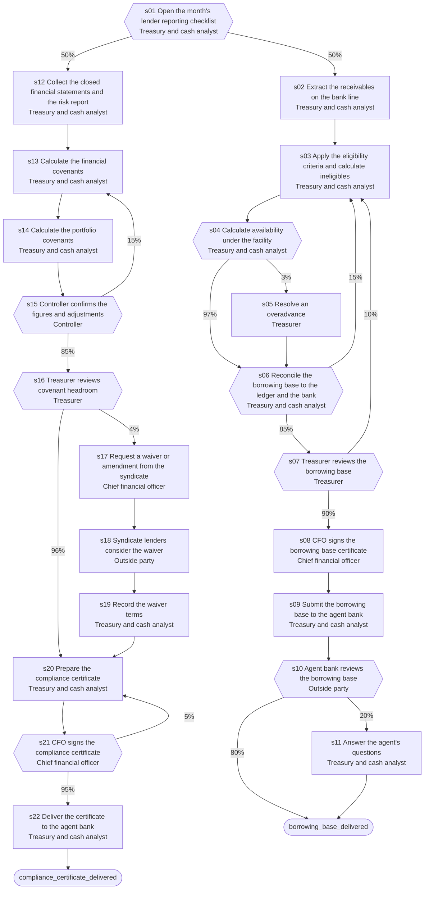

# Report borrowing base and covenants to banks

`efc-report-credit-facility-covenants` · equipment leasing and finance · treasury and securitisation · part of `equipment-finance-co`

New leases are first funded on a syndicated bank credit line, and the banks lend only against eligible receivables and only while the company meets its financial covenants. Each month the treasury analyst extracts the receivables on the line, applies the eligibility rules and concentration caps, calculates availability, reconciles it to the books and, after treasurer review, has the CFO sign the borrowing base certificate. After the month-end close the analyst also calculates the financial and portfolio covenants, the controller confirms the figures, the treasurer reviews headroom and the CFO signs the compliance certificate, with a waiver request when a covenant is breached. Waiting for the close, spreadsheet definitions that differ from accounting and late data make it slow and error-prone.

| | |
|---|---|
| Unit of work | one borrowing base or compliance report |
| Starts when | Month-end portfolio data are loaded (borrowing base) or the month's financial statements are released (compliance certificate). |
| Done when | The signed borrowing base certificate or compliance certificate is delivered to the agent bank and any questions are answered. |
| Organisation | A privately owned Canadian independent equipment lessor that warehouses new contracts on a syndicated revolving credit facility before selling them to conduits. (340 employees, 2019-2022) |
| Volume | 2 cases a month (range 1 to 2) |

## Where it sits

- Starts with **portfolio_data** from maintain-data-and-reporting (50% of cases)
- Starts with **financial_statements** from close-the-month (50% of cases)
- Relies on **risk_report** from monitor-portfolio-risk (a standing input; it does not start a case)
- Sends **borrowing_base_report** to bank_syndicate (outcome: borrowing_base_delivered)
- Sends **covenant_compliance_certificate** to bank_syndicate (outcome: compliance_certificate_delivered)
- Sends **borrowing_base_report** to manage-daily-cash (outcome: borrowing_base_delivered)

## Flow

## Roles

| Role | Department | Layer | FTE on this process | Loaded cost per hour | Evidence |
|---|---|---|---:|---:|---|
| Treasury and cash analyst | Treasury and securitisation | individual contributor | 0.15 | 48 CAD | B [src_vault_treasury], [src_jb_fin_analyst] |
| Treasurer | Treasury and securitisation | director | 0.04 | 105 CAD | C |
| Controller | Financial and lease accounting | director | 0.02 | 98 CAD | C |
| Chief financial officer | Finance | executive | 0.015 | 175 CAD | C |

## Steps

Hands-on time and the wait before each step show the most common value. Evidence tier A is a sourced number, B a sourced description, C the author's estimate.

| Step | Who | Kind | Hands-on | Wait before | Control | Evidence |
|---|---|---|---:|---:|---|---|
| **s01 Open the month's lender reporting checklist.** After month-end the treasury and cash analyst opens the reporting calendar, confirms which reports the credit agreement requires this month (the monthly borrowing base and the monthly or quarter-end compliance certificate), copies last month's workbooks and starts the report that is due first. | Treasury and cash analyst | intake | 20 min | 1.0 d |  | B [src_li_bbc], [src_li_compliance] |
| **s02 Extract the receivables on the bank line.** The analyst runs the warehouse report of contracts funded on the bank warehouse line and not yet sold to a conduit, with net investment, days past due, obligor, vendor, equipment type, province, booking date, term and any modification, and pastes it into the borrowing base workbook. | Treasury and cash analyst | data entry | 1.0 h | 3.0 d |  | B [src_vault_treasury] |
| **s03 Apply the eligibility criteria and calculate ineligibles.** The analyst applies the credit agreement's eligibility rules in the workbook: excludes contracts past due beyond the limit, defaulted, restructured or deferred, with insolvent or foreign obligors, without a perfected registration or on the line too long, and cuts amounts above obligor, vendor and used-equipment concentration caps. | Treasury and cash analyst | analysis | 2.0 h | 2.0 h | Credit agreement: definition of eligible receivables and concentration limits | B [src_li_eligible] |
| **s04 Calculate availability under the facility.** The analyst multiplies eligible receivables by the advance rate, deducts the reserves the agreement sets, compares the result with loans and letters of credit outstanding from the bank statement and shows the excess availability or an overadvance. | Treasury and cash analyst | analysis | 45 min | 1.0 h |  | C |
| **s05 Resolve an overadvance.** The treasurer decides how to bring loans back under the borrowing base, usually by repaying from cash or bringing forward a pool sale, calls the agent bank and records the agreed cure. | Treasurer | judgment | 1.0 h | 4.0 h | Credit agreement: mandatory prepayment when loans exceed the borrowing base | C |
| **s06 Reconcile the borrowing base to the ledger and the bank.** The analyst ties the total receivables in the listing to the lease subledger and general ledger, less contracts sold to conduits, and the loan balance to the agent bank's statement, and explains differences. | Treasury and cash analyst | validation | 1.0 h | 4.0 h | Internal control over financial reporting: lender reports agree to the books | C |
| **s07 Treasurer reviews the borrowing base.** The treasurer checks the movement in eligibles and ineligibles against last month, the concentration cuts and the availability, and approves the report or returns it. | Treasurer | review | 30 min | 1.0 d | Treasury procedure: preparer and reviewer of lender reports differ | C |
| **s08 CFO signs the borrowing base certificate.** The chief financial officer reads the summary and signs the certificate that the borrowing base is accurate and complete and that no default has occurred. | Chief financial officer | approval | 10 min | 1.0 d | Credit agreement: certificate signed by a responsible or financial officer | B [src_li_bbc] |
| **s09 Submit the borrowing base to the agent bank.** The analyst uploads the signed certificate with the receivables listing, aging and ineligibles schedule to the agent bank's portal or sends it by secure email, and files a copy. | Treasury and cash analyst | communication | 15 min | 1.0 h | Credit agreement: monthly delivery deadline for the borrowing base | B [src_li_bbc] |
| **s10 Agent bank reviews the borrowing base.** The agent's credit team checks the certificate against prior months and its own collateral monitoring and may ask about large ineligibles, concentrations or delinquency changes. | Outside party | external wait | 0 min | 3.0 d |  | C |
| **s11 Answer the agent's questions.** The analyst sends contract detail and explanations for the items queried and, if an error is found, a corrected certificate for signature. | Treasury and cash analyst | communication | 45 min | 4.0 h |  | C |
| **s12 Collect the closed financial statements and the risk report.** For the compliance certificate the analyst waits for accounting to release the month's financial statements and for risk to issue the monthly portfolio report, then pulls the trial balance, debt balances and delinquency and loss figures. | Treasury and cash analyst | lookup | 30 min | 11.0 d |  | C |
| **s13 Calculate the financial covenants.** The analyst calculates the ratios exactly as the credit agreement defines them: total debt to tangible net worth, minimum tangible net worth and, at quarter-ends, interest coverage on trailing earnings, with the agreed adjustments for securitisation debt and subordinated debt. | Treasury and cash analyst | analysis | 2.0 h | 2.0 h |  | B [src_cx_covenant], [src_jacobs_ca] |
| **s14 Calculate the portfolio covenants.** From the risk report and warehouse data the analyst calculates the portfolio tests, such as receivables more than 60 days past due and annualised net charge-offs as a share of the portfolio, and the share of deferred contracts in 2020, and compares them with the limits. | Treasury and cash analyst | analysis | 1.0 h | 1.0 h |  | C |
| **s15 Controller confirms the figures and adjustments.** The controller checks that the ledger figures, debt totals and covenant adjustments match the released statements and accounting policies, especially lease accounting and loss allowance effects, and signs the workbook or returns it. | Controller | review | 30 min | 1.0 d | Internal control over financial reporting: accounting review of figures sent to lenders | B [src_cx_covenant] |
| **s16 Treasurer reviews covenant headroom.** The treasurer compares each result with its limit and with the forecast for the next quarters and decides whether the company is in compliance or needs to ask the lenders for a waiver or amendment. | Treasurer | judgment | 30 min | 1.0 d |  | C |
| **s17 Request a waiver or amendment from the syndicate.** The chief financial officer calls the agent bank, explains the cause and the plan, and sends a written request for a waiver or a covenant amendment, often with a fee and tighter reporting. | Chief financial officer | communication | 2.0 h | 2.0 d | Credit agreement: covenant waivers need the consent of the required lenders | B [src_cx_covenant] |
| **s18 Syndicate lenders consider the waiver.** The agent circulates the request, each lender's credit team reviews it and the required lenders consent, sometimes after negotiating the fee or conditions. | Outside party | external wait | 0 min | 14.0 d |  | C |
| **s19 Record the waiver terms.** The analyst updates the covenant workbook and the reporting calendar with the waiver or amended levels, any new reporting and the fee, and notes it on the certificate. | Treasury and cash analyst | data entry | 30 min | 4.0 h |  | C |
| **s20 Prepare the compliance certificate.** The analyst fills the certificate form attached to the credit agreement with each covenant calculation and limit, confirms that no default exists, and attaches the financial statements and, at quarter-ends, the required commentary. | Treasury and cash analyst | drafting | 45 min | 2.0 h |  | B [src_li_compliance], [src_cx_covenant] |
| **s21 CFO signs the compliance certificate.** The chief financial officer reviews the certificate and supporting schedule and signs it as the responsible officer certifying the calculations and that no default has occurred. | Chief financial officer | approval | 20 min | 1.0 d | Credit agreement: compliance certificate signed by a responsible officer; a false certificate is an event of default | B [src_li_compliance], [src_cx_covenant] |
| **s22 Deliver the certificate to the agent bank.** The analyst sends the signed certificate and statements to the agent bank for the syndicate before the deadline, because a late certificate can raise pricing or become a default, and files a copy. | Treasury and cash analyst | communication | 15 min | 1.0 h | Credit agreement: reporting deadlines (late certificates trigger the highest pricing level in the sample agreement) | B [src_jacobs_ca], [src_li_compliance] |

## Exceptions

| Exception | Share of cases | What happens |
|---|---:|---|
| Overadvance | 2% | Loans exceed the borrowing base and the treasurer arranges a repayment or an earlier pool sale. |
| Borrowing base does not tie | 8% | The listing does not agree to the ledger or the bank and is corrected. |
| Agent questions | 10% | The agent bank queries ineligibles, concentrations or delinquency. |
| Covenant figures corrected | 8% | The controller finds a figure or definition error and the covenants are recalculated. |
| Covenant breach and waiver | 2% | A covenant is breached or about to be and the CFO obtains a waiver or amendment before the certificate goes out. |

## Benchmarks

| Metric | Value | Unit | Population | Evidence |
|---|---|---|---|---|
| cycle_time_days | p50 15, p90 24 | calendar days from month-end to delivery of the report | Canadian independent equipment lessor with a syndicated warehouse facility, 2019-2022 | C [src_li_bbc], [src_li_compliance] |
| borrowing_base_delivery_deadline | low 10, high 30 | days after month-end | Sample credit agreement clauses | A [src_li_bbc] |
| quarterly_compliance_certificate_deadline | low 30, high 60 | days after quarter-end | Sample clauses and practitioner guidance | A [src_li_compliance], [src_cx_covenant] |
| eligible_receivable_delinquency_cutoff | low 61, high 120 | days past due | Sample eligible lease receivable definitions | A [src_li_eligible] |

## Pain points

- Eligibility rules and concentration caps live in a spreadsheet and are applied by hand each month, so errors appear when the bank or the reviewer checks them. (steps s03, s07; C)
- The compliance certificate cannot start until accounting releases the statements and risk issues its report, which leaves little time before the deadline. (steps s12; C)
- Covenant definitions differ from accounting figures (securitisation debt, subordinated debt, lease accounting), which causes rework between treasury and the controller. (steps s13, s15; B [src_cx_covenant])
- A projected breach needs weeks of syndicate approval for a waiver. (steps s17, s18; C)

## Assumptions

- One borrowing base certificate and one compliance certificate a month make the two cases; quarter-end certificates are covered by the high ends of the time ranges.
- The risk report trigger arrives inside the compliance case (step s12), so it has a share of zero.
- The borrowing base also goes to daily cash management, which lists it as an input (efc-manage-daily-cash); the organisation file's process map does not list that link.
- Advance rates, eligibility rules, covenant types and limits are private; those described are typical of lessor warehouse facilities and sample clauses, not the company's actual terms.
- The CFO signs both certificates; some agreements accept the controller or treasurer as responsible officer.
- Annual field examinations and audits of the borrowing base by the agent bank are outside this case but add to the analyst's time on the process.
- External steps have no touch time; lender reviews and waiver consents are in wait_before_min.
- Loaded costs are the organisation file's (2019-2022 wage times 1.35).

## Sources

- [src_li_bbc] [Borrowing base certificate (sample clauses from credit agreements)](https://www.lawinsider.com/clause/borrowing-base-certificate) (Law Insider, n.d.). Sample clauses require an updated borrowing base certificate within 10, 15 or 30 days after each month-end, certified by a responsible officer or by the chief financial officer or corporate controller, delivered with the borrowing base reports, and more often after certain events.
- [src_li_eligible] [Eligible lease receivables (definitions from credit agreements)](https://www.lawinsider.com/dictionary/eligible-lease-receivables) (Law Insider, n.d.). Sample definitions exclude leases more than 61 days (or 120 days) past due, in default, not subject to a first priority perfected security interest, restructured for credit reasons, with foreign lessees, older than 210 days or above lessee and used-equipment concentration caps.
- [src_li_compliance] [Monthly financial statements; compliance certificates (sample clauses)](https://www.lawinsider.com/clause/monthly-financial-statements-compliance-certificates) (Law Insider, n.d.). Monthly statements due 20 or 30 days after month-end; a quarterly compliance certificate due 45 days after quarter-end and an annual one 120 days after year-end, signed by a responsible officer.
- [src_cx_covenant] [Debt covenant deadlines are coming: how private companies prepare for the audit](https://cx.connorgp.com/insights/debt-covenant) (CX, a Connor Group company, n.d.). Compliance certificates are signed officer certifications of the ratio calculations, filed each quarter and at year-end, commonly due 30, 45 or 60 days after period close; typical ratios are leverage, interest coverage and fixed charge coverage; lenders expect supporting workpapers and early conversations about adjustments.
- [src_jacobs_ca] [Credit agreement dated December 15, 2005 (exhibit 10.12), Canadian dollar revolving tranche](https://www.sec.gov/Archives/edgar/data/52988/000119312506248847/dex1012.htm) (US SEC EDGAR, 2006). A syndicated revolving credit agreement with a Canadian dollar tranche agented by a Canadian bank; pricing is set by the leverage ratio in the latest compliance certificate and the highest pricing level applies if a certificate is late.
- [src_chesswood_fy2021] [Chesswood announces fiscal year 2021 results](https://www.newswire.ca/news-releases/chesswood-announces-fiscal-year-2021-results-834803822.html) (Chesswood Group (Newswire), 2022). A Canadian equipment finance group formed a new revolver syndicate in 2021 and reports non-GAAP measures based on the requirements of its significant banking and lending agreements.
- [src_vault_treasury] [Financial/Securitization Analyst (job posting)](https://builtintoronto.com/job/treasury-analyst/7949052) (Built In Toronto, n.d.). A Toronto non-bank lender with equipment leasing: produces monthly compliance reports, makes borrowing requests, sends regular reports to funders and supports funder audits; Excel and Great Plains.
- [src_jb_fin_analyst] [Wages: Financial analyst in Canada (NOC 11101)](https://www.jobbank.gc.ca/marketreport/wages-occupation/12417/ca) (Job Bank, Government of Canada, 2024). Hourly wages low $28.21, median $43.27, high $72.36 (2023-2024).

Written by claude-opus on 2026-11-17.
