# Prepare servicer reports for funders

`efc-report-to-securitisation-funders` · equipment leasing and finance · treasury and securitisation · part of `equipment-finance-co`

The company sells pools of leases to bank-sponsored commercial paper conduits but keeps collecting the payments as servicer, so every month it must tell each conduit what happened to its pool. A securitisation analyst extracts the pool data, reconciles collections to the collection account, processes payouts, restructures and defaults, calculates repurchases, delinquency and loss ratios, tests the performance triggers and works out the reserve and distributions. A second analyst checks the report, the treasurer signs the servicer certificate and releases the remittance, and the conduit reviews it. Spreadsheet models, data fixes, collection breaks and waiting for the month-end close make the work slow and error-prone.

| | |
|---|---|
| Unit of work | one monthly servicer report |
| Starts when | The month ends and the month-end pool data are loaded; collections, pool change notices and closed balances arrive during the case. |
| Done when | The signed servicer report and data file are accepted by the conduit, the remittance or reserve transfer is released and the pool tracker is updated. |
| Organisation | A privately owned Canadian independent equipment lessor funding about 65% of its $1.5 billion of receivables through three bank-sponsored ABCP conduits. (340 employees, 2019-2022) |
| Volume | 4 cases a month (range 3 to 5) |

## Where it sits

- Starts with **portfolio_data** from maintain-data-and-reporting (100% of cases)
- Relies on **collections_data** from apply-customer-payments (a standing input; it does not start a case)
- Relies on **pool_change_notice** from quote-and-process-buyouts (a standing input; it does not start a case)
- Relies on **pool_change_notice** from process-lease-assumptions (a standing input; it does not start a case)
- Relies on **pool_change_notice** from restructure-and-defer-payments (a standing input; it does not start a case)
- Relies on **pool_change_notice** from recover-deficiencies-and-write-off (a standing input; it does not start a case)
- Relies on **securitisation_pool** from sell-securitisation-pools (a standing input; it does not start a case)
- Relies on **closed_month_balances** from close-the-month (a standing input; it does not start a case)
- Sends **servicer_report** to conduit_sponsor (outcome: report_accepted)

## Flow

```mermaid
flowchart TD
    s01["s01 Run the month-end batch and load pool data<br/>Automated"]
    s02{{"s02 Extract the pool data and load the servicer report model<br/>Securitisation and funding analyst"}}
    s03["s03 Fix a failed or incomplete pool extract<br/>Data and business intelligence developer"]
    s04{{"s04 Reconcile pool collections to the collection account<br/>Securitisation and funding analyst"}}
    s05{{"s05 Investigate collection breaks with cash application<br/>Securitisation and funding analyst"}}
    s06{{"s06 Review the month's pool change notices<br/>Securitisation and funding analyst"}}
    s07["s07 Calculate repurchases of ineligible or modified contracts<br/>Securitisation and funding analyst"]
    s08["s08 Approve the repurchase and substitution list<br/>Treasurer"]
    s09["s09 Receive the conduit's funding cost and fee statement<br/>Outside party"]
    s10["s10 Calculate the pool balance and performance ratios<br/>Securitisation and funding analyst"]
    s11{{"s11 Test the triggers and calculate the reserve and distributions<br/>Securitisation and funding analyst"}}
    s12["s12 Escalate a trigger breach with the sponsor<br/>Treasurer"]
    s13{{"s13 Tie the pool to the closed month ledger<br/>Securitisation and funding analyst"}}
    s14["s14 Prepare the servicer report and data file<br/>Securitisation and funding analyst"]
    s15{{"s15 Second analyst checks the report<br/>Securitisation and funding analyst"}}
    s16{{"s16 Treasurer reviews and signs the servicer certificate<br/>Treasurer"}}
    s17["s17 Submit the report and data file to the conduit<br/>Securitisation and funding analyst"]
    s18["s18 Set up the monthly remittance or reserve transfer<br/>Securitisation and funding analyst"]
    s19["s19 Release the remittance<br/>Treasurer"]
    s20{{"s20 Conduit administrator reviews the report<br/>Outside party"}}
    s21{{"s21 Answer conduit questions or correct the report<br/>Securitisation and funding analyst"}}
    s22["s22 File the report and update the pool performance tracker<br/>Securitisation and funding analyst"]
    s01 --> s02
    s02 -->|"86%"| s04
    s02 -->|"14%"| s03
    s03 --> s02
    s04 -->|"75%"| s06
    s04 -->|"25%"| s05
    s05 -->|"30%"| s04
    s05 -->|"70%"| s06
    s06 -->|"35%"| s07
    s06 -->|"65%"| s09
    s07 --> s08
    s08 --> s09
    s09 --> s10
    s10 --> s11
    s11 -->|"94%"| s13
    s11 -->|"6%"| s12
    s12 --> s13
    s13 -->|"82%"| s14
    s13 -->|"18%"| s10
    s14 --> s15
    s15 -->|"85%"| s16
    s15 -->|"15%"| s14
    s16 -->|"90%"| s17
    s16 -->|"10%"| s14
    s17 --> s18
    s18 --> s19
    s19 --> s20
    s20 -->|"75%"| s22
    s20 -->|"25%"| s21
    s21 -->|"85%"| s22
    s21 -->|"15%"| s20
    s22 --> end0
    end0(["report_accepted"])
```

## Roles

| Role | Department | Layer | FTE on this process | Loaded cost per hour | Evidence |
|---|---|---|---:|---:|---|
| Securitisation and funding analyst | Treasury and securitisation | individual contributor | 0.85 | 56 CAD | B [src_vault_treasury], [src_jb_fin_analyst] |
| Treasurer | Treasury and securitisation | director | 0.06 | 105 CAD | C |
| Data and business intelligence developer | Data and reporting | individual contributor | 0.03 | 56 CAD | C |

## Steps

Hands-on time and the wait before each step show the most common value. Evidence tier A is a sourced number, B a sourced description, C the author's estimate.

| Step | Who | Kind | Hands-on | Wait before | Control | Evidence |
|---|---|---|---:|---:|---|---|
| **s01 Run the month-end batch and load pool data.** After the last business day of the month the lease system runs its month-end processing and the overnight load refreshes the data warehouse with contract balances, payments, delinquency status and the pool code of every securitised contract. | Automated | system auto | 0 min | 1.0 d |  | C |
| **s02 Extract the pool data and load the servicer report model.** The securitisation analyst runs the warehouse query for this conduit's pools and pastes the contract-level results into the servicer report workbook: opening and closing balances, scheduled and received payments, prepayments, delinquency status, defaults, charge-offs, recoveries and modifications. Pool sales take priority in the first days of the month, so reports queue. | Securitisation and funding analyst | data entry | 1.5 h | 1.5 d |  | B [src_charter_424b], [src_vault_treasury] |
| **s03 Fix a failed or incomplete pool extract.** A data and business intelligence developer finds why the extract is short or wrong, for example a failed overnight load, contracts missing their pool code after a restructure or a changed status code, fixes the data or the query and reruns it. | Data and business intelligence developer | analysis | 1.0 h | 1.0 d |  | C |
| **s04 Reconcile pool collections to the collection account.** The analyst ties the month's cash applied to this conduit's contracts (from cash application) to the deposits and transfers on the collection account bank statement and to the amounts already remitted or held for the conduit, and lists any differences. | Securitisation and funding analyst | validation | 2.0 h | 1.0 h | Servicing agreement and internal control: collections reported to the conduit reconcile to the collection account | B [src_charter_424b] |
| **s05 Investigate collection breaks with cash application.** The analyst emails the cash application team about misapplied payments, debits returned after the cut-off, unidentified receipts and payouts posted to the wrong contract, and waits for corrections or explanations. | Securitisation and funding analyst | coordination | 1.0 h | 1.0 d |  | C |
| **s06 Review the month's pool change notices.** The analyst works through the notices of payouts, assumptions, restructures and deferrals, defaults and write-offs on securitised contracts, checks each against the lease system and flags contracts whose change breaks the eligibility criteria or the servicing standards. | Securitisation and funding analyst | validation | 2.0 h | 2.0 h |  | B [src_li_eligible], [src_charter_424b] |
| **s07 Calculate repurchases of ineligible or modified contracts.** For contracts that were restructured, assumed or found ineligible, the analyst calculates the repurchase price (the discounted balance plus arrears) and, where the facility allows, picks eligible unsold contracts to substitute. | Securitisation and funding analyst | analysis | 1.5 h | 4.0 h | Receivables purchase agreement: seller repurchases receivables that breach eligibility representations | B [src_li_eligible] |
| **s08 Approve the repurchase and substitution list.** The treasurer checks the repurchase amounts and substitutes against the facility terms and the cash forecast and approves them, because repurchases use the company's cash or bank line. | Treasurer | approval | 20 min | 1.0 d | Treasury authority for repurchases and substitutions | C |
| **s09 Receive the conduit's funding cost and fee statement.** The sponsor bank's administrator sends the month's commercial paper cost, program and liquidity fees for this facility, which the waterfall needs. It usually arrives while the reconciliation is under way. | Outside party | external wait | 0 min | 1.0 h |  | C |
| **s10 Calculate the pool balance and performance ratios.** The analyst calculates the discounted pool balance at the facility's discount rate, the pool factor, delinquency by bucket (one to four payments late), the monthly default ratio, cumulative net losses after recoveries and the prepayment rate, and compares them with last month. | Securitisation and funding analyst | analysis | 2.0 h | 2.0 h |  | B [src_charter_424b], [src_boc_abcp] |
| **s11 Test the triggers and calculate the reserve and distributions.** The analyst compares the delinquency, default and loss ratios with the facility's trigger levels, works out the required cash reserve and overcollateralization, and runs the waterfall: conduit interest and fees, principal paydown, servicing fee and any excess spread released to the company. | Securitisation and funding analyst | analysis | 2.0 h | 1.0 h | Securitisation facility terms: performance triggers, cash reserve and overcollateralization requirements | B [src_boc_abcp] |
| **s12 Escalate a trigger breach with the sponsor.** The treasurer reviews the breach or near-miss with the CFO, calls the sponsor bank, agrees whether excess spread is trapped, the reserve topped up, the pool topped up with new contracts or a waiver requested, and has the analyst reflect the result in the report. | Treasurer | judgment | 2.0 h | 1.0 d |  | C |
| **s13 Tie the pool to the closed month ledger.** When accounting finishes the month-end securitisation reconciliation, the analyst compares the pool balances, collections and reserve with the closed securitisation subledger and liability balances, and explains or fixes differences. | Securitisation and funding analyst | validation | 1.0 h | 2.5 d | Internal control over financial reporting: securitisation balances reported to funders agree to the ledger (securitised leases stay on balance sheet) | B [src_cwb_note8] |
| **s14 Prepare the servicer report and data file.** The analyst fills the conduit's report template with collections, pool balances, delinquencies, defaults, recoveries, repurchases, trigger tests, reserve and distributions, and exports the contract-level data file in the conduit's layout. | Securitisation and funding analyst | drafting | 1.5 h | 2.0 h |  | B [src_charter_424b], [src_vault_treasury] |
| **s15 Second analyst checks the report.** Another securitisation analyst re-checks the key figures against the model and the reconciliations: collections tie-out, ratios, trigger levels, reserve and the distribution amounts, and returns errors. | Securitisation and funding analyst | review | 1.0 h | 12.0 h | Treasury procedure: maker-checker review of funder reports | C |
| **s16 Treasurer reviews and signs the servicer certificate.** The treasurer reviews the report, the trigger results, repurchases and the remittance amount, and signs the servicer's officer certificate that the report is accurate and the servicer has met its obligations. | Treasurer | approval | 45 min | 12.0 h | Servicing agreement: officer's certificate with each monthly report | C |
| **s17 Submit the report and data file to the conduit.** The analyst uploads the signed report, certificate and data file to the conduit administrator's portal or sends them by secure email to the sponsor's securitisation team before the reporting date. | Securitisation and funding analyst | communication | 20 min | 1.0 h |  | B [src_boc_abcp], [src_vault_treasury] |
| **s18 Set up the monthly remittance or reserve transfer.** The analyst enters in the bank portal the transfer the waterfall requires: collections due to the conduit, a reserve top-up, or the receipt of released excess spread, with the report attached for approval. | Securitisation and funding analyst | data entry | 20 min | 1.0 h |  | C |
| **s19 Release the remittance.** The treasurer checks the pending payment against the signed report and releases it in the bank portal; no single person can both set up and release a funder payment. | Treasurer | approval | 10 min | 4.0 h | Treasury payment control: dual authorisation of wires | C |
| **s20 Conduit administrator reviews the report.** The sponsor's team checks the report against the data file and its own records, recalculates the triggers and the distribution and may send questions. | Outside party | external wait | 0 min | 3.0 d |  | C |
| **s21 Answer conduit questions or correct the report.** The analyst explains movements such as a jump in deferrals or a large default, sends supporting contract detail and, where an error is found, corrects and resubmits the report. | Securitisation and funding analyst | communication | 1.0 h | 4.0 h |  | B [src_vault_treasury] |
| **s22 File the report and update the pool performance tracker.** The analyst files the final report and certificate, adds the month's delinquency, default, loss and prepayment figures to the pool tracker used for pricing the next pool sale and for management reporting, and sends a short summary to the treasurer. | Securitisation and funding analyst | data entry | 30 min | 4.0 h |  | C |

## Exceptions

| Exception | Share of cases | What happens |
|---|---:|---|
| Failed or incomplete pool extract | 14% | The warehouse load failed or contracts lack pool codes; a data developer fixes the extract. |
| Collection breaks | 25% | Cash applied to pool contracts does not tie to the collection account and the analyst chases cash application. |
| Repurchases or substitutions | 35% | Restructured, assumed or ineligible contracts are repurchased or substituted with treasurer approval. |
| Trigger breach or near-miss | 6% | A delinquency, default or loss ratio breaches or nears its trigger; the treasurer agrees the response with the sponsor. |
| Ledger difference | 18% | Pool balances do not tie to the closed securitisation subledger and figures are recalculated. |
| Conduit questions | 25% | The sponsor asks about movements or finds an error; the analyst answers or resubmits. |

## Benchmarks

| Metric | Value | Unit | Population | Evidence |
|---|---|---|---|---|
| cycle_time_days | p50 17, p90 24 | calendar days from month-end to the conduit accepting the report | Canadian independent equipment lessor reporting to bank-sponsored ABCP conduits, 2019-2022 | C [src_boc_abcp] |
| conduit_monthly_disclosure_deadline | 50 | days after month-end | Canadian ABCP conduits relying on the NI 45-106 ABCP exemption | A [src_boc_abcp] |
| defaulted_lease_definition | 120 | days delinquent | Charter Equipment Lease 1998-1 securitisation | A [src_charter_424b] |
| securitisation_proceeds_to_balance_2021 | 0.899 | cash proceeds divided by securitised lease and loan balances | CWB, 2021 | B [src_cwb_note8] |

## Pain points

- Reports are built in spreadsheet models from warehouse extracts, so formula, range and template errors are common and need a second analyst to catch. (steps s02, s10, s14, s15; C)
- Collections often do not tie to the collection account on the first pass because of misapplied and returned payments around the cut-off. (steps s04, s05; C)
- Pool change notices arrive by email from several teams and modified contracts are easy to miss, which can lead to late repurchases. (steps s06, s07; C)
- The final tie-out waits for the month-end close, compressing the time left before the reporting date. (steps s13; C)

## Assumptions

- One case is one facility's monthly report; four a month (three conduits, one reporting two series).
- Collections data, pool change notices, the new pool from the latest sale and closed balances are listed as triggers with a share of zero because they arrive inside the case; the month-end pool data start it.
- The existing close-the-month workflow does not list closed_month_balances as an output to this process, although the organisation file does; this file follows the organisation file.
- Facility terms (trigger levels, reserve rules, repurchase obligations, reporting dates) are private; the items listed are typical of rated equipment securitisations and are author estimates.
- The second-analyst check uses another securitisation analyst; with three analysts this is feasible but slips in busy months.
- External steps have no touch time; the sponsor's statement and review are in wait_before_min.
- Loaded costs are the organisation file's (2019-2022 wage times 1.35).

## Sources

- [src_boc_abcp] [A primer on the Canadian asset-backed commercial paper market](https://www.bankofcanada.ca/wp-content/uploads/2024/06/primer-canadian-abcp.pdf) (Bank of Canada, 2024). Most Canadian bank-sponsored conduits are multi-seller programs buying third-party assets including equipment leases; sellers give first-loss enhancement through excess spread, overcollateralization and cash reserves; conduits relying on the ABCP exemption publish a Form 45-106F8 monthly disclosure report on asset pools and their performance no later than 50 days after month-end.
- [src_charter_424b] [Charter Equipment Lease 1998-1 LLC prospectus (Form 424B1)](https://www.sec.gov/Archives/edgar/data/0001070771/000089155499001687/0000891554-99-001687.txt) (US SEC EDGAR, 1999). The servicer prepares a statement each period with fees, outstanding balances, pool factor, discounted lease balance, unreimbursed servicer advances, recoveries on defaulted leases and leases one to four payments delinquent, and delivers a monthly servicer report to the rating agencies; defaulted leases are those more than 120 days delinquent or charged off; collections are earmarked to the pool where the lease is funded.
- [src_dbrs_puregrove] [DBRS Morningstar updates Pure Grove Funding transaction 102](https://dbrs.morningstar.com/research/407173/dbrs-morningstar-updates-pure-grove-funding-transaction-102) (DBRS Morningstar, 2022). A Canadian ABCP conduit transaction backed by fixed-rate equipment leases on commercial trucks, with a $500 million program limit and several conduit lenders, rated under the Canadian equipment finance securitization methodology.
- [src_li_eligible] [Eligible lease receivables (definitions from credit agreements)](https://www.lawinsider.com/dictionary/eligible-lease-receivables) (Law Insider, n.d.). Sample definitions exclude leases more than 61 days (or 120 days) past due, in default, not subject to a first priority perfected security interest, restructured for credit reasons, or above lessee concentration limits.
- [src_cwb_note8] [CWB Financial Group Annual Report 2021, note 8: securitization](https://publications.cwb.com/view/902877744/89) (CWB Financial Group, 2021). Securitized equipment leases and loans of $1.07 billion in 2021 for cash proceeds of $963 million do not qualify for derecognition, so a securitization liability is recognised.
- [src_vault_treasury] [Financial/Securitization Analyst (job posting)](https://builtintoronto.com/job/treasury-analyst/7949052) (Built In Toronto, n.d.). A Toronto non-bank lender with equipment leasing: prepares tranches for funders, pays funders on time, produces monthly compliance reports, sends regular reports to funders, supports funder audits and makes borrowing requests; Excel and Great Plains.
- [src_jb_fin_analyst] [Wages: Financial analyst in Canada (NOC 11101)](https://www.jobbank.gc.ca/marketreport/wages-occupation/12417/ca) (Job Bank, Government of Canada, 2024). Hourly wages low $28.21, median $43.27, high $72.36 (2023-2024).

Written by claude-opus on 2026-11-17.
