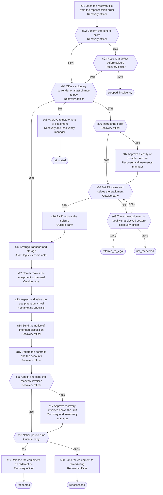

# Repossess leased equipment

`efc-repossess-equipment` · equipment leasing and finance · collections and recoveries · part of `equipment-finance-co`

When late-stage collections gives up on a defaulted lease, a recovery officer takes the equipment back so it can be sold against the balance. The officer confirms that notices have run, no insolvency stay applies and the registration is valid, tries for a voluntary surrender, otherwise instructs a licensed bailiff, arranges transport and storage, sends the notice of intended disposition the provincial PPSA requires to the customer, guarantors and other secured parties, and hands the equipment to remarketing once the notice period ends. It takes five to seven weeks, most of it waiting for the bailiff, the carrier and the statutory notice period, and goes wrong when equipment has been moved, a notice is defective or the customer files for insolvency first.

| | |
|---|---|
| Unit of work | one repossession |
| Starts when | Late-stage collections sends an approved repossession order, or a bailiff reports equipment found or abandoned on an account already in recovery. |
| Done when | The equipment is in storage, the notice period has passed and the file is with remarketing, or the account is reinstated, redeemed, stayed by insolvency, sent to legal or recorded as equipment not recovered. |
| Organisation | A mid-size Canadian independent equipment lessor with about 55,000 active contracts and a five-person recoveries team that uses outside bailiffs, carriers and storage yards. (340 employees, 2019-2022) |
| Volume | 45 cases a month (range 30 to 75) |

## Where it sits

- Starts with **repossession_order** from collect-late-stage (95% of cases)
- Starts with **bailiff_report** from bailiff (5% of cases)
- Sends **repossession_order** to bailiff (outcome: any)
- Sends **ap_invoice** to pay-operating-suppliers (outcome: any)
- Sends **transport_order** to transport_storage (outcome: repossessed)
- Sends **transport_order** to transport_storage (outcome: redeemed)
- Sends **disposition_notice** to customer (outcome: repossessed)
- Sends **repossessed_asset** to remarket-equipment (outcome: repossessed)

## Flow

## Roles

| Role | Department | Layer | FTE on this process | Loaded cost per hour | Evidence |
|---|---|---|---:|---:|---|
| Recovery officer | Recoveries and insolvency | senior specialist | 1.4 | 42 CAD | B [src_jb_14202] |
| Recovery and insolvency manager | Recoveries and insolvency | manager | 0.12 | 72 CAD | B [src_jb_10021] |
| Asset logistics coordinator | Asset management and remarketing | individual contributor | 0.15 | 32 CAD | C |
| Remarketing specialist | Asset management and remarketing | individual contributor | 0.3 | 40 CAD | C |

## Steps

Hands-on time and the wait before each step show the most common value. Evidence tier A is a sourced number, B a sourced description, C the author's estimate.

| Step | Who | Kind | Hands-on | Wait before | Control | Evidence |
|---|---|---|---:|---:|---|---|
| **s01 Open the recovery file from the repossession order.** A recovery officer receives the repossession package from late-stage collections (contract, guarantees, registration verification, default notice with proof of delivery, equipment list with serial numbers, location and contacts, recovery value estimate), opens a recovery file in the collections system and imaging, and notes the province, because seizure and notice rules differ. | Recovery officer | intake | 25 min | 1.0 d |  | C |
| **s02 Confirm the right to seize.** The officer checks that the lease is in default and terminated, that the demand, default notice and any section 244 notice were delivered and their periods have run, refreshes the insolvency search for a notice of intention, proposal or bankruptcy that would stay enforcement, and searches the registry to confirm the company's registration (or Quebec publication) is in place and the serial numbers match. | Recovery officer | validation | 30 min | 4.0 h | PPSA right to take possession on default (BC s.58, Ontario s.62), common-law reasonable notice before seizure, BIA s.244 ten-day notice and BIA stays of proceedings; Quebec Civil Code art. 1852 publication of lease rights | A [src_bc_ppsa], [src_bia_s244], [src_lawtimes_priest], [src_lerners_walgre], [src_legal500_demand], [src_elfa_quebec_pub] |
| **s03 Resolve a defect before seizure.** The officer deals with what the check found: waits out a notice period that has not run, gets a missing notice re-served, corrects a registration error with the registration clerks, or, when the customer has filed for insolvency, stops the seizure and refers the file to recoveries' insolvency work and legal. | Recovery officer | coordination | 45 min | 1.0 d |  | B [src_lerners_walgre], [src_bia_s244] |
| **s04 Offer a voluntary surrender or a last chance to pay.** Before sending a bailiff the officer calls the customer and guarantors to ask them to surrender the equipment at an agreed place and time, which saves bailiff and towing costs, or to pay the full arrears and costs to reinstate. Many customers who are closing down agree to surrender. | Recovery officer | communication | 25 min | 8.0 h |  | C |
| **s05 Approve reinstatement or settlement.** The recovery manager confirms the funds have cleared and that the payment covers arrears, costs and any conditions, approves cancelling the repossession and returns the account to collections with a note. | Recovery and insolvency manager | approval | 15 min | 8.0 h | Recovery policy: delegated authority to reinstate a terminated lease or accept a settlement | C |
| **s06 Instruct the bailiff.** The officer picks a licensed bailiff from the company's panel for the province, sends the written repossession instruction with copies of the lease, the registration verification, the notices, the equipment list with serial numbers and photos, the location and any known hazards, and agrees the fee and the date. | Recovery officer | communication | 30 min | 4.0 h |  | C |
| **s07 Approve a costly or complex seizure.** The recovery manager approves seizures expected to cost more than the officer's limit, such as heavy equipment needing low-bed transport, several sites, a hostile customer needing a police standby, or equipment on a third party's premises. | Recovery and insolvency manager | approval | 15 min | 8.0 h | Recovery policy: approval limits for repossession costs | C |
| **s08 Bailiff locates and seizes the equipment.** The bailiff schedules the seizure, attends the site, identifies the units by serial number, takes possession or seizes them in place, serves the seizure documents on the customer and photographs the condition. Equipment that is moved, hidden, locked in or at a job site needs repeat attempts. | Outside party | external wait | 0 min | 5.0 d |  | C |
| **s09 Trace the equipment or deal with a blocked seizure.** The officer works out where the equipment went: calls guarantors and the dealer, checks bureau and corporate records for new addresses, uses truck GPS or ELD data where the lease allows, and asks legal for a court order when the customer refuses access. The bailiff is sent again once a location is found. | Recovery officer | analysis | 1.0 h | 1.0 d |  | C |
| **s10 Bailiff reports the seizure.** The bailiff sends the report: date and place of seizure, units taken with serial numbers, hour or odometer readings, condition notes and photos, items left behind, and the invoice for the seizure. | Outside party | external wait | 0 min | 1.0 d |  | C |
| **s11 Arrange transport and storage.** The asset logistics coordinator books a carrier and a storage or auction yard near the equipment, sends the transport order with pickup details, dimensions, keys and access instructions, and tells the yard what to expect. For trucks the bailiff's tow often goes straight to the yard. | Asset logistics coordinator | coordination | 25 min | 4.0 h |  | C |
| **s12 Carrier moves the equipment to the yard.** The carrier picks the equipment up from the customer's site or the bailiff's lot and delivers it to the storage or auction yard, which signs a receipt with any visible damage noted. | Outside party | external wait | 0 min | 3.0 d |  | C |
| **s13 Inspect and value the equipment on arrival.** A remarketing specialist reviews the yard's receipt, the bailiff's photos and, for higher-value units, a yard or appraiser inspection; records condition, missing parts and repairs needed; arranges return of the customer's personal property left in the equipment; and updates the expected recovery value. | Remarketing specialist | analysis | 45 min | 1.0 d |  | C |
| **s14 Send the notice of intended disposition.** The officer searches the registry for other secured parties, prepares the notice of disposition from the provincial template (the equipment, the amount needed to redeem, the date after which it may be sold, and that the debtor may be liable for a deficiency) and sends it by registered mail to the customer, each guarantor and the registered secured parties, keeping proof of mailing. | Recovery officer | drafting | 30 min | 8.0 h | PPSA notice of disposition: at least 20 days in British Columbia (s.59(6)) and 15 days in Ontario (s.63(4)) before sale, to the debtor, owners and registered secured parties, with prescribed contents | A [src_bc_ppsa], [src_lawtimes_priest] |
| **s15 Update the contract and the accounts.** The officer records the repossession in the lease system: terminates the contract, stops billing and debits, moves the balance to repossessed status with the equipment's estimated value, flags a securitised contract as defaulted for the funder report, and updates the collections system. | Recovery officer | data entry | 30 min | 4.0 h |  | C |
| **s16 Check and code the recovery invoices.** The officer checks the bailiff, carrier and storage invoices against the quotes and the work done, codes them to the contract's recovery costs and sends them to accounts payable. This runs while the notice period passes. | Recovery officer | validation | 15 min | 1.0 d |  | C |
| **s17 Approve recovery invoices above the limit.** The recovery manager approves bailiff, towing and storage invoices above the officer's limit, querying charges that exceed the agreed fee. | Recovery and insolvency manager | approval | 10 min | 1.0 d | Accounts payable approval limits | C |
| **s18 Notice period runs.** The case waits until the notice period has passed. The customer, a guarantor or another secured party may redeem by paying the full amount owed and costs; very few do. | Outside party | external wait | 0 min | 20.0 d |  | A [src_bc_ppsa], [src_lawtimes_priest] |
| **s19 Release the equipment on redemption.** The officer confirms the redemption funds have cleared, has the contract paid out or reinstated as agreed, and arranges with the yard and carrier for the equipment's release to the customer once storage and transport costs are paid. | Recovery officer | coordination | 45 min | 8.0 h |  | B [src_bc_ppsa] |
| **s20 Hand the equipment to remarketing.** The officer passes the file to remarketing: condition report, keys and documents, notice dates and the earliest sale date, the balance and recovery costs, so the equipment can be sold in a commercially reasonable way and any deficiency pursued afterwards. | Recovery officer | coordination | 20 min | 4.0 h |  | B [src_charter_424b], [src_bc_ppsa] |

## Exceptions

| Exception | Share of cases | What happens |
|---|---:|---|
| Defect or insolvency found before seizure | 15% | A notice period has not run, a notice or registration is defective, or the customer has filed a notice of intention or bankruptcy; about a third of these stop at an insolvency stay. |
| Voluntary surrender | 21% | The customer agrees to hand the equipment over, avoiding the bailiff. |
| Reinstated before seizure | 7% | The customer pays arrears and costs at the last call; the manager approves cancelling the repossession. |
| Equipment not found or access refused | 13% | The equipment was moved, hidden or is locked in; the officer traces it and sends the bailiff again, refers it for a court order or records it as not recovered. |
| Redeemed during the notice period | 3% | The customer, a guarantor or another secured party pays the full amount and the equipment is released. |

## Benchmarks

| Metric | Value | Unit | Population | Evidence |
|---|---|---|---|---|
| cycle_time_days | p50 40, p90 60 | calendar days from the repossession order to the equipment handed to remarketing or the case closed | Author's estimate for a Canadian lessor using outside bailiffs | B [src_bc_ppsa], [src_lawtimes_priest] |
| ppsa_disposition_notice | ontario 15, british_columbia 20 | days' notice before disposing of seized collateral | Ontario and British Columbia PPSAs | A [src_bc_ppsa], [src_lawtimes_priest] |
| bia_244_notice_period | 10 | days after sending the notice before enforcement | Enforcement against all or substantially all business property of an insolvent person | A [src_bia_s244] |
| ppsa_accounting_deadline | 30 | days after a written demand to give an accounting of the disposition | British Columbia PPSA | A [src_bc_ppsa] |

## Pain points

- A missed or short notice, or an insolvency filing before termination and notices are complete, can stop the seizure or expose the company to damages, so every file needs a careful legal check before the bailiff goes out. (steps s02, s03; B [src_lawtimes_priest], [src_lerners_walgre])
- Equipment that has been moved, hidden or sold, especially trucks and mobile machinery, needs tracing and repeat bailiff attempts, and some is never recovered. (steps s08, s09; C)
- The statutory notice period and outside parties (bailiff, carrier, yard) set most of the elapsed time while storage charges accrue and the equipment loses value. (steps s08, s12, s18; B [src_bc_ppsa])
- Bailiff, towing and storage invoices arrive separately and late and must be matched to files by hand. (steps s16, s17; C)

## Assumptions

- The workflow covers taking possession up to the hand-off to remarketing; the sale, deficiency claim and write-off belong to remarket-equipment and recover-deficiencies-and-write-off.
- Outcome shares (about 21% voluntary surrender, 7% reinstated, 5% stopped by insolvency, 13% needing tracing, 4% redeemed) are the author's estimates; no Canadian lessor statistics were found.
- Bailiff licensing and seizure procedure differ by province (licensed bailiffs in Ontario and British Columbia, civil enforcement agencies in Alberta, court process in Quebec when the lessee refuses); no bailiff source was opened, so the bailiff steps are tier C.
- The asset logistics coordinator arranges transport and the remarketing specialist inspects on arrival, as the organisation file lists both roles for this process.
- About 4 hours of recovery officer time per repossession is the author's estimate; at 45 a month that is about 1.4 of the four recovery officers, the rest working deficiencies and insolvencies.
- Web search capacity ran out while this file was researched; the legal sources were fetched by known address and other facts are marked tier C.
- Loaded hourly costs are the organisation file's (wage times 1.35).

## Sources

- [src_bc_ppsa] [Personal Property Security Act [RSBC 1996] chapter 359](https://www.bclaws.gov.bc.ca/civix/document/id/complete/statreg/96359_01) (Government of British Columbia (BC Laws), 2024). Section 58: on default the secured party has, unless otherwise agreed, the right to take possession of the collateral by any method permitted by law, or to seize without removal if perfected by registration. Section 59(6): not less than 20 days before disposition the secured party must give notice of disposition to the debtor and other owners and to registered secured parties; 59(7) sets the contents, including that the debtor may be liable for a deficiency; 59(17) lists exceptions such as perishable collateral or disproportionate storage cost. Section 60: written accounting within 30 days of a demand; debtor liable for any deficiency. Section 62: persons entitled to notice may redeem by tendering fulfilment of the secured obligations.
- [src_bia_s244] [Bankruptcy and Insolvency Act, section 244 (notice of intention to enforce security)](https://laws-lois.justice.gc.ca/eng/acts/B-3/page-33.html) (Justice Laws Website, Government of Canada, 2024). A secured creditor who intends to enforce security on all or substantially all of the inventory, receivables or other business property of an insolvent person must send a notice and may not enforce until 10 days after sending it, unless the insolvent person consents.
- [src_lawtimes_priest] [Secured creditor must give reasonable notice before seizing defaulted assets: Court of Appeal](https://www.lawtimesnews.com/news/general/secured-creditor-must-give-reasonable-notice-before-seizing-defaulted-assets-court-of-appeal/359419) (Law Times, 2021). In 1758704 Ontario Inc. v. Priest (2021 ONCA 588) the Court of Appeal held that a secured creditor must give the debtor reasonable notice of its intention to seize and an opportunity to cure; Ontario PPSA s.63(4) requires 15 days' notice; seizing too fast exposed the creditor to damages for conversion.
- [src_lerners_walgre] [Lessor repossession during a stay: Walgre Transport Inc. (Re)](https://lerners.ca/insights/lessor-repossession-during-a-stay-walgre-transport-inc-(re)) (Lerners LLP, 2026). An equipment lessor sent a BIA s.244 notice, a demand and termination letter and a PPSA s.63(4) notice; because termination and the notice periods were complete before the lessee filed a notice of intention, the court let the lessor take possession despite the stay; deadlines in s.244 and s.63 notices are critical.
- [src_legal500_demand] [Lessons learned, lesson two: serve a demand notice before taking enforcement action](https://www.legal500.com/intelligence/canada/finance-and-banking/lessons-learned-lesson-two-serve-a-demand-notice-before-taking-enforcement-action) (Cassels via Legal 500, 2016). There is no statutory form or prescribed period for a demand; reasonable notice depends on the facts, including the cure period in the security agreement and whether the collateral depreciates quickly; a section 244 notice may also be needed.
- [src_elfa_quebec_pub] [State law compendium: Quebec, publication](https://www.elfaonline.org/advocacy/state-issues/state-law-compendium/quebec-canada/publication) (Equipment Leasing and Finance Association, 2024). Civil Code of Quebec article 1852: rights under a lease of more than one year of a road vehicle or movable property used to operate an enterprise must be published to be set up against third parties; the lessor's ownership is enforceable against the lessee whether or not published.
- [src_charter_424b] [Charter Equipment Lease 1998-1 LLC prospectus (Form 424B1)](https://www.sec.gov/Archives/edgar/data/0001070771/000089155499001687/0000891554-99-001687.txt) (Charter Financial via SEC EDGAR, 1999). A New York and Toronto lessor's servicer may sell the equipment securing a defaulted lease at public or private sale or take any other action permitted by law, and uses commercially reasonable efforts to dispose of equipment. Read from a text copy saved under scratch/ by earlier work.
- [src_jb_14202] [Wages: Collector in Ontario (NOC 14202)](https://www.jobbank.gc.ca/marketreport/wages-occupation/19300/ON) (Job Bank, Government of Canada, 2025). Ontario hourly wages low $17.95, median $25.38, high $36.69 (2023-2024).
- [src_jb_10021] [Wages: Operations manager, banking, credit and investment in Ontario (NOC 10021)](https://www.jobbank.gc.ca/marketreport/wages-occupation/17461/ON) (Job Bank, Government of Canada, 2025). Ontario hourly wages low $38.46, median $58.97, high $96.15 (2023-2024).

Written by claude-opus on 2026-11-17.
