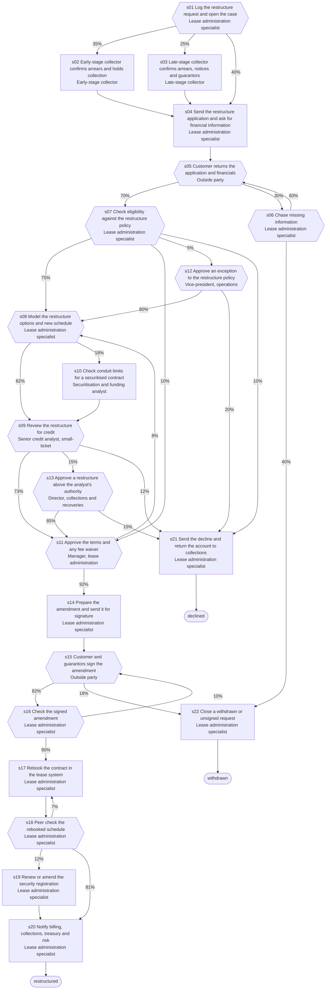

# Restructure and defer lease payments

`efc-restructure-and-defer-payments` · equipment leasing and finance · operations (lease administration) · part of `equipment-finance-co`

Small business customers who hit a cash flow problem ask, through customer service or their collector, to skip payments for a few months or stretch the remaining term. A lease administration specialist gathers the customer's reasons and financial information, checks the request against the restructure policy and any securitisation limits, models a new schedule, gets a senior credit analyst's approval and a manager's sign-off, sends an amending agreement for the customer and guarantors to sign, and rebooks the contract so billing, collections and the funders see the change. The work takes two to four weeks, mostly waiting for customers, guarantors and approvers, and in 2020 the same process was swamped by waves of COVID deferral requests.

| | |
|---|---|
| Unit of work | one restructure request |
| Starts when | Customer service routes a customer's request to defer or restructure, or an early- or late-stage collector refers a customer with a temporary cash flow problem. |
| Done when | The signed amendment is rebooked and billing, collections, treasury and the customer have the new schedule, or the request is declined or withdrawn and the account is back with collections. |
| Organisation | A mid-size Canadian independent equipment lessor with about 55,000 active contracts, about 65% of receivables sold to bank-sponsored conduits, a lease system that supports due date, term and payment changes, and e-signature for amendments. (340 employees, 2019-2022) |
| Volume | 90 cases a month (range 50 to 1,500) |

## Where it sits

- Starts with **restructure_request** from handle-service-requests (40% of cases)
- Starts with **restructure_request** from collect-early-stage (35% of cases)
- Starts with **restructure_request** from collect-late-stage (25% of cases)
- Sends **contract_amendment** to bill-customers (outcome: restructured)
- Sends **contract_amendment** to customer (outcome: restructured)
- Sends **pool_change_notice** to report-to-securitisation-funders (outcome: restructured)
- Sends **portfolio_data** to monitor-portfolio-risk (outcome: any)

## Flow

## Roles

| Role | Department | Layer | FTE on this process | Loaded cost per hour | Evidence |
|---|---|---|---:|---:|---|
| Lease administration specialist | Lease administration | individual contributor | 2 | 33 CAD | C |
| Senior credit analyst, small-ticket | Small-ticket credit | senior specialist | 0.4 | 48 CAD | B [src_jb_11109] |
| Manager, lease administration | Lease administration | manager | 0.15 | 70 CAD | B [src_jb_10021] |
| Early-stage collector | Early-stage collections | individual contributor | 0.05 | 30 CAD | B [src_jb_14202] |
| Late-stage collector | Late-stage collections | individual contributor | 0.05 | 34 CAD | B [src_jb_14202] |
| Director, collections and recoveries | Collections and recoveries | director | 0.03 | 90 CAD | C |
| Vice-president, operations | Operations | executive | 0.02 | 135 CAD | C |
| Securitisation and funding analyst | Treasury and securitisation | individual contributor | 0.03 | 56 CAD | C |

## Steps

Hands-on time and the wait before each step show the most common value. Evidence tier A is a sourced number, B a sourced description, C the author's estimate.

| Step | Who | Kind | Hands-on | Wait before | Control | Evidence |
|---|---|---|---:|---:|---|---|
| **s01 Log the restructure request and open the case.** A lease administration specialist picks up the request from the team's work queue (a task from customer service or a referral note from collections), checks for an open request on the same customer, and notes the contract status, arrears, total exposure across the customer's contracts, whether the contract is in a securitisation pool and whether it is a Quebec contract needing French documents. | Lease administration specialist | intake | 10 min | 1.0 d |  | C |
| **s02 Early-stage collector confirms arrears and holds collection.** The collector who referred the account adds the current arrears, returned debits, promises made and broken and the customer's stated reason to the case, and sets a hold code so automated notices and calls stop while the request is decided. | Early-stage collector | coordination | 10 min | 8.0 h |  | C |
| **s03 Late-stage collector confirms arrears, notices and guarantors.** The late-stage collector records the arrears, whether a default notice or section 244 notice has gone out and when its period ends, the guarantors' position and any insolvency search result, and holds enforcement while the request is decided. | Late-stage collector | coordination | 15 min | 8.0 h |  | C |
| **s04 Send the restructure application and ask for financial information.** The specialist e-mails the customer the restructure application: the reason for the difficulty, how long it is expected to last, what they propose (deferral of a number of payments, lower payments for a period, term extension), recent bank statements or interim financial statements, and for larger exposures the latest annual statements and a cash flow forecast. | Lease administration specialist | communication | 15 min | 2.0 h |  | C |
| **s05 Customer returns the application and financials.** The case waits for the customer to complete the form and gather statements. Small business owners in difficulty are slow to respond, and some find other money or government support and drop the request. | Outside party | external wait | 0 min | 4.0 d |  | B [src_cfla_cmo2020] |
| **s06 Chase missing information.** The specialist calls or e-mails the customer about missing statements or an unsigned application, and reminds them that collection activity resumes if the request is not completed. Customers who do not reply after the follow-up are returned to collections. | Lease administration specialist | communication | 10 min | 4.0 h |  | C |
| **s07 Check eligibility against the restructure policy.** The specialist checks the request against the restructure policy: payments made since booking, earlier deferrals on the contract, arrears not past the policy limit, no insolvency filing, equipment still in use and in the customer's hands, and for securitised contracts whether a deferral or new maturity is allowed under the conduit agreement. | Lease administration specialist | validation | 20 min | 4.0 h | Restructure and deferral policy: eligibility criteria and limits on repeat deferrals | B [src_charter_424b], [src_cfla_cmo2020] |
| **s08 Model the restructure options and new schedule.** The specialist builds the proposal in the lease system's quote screens and a spreadsheet: which payments are deferred and whether they are added to the end or spread over the remaining term, the new maturity date, any deferral fee and extra interest, sales tax on the new payment amounts, and whether the new maturity stays within the equipment's useful life and the registration period. | Lease administration specialist | analysis | 40 min | 8.0 h |  | B [src_oracle_monetary] |
| **s09 Review the restructure for credit.** A senior credit analyst refreshes the commercial bureau report, reads the financial information and payment history, looks at the customer's total exposure and the equipment's value against the balance, and recommends approval, approval with conditions (a partial payment now, an added guarantor, a shorter deferral) or decline, within delegated authority. The analyst is independent of the collector who referred the account. | Senior credit analyst, small-ticket | judgment | 45 min | 2.0 d | Credit policy: delegated credit authority for modifications, with credit review separate from collections | B [src_jb_11109] |
| **s10 Check conduit limits for a securitised contract.** For a contract sold to a conduit whose maturity or payment dates will move, a securitisation analyst checks the purchase and servicing agreement: deferrals allowed only for contracts in default, no new maturity past the pool's latest maturity, and limits on modified contracts. Where the change is not allowed the analyst arranges to repurchase the contract from the pool at the next settlement. | Securitisation and funding analyst | validation | 20 min | 1.0 d | Conduit purchase and servicing agreement: servicer covenants on payment deferrals, maturity extensions and repurchase of modified contracts | B [src_charter_424b] |
| **s11 Approve the terms and any fee waiver.** The lease administration manager checks the calculation against the credit approval, confirms the documents to be used, approves any waiver of the deferral fee or arrears interest within their limit and signs off the offer. Calculations that do not tie go back to the specialist. | Manager, lease administration | approval | 15 min | 1.0 d | Maker-checker approval of contract modifications and fee waivers by a manager other than the preparer | C |
| **s12 Approve an exception to the restructure policy.** The vice-president of operations reviews requests outside the policy, such as a third deferral, an extension beyond the usual limit or waived interest for a large customer, weighing the expected loss on repossession against the concession, and approves or declines. | Vice-president, operations | approval | 20 min | 2.0 d | Restructure policy exception authority held by the vice-president of operations | C |
| **s13 Approve a restructure above the analyst's authority.** The director of collections and recoveries reviews large or high-risk restructures and late-stage accounts above the analyst's limit, compares the restructure with the recovery expected from repossession, and approves, adds conditions or declines. | Director, collections and recoveries | approval | 20 min | 1.0 d | Delegated authority matrix for restructures by exposure and delinquency | C |
| **s14 Prepare the amendment and send it for signature.** The specialist fills the amending agreement template with the deferred payments, new schedule, maturity, fees and a confirmation that all other terms and the guarantees continue, adds a guarantor acknowledgement, produces it in French for Quebec customers, and sends it by e-signature with a cover note explaining the new debit dates and amounts. | Lease administration specialist | drafting | 30 min | 4.0 h | Legal requirements for amendments: written amendment kept in the lease file, guarantor consent to preserve the guarantee, French-language documents for Quebec customers | B [src_charter_424b] |
| **s15 Customer and guarantors sign the amendment.** The case waits for the customer and each guarantor to sign. Guarantors who are not involved in the business are the usual delay. | Outside party | external wait | 0 min | 3.0 d |  | C |
| **s16 Check the signed amendment.** The specialist checks that every party signed and dated, that the guarantor acknowledgement is complete and that the signed version matches the approved terms, then files it to the contract in imaging. Missing signatures are sent back out. | Lease administration specialist | validation | 10 min | 4.0 h |  | C |
| **s17 Rebook the contract in the lease system.** The specialist enters the change in the lease system: due date change or payment deferral, term extension, new payment amounts and fee, so the system rebuilds the payment schedule, income and tax, clears the arrears that were capitalised, flags the contract as modified for risk and funder reporting, and updates the debit schedule. | Lease administration specialist | data entry | 35 min | 1.0 d |  | B [src_oracle_monetary] |
| **s18 Peer check the rebooked schedule.** A second specialist compares the new schedule, maturity, fee, tax and modification flag in the lease system with the signed amendment and the approval, and returns errors for correction. | Lease administration specialist | review | 15 min | 8.0 h | Maker-checker review of contract changes in the lease system | C |
| **s19 Renew or amend the security registration.** When the new maturity falls after the PPSA or RDPRM registration expires, the specialist files a financing change statement through the registry portal to extend the registration period and saves the verification statement to the file. | Lease administration specialist | data entry | 15 min | 4.0 h | Personal property security acts: a registration lapses at the end of its period unless renewed by a financing change statement before expiry (BC PPSA s.44(2) and equivalents) | B [src_bc_ppsa] |
| **s20 Notify billing, collections, treasury and risk.** The specialist sends the contract amendment to billing so the next invoices and debits follow the new schedule with the required pre-notification, closes the referral and releases the hold in the collections system, adds a securitised contract to the month's pool change notice for treasury, and confirms the new schedule to the customer. | Lease administration specialist | communication | 15 min | 1.0 h | Payments Canada Rule H1 s.17: pre-notification of a changed PAD amount or date at least 10 calendar days before the debit, unless waived in the PAD agreement | B [src_h1] |
| **s21 Send the decline and return the account to collections.** The specialist writes to the customer that the request is declined with the reason in plain terms, notes the decision, removes the collection hold and returns the account to the referring collector with the date collection activity resumes. | Lease administration specialist | communication | 15 min | 4.0 h |  | C |
| **s22 Close a withdrawn or unsigned request.** When the customer withdraws, stops replying or lets the signed offer expire, the specialist closes the case with the reason, voids any open e-signature envelope, removes the hold and tells the referring collector so collection activity resumes. | Lease administration specialist | communication | 10 min | 4.0 h |  | B [src_cfla_cmo2020] |

## Exceptions

| Exception | Share of cases | What happens |
|---|---:|---|
| Incomplete application | 30% | Statements or the signed form are missing; the specialist chases, and about four in ten of these customers withdraw or stop replying. |
| Securitised contract whose maturity moves | 13% | Treasury checks the conduit agreement and may repurchase the contract from the pool before it is modified. |
| Approval above authority or policy exception | 13% | Large or late-stage restructures go to the director of collections; requests outside policy go to the vice-president of operations. |
| Declined | 20% | Ineligible under the policy or declined on credit; the account returns to collections. |
| Rebooking error | 7% | The peer check finds the new schedule, fee or tax keyed wrongly and sends it back. |
| Registration renewal | 7% | The new maturity passes the registration expiry, so a financing change statement is filed. |

## Benchmarks

| Metric | Value | Unit | Population | Evidence |
|---|---|---|---|---|
| cycle_time_days | p50 20, p90 40 | calendar days from the request reaching lease administration to rebooked, declined or withdrawn | Author's estimate for case-by-case restructures at a mid-size lessor | C |
| covid_deferrals_approved_2020 | 0.074 | share of portfolio (US equipment finance, by value) | ELFA Survey of Equipment Finance Activity respondents, 2020 | A [src_elfa_sefa2021] |
| deferral_requests_withdrawn_april_2020 | 0.6 | share of customers withdrawing requests after government programs were announced (more than) | CFLA member survey, April 2020 | A [src_cfla_cmo2020] |
| lessors_accommodating_most_requests_2020 | 0.5 | share of CFLA respondents accommodating at least 80% of deferral requests (more than) | CFLA member survey, April 2020 | A [src_cfla_cmo2020] |
| pad_prenotification_days | 10 | calendar days before a changed debit amount or date | PADs at set intervals in Canada, unless waived | A [src_h1] |

## Pain points

- Most of the elapsed time is waiting for the customer's financial information and for guarantors to sign, while the account sits on collection hold and arrears grow. (steps s05, s06, s15; C)
- Securitised contracts need a check of conduit limits and sometimes a repurchase before they can be modified, adding a hand-off to treasury. (steps s10; B [src_charter_424b])
- The new schedule is modelled in a spreadsheet and keyed again into the lease system, so calculation and keying errors need a manager's check and a peer check. (steps s08, s11, s17, s18; C)
- A case-by-case process with several approvals cannot absorb a wave of requests; in 2020 lessors faced deferral requests from up to half their portfolios and more than 100 COVID calls a day. (steps s01, s09, s11; A [src_cfla_cmo2020])
- If billing is not told in time, a debit at the old amount goes out after the amendment, returns and restarts collection activity. (steps s20; C)

## Assumptions

- The model describes normal-volume case-by-case handling (mode 90 a month). In spring 2020, with up to 1,500 requests a month, lessors used a standard deferral program (for example three months deferred and added to the end) with a short application, no financial statements and manager sign-off; that path is the s07 to s11 branch, which carries only 10% of cases at the mode. At 1,500 a month even the short path would need many more people than lease administration has, so customer service, collections and credit staff were redeployed.
- About 53% of requests end restructured, 20% declined and 27% withdrawn or unsigned; these shares are estimates for normal times, when lessors are stricter than the 80%-plus acceptance many reported in 2020. Referral shares (40% customer service, 35% early-stage, 25% late-stage collections) are estimates consistent with the referral rates in the existing collections workflows.
- The securitisation analyst is added for the conduit check although the process map does not list that role for this process; the organisation file has it.
- The vice-president of operations approves policy exceptions and the director of collections approves restructures above the senior analyst's authority; the split of authority is the author's assumption.
- Accounting for the modification (IFRS 16 lessor modification and IFRS 9 modification gain or loss) is done by the lease system and the month-end close, not as a step here.
- About 3 hours of specialist time per request is the author's estimate; at 90 requests a month that is about 2 FTE of the 3 FTE of lease administration specialists left unclaimed in the organisation file.
- Loaded hourly costs are the organisation file's (wage times 1.35).

## Sources

- [src_cfla_cmo2020] [Asset-based finance in Canada: the 2019-2020 year (Canadian Market Overview)](https://cfla-acfl.ca/files/Industry-Intelligence/CMO-2020.pdf) (Canadian Finance and Leasing Association, prepared by Quantitative Economic Decisions Inc., 2020). CFLA member surveys in spring 2020: 40% of respondents had over 100 COVID-related calls a day; for about half, deferral requests were under 20% of the portfolio, while a fifth had requests over half of the portfolio; over 40% (later over half) accommodated at least 80% of deferral requests; by April government support programs led over 60% of customers to withdraw their deferral requests; small business delinquency rates in the first half of 2020 rose three times as much as in all of 2019. Read from a text copy saved under scratch/ by earlier work.
- [src_elfa_sefa2021] [New data reveals market insights (2021 Survey of Equipment Finance Activity)](https://www.elfaonline.org/communications/july-august-sept/new-data-reveals-market-insights) (Equipment Leasing and Finance Association, 2021). In 2020 US equipment finance companies approved nearly $19 billion of COVID-related deferrals, 7.4% of the overall portfolio, and customers accepted nearly $18 billion (7%); companies devised individual deferral plans as needed; receivables over 30 days past due rose to 2.3% and net losses to 0.48%.
- [src_oracle_monetary] [Monetary transactions (Oracle Financial Services Lending and Leasing user guide 15.0)](https://docs.oracle.com/en/industries/financial-services/financial-lending-leasing/15.0.0.0.0/lesug/monetary-transactions.html) (Oracle, 2023). A lending and leasing servicing system offers separate transactions to change the due date, extend a lease, change the lease term, change the payment amount, and apply, adjust or waive an extension fee; any transaction that moves the maturity date out is checked against the funding customer's credit limit expiry date.
- [src_charter_424b] [Charter Equipment Lease 1998-1 LLC prospectus (Form 424B1)](https://www.sec.gov/Archives/edgar/data/0001070771/000089155499001687/0000891554-99-001687.txt) (Charter Financial via SEC EDGAR, 1999). A securitisation servicer may, case by case and under its normal procedures, extend or modify a lessee's payment schedule; extensions beyond the final scheduled payment date may lead the servicer to acquire the lease; the servicer covenants not to forgive rent, not to defer payments or change maturity unless the lessee is in default, and never to extend maturity past the latest maturity in the pool; amendments must be in writing and kept in the lease file. Read from a text copy saved under scratch/ by earlier work.
- [src_h1] [Rule H1 Pre-Authorized Debits (PADs)](https://www.payments.ca/sites/default/files/h1eng.pdf) (Payments Canada (Canadian Payments Association), 2026). Section 17: for PADs at set intervals the payee must give pre-notification of the amount and date at least 10 calendar days before any change in a fixed amount or payment date; section 19: payor and payee may reduce or waive pre-notification in the PAD agreement. Read from a text copy saved under scratch/ by earlier work.
- [src_bc_ppsa] [Personal Property Security Act [RSBC 1996] chapter 359](https://www.bclaws.gov.bc.ca/civix/document/id/complete/statreg/96359_01) (Government of British Columbia (BC Laws), 2024). Section 44(2): a registration may be renewed by registering a financing change statement at any time before it expires.
- [src_jb_11109] [Wages: Finance and credit administrator in Ontario (NOC 11109)](https://www.jobbank.gc.ca/marketreport/wages-occupation/186/ON) (Job Bank, Government of Canada, 2025). Ontario hourly wages low $23.00, median $36.92, high $66.46 (2023-2024).
- [src_jb_14202] [Wages: Collector in Ontario (NOC 14202)](https://www.jobbank.gc.ca/marketreport/wages-occupation/19300/ON) (Job Bank, Government of Canada, 2025). Ontario hourly wages low $17.95, median $25.38, high $36.69 (2023-2024).
- [src_jb_10021] [Wages: Operations manager, banking, credit and investment in Ontario (NOC 10021)](https://www.jobbank.gc.ca/marketreport/wages-occupation/17461/ON) (Job Bank, Government of Canada, 2025). Ontario hourly wages low $38.46, median $58.97, high $96.15 (2023-2024).

Written by claude-opus on 2026-11-17.
