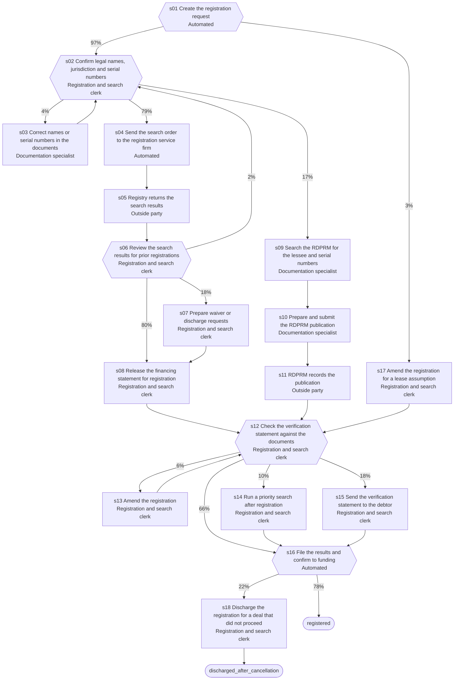

# Search registries and register security interests

`efc-search-and-register-security` · equipment leasing and finance · operations (documentation and funding) · part of `equipment-finance-co`

A lease of more than one year only protects the company against a customer's other creditors and a bankruptcy trustee if it is registered in the provincial personal property registry, or published at Quebec's RDPRM, in time and with the debtor's exact name. For each released document package, registration clerks confirm legal names and serial numbers, search for earlier registrations, ask for waivers where a bank or another lessor already has a claim, file the financing statement and check the verification statement before funding relies on it; the Quebec documentation desk publishes Quebec leases. The work is high volume and quick per contract, but name errors can void a registration, prior bank registrations hold up funding, and registrations for deals that never fund have to be discharged later.

| | |
|---|---|
| Unit of work | one contract's searches and registration |
| Starts when | The documentation team releases a lease or loan package (or lease administration approves an assumption), creating a registration request. |
| Done when | The registration or Quebec publication is confirmed, checked against the documents and on file for funding; for deals that never fund, the registration has been discharged. |
| Organisation | A mid-size independent Canadian equipment lessor with three registration clerks in its funding team, searches and filings ordered through a registration service firm's interface, and a bilingual documentation desk for Quebec. (340 employees, 2019-2022) |
| Volume | 1,900 cases a month (range 1,600 to 2,250) |

## Where it sits

- Starts with **registration_request** from prepare-lease-documents (97% of cases)
- Starts with **registration_request** from process-lease-assumptions (3% of cases)
- Relies on **registry_search_result** from ppsa_registry (a standing input; it does not start a case)
- Sends **registration_filing** to ppsa_registry (outcome: any)
- Sends **registration_confirmation** to audit-and-fund-contracts (outcome: any)
- Sends **registration_discharge** to ppsa_registry (outcome: discharged_after_cancellation)

## Flow

## Roles

| Role | Department | Layer | FTE on this process | Loaded cost per hour | Evidence |
|---|---|---|---:|---:|---|
| Registration and search clerk | Funding and booking team | individual contributor | 3 | 30 CAD | C |
| Documentation specialist | Documentation team | individual contributor | 0.75 | 33 CAD | B [src_eq_credit_coord] |

## Steps

Hands-on time and the wait before each step show the most common value. Evidence tier A is a sourced number, B a sourced description, C the author's estimate.

| Step | Who | Kind | Hands-on | Wait before | Control | Evidence |
|---|---|---|---:|---:|---|---|
| **s01 Create the registration request.** When the documentation team releases a lease or loan package, the origination portal creates a registration request with the debtor and guarantor names, addresses, province, equipment description and serial numbers, and places it in the registration queue. | Automated | system auto | 0 min | 0 min |  | C |
| **s02 Confirm legal names, jurisdiction and serial numbers.** A registration clerk opens the request and compares the debtor's name with the corporate registry profile in the credit file, checks individual guarantors' full names and birth dates, confirms the province where the debtor and equipment are located and that serial numbers are complete. Quebec deals go to the Quebec documentation desk. | Registration and search clerk | lookup | 1.5 min | 3.0 h | PPSA registration validity: a seriously misleading error in the debtor's name or serial number makes the registration ineffective (BC PPSA s.43(6); Manitoba PPSA as applied in 2017 MBQB 178) | B [src_cassels_name], [src_bc_ppsa] |
| **s03 Correct names or serial numbers in the documents.** A documentation specialist corrects the debtor's legal name or a serial number in the lease documents, re-issues the affected pages for signature if needed and sends the corrected data back to registration. | Documentation specialist | data entry | 10 min | 4.0 h |  | C |
| **s04 Send the search order to the registration service firm.** The portal sends the debtor name and serial number searches to the registration service firm's interface, pre-filled from the request; search fees are charged to the company's account. | Automated | system auto | 0 min | 10 min |  | C |
| **s05 Registry returns the search results.** The provincial personal property registry runs the searches through the service firm and returns the results listing registrations against the debtor's name and the serial numbers. | Outside party | external wait | 0 min | 30 min |  | C |
| **s06 Review the search results for prior registrations.** The clerk reads the results for earlier registrations that cover the same equipment or all of the debtor's present and after-acquired property, such as a bank's general security agreement or another lessor's lease, and for similar names that might be the same debtor. | Registration and search clerk | analysis | 2 min | 2.0 h | Funding and credit policy: prior registrations covering the equipment must be waived, subordinated or discharged before the deal funds | B [src_eq_credit_coord], [src_bc_ppsa] |
| **s07 Prepare waiver or discharge requests.** For a conflicting registration the clerk drafts a waiver or subordination letter for the bank or prior secured party, or a discharge request for a paid-out lease, records it as a funding condition and sends it to the dealer, broker or customer to obtain. | Registration and search clerk | drafting | 8 min | 30 min |  | B [src_eq_credit_coord] |
| **s08 Release the financing statement for registration.** The clerk checks the pre-filled financing statement in the service firm's interface: secured party, each debtor's exact name, collateral description with serial numbers, purchase-money flag and a registration period covering the lease term, and releases it for filing. | Registration and search clerk | data entry | 2.5 min | 15 min | PPSA: a lease of more than one year must be perfected by registration to bind a trustee in bankruptcy (BC PPSA ss.3, 20, 25), and within 15 days of the lessee taking possession for purchase-money priority (s.34) | A [src_bc_ppsa] |
| **s09 Search the RDPRM for the lessee and serial numbers.** For Quebec deals a bilingual documentation specialist searches the Register of Personal and Movable Real Rights (RDPRM) by the lessee's name and by vehicle serial numbers, reviews earlier publications such as hypothecs on the enterprise's movables, and notes any that need a waiver as a funding condition. | Documentation specialist | lookup | 5 min | 4.0 h | Funding and credit policy: prior registrations covering the equipment must be waived, subordinated or discharged before the deal funds | C [src_elfa_quebec_pub] |
| **s10 Prepare and submit the RDPRM publication.** The specialist completes the French application to publish the lessor's rights under the lease, describing the lessee and the equipment with serial numbers and the lease term, and submits it electronically before the publication delay runs out. | Documentation specialist | data entry | 8 min | 30 min | Civil Code of Quebec art. 1852: rights under a lease of more than one year must be published at the RDPRM to be set up against third persons; late publication is effective only from its date | A [src_elfa_quebec_pub] |
| **s11 RDPRM records the publication.** The register records the publication in order of presentation and issues the statement confirming it, which the specialist downloads to the contract file. | Outside party | external wait | 0 min | 12.0 h |  | C |
| **s12 Check the verification statement against the documents.** The clerk compares the verification statement or RDPRM confirmation with the signed or released documents: debtor names, serial numbers, collateral description, registration period and the base registration number, and marks the registration complete. | Registration and search clerk | validation | 1.5 min | 1.0 h | Funding checklist: the verification statement is matched to the signed documents before funding | B [src_occ_lpm], [src_bc_ppsa] |
| **s13 Amend the registration.** The clerk files a financing change statement to correct the error, or a fresh registration when the error is seriously misleading, and records the new verification. | Registration and search clerk | data entry | 6 min | 2.0 h | PPSA registration validity: a seriously misleading error in the debtor's name or serial number makes the registration ineffective (BC PPSA s.43(6); Manitoba PPSA as applied in 2017 MBQB 178) | B [src_cassels_name], [src_bc_ppsa] |
| **s14 Run a priority search after registration.** For mid-ticket deals the clerk runs a second search a day or two later to confirm the registration appears and that nothing was registered against the debtor in between. | Registration and search clerk | lookup | 4 min | 1.0 d |  | C |
| **s15 Send the verification statement to the debtor.** Where the lease does not waive it, the clerk emails or mails each debtor a copy of the verification statement within the statutory period. | Registration and search clerk | communication | 2 min | 2.0 h | BC PPSA s.43(15) and equivalents: each debtor gets a copy of the verification statement within 20 days unless the right was waived in writing in the lease | A [src_bc_ppsa] |
| **s16 File the results and confirm to funding.** The verification statement and search results are attached to the contract file in imaging and the funding checklist in the portal is updated with the registration number, so the funding specialist can see the registration is complete. | Automated | system auto | 0 min | 30 min |  | C |
| **s17 Amend the registration for a lease assumption.** For an approved assumption the clerk searches the new lessee, files a financing change statement adding the new debtor (and releasing the old one if credit agreed), and records the verification. | Registration and search clerk | data entry | 10 min | 8.0 h | PPSA: a lease of more than one year must be perfected by registration to bind a trustee in bankruptcy (BC PPSA ss.3, 20, 25), and within 15 days of the lessee taking possession for purchase-money priority (s.34) | B [src_bc_ppsa] |
| **s18 Discharge the registration for a deal that did not proceed.** When documentation or funding closes a deal as not proceeding, the clerk files a discharge of the registration so it does not cloud the customer's record, and notes it on the file. | Registration and search clerk | data entry | 2.5 min | 21.0 d | BC PPSA s.50 and equivalents: a registration must be amended or discharged within 40 days of a written demand; the company discharges unused registrations without waiting for a demand | B [src_bc_ppsa] |

## Exceptions

| Exception | Share of cases | What happens |
|---|---:|---|
| Prior registration needs a waiver | 15% | A bank's general security agreement or another lessor's registration covers the equipment; a waiver or discharge request becomes a funding condition. |
| Name or serial mismatch with the documents | 4% | The debtor's legal name or a serial number in the documents does not match the registry or invoice, so documentation corrects the documents before registration. |
| Registration error found on the verification statement | 6% | The verification statement shows a wrong name, serial number or period, so the clerk amends or re-registers. |
| Deal never funds | 22% | The package goes unsigned or the deal is cancelled at funding, and the registration made at document release is discharged weeks later. |
| Quebec lease | 17% | The lease is published at the RDPRM by the Quebec documentation desk instead of a PPSA registration. |

## Benchmarks

| Metric | Value | Unit | Population | Evidence |
|---|---|---|---|---|
| cycle_time_days | p50 1.0, p90 3 | calendar days from registration request to registration checked and on file (cases that later need a discharge run longer) | Author estimate for electronic registration at a Canadian lessor | C [src_bc_ppsa], [src_elfa_quebec_pub] |
| pmsi_perfection_deadline | 15 | days after the debtor obtains possession | British Columbia PPSA (similar in other common-law provinces) | A [src_bc_ppsa] |
| verification_copy_deadline | 20 | days after registration, unless waived in writing | British Columbia PPSA | A [src_bc_ppsa] |
| discharge_on_demand_deadline | 40 | days after written demand | British Columbia PPSA | A [src_bc_ppsa] |
| registration_threshold_us_small_ticket | 50000 | USD lease size above which a US lessor generally files financing statements | Marlin Business Services, 2019 | A [src_marlin_10k2019] |

## Pain points

- A small error in the debtor's legal name can void a registration, so names are checked several times and mismatches with documents send packages back. (steps s02, s03, s12, s13; B [src_cassels_name])
- Prior bank and lessor registrations need waivers that customers and dealers are slow to obtain, which holds up funding. (steps s06, s07; B [src_eq_credit_coord])
- Registering at document release means about a fifth of registrations are for deals that never fund and must be discharged later. (steps s16, s18; C)
- Quebec publications are a separate register, language and form handled by a different desk. (steps s09, s10, s11; B [src_elfa_quebec_pub])

## Assumptions

- Searches and filings for common-law provinces are ordered through a registration service firm's interface pre-filled from the origination portal (the organisation file says registry filings partly go through service firms). Without this, three clerks could not handle about 1,900 contracts a month: hands-on time already implies about 3.0 FTE, all of the clerks in the organisation file.
- Funding and booking specialists are listed in the process map but are already fully allocated to funding and booking (11.0 of 11 FTE), so they do no steps here; they read the registration in the funding audit. Quebec RDPRM work is done by a bilingual documentation specialist (about 0.75 FTE of the one remaining).
- Registration is made when documents are released, before signature (BC PPSA s.43(4) allows registration before the agreement), so about 22% of registrations are later discharged when the deal does not fund. The organisation file's produces list has no discharge link for this process; this workflow adds registration_discharge to the personal property registries.
- Registry search results return into an open case, so their trigger share is 0.
- The Quebec share (about 17%) follows the organisation's document workflow. Provincial differences in rules (for example Ontario's treatment of VINs) are not modelled separately; BC PPSA sections stand for the common-law provinces.
- Registry and service firm fees (a few dollars to tens of dollars per search or registration) are not labour and are not modelled.
- Loaded costs are the organisation file's (2019-2022 wage times 1.35). External steps have zero touch time.

## Sources

- [src_bc_ppsa] [Personal Property Security Act [RSBC 1996] chapter 359](https://www.bclaws.gov.bc.ca/civix/document/id/complete/statreg/96359_01) (Government of British Columbia (BC Laws), 2024). Section 3: the Act applies to a lease for a term of more than one year; s.20: an unperfected security interest is not effective against a trustee in bankruptcy; s.25: registration of a financing statement perfects a security interest; s.34: a purchase-money security interest has priority if perfected not later than 15 days after the debtor obtains possession; s.43(4): a financing statement may be registered before a security agreement is made; s.43(6): a defect invalidates a registration only if seriously misleading; s.43(15): a copy of the verification statement must be given to each debtor within 20 days unless the debtor waived it in writing; s.44: a registration lasts for the period stated and can be renewed before expiry; s.50(4): on written demand the secured party must amend or discharge within 40 days.
- [src_elfa_quebec_pub] [State law compendium: Quebec, publication](https://www.elfaonline.org/advocacy/state-issues/state-law-compendium/quebec-canada/publication) (Equipment Leasing and Finance Association, 2024). Civil Code of Quebec article 1852: rights under a lease of more than one year of a road vehicle, other prescribed movable property or movable property required for the operation of an enterprise must be published to be set up against third persons; published within the delay they run from the date of the lease, otherwise only from the date, hour and minute of publication; a renewal clause that can take a lease beyond one year counts.
- [src_cassels_name] [Lessons learned, lesson one supplement: get the name right on the financing statement](https://cassels.com/insights/lessons-learned-lesson-one-supplement-get-the-name-right-on-the-financing-statement/) (Cassels Brock and Blackwell LLP, 2017). In Bankruptcy of Rosa Argentina Gonzalez, 2017 MBQB 178, a registration under 'R Argentina Gonzalez' instead of the debtor's legal name was seriously misleading on an objective test even though the serial number was right, so the lender was unperfected and unsecured against the trustee; a searcher who finds nothing under the debtor's name need not also search by serial number; Ontario amendments would let a correct VIN save a registration.
- [src_eq_credit_coord] [Credit Coordinator, Bennington Financial (job posting)](https://jobs.lever.co/eqbank/c1b4e9a7-8406-44f8-b482-eaf231c17a11) (EQ Bank / EQB Inc. on Lever, 2025). A Canadian equipment lessor's coordinator requests information from land and corporate registries, runs searches when creating lease documents and creates waivers based on the search results.
- [src_marlin_10k2019] [Marlin Business Services Corp. Form 10-K for fiscal year 2019](https://www.sec.gov/Archives/edgar/data/1260968/000119312520072460/d875863d10k.htm) (Marlin Business Services Corp. via US SEC EDGAR, 2020). A US small-ticket lessor generally files UCC financing statements for leases over $50,000, showing that registration practice is set by policy and deal size where the law allows.
- [src_occ_lpm] [Comptroller's Handbook: Loan Portfolio Management (April 1998, updated June 2017)](https://occ.gov/publications-and-resources/publications/comptrollers-handbook/files/lending-loan-portfolio-risk-management/pub-ch-loan-portfolio-mgmt-previous.pdf) (Office of the Comptroller of the Currency, 2017). Credit administration covers the back-room functions of loan disbursement, processing, lien perfection and collateral documentation; these processing functions are often the first line of defence and are reviewed periodically by audit.

Written by claude-opus on 2026-11-17.
