# Select and sell securitisation pools

`efc-sell-securitisation-pools` · equipment leasing and finance · finance (treasury and securitisation) · part of `equipment-finance-co`

New leases are first funded on a bank credit line and then sold each month in pools to bank-sponsored commercial paper conduits, which is how the company refinances most of its lending. For each conduit, a securitisation analyst selects booked contracts, tests them against the conduit's eligibility criteria and concentration limits, builds the data tape, calculates the purchase price, overcollateralization and cash reserve, and gets the pool reconciled by accounting, approved by the treasurer and certified by the CFO before the conduit reviews and funds it. Data exceptions, conduit questions and file audits cause rework, and most elapsed time is waiting for month-end data, approvals, the conduit's review and the fixed settlement date.

| | |
|---|---|
| Unit of work | one pool sale to a conduit |
| Starts when | The month-end cut-off passes with booked contracts funded on the bank warehouse line, and the treasury cash forecast shows how much funding is needed. |
| Done when | The conduit has paid the purchase price, the reserve is funded, the bank line is repaid, the entries are booked and the pool is set up for monthly servicer reporting; or the purchase is deferred to the next month. |
| Organisation | A privately owned Canadian independent equipment lessor with 340 staff and about $1.5 billion of leases, funded by a syndicated bank warehouse line and monthly pool sales to three bank-sponsored ABCP conduits. (340 employees, 2019-2022) |
| Volume | 3 cases a month (range 2 to 4) |

## Where it sits

- Starts with **booked_contract** from book-contracts (90% of cases)
- Starts with **cash_forecast** from manage-daily-cash (10% of cases)
- Relies on **funding_proceeds** from conduit_sponsor (a standing input; it does not start a case)
- Sends **securitisation_pool** to conduit_sponsor (outcome: sold)
- Sends **securitisation_pool** to report-to-securitisation-funders (outcome: sold)
- Sends **funding_proceeds** to manage-daily-cash (outcome: sold)
- Sends **journal_entries** to close-the-month (outcome: sold)

## Flow

```mermaid
flowchart TD
    s01["s01 Extract booked contracts not yet sold after the cut-off<br/>Securitisation and funding analyst"]
    s02["s02 Size the sale against the cash forecast and facility headroom<br/>Securitisation and funding analyst"]
    s03["s03 Allocate contracts to this conduit<br/>Securitisation and funding analyst"]
    s04{{"s04 Test each contract against the eligibility criteria<br/>Securitisation and funding analyst"}}
    s05{{"s05 Test concentration limits and rebalance the pool<br/>Securitisation and funding analyst"}}
    s06{{"s06 Resolve data exceptions with operations<br/>Securitisation and funding analyst"}}
    s07["s07 Build the data tape and pool schedule<br/>Securitisation and funding analyst"]
    s08["s08 Calculate the purchase price, overcollateralization and reserve<br/>Securitisation and funding analyst"]
    s09{{"s09 Reconcile the pool to the lease subledger and ledger<br/>Lease accountant"}}
    s10{{"s10 Treasurer reviews the pool and settlement figures<br/>Treasurer"}}
    s11["s11 CFO signs the purchase notice and officer's certificate<br/>Chief financial officer"]
    s12["s12 Send the tape, schedule and notice to the conduit<br/>Securitisation and funding analyst"]
    s13{{"s13 Conduit reviews the tape<br/>Outside party"}}
    s14{{"s14 Answer conduit questions and remove rejected contracts<br/>Securitisation and funding analyst"}}
    s15["s15 Pull contract files for the funder's file audit<br/>Securitisation and funding analyst"]
    s16{{"s16 Funder's auditor reviews the sample files<br/>Outside party"}}
    s17["s17 Execute the assignment and flag the contracts as sold<br/>Securitisation and funding analyst"]
    s18{{"s18 Conduit funds the purchase on the settlement date<br/>Outside party"}}
    s19["s19 Confirm the proceeds and fund the reserve account<br/>Securitisation and funding analyst"]
    s20["s20 Send the settlement statement to treasury for the bank line paydown<br/>Securitisation and funding analyst"]
    s21["s21 Record the securitisation entries<br/>Lease accountant"]
    s22["s22 Add the pool to servicer reporting<br/>Securitisation and funding analyst"]
    s01 --> s02
    s02 --> s03
    s03 --> s04
    s04 -->|"85%"| s05
    s04 -->|"15%"| s06
    s05 -->|"85%"| s07
    s05 -->|"15%"| s03
    s06 -->|"90%"| s05
    s06 -->|"10%"| s04
    s07 --> s08
    s08 --> s09
    s09 -->|"85%"| s10
    s09 -->|"15%"| s08
    s10 -->|"88%"| s11
    s10 -->|"12%"| s08
    s11 --> s12
    s12 --> s13
    s13 -->|"65%"| s17
    s13 -->|"27%"| s14
    s13 -->|"8%"| s15
    s14 -->|"50%"| s08
    s14 -->|"50%"| s17
    s15 --> s16
    s16 -->|"70%"| s17
    s16 -->|"30%"| s14
    s17 --> s18
    s18 -->|"97%"| s19
    s18 -->|"3%"| end0
    s19 --> s20
    s20 --> s21
    s21 --> s22
    s22 --> end1
    end0(["deferred"])
    end1(["sold"])
```

## Roles

| Role | Department | Layer | FTE on this process | Loaded cost per hour | Evidence |
|---|---|---|---:|---:|---|
| Securitisation and funding analyst | Treasury and securitisation | individual contributor | 0.6 | 56 CAD | B [src_vault_treasury], [src_jobbank_11101] |
| Treasurer | Treasury and securitisation | director | 0.06 | 105 CAD | C |
| Chief financial officer | Finance | executive | 0.02 | 175 CAD | C |
| Lease accountant | Financial and lease accounting | individual contributor | 0.12 | 50 CAD | C |

## Steps

Hands-on time and the wait before each step show the most common value. Evidence tier A is a sourced number, B a sourced description, C the author's estimate.

| Step | Who | Kind | Hands-on | Wait before | Control | Evidence |
|---|---|---|---:|---:|---|---|
| **s01 Extract booked contracts not yet sold after the cut-off.** After the month-end cut-off, once bookings and month-end payments are posted, a securitisation analyst runs the data warehouse query of booked contracts still funded on the bank warehouse line, with balances, payment history, equipment, obligor, province and registration fields, and loads it into the pool workbook. | Securitisation and funding analyst | lookup | 2.0 h | 2.0 d |  | B [src_vault_treasury], [src_boc_abcp] |
| **s02 Size the sale against the cash forecast and facility headroom.** The analyst compares the treasury cash forecast and warehouse line usage with each conduit's unused commitment and the borrowing base, and decides how much this conduit should buy this month so the bank line stays within its limit. | Securitisation and funding analyst | analysis | 1.0 h | 2.0 h |  | C |
| **s03 Allocate contracts to this conduit.** The analyst assigns candidate contracts to the conduit whose criteria they fit best, for example trucks to the truck facility and small-ticket office and medical equipment to a general facility, keeping the rest on the bank line or for another conduit. | Securitisation and funding analyst | judgment | 1.0 h | 1.0 h |  | B [src_dbrs_puregrove], [src_dbrs_lakeshore], [src_dbrs_fusion], [src_bdc_fpil] |
| **s04 Test each contract against the eligibility criteria.** The analyst runs the facility's eligibility tests in the workbook: not delinquent beyond the limit, first payment made, remaining term and balloon within limits, obligor a Canadian business not in default or bankruptcy, permitted equipment type, no modification or deferral, registration perfected and minimum yield met. Ineligible contracts stay on the warehouse line. | Securitisation and funding analyst | validation | 3.0 h | 1.0 h | Receivables purchase agreement with each conduit: contractual eligibility criteria and seller representations | B [src_boc_abcp], [src_dbrs_method2019] |
| **s05 Test concentration limits and rebalance the pool.** The analyst checks the eligible pool against concentration limits on largest obligors, vendors, industries, equipment types, provinces and residual or balloon exposure, and removes or swaps contracts until every limit is met. | Securitisation and funding analyst | analysis | 1.5 h | 0 min | Receivables purchase agreement: concentration limits that support the conduit's rating | C |
| **s06 Resolve data exceptions with operations.** The analyst emails the funding team and data developers a list of contracts with missing registration numbers, unknown equipment codes or payment histories that do not match the schedule, and waits for corrections in the lease system. | Securitisation and funding analyst | coordination | 1.0 h | 1.0 d |  | C |
| **s07 Build the data tape and pool schedule.** The analyst produces the contract-level data tape in the conduit's template (obligor, equipment, province, original and remaining term, payments, balance, yield, delinquency status) and the schedule of purchased contracts that will be attached to the assignment. | Securitisation and funding analyst | drafting | 2.0 h | 1.0 h |  | B [src_vault_treasury] |
| **s08 Calculate the purchase price, overcollateralization and reserve.** The analyst discounts the pool's remaining payments at the conduit's discount rate to get the discounted balance, applies the advance rate to get the purchase price and works out the overcollateralization and the cash reserve deposit the company must fund, with fees and the expected excess spread. | Securitisation and funding analyst | analysis | 2.0 h | 1.0 h |  | B [src_boc_abcp], [src_cwb_note8] |
| **s09 Reconcile the pool to the lease subledger and ledger.** A lease accountant ties the pool's contract count and balances to the lease system and the general ledger, checks that no contract is already sold to another conduit or pledged elsewhere, and confirms the reserve and fee entries that will be booked. | Lease accountant | validation | 2.0 h | 1.0 d | Internal control over financial reporting: independent reconciliation of securitised pools and a check against double sale or pledge | C |
| **s10 Treasurer reviews the pool and settlement figures.** The treasurer reviews pool size, eligibility and concentration results, the purchase price and reserve, and the effect on the bank line and liquidity, and approves or asks for changes. | Treasurer | approval | 1.5 h | 1.0 d | Treasury policy: pool and settlement prepared by an analyst and approved by the treasurer | C |
| **s11 CFO signs the purchase notice and officer's certificate.** The chief financial officer signs the notice of purchase and the officer's certificate repeating the seller's representations that every contract meets the eligibility criteria. | Chief financial officer | approval | 30 min | 1.0 d | Receivables purchase agreement and board signing authorities: an authorised officer certifies the seller's representations | C |
| **s12 Send the tape, schedule and notice to the conduit.** The analyst uploads the data tape, pool schedule, settlement calculation and signed notice to the conduit administrator's portal or secure file transfer and emails the sponsor bank's securitisation team. | Securitisation and funding analyst | communication | 30 min | 1.0 h |  | B [src_vault_treasury] |
| **s13 Conduit reviews the tape.** The sponsor bank's team re-runs eligibility and concentration tests on the tape, checks the purchase price and may ask for a sample of contract files for audit. | Outside party | external wait | 0 min | 2.0 d |  | B [src_boc_abcp], [src_vault_treasury] |
| **s14 Answer conduit questions and remove rejected contracts.** The analyst answers the sponsor's questions, takes out contracts it rejects and, if the pool changed, recalculates the purchase price for re-approval. | Securitisation and funding analyst | communication | 2.0 h | 2.0 h |  | C |
| **s15 Pull contract files for the funder's file audit.** The analyst requests the sample of contract files from imaging, checks each has the signed lease, guarantee, invoice, registration and insurance evidence, and sends them to the sponsor's auditor. | Securitisation and funding analyst | coordination | 4.0 h | 4.0 h |  | B [src_vault_treasury], [src_elfa_paper] |
| **s16 Funder's auditor reviews the sample files.** The sponsor's auditor reviews the sample files against the tape and the eligibility criteria and reports any missing documents or data mismatches. | Outside party | external wait | 0 min | 4.0 d |  | C |
| **s17 Execute the assignment and flag the contracts as sold.** The analyst completes the assignment with the final schedule of purchased contracts, flags each contract in the lease system with the conduit's pool code so collections are reported and remitted to the conduit, and confirms the chattel paper is marked as assigned. | Securitisation and funding analyst | data entry | 1.5 h | 4.0 h | PPSA: a transfer of chattel paper falls under the Act (BC PPSA s.3(a)); the conduit's interest is protected by registration and by possession of or a legend on the chattel paper | B [src_bc_ppsa], [src_goodmans_ecp], [src_legal500_eqfin] |
| **s18 Conduit funds the purchase on the settlement date.** On the facility's monthly settlement date the conduit wires the purchase price less fees. In stressed markets, as in March 2020, a sponsor can defer the purchase and the pool stays on the bank line until the next month. | Outside party | external wait | 0 min | 3.0 d |  | B [src_boc_abcp] |
| **s19 Confirm the proceeds and fund the reserve account.** The analyst checks the wire in the bank portal against the settlement statement and arranges the transfer of the cash reserve deposit into the reserve account named in the facility. | Securitisation and funding analyst | validation | 45 min | 2.0 h | Receivables purchase agreement: cash reserve funded at settlement | B [src_boc_abcp] |
| **s20 Send the settlement statement to treasury for the bank line paydown.** The analyst sends the settlement statement to the treasury and cash analyst, who uses the proceeds to repay the bank warehouse line in the daily cash process. | Securitisation and funding analyst | communication | 20 min | 0 min |  | B [src_vault_treasury] |
| **s21 Record the securitisation entries.** A lease accountant books the proceeds as a securitisation liability, the reserve deposit, fees and the pool's contracts as transferred but not derecognised, and updates the securitisation subledger. | Lease accountant | data entry | 1.5 h | 1.0 d | IFRS 9 derecognition test: transfers that keep substantially all risks and rewards stay on balance sheet with a securitisation liability | B [src_cwb_note8] |
| **s22 Add the pool to servicer reporting.** The analyst adds the pool's contract list, cut-off balances and reserve to the monthly servicer report model and the warehouse pool tables, so collections, defaults and triggers are reported to the conduit from the next month. | Securitisation and funding analyst | data entry | 1.5 h | 0 min |  | B [src_vault_treasury] |

## Exceptions

| Exception | Share of cases | What happens |
|---|---:|---|
| Missing or inconsistent contract data | 15% | Registration numbers, equipment codes or payment histories need correcting by operations before contracts can enter the pool. |
| Concentration limit breached | 15% | Large obligors, vendors or equipment types push the pool over a limit and contracts are reallocated. |
| Conduit questions or rejected contracts | 30% | The sponsor rejects contracts or questions the price; the pool is recalculated and re-approved. |
| Funder file audit | 8% | The sponsor samples contract files; missing documents remove contracts from the pool. |
| Purchase deferred | 3% | In stressed funding markets (for example March 2020) a sponsor defers the purchase and the contracts stay on the bank line, raising its usage. |
| Ineligible contract found after sale | 5% | A contract later found ineligible (for example a deferral granted before cut-off) must be repurchased under the seller's representations; handled in servicer reporting, not modelled here. |

## Benchmarks

| Metric | Value | Unit | Population | Evidence |
|---|---|---|---|---|
| cycle_time_days | p50 16, p90 26 | calendar days from month-end cut-off to settlement, entries and reporting set-up | Monthly pool sales by a Canadian independent lessor to bank-sponsored conduits, 2019-2022 (author estimate) | C |
| proceeds_to_securitised_balance | 0.899 | cash proceeds divided by securitised lease and loan balances | CWB Financial Group equipment financing securitisations, fiscal 2021 | A [src_cwb_note8] |
| equipment_finance_share_of_canadian_abcp_assets | 0.08 | share of assets backing Canadian ABCP | Canadian ABCP market, January 2024 | A [src_boc_abcp] |
| conduit_program_limit | 500000000 | CAD | One Canadian truck lease conduit transaction (December 2022) | A [src_dbrs_puregrove] |

## Pain points

- Pool selection runs in spreadsheets fed by warehouse queries, so eligibility and concentration tests are rebuilt each month and errors are found by the conduit. (steps s01, s04, s05, s07; C)
- Contract data gaps from booking (registration numbers, equipment codes) hold contracts out of pools and need chasing. (steps s06; C)
- Approvals by the treasurer and CFO and the conduit's review each take days, and the fixed settlement date means a late tape waits for the next window. (steps s10, s11, s13, s18; C)
- Conduits depend on ABCP demand; when markets froze in March 2020 purchases could be deferred, leaving new leases on the bank line. (steps s18; B [src_boc_abcp])

## Assumptions

- Three conduit facilities each buy one pool a month (organisation file); this file describes one pool sale. Pools average about $20 million to $25 million (about 400 contracts), so most eligible new contracts leave the bank line within one to two months of booking.
- Facility terms (eligibility criteria, concentration limits, advance rates, reserve levels and settlement dates) are private; the criteria listed are typical of rated equipment securitisations and are author estimates. The advance rate of about 90% is anchored on CWB's 2021 proceeds-to-balance ratio.
- Conduit funding proceeds arrive inside the case (step s19) rather than starting it, so that trigger has a share of zero.
- Securitised contracts stay on the balance sheet (as in CWB's note 8), so accounting records a securitisation liability; the company remains servicer and keeps the chattel paper marked as assigned.
- External steps have zero touch time; the conduit's review and settlement timing are in wait_before_min.
- Hands-on time per pool is about 25 to 35 hours across roles, mostly the analyst's; the analysts' other duties (servicer reports, borrowing base and covenant reporting) are separate processes.
- Loaded costs are the organisation file's (2019-2022 wage times 1.35).

## Sources

- [src_boc_abcp] [A primer on the Canadian asset-backed commercial paper market](https://www.bankofcanada.ca/wp-content/uploads/2024/06/primer-canadian-abcp.pdf) (Bank of Canada, 2024). Most Canadian bank-sponsored ABCP programs are multi-seller conduits buying third-party assets, including equipment leases (equipment finance 8% of assets backing Canadian ABCP in January 2024); sellers provide first-loss enhancement through overcollateralization, excess spread and a cash reserve or letter of credit sized on historical performance; for conduits using the ABCP exemption each transaction is reviewed by two rating agencies; sponsors provide liquidity facilities; monthly disclosure reporting.
- [src_cwb_note8] [CWB Financial Group Annual Report 2021, note 8: securitization](https://publications.cwb.com/view/902877744/89) (CWB Financial Group, 2021). A Canadian bank's equipment finance subsidiary securitized equipment financing leases and loans of $1,071.3 million in fiscal 2021 ($1,253.3 million in 2020) for cash proceeds of $962.7 million ($1,115.8 million); the transfers do not qualify for derecognition because risks are retained, so the assets stay on balance sheet and the proceeds are a securitization liability.
- [src_dbrs_lakeshore] [DBRS confirms Lakeshore Trust at R-1 (high) (sf)](https://dbrs.morningstar.com/research/316924/dbrs-confirms-lakeshore-trust-at-r-1-high-sf) (DBRS, 2017). On 2 October 2017 a Canadian ABCP conduit added a transaction of fixed-rate and some floating-rate commercial loan and lease receivables secured by new and used small- and mid-ticket equipment; the rating agency confirms the conduit's rating when a transaction is added.
- [src_dbrs_fusion] [DBRS Morningstar confirms rating on Fusion Trust's Series A Class A notes at R-1 (high) (sf)](https://dbrs.morningstar.com/research/407269/dbrs-morningstar-confirms-rating-on-fusion-trusts-series-a-class-a-notes-at-r-1-high-sf) (Morningstar DBRS, 2022). On 9 December 2022 a Canadian conduit added a transaction of fixed-rate monthly, quarterly, semi-annual and annual pay lease and loan contracts secured by new and used small- and mid-ticket equipment.
- [src_dbrs_puregrove] [DBRS Morningstar updates Pure Grove Funding transaction 102](https://dbrs.morningstar.com/research/407173/dbrs-morningstar-updates-pure-grove-funding-transaction-102) (Morningstar DBRS, 2022). A Canadian conduit transaction backed by fixed-rate equipment lease contracts on new and used commercial trucks; program limit increased to $500 million and two more conduit lenders added (December 2022).
- [src_dbrs_method2019] [Rating Canadian equipment finance securitization transactions (archived methodology)](https://dbrs.morningstar.com/research/351620/rating-canadian-equipment-finance-securitization-transactions-archived) (Morningstar DBRS, 2019). A rating methodology specific to Canadian equipment finance securitizations was in force from October 2019.
- [src_vault_treasury] [Financial/Securitization Analyst (job posting)](https://builtintoronto.com/job/treasury-analyst/7949052) (Vault Credit Corporation on Built In Toronto, 2026). A Canadian equipment lessor's analyst prepares tranches for submission to funders, documents new funding tranches in the ledger, manages payments to funders, produces monthly compliance reporting, supports tranche and funder audits and makes borrowing requests.
- [src_legal500_eqfin] [Asset/equipment finance and leasing (Canada)](https://www.legal500.com/intelligence/canada/finance-and-banking/asset-equipment-finance-and-leasing) (Legal 500, undated). Lease securitizations in Canada are more complicated than loan securitizations because selling lease rights would accelerate income; structures such as sale and sale-leaseback or concurrent leases are used.
- [src_bc_ppsa] [Personal Property Security Act [RSBC 1996] chapter 359](https://www.bclaws.gov.bc.ca/civix/document/id/complete/statreg/96359_01) (Government of British Columbia (BC Laws), 2024). Section 3(a): the Act applies to a transfer of an account or chattel paper even when it does not secure an obligation; chattel paper means writings that evidence a monetary obligation and a security interest in or lease of specific goods.
- [src_goodmans_ecp] [Ontario PPSA amended to incorporate rules relating to electronic chattel paper](https://www.goodmans.ca/insights/article/Ontario_PPSA_Amended_to_Incorporate_Rules_Relating_to_Electronic_Chattel_Paper) (Goodmans LLP, 2020). A purchaser of chattel paper that takes possession (or control of electronic chattel paper) in the ordinary course for new value can have priority over a security interest, unless the paper indicates an assignment to someone else; rules in force 15 May 2020.
- [src_elfa_paper] [How good is your paper?](https://www.elfaonline.org/communications/may-june-2024/how-good-is-your-paper) (Equipment Leasing and Finance Association (EL&F magazine), 2024). Capital market buyers will not buy a lease without certain clauses; many lease forms fail to designate the sole original chattel paper, which matters because the holder of original chattel paper gets priority.
- [src_bdc_fpil] [Securitization and specialty finance (indirect financing)](https://bdc.ca/en/about/what-we-do/wholesale-financing/indirect-financing) (Business Development Bank of Canada, 2022). BDC's Funding Platform for Independent Lenders offers securitization, secured and structured loans to independent finance companies on mainly equipment and vehicle leases and loans; more than 20 finance companies funded (as of July 2022).
- [src_jobbank_11101] [Wages: Financial analyst in Canada (NOC 11101)](https://www.jobbank.gc.ca/marketreport/wages-occupation/12417/ca) (Job Bank, Government of Canada, 2025). Ontario hourly wages low $28.21, median $43.27, high $72.36 (2023-2024).

Written by claude-opus on 2026-11-17.
