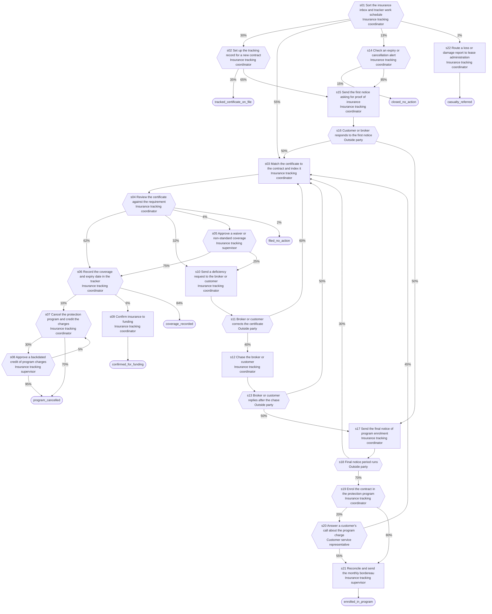

# Track equipment insurance

`efc-track-equipment-insurance` · equipment leasing and finance · operations (insurance tracking) · part of `equipment-finance-co`

Every lease requires the customer to insure the equipment with the company named as loss payee, and a team of four insurance tracking coordinators checks that they do. They set up a tracking record for each new contract, review certificates of insurance sent by customers and brokers, chase corrections, follow up policies that expire or are cancelled, and enrol customers who never send proof in the company's protection program, which adds a monthly charge to the invoice and is reported to the program insurer each month. Most certificates are checked in minutes, but about a third are wrong (wrong business name, no loss payee wording, missing equipment) and lapse cases take one to two months of letters and waiting before enrolment.

| | |
|---|---|
| Unit of work | one certificate or lapse case |
| Starts when | A newly booked contract, a certificate of insurance or renewal from a customer, broker or customer service, or a tracker alert that a policy has expired or been cancelled. |
| Done when | Compliant coverage is recorded with its expiry date, the customer is enrolled in the protection program with the charge set up and reported to the insurer, a loss is passed to lease administration, or the alert is closed. |
| Organisation | A mid-size Canadian independent equipment lessor with about 55,000 active contracts, an in-house insurance tracking team using a tracking database linked to the lease system, and a protection program underwritten by an outside insurer. (340 employees, 2019-2022) |
| Volume | 4,400 cases a month (range 3,600 to 5,300) |

## Where it sits

- Starts with **booked_contract** from book-contracts (30% of cases)
- Starts with **insurance_requirement** from prepare-lease-documents (5% of cases)
- Starts with **insurance_certificate** from customer (22% of cases)
- Starts with **insurance_certificate** from insurer (35% of cases)
- Starts with **insurance_certificate** from handle-service-requests (8% of cases)
- Sends **insurance_confirmation** to audit-and-fund-contracts (outcome: confirmed_for_funding)
- Sends **insurance_lapse_notice** to customer (outcome: any)
- Sends **insurance_charge** to bill-customers (outcome: enrolled_in_program)
- Sends **insurance_charge** to bill-customers (outcome: program_cancelled)
- Sends **premium_bordereau** to protection_program_insurer (outcome: enrolled_in_program)
- Sends **casualty_notice** to settle-casualty-losses (outcome: casualty_referred)

## Flow

## Roles

| Role | Department | Layer | FTE on this process | Loaded cost per hour | Evidence |
|---|---|---|---:|---:|---|
| Insurance tracking coordinator | Insurance tracking | individual contributor | 4 | 30 CAD | C |
| Insurance tracking supervisor | Insurance tracking | supervisor | 0.6 | 47 CAD | C |
| Customer service representative | Customer service | individual contributor | 0.25 | 27 CAD | C |

## Steps

Hands-on time and the wait before each step show the most common value. Evidence tier A is a sourced number, B a sourced description, C the author's estimate.

| Step | Who | Kind | Hands-on | Wait before | Control | Evidence |
|---|---|---|---:|---:|---|---|
| **s01 Sort the insurance inbox and tracker work schedule.** A coordinator works the shared insurance mailbox, fax queue and scanned mail (certificates from brokers and customers, certificates forwarded by customer service, cancellation notices, loss reports) and the tracker's daily work schedule of newly booked contracts and policies reaching expiry, and sends each item to the right type of work. | Insurance tracking coordinator | intake | 0.5 min | 8.0 h |  | B [src_lp_u13] |
| **s02 Set up the tracking record for a new contract.** For a contract booked overnight the coordinator opens the tracker record created from the booking, checks the equipment, serial numbers, cost and required coverage against the insurance requirement documentation entered, and looks for a certificate already received before funding. If one is on file it is linked; if not the contract goes into the request cycle. | Insurance tracking coordinator | data entry | 2 min | 30 min |  | C |
| **s03 Match the certificate to the contract and index it.** The coordinator identifies the customer and contracts the certificate covers (brokers often omit the contract number and list a different business name), searches the tracker and lease system, and indexes the image to each contract in the imaging system. | Insurance tracking coordinator | lookup | 0.8 min | 1.0 h |  | C |
| **s04 Review the certificate against the requirement.** The coordinator compares the certificate with the contract's requirement: the named insured matches the lessee, the company is shown as loss payee (and additional insured for liability where required), the equipment is described by serial number or as all leased equipment, the limit covers replacement value, the deductible is within the maximum, the dates are current and the insurer is licensed. Certificates that only say additional insured, list the wrong business or omit units are sent back. | Insurance tracking coordinator | validation | 2.5 min | 1.0 h | Lease insurance clause and credit policy: all-risk property cover for replacement value with the company as loss payee, liability cover naming the company as additional insured | B [src_charter_424b], [src_millerthomson], [src_csio_forms] |
| **s05 Approve a waiver or non-standard coverage.** The supervisor reviews requests to accept something other than the standard: a fleet customer's blanket policy without serial numbers, a high deductible, self-insurance by a strong mid-ticket customer or a certificate from an unlicensed or foreign insurer, checks the credit file and the equipment value, and approves, approves with conditions or declines. | Insurance tracking supervisor | approval | 10 min | 1.0 d | Insurance and credit policy: delegated authority for insurance waivers and self-insurance | B [src_charter_424b] |
| **s06 Record the coverage and expiry date in the tracker.** The coordinator keys the insurer, policy number, limit, deductible and expiry date, marks the contract compliant and sets the next follow-up date before expiry, so the tracker will raise an alert when the policy is due to renew. | Insurance tracking coordinator | data entry | 1 min | 5 min |  | B [src_lp_u13] |
| **s07 Cancel the protection program and credit the charges.** When a customer already enrolled sends a compliant certificate, the coordinator ends the program enrolment from the certificate's effective date, works out the program charges billed since then, sends billing an adjustment to credit them and stop future charges, and tells the customer by e-mail or letter. | Insurance tracking coordinator | data entry | 5 min | 1.0 h |  | C |
| **s08 Approve a backdated credit of program charges.** The supervisor checks that the customer's own policy was in force for the whole period being credited, looks at whether any claim was paid under the program, and approves or limits the credit. | Insurance tracking supervisor | approval | 5 min | 1.0 d | Delegated authority for credits and refunds of program charges | C |
| **s09 Confirm insurance to funding.** For a truck or mid-ticket deal that cannot fund without a certificate, the coordinator marks the insurance condition cleared in the tracker and the origination portal and e-mails the funding specialist that the file can proceed. | Insurance tracking coordinator | communication | 1 min | 30 min | Funding conditions: trucks and mid-ticket equipment need insurance evidence before the vendor is paid | B [src_charter_424b] |
| **s10 Send a deficiency request to the broker or customer.** The coordinator e-mails the insurance broker named on the certificate, or the customer when there is none, listing exactly what must change (loss payee wording and address, named insured, missing serial numbers, limit, expiry) and attaches the requirement letter. | Insurance tracking coordinator | communication | 3 min | 30 min |  | C |
| **s11 Broker or customer corrects the certificate.** The case waits for the broker to issue a corrected certificate or endorsement. Brokers with many small commercial accounts take days to weeks, and some customers forward the request to a broker who never received the first one. | Outside party | external wait | 0 min | 7.0 d |  | C |
| **s12 Chase the broker or customer.** When the follow-up date passes the coordinator calls or e-mails the broker and the customer again, confirms the right broker contact and resends the deficiency list. | Insurance tracking coordinator | communication | 3 min | 2.0 h |  | B [src_lp_u13] |
| **s13 Broker or customer replies after the chase.** The case waits again for a corrected certificate. Without one the contract is treated as uninsured and moves to the final notice before program enrolment. | Outside party | external wait | 0 min | 5.0 d |  | C |
| **s14 Check an expiry or cancellation alert.** For a policy the tracker shows as expired, or an insurer's cancellation notice, the coordinator checks whether a renewal certificate already arrived but was not indexed, whether the contract has been paid out or terminated, and whether the customer is already enrolled, then starts the notice cycle or closes the alert. | Insurance tracking coordinator | lookup | 1 min | 1.0 h |  | B [src_lp_u13], [src_assurant_tracking] |
| **s15 Send the first notice asking for proof of insurance.** The tracker produces the day's batch of first notices (new contracts without a certificate and lapsed policies). The coordinator checks the batch for contracts that should not get one, releases it for printing and e-mail, and sets a follow-up date about 30 days out. The letter explains the requirement and that the equipment will be enrolled in the protection program with a monthly charge if no proof arrives. | Insurance tracking coordinator | communication | 0.5 min | 4.0 h |  | B [src_lp_u13], [src_nbc_ldw] |
| **s16 Customer or broker responds to the first notice.** The case waits for the customer or broker to send a certificate. Many small businesses forward the letter to their broker late or ignore it. | Outside party | external wait | 0 min | 21.0 d |  | C |
| **s17 Send the final notice of program enrolment.** The coordinator releases the final notice from the tracker batch: the equipment will be enrolled in the protection program from a stated date, the monthly charge, the coverage and deductible, and how to avoid or cancel it by sending proof of insurance. | Insurance tracking coordinator | communication | 0.5 min | 4.0 h |  | B [src_nbc_ldw] |
| **s18 Final notice period runs.** The case waits out the final notice period, usually two to four weeks, for the customer or broker to send a certificate before the enrolment date stated in the notice. | Outside party | external wait | 0 min | 14.0 d |  | C |
| **s19 Enrol the contract in the protection program.** The coordinator enrols the equipment in the protection program in the tracker with the effective date and insured value, sets the monthly insurance charge in the lease system so it bills on the next invoice, and records the enrolment for the monthly report to the program insurer. | Insurance tracking coordinator | data entry | 3 min | 2.0 h | Lease insurance clause allowing the lessor to insure the equipment at the lessee's cost, and the program agreement with the protection program insurer | B [src_nbc_ldw], [src_gaig_equipment] |
| **s20 Answer a customer's call about the program charge.** When the charge appears on the invoice some customers call customer service. The representative explains the requirement and the charge from the contract notes and tracker status, and asks for a certificate by e-mail when the customer says they are insured, forwarding it to insurance tracking. | Customer service representative | communication | 6 min | 3.0 d |  | C |
| **s21 Reconcile and send the monthly bordereau.** At month end the supervisor runs the list of enrolled contracts, values and premiums from the tracker, reconciles it to the insurance charges billed in the lease system, corrects differences and sends the bordereau to the program insurer through its portal or by e-mail. | Insurance tracking supervisor | review | 0.4 min | 7.0 d | Program agreement with the insurer: complete monthly reporting of insured contracts and premiums, reconciled to billing | C |
| **s22 Route a loss or damage report to lease administration.** When a customer or insurer reports that leased equipment was destroyed, stolen or damaged, the coordinator checks what cover is on file (customer policy or program), notes the claim, sends the casualty notice and the certificate or program details to lease administration and, for enrolled contracts, notifies the program insurer. | Insurance tracking coordinator | coordination | 8 min | 1.0 h |  | C |

## Exceptions

| Exception | Share of cases | What happens |
|---|---:|---|
| Deficient certificate | 20% | Wrong named insured, additional insured instead of loss payee, missing serial numbers or too low a limit; the broker is asked for a corrected certificate and chased. |
| Waiver or non-standard coverage | 3% | Blanket fleet policies, high deductibles or self-insurance need the supervisor's approval. |
| Enrolled customer later proves insurance | 4% | The program is cancelled from the certificate's effective date and the charges are credited; long backdating needs approval. |
| Uninsured contract enrolled in the program | 14% | No proof after the first and final notices; the contract is enrolled and the charge billed, and some customers call to dispute it. |
| Loss reported | 2% | A destroyed, stolen or damaged unit is routed to lease administration with the coverage details. |

## Benchmarks

| Metric | Value | Unit | Population | Evidence |
|---|---|---|---|---|
| cycle_time_days | p50 3, p90 55 | calendar days from receipt of the certificate, booking or alert to coverage recorded, program enrolment reported or case closed | Author's estimate for in-house insurance tracking at a mid-size lessor | C |
| protection_program_deductible | 250 | CAD per claim | National Bank equipment financing loss damage waiver | A [src_nbc_ldw] |
| tracked_assets_one_vendor | 600000 | leased assets tracked for the life of the agreement | One outsourced insurance tracking provider, 2019 | A [src_acquis_fog] |
| certificate_deficiency_rate | 0.32 | share of certificates reviewed that need correction | This organisation | C |

## Pain points

- Certificates commonly name the wrong business, show the company only as additional insured, or describe the equipment vaguely, so a third of reviews end in a deficiency request and a broker chase. (steps s04, s10, s11, s12; B [src_millerthomson])
- Lapse cases take one to two months of letters and waiting, during which the equipment may be uninsured and the company exposed to an unrecoverable loss. (steps s15, s16, s17, s18; B [src_acquis_fog])
- Program charges appear on invoices of customers who were insured but never sent proof, causing calls, credits and complaints. (steps s19, s20, s07, s08; C)
- The inbox and work schedule build backlogs at renewal peaks; certificates matched to the wrong contract or not indexed trigger needless lapse notices. (steps s01, s03, s14; C)

## Assumptions

- The four coordinators and one supervisor of the organisation file's insurance tracking unit do this work in-house; many lessors outsource it to tracking vendors, which would remove most of the coordinator steps.
- Each certificate or lapse case is one case. A certificate that arrives in answer to a notice or a deficiency request is handled inside the open case, not counted again as a new case.
- Lapse cases are started by the tracker's expiry date or an insurer's cancellation notice; they are attributed to insurer in interfaces.triggered_by because the organisation file has no internal trigger for expiry.
- About 14% of cases (roughly 600 a month) end in program enrolment and about 6% in a program cancellation. Shares of work types, the 32% deficiency rate, response rates to notices and the 30-day and 2-to-4-week notice periods are the author's estimates. No Canadian rule fixes the notice periods for commercial equipment.
- Insurance confirmations to funding (about 3% of cases, roughly 130 a month) exceed the 3% share of fundings that efc-audit-and-fund-contracts attributes to them (about 42 a month), because most confirmations are simply on file when funding checks the tracker.
- Licensing rules for a lessor that offers an insurance program to its customers (for example Quebec's distribution without a representative) were not researched; the program is assumed to be offered through the insurer's program agreement.
- Mean hands-on time is about 11 minutes per case including rework loops, about 6 FTE in total (about 5 of it coordinator time) at 4,400 cases a month against the four coordinators and one supervisor in the organisation file. The unit is stretched at the mode and clearly short at the 5,300-case high end, which matches the backlogs common in in-house tracking; this is recorded as a possible understatement of headcount in the organisation file.
- Loaded hourly costs are the organisation file's (wage times 1.35).

## Sources

- [src_lp_u13] [Insurance Tracking module [U13]](https://docsuite.netsoltech.com/v60b/docsuite/refguide/updates/u13/u13.htm) (NetSol Technologies (LeasePak documentation suite), 2020). A lease system's insurance tracking module keeps track of expired policies, builds a daily work schedule of accounts for each clerk (lease, lessee, policy number, expiry date, follow-up date, note), starts tracking a set number of days before expiry, assigns accounts to clerks in the end-of-period run, lets supervisors reassign work, and prints the clerk's details on insurance letters.
- [src_assurant_tracking] [Commercial equipment: insurance tracking](https://www.assurant.com/equipment-leasing-and-finance/insurance-tracking) (Assurant, 2025). Insurance tracking for equipment lessors runs for the full term of the agreement, gives status notifications for tracked policies and updates on lapsed or expired coverage, and the provider handles the communication needed to get a new policy placed after a lapse.
- [src_gaig_equipment] [Equipment financing (specialty equipment insurance)](https://www.greatamericaninsurancegroup.com/about-us/business-operations/product/specialty-equipment/equipment-financing) (Great American Insurance Group, 2025). Insurance tracking monitors coverage status and detects uninsured assets, included in embedded programs for lessors or offered alone; physical damage cover for leased equipment is offered across the United States and Canada.
- [src_nbc_ldw] [Equipment financing: vehicle protection plan](https://www.nbc.ca/en/business/help-centre/manage-business/financing/equipment-financing-vehicle-protection.html) (National Bank of Canada, 2025). A Canadian equipment lessor's loss damage waiver covers eligible leased equipment for a fee; if the customer does not provide proof of external insurance the equipment is automatically enrolled; the deductible is $250.
- [src_millerthomson] [Insurance protection for secured lenders](https://millerthomson.com/en/insights/financial-services-restructuring-communique/insurance-policy-secured-lenders) (Miller Thomson LLP, 2022). Certificates often name lenders as additional insured or loss payee without the mortgagee wording that gives full protection; lenders should check that the policy itself, not only the certificate, names them correctly; Builders Capital v. Aviva (2022 ABCA 120) left lenders unprotected when the policy named the wrong party.
- [src_csio_forms] [Industry forms](https://csio.com/standards-forms/industry-forms) (Centre for Study of Insurance Operations (CSIO), 2025). CSIO maintains standard forms for the Canadian property and casualty industry, including a Certificate of Property Insurance and a Certificate of Liability Insurance used by brokers.
- [src_charter_424b] [Charter Equipment Lease 1998-1 LLC prospectus (Form 424B1)](https://www.sec.gov/Archives/edgar/data/0001070771/000089155499001687/0000891554-99-001687.txt) (Charter Financial via SEC EDGAR, 1999). A New York and Toronto lessor requires property insurance against damage, fire, theft and other loss for the replacement value of the equipment with the lessor as loss payee, and public liability insurance naming the lessor as additional insured; clients use their own carrier or, for strong credits, self-insurance; the contract administrator obtains insurance certificates before funding. Read from a text copy saved under scratch/ by earlier work.
- [src_acquis_fog] [Why keeping track of asset finance agreements can feel like wading through fog](https://www.acquisinsurance.com/?p=2307) (Acquis Insurance Management, 2019). When the customer must insure leased equipment, lessors very often have no real idea whether it is actually or adequately insured; tracking is a cumbersome, resource-heavy task that outsourcing can relieve.

Written by claude-opus on 2026-11-17.
