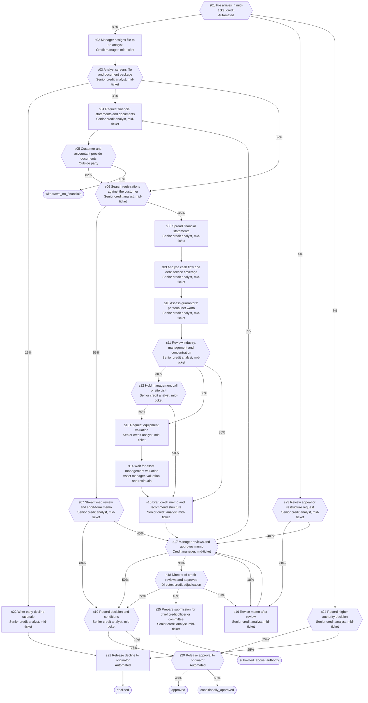

# Underwrite mid-ticket credit applications

`efc-underwrite-mid-ticket-credit` · equipment leasing and finance · credit (mid-ticket underwriting) · part of `equipment-finance-co`

Applications above $250,000, or that take a customer's total exposure above that level, go to eight senior analysts who underwrite them from financial statements rather than from bureau scores alone. An analyst screens the package, chases missing statements, searches registrations, spreads the statements, analyses cash flow, guarantors, industry and management, asks asset management to value used or specialised equipment and writes a credit memo with a recommended structure. The mid-ticket manager approves within authority and passes larger exposures to the director of credit and, beyond that, to the chief credit officer or committee. Waiting for customers' statements, valuations and approvers stretches the cycle to days or weeks while competitors quote the same deal.

| | |
|---|---|
| Unit of work | one mid-ticket application |
| Starts when | A set-up application above $250,000 (or above that level of total exposure), a fraud-cleared file, an appeal or a returned higher-authority decision enters the mid-ticket queue. |
| Done when | A credit decision (approval with structure and conditions, or decline) is released to the account executive or broker, or the file is withdrawn for missing statements or submitted to the chief credit officer or committee. |
| Organisation | A mid-size privately owned Canadian independent equipment lessor underwriting about 430 mid-ticket applications a month (average funded deal about $380,000) with eight senior analysts, a manager and the director of credit. (340 employees, 2019-2022) |
| Volume | 430 cases a month (range 330 to 550) |

## Where it sits

- Starts with **credit_application** from intake-credit-applications (87% of cases)
- Starts with **fraud_clearance** from verify-identity-and-fraud (2% of cases)
- Starts with **credit_appeal** from communicate-credit-decisions (4% of cases)
- Starts with **credit_decision** from approve-credit-above-authority (7% of cases)
- Relies on **customer_financials** from customer (a standing input; it does not start a case)
- Relies on **asset_valuation** from value-equipment-and-set-residuals (a standing input; it does not start a case)
- Relies on **credit_policy** from maintain-credit-policy-and-scorecards (a standing input; it does not start a case)
- Sends **credit_decision** to communicate-credit-decisions (outcome: approved)
- Sends **credit_decision** to communicate-credit-decisions (outcome: conditionally_approved)
- Sends **credit_decision** to communicate-credit-decisions (outcome: declined)
- Sends **credit_decision** to communicate-credit-decisions (outcome: withdrawn_no_financials)
- Sends **credit_submission** to approve-credit-above-authority (outcome: submitted_above_authority)
- Sends **valuation_request** to value-equipment-and-set-residuals (outcome: any)

## Flow

## Roles

| Role | Department | Layer | FTE on this process | Loaded cost per hour | Evidence |
|---|---|---|---:|---:|---|
| Senior credit analyst, mid-ticket | Mid-ticket credit | senior specialist | 7.6 | 56 CAD | B [src_bennington_sr_analyst], [src_jb_credit_admin] |
| Credit manager, mid-ticket | Mid-ticket credit | manager | 0.75 | 80 CAD | B [src_jb_ops_mgr], [src_occ_lpm] |
| Director, credit adjudication | Credit adjudication | director | 0.35 | 98 CAD | B [src_bennington_sr_analyst], [src_jb_ops_mgr] |
| Asset manager, valuation and residuals | Asset management and remarketing | senior specialist | 0 | 56 CAD | C |

## Steps

Hands-on time and the wait before each step show the most common value. Evidence tier A is a sourced number, B a sourced description, C the author's estimate.

| Step | Who | Kind | Hands-on | Wait before | Control | Evidence |
|---|---|---|---:|---:|---|---|
| **s01 File arrives in mid-ticket credit.** A file reaches mid-ticket credit as a newly set-up application above $250,000 or with total exposure above that level, as a file cleared by the fraud analyst, as an appeal or restructure request from sales, or back from the chief credit officer or credit committee with a decision. | Automated | intake | 0 min | 0 min |  | C |
| **s02 Manager assigns file to an analyst.** The mid-ticket credit manager reviews new files at the morning huddle and assigns each to a senior analyst by workload, industry knowledge and the originator's relationship, marking competitive or time-sensitive deals. | Credit manager, mid-ticket | coordination | 1 min | 4.0 h |  | C |
| **s03 Analyst screens file and document package.** The analyst reads the set-up summary, bureau reports and exposure, sizes the request against the customer's revenue, and checks the package for two years of financial statements with interims, tax returns where statements are not reviewed, guarantors' net worth statements, a debt schedule and the supplier quote. Obvious policy failures are declined early. | Senior credit analyst, mid-ticket | review | 20 min | 1.0 d | Credit policy financial information requirements by deal size (statements, interims, tax returns and net worth statements above $250,000) | B [src_crest_over250], [src_bennington_sr_analyst], [src_dlc_easylease], [src_eqx_bcr_guide] |
| **s04 Request financial statements and documents.** The analyst emails the account executive or broker a list of what is still needed, such as the latest interim statements, the accountant's year-end statements, tax returns, guarantors' net worth statements or an aging of receivables, and sets a follow-up date. | Senior credit analyst, mid-ticket | communication | 10 min | 0 min |  | B [src_crest_over250] |
| **s05 Customer and accountant provide documents.** The customer asks its accountant for statements or interim figures and gathers tax returns and net worth statements, which the account executive or broker forwards. This often takes several days, especially near year end or tax season, and some customers give up or finance elsewhere. | Outside party | external wait | 0 min | 3.0 d |  | C |
| **s06 Search registrations against the customer.** The analyst searches the personal property registry in the customer's province, or Quebec's RDPRM, for existing security interests, such as a bank's general security agreement or another lessor's registration on the same equipment, and notes anything that affects priority or signals hidden debt. | Senior credit analyst, mid-ticket | lookup | 10 min | 1.0 h | Credit policy: confirm existing secured creditors and the lessor's priority under the provincial PPSA or Quebec Civil Code before approval | B [src_bc_ppsa] |
| **s07 Streamlined review and short-form memo.** For established customers with strong bureau and payment history and deals up to about $500,000, the analyst reviews the statements without a full spread, checks revenue, profit and leverage trends, uses the residual table for the equipment and writes a short-form memo with risk rating and recommended structure, deciding it alone when it is within the senior analyst's authority. | Senior credit analyst, mid-ticket | analysis | 1.0 h | 2.0 h |  | C |
| **s08 Spread financial statements.** The analyst types two or three years of balance sheets and income statements, plus interims, into the spreading spreadsheet, maps accounts to standard lines, adjusts for owner compensation and one-time items and checks that the spread balances. | Senior credit analyst, mid-ticket | data entry | 40 min | 2.0 h |  | B [src_sageworks_2015], [src_occ_lpm] |
| **s09 Analyse cash flow and debt service coverage.** The analyst calculates cash flow available for debt service, adds the proposed lease payments to existing debt, computes coverage and leverage, combines related companies and guarantors where they support the deal and tests what happens if revenue falls. | Senior credit analyst, mid-ticket | analysis | 25 min | 0 min |  | B [src_occ_lpm], [src_abrigo_2021] |
| **s10 Assess guarantors' personal net worth.** The analyst reviews each guarantor's personal net worth statement against the personal bureau report, discounts illiquid assets and notes contingent liabilities, and judges how much support the guarantees really add. | Senior credit analyst, mid-ticket | analysis | 12 min | 0 min |  | B [src_abrigo_2021], [src_crest_over250] |
| **s11 Review industry, management and concentration.** The analyst researches the industry outlook, the company's customers and contracts, management's experience and any concentration on one customer or project, using the company's overview, web sources and the account executive's notes. | Senior credit analyst, mid-ticket | analysis | 20 min | 0 min |  | B [src_abrigo_2021] |
| **s12 Hold management call or site visit.** The analyst and the account executive schedule a call, or for larger deals a visit, with the owner to understand the business, the reason for the equipment, upcoming contracts and anything unusual in the statements. | Senior credit analyst, mid-ticket | communication | 45 min | 2.0 d |  | B [src_bennington_sr_analyst] |
| **s13 Request equipment valuation.** For used, specialised or high-value equipment, or a fair market value lease with a large residual, the analyst sends asset management a valuation request with the make, model, year, hours, invoice and proposed term. | Senior credit analyst, mid-ticket | communication | 8 min | 0 min |  | C |
| **s14 Wait for asset management valuation.** An asset manager values the equipment from auction and dealer data or orders a third-party appraisal or inspection and returns current value, a recommended advance and a residual. The asset manager's work is part of the valuation process; this step is the analyst's wait for it. | Asset manager, valuation and residuals | external wait | 0 min | 2.0 d |  | B [src_amc_appraisals] |
| **s15 Draft credit memo and recommend structure.** The analyst writes the credit memo: request and recommendation, borrower and management, industry, financial analysis and coverage, collateral value and advance, guarantors, risk rating, policy exceptions and the recommended structure such as term, down payment, security deposit, residual and reporting covenants. | Senior credit analyst, mid-ticket | drafting | 1.0 h | 1.0 h |  | B [src_abrigo_2021], [src_occ_lpm] |
| **s16 Revise memo after review.** The analyst reworks the memo after the manager or director asks for changes, or after an appeal: re-running coverage with a new structure, adding conditions, answering the approver's questions or updating figures, then sends it back for review. | Senior credit analyst, mid-ticket | drafting | 30 min | 4.0 h |  | B [src_sageworks_2015] |
| **s17 Manager reviews and approves memo.** The mid-ticket credit manager reads the memo and spread, challenges assumptions and structure with the analyst, and approves or declines within the manager's authority, sends the memo back for rework or more information, or recommends it to the director of credit. | Credit manager, mid-ticket | approval | 20 min | 8.0 h | Delegated credit authority: manager approval limit by exposure and risk rating, with a second signature for amounts above it | B [src_occ_lpm] |
| **s18 Director of credit reviews and approves.** The director of credit reviews memos above the manager's limit, often asking for changes to the structure or extra conditions, and approves or declines within the director's authority or sends the largest and most complex exposures on to the chief credit and risk officer or the credit committee. | Director, credit adjudication | approval | 30 min | 1.0 d | Delegated credit authority: director approval limit set by the board-approved authority matrix | B [src_occ_lpm], [src_bennington_sr_analyst] |
| **s19 Record decision and conditions.** The analyst enters the decision, risk rating, approved structure, expiry date and conditions precedent such as guarantees, insurance, registration, annual financial statements or a security deposit in the portal, attaches the signed memo and logs any policy exception. | Senior credit analyst, mid-ticket | data entry | 10 min | 30 min | Credit policy documentation standard and exception tracking | B [src_occ_lpm] |
| **s20 Release approval to originator.** The portal posts the approval, conditions and expiry to the account executive or broker desk, which takes it to the customer. | Automated | system auto | 0 min | 0 min |  | B [src_marlin_10k2019] |
| **s21 Release decline to originator.** The portal posts the decline and its reasons to the account executive or broker desk, which tells the customer and may come back with a restructure request. | Automated | system auto | 0 min | 0 min |  | C |
| **s22 Write early decline rationale.** When the screen shows a clear policy failure, such as losses in both years, a recent insolvency or an exposure the company will not take, the analyst writes a short decline rationale and records it for the manager's sign-off in the daily list. | Senior credit analyst, mid-ticket | drafting | 10 min | 0 min |  | C |
| **s23 Review appeal or restructure request.** The analyst reads the request from the account executive or broker, for example a larger down payment, a shorter term, an added guarantor or new interim figures, updates the analysis and either revises the memo or takes the change straight to the manager. | Senior credit analyst, mid-ticket | judgment | 40 min | 1.0 d |  | B [src_bennington_sr_analyst] |
| **s24 Record higher-authority decision.** When the chief credit and risk officer or the credit committee returns a decision, the analyst records it with any added conditions in the portal so it can be released. | Senior credit analyst, mid-ticket | data entry | 10 min | 1.0 h |  | C |
| **s25 Prepare submission for chief credit officer or committee.** The analyst turns the memo into the committee format with the director's comments, a summary of total exposure, the risk rating rationale and the exceptions, and sends it for the next decision by the chief credit and risk officer or the credit committee. | Senior credit analyst, mid-ticket | drafting | 1.0 h | 2.0 h | Board-approved authority matrix: exposures above the director's limit go to the chief credit and risk officer or the credit committee | B [src_occ_lpm], [src_sageworks_2015] |

## Exceptions

| Exception | Share of cases | What happens |
|---|---:|---|
| Missing financial statements | 33% | Statements, interims, tax returns or net worth statements are missing; the analyst waits days for the customer's accountant and about one file in five is never completed. |
| Equipment valuation needed | 16% | Used, specialised or high-residual equipment is valued by asset management, sometimes through a third-party appraisal that takes one to three weeks. |
| Escalated to the director | 20% | Exposures above the manager's limit go to the director of credit, who often adds conditions or changes the structure. |
| Submitted above the director's authority | 3% | The largest or most complex exposures go to the chief credit and risk officer or credit committee and come back later as returned decisions. |
| Memo rework | 9% | The manager or director sends the memo back for changes to the analysis, structure or conditions. |
| Early decline | 13% | The screen shows a clear policy failure and the file is declined without full underwriting. |

## Benchmarks

| Metric | Value | Unit | Population | Evidence |
|---|---|---|---|---|
| cycle_time_days | p50 4.0, p90 14.0 | calendar days from entering mid-ticket credit to decision released | Mid-ticket credit at Canadian independent lessors, 2019-2022 | C |
| time_to_answer_with_complete_package | 1 | business days | A US lessor for transactions above $250,000 | A [src_crest_over250] |
| third_party_appraisal_turnaround | desktop 7-15, on_site 15-25 | business days | A US equipment appraiser serving lenders | A [src_amc_appraisals] |
| financial_statement_threshold | canadian_broker_network_cad 80000, us_lessor_usd 250000 | deal size above which financial statements are required | A Canadian broker network ($80,000) and a US lessor ($250,000) | A [src_dlc_easylease], [src_crest_over250] |
| applications_per_analyst_per_month | low 45, mode 54, high 65 | applications (all outcomes) | This organisation | C |

## Pain points

- Waiting for customers' financial statements, interims and net worth statements is the longest delay, and many files stall or are lost to competitors in the meantime. (steps s04, s05; C)
- Spreading in spreadsheets is slow and error-prone, and analysts calculate ratios differently, which the manager has to catch on review. (steps s08, s09, s17; B [src_sageworks_2015])
- Files wait in analysts' backlogs and for the manager and director, who review memos between their own meetings and files. (steps s03, s17, s18; B [src_occ_lpm])
- Valuations for used and specialised equipment, especially outside appraisals, add days to weeks. (steps s13, s14; A [src_amc_appraisals])
- Memos are re-formatted for committee and re-worked after approvers change the structure. (steps s15, s25; B [src_sageworks_2015])

## Assumptions

- About 55% of files that reach analysis get a streamlined review, which senior analysts decide alone about 60% of the time and short-form memo (strong profiles up to about $500,000); the rest get a full spread, cash flow, guarantor and industry analysis. Without this lighter track, eight analysts could not handle 430 applications a month.
- Valuation work by asset managers is documented in the value-equipment-and-set-residuals process; this workflow counts only the wait, so asset_manager carries 0 FTE here. The valuation_request output is linked with outcome 'any' because it is sent mid-process.
- Organisation file ambiguity: approve-credit-above-authority says memos above a manager's limit go to the director of credit, while this process lists the director among its roles. Here the director approves within the director's own limit as part of underwriting, and only exposures above that go to the chief credit and risk officer or committee through approve-credit-above-authority.
- Combined with small-ticket, about 30 files a month go to approve-credit-above-authority, below the organisation file's 60; the file's figure would be reached if part of the director's mid-ticket approvals were counted in that process instead.
- Customer financials and asset valuations are inputs that arrive during a case, not case starts, so their trigger share is 0; the same for credit policy changes.
- About 78% of fully reviewed files are approved, most with conditions; with early declines and withdrawals this gives roughly two thirds of decided files approved, in line with the organisation file.
- Staffing: about 7.6 of 8 analysts, three quarters of the manager's time and a third of the director's time are on this process. Hands-on time implies slightly more analyst time than that; in practice analysts at this volume work long days or carry backlogs, and the organisation file looks about one mid-ticket analyst short for 430 applications a month.
- Loaded costs are the organisation file's (2019-2022 wage times 1.35).

## Sources

- [src_crest_over250] [Equipment leasing over $250,000](https://www.crestcapital.com/equipment-leasing-over-250) (Crest Capital, 2025). Above $250,000 a lessor asks for a company overview, the equipment's purpose and justification, the last two year-end financial statements and current interims, two years of tax returns unless statements are reviewed or audited, returns and a financial statement for owners of 20% or more and a list of current loans and leases; once the full package is in, an answer typically comes within a business day.
- [src_bennington_sr_analyst] [Senior Credit Analyst, Bennington Financial (job posting)](https://builtintoronto.com/job/senior-credit-analyst/9199845) (Built In Toronto, 2026). A Canadian equipment lessor's senior credit analyst handles mid-ticket adjudication of $250,000 and up and complex deals, recommends acceptance, pricing and structure, reads financial statements in depth, negotiates structure with brokers and lessees by phone and reports to the director of credit; 10+ years' experience asked.
- [src_occ_lpm] [Comptroller's Handbook: Loan Portfolio Management (April 1998, updated June 2017)](https://occ.gov/publications-and-resources/publications/comptrollers-handbook/files/lending-loan-portfolio-risk-management/pub-ch-loan-portfolio-mgmt-previous.pdf) (Office of the Comptroller of the Currency, 2017). Underwriting standards include current and historical balance sheet and income data, projections and financial analysis including repayment capacity; loan authorities should be commensurate with experience and the type, amount and risk of credit, with group or committee approval for larger amounts; the committee method slows responsiveness while individual signature authority is more timely.
- [src_abrigo_2021] [Commercial credit analysis 101: back to basics](https://abrigo.com/blog/commercial-credit-analysis-101-back-to-basics) (Abrigo, 2021). A credit memo should be two pages or less with a customer overview and recommendation, risk score, terms, pricing and covenants, key financials and ratios, an industry overview and policy exceptions, supported by global cash flow, guarantor and collateral analysis; debt service coverage compares expected income with recurring debt payments.
- [src_sageworks_2015] [Sageworks Credit Analysis product sheet](https://resources.sageworks.com/docs/sw/pdf/Credit_Analysis_FOR_SCREEN_5_18_15.pdf) (Sageworks, 2015). Lenders spreading in spreadsheets face errors, calculations that differ between analysts, time-consuming global cash flow analysis and proposals recreated after loan committee recommendations.
- [src_amc_appraisals] [Equipment appraisals](https://www.amcbid.com/appraisals) (Auction Management Corporation, 2025). Third-party equipment appraisals for lenders take 7 to 15 business days desktop and 15 to 25 business days on site, on fair market, orderly liquidation and forced liquidation value premises.
- [src_bc_ppsa] [Personal Property Security Act [RSBC 1996] chapter 359](https://www.bclaws.gov.bc.ca/civix/document/id/complete/statreg/96359_01) (British Columbia King's Printer, 2024). The Act applies to a lease for a term of more than one year; registration of a financing statement perfects a security interest; a purchase-money security interest perfected within 15 days of possession has priority over other security interests in the same collateral.
- [src_marlin_10k2019] [Marlin Business Services Corp. Form 10-K for fiscal year 2019](https://www.sec.gov/Archives/edgar/data/1260968/000119312520072460/d875863d10k.htm) (US Securities and Exchange Commission (EDGAR), 2020). Transactions over $150,000 receive a higher level of scrutiny which may include a review of financial statements; approvals are typically valid for up to 90 days.
- [src_dlc_easylease] [EasyLease: equipment and vendor leasing](https://dominionlending.ca/easylease) (Dominion Lending Centres, 2024). A Canadian leasing broker network requires two years of financial statements plus interims from $80,000 for businesses over two years old, and a personal net worth statement for younger businesses.
- [src_eqx_bcr_guide] [Equifax Business Credit Report user guide](https://assets.equifax.com/assets/canada/english/business_credit_report_user_guide.pdf) (Equifax Canada, 2017). Commercial report scores and trade, collection, legal and inquiry detail used in credit review.
- [src_jb_credit_admin] [Wages: Finance and credit administrator in Ontario (NOC 11109)](https://www.jobbank.gc.ca/marketreport/wages-occupation/186/ON) (Job Bank, Government of Canada, 2025). Ontario hourly wages low $23.00, median $36.92, high $66.46 (2023-2024).
- [src_jb_ops_mgr] [Wages: Operations manager, banking, credit and investment in Ontario (NOC 10021)](https://www.jobbank.gc.ca/marketreport/wages-occupation/17461/ON) (Job Bank, Government of Canada, 2025). Ontario hourly wages low $38.46, median $58.97, high $96.15 (2023-2024).

Written by claude-opus on 2026-11-17.
