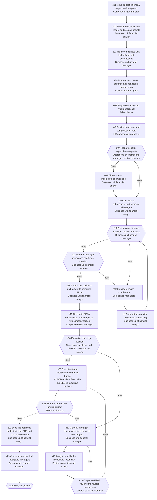

# Annual operating budget for one business unit

`fin-annual-budget-cycle` · cross-industry · finance: planning and analysis

Once a year each business unit builds its operating budget for the next year: revenue, costs, headcount and capital. Corporate FP&A issues targets and templates, the unit's analyst preloads a spreadsheet model, cost centre managers and the sales director fill in their parts, and the analyst consolidates them for the finance manager and general manager to challenge. The unit submits to corporate, where executives usually set new targets for at least one revision round before the board approves the company budget. Most of the elapsed time is waiting for managers' submissions, review meetings and board dates, and the many spreadsheet versions cause errors and rework.

| | |
|---|---|
| Unit of work | one business unit's annual operating budget |
| Starts when | Corporate FP&A issues the budget calendar, targets and templates, usually in early autumn for a calendar year. |
| Done when | The board has approved the company budget and this unit's budget is loaded by month in the ERP and communicated to its managers. |
| Organisation | One business unit (about $200 million revenue, 500 to 700 employees, about ten cost centres) of a US mid-size company with a calendar fiscal year, spreadsheet templates and a corporate planning tool. (2,000 employees, 2019-2022) |
| Volume | 0.0833 cases a month (range 0.0833 to 0.0833) |

## Where it sits

- Starts with **budget calendar, targets and templates** from Corporate FP&A (strategic plan and annual planning calendar) (100% of cases)
- Sends **monthly budget for budget-versus-actual reporting** to Month-end close and management reporting (outcome: approved_and_loaded)
- Sends **approved spending, headcount and capital budgets** to Cost centre managers (outcome: approved_and_loaded)
- Sends **approved headcount plan** to Human resources and recruiting (outcome: approved_and_loaded)
- Sends **approved capital list** to Capital expenditure approval (outcome: approved_and_loaded)
- Sends **targets used for bonuses** to Incentive compensation (outcome: approved_and_loaded)
- Sends **business unit share of the company budget** to Board of directors (outcome: approved_and_loaded)

## Flow

## Roles

| Role | Department | Layer | FTE on this process | Loaded cost per hour | Evidence |
|---|---|---|---:|---:|---|
| Corporate FP&A manager | Corporate finance: planning and analysis | manager | 0.015 | 114 USD | A [bls_113031], [bls_ecec2021] |
| Business unit financial analyst | Business unit finance | individual contributor | 0.12 | 79 USD | A [bls_132051], [bls_ecec2021] |
| Business unit finance manager | Business unit finance | manager | 0.03 | 114 USD | A [bls_113031], [bls_ecec2021] |
| Business unit general manager | Business unit leadership | director | 0.015 | 131 USD | B [bls_111021], [bls_ecec2021] |
| Sales director | Business unit sales | director | 0.01 | 110 USD | A [bls_112022], [bls_ecec2021] |
| Cost centre managers | Business unit departments | manager | 0.04 | 85 USD | A [bls_111021], [bls_ecec2021] |
| Operations or engineering manager (capital requests) | Business unit operations | manager | 0.005 | 85 USD | A [bls_111021], [bls_ecec2021] |
| HR compensation analyst | Human resources | individual contributor | 0.005 | 55 USD | A [bls_131141], [bls_ecec2021] |
| Chief financial officer (with the CEO in executive reviews) | Executive team | executive | 0.005 | 184 USD | B [bls_111011], [bls_ecec2021] |
| Board of directors | Board | external party | 0 | 300 USD | C |

## Steps

Hands-on time and the wait before each step show the most common value. Evidence tier A is a sourced number, B a sourced description, C the author's estimate.

| Step | Who | Kind | Hands-on | Wait before | Control | Evidence |
|---|---|---|---:|---:|---|---|
| **s01 Issue budget calendar, targets and templates.** Corporate FP&A sends each business unit the budget calendar, top-down revenue and profit targets, planning assumptions such as inflation, merit increase and benefit rates, the corporate allocations, and the templates to complete. | Corporate FP&A manager | communication | 2.0 h | 0 min | Budget policy and procedures issued by corporate FP&A (APQC PCF 9.1.1.1 develop and maintain budget policies and procedures) | B [acctools_planning], [pcf_copy] |
| **s02 Build the business unit model and preload actuals.** The business unit financial analyst builds the unit's budget workbook, loads year-to-date actuals and the run-rate forecast from the ERP, pulls the headcount roster, and preloads each cost centre template with history adjusted for inflation so managers only change what is different. | Business unit financial analyst | data entry | 1.2 d | 1.0 d |  | B [acctools_planning], [acca_budget] |
| **s03 Hold the business unit kick-off and set assumptions.** The general manager meets the finance manager, sales director and department heads to walk through the targets, agree the unit's priorities and key assumptions such as volume growth and new hires, and hand out the templates and deadline. | Business unit general manager | coordination | 3.0 h | 2.0 d |  | B [cfo_budget] |
| **s04 Prepare cost centre expense and headcount submissions.** About ten cost centre managers update their templates with planned headcount and hires, travel, contractors, supplies and projects, and write short justifications for increases. Most work on it close to the submission deadline about two weeks after kick-off. | Cost centre managers | drafting | 1.5 d | 6.0 d |  | B [acctools_planning], [acctools_master], [acca_budget], [wiki_zbb] |
| **s05 Prepare revenue and volume forecast.** The sales director and account managers build the revenue budget by customer or product line from the CRM pipeline, expected price changes and volume trends, and send it to the analyst. | Sales director | drafting | 12.0 h | 4.0 h |  | B [acctools_master] |
| **s06 Provide headcount and compensation data.** The HR compensation analyst validates the unit's headcount roster, applies merit increase, bonus and benefit rates to each position, and prices the requested new hires, then sends the file to the analyst. | HR compensation analyst | data entry | 4.0 h | 12.0 h |  | C |
| **s07 Prepare capital expenditure requests.** The operations or engineering manager lists planned equipment, facilities and IT projects with costs, timing and a short business case for each, ranked by priority, for review with the general manager. | Operations or engineering manager (capital requests) | drafting | 8.0 h | 4.0 h | Capital expenditure policy: requests above a threshold need a business case and ranking before inclusion | C |
| **s08 Chase late or incomplete submissions.** The analyst tracks which templates are missing or incomplete, emails and calls the managers, and escalates to the finance manager or general manager when deadlines slip. | Business unit financial analyst | communication | 2.0 h | 3.0 d |  | C |
| **s09 Consolidate submissions and compare with targets.** The analyst loads all templates into the business unit model, fixes broken formulas and version mix-ups, reconciles headcount to the HR file, and builds a summary comparing the draft with the targets, the current year forecast and prior year, highlighting the gap. | Business unit financial analyst | analysis | 1.0 d | 1.0 d |  | B [acctools_planning] |
| **s10 Business unit finance manager reviews the draft.** The finance manager reviews the consolidated draft for errors, unsupported increases and gaps to target, agrees questions to raise with managers, and decides whether it is ready for the general manager. | Business unit finance manager | review | 5.0 h | 1.0 d |  | B [acctools_planning] |
| **s11 General manager review and challenge session.** The general manager meets finance and each department head, challenges headcount additions and spending increases against the targets, and either approves the business unit submission or asks for cuts and changes. | Business unit general manager | review | 4.0 h | 2.0 d | Delegation of authority: the business unit general manager approves the unit budget before submission | B [acctools_master], [cfo_budget] |
| **s12 Managers revise submissions.** Cost centre managers rework their templates to the requested cuts or corrections, often pushing back on cuts or moving costs between lines, and resend them. | Cost centre managers | drafting | 6.0 h | 2.0 d |  | B [cfo_budget] |
| **s13 Analyst updates the model and version log.** The analyst loads the revised templates, reruns the consolidation and gap summary, and records what changed between versions so reviewers can see the movement. | Business unit financial analyst | data entry | 8.0 h | 12.0 h |  | B [cfo_budget] |
| **s14 Submit the business unit budget to corporate FP&A.** The analyst re-keys or uploads the approved budget into the corporate planning template or tool by line and month, attaches the commentary deck and capital list, and confirms the submission totals agree to the unit model. | Business unit financial analyst | data entry | 4.0 h | 12.0 h |  | C |
| **s15 Corporate FP&A consolidates and compares with company targets.** Once all business units have submitted, corporate FP&A consolidates them, adds corporate costs and allocations, compares the total with the company profit and cash targets, and prepares the gap analysis for the executive reviews. | Corporate FP&A manager | analysis | 4.0 h | 2.0 d |  | B [acctools_planning], [pcf_copy] |
| **s16 Executive challenge session.** The CFO and CEO review the business unit's budget with its general manager and finance manager, challenge revenue that looks low and costs that look high against the company target, and accept it or set new targets for a revision round. | Chief financial officer (with the CEO in executive reviews) | review | 4.0 h | 4.0 d | Executive review of business unit budgets before the company budget goes to the board | B [acctools_planning] |
| **s17 General manager decides revisions to meet new targets.** The general manager and finance manager decide where to cut or what extra revenue to commit, usually by deferring hires, trimming discretionary spending or delaying capital projects, and agree the changes with department heads. | Business unit general manager | judgment | 4.0 h | 2.0 d |  | C |
| **s18 Analyst rebuilds the model and resubmits.** The analyst applies the agreed revisions, updates the headcount and capital schedules and the commentary, and resubmits to corporate FP&A in the planning tool. | Business unit financial analyst | data entry | 15.0 h | 1.0 d |  | C |
| **s19 Corporate FP&A reviews the revised submission.** Corporate FP&A checks that the revised submission closes the agreed gap, ties out to the planning tool and is consistent with other units, and either accepts it or asks for another round. | Corporate FP&A manager | review | 2.0 h | 2.0 d |  | B [cfo_budget] |
| **s20 Executive team finalises the company budget.** The CFO and CEO sign off the consolidated company budget, including this unit, and prepare the board materials with the budget, key assumptions and risks. | Chief financial officer (with the CEO in executive reviews) | approval | 1.0 h | 3.0 d | Delegation of authority: CEO and CFO approve the company operating budget for board submission | B [acctools_planning] |
| **s21 Board approves the annual budget.** At its next scheduled meeting the board reviews the company budget and approves it, occasionally asking for changes. This unit's share of board time is small, but the case waits for the meeting date. | Board of directors | approval | 20 min | 5.0 d | Corporate governance: the board approves the annual operating budget under its charter or bylaws | B [acctools_planning] |
| **s22 Load the approved budget into the ERP and phase it by month.** The analyst spreads the approved annual figures by month using seasonality and hiring dates, loads them by cost centre and account into the ERP or planning tool for budget-versus-actual reporting, and checks the loaded totals. | Business unit financial analyst | data entry | 8.0 h | 2.0 d |  | B [acctools_planning], [acctools_master] |
| **s23 Communicate the final budget to managers.** The finance manager sends each cost centre manager their final budget, headcount and capital approvals, explains changes from their submission, and confirms the targets they will be measured against. | Business unit finance manager | communication | 2.0 h | 12.0 h |  | B [pcf_copy] |

## Exceptions

| Exception | Share of cases | What happens |
|---|---:|---|
| Late or incomplete submissions | 50% | Some managers miss the deadline or send incomplete templates; the analyst chases and escalates. |
| Business unit revision loop | 60% | The finance manager or general manager sends the draft back for fixes or cuts; managers revise and the analyst updates the model before another review. |
| Executive revision round | 70% | Executives set new targets; the general manager decides cuts, the analyst rebuilds and corporate reviews again, sometimes twice. |
| Board changes | 5% | The board asks for changes, sending the unit back to a revision round. |

## Benchmarks

| Metric | Value | Unit | Population | Evidence |
|---|---|---|---|---|
| cycle_time_days | p50 42, p90 75 | calendar days from issuing budget objectives to a ready-to-use approved budget | APQC cross-industry benchmarking, nearly 6,000 organisations (derived) | B [cfo_budget] |
| budget_versions_median | 5 | versions | APQC (as cited) | A [cfo_budget] |
| fpa_fte_per_billion_revenue | p25 1.9, median 3.4, p75 5.4 | FTE per $1 billion revenue | APQC all industries (as cited) | A [cfo_fcst_fte] |
| forecast_cycle_time_days | top 8, median 11 | days | APQC, nearly 3,900 companies (as cited) | A [cfo_fcst_cycle] |

## Pain points

- Most elapsed time is waiting: for managers to fill templates near the deadline, for review meetings on busy calendars, for other units to submit and for the board date. (steps s04, s11, s15, s16, s21; B [cfo_budget])
- Back-and-forth negotiation produces several budget versions; managers pad requests expecting cuts and executives cut expecting padding. (steps s10, s11, s12, s16, s17; A [cfo_budget], [acca_budget], [acctools_master])
- Spreadsheet templates break, versions get mixed up and figures are re-keyed into the corporate tool, so analysts spend days on consolidation and checks. (steps s02, s09, s13, s14, s18; B [acctools_master], [cfo_budget])
- Late or incomplete submissions need chasing and escalation. (steps s07, s08; C)

## Assumptions

- General workflow for one business unit of about $200 million revenue in a US company of about 2,000 employees; one budget per year (cases_per_month = 1/12).
- Loaded cost per hour = BLS May 2021 wage x 1.8 (benefits factor 1.43 from BLS ECEC December 2021, overhead factor 1.25 estimated).
- Incremental budgeting from last year's base with top-down targets; zero-based budgeting would add decision packages and ranking and much more manager time (wiki_zbb).
- Hands-on times for groups (cost centre managers, executives) are totals across the people involved for this unit.
- The submission window (s04) is modelled as the wait before managers' work; revenue, headcount and capital inputs (s05 to s07) run in parallel with near-zero waits, but the simulator still adds their hands-on time to elapsed time.
- The simulator reuses the same branch probabilities on every revision pass, so the number of rounds follows a geometric distribution; on average this gives about four versions (about 2.2 business unit drafts plus 0.7 executive revision rounds and the final), a little below the APQC median of five.
- Stated FTE is averaged over the year; budget work is concentrated in about three months, when the analyst spends about half their time on it.
- The APQC median cycle time is not published; the benchmark p50 of 42 days is set between the published top-quarter (28 days) and 75th-percentile (about 56 days) values.
- Branch shares (late submissions, revision rounds, board changes) are author estimates.
- The simulated median (about 58 days) is 1.4 times the derived benchmark of 42 days and sits just above the APQC 75th percentile of about 56 days. About 9 of those days are hands-on time that the simulator adds in sequence although much of it happens in parallel or inside the submission window.

## Sources

- [cfo_budget] [4 tips for a faster and more effective budgeting process: Metric of the Month (Perry D. Wiggins, citing APQC)](https://www.cfo.com/news/budgeting-process-collaboration-metric-perry-wiggins-apqc/692752/) (CFO.com, 2023). APQC data from nearly 6,000 organisations: cycle time to complete the annual budget, in calendar days from setting budget objectives to delivering a ready-to-use budget; the top quarter finish in 28 days or less, nearly twice as fast as organisations at the 75th percentile; a median of five budget versions from back-and-forth negotiation, with much of the cycle spent waiting rather than working; starting later, kickoff training and a single version of the truth shorten it.
- [cfo_fcst_fte] [Measuring financial forecasting efficiency: Metric of the Month (citing APQC)](https://www.cfo.com/news/measuring-financial-forecasting-efficiency-budgeting-financial-planning-and-analysis/723434/) (CFO.com, 2024). FTEs synthesising financial data to develop budgets and forecasts per $1 billion revenue: 25th percentile 1.9, median 3.4, 75th percentile 5.4 (all industries).
- [cfo_fcst_cycle] [4 strategies for faster financial forecasting: Metric of the Month (citing APQC)](https://www.cfo.com/news/4-strategies-for-faster-financial-forecasting-metric-of-the-month/750332/) (CFO.com, 2025). Cycle time to prepare a financial forecast (generally a quarterly rolling P&L forecast): median 11 days, high performers 8 days, nearly 3,900 companies.
- [pcf_copy] [9.0 Manage financial resources (APQC Process Classification Framework, cross-industry, reproduced)](https://capechamber.co.za/enterprise/improve-your-business-processes/9-manage-financial-resources) (Cape Chamber of Commerce, n.d.). APQC PCF 9.1.1 Perform planning, budgeting and forecasting: develop and maintain budget policies and procedures, prepare periodic budgets and plans, operationalise and implement plans, prepare periodic forecasts, perform variance analysis.
- [acctools_planning] [Budgetary planning](https://www.accountingtools.com/articles/budgetary-planning.html) (AccountingTools, 2026). Process: board sets strategic direction; milestone calendar; written policies and procedures; budget owner preloads a model from historical results; managers adjust their sections; segments aggregated into a master model that senior management reviews and often sends back for repeated revisions; board sign-off; budget loaded into accounting software for budget-versus-actual reporting.
- [acctools_master] [Master budget](https://www.accountingtools.com/articles/master-budget) (AccountingTools, 2026). Master budget components (sales, production, materials, labour, overhead, selling and administrative, cash, financing, budgeted statements); senior management reviews several iterations; participative budgeting; spreadsheets common in smaller organisations; tying targets to pay leads managers to underestimate sales and overstate expenses.
- [acca_budget] [Comparing budgeting techniques](https://www.accaglobal.com/pk/en/student/exam-support-resources/fundamentals-exams-study-resources/f5/technical-articles/comparing-budgeting-techniques.html) (ACCA, n.d.). Incremental budgeting starts from the current budget or actuals plus increments; it is quick, cheap and limits conflict but carries forward slack and encourages spend-it-or-lose-it; zero-based budgeting uses decision packages, ranking and allocation.
- [wiki_zbb] [Zero-based budgeting](https://en.wikipedia.org/wiki/Zero-based_budgeting) (Wikipedia, n.d.). Zero-based budgeting requires every expense to be justified each period through decision units, decision packages and ranking; it takes more time, effort and staff than budgeting from last year's base.
- [bls_132051] [Occupational Employment and Wages, May 2021: 13-2051 Financial and Investment Analysts](https://www.bls.gov/oes/2021/may/oes132051.htm) (US Bureau of Labor Statistics, 2022). Median hourly wage $44.03; 25th percentile $31.75; 75th percentile $59.91.
- [bls_113031] [Occupational Employment and Wages, May 2021: 11-3031 Financial Managers](https://www.bls.gov/oes/2021/may/oes113031.htm) (US Bureau of Labor Statistics, 2022). Median hourly wage $63.32; 25th percentile $47.89; 75th percentile $92.24.
- [bls_111021] [Occupational Employment and Wages, May 2021: 11-1021 General and Operations Managers](https://www.bls.gov/oes/2021/may/oes111021.htm) (US Bureau of Labor Statistics, 2022). Median hourly wage $47.10; 25th percentile $29.18; 75th percentile $72.96.
- [bls_112022] [Occupational Employment and Wages, May 2021: 11-2022 Sales Managers](https://www.bls.gov/oes/2021/may/oes112022.htm) (US Bureau of Labor Statistics, 2022). Median hourly wage $61.30; 25th percentile $40.60; 75th percentile $83.18.
- [bls_131141] [Occupational Employment and Wages, May 2021: 13-1141 Compensation, Benefits, and Job Analysis Specialists](https://www.bls.gov/oes/2021/may/oes131141.htm) (US Bureau of Labor Statistics, 2022). Median hourly wage $30.83; 25th percentile $23.94; 75th percentile $40.25.
- [bls_111011] [Occupational Employment and Wages, May 2021: 11-1011 Chief Executives](https://www.bls.gov/oes/2021/may/oes111011.htm) (US Bureau of Labor Statistics, 2022). Median hourly wage $86.31; mean $102.41; 25th percentile $53.40; 75th percentile not published.
- [bls_ecec2021] [Employer Costs for Employee Compensation, December 2021 (news release)](https://www.bls.gov/news.release/archives/ecec_03182022.htm) (US Bureau of Labor Statistics, 2022). Private industry: wages and salaries 70.5 percent and benefits 29.5 percent of total compensation.

Written by claude-opus on 2026-11-17.
