# Monthly financial close for one legal entity

`fin-month-end-close` · cross-industry · finance: accounting (record to report)

Every month the accounting team closes the books of the legal entity so the group can report its results. After cut-off, AP, billing, inventory, payroll and fixed asset owners close their sub-ledgers, the senior accountant books accruals with input from department managers, and staff accountants reconcile about 70 balance sheet accounts. Reviews by the accounting manager, a flux analysis, the controller and the entity finance director each send some work back as adjustments before the package is loaded into group consolidation. The close is slow where it depends on late inputs from departments and other entities, manual spreadsheet reconciliations and sequential review layers.

| | |
|---|---|
| Unit of work | one monthly close of one legal entity |
| Starts when | The last business day of the month (period end). |
| Done when | The entity's reporting package is submitted to group consolidation and the period is locked in the ERP, with any group queries answered. |
| Organisation | A US operating legal entity of a mid-size group (about 800 employees, $300 to $400 million revenue) with an ERP, spreadsheet reconciliations and a group consolidation tool, reporting to the group on about working day 5. (800 employees, 2019-2022) |
| Volume | 1 cases a month (range 1 to 1) |

## Where it sits

- Starts with **period end and close calendar** from Accounting calendar (period end) (100% of cases)
- Sends **entity reporting package and trial balance** to Group consolidation and reporting (outcome: any)
- Sends **monthly financial statements and variance commentary** to Management reporting and planning (outcome: any)
- Sends **tax provision and sales tax accruals** to Tax compliance (outcome: any)
- Sends **reconciliations and journal entry support** to External audit (outcome: any)
- Sends **intercompany confirmations** to Other group entities (outcome: any)

## Flow

```mermaid
flowchart TD
    s01["s01 Confirm cut-off and open the close checklist<br/>Accounting manager"]
    s02["s02 Close the AP sub-ledger and accrue goods received not invoiced<br/>Accounts payable specialist"]
    s03["s03 Close the billing and AR sub-ledger<br/>Billing and accounts receivable specialist"]
    s04["s04 Close inventory and cost accounting<br/>Cost accountant"]
    s05["s05 Close payroll, fixed assets and prepaids<br/>Staff accountant"]
    s06["s06 Request accrual inputs from department managers<br/>Staff accountant"]
    s07{{"s07 Department managers provide accrual estimates<br/>Department managers  budget owners"}}
    s08{{"s08 Chase missing accrual inputs<br/>Staff accountant"}}
    s09["s09 Prepare accrual and adjusting journal entries<br/>Senior accountant"]
    s10{{"s10 Review and approve journal entries<br/>Accounting manager"}}
    s11["s11 Post entries and run the preliminary trial balance<br/>Senior accountant"]
    s12{{"s12 Reconcile intercompany balances<br/>Senior accountant"}}
    s13["s13 Wait for counterpart entity to confirm or correct<br/>Outside party"]
    s14["s14 Prepare balance sheet account reconciliations<br/>Staff accountant"]
    s15{{"s15 Review account reconciliations<br/>Accounting manager"}}
    s16["s16 Calculate monthly tax provision and sales tax accruals<br/>Tax accountant"]
    s17{{"s17 Run flux analysis and draft commentary<br/>Financial analyst"}}
    s18["s18 Draft post-close adjusting entries<br/>Senior accountant"]
    s19["s19 Approve adjusting entries<br/>Accounting manager"]
    s20{{"s20 Controller reviews trial balance and draft financial statements<br/>Controller"}}
    s21["s21 Prepare the reporting package and load it to group consolidation<br/>Financial analyst"]
    s22{{"s22 Run group validation checks<br/>Automated"}}
    s23["s23 Fix validation errors<br/>Senior accountant"]
    s24{{"s24 Finance director reviews and signs off the package<br/>Entity finance director"}}
    s25{{"s25 Submit the package and lock the period<br/>Accounting manager"}}
    s26["s26 Answer group reporting queries<br/>Senior accountant"]
    s01 --> s02
    s02 --> s03
    s03 --> s04
    s04 --> s05
    s05 --> s06
    s06 --> s07
    s07 -->|"65%"| s09
    s07 -->|"35%"| s08
    s08 -->|"50%"| s07
    s08 -->|"50%"| s09
    s09 --> s10
    s10 -->|"85%"| s11
    s10 -->|"15%"| s09
    s11 --> s12
    s12 -->|"55%"| s14
    s12 -->|"45%"| s13
    s13 --> s14
    s14 --> s15
    s15 -->|"85%"| s16
    s15 -->|"15%"| s14
    s16 --> s17
    s17 -->|"60%"| s20
    s17 -->|"40%"| s18
    s18 --> s19
    s19 --> s20
    s20 -->|"75%"| s21
    s20 -->|"25%"| s18
    s21 --> s22
    s22 -->|"80%"| s24
    s22 -->|"20%"| s23
    s23 --> s22
    s24 -->|"88%"| s25
    s24 -->|"12%"| s18
    s25 -->|"60%"| end0
    s25 -->|"40%"| s26
    s26 --> end1
    end0(["closed"])
    end1(["closed_after_queries"])
```

## Roles

| Role | Department | Layer | FTE on this process | Loaded cost per hour | Evidence |
|---|---|---|---:|---:|---|
| Entity finance director | Finance | director | 0.02 | 166 USD | B [bls_113031], [bls_ecec2021] |
| Controller | Finance: accounting | manager | 0.06 | 114 USD | A [bls_113031], [bls_ecec2021] |
| Accounting manager | Finance: accounting | manager | 0.25 | 99 USD | A [bls_113031], [bls_ecec2021] |
| Senior accountant | Finance: accounting | senior specialist | 0.3 | 75 USD | A [bls_132011], [bls_ecec2021] |
| Staff accountant | Finance: accounting | individual contributor | 0.6 | 58 USD | A [bls_132011], [bls_ecec2021] |
| Cost accountant | Finance: accounting | senior specialist | 0.12 | 67 USD | A [bls_132011], [bls_ecec2021] |
| Accounts payable specialist | Finance: accounts payable | individual contributor | 0.05 | 39 USD | A [bls_433031], [bls_ecec2021] |
| Billing and accounts receivable specialist | Finance: accounts receivable | individual contributor | 0.04 | 39 USD | A [bls_433031], [bls_ecec2021] |
| Financial analyst | Finance: planning and analysis | individual contributor | 0.15 | 79 USD | A [bls_132051], [bls_ecec2021] |
| Tax accountant | Finance: tax | senior specialist | 0.03 | 75 USD | A [bls_132011], [bls_ecec2021] |
| Department managers (budget owners) | Operating departments | manager | 0.02 | 85 USD | A [bls_111021], [bls_ecec2021] |

## Steps

Hands-on time and the wait before each step show the most common value. Evidence tier A is a sourced number, B a sourced description, C the author's estimate.

| Step | Who | Kind | Hands-on | Wait before | Control | Evidence |
|---|---|---|---:|---:|---|---|
| **s01 Confirm cut-off and open the close checklist.** On the last business day the accounting manager confirms the last shipping and receiving documents of the month with the warehouse, reminds departments of deadlines for invoices, timesheets and accrual inputs, and rolls the close checklist and calendar forward with owners and due days. | Accounting manager | coordination | 1.0 h | 0 min | Period-end cut-off so revenue and expenses are recorded in the right period (US GAAP accrual accounting, ASC 606 for revenue) | B [cfo_close], [jofa_2011] |
| **s02 Close the AP sub-ledger and accrue goods received not invoiced.** The AP specialist posts the last supplier invoices received by cut-off, runs the goods-received-not-invoiced report, prepares the received-not-invoiced accrual listing for the senior accountant, and closes the AP period. Work starts on the first working day, which may be after a weekend. | Accounts payable specialist | data entry | 5.0 h | 8.0 h |  | B [pcf_copy], [tipalti_close] |
| **s03 Close the billing and AR sub-ledger.** The billing and AR specialist runs the final billing for shipments through period end, lists shipped but unbilled orders, applies cash received through the last day, runs the AR aging and the bad debt reserve inputs, and closes the AR period. | Billing and accounts receivable specialist | data entry | 4.0 h | 0 min |  | B [tipalti_close], [pcf_copy] |
| **s04 Close inventory and cost accounting.** The cost accountant checks that all receipts, issues and production are posted, books cycle count adjustments, runs standard cost variance and overhead absorption reports, reviews work in progress and calculates the excess and obsolete inventory reserve. | Cost accountant | analysis | 9.0 h | 0 min |  | B [tipalti_close] |
| **s05 Close payroll, fixed assets and prepaids.** The staff accountant calculates the payroll accrual for days worked but unpaid and the vacation accrual, runs depreciation and moves finished construction-in-progress to assets, and amortises prepaid expenses from the schedules. | Staff accountant | data entry | 4.0 h | 0 min |  | B [tipalti_close], [pcf_copy] |
| **s06 Request accrual inputs from department managers.** The staff accountant emails each department manager a template listing open purchase orders and recurring services and asks for services received but not yet invoiced, such as legal, consulting, marketing and utilities, with a deadline of the second working day. | Staff accountant | communication | 1.5 h | 0 min |  | C |
| **s07 Department managers provide accrual estimates.** About eight department managers check their contracts and vendor activity and reply with estimates for work received but not invoiced. Replies come late or incomplete, and some managers do not reply at all. | Department managers (budget owners) | judgment | 2.0 h | 10.0 h |  | C |
| **s08 Chase missing accrual inputs.** The staff accountant follows up by email or phone with managers who have not replied, and where no answer comes by the cut-off uses the run rate or the open purchase order to estimate the accrual. | Staff accountant | communication | 30 min | 6.0 h |  | C |
| **s09 Prepare accrual and adjusting journal entries.** The senior accountant calculates accruals from the received-not-invoiced listing, unbilled revenue, payroll, department estimates, bonus, interest and rent, checks prior-month auto-reversals, and prepares each journal entry with support in the standard template. | Senior accountant | drafting | 9.0 h | 2.0 h |  | B [pcf_copy], [jofa_2011] |
| **s10 Review and approve journal entries.** The accounting manager opens each manual journal entry with its support, checks the calculation, accounts, period and amount against expectations, and approves it in the ERP or returns it with comments. The preparer cannot approve their own entries. | Accounting manager | review | 2.5 h | 4.0 h | Internal control over financial reporting (SOX 404 for public issuers): manual journal entries independently reviewed and approved by someone other than the preparer | B [jofa_2011], [sox404] |
| **s11 Post entries and run the preliminary trial balance.** The senior accountant uploads the approved journal entries, runs the preliminary trial balance, confirms that it balances and that the AP, AR, inventory and fixed asset sub-ledgers agree to their control accounts. | Senior accountant | data entry | 45 min | 30 min |  | B [wiki_fcm], [pcf_copy] |
| **s12 Reconcile intercompany balances.** The senior accountant books intercompany charges such as management fees and shared services, compares intercompany receivables, payables and charges with the counterpart entities' figures from the group schedule, and flags differences. | Senior accountant | validation | 3.0 h | 1.0 h | Group intercompany accounting policy: balances agreed with counterparties before submission so they eliminate on consolidation | B [pcf_copy] |
| **s13 Wait for counterpart entity to confirm or correct.** The counterpart entity's accountant checks the difference, usually a charge booked in one entity only or at a different exchange rate, and corrects their books or confirms ours. The case waits on another team in the group. | Outside party | external wait | 0 min | 12.0 h |  | C |
| **s14 Prepare balance sheet account reconciliations.** The staff accountants reconcile about 70 balance sheet accounts: the bank accounts against bank statements, then receivables, inventory, prepaids, fixed assets, accruals, payables, payroll liabilities and tax accounts against sub-ledgers and schedules, and document each reconciling item in the workbook. | Staff accountant | validation | 1.4 d | 1.0 h |  | A [cfo_bankrec], [cfo_glrec], [tipalti_close] |
| **s15 Review account reconciliations.** The accounting manager reviews each reconciliation, focusing on high-risk accounts and aged or unexplained reconciling items, signs it off in the workbook, and returns any that do not tie or lack support. | Accounting manager | review | 6.0 h | 4.0 h | Internal control over financial reporting (SOX 404 for public issuers): balance sheet reconciliations reviewed and signed off each period | B [sox404], [jofa_2011] |
| **s16 Calculate monthly tax provision and sales tax accruals.** The tax accountant estimates the month's income tax provision from pre-tax income and the expected annual rate, updates sales and use tax and property tax accruals, and sends the entries to the senior accountant. | Tax accountant | analysis | 2.0 h | 2.0 h | Group reporting policy: monthly estimate of income tax expense under ASC 740 for management reporting (required at quarter-end for public issuers) | C |
| **s17 Run flux analysis and draft commentary.** The financial analyst compares each income statement and balance sheet line with the prior month, budget and prior year, investigates variances above the thresholds by asking accountants and operations, and drafts the commentary. Unexplained swings often reveal a missed accrual or misposting. | Financial analyst | analysis | 7.0 h | 4.0 h | Management review control: fluctuation analysis against set thresholds before financial statements are released | B [wiki_fcm], [jofa_2011] |
| **s18 Draft post-close adjusting entries.** The senior accountant prepares adjusting entries for errors found in reconciliation review, flux analysis or the controller's review, such as a missed accrual, a misclassification or a reserve change, with support. | Senior accountant | drafting | 1.5 h | 2.0 h |  | B [jofa_2011], [pcf_copy] |
| **s19 Approve adjusting entries.** The accounting manager reviews each adjusting entry and its support against the materiality thresholds and approves it for posting, or escalates large ones to the controller. | Accounting manager | approval | 30 min | 4.0 h | Internal control over financial reporting (SOX 404 for public issuers): post-close adjustments approved by someone other than the preparer within materiality thresholds | B [jofa_2011], [sox404] |
| **s20 Controller reviews trial balance and draft financial statements.** The controller reviews the trial balance, the reconciliation status, the flux commentary and the key judgements on reserves and accruals, and either signs off or asks for changes or more explanation. | Controller | review | 3.0 h | 4.0 h | Internal control over financial reporting (SOX 404 for public issuers): management review of period-end financial statements by someone not involved in preparing them | B [tipalti_close], [sox404] |
| **s21 Prepare the reporting package and load it to group consolidation.** The financial analyst maps the trial balance to the group chart of accounts, loads it into the consolidation tool, and fills the package: income statement, balance sheet, cash flow, intercompany schedule, headcount and KPI schedules, and variance commentary. | Financial analyst | drafting | 6.0 h | 2.0 h |  | B [pcf_copy], [cfo_consol] |
| **s22 Run group validation checks.** The consolidation tool runs its validation rules on submission: the package balances, schedules tie to the trial balance, and intercompany balances match the counterparts within tolerance. | Automated | system auto | 0 min | 15 min |  | C |
| **s23 Fix validation errors.** The senior accountant reads the validation report, corrects mapping errors or schedule differences, agrees remaining intercompany differences with the counterpart, and resubmits the package. | Senior accountant | data entry | 45 min | 1.0 h |  | C |
| **s24 Finance director reviews and signs off the package.** The entity finance director reads the package and commentary, questions large variances and judgements, and signs it off for submission. At quarter-end this sign-off becomes the sub-certification that supports the group's certifications. | Entity finance director | approval | 1.5 h | 6.0 h | Group reporting policy: entity finance lead signs off the monthly package (quarterly sub-certification supports officer certifications at public groups) | C |
| **s25 Submit the package and lock the period.** The accounting manager submits the package in the consolidation tool by the group deadline and hard-closes the period in the ERP so no further entries can post to it. | Accounting manager | data entry | 30 min | 1.0 h | Hard close: posting periods locked after sign-off; reopening needs controller approval | B [cfo_close] |
| **s26 Answer group reporting queries.** The senior accountant answers questions from the group reporting team about variances, intercompany differences or classifications, and sends supporting schedules. Rarely the group books a top-side adjustment instead of reopening the period. | Senior accountant | communication | 1.0 h | 8.0 h |  | C |

## Exceptions

| Exception | Share of cases | What happens |
|---|---:|---|
| Late accrual inputs | 35% | Department managers miss the accrual deadline; the accountant chases and estimates from run rate or open POs. |
| Journal entries returned | 15% | The accounting manager returns entries with errors for correction before posting. |
| Intercompany differences | 45% | Balances with other group entities do not agree and wait on the counterpart's correction. |
| Reconciliations returned | 15% | Reconciliations that do not tie or lack support go back to the preparer. |
| Post-close adjustments | 55% | Flux analysis, controller review or the finance director find errors that need adjusting entries and another review. |
| Group validation failure | 20% | The consolidation tool rejects the package for mapping or intercompany differences. |
| Group queries | 40% | Group reporting asks questions after submission. |

## Benchmarks

| Metric | Value | Unit | Population | Evidence |
|---|---|---|---|---|
| cycle_time_days | p50 6.4, p90 12 | calendar days from running the trial balance to completed consolidated statements | APQC General Accounting Open Standards Benchmarking, 2,300 organisations (as cited) | A [cfo_close], [cfo_consol] |
| consolidated_financials_cycle_days_quartiles | p25 4, p75 10 | calendar days | APQC (as cited, 2022) | A [cfo_consol] |
| bank_reconciliation_hours_per_account | top 2.6, median 4, bottom 5 | hours | APQC (as cited, 2026) | A [cfo_bankrec] |
| gl_reconciliation_hours | p25 5, median 6, p75 10 | hours | APQC (as cited, 2024) | A [cfo_glrec] |
| period_end_management_reports_cycle_days | top 6, median 10, bottom 15 | days | APQC (as cited, 2026) | A [cfo_mgmt_reports] |

## Pain points

- Accrual inputs from department managers arrive late or not at all, so accountants chase and estimate, and misses show up later as flux surprises. (steps s06, s07, s08, s17; C)
- About 70 reconciliations are prepared by hand in spreadsheets in the same few days, which is the largest block of hands-on time and the main source of unexplained items. (steps s14, s15; B [acctoday_2017], [cfo_glrec], [cfo_bankrec])
- Sequential review layers (accounting manager, controller, finance director) each wait on the reviewer's calendar and each can send work back to adjusting entries. (steps s10, s15, s20, s24, s18; B [jofa_2011])
- Intercompany differences wait on other entities and resurface as group validation failures. (steps s12, s13, s22, s23; B [pcf_copy], [cfo_consol])
- Close coordination runs on checklists, email chains and status meetings rather than a system, so status is hard to see. (steps s01, s25; B [acctoday_2017], [jofa_2011])

## Assumptions

- General workflow for one US operating entity of about 800 employees in a mid-size group; one close per month (cases_per_month = 1).
- Loaded cost per hour = BLS May 2021 wage x 1.8 (benefits factor 1.43 from BLS ECEC December 2021, overhead factor 1.25 estimated).
- The simulator adds every step's hands-on time to elapsed time, so steps that really run in parallel (s02 to s06, s12 with s14, s16 with s17) are summed. About 120 hands-on hours appear as about 5 days of elapsed time, which roughly matches several people working in parallel over the first five working days. Waits on concurrent steps are set near zero for this reason.
- The simulated median (about 10 days, 1.6 times the benchmark) is above the APQC median of 6.4 days partly because this workflow starts at period end and includes the sub-ledger close before the trial balance, and partly because parallel work is summed; it is within the 0.5x to 2x check.
- Reconciliation time uses APQC's 4-hour median per bank account and assumes 4 to 6 bank accounts plus about 65 other monthly reconciliations; balance sheet accounts reconciled quarterly are excluded.
- Stated FTE on the process is higher than the hands-on time implies because close staff also do pre-close work, close meetings and checklist upkeep that are not modelled as steps.
- Branch shares (late inputs, returns, adjustments, intercompany differences, group queries) are author estimates; no event log for the close was found.
- The counterpart entity and the group reporting team are treated as outside parties with zero hands-on time in this workflow.

## Sources

- [cfo_close] [Metric of the Month: cycle time for monthly close (citing APQC General Accounting Open Standards Benchmarking)](https://www.cfo.com/news/metric-of-the-month-cycle-time-for-monthly-close/659297/) (CFO.com, 2018). Median 6.4 calendar days from running the trial balance to completing consolidated financial statements (2,300 organisations); top quarter 4.8 days or less, bottom quarter 10 or more days. A standard chart of accounts saves about two days; pre-close reconciliations and journal entries, a month-end checklist, communicated cut-off dates and sub-ledgers posting summaries reduce close time.
- [cfo_consol] [Best organizations report consolidated financials in 4 days: Metric of the Month (citing APQC)](https://www.cfo.com/news/best-organizations-report-consolidated-financials-in-4-days-metric-of-the/655020/) (CFO.com, 2022). Calendar days from running the initial monthly entity trial balance to completing consolidated statements: 25th percentile 4 days, 75th percentile 10 days; excessive spreadsheets, manual touchpoints, human error and non-standard charts of accounts lengthen it.
- [cfo_glrec] [How long is too long to reconcile the general ledger? Metric of the Month (citing APQC)](https://www.cfo.com/news/how-long-is-too-long-to-reconcile-the-general-ledger-metric-of-the-month-accounting-strategy/725696/) (CFO.com, 2024). Hours accounting staff take to reconcile the general ledger: median 6, 25th percentile 5, 75th percentile 10; liability and revenue accounts that need tracing to source documents and monthly rather than continuous reconciliation take longer.
- [cfo_bankrec] [What bank reconciliation cycle time really tells you: Metric of the Month (citing APQC)](https://www.cfo.com/news/what-bank-reconciliation-cycle-time-really-tells-you-metric-of-the-month/819241/) (CFO.com, 2026). Time to reconcile a single bank account: top performers about 2.6 hours, median 4 hours, bottom performers 5 hours or more; month-end surges, unmatched receipts, paper checks and dependence on other teams slow it.
- [cfo_mgmt_reports] [5 ways to speed up period-end management reports: Metric of the Month (citing APQC)](https://www.cfo.com/news/5-ways-to-speed-up-period-end-management-reports-metric-of-the-month-automation-strategy/822165/) (CFO.com, 2026). Cycle time to produce period-end management reports: top quarter 6 days, median 10 days, bottom quarter 15 days on average.
- [cfo_yearend] [5 strategies for a faster year-end close: Metric of the Month (citing APQC)](https://www.cfo.com/news/5-strategies-for-a-faster-year-end-close-metric-of-the-month-ai-erp/758999/) (CFO.com, 2025). Annual close at site level: median 10 days for organisations under $100 million revenue and 23 days for $1 to $5 billion; fastest quarter 10 days or less; monthly reconciliations and a shared checklist help.
- [tipalti_close] [Month-end close process and checklist](https://tipalti.com/resources/learn/month-end-close/) (Tipalti, 2025). Steps: collect information, reconcile sub-ledgers with the general ledger, reconcile accounts starting with cash, inventory and fixed assets, prepare statements, final review by a controller not involved in the close; cites an APQC median close of 6.4 days.
- [jofa_2011] [Building blocks of a successful financial close process (Kevin Kelso)](https://www.journalofaccountancy.com/issues/2011/dec/20114327.html) (Journal of Accountancy, 2011). Close calendar with cut-off times, close instructions, daily close calls, exception hierarchy with materiality thresholds and an approval process for post-close adjustments, journal entry checklist with independent review as a detective control, standard JE templates, comparison with prior periods, post-mortem after each close.
- [acctoday_2017] [The monthly headache: how close management software can help (Mike Whitmire)](https://www.accountingtoday.com/opinion/the-monthly-headache-how-close-management-software-can-help) (Accounting Today, 2017). Close relies on disparate checklists, long email chains, status meetings and manual reconciliations between the ERP and Excel; SOX, IPO and audit work add time. Opinion piece by a close software vendor.
- [wiki_fcm] [Financial close management](https://en.wikipedia.org/wiki/Financial_close_management) (Wikipedia, n.d.). Close steps: consolidating transactions, reconciliation, adjustments, trial balance check, fluctuation analysis comparing periods to find material changes, reporting under GAAP or IFRS.
- [pcf_copy] [9.0 Manage financial resources (APQC Process Classification Framework, cross-industry, reproduced)](https://capechamber.co.za/enterprise/improve-your-business-processes/9-manage-financial-resources) (Cape Chamber of Commerce, n.d.). APQC PCF 9.3.2 Perform general accounting: process journal entries, process allocations, process period end adjustments, post and reconcile intercompany transactions, reconcile general ledger accounts, perform consolidations and eliminations, prepare trial balance; 9.3.4 prepare business unit financial statements; 9.6.1.5 process financial accruals and reversals.
- [sox404] [15 U.S. Code 7262: Management assessment of internal controls (Sarbanes-Oxley Act section 404)](https://www.law.cornell.edu/uscode/text/15/7262) (Legal Information Institute, Cornell Law School, 2002). Public issuers' annual reports must contain management's assessment of internal control over financial reporting, attested by the auditor for accelerated filers.
- [bls_113031] [Occupational Employment and Wages, May 2021: 11-3031 Financial Managers](https://www.bls.gov/oes/2021/may/oes113031.htm) (US Bureau of Labor Statistics, 2022). Median hourly wage $63.32; 25th percentile $47.89; 75th percentile $92.24 (90th percentile not published).
- [bls_132011] [Occupational Employment and Wages, May 2021: 13-2011 Accountants and Auditors](https://www.bls.gov/oes/2021/may/oes132011.htm) (US Bureau of Labor Statistics, 2022). Median hourly wage $37.14; 25th percentile $29.21; 75th percentile $47.98.
- [bls_132051] [Occupational Employment and Wages, May 2021: 13-2051 Financial and Investment Analysts](https://www.bls.gov/oes/2021/may/oes132051.htm) (US Bureau of Labor Statistics, 2022). Median hourly wage $44.03; 25th percentile $31.75; 75th percentile $59.91.
- [bls_433031] [Occupational Employment and Wages, May 2021: 43-3031 Bookkeeping, Accounting, and Auditing Clerks](https://www.bls.gov/oes/2021/may/oes433031.htm) (US Bureau of Labor Statistics, 2022). Mean hourly wage $21.70; 25th percentile $17.67; 75th percentile $23.92.
- [bls_111021] [Occupational Employment and Wages, May 2021: 11-1021 General and Operations Managers](https://www.bls.gov/oes/2021/may/oes111021.htm) (US Bureau of Labor Statistics, 2022). Median hourly wage $47.10; 25th percentile $29.18; 75th percentile $72.96.
- [bls_ecec2021] [Employer Costs for Employee Compensation, December 2021 (news release)](https://www.bls.gov/news.release/archives/ecec_03182022.htm) (US Bureau of Labor Statistics, 2022). Private industry: wages and salaries 70.5 percent and benefits 29.5 percent of total compensation.

Written by claude-opus on 2026-11-17.
