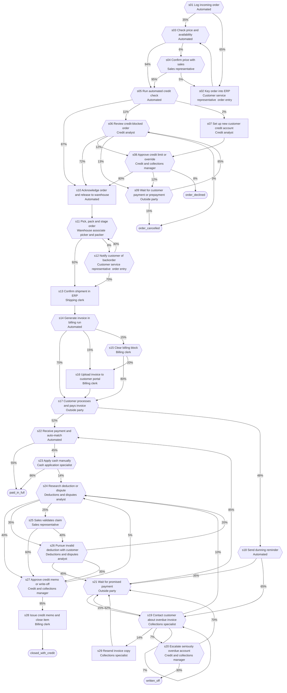

# Process one business customer order from order receipt to cash (order to cash)

`fin-order-to-cash-b2b` · cross-industry (B2B manufacturing and distribution) · finance and sales operations: order to cash

Order to cash turns a business customer's purchase order into goods shipped, an invoice and cash in the bank. Customer service keys or imports the order, the ERP checks price, stock and credit, and about one order in eight stops for a credit analyst. After the warehouse ships, a nightly run invoices the customer, who pays on its own schedule; about half of invoices are paid late and go through reminders and collector calls. Cash application matches payments to invoices, and short payments become deductions that analysts research with sales before a credit memo or a repayment closes them. Almost all elapsed time is the customer's payment term and delay.

| | |
|---|---|
| Unit of work | one business customer order (one shipment and one invoice) |
| Starts when | A business customer sends a purchase order by EDI, email, phone or fax. |
| Done when | The invoice is fully paid and the cash applied, or closed by credit memo or write-off, or the order is cancelled or declined before shipping. |
| Organisation | A US mid-size manufacturer or distributor selling on net 30 credit terms to business customers, with an ERP, EDI with larger customers, a warehouse management system and a bank lockbox. (2,000 employees, 2019-2022) |
| Volume | 5,000 cases a month (range 4,000 to 6,500) |

## Where it sits

- Starts with **customer purchase order** from Business customer purchasing (90% of cases)
- Starts with **customer purchase order** from Sales representatives entering orders taken in person (10% of cases)
- Sends **order acknowledgement, invoice and statements** to Business customer accounts payable (outcome: any)
- Sends **warehouse release and shipment** to Warehouse fulfilment and transport (outcome: any)
- Sends **revenue, receivable, cash and bad debt postings** to Month-end close (outcome: any)
- Sends **applied cash receipts** to Cash management and treasury (outcome: paid_in_full)
- Sends **deduction root causes and credit memos** to Sales and pricing (outcome: closed_with_credit)
- Sends **placed debt** to Collection agency (outcome: written_off)
- Sends **credit decision notice** to Business customer purchasing (outcome: order_declined)
- Sends **cancelled order** to Sales (outcome: order_cancelled)

## Flow

## Roles

| Role | Department | Layer | FTE on this process | Loaded cost per hour | Evidence |
|---|---|---|---:|---:|---|
| Customer service representative (order entry) | Sales operations: customer service | individual contributor | 4.2 | 32 USD | A [bls_434051], [bls_ecec2021] |
| Sales representative | Sales | individual contributor | 0.7 | 53 USD | A [bls_414012], [bls_ecec2021] |
| Credit analyst | Finance: credit and collections | senior specialist | 2 | 67 USD | A [bls_132041], [bls_ecec2021] |
| Credit and collections manager | Finance: credit and collections | manager | 0.8 | 114 USD | A [bls_113031], [bls_ecec2021] |
| Warehouse associate (picker and packer) | Distribution centre | individual contributor | 11 | 26 USD | A [bls_537065], [bls_ecec2021] |
| Shipping clerk | Distribution centre | individual contributor | 2.4 | 32 USD | A [bls_435071], [bls_ecec2021] |
| Billing clerk | Finance: billing | individual contributor | 1.8 | 33 USD | A [bls_433021], [bls_ecec2021] |
| Collections specialist | Finance: credit and collections | individual contributor | 2.8 | 33 USD | A [bls_433011], [bls_ecec2021] |
| Cash application specialist | Finance: accounts receivable | individual contributor | 1.8 | 39 USD | A [bls_433031], [bls_ecec2021] |
| Deductions and disputes analyst | Finance: accounts receivable | individual contributor | 3 | 43 USD | A [bls_433031], [bls_ecec2021] |

## Steps

Hands-on time and the wait before each step show the most common value. Evidence tier A is a sourced number, B a sourced description, C the author's estimate.

| Step | Who | Kind | Hands-on | Wait before | Control | Evidence |
|---|---|---|---:|---:|---|---|
| **s01 Log incoming order.** Orders arrive as EDI purchase orders that the translator imports straight into the ERP, or as emailed PDF purchase orders, phone calls and faxes that land in the customer service queue. The system time-stamps each order and routes manual ones to the order entry queue. | Automated | system auto | 0 min | 15 min |  | B [wiki_o2c], [emagia_o2c] |
| **s02 Key order into ERP.** The customer service representative opens the customer's purchase order, finds the customer and ship-to in the ERP, keys each item, quantity, requested date and the customer PO number, and checks the price the customer quoted against the contract or price list. | Customer service representative (order entry) | data entry | 7 min | 2.0 h |  | B [emagia_o2c], [pcf_copy] |
| **s03 Check price and availability.** The ERP prices each line from the customer's contract or price list, compares it with any price on the customer PO, and checks available-to-promise stock for the requested date. Lines priced differently from the customer PO are flagged. | Automated | system auto | 0 min | 5 min |  | C |
| **s04 Confirm price with sales.** The sales rep gets an email from customer service showing the system price and the customer's price, checks the latest quote or agreement, and either approves a price override within their authority or asks the customer to accept the correct price. | Sales representative | judgment | 8 min | 8.0 h | Pricing authority policy: price overrides below list or contract need sales approval within set limits | C |
| **s05 Run automated credit check.** When the order is saved the ERP adds its value to the customer's open receivables and open orders, compares the total with the credit limit, and checks for past-due balances or a credit hold flag. Orders that fail are blocked from release. | Automated | system auto | 0 min | 5 min | Credit policy: orders over the credit limit or with past-due balances are blocked until credit releases them | B [emagia_o2c], [pcf_copy] |
| **s06 Review credit-blocked order.** The credit analyst opens the blocked order list, reviews the customer's aging, payment history and any payment in transit, checks with the collector or sales rep, and releases the order, holds it until the customer pays, or escalates it to the credit manager. | Credit analyst | judgment | 12 min | 8.0 h |  | B [pcf_copy], [emagia_o2c] |
| **s07 Set up new customer credit account.** The credit analyst sends a credit application, collects trade and bank references and the customer's tax exemption certificate, pulls a business credit report, screens the customer against the OFAC sanctions list and recommends a credit limit and terms. | Credit analyst | analysis | 1.0 h | 3.0 d | OFAC sanctions regulations (31 CFR chapter V): US persons may not deal with blocked persons, so new customers are screened against the SDN list | B [pcf_copy], [ofac_faq], [cfo_credit] |
| **s08 Approve credit limit or override.** The credit manager reviews the analyst's recommendation or escalation, the credit report and the order value, and approves the limit or a one-time override, requires prepayment or a guarantee, or declines. A declined applicant is told the decision. | Credit and collections manager | approval | 8 min | 1.0 d | Equal Credit Opportunity Act, Regulation B (12 CFR 1002.9(a)(3)): trade credit applicants must be told of the action taken within a reasonable time | B [cfpb_regb], [pcf_copy], [cfo_credit] |
| **s09 Wait for customer payment or prepayment.** The customer is asked to pay the past-due balance, send a prepayment or provide a guarantee before the order ships. The order stays blocked while the customer's AP team arranges payment. | Outside party | external wait | 0 min | 3.0 d |  | C |
| **s10 Acknowledge order and release to warehouse.** The ERP sends an order acknowledgement by EDI or email with the confirmed ship date and releases the order to the warehouse management system in the next wave release. | Automated | system auto | 0 min | 30 min |  | B [wiki_o2c] |
| **s11 Pick, pack and stage order.** A warehouse associate picks the lines with an RF scanner, packs and labels the cartons or builds the pallet, and stages it at the dock for the carrier. Short picks are reported to customer service. | Warehouse associate (picker and packer) | physical | 12 min | 1.0 d |  | C |
| **s12 Notify customer of backorder.** Customer service sees the short pick, checks the expected replenishment date and emails or calls the customer to ask whether to ship what is available and backorder the rest or hold the order until complete. | Customer service representative (order entry) | communication | 6 min | 8.0 h |  | C |
| **s13 Confirm shipment in ERP.** The shipping clerk weighs the shipment, books the carrier, prints the bill of lading and packing list, and confirms the shipment in the WMS so the ERP posts the goods issue with the carrier tracking number. | Shipping clerk | data entry | 3 min | 1.0 h |  | C |
| **s14 Generate invoice in billing run.** The nightly billing run creates an invoice for each shipped order from the goods issue, with prices, freight and sales tax, posts the receivable and revenue, and sends clean invoices by EDI or email. Orders with billing blocks wait for a billing clerk. | Automated | system auto | 0 min | 8.0 h | Revenue recognition and cut-off (ASC 606, audited financial statements): invoices and revenue follow the shipment that transfers control | B [wiki_o2c], [pcf_copy] |
| **s15 Clear billing block.** The billing clerk works the billing block list: confirms price overrides, adds freight not yet priced, enters a missing customer PO number, and applies sales tax where the customer's exemption certificate is missing or expired, then releases the invoice. | Billing clerk | validation | 6 min | 12.0 h | State sales and use tax laws: tax is charged unless a valid exemption or resale certificate is on file | B [pcf_copy] |
| **s16 Upload invoice to customer portal.** For customers that only accept invoices through their own supplier portal, the billing clerk logs in, re-keys or flips the invoice against the customer's PO, attaches the PDF, and fixes any portal rejection for PO or price mismatch. | Billing clerk | data entry | 6 min | 12.0 h |  | B [emagia_cashapp] |
| **s17 Customer processes and pays invoice.** The customer's AP team receives, matches and approves the invoice in their own process and pays on their payment run, usually near or after the due date on net 30 terms. Many invoices are not paid by the due date. | Outside party | external wait | 0 min | 30.0 d |  | A [atradius_usmca2021], [cfo_dso], [cfo_2022] |
| **s18 Send dunning reminder.** The weekly dunning run sends a past-due reminder or statement by email to the customer's AP contact for invoices past due beyond a short grace period. | Automated | system auto | 0 min | 3.0 d |  | B [wiki_o2c] |
| **s19 Contact customer about overdue invoice.** The collector works a call list sorted by amount and age, calls or emails the customer's AP contact, and records the outcome: a promise to pay, a dispute, an invoice the customer never received, or no answer. Contacts usually cover several invoices of one customer at once. | Collections specialist | communication | 7 min | 3.0 d |  | B [pcf_copy], [emagia_o2c] |
| **s20 Escalate seriously overdue account.** The credit manager reviews accounts far past due, puts the account on credit hold, sends a final demand, negotiates a payment plan, or places the debt with a collection agency and proposes a write-off. | Credit and collections manager | judgment | 20 min | 5.0 d |  | B [pcf_copy], [atradius_usmca2021], [cfo_baddebt] |
| **s21 Wait for promised payment.** After a promise to pay, a resent invoice or an agreed plan, the case waits for the customer's next payment run. Broken promises go back to the collector. | Outside party | external wait | 0 min | 7.0 d |  | C |
| **s22 Receive payment and auto-match.** The bank's lockbox and ACH files arrive each morning; the ERP imports them and matches each payment to open invoices by invoice number and amount from the remittance. Payments without readable remittance, or that do not equal the invoices, go to the cash application queue. | Automated | system auto | 0 min | 12.0 h |  | B [emagia_cashapp], [emagia_sson] |
| **s23 Apply cash manually.** The cash application specialist finds the remittance in the AR mailbox, a customer portal or the check image, identifies the invoices paid, applies the payment, takes allowed early-payment discounts, and codes any short payment as a deduction with a reason code. | Cash application specialist | data entry | 5 min | 1.0 d | Internal control over financial reporting (SOX 404 for public issuers): staff who apply cash cannot issue credit memos or approve write-offs | B [emagia_cashapp], [pcf_copy], [sox404] |
| **s24 Research deduction or dispute.** The deductions analyst pulls the invoice, the customer's claim, the proof of delivery, the price agreement and any promotion terms, decides whether the claim is valid, and asks the customer for backup when it is missing. Backlogs mean many items wait weeks. | Deductions and disputes analyst | analysis | 25 min | 5.0 d |  | B [pcf_copy], [emagia_disputes], [cfo_billing_adj] |
| **s25 Sales validates claim.** The sales rep receives the analyst's email about a pricing, allowance or return claim, checks what was agreed with the customer, and replies whether to accept or deny it. Replies are often slow because sales treats it as low priority. | Sales representative | judgment | 15 min | 3.0 d |  | B [pcf_copy] |
| **s26 Pursue invalid deduction with customer.** The deductions analyst sends the customer a denial with the proof of delivery or agreement and asks for repayment, or issues a chargeback invoice, and follows up when the customer does not respond. | Deductions and disputes analyst | communication | 20 min | 1.0 d |  | B [pcf_copy] |
| **s27 Approve credit memo or write-off.** The credit manager reviews the proposed credit memo or write-off with its reason code and support, and approves it within their limit or sends it back. Larger amounts go to the controller. | Credit and collections manager | approval | 3 min | 1.0 d | Internal control over financial reporting (SOX 404 for public issuers): credit memos and write-offs approved within limits by someone independent of cash application and billing | B [pcf_copy], [sox404] |
| **s28 Issue credit memo and close item.** The billing clerk creates the approved credit memo or write-off entry in the ERP, nets it against the open deduction, and sends the credit memo to the customer so the item closes. | Billing clerk | data entry | 5 min | 12.0 h |  | B [pcf_copy] |
| **s29 Resend invoice copy.** When the customer says it never received the invoice or cannot find it in its system, the collector resends the invoice and proof of delivery by email or through the customer's portal and notes the new expected payment date. | Collections specialist | communication | 4 min | 2.0 h |  | C |

## Exceptions

| Exception | Share of cases | What happens |
|---|---:|---|
| Price mismatch at order entry | 6% | The customer's PO price differs from the contract or list price; sales confirms or the customer corrects the order. |
| Credit block | 11% | The order exceeds the limit or the customer is past due; the analyst releases, holds for payment or escalates. |
| New customer credit setup | 2% | No credit account exists; the analyst collects the application, references and credit report and the manager approves a limit. |
| Backorder | 8% | Stock is short at picking; customer service agrees a partial shipment or a wait for stock. |
| Billing block or portal submission | 30% | The invoice needs a billing clerk to fix price, freight, PO number or tax, or must be keyed into the customer's portal. |
| Late payment and collections | 48% | The invoice is not paid at the due date; dunning, collector calls, resends and escalation follow. |
| Deduction or dispute | 11% | The customer short-pays or disputes; the analyst researches, sales validates, and the item closes by credit memo, repayment or write-off. |

## Benchmarks

| Metric | Value | Unit | Population | Evidence |
|---|---|---|---|---|
| cycle_time_days | p50 42, p90 80 | calendar days from order receipt to cash applied | B2B sellers on net 30 terms (derived) | B [cfo_dso], [cfo_2022], [hackett_2020], [atradius_usmca2021], [wiki_dso] |
| dso_days_apqc | p25 30, median 38, p75 46 | days | APQC cross-industry benchmarking (as cited, 2024 article) | A [cfo_dso] |
| credit_approval_cycle_days | p25 4, median 5, p75 6 | calendar days | APQC cross-industry benchmarking (as cited, 2026 article) | A [cfo_credit] |
| uncollectible_balances_share_of_revenue | p25 0.0055, p75 0.0081 | share of revenue | APQC Customer Credit and Invoicing benchmarking (as cited) | A [cfo_baddebt] |
| ar_processing_cost_per_1000_revenue | p25 0.18, median 0.34, p75 0.58 | USD per $1,000 revenue | APQC cross-industry benchmarking (as cited) | A [cfo_ar_cost] |
| dso_days_large_us | average_2021 40.6, median_2021 48.7, average_2020 41.5 | days | 1,000 largest non-financial US companies (Hackett Group Working Capital Survey) | A [cfo_2022], [hackett_2020] |
| share_of_b2b_credit_sales_value_paid_late | 0.5 | share of value | US companies surveyed by Atradius, Q2 2021 | A [atradius_usmca2021] |
| share_of_b2b_invoices_written_off | 0.08 | share of invoices | US companies surveyed by Atradius, Q2 2021 | A [atradius_usmca2021] |
| share_of_b2b_sales_on_credit | 0.52 | share of value | US industries surveyed by Atradius, Q2 2021 | A [atradius_us2021] |
| share_of_organisations_with_automated_cash_application | 0.57 | share of organisations | SSON Future of O2C 2025 respondents (as cited) | A [emagia_sson] |

## Pain points

- Customers pay late and collectors spend their time chasing invoices the customer never received, could not match in its portal, or forgot, rather than true credit risks. (steps s17, s18, s19, s29, s21; A [atradius_usmca2021])
- Electronic payments arrive without remittance, so a large share of receipts need manual matching from emails and customer portals and cash sits unapplied. (steps s22, s23; B [emagia_cashapp])
- Deductions pile up because research needs proof of delivery, pricing agreements and slow replies from sales, and small items are written off rather than pursued. (steps s24, s25, s26, s27; B [emagia_disputes], [pcf_copy])
- Credit blocks on good customers delay shipments while analysts check aging and payments in transit. (steps s05, s06, s08; B [emagia_o2c])
- Order entry re-keys emailed PDF purchase orders and invoices are re-keyed into customers' portals, creating errors that surface later as disputes. (steps s02, s16; C)

## Assumptions

- General workflow for a US mid-size B2B manufacturer or distributor of about 2,000 employees; 5,000 orders a month (tier C).
- One order is one shipment and one invoice; split shipments and multi-invoice payments are folded into the per-order times.
- Loaded cost per hour = BLS May 2021 wage x 1.8 (benefits factor 1.43 from BLS ECEC December 2021, overhead factor 1.25 estimated).
- Pick and pack labour is included as one physical step (s11) because the order cannot be invoiced without it; it accounts for about half of the hands-on time and can be removed if a separate fulfilment workflow covers it.
- Net 30 terms are assumed. The customer payment wait (s17) is calibrated so that the simulated median order-to-cash time sits near the 2021 median DSO of large US companies; DSO is a balance measure, so this is an approximation.
- The backorder loop re-uses the normal picking wait; a real wait for replenishment can be weeks, so backordered cases are understated.
- The write-off share in this workflow (about 0.8 percent of orders) matches APQC uncollectible balances of 0.55 to 0.81 percent of revenue and is far below the Atradius survey figure of 8 percent of invoices written off, which is self-reported for a pandemic year.
- Collector contacts usually cover several invoices of one customer; per-invoice touch times are the call time divided across those invoices.
- External party steps (customer, bank) carry zero hands-on time.
- The simulated p90 (about 65 days) is below the 80-day p90 estimate because triangular waits cap the slowest payers; real receivables have a long tail of invoices over 90 days.
- Branch shares for credit blocks, billing blocks, auto-match and deductions are author estimates; no public event log for B2B order to cash was used.

## Sources

- [pcf_copy] [9.0 Manage financial resources (APQC Process Classification Framework, cross-industry, reproduced)](https://capechamber.co.za/enterprise/improve-your-business-processes/9-manage-financial-resources) (Cape Chamber of Commerce, n.d.). APQC PCF 9.2 Perform revenue accounting: 9.2.1 process customer credit (approve new account applications, review existing accounts, reinstate or suspend accounts), 9.2.2 invoice customer (generate and transmit billing data, post receivable entries, resolve billing inquiries), 9.2.3 process accounts receivable (receive and deposit payments, apply cash remittances), 9.2.4 manage and process collections (correspond and negotiate with delinquent accounts, process adjustments and write-offs), 9.2.5 manage and process adjustments and deductions (analyze, negotiate with customer, discuss with internal parties, prepare chargeback invoices).
- [wiki_o2c] [Order to cash](https://en.wikipedia.org/wiki/Order_to_cash) (Wikipedia, n.d.). Order-to-cash stages: order receipt by phone, fax, email, internet or salesperson; confirmation and fulfilment; invoicing subject to revenue recognition; collection through dunning cycles; customer care.
- [hackett_2020] [Hackett survey: pandemic drives significant changes in working capital performance in 2020](https://www.thehackettgroup.com/?p=14861) (The Hackett Group, 2020). Working Capital Survey of the 1,000 largest non-financial US companies: DSO rose 3.8 percent to 41.5 days; DPO more than 62 days.
- [cfo_2022] [The industries that got paid faster: working capital scorecard](https://www.cfo.com/news/the-industries-that-got-paid-faster-working-capital-scorecard/655003/) (CFO.com (with The Hackett Group), 2022). For the 1,000 largest non-financial US companies, average DSO fell by 1.1 days to 40.6 days in 2021 and the median DSO was 48.7 days; DSO = year-end trade receivables net of allowance divided by one day of revenue.
- [atradius_usmca2021] [USMCA: late payments affect nearly half of B2B trade (Payment Practices Barometer 2021)](https://atradius.us/knowledge-and-research/reports/usmca--late-payments-affect-nearly-half-of-b2b-trade) (Atradius, 2021). Survey in Q2 2021: late payments affected 50 percent of the value of US B2B credit sales; 8 percent of US B2B invoices written off as uncollectable; 47 percent of US businesses saw customer payment practices deteriorate.
- [atradius_us2021] [US: trade credit use on the rise amid economic distress (Payment Practices Barometer 2021)](https://atradius.us/knowledge-and-research/reports/us--trade-credit-use-on-the-rise-amid-economic-distress) (Atradius, 2021). 52 percent of the value of B2B sales in the surveyed US industries was transacted on credit (Q2 2021 survey).
- [wiki_dso] [Days sales outstanding](https://en.wikipedia.org/wiki/Days_sales_outstanding) (Wikipedia, n.d.). DSO = accounts receivable / average sales per day; it measures outstanding balances in days of sales, not how long a given customer takes to pay.
- [cfpb_regb] [Regulation B (Equal Credit Opportunity Act), 12 CFR 1002.9 Notifications](https://www.consumerfinance.gov/rules-policy/regulations/1002/9/) (Consumer Financial Protection Bureau, n.d.). For trade credit and business applicants with revenue over $1 million, the creditor must notify the applicant of action taken, orally or in writing, within a reasonable time; written reasons on request within 60 days.
- [ofac_faq] [OFAC FAQs: basic information on OFAC and sanctions](https://ofac.treasury.gov/faqs/topic/1501) (US Treasury Office of Foreign Assets Control, n.d.). All US persons must comply with OFAC sanctions and are generally prohibited from transactions with blocked persons on the SDN list.
- [cfo_dso] [Days sales outstanding: a critical lever for managing cash flow: Metric of the Month (Perry D. Wiggins, citing APQC)](https://www.cfo.com/news/dso-cash-flow-management-metric-of-the-month-perry-wiggins-apqc/717822/) (CFO.com, 2024). APQC cross-industry DSO: median 38 days or less, 25th percentile 30 days or less, 75th percentile 46 days or longer; invoices prepared but sent days later, paper checks and weak terms raise DSO.
- [cfo_credit] [How to cut credit approval time without raising risk: Metric of the Month (citing APQC)](https://www.cfo.com/news/how-to-cut-credit-approval-time-without-raising-risk-metric-of-the-month/827588/) (CFO.com, 2026). APQC credit approval cycle time in calendar days from start of the customer credit process to approval: 25th percentile 4 days, median 5 days, 75th percentile 6 days; slow approvals come from incomplete submissions, repeated information requests, handoffs and approval queues.
- [cfo_baddebt] [3 ways to control uncollectible balances: Metric of the Month (citing APQC Customer Credit and Invoicing Open Standards Benchmarking)](https://www.cfo.com/news/3-ways-to-control-uncollectible-balances-metric-of-the-month/686814/) (CFO.com, 2023). Uncollectible balances: 0.55 percent of revenue at the 25th percentile and 0.81 percent at the 75th percentile.
- [cfo_billing_adj] [Eliminate billing adjustment bottlenecks: Metric of the Month (citing APQC)](https://www.cfo.com/news/-billing-error-resolution-risk-metric-of-the-month/699441/) (CFO.com, 2023). Cycle time from identifying a billing adjustment to resolving and recording it: fastest quarter seven days or fewer, slowest three weeks or longer; poor documentation and communication between stakeholders are the main causes.
- [cfo_ar_cost] [Boosting efficiency in accounts receivable processing: Metric of the Month (citing APQC)](https://www.cfo.com/news/boosting-efficiency-in-accounts-receivable-processing-metric-of-the-month-cash-flow/741523/) (CFO.com, 2025). Total cost to process accounts receivable per $1,000 revenue: median $0.34, 25th percentile $0.18, 75th percentile $0.58; personnel is the largest cost.
- [emagia_o2c] [What is the order-to-cash (O2C) process?](https://www.emagia.com/blog/what-is-order-to-cash-process/) (Emagia, 2026). Describes eight O2C steps: order management, credit management (check creditworthiness, set limits; manual reviews hold orders), fulfilment and shipping, invoicing, AR management, collections, dispute and deduction management, cash application and reconciliation.
- [emagia_cashapp] [What is cash application?](https://www.emagia.com/blog/what-is-cash-application/) (Emagia, 2026). Cash application steps: receive payment (lockbox, ACH, wire, card, portals), capture remittance (check stubs, bank files, emails, EDI 820, customer AP portals), identify customer, match to invoices, route short payments and deductions with reason codes, post and reconcile. Electronic payments arrive separately from remittance; unapplied cash causes.
- [emagia_disputes] [How to handle customer payment disputes faster](https://www.emagia.com/blog/how-to-handle-customer-payment-disputes-faster/) (Emagia, 2025). Dispute steps: acknowledge, collect evidence (invoices, delivery confirmations, correspondence), investigate root cause, propose and communicate resolution, escalate, document.
- [emagia_sson] [Top 5 insights from the SSON Future of O2C report](https://www.emagia.com/blog/top-5-insights-from-the-sson-future-of-o2c-report/) (Emagia (summarising Shared Services and Outsourcing Network), 2025). Cites SSON: 57 percent of organisations have automated cash application, the highest of any O2C function; 68 percent of O2C teams name automation as top priority.
- [sox404] [15 U.S. Code 7262: Management assessment of internal controls (Sarbanes-Oxley Act section 404)](https://www.law.cornell.edu/uscode/text/15/7262) (Legal Information Institute, Cornell Law School, 2002). Public issuers' annual reports must contain management's assessment of internal control over financial reporting.
- [bls_434051] [Occupational Employment and Wages, May 2021: 43-4051 Customer Service Representatives](https://www.bls.gov/oes/2021/may/oes434051.htm) (US Bureau of Labor Statistics, 2022). Median hourly wage $17.75; 25th percentile $14.28; 75th percentile $22.34.
- [bls_414012] [Occupational Employment and Wages, May 2021: 41-4012 Sales Representatives, Wholesale and Manufacturing, Except Technical and Scientific Products](https://www.bls.gov/oes/2021/may/oes414012.htm) (US Bureau of Labor Statistics, 2022). Median hourly wage $29.61; 25th percentile $22.02; 75th percentile $41.16.
- [bls_132041] [Occupational Employment and Wages, May 2021: 13-2041 Credit Analysts](https://www.bls.gov/oes/2021/may/oes132041.htm) (US Bureau of Labor Statistics, 2022). Median hourly wage $37.23; 25th percentile $29.08; 75th percentile $48.68.
- [bls_113031] [Occupational Employment and Wages, May 2021: 11-3031 Financial Managers](https://www.bls.gov/oes/2021/may/oes113031.htm) (US Bureau of Labor Statistics, 2022). Median hourly wage $63.32; 25th percentile $47.89; 75th percentile $92.24.
- [bls_537065] [Occupational Employment and Wages, May 2021: 53-7065 Stockers and Order Fillers](https://www.bls.gov/oes/2021/may/oes537065.htm) (US Bureau of Labor Statistics, 2022). Median hourly wage $14.48; 25th percentile $13.63; 75th percentile $18.02.
- [bls_435071] [Occupational Employment and Wages, May 2021: 43-5071 Shipping, Receiving, and Inventory Clerks](https://www.bls.gov/oes/2021/may/oes435071.htm) (US Bureau of Labor Statistics, 2022). Median hourly wage $17.74; 25th percentile $14.35; 75th percentile $21.97.
- [bls_433021] [Occupational Employment and Wages, May 2021: 43-3021 Billing and Posting Clerks](https://www.bls.gov/oes/2021/may/oes433021.htm) (US Bureau of Labor Statistics, 2022). Median hourly wage $18.43; 25th percentile $17.62; 75th percentile $22.94.
- [bls_433011] [Occupational Employment and Wages, May 2021: 43-3011 Bill and Account Collectors](https://www.bls.gov/oes/2021/may/oes433011.htm) (US Bureau of Labor Statistics, 2022). Median hourly wage $18.13; 25th percentile $14.62; 75th percentile $22.58.
- [bls_433031] [Occupational Employment and Wages, May 2021: 43-3031 Bookkeeping, Accounting, and Auditing Clerks](https://www.bls.gov/oes/2021/may/oes433031.htm) (US Bureau of Labor Statistics, 2022). Mean hourly wage $21.70; 25th percentile $17.67; 75th percentile $23.92; 90th percentile $29.80.
- [bls_ecec2021] [Employer Costs for Employee Compensation, December 2021 (news release)](https://www.bls.gov/news.release/archives/ecec_03182022.htm) (US Bureau of Labor Statistics, 2022). Private industry: wages and salaries 70.5 percent and benefits 29.5 percent of total compensation.

Written by claude-opus on 2026-11-17.
