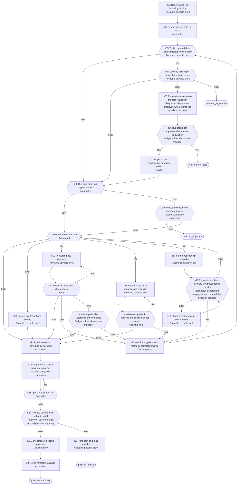

# Process one purchase-order-backed supplier invoice (accounts payable)

`fin-procure-to-pay-invoice` · cross-industry · finance: accounts payable

Accounts payable turns a supplier's invoice for goods or services bought on a purchase order into a correct payment. An AP clerk captures the invoice, the ERP matches it to the purchase order and the goods receipt, and about one invoice in five stops on a hold that a buyer, receiver or requester has to clear. Cleared invoices wait for the payment run that covers their due date, which a supervisor prepares, the controller approves and a second signatory releases at the bank. Most elapsed time is waiting: for keying queues, for buyers and requesters to fix holds, for suppliers to send credit memos, and for the due date.

| | |
|---|---|
| Unit of work | one supplier invoice referencing a purchase order |
| Starts when | A supplier invoice that references (or should reference) a purchase order arrives in the AP mailbox or mail tray. |
| Done when | The invoice is paid by ACH, wire or check with remittance advice, or is rejected as a duplicate, returned to the supplier or disputed and not paid. |
| Organisation | A US mid-size manufacturer or distributor with a central AP team, an ERP with purchasing and receiving modules, OCR invoice capture, and weekly or twice-weekly payment runs. (2,000 employees, 2019-2022) |
| Volume | 2,500 cases a month (range 2,000 to 3,200) |

## Where it sits

- Starts with **supplier invoice** from Supplier billing (90% of cases)
- Starts with **supplier invoice** from Requesters forwarding invoices sent to them directly (10% of cases)
- Sends **ACH or wire payment and remittance advice** to Supplier (outcome: paid_electronically)
- Sends **check with remittance stub** to Supplier (outcome: paid_by_check)
- Sends **AP sub-ledger postings, holds and accrual data** to Month-end close (outcome: any)
- Sends **payment file and cash requirement forecast** to Cash management and treasury (outcome: any)
- Sends **invoice rejection notice** to Supplier (outcome: returned_to_supplier)
- Sends **duplicate invoice notice** to Supplier (outcome: rejected_duplicate)
- Sends **PO change orders and retrospective PO requests** to Purchasing (outcome: any)
- Sends **1099 reportable payment data** to Tax reporting (outcome: any)

## Flow

## Roles

| Role | Department | Layer | FTE on this process | Loaded cost per hour | Evidence |
|---|---|---|---:|---:|---|
| Accounts payable clerk | Finance: accounts payable | individual contributor | 3.4 | 39 USD | A [bls_433031], [bls_ecec2021] |
| Accounts payable supervisor | Finance: accounts payable | supervisor | 0.35 | 52 USD | A [bls_431011], [bls_ecec2021] |
| Buyer | Procurement | individual contributor | 0.5 | 55 USD | A [bls_131020], [bls_ecec2021] |
| Receiving clerk | Warehouse and receiving | individual contributor | 0.25 | 32 USD | A [bls_435071], [bls_ecec2021] |
| Requester (department employee who ordered the goods or services) | Operating departments | individual contributor | 0.3 | 60 USD | C |
| Budget holder (department manager) | Operating departments | manager | 0.06 | 85 USD | A [bls_111021], [bls_ecec2021] |
| Controller | Finance | manager | 0.06 | 114 USD | A [bls_113031], [bls_ecec2021] |
| Treasury or cash manager (second payment signatory) | Finance: treasury | manager | 0.04 | 114 USD | A [bls_113031], [bls_ecec2021] |

## Steps

Hands-on time and the wait before each step show the most common value. Evidence tier A is a sourced number, B a sourced description, C the author's estimate.

| Step | Who | Kind | Hands-on | Wait before | Control | Evidence |
|---|---|---|---:|---:|---|---|
| **s01 Receive and log incoming invoice.** The AP clerk opens the shared AP mailbox and the paper mail tray, date-stamps paper invoices and scans them, saves emailed PDFs to the capture queue and forwards statements, quotes and misdirected mail. About half of invoices still arrive on paper or as unstructured PDFs. | Accounts payable clerk | intake | 1 min | 4.0 h |  | B [rfp_ardent2021], [stanford_poinv] |
| **s02 Extract invoice data by OCR.** The capture tool reads the scanned image in a scheduled batch and pulls supplier, invoice number, dates, PO number, totals, tax and, where it can, line items, then creates a draft invoice in the ERP for verification. It often misreads fields on poor scans or unusual layouts. | Automated | system auto | 0 min | 1.0 h |  | B [transcepta_exc] |
| **s03 Verify captured data and complete invoice entry.** The AP clerk compares the draft against the invoice image, corrects misread fields, keys missing lines, confirms the supplier and remit-to address, enters or corrects the PO number and saves the invoice for matching. If the invoice has no usable PO reference the clerk sets it aside for research. | Accounts payable clerk | data entry | 3.5 min | 1.0 d |  | B [auxis_ap], [transcepta_exc], [pcf_copy] |
| **s04 Look up missing or invalid purchase order.** The AP clerk searches the ERP for open POs from that supplier, checks the requester or ship-to name on the invoice and emails the likely requester or buyer. If no PO exists the requester is asked to raise one; if the invoice cannot be traced it goes back to the supplier. | Accounts payable clerk | lookup | 10 min | 4.0 h |  | B [transcepta_exc], [oatug_match] |
| **s05 Requester raises after-the-fact requisition.** The requester who ordered without a PO opens the purchasing module, enters a requisition for the goods or services already received with the account, cost centre and a short justification, and submits it for approval. Requesters often need one or two reminders first. | Requester (department employee who ordered the goods or services) | data entry | 10 min | 3.0 d |  | C |
| **s06 Budget holder approves after-the-fact requisition.** The budget holder receives the ERP approval notice, reads the justification, checks the spend against the budget and approves or rejects the requisition. Approvals wait when the manager is travelling or in meetings. | Budget holder (department manager) | approval | 3 min | 1.0 d | Delegation of authority and approval limits matrix (APQC PCF 9.3.1.4 set and enforce approval limits) | B [pcf_copy], [corpay_audit] |
| **s07 Buyer issues retrospective purchase order.** The buyer converts the approved requisition into a PO with the supplier's price, marks it as after-the-fact, and records a receipt or two-way match flag so the invoice can match. The buyer emails AP the PO number. | Buyer | data entry | 6 min | 1.0 d | Internal control over financial reporting (SOX 404 for public issuers): purchasing kept separate from payables and payment | B [corpay_audit], [sox404] |
| **s08 Run duplicate and supplier checks.** On save the ERP checks the invoice against earlier invoices for the same supplier, invoice number, date and amount, confirms the supplier is active and not blocked, and flags possible duplicates for review instead of letting them match. | Automated | system auto | 0 min | 5 min | Duplicate payment prevention check required under the company's internal controls over payables | B [corpay_audit], [transcepta_exc] |
| **s09 Investigate suspected duplicate invoice.** The AP supervisor opens both invoice images, compares numbers, dates, amounts and PO lines, checks whether the first one was paid and, if unsure, calls the supplier. A true duplicate is voided and the supplier is told; a false flag is released. | Accounts payable supervisor | validation | 10 min | 1.0 d |  | B [corpay_audit], [transcepta_exc] |
| **s10 Run three-way match.** The ERP compares each invoice line with the PO price and quantity and with the quantity received on the goods receipt, within set tolerances. Lines that agree pass; lines outside tolerance get a price, quantity or missing-receipt hold. Held invoices are matched again in the nightly validation run after a fix. | Automated | system auto | 0 min | 1.0 h | Three-way match as a key control over payables in internal control over financial reporting (SOX 404 for public issuers) | A [rfp_ardent2021], [transcepta_exc], [tue_bpic2019], [oatug_match] |
| **s11 Research price variance.** The AP clerk opens the held invoice, compares the invoiced unit price with the PO and any contract or price list, checks for unit-of-measure and freight differences, logs the hold in the tracking sheet and emails the buyer with the variance amount. | Accounts payable clerk | analysis | 10 min | 1.0 d |  | B [oatug_match], [stanford_poinv] |
| **s12 Buyer resolves price discrepancy.** The buyer checks the quote or contract and contacts the supplier. If the supplier's price is right the buyer amends the PO by change order; if the supplier overbilled the buyer asks for a credit memo; a small agreed increase without a PO change goes to the budget holder. | Buyer | judgment | 12 min | 3.0 d |  | B [oatug_match], [transcepta_exc], [cfo_inv_error] |
| **s13 Wait for supplier credit memo or corrected invoice.** The supplier's billing team issues a credit memo or a replacement invoice and sends it to the AP mailbox. AP cannot pay the held invoice until it arrives, so the case waits on the supplier. | Outside party | external wait | 0 min | 7.0 d |  | C |
| **s14 Budget holder approves price variance.** The budget holder gets an email from the buyer or AP showing the PO price, the invoiced price and the reason, and approves paying the higher amount or rejects it. The approval email is saved to the invoice. | Budget holder (department manager) | approval | 3 min | 2.0 d | Delegation of authority: spend above the approved PO value needs budget holder approval | B [corpay_audit], [stanford_poinv] |
| **s15 Research quantity variance with receiving.** The AP clerk compares billed quantities with the goods receipt lines, checks for partial deliveries and other invoices against the same PO line, and emails the receiving dock or requester asking them to confirm what arrived. | Accounts payable clerk | communication | 8 min | 1.0 d |  | B [oatug_match] |
| **s16 Receiving checks records and corrects goods receipt.** The receiving clerk looks up the packing slip and the receipt in the ERP, and if needed checks the stock location. A missed or mis-keyed receipt is corrected; a genuine short or damaged delivery is confirmed back to AP and the buyer. | Receiving clerk | lookup | 10 min | 2.0 d |  | B [oatug_match] |
| **s17 Send goods receipt reminder.** For an invoice held because no receipt is posted, the AP clerk emails the requester or uses the ERP notice to ask them to confirm delivery and post the receipt, and logs the hold in the tracking sheet. | Accounts payable clerk | communication | 3 min | 1.0 d |  | B [stanford_poinv], [tue_bpic2019] |
| **s18 Requester confirms delivery and posts goods receipt.** The requester checks that the goods arrived or the service was performed and enters the receipt in the ERP desktop receiving screen. Sometimes the goods have not yet arrived, and the invoice stays on hold until they do. | Requester (department employee who ordered the goods or services) | data entry | 4 min | 3.0 d |  | B [oatug_match], [stanford_poinv] |
| **s19 Chase overdue receipt confirmation.** After about a week without a receipt, the AP clerk sends a second reminder and copies the requester's manager, and notes the chase in the tracking sheet. Suppliers asking about payment status often prompt this chase. | Accounts payable clerk | communication | 4 min | 5.0 d |  | B [stanford_poinv] |
| **s20 Review tax, freight and coding.** The AP clerk codes freight and other charges not on the PO, accrues use tax when the supplier charged none, and for 1099-reportable suppliers checks that a valid taxpayer ID is on file, applying backup withholding when it is not. | Accounts payable clerk | validation | 3 min | 4.0 h | IRS information reporting and backup withholding (Forms 1099-NEC and 1099-MISC; 24 percent withholding when a reportable payee lacks a correct TIN) | B [stanford_poinv], [irs_bwh], [pcf_copy] |
| **s21 Post invoice and schedule by due date.** Once the invoice is matched or its hold is released, the ERP posts the liability to the AP sub-ledger and general ledger and sets the payment due date from the supplier's terms and payment method. | Automated | system auto | 0 min | 30 min |  | B [stanford_poinv], [iu_faq] |
| **s22 Prepare and review payment proposal.** On payment run day the AP supervisor runs the payment proposal for invoices due before the next run, reviews it for blocked suppliers, large amounts, recent bank detail changes and early-payment discounts, and screens payees against the sanctions list before sending it for approval. The invoice waits here until the run that covers its due date. | Accounts payable supervisor | review | 0.5 min | 5.0 d | OFAC sanctions regulations (31 CFR chapter V): US persons may not pay blocked persons, so payees are screened against the SDN list | B [corpay_audit], [ofac_faq], [pcf_copy], [procurify_apqc] |
| **s23 Approve payment run.** The controller reviews the payment run summary, totals by supplier and any large or unusual payments, and approves it in the ERP. Invoices queried are pulled from the run and go back to AP. | Controller | approval | 0.2 min | 4.0 h | Internal control over financial reporting (SOX 404 for public issuers): payment approval separate from invoice entry, vendor master maintenance and payment execution | B [corpay_audit], [sox404], [pcf_copy] |
| **s24 Release payment file in bank portal.** The ERP generates the ACH and wire file and the check print file. A second signatory logs into the bank portal, checks the file total against the approved run and releases it under the bank's dual authorization rules. | Treasury or cash manager (second payment signatory) | approval | 0.1 min | 2.0 h | Bank mandate and treasury policy requiring dual authorization to release payments | A [nacha_afp2022], [rfp_ardent2021], [corpay_audit] |
| **s25 Print, sign and mail checks.** The AP clerk prints the checks with remittance stubs on secure stock, applies the signature or routes large checks for a manual second signature, stuffs and mails them, and sends the positive pay file to the bank. | Accounts payable clerk | physical | 1.5 min | 2.0 h | Check signing authority limits and positive pay with the bank | C |
| **s26 Bank settles electronic payment.** The bank processes the ACH batch or wire and credits the supplier's account, usually the next business day for ACH. The case waits on the bank. | Outside party | external wait | 0 min | 1.0 d |  | B [stanford_poinv] |
| **s27 Send remittance advice.** The ERP emails a remittance advice listing the invoices paid, credit memos taken and any withholding to the supplier's remittance contact. | Automated | system auto | 0 min | 10 min |  | C |

## Exceptions

| Exception | Share of cases | What happens |
|---|---:|---|
| Price variance outside tolerance | 8% | Invoiced unit price differs from the PO by more than the tolerance. AP researches, the buyer either amends the PO, asks the supplier for a credit memo or gets budget holder approval for the difference. |
| Quantity variance | 5% | Billed quantity exceeds the quantity received. Receiving corrects a missed receipt or confirms a short delivery, which leads to a supplier credit. |
| Missing goods receipt | 9% | The invoice arrives before anyone posts the receipt (or before the goods arrive). AP reminds and chases the requester; the invoice rematches overnight once the receipt is posted. |
| Missing or invalid purchase order | 5% | The invoice has no PO number or a wrong one. AP looks it up; where nothing was ordered on a PO the requester raises an after-the-fact requisition that the budget holder approves and the buyer converts. |
| Suspected duplicate | 2% | The ERP flags an invoice that resembles an earlier one; the supervisor voids true duplicates. |
| Supplier credit memo loop | 6% | Price or quantity errors by the supplier need a credit memo or corrected invoice, which re-enters at data entry and is matched again. |
| Invoice pulled from payment run | 2% | The controller queries an invoice during approval and it waits for the next run. |

## Benchmarks

| Metric | Value | Unit | Population | Evidence |
|---|---|---|---|---|
| cycle_time_days | p50 15, p90 30 | calendar days from invoice receipt until payment is transmitted | APQC Open Standards Benchmarking, cross-industry (as cited by Procurify and Corpay) | A [procurify_apqc], [corpay_audit], [cfo_ap_cycle] |
| average_invoice_processing_time_days | 10 | days | Ardent Partners survey respondents, 2020 | A [rfp_ardent2021] |
| invoice_exception_rate | ardent_2020 0.25, ardent_average_cited 0.225, best_in_class 0.09 | share of invoices | Ardent Partners survey respondents | A [rfp_ardent2021], [transcepta_exc] |
| cost_per_invoice | apqc_median 5.78, apqc_median_alt 6.0, ardent_2020_average 10.89 | USD per invoice | APQC Open Standards Benchmarking; Ardent Partners 2020 | A [procurify_apqc], [corpay_audit], [rfp_ardent2021] |
| invoices_per_ap_fte_per_year | top 24284, median 9483, bottom 5000 | invoices per FTE per year | APQC Open Standards Benchmarking (as cited) | A [procurify_apqc] |
| share_invoices_received_electronically | 0.51 | share of invoices | Ardent Partners 2020 | A [rfp_ardent2021] |
| share_b2b_payments_by_check | 0.33 | share of B2B payments | AFP 2022 Digital Payments Survey, US and Canada | A [nacha_afp2022] |
| bpic2019_median_throughput_days | 64 | days from PO item creation to case end | BPI Challenge 2019 event log, one coatings company, 251,734 PO items | A [vidgof2023], [tue_bpic2019] |

## Pain points

- Held invoices wait days for buyers, receivers and requesters who treat AP queries as low priority, so exceptions dominate elapsed time and drive supplier calls about late payment. (steps s12, s16, s18, s19; B [oatug_match], [transcepta_exc])
- About half of invoices arrive on paper or as PDFs that OCR misreads, so clerks re-key or correct fields and keying errors later cause false holds. (steps s01, s02, s03; A [rfp_ardent2021], [auxis_ap])
- Goods receipts are not posted on time, so correct invoices sit on missing-receipt holds. (steps s17, s18, s19; B [stanford_poinv], [tue_bpic2019])
- Buying without a PO forces after-the-fact requisitions, approvals and PO creation after the invoice arrives. (steps s04, s05, s06, s07; B [transcepta_exc])
- Supplier credit memos re-enter the process at data entry and must be matched again, doubling the work on a disputed invoice. (steps s13, s03; C)

## Assumptions

- General workflow for a US mid-size company of about 2,000 employees; volume 2,500 PO-backed invoices a month (tier C).
- Loaded cost per hour = BLS May 2021 wage x 1.8 (benefits factor 1.43 from BLS ECEC December 2021, overhead factor 1.25 estimated).
- OCR capture is in place but about half of invoices still need manual correction or keying; e-invoicing networks are not assumed.
- Exception rate of 22 percent at first match is taken from Ardent Partners figures for all invoices; the split into price 8, quantity 5 and missing receipt 9 percent is an author estimate. The BPI Challenge 2019 log was used for the flow structure (invoice before or after goods receipt, blocking until receipt) but its statistics were not computed for this file.
- Cases rematch after a fix through s10 or release directly to posting; the simulator reuses the same branch probabilities on every pass, so repeat holds are slightly overstated.
- Most of the elapsed time after matching is waiting for the payment run that covers the due date (s22). The wait range was set so the simulated median sits near the APQC median of 15 days; companies that pay strictly at net 30 from invoice date would show longer cycles.
- Payment proposal, approval and release are done once per run; their per-invoice touch time is the run time divided by the invoices in the run.
- External party steps (supplier, bank) carry zero hands-on time so that staffing figures count only internal staff.
- fte_on_process for requesters, budget holders and buyers is spread over many people.
- The simulated labour cost of about $12 per invoice is above the APQC median of about $6 because it counts time spent by buyers, receivers, requesters and approvers outside AP and uses a 1.8 loading factor; it is close to Ardent's 2020 average of $10.89. Stated AP staffing (3.4 clerks plus a part-time supervisor for 2,500 invoices a month) implies about 8,000 invoices per AP FTE per year, a little below the APQC median of 9,483.
- The simulated p90 (about 24 days) is below the 30-day p90 estimate because the triangular waits cap the slowest holds; real logs have longer tails from invoices on hold for months.

## Sources

- [tue_bpic2019] [BPI Challenge 2019 (dataset description)](https://research.tue.nl/en/datasets/bpi-challenge-2019/) (Eindhoven University of Technology research portal / 4TU.ResearchData, 2019). Real purchase-to-pay event log from a multinational coatings and paints company: 76,349 purchase documents, 251,734 items (cases), 1,595,923 events, 42 activities, 627 users (20 batch users); four flow types (3-way match invoice after goods receipt, 3-way match invoice before goods receipt with invoices blocked until goods are received, 2-way match, consignment).
- [vidgof2023] [The Impact of Process Complexity on Process Performance: A Study using Event Log Data (Vidgof, Wurm, Mendling)](https://arxiv.org/html/2307.06106v1) (arXiv, 2023). Reports a median throughput time of 64 days for the BPI Challenge 2019 log (251,734 traces), measured from purchase order item creation, so it includes ordering and delivery time.
- [rfp_ardent2021] [Latest A/P benchmarks to help measure your efficiency (citing Ardent Partners, Accounts Payable Metrics that Matter in 2021)](https://www.resourcefulfinancepro.com/articles/ap-benchmarks-2021/) (Resourceful Finance Pro, 2021). 2020 figures: average cost to process an invoice $10.89; average processing time 10 days; about 25 percent of invoices flagged for exceptions; 51 percent of invoices received electronically; 57 percent of payments sent electronically.
- [procurify_apqc] [The 4 KPIs your accounts payable team should be tracking immediately (citing APQC)](https://www.procurify.com/blog/the-4-kpis-your-accounts-payable-team-should-be-tracking-immediately/) (Procurify, 2026). APQC figures as cited: invoice receipt to payment median 15 days, bottom performers 23 days; invoices per AP FTE per year median 9,483 (top about 24,284, bottom about 5,000); cost per invoice median $5.78 (top $2.05, bottom $10.00); AP FTEs per $1B revenue median 6.8.
- [cfo_ap_cycle] [Hidden delays that slow payments and strain cash flow: Metric of the Month (Perry D. Wiggins, citing APQC)](https://www.cfo.com/news/hidden-delays-that-slow-payments-and-strain-cash-flow-metric-of-the-month/806681/) (CFO.com, 2025). APQC cross-industry benchmark, cycle time in days from receipt of invoice until payment is transmitted: 25th percentile group averages 12 days, median 15 days, upper quartile averages 24 days. Delays come from invoices sent to the wrong inbox, tax, price or quantity errors needing correction, and payment timing set around payroll or liquidity.
- [cfo_inv_error] [Fixing invoice errors shouldn't take a week: Metric of the Month (citing APQC)](https://www.cfo.com/news/fixing-invoice-errors-shouldnt-take-a-week-metric-of-the-month/655053/) (CFO.com, 2022). APQC measure 'cycle time to resolve an invoice error' (days to reconcile invoice lines with POs and receiving documents, including waiting); the best companies resolve errors in three days or less and bottom performers take twice as long as top performers. Causes: incorrect pricing or charges, wrong quantity against the PO, wrong tax, incorrect customer information.
- [corpay_audit] [Accounts payable audit: checklist, procedures, and controls](https://www.corpay.com/resources/blog/accounts-payable-audit) (Corpay, 2026). Describes AP controls: segregation of vendor setup, invoice entry, approval, payment execution and reconciliation; approval matrix; three-way match with an exception queue; vendor master change review and dual authorization; duplicate checks before payment; manager review of payment runs. Cites APQC median cost per invoice of $6.00 and median receipt-to-payment cycle time of 15 days.
- [transcepta_exc] [Top 7 causes of invoice exceptions](https://www.transcepta.com/blog/7-causes-of-invoice-exceptions) (Transcepta, n.d.). Lists exception causes (missing vendor data, OCR misreads, PO price and quantity mismatches, non-PO invoices, tax errors, manual keying errors, duplicates); states an average exception rate of about 22.5 percent (attributed to Ardent Partners), best-in-class under 9 to 10 percent, and an average of 3 to 7 days to resolve an exception (no source given).
- [oatug_match] [Resolving match exceptions in Oracle Fusion](https://www.oatug.org/insight-spring2025/features-archive/resolving-match-exceptions) (OATUG Insight (Oracle Applications and Technology Users Group), 2025). Practitioner description of who works match holds: AP identifies and triages holds; buyers fix price holds by PO change order or supplier credit; requesters and receivers resolve quantity received holds by confirming receipt; holds release on the next validation run; manual release by AP only with a release code.
- [stanford_poinv] [Purchase order invoice processing](https://fingate.stanford.edu/purchasing-contracts/purchase-order-invoice-processing) (Stanford University Financial Management Services (Fingate), n.d.). Invoices emailed to AP reference the PO; lines over the PO by more than $250 go on hold until a change order; AP self-assesses use tax for shipping and tax not on the PO; holds for missing receiving or approvals notify the preparer, with escalation after 28 days; invoices without holds are paid automatically on terms, typically net 30; ACH and check runs Monday to Friday.
- [iu_faq] [Invoice payment FAQs](https://training.iu.edu/news/articles/accounts-payable/invoice-payment-faqs.html) (Indiana University Training, n.d.). Standard terms net 30 from invoice date; suppliers paid per the terms and payment method in the supplier profile.
- [pcf_copy] [9.0 Manage financial resources (APQC Process Classification Framework, cross-industry, reproduced)](https://capechamber.co.za/enterprise/improve-your-business-processes/9-manage-financial-resources) (Cape Chamber of Commerce, n.d.). APQC PCF 9.6.1 Process accounts payable: verify AP pay file with PO and vendor master, audit invoices and key data, approve payments, process payables taxes, research and resolve payable exceptions, process payments, respond to AP inquiries.
- [auxis_ap] [Accounts payable metrics: are you a peak performer?](https://www.auxis.com/accounts-payable-key-performance-metrics-are-you-a-top-performer/) (Auxis, 2024). Cites APQC: AP staff keying under 25 percent of invoice lines have almost twice the median productivity of those keying 75 percent; top performers pay within 2.8 days of receipt; AP FTEs per $1B revenue 3.3 (top) to 14.4 (bottom).
- [nacha_afp2022] [AFP survey finds businesses actively shifting to ACH and other electronic B2B payments](https://www.nacha.org/news/afp-survey-finds-businesses-actively-shifting-ach-and-other-electronic-b2b-payments) (Nacha, 2022). 2022 AFP Digital Payments Survey: 33 percent of B2B payments in the US and Canada made by check (50 percent in 2013).
- [bls_433031] [Occupational Employment and Wages, May 2021: 43-3031 Bookkeeping, Accounting, and Auditing Clerks](https://www.bls.gov/oes/2021/may/oes433031.htm) (US Bureau of Labor Statistics, 2022). Mean hourly wage $21.70; 25th percentile $17.67; 75th percentile $23.92.
- [bls_431011] [Occupational Employment and Wages, May 2021: 43-1011 First-Line Supervisors of Office and Administrative Support Workers](https://www.bls.gov/oes/2021/may/oes431011.htm) (US Bureau of Labor Statistics, 2022). Median hourly wage $29.13; 25th percentile $22.83; 75th percentile $36.98.
- [bls_131020] [Occupational Employment and Wages, May 2021: 13-1020 Buyers and Purchasing Agents](https://www.bls.gov/oes/2021/may/oes131020.htm) (US Bureau of Labor Statistics, 2022). Median hourly wage $30.51; 25th percentile $23.63; 75th percentile $42.22.
- [bls_435071] [Occupational Employment and Wages, May 2021: 43-5071 Shipping, Receiving, and Inventory Clerks](https://www.bls.gov/oes/2021/may/oes435071.htm) (US Bureau of Labor Statistics, 2022). Median hourly wage $17.74; 25th percentile $14.35; 75th percentile $21.97.
- [bls_111021] [Occupational Employment and Wages, May 2021: 11-1021 General and Operations Managers](https://www.bls.gov/oes/2021/may/oes111021.htm) (US Bureau of Labor Statistics, 2022). Median hourly wage $47.10; 25th percentile $29.18; 75th percentile $72.96.
- [bls_113031] [Occupational Employment and Wages, May 2021: 11-3031 Financial Managers](https://www.bls.gov/oes/2021/may/oes113031.htm) (US Bureau of Labor Statistics, 2022). Median hourly wage $63.32; 25th percentile $47.89; 75th percentile $92.24.
- [bls_ecec2021] [Employer Costs for Employee Compensation, December 2021 (news release)](https://www.bls.gov/news.release/archives/ecec_03182022.htm) (US Bureau of Labor Statistics, 2022). Private industry: wages and salaries 70.5 percent and benefits 29.5 percent of total compensation; office and administrative support 69.7 percent wages.
- [irs_bwh] [Backup withholding](https://www.irs.gov/businesses/small-businesses-self-employed/backup-withholding) (Internal Revenue Service, n.d.). Payers must withhold at 24 percent from reportable payments (including 1099-NEC and 1099-MISC payments) when the payee has not given a correct taxpayer identification number.
- [ofac_faq] [OFAC FAQs: basic information on OFAC and sanctions](https://ofac.treasury.gov/faqs/topic/1501) (US Treasury Office of Foreign Assets Control, n.d.). All US persons must comply with OFAC sanctions; US persons are generally prohibited from transactions with blocked persons on the SDN list; blocked property must be reported within 10 business days.
- [sox404] [15 U.S. Code 7262: Management assessment of internal controls (Sarbanes-Oxley Act section 404)](https://www.law.cornell.edu/uscode/text/15/7262) (Legal Information Institute, Cornell Law School, 2002). Annual reports of public issuers must contain management's assessment of internal control over financial reporting; auditor attestation for accelerated filers.

Written by claude-opus on 2026-11-17.
